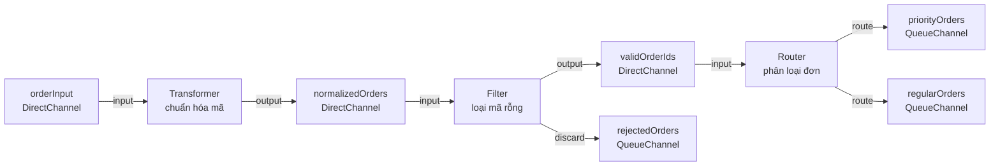

# Xem cấu trúc integration graph

## 1. Mục tiêu và tình huống sử dụng

Trong chương **System management** của module **SPRING_INTEGRATION_CORE**, integration graph giúp quan sát cách các thành phần Spring Integration đang nối với nhau trong ứng dụng. Sau khi đã thiết kế luồng bằng `Message`, `MessageChannel`, endpoint, gateway và Java DSL, bước tiếp theo là đối chiếu luồng mong muốn với cấu trúc thực tế đã được tạo trong Spring container.

Giả sử một hệ thống tiếp nhận mã đơn hàng có ba nhánh:

- Mã bắt đầu bằng `VIP-` đi vào hàng đợi ưu tiên.
- Mã hợp lệ còn lại đi vào hàng đợi thông thường.
- Mã rỗng sau chuẩn hóa đi vào hàng đợi bị loại.

Khi đơn ưu tiên xuất hiện ở nhánh thông thường, người vận hành cần xác định router đang nối tới đâu trước khi tìm lỗi trong điều kiện phân loại. Khi không thấy đầu ra, cần phân biệt hàng đợi chưa có consumer với endpoint chưa được đăng ký. Integration graph cung cấp bản đồ để thực hiện những bước điều tra đó.

Sau bài học, bạn có thể:

1. Lấy graph bằng `IntegrationGraphServer` hoặc Spring Boot Actuator.
2. Đọc `contentDescriptor`, `nodes`, `links` và chiều của từng loại liên kết.
3. Đối chiếu một flow Java DSL với cấu trúc graph.
4. Dựng lại graph sau thay đổi cấu trúc động.
5. Kết hợp graph với kiểm thử hành vi, metrics và thông tin chẩn đoán.

Các ví dụ dùng **Java 17+, Spring Boot 3.5.x và Spring Integration 6.5.x**, với phiên bản dependency do Spring Boot quản lý. Đây là mốc tương thích cho ví dụ; khi áp dụng vào dự án khác, đối chiếu API theo phiên bản đang sử dụng.

## 2. Integration graph mô tả điều gì?

### 2.1. Mô hình cấu trúc trong ứng dụng đang chạy

Integration graph biểu diễn các thành phần tích hợp mà framework nhận diện được cùng các kết nối giữa chúng. Có thể đọc mô hình đó như một đồ thị có hướng:

```text
channel đầu vào → endpoint xử lý → channel đầu ra → endpoint kế tiếp
```

Mô hình được thu thập từ các đối tượng runtime. Vì vậy, nó hữu ích khi cấu hình được lắp ghép từ nhiều lớp Java, annotation hoặc flow đăng ký động. Đồ thị có thể có nhánh, chu trình và các nhóm rời nhau; không nên giả định mọi ứng dụng chỉ có một chuỗi xử lý tuyến tính.

Graph giúp trả lời câu hỏi về **cấu trúc kết nối**. Một cạnh từ router đến channel cho thấy quan hệ định tuyến được graph biết đến; cần bằng chứng xử lý message để kết luận một đơn hàng cụ thể đã đi qua cạnh ấy.

Spring Integration cung cấp graph để quan sát mô hình runtime; tài liệu cũng mô tả các loại liên kết như `input`, `output`, `error`, `discard` và `route`. Xem [Integration Graph](https://docs.spring.io/spring-integration/reference/graph.html).

### 2.2. Chọn bằng chứng phù hợp với câu hỏi

| Câu hỏi vận hành | Bằng chứng nên xem |
| --- | --- |
| Router có nối tới hàng đợi ưu tiên không? | Node và link của graph |
| Transformer có được tạo trong cấu hình đang chạy không? | Graph kết hợp cấu hình bean khi cần |
| Trong một phút có bao nhiêu lần gửi thất bại? | Metrics theo thời gian |
| Đơn hàng `VIP-001` thực sự đã qua những bước nào? | Log có correlation ID, message history hoặc tracing đã cấu hình |
| Aggregator đang giữ bao nhiêu nhóm chưa hoàn tất? | Thông tin của message store và số liệu riêng của aggregator |
| Dịch vụ thanh toán bên ngoài đang hoạt động không? | Health check và thông tin của hệ thống bên ngoài |

Trong thực tế, quy trình điều tra thường bắt đầu từ graph để khoanh vùng thành phần, rồi dùng dữ liệu tương ứng để kiểm chứng giả thuyết.

## 3. Ba phần chính của dữ liệu graph

Lớp `Graph` cung cấp ba tập thông tin qua `getContentDescriptor()`, `getNodes()` và `getLinks()`. Có thể tuần tự hóa mô hình thành JSON để công cụ khác đọc. Xem [API của Graph 6.5](https://docs.spring.io/spring-integration/docs/6.5.0/api/org/springframework/integration/graph/Graph.html).

### 3.1. `contentDescriptor`: nhận diện nguồn dữ liệu

Phần này mô tả nguồn cung cấp graph, ví dụ:

```json
{
  "provider": "spring-integration",
  "providerVersion": "6.5.x",
  "providerFormatVersion": 1.2,
  "name": "order-routing-demo"
}
```

Đây là ví dụ minh họa; `providerVersion` thực tế chứa phiên bản thư viện cụ thể.

Khi tiếp nhận graph từ một instance, trước hết cần xác nhận đúng ứng dụng và đúng phiên bản mong đợi. Trong hệ thống nhiều replica, hai phản hồi có thể đến từ hai tiến trình khác nhau. Do đó, khi ghi nhận sự cố, nên đi kèm thời điểm, instance và phiên bản triển khai do môi trường vận hành cung cấp.

`providerFormatVersion` mô tả định dạng graph, không phải phiên bản API nghiệp vụ của ứng dụng.

### 3.2. `nodes`: các thành phần tích hợp

Một node thường có những trường sau:

| Trường | Cách sử dụng khi đọc graph |
| --- | --- |
| `nodeId` | Tra cứu đầu mút của link trong graph đang đọc |
| `name` | Nhận diện component và đối chiếu tên trong cấu hình |
| `componentType` | Xác định loại thành phần, chẳng hạn channel hoặc router |
| `integrationPatternType` | Nhận diện mẫu tích hợp doanh nghiệp khi được cung cấp |
| `integrationPatternCategory` | Phân nhóm mẫu tích hợp khi được cung cấp |
| `properties` | Đọc thuộc tính bổ sung của node |
| `observed` | Xem component có được gắn observation hay không, nếu phiên bản cung cấp trường này |

Các node thuộc loại endpoint có thể có thêm thông tin về đầu vào, đầu ra hoặc nhánh phụ. Nên viết công cụ đọc JSON sao cho chấp nhận trường tùy chọn và trường bổ sung.

`observed: false` không có nghĩa endpoint đã dừng. Trường này nói về instrumentation cho observation, không xác nhận trạng thái lifecycle hay kết quả xử lý nghiệp vụ. Xem [API của IntegrationNode](https://docs.spring.io/spring-integration/api/org/springframework/integration/graph/IntegrationNode.html).

### 3.3. `links`: quan hệ có hướng giữa các node

Mỗi link gồm `from`, `to` và `type`. Hai trường đầu tham chiếu tới `nodeId`, không phải chỉ số phần tử trong mảng `nodes`. Xem [API của LinkNode 6.5](https://docs.spring.io/spring-integration/docs/6.5.0/api/org/springframework/integration/graph/LinkNode.html).

| Loại link | Chiều cần đọc | Ý nghĩa thực hành |
| --- | --- | --- |
| `input` | Channel → endpoint | Endpoint nhận message từ channel |
| `output` | Thành phần phát kết quả → channel | Kết quả được gửi tới channel đầu ra |
| `route` | Router → channel đích | Nhánh định tuyến được graph biết đến |
| `discard` | Thành phần có nhánh loại → discard channel | Message bị loại được chuyển sang nhánh riêng |
| `error` | Thành phần có cấu hình phát lỗi tương ứng → error channel | Quan hệ tới nhánh lỗi mà mô hình thể hiện được |

Ví dụ, nếu node 11 là `orderInput` và node 12 là transformer, link sau được đọc là “transformer nhận message từ `orderInput`”:

```json
{
  "from": 11,
  "to": 12,
  "type": "input"
}
```

Không đảo chiều mũi tên chỉ vì từ `input` gợi cảm giác “đầu vào của channel”. Ở đây đầu vào được xét từ phía endpoint.

## 4. Tạo ví dụ Java DSL có cấu trúc dễ quan sát

### 4.1. Dependency và cấu hình Actuator

Trong một ứng dụng Maven đã dùng parent hoặc BOM của Spring Boot 3.5.x, cần các dependency sau:

```xml
<dependencies>
    <dependency>
        <groupId>org.springframework.boot</groupId>
        <artifactId>spring-boot-starter-integration</artifactId>
    </dependency>
    <dependency>
        <groupId>org.springframework.boot</groupId>
        <artifactId>spring-boot-starter-actuator</artifactId>
    </dependency>
    <dependency>
        <groupId>org.springframework.boot</groupId>
        <artifactId>spring-boot-starter-web</artifactId>
    </dependency>
</dependencies>
```

Starter web tạo ứng dụng HTTP để truy cập endpoint trong ví dụ. Chỉ để xem graph qua Actuator, không cần thêm `spring-integration-http`.

Cấu hình ứng dụng:

```yaml
spring:
  application:
    name: order-routing-demo

management:
  endpoints:
    web:
      exposure:
        include: health,integrationgraph
```

Spring Boot chỉ expose một số endpoint mặc định; khai báo `integrationgraph` trong danh sách exposure giúp truy cập qua HTTP. Endpoint này cần Spring Integration core trên classpath. Quyền truy cập endpoint và HTTP exposure là hai điều kiện riêng, nên còn phải kiểm tra cấu hình access nếu ứng dụng đã giới hạn chúng. Xem [Actuator Endpoints của Spring Boot 3.5](https://docs.spring.io/spring-boot/3.5/reference/actuator/endpoints.html).

Các đường dẫn HTTP bên dưới giả định cổng `8080`, base path Actuator mặc định và môi trường thực hành không có yêu cầu đăng nhập. Với ứng dụng đã cấu hình bảo mật, sử dụng thông tin xác thực và quyền quản trị tương ứng.

### 4.2. Định nghĩa flow

Ví dụ sử dụng ba channel trung gian có tên rõ ràng và ba `QueueChannel` làm điểm thu kết quả.

```java
package example.integrationgraph;

import java.util.Locale;

import org.springframework.boot.SpringApplication;
import org.springframework.boot.autoconfigure.SpringBootApplication;
import org.springframework.context.annotation.Bean;
import org.springframework.integration.channel.DirectChannel;
import org.springframework.integration.channel.QueueChannel;
import org.springframework.integration.config.EnableIntegration;
import org.springframework.integration.dsl.IntegrationFlow;

@SpringBootApplication
@EnableIntegration
public class IntegrationGraphDemo {

    public static void main(String[] args) {
        SpringApplication.run(IntegrationGraphDemo.class, args);
    }

    @Bean
    DirectChannel orderInput() {
        return new DirectChannel();
    }

    @Bean
    DirectChannel normalizedOrders() {
        return new DirectChannel();
    }

    @Bean
    DirectChannel validOrderIds() {
        return new DirectChannel();
    }

    @Bean
    QueueChannel priorityOrders() {
        return new QueueChannel(100);
    }

    @Bean
    QueueChannel regularOrders() {
        return new QueueChannel(100);
    }

    @Bean
    QueueChannel rejectedOrders() {
        return new QueueChannel(100);
    }

    @Bean
    IntegrationFlow orderRoutingFlow() {
        return IntegrationFlow.from("orderInput")
                .transform(String.class,
                        value -> value.strip().toUpperCase(Locale.ROOT))
                .channel("normalizedOrders")
                .filter(String.class,
                        value -> !value.isBlank(),
                        endpoint -> endpoint
                                .id("rejectBlankOrderId")
                                .discardChannel("rejectedOrders"))
                .channel("validOrderIds")
                .<String, Boolean>route(
                        value -> value.startsWith("VIP-"),
                        router -> router
                                .id("classifyOrder")
                                .channelMapping(true, "priorityOrders")
                                .channelMapping(false, "regularOrders"))
                .get();
    }
}
```

Phần chuẩn hóa bỏ khoảng trắng ở hai đầu và chuyển sang chữ hoa. Filter loại mã rỗng. Router chuyển kết quả boolean thành tên channel qua hai mapping tường minh.

API DSL cho phép chỉ định kiểu payload bằng `Class` ở transformer và filter; kiểu `String, Boolean` của router làm rõ đầu vào và kết quả điều kiện. Xem [BaseIntegrationFlowDefinition 6.5](https://docs.spring.io/spring-integration/docs/6.5.0/api/org/springframework/integration/dsl/BaseIntegrationFlowDefinition.html) và [IntegrationFlowDefinition 6.5](https://docs.spring.io/spring-integration/docs/6.5.0/api/org/springframework/integration/dsl/IntegrationFlowDefinition.html).

Ba hàng đợi có dung lượng giới hạn phục vụ thực hành, chưa có consumer tự động. Vì vậy, graph kết thúc ở các queue là cấu trúc có chủ đích. Trong ví dụ này, người học sẽ lấy kết quả bằng `receive(timeout)`.

`QueueChannel` lưu message để bên nhận đọc sau; `DirectChannel` chuyển việc xử lý tới subscriber trong luồng gọi. Với queue không có message store riêng, dữ liệu mặc định nằm trong bộ nhớ. Xem [Message Channel Implementations](https://docs.spring.io/spring-integration/reference/channel/implementations.html).

### 4.3. Sơ đồ để đối chiếu với graph



Sơ đồ này mô tả riêng flow nghiệp vụ. JSON thực tế có thể còn chứa các component hạ tầng như `errorChannel`, `errorLogger` và `nullChannel`.

Tên bean channel được đặt rõ để dễ tìm trong graph. `.id(...)` đặt tên endpoint; tên node của handler liên quan có thể mang hậu tố do framework tạo. Transformer trong ví dụ dùng tên sinh tự động. Khi đối chiếu, hãy kết hợp tên, loại component và các cạnh nối, tránh giả định tên node luôn trùng hoàn toàn tên endpoint.

## 5. Lấy graph qua Spring Boot Actuator

### 5.1. Đọc JSON

Sau khi khởi động ứng dụng, gọi:

```powershell
$graphUri = 'http://localhost:8080/actuator/integrationgraph'
$graph = Invoke-RestMethod -Uri $graphUri -Method Get
$graph | ConvertTo-Json -Depth 20
```

Các lệnh trên chỉ giữ phản hồi trong biến của phiên PowerShell. Tham số `-Depth` giúp hiển thị cấu trúc lồng nhau đầy đủ hơn.

Actuator cung cấp `GET /actuator/integrationgraph` để lấy graph; `POST` trên cùng đường dẫn dùng để dựng lại graph và phản hồi thành công bằng `204 No Content`. Xem [Spring Integration Graph endpoint của Spring Boot 3.5](https://docs.spring.io/spring-boot/3.5/api/rest/actuator/integrationgraph.html).

Phần JSON dưới đây là **trích đoạn minh họa đã rút gọn**, chỉ giữ router và các channel liên quan. ID được chọn để giải thích cách nối dữ liệu; phản hồi thật có thể có ID, tên handler và thứ tự khác.

```json
{
  "contentDescriptor": {
    "provider": "spring-integration",
    "providerVersion": "6.5.x",
    "providerFormatVersion": 1.2,
    "name": "order-routing-demo"
  },
  "nodes": [
    {
      "nodeId": 21,
      "name": "validOrderIds",
      "componentType": "channel"
    },
    {
      "nodeId": 22,
      "name": "classifyOrder.handler",
      "componentType": "router",
      "input": "validOrderIds"
    },
    {
      "nodeId": 23,
      "name": "priorityOrders",
      "componentType": "queue-channel"
    },
    {
      "nodeId": 24,
      "name": "regularOrders",
      "componentType": "queue-channel"
    }
  ],
  "links": [
    { "from": 21, "to": 22, "type": "input" },
    { "from": 22, "to": 23, "type": "route" },
    { "from": 22, "to": 24, "type": "route" }
  ]
}
```

Đọc trích đoạn theo ba bước:

1. Tra node `21` để xác định `validOrderIds`.
2. Theo link `input` từ `21` đến `22`: router nhận message từ channel này.
3. Theo hai link `route` từ `22`: router có quan hệ tới hai channel kết quả.

Đồ thị trên chưa thể hiện rằng `true` tương ứng với ưu tiên và `false` tương ứng với thông thường. Cần đối chiếu `channelMapping` trong DSL để hiểu quy tắc nghiệp vụ. Việc vẽ hai cạnh cũng chưa cung cấp số lượng message đã đi qua mỗi cạnh.

### 5.2. Liệt kê node theo tên

```powershell
$graph.nodes |
    Sort-Object name |
    Select-Object nodeId, name, componentType
```

Tập trung vào những tên đã khai báo trong ví dụ:

```powershell
$graph.nodes |
    Where-Object {
        $_.name -in @(
            'orderInput',
            'normalizedOrders',
            'validOrderIds',
            'priorityOrders',
            'regularOrders',
            'rejectedOrders'
        )
    } |
    Select-Object nodeId, name, componentType
```

Nếu thiếu một tên, đừng vội tìm theo ID của lần khởi động trước. Trước hết, xác nhận ứng dụng đang chạy đúng cấu hình và flow đã được tạo.

### 5.3. Đổi link từ ID sang tên cho dễ đọc

```powershell
$nodeNames = @{}
foreach ($node in $graph.nodes) {
    $nodeNames[[int]$node.nodeId] = $node.name
}

$edges = foreach ($link in $graph.links) {
    [pscustomobject]@{
        From = $nodeNames[[int]$link.from]
        Type = $link.type
        To   = $nodeNames[[int]$link.to]
    }
}

$edges | Format-Table -AutoSize
```

Một dòng như sau có nghĩa endpoint nhận message từ `validOrderIds`:

```text
From           Type   To
----           ----   --
validOrderIds  input  classifyOrder.handler
```

Để khoanh vùng nhánh loại và nhánh định tuyến:

```powershell
$edges |
    Where-Object { $_.Type -in @('discard', 'route') } |
    Format-Table -AutoSize
```

Nếu tự xây công cụ trực quan hóa, có thể dùng cách nối tương tự để tạo mũi tên. Giữ nguyên loại cạnh khi hiển thị giúp phân biệt đầu ra nghiệp vụ, nhánh loại và nhánh lỗi.

## 6. Đọc graph trực tiếp trong Java

### 6.1. Sử dụng `IntegrationGraphServer`

`IntegrationGraphServer` xây dựng và giữ graph. Trong ứng dụng Boot có Actuator được cấu hình phù hợp, tận dụng bean được tự cấu hình thay vì tạo thêm server chỉ để đọc dữ liệu.

Một service đọc graph có thể viết như sau:

```java
package example.integrationgraph;

import org.springframework.integration.graph.Graph;
import org.springframework.integration.graph.IntegrationGraphServer;
import org.springframework.stereotype.Service;

@Service
public class GraphInspectionService {

    private final IntegrationGraphServer graphServer;

    public GraphInspectionService(IntegrationGraphServer graphServer) {
        this.graphServer = graphServer;
    }

    public Graph currentGraph() {
        return graphServer.getGraph();
    }

    public Graph rebuildGraph() {
        return graphServer.rebuild();
    }
}
```

API phân biệt hai thao tác:

- `getGraph()` trả graph đang được cache.
- `rebuild()` xây dựng lại graph, cập nhật cache và trả kết quả mới.

Nên gọi `rebuild()` khi các thành phần ứng dụng đã được thêm hoặc gỡ và cần đối chiếu lại cấu trúc. Xem [API của IntegrationGraphServer 6.5](https://docs.spring.io/spring-integration/docs/6.5.0/api/org/springframework/integration/graph/IntegrationGraphServer.html).

Khi dùng Spring Integration ngoài Boot, có thể đăng ký server dưới dạng bean trong cấu hình ứng dụng đã bật Spring Integration:

```java
@Bean
IntegrationGraphServer integrationGraphServer() {
    IntegrationGraphServer server = new IntegrationGraphServer();
    server.setApplicationName("order-routing-demo");
    return server;
}
```

Spring quản lý lifecycle và cung cấp `ApplicationContext` cho bean này. Tránh tạo một đối tượng bằng `new IntegrationGraphServer()` bên ngoài container rồi gọi `getGraph()` ngay với giả định nó đã được khởi tạo đầy đủ.

### 6.2. Tên và thuộc tính bổ sung

Tên ứng dụng trong descriptor có thể lấy từ `spring.application.name` hoặc đặt bằng `setApplicationName(...)`. Server cũng có `setAdditionalPropertiesCallback(...)` để bổ sung metadata cho các component.

Ví dụ, nếu tự khai báo server, có thể thêm nhãn tĩnh phục vụ hiển thị:

```java
server.setAdditionalPropertiesCallback(component ->
        java.util.Map.<String, Object>of(
                "owningService", "order-routing-demo"));
```

Đây là phần bổ sung vào lúc cấu hình bean server, không phải tạo thêm một server thứ hai. Thuộc tính do ứng dụng thêm cần có ý nghĩa rõ ràng; ví dụ một nhãn sở hữu tĩnh khác với chỉ báo lifecycle được lấy ở một thời điểm.

Không mặc định xem một trường `properties.running` do mã tùy chỉnh ghi vào là trạng thái luôn cập nhật. Cần biết callback được thực thi khi nào và dữ liệu đó có được lấy lại ở mỗi lần đọc hay chỉ khi tạo node.

## 7. Khi nào cần dựng lại graph?

### 7.1. Cấu trúc ứng dụng có thể thay đổi

Với flow khai báo tĩnh, graph sau khi context khởi tạo thường đủ để quan sát kết nối. Trong hệ thống đăng ký hoặc gỡ flow bằng `IntegrationFlowContext`, danh sách thành phần có thể thay đổi sau thời điểm graph được xây dựng.

Ví dụ một môi trường thực hành đăng ký thêm nhánh xử lý hoàn tiền:

1. Ứng dụng đã khởi động và graph ban đầu được lấy.
2. Flow hoàn tiền được đăng ký thành công.
3. Người học đọc graph cũ và chưa thấy channel hoàn tiền.
4. Người học yêu cầu dựng lại graph rồi lấy JSON mới để kiểm tra.

Đây là tình huống nên xác minh vòng đời cập nhật của graph trước khi kết luận việc đăng ký flow thất bại.

### 7.2. Dựng lại qua Actuator

```powershell
$graphUri = 'http://localhost:8080/actuator/integrationgraph'

Invoke-WebRequest -Uri $graphUri -Method Post |
    Select-Object StatusCode

$graph = Invoke-RestMethod -Uri $graphUri -Method Get
```

Ở cấu hình cho phép thao tác ghi, lệnh `POST` thành công trả `204`; tiếp tục `GET` để đọc cấu trúc mới.

Trong Boot 3.5, nếu endpoint được đặt `access: read-only` thì thao tác dựng lại không được cung cấp như thao tác đọc. Quyền truy cập endpoint có thể còn bị giới hạn bởi `management.endpoints.access.max-permitted`. Điều này độc lập với việc ứng dụng có expose endpoint qua HTTP hay không.

Dựng lại graph cập nhật bản mô tả cấu trúc. Thao tác này không đăng ký flow còn thiếu, không khởi động consumer đã dừng và không xử lý lại message đang nằm trong queue. Nếu chưa xác nhận flow đã được tạo thì cần xử lý nguyên nhân đó trước.

Không cần gọi `rebuild()` sau mỗi message. Một công cụ hiển thị có thể đọc định kỳ và chỉ yêu cầu dựng lại khi có thay đổi cấu trúc đã biết hoặc khi người vận hành chủ động kiểm tra.

### 7.3. Phân biệt Actuator với Integration Graph Controller

Spring Integration còn có HTTP controller riêng cho graph. Hai cách truy cập này dùng các đường dẫn và thao tác khác nhau:

| Cơ chế | Đọc graph | Dựng lại graph |
| --- | --- | --- |
| Spring Boot Actuator, cấu hình mặc định | `GET /actuator/integrationgraph` | `POST /actuator/integrationgraph` |
| Integration Graph Controller, đường dẫn mặc định | `GET /integration` | `GET /integration/refresh` |
| Gọi trực tiếp từ Java | `getGraph()` | `rebuild()` |

Controller riêng cần module HTTP hoặc WebFlux tương ứng và cấu hình kích hoạt phù hợp. Với HTTP MVC, tài liệu mô tả `@EnableIntegrationGraphController`; đường dẫn mặc định có thể tùy chỉnh. Xem [Integration Graph Controller](https://docs.spring.io/spring-integration/reference/integration-graph-controller.html).

Trong bài này, các lệnh thực hành dùng **Actuator**. Không ghép hậu tố `/refresh` của controller riêng vào URL Actuator rồi kỳ vọng chúng có cùng hợp đồng HTTP.

## 8. Dùng graph để điều tra vấn đề trong flow

### 8.1. Không thấy component mong đợi

Ví dụ: không tìm thấy `rejectedOrders` trong JSON.

Nên kiểm tra theo thứ tự:

1. Phản hồi có thuộc đúng ứng dụng, instance và bản triển khai không?
2. Lớp cấu hình chứa flow có được component scan hoặc import không?
3. Bean có phụ thuộc vào profile hoặc điều kiện cấu hình chưa thỏa mãn không?
4. Nếu flow được đăng ký sau khởi động, việc đăng ký đã thành công chưa?
5. Graph đã được dựng lại sau thay đổi đó chưa?

Một trường hợp dễ nhầm là xem graph của replica A trong khi thao tác đăng ký động chỉ diễn ra trên replica B. Dựng lại graph ở A không làm flow của B xuất hiện.

### 8.2. Có node nhưng chưa thấy đầu ra

Ví dụ: graph có `priorityOrders`, nhưng một màn hình nghiệp vụ chưa nhận được đơn ưu tiên.

Từ graph của ví dụ, có thể đặt các giả thuyết cụ thể:

- Router nối sai channel đích: đối chiếu các cạnh `route`.
- Mã đã bị filter loại trước router: kiểm tra `discard` và payload đã chuẩn hóa.
- Message đã tới queue, nhưng queue chưa có consumer: đọc có timeout trong môi trường thực hành hoặc xem số liệu hàng đợi.
- Router có cấu trúc đúng nhưng điều kiện phân loại sai: kiểm thử mã `" vip-001 "` và xác nhận kết quả sau transformer.
- Consumer ở phần mở rộng của ứng dụng chưa chạy: kiểm tra lifecycle và cấu hình poller riêng.

Graph chỉ biểu diễn được phần kết nối; việc node xuất hiện chưa đủ để xác nhận một lần gửi đã hoàn tất toàn bộ quy trình.

Với aggregator, một đường đi tới node aggregator và một cạnh đầu ra vẫn chưa cho biết nhóm message nào đã đủ điều kiện release. Khi một đơn bị giữ tại đây, cần xem correlation key, release strategy, timeout và trạng thái group trong message store.

### 8.3. Nhánh định tuyến động chưa xuất hiện như mong đợi

Ví dụ sử dụng mapping tường minh nên đích ưu tiên và thông thường đã được khai báo sẵn. Với router giải quyết tên channel động từ dữ liệu message, danh sách route mà graph thể hiện có thể phụ thuộc các đích đã được router nhận diện và giới hạn lưu route của router.

Khi điều tra dạng flow đó, hãy đối chiếu cấu hình router, tên channel thực tế được giải quyết và thời điểm lấy graph. Không dùng việc thiếu một cạnh động làm bằng chứng duy nhất rằng message đã bị mất.

Nếu thay đổi cấu trúc để tạo thêm channel hoặc flow đích, dựng lại graph sau khi thay đổi được hoàn tất. Đồng thời xác nhận điều kiện nào khiến router chọn đích mới.

### 8.4. Không thấy cạnh lỗi tới `errorChannel`

Trong luồng đồng bộ dùng `DirectChannel`, ngoại lệ có thể được truyền về bên gọi. Việc ứng dụng có bean `errorChannel` không có nghĩa mọi endpoint tự động có một cạnh lỗi tới channel này.

Để điều tra lỗi, cần xác định vị trí xử lý: lời gọi đồng bộ, gateway, polling consumer hay thành phần bất đồng bộ. Sau đó đối chiếu cấu hình error channel và cơ chế xử lý lỗi của thành phần ấy.

Một message bị filter loại và gửi tới `rejectedOrders` là kết quả của quy tắc chấp nhận dữ liệu. Nó không mặc nhiên là ngoại lệ kỹ thuật. Trong graph, vì thế cần phân biệt rõ `discard` với `error`.

### 8.5. Gateway và ranh giới giữa các hệ thống

Với messaging gateway có nhiều phương thức, graph có thể biểu diễn từng phương thức thành node riêng. Khi tìm kiếm, nên dùng tên gateway kết hợp phương thức thay vì giả định toàn bộ interface chỉ tương ứng một node.

Một lời gọi request–reply có thể dùng reply channel tạm thời. Không nên yêu cầu graph phải có một cạnh tĩnh tương ứng với mọi đối tượng reply channel được tạo trong mỗi lời gọi.

Khi flow gửi message ra broker hoặc gọi dịch vụ khác, graph của tiến trình hiện tại giúp quan sát adapter hoặc gateway tại ranh giới đó. Muốn dựng bức tranh xuyên nhiều ứng dụng, cần ghép thêm thông tin về broker, tên đích, deployment và tracing đã cấu hình.

## 9. Kết hợp graph với metrics và message history

### 9.1. Dùng metrics để lượng hóa giả thuyết

Giả sử cạnh `route` tới `priorityOrders` đã đúng. Bước tiếp theo có thể là kiểm tra số lần gửi thành công, thất bại và thời gian xử lý của component liên quan.

Spring Integration tích hợp Micrometer khi có `MeterRegistry`. Các meter như `spring.integration.send` và `spring.integration.receive` cùng tag tên component giúp liên hệ số liệu với node. Xem [Metrics and Management](https://docs.spring.io/spring-integration/reference/metrics.html).

Với ứng dụng đã expose endpoint `metrics` và cho phép truy cập, có thể xem tên meter trước khi truy vấn chi tiết:

```powershell
$metricsUri = 'http://localhost:8080/actuator/metrics'
Invoke-RestMethod -Uri $metricsUri -Method Get
```

Cấu hình ở mục 4 chỉ expose `health` và `integrationgraph`; muốn thử lệnh này, cần thêm `metrics` vào danh sách exposure của môi trường thực hành và giữ các quyền truy cập phù hợp.

Không viết công cụ giám sát với giả định graph luôn chứa các trường thống kê kiểu cũ như `sendTimers` hoặc `receiveCounters`. Với các phiên bản hiện đại trong ví dụ, nên thu thập metrics qua cơ chế Micrometer được hỗ trợ. Tần suất lỗi hay độ trễ theo thời gian cần được đọc từ hệ thống số liệu tương ứng.

### 9.2. Dùng message history để quan sát một message

Khi cần xem dấu vết đi qua các component có tên, có thể bật message history trong cấu hình thực hành:

```java
import org.springframework.integration.config.EnableMessageHistory;

@EnableMessageHistory
```

Gắn annotation này lên một lớp cấu hình đang được Spring quản lý. Nó cho phép ghi lịch sử vào header của message tại các component được theo dõi; có thể giới hạn theo tên component khi cần. Xem [Message History](https://docs.spring.io/spring-integration/reference/message-history.html).

Có thể đọc header bằng API:

```java
import org.springframework.integration.history.MessageHistory;

MessageHistory history = message.getHeaders()
        .get(MessageHistory.HEADER_NAME, MessageHistory.class);
```

Trong đó `message` là message đang kiểm tra, chẳng hạn kết quả đọc từ `priorityOrders`. Giá trị có thể là `null` nếu chưa bật theo dõi hoặc message chưa đi qua thành phần được theo dõi.

Một cách điều tra nhất quán là dùng tên component làm điểm nối giữa ba nguồn: graph cho biết vị trí trong luồng, metrics cho biết tình trạng tổng hợp, còn history hoặc log cho biết dấu vết của message đang xét. Nên tránh ghi toàn bộ payload đơn hàng chỉ để xác định nhánh đã đi qua.

## 10. Kiểm thử cấu trúc cùng hành vi

### 10.1. Chọn điều kiện kiểm chứng ổn định

Một bài kiểm thử graph nên xác nhận điều có ý nghĩa đối với thiết kế:

- Các channel nghiệp vụ cần thiết tồn tại.
- Có đường nối từ channel đầu vào của router tới node router.
- Message đại diện đi đúng nhánh và có payload đã chuẩn hóa.

Không nên so sánh nguyên chuỗi JSON hay yêu cầu `nodeId` phải bằng một số cố định. Những cách đó dễ thất bại khi thứ tự đăng ký bean, phiên bản thư viện hoặc các component hạ tầng thay đổi dù hành vi nghiệp vụ vẫn đúng.

Ví dụ kiểm thử dưới đây dùng `spring-boot-starter-test` trong test scope và ứng dụng ở mục 4. Đây là mã để thực hành trong dự án ví dụ.

```java
package example.integrationgraph;

import java.util.Set;
import java.util.stream.Collectors;

import org.junit.jupiter.api.Test;
import org.springframework.beans.factory.annotation.Autowired;
import org.springframework.boot.test.context.SpringBootTest;
import org.springframework.context.ApplicationContext;
import org.springframework.integration.channel.DirectChannel;
import org.springframework.integration.channel.QueueChannel;
import org.springframework.integration.graph.Graph;
import org.springframework.integration.graph.IntegrationGraphServer;
import org.springframework.integration.graph.IntegrationNode;
import org.springframework.messaging.Message;
import org.springframework.messaging.support.GenericMessage;

import static org.assertj.core.api.Assertions.assertThat;

@SpringBootTest(classes = IntegrationGraphDemo.class)
class IntegrationGraphDemoTest {

    @Autowired
    ApplicationContext context;

    @Autowired
    IntegrationGraphServer graphServer;

    @Test
    void graphAndRoutingMatchTheDeclaredFlow() {
        Graph graph = graphServer.rebuild();

        assertThat(graph.getNodes())
                .extracting(IntegrationNode::getName)
                .contains(
                        "orderInput",
                        "normalizedOrders",
                        "validOrderIds",
                        "priorityOrders",
                        "regularOrders",
                        "rejectedOrders");

        int routerInputId = graph.getNodes().stream()
                .filter(node -> node.getName().equals("validOrderIds"))
                .findFirst()
                .orElseThrow()
                .getNodeId();

        Set<Integer> routerIds = graph.getNodes().stream()
                .filter(node -> node.getName().contains("classifyOrder"))
                .map(IntegrationNode::getNodeId)
                .collect(Collectors.toSet());

        assertThat(routerIds).isNotEmpty();
        assertThat(graph.getLinks()).anyMatch(link ->
                link.getFrom() == routerInputId
                        && routerIds.contains(link.getTo()));

        DirectChannel input =
                context.getBean("orderInput", DirectChannel.class);

        assertThat(input.send(new GenericMessage<>(" vip-001 ")))
                .isTrue();
        assertThat(input.send(new GenericMessage<>(" ord-002 ")))
                .isTrue();
        assertThat(input.send(new GenericMessage<>("   ")))
                .isTrue();

        assertPayload("priorityOrders", "VIP-001");
        assertPayload("regularOrders", "ORD-002");
        assertPayload("rejectedOrders", "");

        assertThat(queue("priorityOrders").receive(0)).isNull();
        assertThat(queue("regularOrders").receive(0)).isNull();
        assertThat(queue("rejectedOrders").receive(0)).isNull();
    }

    private void assertPayload(String channelName, String expected) {
        Message<?> message = queue(channelName).receive(1_000);
        assertThat(message).isNotNull();
        assertThat(message.getPayload()).isEqualTo(expected);
    }

    private QueueChannel queue(String name) {
        return context.getBean(name, QueueChannel.class);
    }
}
```

Bài kiểm thử xác nhận cạnh bằng cách tìm ID theo tên trong chính graph đang đọc. Nó không giữ ID giữa các lần khởi động. Phần kiểm tra router chấp nhận tên handler có tiền tố hoặc hậu tố quanh `classifyOrder`, thay vì buộc toàn bộ tên sinh tự động phải cố định.

Ba message đầu vào có kết quả dự kiến:

| Payload gửi vào | Payload sau chuẩn hóa | Channel kết quả |
| --- | --- | --- |
| `" vip-001 "` | `"VIP-001"` | `priorityOrders` |
| `" ord-002 "` | `"ORD-002"` | `regularOrders` |
| `"   "` | `""` | `rejectedOrders` |

Các lệnh nhận dùng timeout hữu hạn để tránh chờ vô hạn. Kiểm tra các queue đã rỗng sau khi lấy kết quả giúp phát hiện message dư trong bối cảnh kiểm thử này. Nếu bổ sung nhiều test dùng chung context, cần chủ động bảo đảm các queue sạch trước từng ca thử.

### 10.2. Hiểu giới hạn của bài kiểm thử

Sự tồn tại của node và cạnh xác nhận một phần cấu trúc được đăng ký. Ba mẫu dữ liệu kiểm chứng ba nhánh cơ bản. Chúng chưa bao phủ hết dung lượng queue, tải đồng thời, cơ chế retry, lỗi gateway hoặc các quy tắc định tuyến mở rộng.

Khi thay đổi flow, bổ sung kiểm tra cho điều kiện nghiệp vụ mới. Ví dụ, nếu đổi quy tắc ưu tiên sang header `customerTier`, cần gửi message có header đại diện; chỉ nhìn thấy hai cạnh `route` vẫn chưa đủ để xác nhận router đã đọc đúng header.

## 11. Thực hành quan sát và giải thích graph

Thực hiện tuần tự trong ứng dụng ví dụ:

1. Khởi động ứng dụng với cấu hình ở mục 4 và gọi `GET /actuator/integrationgraph`.
2. Tìm đủ sáu channel nghiệp vụ theo tên.
3. Chuyển các link từ ID sang tên bằng đoạn PowerShell ở mục 5.
4. Đối chiếu đường từ `orderInput` qua transformer, filter đến router với sơ đồ.
5. Tìm nhánh `discard` tới `rejectedOrders` và hai nhánh `route`.
6. Chạy bài kiểm thử để xác nhận kết quả của ba payload mẫu.
7. Nếu có flow đăng ký động trong môi trường thực hành riêng, lấy graph trước thay đổi, hoàn tất đăng ký, yêu cầu dựng lại và đối chiếu graph mới.

Khi mô tả kết quả, ghi rõ những gì quan sát được và bằng chứng đi kèm. Ví dụ: “Graph cho thấy router nối tới `priorityOrders`; bài kiểm thử gửi `' vip-001 '` và nhận `'VIP-001'` ở queue đó.” Cách diễn đạt này phân biệt kết nối đã cấu hình với kết quả đã kiểm chứng.

Trong vận hành, graph có thể tiết lộ tên component, tên channel, biểu thức và metadata tùy chỉnh. Chỉ expose endpoint trong phạm vi quản trị phù hợp; nếu công cụ chỉ cần xem cấu trúc, cân nhắc quyền chỉ đọc. Tránh đưa token, mật khẩu hay payload nhạy cảm vào tên component hoặc thuộc tính bổ sung của graph.

Tiêu chí hoàn thành phần thực hành là bạn có thể chỉ ra một đường đi nghiệp vụ bằng tên node và loại cạnh, giải thích vì sao một queue có thể là điểm cuối hợp lệ, và chọn được bằng chứng tiếp theo khi cấu trúc đúng nhưng message chưa có kết quả như mong đợi.
