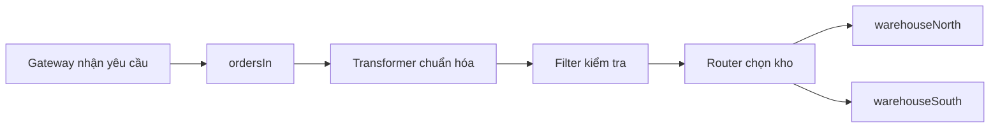

# Theo dõi message history

Trong chương **System management** của **SPRING_INTEGRATION_CORE**, Message History giúp quan sát một message đã đi qua những thành phần nào. Bài học sử dụng Message, MessageChannel, endpoint và Java DSL để dựng một luồng nhỏ, sau đó đọc lịch sử ở đầu ra và tại điểm lỗi. Kỹ thuật này hữu ích khi transformer chạy sai, router chọn nhánh ngoài dự kiến hoặc một message không tới được nơi xử lý cuối cùng.

## 1. Mục tiêu và kiến thức cần có

Sau bài học, bạn có thể:

- Bật Message History và chọn các thành phần cần theo dõi.
- Đọc các mục lịch sử bằng API, xử lý trường hợp không có header.
- Đối chiếu đường đi thực tế với thiết kế luồng và dữ liệu lỗi.
- Viết kiểm thử xác nhận dấu vết vẫn được giữ sau biến đổi payload.
- Chọn phạm vi ghi lịch sử phù hợp với lưu lượng và nhu cầu vận hành.

Bạn cần biết cách tạo `Message<?>`, gửi message qua channel, khai báo bean và xây dựng một `IntegrationFlow`. Các ví dụ dùng Java 17 và API thuộc dòng Spring Integration 6.3 trở lên; phần giải thích cơ chế append được giới hạn rõ ở phiên bản này. Dự án cần `spring-integration-core`; ví dụ kiểm thử dùng thêm JUnit Jupiter. Giữ các phiên bản Spring đồng bộ theo cơ chế quản lý dependency của ứng dụng.

## 2. Từ một sự cố tới câu hỏi về đường đi

Giả sử ứng dụng nhận mã đơn hàng, chuẩn hóa dữ liệu, kiểm tra điều kiện rồi định tuyến sang kho:



Người vận hành nhận phản ánh: đơn hàng `ORD-42` đã được tiếp nhận nhưng kho phía Nam không thấy yêu cầu. Những câu hỏi cần trả lời gồm: message có tới router không, nhánh phía Bắc có nhận nó không, hay filter đã loại nó trước đó?

Message History cung cấp các mốc để kiểm tra những giả thuyết ấy. Nó ghi dấu vết trong message, vì vậy cần lấy được message ở một điểm quan sát: đầu ra, discard channel, luồng lỗi hoặc một nơi lưu dữ liệu chẩn đoán. Chỉ bật tính năng rồi bỏ toàn bộ message sau xử lý sẽ không tạo ra kho lịch sử để truy vấn về sau.

Trong một thiết kế vận hành cho tình huống trên, có thể lưu một bản ghi gồm `requestId`, tên ứng dụng, thời điểm quan sát, kết quả và danh sách thành phần đã đi qua. Đây là chính sách lưu trữ của ứng dụng; cần thiết kế riêng nếu muốn tìm kiếm theo đơn hàng sau nhiều giờ.

## 3. Header `history` chứa gì?

Spring Integration đặt lịch sử dưới header `history`; trong Java nên dùng `MessageHistory.HEADER_NAME`. Giá trị là `MessageHistory`, cung cấp cách duyệt một danh sách các `Properties`. Các hằng số cho trường dữ liệu gồm `NAME_PROPERTY`, `TYPE_PROPERTY` và `TIMESTAMP_PROPERTY`. [API MessageHistory](https://docs.spring.io/spring-integration/api/org/springframework/integration/history/MessageHistory.html).

| Thuộc tính | Nội dung | Cách sử dụng khi chẩn đoán |
| --- | --- | --- |
| `name` | Tên thành phần tại thời điểm ghi | Đối chiếu với channel hoặc handler trong cấu hình |
| `type` | Loại thành phần nếu có | Phân biệt transformer, gateway và các loại channel |
| `timestamp` | Thời điểm ghi theo mili giây tính từ Unix epoch | Quan sát khoảng cách giữa các mốc |

Một cách trình bày lịch sử trong ví dụ đơn hàng có thể là:

```text
name=ordersIn        type=channel        timestamp=1700000000000
name=ordersNormalize type=transformer    timestamp=1700000000002
name=ordersOut       type=channel        timestamp=1700000000004
```

Đây là dữ liệu minh họa do bài học trình bày lại; tên loại cụ thể có thể chi tiết hơn tùy component. Không dùng chuỗi hiển thị này làm định dạng trao đổi giữa các hệ thống.

### 3.1. Diễn giải đúng một mốc

Một mốc cho biết thành phần đã ghi nhận message tại vị trí đó. Nó không tự chứng minh tác vụ đã hoàn thành, giao dịch đã commit hoặc hệ thống bên ngoài đã tiếp nhận dữ liệu. Chẳng hạn, `ordersNormalize` có thể xuất hiện trước khi logic chuẩn hóa ném ngoại lệ: handler của framework ghi history trước khi thực hiện xử lý nội bộ. [Mã nguồn AbstractMessageHandler](https://raw.githubusercontent.com/spring-projects/spring-integration/6.5.x/spring-integration-core/src/main/java/org/springframework/integration/handler/AbstractMessageHandler.java).

Với một hệ thống thanh toán, vì thế cần quan sát cả kết quả nghiệp vụ và mã tham chiếu trả về từ nhà cung cấp. Một history kết thúc ở outbound handler mới giúp xác định vùng cần điều tra.

### 3.2. Đọc thời gian như dấu hiệu

Giả sử hai mốc liên tiếp cách nhau 800 ms. Có thể đặt giả thuyết rằng thời gian nằm trong khoảng giữa hai điểm quan sát: xử lý ở bước trước, đợi hàng đợi, chờ executor hoặc thao tác khác. Chưa đủ cơ sở để gán toàn bộ 800 ms cho bước sau.

Ví dụ, khi quan sát `ordersQueue` rồi `reserveStock`, độ trễ lớn gợi ý kiểm tra cả độ sâu queue và khả năng cấp phát worker. Trong một luồng đồng bộ rất nhanh, nhiều mốc có thể trùng mili giây; số chênh lệch bằng 0 không có nghĩa là không tốn tài nguyên.

## 4. Bật và giới hạn thành phần được theo dõi

Đặt `@EnableMessageHistory` trên một lớp cấu hình được nạp vào application context:

```java
import org.springframework.context.annotation.Configuration;
import org.springframework.integration.config.EnableIntegration;
import org.springframework.integration.config.EnableMessageHistory;

@Configuration
@EnableIntegration
@EnableMessageHistory
public class HistoryConfiguration {
}
```

Annotation hỗ trợ danh sách mẫu tên thành phần. Mặc định mẫu là `*`; có thể chọn chính xác từng tên hoặc dùng wildcard như `orders*`. Đây là mẫu tên, không phải biểu thức chính quy và không phải điều kiện theo payload. [API EnableMessageHistory](https://docs.spring.io/spring-integration/api/org/springframework/integration/config/EnableMessageHistory.html).

```java
@EnableMessageHistory({"ordersIn", "ordersNormalize", "ordersOut"})
```

Trong một ứng dụng lớn, nhóm phụ trách tiếp nhận đơn hàng có thể chọn các channel tại ranh giới của từng bước. Khi điều tra sâu hơn, nhóm bổ sung handler liên quan. Quy ước tên như `ordersIn`, `ordersValidated` và `ordersRejected` giúp người đọc hiểu ý nghĩa các mốc.

Chọn một nơi quản lý cấu hình history cho application context, tránh các khai báo có phạm vi theo dõi khác nhau. Tài liệu chính thức khuyến nghị dùng cơ chế cấu hình chuyên dụng thay vì tự định nghĩa một bean `MessageHistoryConfigurer` thông thường. [Cấu hình Message History](https://docs.spring.io/spring-integration/reference/message-history.html).

## 5. Ví dụ đầy đủ: chuẩn hóa mã đơn hàng bằng Java DSL

Ví dụ thực hành thu hẹp luồng về ba điểm có tên ổn định:

```text
ordersIn -> ordersNormalize -> ordersOut
```

`ordersIn` nhận chuỗi; `ordersNormalize` bỏ khoảng trắng đầu cuối và chuyển sang chữ hoa; `ordersOut` giữ kết quả để chương trình đọc lại. Mã rỗng bị từ chối bằng ngoại lệ để có đường thử lỗi.

### 5.1. Cấu hình

```java
import java.util.Locale;

import org.springframework.beans.factory.annotation.Qualifier;
import org.springframework.context.annotation.Bean;
import org.springframework.context.annotation.Configuration;
import org.springframework.integration.channel.DirectChannel;
import org.springframework.integration.channel.QueueChannel;
import org.springframework.integration.config.EnableIntegration;
import org.springframework.integration.config.EnableMessageHistory;
import org.springframework.integration.dsl.IntegrationFlow;
import org.springframework.integration.transformer.MessageTransformingHandler;
import org.springframework.messaging.MessageChannel;
import org.springframework.messaging.support.MessageBuilder;

@Configuration
@EnableIntegration
@EnableMessageHistory({"ordersIn", "ordersNormalize", "ordersOut"})
public class OrderHistoryConfig {

    @Bean
    public MessageChannel ordersIn() {
        return new DirectChannel();
    }

    @Bean
    public QueueChannel ordersOut() {
        return new QueueChannel(10);
    }

    @Bean
    public MessageTransformingHandler ordersNormalize() {
        return new MessageTransformingHandler(message -> {
            String orderCode = ((String) message.getPayload())
                    .strip()
                    .toUpperCase(Locale.ROOT);

            if (orderCode.isEmpty()) {
                throw new IllegalArgumentException("Mã đơn hàng không được rỗng");
            }

            return MessageBuilder.withPayload(orderCode)
                    .copyHeaders(message.getHeaders())
                    .build();
        });
    }

    @Bean
    public IntegrationFlow orderHistoryFlow(
            @Qualifier("ordersIn") MessageChannel input,
            @Qualifier("ordersOut") QueueChannel output,
            @Qualifier("ordersNormalize") MessageTransformingHandler normalizer) {

        return IntegrationFlow.from(input)
                .handle(normalizer)
                .channel(output)
                .get();
    }
}
```

Java DSL tạo và kết nối các endpoint, channel trong context từ bean `IntegrationFlow`. Trong ví dụ này, handler transformer được khai báo thành bean riêng nên tên `ordersNormalize` dễ dùng cho việc theo dõi và kiểm thử. [Java DSL](https://docs.spring.io/spring-integration/reference/dsl.html).

Không gắn thêm `@Transformer` vào bean `ordersNormalize`: DSL đã nối handler với input và output. Hai cách tạo endpoint cho cùng một handler sẽ khiến ví dụ khó kiểm soát.

Queue đầu ra có sức chứa 10 để bản thực hành có giới hạn rõ ràng. Không cần poller vì chương trình chủ động gọi `receive(...)` để lấy kết quả. Nếu một endpoint khác cần tự tiêu thụ từ `QueueChannel`, lúc đó phải cấu hình cơ chế polling phù hợp. [Cấu hình message channel](https://docs.spring.io/spring-integration/reference/channel/configuration.html).

### 5.2. Hàm trình bày history

```java
import java.util.Properties;

import org.springframework.integration.history.MessageHistory;
import org.springframework.messaging.Message;

public final class HistoryPrinter {

    private HistoryPrinter() {
    }

    public static String render(Message<?> message) {
        MessageHistory history = MessageHistory.read(message);
        if (history == null || history.isEmpty()) {
            return "Không có message history tại điểm quan sát";
        }

        StringBuilder text = new StringBuilder();
        for (Properties entry : history) {
            text.append("name=")
                    .append(entry.getProperty(MessageHistory.NAME_PROPERTY, "?"))
                    .append(" type=")
                    .append(entry.getProperty(MessageHistory.TYPE_PROPERTY, "?"))
                    .append(" timestamp=")
                    .append(entry.getProperty(MessageHistory.TIMESTAMP_PROPERTY, "?"))
                    .append(System.lineSeparator());
        }
        return text.toString();
    }
}
```

Kiểm tra `null` là cần thiết khi history chưa được bật, không có thành phần phù hợp hoặc message vừa được dựng lại mà thiếu header. Dùng các thuộc tính tường minh thay vì phân tích `history.toString()`: trong mã nguồn dòng 6.5, `toString()` ghép tên thành phần, không xuất toàn bộ metadata. [Mã nguồn MessageHistory](https://raw.githubusercontent.com/spring-projects/spring-integration/6.5.x/spring-integration-core/src/main/java/org/springframework/integration/history/MessageHistory.java).

### 5.3. Gửi yêu cầu và đọc kết quả

```java
import org.springframework.context.annotation.AnnotationConfigApplicationContext;
import org.springframework.integration.channel.QueueChannel;
import org.springframework.messaging.Message;
import org.springframework.messaging.MessageChannel;
import org.springframework.messaging.support.MessageBuilder;

public class OrderHistoryDemo {

    public static void main(String[] args) {
        try (var context = new AnnotationConfigApplicationContext(OrderHistoryConfig.class)) {
            MessageChannel input = context.getBean("ordersIn", MessageChannel.class);
            QueueChannel output = context.getBean("ordersOut", QueueChannel.class);

            Message<String> request = MessageBuilder.withPayload("  ord-42  ")
                    .setHeader("requestId", "req-1001")
                    .build();

            if (!input.send(request, 1_000)) {
                throw new IllegalStateException("Không gửi được yêu cầu");
            }

            Message<?> result = output.receive(1_000);
            if (result == null) {
                throw new IllegalStateException("Không nhận được kết quả");
            }

            System.out.println(result.getPayload());
            System.out.println(result.getHeaders().get("requestId"));
            System.out.println(HistoryPrinter.render(result));
        }
    }
}
```

Kết quả mong đợi là payload `ORD-42`, header `requestId` bằng `req-1001`, cùng các mốc `ordersIn`, `ordersNormalize`, `ordersOut` theo thứ tự. Các lớp trong ví dụ cần ở cùng package hoặc có import tương ứng.

Nên đọc history từ `result`. Framework có thể tạo message mới trong quá trình tracking hoặc transformation; giữ biến `request` ban đầu không phải cách đáng tin cậy để quan sát dấu vết cuối luồng. `requestId` là khóa do ứng dụng chủ động duy trì để nối các bản ghi chẩn đoán.

### 5.4. Vì sao copy header khi đổi payload?

Transformer trong ví dụ tự dựng một message mới. Lệnh `copyHeaders(...)` giữ các header ứng dụng và history đang có; ID của message mới không phải khóa nghiệp vụ xuyên suốt.

Thử thay đoạn trả về bằng:

```java
return MessageBuilder.withPayload(orderCode).build();
```

Khi đó, yêu cầu vẫn có thể cho ra `ORD-42`, nhưng `requestId` và đoạn history trước transformer không còn được sao chép sang kết quả. Đầu ra có thể chỉ còn history được tạo lại từ những thành phần phía sau. Đây là ví dụ cho việc kết quả nghiệp vụ đúng nhưng dữ liệu phục vụ điều tra đã bị đứt.

Với transformer chỉ trả về payload, framework thường thực hiện việc truyền header theo cơ chế của endpoint. Khi tự trả về cả `Message<?>`, cần xác định rõ tập header muốn bảo toàn và kiểm thử quyết định đó.

## 6. Chẩn đoán lỗi bằng message tại điểm thất bại

Với cấu hình trên, gửi chuỗi toàn khoảng trắng làm `ordersNormalize` ném ngoại lệ. Vì đầu vào là `DirectChannel`, lỗi xử lý đồng bộ truyền về bên gọi. Không giả định rằng chỉ cần tồn tại bean `errorChannel` thì mọi lỗi đồng bộ sẽ tự chạy qua đó. Xử lý qua executor, poller hoặc gateway có cấu hình riêng cần được đánh giá theo cơ chế lỗi tương ứng. [Error Handling](https://docs.spring.io/spring-integration/reference/error-handling.html).

Khi nhận một `ErrorMessage`, payload thường chứa ngoại lệ và có thể mang `failedMessage`; `originalMessage` là thông tin bổ sung có thể có ở nơi tạo error message. Hai đối tượng này có thể phản ánh các thời điểm khác nhau. [API ErrorMessage](https://docs.spring.io/spring-framework/docs/current/javadoc-api/org/springframework/messaging/support/ErrorMessage.html).

Có thể viết hàm dùng chung cho cả nhánh đồng bộ và nhánh nhận `ErrorMessage`:

```java
import org.springframework.messaging.Message;
import org.springframework.messaging.MessagingException;
import org.springframework.messaging.support.ErrorMessage;

public final class HistoryDiagnostics {

    private HistoryDiagnostics() {
    }

    public static Message<?> findFailedMessage(Throwable failure) {
        Message<?> candidate = null;
        Throwable current = failure;
        while (current != null) {
            if (current instanceof MessagingException messagingException
                    && messagingException.getFailedMessage() != null) {
                candidate = messagingException.getFailedMessage();
            }
            current = current.getCause();
        }
        return candidate;
    }

    public static String describe(ErrorMessage error) {
        Message<?> failed = findFailedMessage(error.getPayload());
        if (failed == null) {
            failed = error.getOriginalMessage();
        }
        return failed == null
                ? "Ngoại lệ không kèm message để đọc history"
                : HistoryPrinter.render(failed);
    }
}
```

Hàm chọn message ở ngoại lệ sâu nhất có thông tin trong chuỗi nguyên nhân thông thường. Nếu ứng dụng tự dựng ngoại lệ có quan hệ vòng, cần bổ sung cơ chế phát hiện vòng trước khi dùng cách duyệt này.

Trong nhánh lỗi, phân biệt ba dữ liệu:

- History của message nghiệp vụ: những mốc trước hoặc tại lúc thất bại.
- History của chính `ErrorMessage`: đường đi của thông báo lỗi qua các thành phần xử lý lỗi.
- Stack trace và nguyên nhân gốc: thông tin về thao tác đã thất bại.

Ví dụ, `ordersNormalize` là mốc cuối của failed message chỉ giúp khoanh vùng bộ chuẩn hóa. Thông báo `Mã đơn hàng không được rỗng` giải thích điều kiện đầu vào gây lỗi. Hai thông tin bổ sung cho nhau khi viết bản ghi sự cố.

## 7. Kiểm thử dấu vết của luồng

Kiểm thử cần kiểm tra payload, header liên kết và thứ tự những mốc có ý nghĩa. Ví dụ dưới đây áp dụng cho đúng cấu hình ba bean đã khai báo:

```java
import java.util.List;

import org.junit.jupiter.api.Test;
import org.springframework.context.annotation.AnnotationConfigApplicationContext;
import org.springframework.integration.channel.QueueChannel;
import org.springframework.integration.history.MessageHistory;
import org.springframework.messaging.Message;
import org.springframework.messaging.MessageChannel;
import org.springframework.messaging.MessagingException;
import org.springframework.messaging.support.GenericMessage;
import org.springframework.messaging.support.MessageBuilder;

import static org.junit.jupiter.api.Assertions.*;

class OrderHistoryTest {

    @Test
    void preservesBusinessHeaderAndTrackedPath() {
        try (var context = new AnnotationConfigApplicationContext(OrderHistoryConfig.class)) {
            MessageChannel input = context.getBean("ordersIn", MessageChannel.class);
            QueueChannel output = context.getBean("ordersOut", QueueChannel.class);

            assertTrue(input.send(MessageBuilder.withPayload("  ord-42  ")
                    .setHeader("requestId", "req-1001")
                    .build(), 1_000));

            Message<?> result = output.receive(1_000);
            assertNotNull(result);
            assertEquals("ORD-42", result.getPayload());
            assertEquals("req-1001", result.getHeaders().get("requestId"));

            MessageHistory history = MessageHistory.read(result);
            assertNotNull(history);
            List<String> names = history.stream()
                    .map(entry -> entry.getProperty(MessageHistory.NAME_PROPERTY))
                    .toList();

            assertEquals(List.of("ordersIn", "ordersNormalize", "ordersOut"), names);
            for (var entry : history) {
                String timestamp = entry.getProperty(MessageHistory.TIMESTAMP_PROPERTY);
                assertNotNull(timestamp);
                assertDoesNotThrow(() -> Long.parseLong(timestamp));
            }
        }
    }

    @Test
    void keepsFailurePathWithoutProducingSuccessfulOutput() {
        try (var context = new AnnotationConfigApplicationContext(OrderHistoryConfig.class)) {
            MessageChannel input = context.getBean("ordersIn", MessageChannel.class);
            QueueChannel output = context.getBean("ordersOut", QueueChannel.class);

            MessagingException failure = assertThrows(MessagingException.class,
                    () -> input.send(new GenericMessage<>("   "), 1_000));

            Message<?> failed = HistoryDiagnostics.findFailedMessage(failure);
            assertNotNull(failed);
            MessageHistory history = MessageHistory.read(failed);
            assertNotNull(history);

            List<String> names = history.stream()
                    .map(entry -> entry.getProperty(MessageHistory.NAME_PROPERTY))
                    .toList();

            assertEquals(List.of("ordersIn", "ordersNormalize"), names);
            assertNull(output.receive(0));
        }
    }
}
```

Không so sánh timestamp với một giá trị cố định. Đồng hồ và thời điểm lập lịch thay đổi giữa các lần chạy. Trong một luồng thực tế có thêm thành phần hạ tầng, có thể kiểm tra thứ tự tương đối của các mốc nghiệp vụ thay vì buộc toàn bộ danh sách phải giống ví dụ tối giản.

Mỗi test tạo context riêng nên queue đầu ra không giữ dữ liệu từ test khác. Timeout cho `receive(...)` giúp phép thử kết thúc trong thời gian hữu hạn nếu luồng không tạo kết quả.

## 8. Những ranh giới cần hiểu

### 8.1. Phiên bản và lịch sử được nối thêm

Trước Spring Integration 6.3, mỗi lần tracking tạo bản history mới cùng bản message mới. Từ 6.3, sau lần tạo header đầu tiên, framework nối mục vào container history hiện có. Các thành phần framework tạo nhiều nhánh thực hiện clone history để từng nhánh có dấu vết riêng. Với logic tự phát nhiều message ngoài cơ chế đó, tài liệu khuyến nghị API `cloneMessageHistoryIfAny()` của integration message builder. [Thay đổi cơ chế Message History](https://docs.spring.io/spring-integration/reference/message-history.html).

Ứng dụng nên coi lịch sử là dữ liệu chẩn đoán chỉ đọc. Nếu muốn lưu trạng thái tại một thời điểm, hãy chuyển từng entry sang DTO hoặc chuỗi ngay tại điểm quan sát. Giữ tham chiếu tới header rồi đọc muộn có thể khiến bản ghi phản ánh thêm những bước vừa được thực hiện sau đó.

### 8.2. Router, filter, splitter và aggregator

| Tình huống | Cách thiết kế quan sát cho ví dụ đơn hàng |
| --- | --- |
| Router chọn kho | Theo dõi thêm channel vào của từng kho để xác nhận đích được chọn |
| Filter loại mã không hợp lệ | Đặt discard channel có tên và đọc message ở đó |
| Splitter tách các dòng hàng | Giữ `requestId` cùng thông tin nhận diện từng dòng để phân biệt các nhánh |
| Aggregator gom kết quả | Kiểm tra chính sách tạo output và bảo toàn header của aggregator đang dùng |
| Luồng kết thúc không trả message | Xuất bản ghi chẩn đoán tại điểm kết thúc nếu cần truy vấn về sau |

Không suy ra history của output aggregator là phép hợp tự động của mọi lịch sử thành viên. Trong một thiết kế gom nhiều dòng hàng, nếu yêu cầu điều tra cần đường đi của từng dòng, hãy lưu dữ liệu từng nhánh cùng khóa nhóm rồi liên kết theo mô hình ứng dụng.

### 8.3. Gateway và hệ thống bên ngoài

Gateway là một ranh giới thuận tiện để gắn mã yêu cầu và ghi kết quả. Tuy nhiên, phương thức gateway trả về riêng payload sẽ không cung cấp cho caller toàn bộ headers của reply. Cần đặt điểm quan sát trong flow hoặc chủ động thiết kế kiểu trả về phù hợp nếu caller cần đọc history.

Khi message đi qua Kafka, AMQP hoặc HTTP, việc header được giữ phụ thuộc vào adapter, mapper và serializer. Không mặc định Java object `MessageHistory` sẽ được truyền nguyên vẹn. Trong thiết kế liên dịch vụ, dùng khóa yêu cầu và cơ chế truyền trace context thích hợp; xuất history nội bộ ra ngoài chỉ khi có một hợp đồng dữ liệu rõ ràng.

## 9. Phân biệt history với các công cụ quan sát khác

| Công cụ | Câu hỏi điển hình | Cách kết hợp trong sự cố đơn hàng |
| --- | --- | --- |
| Message History | Message cụ thể đã qua những mốc nào? | Tìm đoạn luồng cần điều tra |
| Log ứng dụng | Dữ liệu và quyết định tại một bước là gì? | Xem lý do chọn kho hoặc từ chối mã |
| Metrics | Toàn hệ thống đang xử lý ra sao? | Kiểm tra số lỗi, thời gian xử lý và queue tồn |
| Distributed tracing | Yêu cầu đi qua các dịch vụ và thao tác nào? | Nối ứng dụng tiếp nhận, dịch vụ kho và lời gọi ngoài |
| Audit nghiệp vụ | Sự kiện nghiệp vụ nào đã được xác nhận? | Lưu kết quả đặt hàng theo chính sách của ứng dụng |

Spring Integration có tích hợp Micrometer cho metrics và Observation. Việc bật `@EnableMessageHistory` không đồng nghĩa tự thiết lập registry, exporter hoặc hệ thống lưu trace. Các cơ chế này có cấu hình và vòng đời riêng. [Metrics và Management](https://docs.spring.io/spring-integration/reference/metrics.html).

Với phản ánh đơn hàng chậm, một quy trình điều tra hợp lý là dùng metrics xác định thời đoạn bất thường, dùng khóa yêu cầu tìm bản ghi history rồi dùng log hoặc trace để giải thích thao tác trong đoạn bị nghi ngờ.

## 10. Chi phí vận hành và thay đổi phạm vi

Đề xuất vận hành cho hệ thống đơn hàng:

1. Bắt đầu với một số mốc tại các ranh giới quan trọng của flow.
2. Đo kích thước message, bộ nhớ, độ trễ và lượng log dưới lưu lượng đại diện.
3. Mở rộng phạm vi trong thời gian điều tra rồi thu hẹp khi đã đủ dữ liệu.
4. Chuyển dữ liệu chẩn đoán cần giữ sang định dạng lưu trữ của ứng dụng, có chính sách thời hạn.
5. Tránh ghi toàn bộ payload hoặc toàn bộ headers khi chỉ cần tên mốc và mã yêu cầu.

Mỗi mốc bổ sung dữ liệu vào message. Một vòng lặp nghiệp vụ quay lại nhiều bước có thể tạo history dài hơn dự kiến. Lấy mẫu log ở đầu ra chỉ giảm lượng dữ liệu xuất log; nó không tự giảm chi phí tracking đã phát sinh trước đó.

`MessageHistoryConfigurer` cho phép đổi mẫu theo dõi khi đã dừng configurer. Đoạn dưới sử dụng bean do cơ chế enable tạo ra; không tạo thêm configurer thứ hai:

```java
import org.springframework.integration.history.MessageHistoryConfigurer;

MessageHistoryConfigurer configurer =
        context.getBean(MessageHistoryConfigurer.class);

configurer.stop();
try {
    configurer.setComponentNamePatterns(new String[] {"ordersIn", "ordersOut"});
}
finally {
    configurer.start();
}
```

Biến `context` ở đây là application context đang chạy; đoạn này dành cho công cụ quản trị hoặc thực hành có kiểm soát. Dừng configurer tạm ngừng việc theo dõi, không phải dừng toàn bộ business flow. Việc thay mẫu không bổ sung các mốc đã bỏ lỡ. API yêu cầu gọi `stop()` trước khi thay đổi mẫu. [API MessageHistoryConfigurer](https://docs.spring.io/spring-integration/api/org/springframework/integration/history/MessageHistoryConfigurer.html).

## 11. Bảng xử lý các hiện tượng thường gặp

| Hiện tượng | Giả thuyết nên kiểm tra | Hướng xử lý |
| --- | --- | --- |
| Không có header history | Cấu hình chưa được nạp hoặc mẫu không khớp | Xác nhận configuration đang hoạt động và tên bean thực tế |
| Có history nhưng thiếu đoạn đầu | Message bị dựng lại mà không giữ header | Kiểm tra transformer hoặc code tự tạo message |
| Không thấy tên endpoint đã đặt trong DSL | Handler và endpoint có thể được đăng ký bằng các tên khác nhau | Quan sát tên component thực tế; khai báo handler thành bean riêng khi cần tên ổn định |
| Filter có mặt nhưng không có output | Message có thể đã bị loại | Kiểm tra discard channel và điều kiện lọc |
| Mốc cuối là một handler nhưng tác vụ thất bại | History ghi trước khi thao tác thành công | Đọc failed message và nguyên nhân lỗi |
| Chỉ thấy các bước xử lý lỗi | Đang đọc history của ErrorMessage | Tìm message nghiệp vụ trong ngoại lệ hoặc original message |
| Dữ liệu thay đổi khi đọc muộn | Đang giữ tham chiếu tới container được nối thêm | Tạo bản snapshot tại thời điểm cần lưu |
| History rất dài | Phạm vi rộng, nhiều lần quay vòng hoặc chuyển tiếp | Giới hạn mốc và kiểm tra thiết kế định tuyến |

Với DSL, một ID endpoint không nên được mặc định là tên history của mọi đối tượng liên quan. Quá trình đăng ký bean phân biệt consumer endpoint, message handler và alias của handler. Ví dụ dùng bean `ordersNormalize` để tránh phụ thuộc vào tên tự sinh. [Mã nguồn đăng ký IntegrationFlow](https://raw.githubusercontent.com/spring-projects/spring-integration/6.5.x/spring-integration-core/src/main/java/org/springframework/integration/dsl/context/IntegrationFlowBeanPostProcessor.java).

## 12. Bài thực hành củng cố

Dùng cấu hình và các test trong bài để thực hiện từng thay đổi độc lập:

1. Chỉ theo dõi `ordersIn` và `ordersOut`. Xác nhận payload vẫn được chuẩn hóa, còn dấu vết transformer không xuất hiện.
2. Bỏ `copyHeaders(...)` trong transformer. Quan sát `requestId` và phần history còn lại để hiểu hậu quả của việc dựng message mới.
3. Gửi mã toàn khoảng trắng. Lấy failed message từ ngoại lệ và giải thích vì sao có mốc transformer nhưng không có mốc đầu ra.
4. Đặt thêm một channel có tên giữa hai bước xử lý. Quyết định có cần theo dõi mốc đó dựa trên câu hỏi điều tra cụ thể.
5. Thiết kế một bản ghi chẩn đoán riêng cho đơn hàng: khóa liên kết, các mốc, kết quả và thời điểm lưu; giải thích cách truy vấn khi không còn giữ message trong bộ nhớ.

Kết quả cần đạt là khả năng dùng dấu vết để kiểm tra giả thuyết về đường đi, kết hợp nó với bằng chứng về kết quả xử lý và giữ đủ ngữ cảnh ở các ranh giới của flow.
