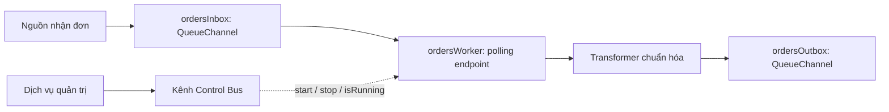
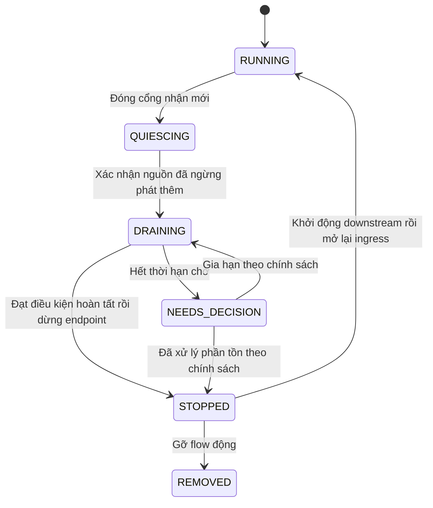

# Quản trị flow khi runtime

## 1. Bối cảnh và mục tiêu

Một hệ thống tích hợp nhận đơn hàng liên tục nhưng dịch vụ tính giá của đối tác cần bảo trì. Nếu tắt cả ứng dụng, các luồng đồng bộ tồn kho và gửi thông báo cũng bị gián đoạn. Nếu chỉ ngắt một handler ở giữa luồng, thông điệp có thể bị dồn vào hàng đợi, hết thời gian chờ hoặc thất bại khi không còn consumer nhận.

**Quản trị flow khi runtime** là điều khiển vòng đời và cấu hình vận hành của luồng thông điệp trong khi ứng dụng vẫn đang chạy. Công việc này bao gồm khởi động, dừng, quan sát, đăng ký và gỡ bỏ flow; đồng thời xác định cách xử lý thông điệp đã được tiếp nhận.

Trong phạm vi **SPRING_INTEGRATION_CORE**, bài học thuộc chương **System management**, sử dụng các thành phần cốt lõi: `Message`, `MessageChannel`, endpoint, gateway và Java DSL. Các ví dụ minh họa cách vận hành những thành phần đó khi luồng có transformer, router, filter hoặc aggregator.

Sau bài học, bạn có thể:

- Chọn điều khiển một endpoint, toàn flow hay nguồn tiếp nhận.
- Gán tên ổn định cho endpoint và điều khiển qua `Lifecycle` hoặc Control Bus.
- Tạo và quản lý flow động bằng `IntegrationFlowContext`.
- Thiết kế quy trình ngừng tiếp nhận, xử lý nốt dữ liệu và chuyển sang phiên bản flow mới.
- Xác minh kết quả bằng trạng thái runtime, kết quả nghiệp vụ và số liệu vận hành.

Các đoạn Java DSL sử dụng API của **Spring Integration 6.5** và Java 17 trở lên. Cú pháp Control Bus trong bài là `beanName.methodName`, với đối số đặt trong header riêng; không dùng lẫn với cú pháp biểu thức trong các tài liệu phiên bản cũ. Có thể đối chiếu định dạng lệnh tại [Control Bus của Spring Integration 6.5](https://docs.spring.io/spring-integration/reference/6.5/control-bus.html).

## 2. Flow, endpoint và tài nguyên có vòng đời khác nhau

Một `IntegrationFlow` mô tả chuỗi thành phần. Khi đăng ký, framework tạo các channel, handler và endpoint tương ứng. Trong mô hình consumer thông thường:

- **Channel** vận chuyển hoặc lưu đệm `Message`.
- **Handler** thực hiện công việc: biến đổi, định tuyến, lọc, gọi dịch vụ hoặc gom nhóm.
- **Endpoint** nối handler với channel, bằng subscription hoặc polling.
- **Gateway** cung cấp giao diện gọi, thường có cơ chế gửi yêu cầu và đợi phản hồi.
- **Tài nguyên hỗ trợ** gồm scheduler, executor, connection factory và message store.

Vì vậy, tên phương thức `@Bean` tạo một flow không mặc nhiên là tên endpoint cần dừng. Khi muốn ngừng polling một hàng đợi, phải tìm endpoint polling đúng; lấy nhầm handler sẽ không đạt mục tiêu quản lý subscription hoặc poller.

| Đối tượng thao tác | Mục đích điển hình | Điều cần xác định |
| --- | --- | --- |
| Endpoint nhận từ nguồn ngoài | Tạm ngừng tiếp nhận dữ liệu | Dữ liệu mới nằm lại ở đâu, có được phát lại không? |
| Consumer của một channel | Dừng một chặng xử lý | Producer phía trước còn gửi được không? |
| Registration của flow động | Quản lý nhóm thành phần thuộc flow | Có cần giữ downstream chạy để drain trước không? |
| Executor hoặc connection dùng chung | Quản lý tài nguyên hạ tầng | Những flow nào khác cùng phụ thuộc? |
| `ApplicationContext` | Dừng phạm vi ứng dụng | Đây có đúng phạm vi bảo trì cần thiết không? |

Không nên tắt executor dùng chung chỉ để dừng một flow. Nó có thể đang phục vụ cả endpoint xử lý lỗi và các luồng khác.

### 2.1. Vòng đời cơ bản

`Lifecycle` cung cấp ba phương thức quan trọng:

```java
void start();
void stop();
boolean isRunning();
```

`SmartLifecycle` bổ sung khả năng tự khởi động, thứ tự theo `phase` và dừng với callback. Khi Spring điều phối lifecycle của application context, phase thấp khởi động trước; khi dừng thì thứ tự đảo lại. Các bean cùng phase không có thứ tự cố định; quan hệ phụ thuộc tường minh được ưu tiên hơn phase. [SmartLifecycle Javadoc](https://docs.spring.io/spring-framework/docs/current/javadoc-api/org/springframework/context/SmartLifecycle.html)

Ví dụ, có thể cấu hình consumer phía sau ở phase thấp hơn nguồn nhận để downstream sẵn sàng trước khi nguồn phát thông điệp. Đây là thứ tự lifecycle, chưa phải cơ chế chứng minh mọi thông điệp đã xử lý xong.

Hai lưu ý thực tế:

1. `autoStartup(false)` quyết định hành vi tự khởi động; nó không cấm người quản trị gọi `start()` sau đó.
2. Một thành phần báo `isRunning() == true` chỉ xác nhận trạng thái lifecycle của thành phần đó. Dịch vụ đối tác, database hoặc consumer ở chặng sau vẫn có thể đang lỗi.

### 2.2. Dừng, tạm ngừng và hủy

| Thao tác | Ý nghĩa vận hành | Khả năng sử dụng tiếp |
| --- | --- | --- |
| `stop()` | Yêu cầu thành phần ngừng hoạt động theo lifecycle của nó | Thông thường có thể gọi `start()` lại |
| `pause()` nếu thành phần hỗ trợ | Tạm ngừng theo hợp đồng riêng của thành phần | Dùng `resume()` khi API tương ứng hỗ trợ |
| Drain | Ngừng nhận mới và chờ công việc đã nhận đạt trạng thái kết thúc | Do ứng dụng phối hợp và xác nhận |
| `destroy()` của registration | Gỡ flow động và các bean phụ thuộc do registration quản lý | Phải tạo registration mới nếu cần dùng lại |

Không giả định mọi endpoint đều có `pause()`. Bài học dùng `start()` và `stop()` làm cơ chế điều khiển chung; việc pause/resume phải được kiểm tra trên API của adapter cụ thể.

**Dừng không đồng nghĩa với rollback, lưu bền hay drain.** Một tác vụ đang chạy có thể vẫn hoàn tất, bị ngắt hoặc kết thúc lỗi tùy implementation, executor và transaction. Hợp đồng giao nhận phải được xác định riêng.

## 3. Hiểu đường đi thông điệp trước khi dừng



Sơ đồ tách đường truyền đơn hàng và đường gửi lệnh quản trị. Control Bus dùng thông điệp nhưng payload của nó thể hiện thao tác quản lý, không phải đơn hàng.

### 3.1. Ảnh hưởng của channel

| Kiểu channel | Khi consumer bị dừng | Hệ quả phải dự kiến |
| --- | --- | --- |
| `DirectChannel` | Endpoint event-driven thông thường hủy subscription khi dừng | Nếu không còn subscriber, việc gửi có thể ném `MessageDeliveryException` |
| `QueueChannel` | Consumer ngừng polling; channel vẫn có thể nhận nếu còn chỗ | Backlog tăng; producer có thể chờ hoặc gửi thất bại khi đầy |
| `ExecutorChannel` | Có ranh giới thực thi qua executor | Phải tính cả tác vụ đã được nhận vào executor, không chỉ subscription |
| `PublishSubscribeChannel` | Một subscriber dừng không làm các subscriber khác dừng theo | Điều kiện gửi thành công phụ thuộc cấu hình, chẳng hạn `minSubscribers` |

Riêng với `QueueChannel`, việc `send()` thành công chỉ cho biết thông điệp đã vào hàng đợi. Nó chưa chứng minh handler đã xử lý nghiệp vụ thành công. Channel mặc định dùng bộ nhớ cũng không tự trở thành nơi lưu bền khi endpoint dừng. [Message Channel Implementations](https://docs.spring.io/spring-integration/reference/6.5/channel/implementations.html)

Đây là lý do một flow có hàng đợi thường cần giới hạn dung lượng, timeout khi gửi và chính sách xử lý khi không còn chỗ.

### 3.2. Liên hệ với các EIP khác

- **Transformer:** ngừng endpoint làm chặng biến đổi ngừng nhận; các thông điệp đã qua transformer vẫn có thể đi tiếp.
- **Filter:** thông điệp bị loại là một kết quả có chủ đích. Khi tính số lượng hoàn tất để drain, phải tính cả nhánh discard.
- **Router:** khi đổi tuyến sang flow mới, thông điệp đã chọn tuyến cũ không tự chuyển sang tuyến mới.
- **Aggregator:** nhóm đang chờ đủ phần tử chưa hoàn tất chỉ vì channel đầu vào đã rỗng. Cần chính sách cho nhóm dở dang, message store, timeout và kết quả phát ra.
- **Gateway:** request đang chờ reply có thể hết timeout trong lúc bảo trì. Client retry có thể tạo thao tác trùng nếu phía xử lý thiếu idempotency.

Vì thế, phép đo “queue size bằng 0” luôn phải đặt trong ngữ cảnh toàn bộ đường đi dữ liệu.

## 4. Ví dụ cấu hình flow có thể điều khiển

Ví dụ sau chỉ dùng thành phần core, không cần broker hoặc cơ sở dữ liệu. Ứng dụng cần dependency `org.springframework.integration:spring-integration-core` được quản lý phiên bản nhất quán; nếu dùng Spring Boot, có thể dùng starter integration và BOM tương thích.

Mục tiêu là đưa chuỗi vào `ordersInbox`, chuẩn hóa chuỗi và nhận kết quả từ `ordersOutbox`. Endpoint `ordersWorker` được tạo sẵn nhưng chưa tự chạy.

```java
import java.time.Duration;
import java.util.Locale;

import org.springframework.beans.factory.annotation.Qualifier;
import org.springframework.context.annotation.Bean;
import org.springframework.context.annotation.Configuration;
import org.springframework.integration.channel.DirectChannel;
import org.springframework.integration.channel.QueueChannel;
import org.springframework.integration.config.EnableIntegration;
import org.springframework.integration.dsl.IntegrationFlow;
import org.springframework.integration.dsl.Pollers;
import org.springframework.messaging.MessageChannel;

@Configuration
@EnableIntegration
public class RuntimeFlowConfiguration {

    @Bean
    public QueueChannel ordersInbox() {
        return new QueueChannel(100);
    }

    @Bean
    public QueueChannel ordersOutbox() {
        return new QueueChannel(100);
    }

    @Bean
    public IntegrationFlow ordersFlow(
            @Qualifier("ordersInbox") QueueChannel input,
            @Qualifier("ordersOutbox") QueueChannel output) {

        return IntegrationFlow.from(input)
                .<String, String>transform(
                        text -> text.trim().toUpperCase(Locale.ROOT),
                        endpoint -> endpoint
                                .id("ordersWorker")
                                .autoStartup(false)
                                .poller(Pollers
                                        .fixedDelay(Duration.ofMillis(100))
                                        .maxMessagesPerPoll(1)))
                .channel(output)
                .get();
    }

    @Bean
    public MessageChannel runtimeCommands() {
        return new DirectChannel();
    }

    @Bean
    public IntegrationFlow runtimeControlFlow(
            @Qualifier("runtimeCommands") MessageChannel commands) {

        return IntegrationFlow.from(commands)
                .controlBus()
                .get();
    }
}
```

Các quyết định thiết kế trong ví dụ:

- `ordersFlow` đặt tên cho flow; `ordersWorker` đặt ID tường minh cho endpoint nhận từ hàng đợi. Đây là đối tượng sẽ được quản trị.
- Poller thuộc endpoint nối transformer với `ordersInbox`, không thuộc bản thân `QueueChannel`.
- `maxMessagesPerPoll(1)` giới hạn số thông điệp mỗi lượt poll; nó không phải giới hạn backlog hay tổng số thông điệp đang xử lý trong mọi kiến trúc.
- Hai hàng đợi đều có dung lượng 100 để ví dụ không tích lũy vô hạn.
- Flow điều khiển cần hoạt động độc lập để có thể khởi động lại worker đang dừng.

`ordersOutbox` là nơi quan sát kết quả trong bài thực hành. Trong ứng dụng thật phải có downstream tiêu thụ nó; nếu để đầy, việc chuyển tiếp kết quả có thể chặn worker.

## 5. Điều khiển trực tiếp bằng Lifecycle

Khi dịch vụ quản trị và endpoint cùng nằm trong một application context, gọi trực tiếp là cách dễ đọc và có kiểu rõ ràng.

```java
import org.springframework.beans.factory.annotation.Qualifier;
import org.springframework.context.Lifecycle;
import org.springframework.stereotype.Service;

@Service
public class OrdersRuntimeAdmin {

    private final Lifecycle worker;

    public OrdersRuntimeAdmin(
            @Qualifier("ordersWorker") Lifecycle worker) {
        this.worker = worker;
    }

    public void startWorker() {
        worker.start();
    }

    public void stopWorker() {
        worker.stop();
    }

    public boolean isWorkerRunning() {
        return worker.isRunning();
    }
}
```

Dịch vụ trên điều khiển đúng endpoint đã được đặt ID trong DSL. Nó không gọi phương thức tạo bean để tạo một flow khác và cũng không ngừng application context.

Trong ví dụ, sau khi dừng worker, producer vẫn có thể gửi vào `ordersInbox` cho đến khi hàng đợi đầy. Nếu mục đích bảo trì là ngừng nhận mới, cần thêm cơ chế đóng nguồn tiếp nhận hoặc từ chối request ở ingress.

Một phản hồi quản trị hữu ích nên ghi rõ đối tượng đã tác động, thời điểm, trạng thái quan sát sau lệnh và người thực hiện. Trạng thái `STOPPED` của endpoint cần được phân biệt với kết quả `DRAINED` của quy trình nghiệp vụ.


## 6. Điều khiển qua Control Bus

Control Bus phù hợp khi muốn biểu diễn thao tác quản trị bằng một `Message`, đi qua một điểm tiếp nhận lệnh thống nhất. Nó vẫn gọi thao tác của bean trong application context; bản thân Control Bus không tự cung cấp cơ chế điều phối nhiều JVM.

Với cấu hình ở phần trước, payload có dạng:

```text
ordersWorker.start
ordersWorker.stop
ordersWorker.isRunning
```

Lệnh trỏ đến endpoint `ordersWorker`. Control Bus giải quyết thao tác qua registry và chỉ cho phép các phương thức thuộc phạm vi quản trị được hỗ trợ, chẳng hạn lifecycle hoặc phương thức được đánh dấu quản lý. Các phương thức Java bất kỳ không mặc nhiên trở thành lệnh. [Control Bus](https://docs.spring.io/spring-integration/reference/6.5/control-bus.html), [ControlBusCommandRegistry](https://docs.spring.io/spring-integration/docs/6.5.0/api/org/springframework/integration/support/management/ControlBusCommandRegistry.html)

### 6.1. Client gửi lệnh có chủ đích

```java
import org.springframework.beans.factory.annotation.Qualifier;
import org.springframework.integration.core.MessagingTemplate;
import org.springframework.messaging.MessageChannel;
import org.springframework.stereotype.Service;

@Service
public class OrdersControlBusClient {

    private final MessagingTemplate commands;

    public OrdersControlBusClient(
            @Qualifier("runtimeCommands") MessageChannel channel) {
        this.commands = new MessagingTemplate(channel);
        this.commands.setSendTimeout(1_000);
        this.commands.setReceiveTimeout(1_000);
    }

    public void startWorker() {
        commands.convertAndSend("ordersWorker.start");
    }

    public void stopWorker() {
        commands.convertAndSend("ordersWorker.stop");
    }

    public boolean isWorkerRunning() {
        Boolean running = commands.convertSendAndReceive(
                "ordersWorker.isRunning", Boolean.class);

        if (running == null) {
            throw new IllegalStateException(
                    "Không nhận được phản hồi trạng thái ordersWorker");
        }
        return running;
    }
}
```

`start` và `stop` trả về `void`, nên client chỉ gửi lệnh. `isRunning` trả về giá trị, nên client dùng request/reply; `MessagingTemplate` chuẩn bị đường nhận phản hồi cho lần gọi đó.

Ví dụ dùng `DirectChannel` cho lệnh. Việc chuyển lệnh đến Control Bus diễn ra đồng bộ trên thread gửi. Các timeout của template không tạo ra một deadline có khả năng ngắt cưỡng bức mọi lời gọi đồng bộ bên trong handler.

Có thể thay client trên bằng gateway có các phương thức tương ứng. Quyết định dùng gateway hay template thay đổi giao diện gọi; nó không thay đổi ý nghĩa của lifecycle.

### 6.2. Lệnh có tham số

Trong API được chọn cho bài học, đối số của phương thức được truyền dưới dạng danh sách trong header `IntegrationMessageHeaderAccessor.CONTROL_BUS_ARGUMENTS`. Payload chỉ chứa tên bean và tên phương thức. Kiểu của từng giá trị phải khớp chữ ký phương thức được quản lý.

Không ghép tham số người dùng thành biểu thức tùy ý. Nếu cung cấp HTTP API cho vận hành, nên nhận thao tác có cấu trúc như `START`, `STOP`, `STATUS`, sau đó ánh xạ ở phía server sang các lệnh được cho phép. Client phía trên thực hiện đúng nguyên tắc đó bằng các chuỗi lệnh cố định.

Việc Control Bus hạn chế phương thức gọi không thay thế cho xác thực và phân quyền của API quản trị. Cần kiểm soát cả người được phép gửi lệnh, tenant được phép tác động và phạm vi endpoint.

### 6.3. Lựa chọn cơ chế điều khiển

| Tình huống | Cơ chế phù hợp |
| --- | --- |
| Service nội bộ điều khiển một endpoint cố định | Inject `Lifecycle` |
| Luồng quản trị đã sử dụng mô hình thông điệp | Control Bus qua kênh riêng |
| Tạo và gỡ các flow trong lúc ứng dụng chạy | `IntegrationFlowContext` |
| Công cụ vận hành đã sử dụng JMX | Các thao tác quản lý được export qua JMX |
| API quản trị từ xa | Lớp API có phân quyền, gọi một cơ chế nội bộ ở trên |

Nên có một điểm chịu trách nhiệm cho chính sách vận hành. Nếu cả REST, JMX và Control Bus đều có thể thay đổi trạng thái, các yêu cầu vẫn phải được phối hợp để tránh lệnh start và stop tranh chấp.

## 7. Đăng ký flow động bằng IntegrationFlowContext

Dừng một endpoint đã tồn tại không giải quyết trường hợp một tenant mới cần thêm luồng xử lý. Với flow động, `IntegrationFlowContext` cung cấp registration để thêm flow, đặt ID, quyết định tự khởi động và gỡ các bean phụ thuộc khi không dùng nữa. `useFlowIdAsPrefix()` giúp tránh trùng tên khi nhiều flow sử dụng cùng ID nội bộ. [Dynamic and Runtime Integration Flows](https://docs.spring.io/spring-integration/reference/dsl/java-runtime-flows.html)

### 7.1. Ví dụ flow chuẩn hóa riêng cho từng tenant

Mỗi flow nhận chuỗi và phản hồi chuỗi đã chuẩn hóa, kèm tenant. Nó dùng `DirectChannel`, nên không có backlog trung gian trong ví dụ này.

```java
import java.util.Locale;

import org.springframework.integration.channel.DirectChannel;
import org.springframework.integration.core.MessagingTemplate;
import org.springframework.integration.dsl.IntegrationFlow;
import org.springframework.integration.dsl.context.IntegrationFlowContext;
import org.springframework.integration.dsl.context.IntegrationFlowContext
        .IntegrationFlowRegistration;
import org.springframework.stereotype.Service;

@Service
public class TenantFlowManager {

    private final IntegrationFlowContext flowContext;

    public TenantFlowManager(IntegrationFlowContext flowContext) {
        this.flowContext = flowContext;
    }

    public synchronized String registerStopped(String tenantId) {
        String flowId = flowId(tenantId);

        if (flowContext.getRegistrationById(flowId) != null) {
            throw new IllegalStateException(
                    "Flow đã được đăng ký: " + flowId);
        }

        IntegrationFlow flow = IntegrationFlow
                .from(new DirectChannel())
                .<String, String>transform(
                        text -> tenantId + ":"
                                + text.trim().toUpperCase(Locale.ROOT),
                        endpoint -> endpoint.id("normalize"))
                .get();

        IntegrationFlowRegistration registration = flowContext
                .registration(flow)
                .id(flowId)
                .useFlowIdAsPrefix()
                .autoStartup(false)
                .register();

        return registration.getId();
    }

    public synchronized void start(String tenantId) {
        requireRegistration(tenantId).start();
    }

    public synchronized String request(String tenantId, String payload) {
        MessagingTemplate template = requireRegistration(tenantId)
                .getMessagingTemplate();
        template.setSendTimeout(1_000);
        template.setReceiveTimeout(1_000);
        return template.convertSendAndReceive(payload, String.class);
    }

    public synchronized void stop(String tenantId) {
        requireRegistration(tenantId).stop();
    }

    public synchronized void remove(String tenantId) {
        requireRegistration(tenantId).destroy();
    }

    private IntegrationFlowRegistration requireRegistration(
            String tenantId) {
        String flowId = flowId(tenantId);
        IntegrationFlowRegistration registration =
                flowContext.getRegistrationById(flowId);

        if (registration == null) {
            throw new IllegalArgumentException(
                    "Không tìm thấy flow: " + flowId);
        }
        return registration;
    }

    private String flowId(String tenantId) {
        if (tenantId == null
                || !tenantId.matches("[a-z0-9]{1,24}")) {
            throw new IllegalArgumentException(
                    "tenantId chỉ gồm a-z, 0-9; dài từ 1 đến 24 ký tự");
        }
        return "tenantOrders-" + tenantId;
    }
}
```

Khi lớp này được đăng ký làm Spring bean, chuỗi sử dụng là:

```java
String id = tenantFlowManager.registerStopped("hcm");
// id = "tenantOrders-hcm"

tenantFlowManager.start("hcm");

String result = tenantFlowManager.request("hcm", "  don-42  ");
// result = "hcm:DON-42"

tenantFlowManager.stop("hcm");
tenantFlowManager.start("hcm");

tenantFlowManager.remove("hcm");
// Registration đã được gỡ; muốn dùng lại phải đăng ký flow mới.
```

Các dòng trên là mã gọi bên trong một thành phần hoặc bài kiểm tra đã được inject `TenantFlowManager`, không phải một chương trình `main` độc lập.

### 7.2. Những điểm cần hiểu trong ví dụ

**ID có chủ đích.** `tenantOrders-hcm` giúp tra cứu, ghi audit và gắn cấu hình tenant với flow. Kiểm tra định dạng giúp kiểm soát tên nhưng chưa phải kiểm tra quyền sở hữu tenant.

**Mỗi flow có thành phần riêng.** Mỗi lần tạo flow, ví dụ tạo `DirectChannel` mới. Endpoint nội bộ cùng tên `normalize` được đặt dưới prefix của từng flow, thay vì cạnh tranh một bean name chung.

**Registration chưa chạy.** `autoStartup(false)` cho phép đăng ký trước, xác nhận cấu hình rồi mới mở luồng. Với `DirectChannel` này, gửi trước khi start hoặc sau khi stop có thể thất bại do không có subscriber; nó không chờ sẵn dữ liệu cho lần start kế tiếp.

**Phản hồi đi qua reply channel của request.** Flow kết thúc ở transformer trả giá trị, nên `MessagingTemplate` có thể nhận phản hồi. Với flow bắt đầu từ một nguồn không phải `MessageChannel`, không thể mặc nhiên dùng `getMessagingTemplate()` theo cách này. [IntegrationFlowRegistration Javadoc](https://docs.spring.io/spring-integration/api/org/springframework/integration/dsl/context/IntegrationFlowContext.IntegrationFlowRegistration.html)

**Khóa chỉ có tác dụng trong phạm vi ví dụ.** Các phương thức `synchronized` tuần tự hóa đăng ký, gửi request và thay đổi lifecycle thông qua cùng một instance manager. Cách này phù hợp để minh họa flow đồng bộ nhỏ; một request chậm sẽ giữ khóa và chặn cả thao tác của tenant khác. Hệ thống có tải lớn cần cơ chế điều phối theo flow, đồng thời quản lý các tác vụ bất đồng bộ bên ngoài khóa.

**Hủy flow không thu hồi dữ liệu đã gửi ra ngoài.** `destroy()` gỡ registration và các bean phụ thuộc mà nó quản lý. Nó không hoàn tác giao dịch đã commit, không xóa tài nguyên dùng chung của ứng dụng và không bảo đảm thông điệp đang bay đã hoàn tất.

### 7.3. Flow khai báo sẵn và flow đăng ký runtime

`StandardIntegrationFlow` là container logic của các thành phần. Khi flow được tạo qua bean thông thường, Spring điều phối khởi động các thành phần trong application context. Với flow đăng ký động, nên điều khiển qua registration; registration mặc định có thể tự khởi động flow nếu không tắt tùy chọn đó. [StandardIntegrationFlow Javadoc](https://docs.spring.io/spring-integration/api/org/springframework/integration/dsl/StandardIntegrationFlow.html)

Vì vậy, không nên suy rằng mọi flow khai báo sẵn sẽ đứng yên chỉ vì container flow không tự khởi động. Hãy đặt `autoStartup(false)` ở đúng endpoint cần giữ dừng, như `ordersWorker`, hoặc trên registration khi tạo toàn bộ flow động.

Registry runtime cũng không thay thế nơi lưu cấu hình nghiệp vụ. Nếu JVM khởi động lại, ứng dụng cần đọc cấu hình tenant từ nguồn dữ liệu phù hợp và đăng ký lại những flow mong muốn; đối tượng registration trong bộ nhớ không phải cấu hình bền vững.


## 8. Dừng flow theo quy trình xử lý nốt dữ liệu

Trong môi trường thực tế, nhu cầu thường là “không nhận đơn mới nhưng vẫn hoàn tất những đơn đã nhận”. Đó là một quy trình vận hành nhiều bước.



Các trạng thái trong sơ đồ là mô hình của ứng dụng quản trị, không phải enum trạng thái có sẵn của `IntegrationFlowContext`.

### 8.1. Runbook bảo trì một flow

| Bước | Hành động | Bằng chứng để chuyển bước |
| --- | --- | --- |
| 1. Xác định phạm vi | Chọn flow, instance, tenant và thời hạn bảo trì | Đã biết ingress, queue, endpoint và tài nguyên dùng chung |
| 2. Ngừng nhận mới | Đóng admission gate hoặc ngừng nguồn nhận phù hợp | Không còn request mới được chấp nhận vào phạm vi bảo trì |
| 3. Giữ downstream chạy | Để consumer, handler lỗi và nơi nhận kết quả tiếp tục hoạt động | Backlog giảm; hệ thống vẫn phát kết quả cuối cùng |
| 4. Xác nhận drain | Kiểm tra hàng đợi, công việc đang chạy và trạng thái nhóm | Tất cả dữ liệu đã nhận đạt kết quả theo hợp đồng |
| 5. Dừng hoặc gỡ | Dừng endpoint; chỉ destroy khi không cần registration nữa | Trạng thái lifecycle và registry phù hợp yêu cầu |
| 6. Khôi phục | Khởi động downstream, xác nhận sẵn sàng rồi mở ingress | Yêu cầu thử thành công; tải thực phục hồi trong giới hạn |

Nếu có nhiều nguồn vào cùng một flow, bước 2 phải bao phủ tất cả. Chặn HTTP ingress không ngăn một scheduled job nội bộ tiếp tục gửi vào channel.

**Điều kiện drain phải phản ánh nghiệp vụ.** Một điều kiện tham khảo là:

```text
không còn dữ liệu mới được nhận vào phạm vi bảo trì
AND không còn thông điệp chờ trong các queue liên quan
AND không còn tác vụ hoặc request đang xử lý
AND nhóm aggregator và nhánh lỗi đã được xử lý theo chính sách
```

Đây là điều kiện thiết kế, không phải một API kiểm tra tổng quát có sẵn. Muốn dùng nó, ứng dụng phải đo đủ các loại công việc và đặt một ranh giới rõ ràng giữa trước và sau thời điểm ngừng tiếp nhận.

Ví dụ, queue có thể bằng 0 ngay sau khi worker lấy ra một đơn hàng, trong khi lời gọi đối tác vẫn đang chạy. Ngược lại, một hàng đợi của flow khác vẫn có dữ liệu nhưng không ảnh hưởng đến phạm vi bảo trì hiện tại.

### 8.2. Khi hết thời gian chờ

Không tự đổi trạng thái thành “đã drain” khi deadline hết hạn. Cần lựa chọn đã được quy định:

- Gia hạn nếu công việc vẫn tiến triển và thời gian bảo trì cho phép.
- Giữ phần chưa xử lý trong hàng đợi hoặc message store bền vững để khôi phục.
- Đưa thông điệp không thể hoàn tất sang kênh lỗi hoặc nơi lưu phục vụ xử lý lại, có đủ định danh và nguyên nhân.
- Dừng cưỡng bức khi hợp đồng cho phép, đồng thời ghi nhận phần còn dang dở và cơ chế bù hoặc phát lại.

Lựa chọn cuối cùng có thể tạo xử lý trùng hoặc kết quả chưa xác định ở hệ thống ngoài. Dùng mã nghiệp vụ ổn định và idempotency để tránh việc retry tạo hai giao dịch cho một yêu cầu.

Với aggregator, nhóm đang thiếu thành viên cần chính sách cụ thể: chờ tiếp khi khôi phục, timeout, phát partial result nếu nghiệp vụ cho phép hoặc chuyển sang nhánh xử lý ngoại lệ. Không xóa message store chỉ để làm số lượng nhóm về 0.

### 8.3. Cơ chế orderly shutdown của framework

Spring Integration có thao tác `stopActiveComponents` trên `IntegrationMBeanExporter`, phục vụ dừng có trật tự trong phạm vi ứng dụng được quản lý. Cơ chế này phối hợp các thành phần hỗ trợ shutdown, ngừng nguồn nhận và dành một khoảng thời gian cho thông điệp đang xử lý. Nó giữ poller cần thiết hoạt động để dữ liệu trong queue có cơ hội đi tiếp. [Orderly Shutdown](https://docs.spring.io/spring-integration/reference/shutdown.html)

Thao tác đó không đồng nghĩa với `stop()` trên một endpoint và cũng không phải lệnh drain dành riêng cho một tenant. Khi chỉ bảo trì một flow, ứng dụng vẫn cần quy trình theo phạm vi như bảng phía trên.

## 9. Thay đổi flow đang chạy và chuyển phiên bản

Đổi một giá trị được API hỗ trợ, chẳng hạn cấu hình của một trigger có khả năng thay đổi động, khác với thay cả topology. Không giả định mọi setter đều an toàn để gọi đồng thời với xử lý thông điệp.

Khi cần thay transformer, thêm filter hoặc đổi cách gọi dịch vụ, một phương án dễ kiểm soát là tạo phiên bản flow mới.

Ví dụ thiết kế tên:

```text
tenantOrders-hcm-v1
tenantOrders-hcm-v2
```

Đây là cách mở rộng thiết kế của ví dụ tenant; lớp `TenantFlowManager` ở phần trước chưa triển khai quản lý phiên bản.

Quy trình chuyển đổi:

1. Đăng ký v2 với ID riêng và chưa mở nhận dữ liệu nghiệp vụ.
2. Khởi động, xác nhận tài nguyên và kiểm tra v2 bằng dữ liệu thử không tạo tác dụng phụ ngoài ý muốn.
3. Chuyển quyết định định tuyến tại ingress sang v2 cho những thông điệp mới được tiếp nhận.
4. Giữ v1 hoạt động cho thông điệp đã được nhận và request đang chờ phản hồi.
5. Drain v1 theo điều kiện đã xác định.
6. Gỡ v1 sau khi xác nhận không còn công việc thuộc phiên bản đó.

Một stable ingress có thể chọn channel phiên bản dựa trên cấu hình routing do ứng dụng quản lý. Cần xác định thời điểm quyết định tuyến và truyền định danh phiên bản theo thông điệp khi cần.

Các điểm dễ sai:

- **Cùng gắn hai consumer vào một `DirectChannel`:** không tạo ra cơ chế chuyển phiên bản có kiểm soát. Với cơ chế phân phối thông thường, thông điệp có thể được chọn gửi đến một trong các subscriber.
- **Aggregator qua hai phiên bản:** nếu các phần của một nhóm đi vào hai message store hoặc hai chính sách gom nhóm khác nhau, cả hai phía có thể chờ vô hạn. Có thể giữ tuyến theo correlation key hoặc hoàn tất nhóm trước khi chuyển.
- **Gateway đang chờ:** gỡ v1 quá sớm có thể làm request cũ hết thời gian chờ dù v2 đã hoạt động.
- **Rollback:** đổi tuyến về v1 chỉ tác động đến những thông điệp được quyết định tuyến sau đó. Tác dụng phụ mà v2 đã tạo vẫn cần cơ chế bù hoặc xử lý riêng.

Đăng ký v2 thành công chỉ chứng minh các thành phần đã được tạo. Readiness của flow cần bao gồm cả tài nguyên phụ thuộc và một tiêu chí xử lý thực tế phù hợp.

## 10. Quan sát và điều phối runtime

### 10.1. Theo dõi ba lớp tín hiệu

| Lớp | Tín hiệu nên có | Ý nghĩa |
| --- | --- | --- |
| Lifecycle | Trạng thái mong muốn, trạng thái quan sát, flow ID, endpoint ID, instance ID | Biết lệnh đang tác động đúng đối tượng |
| Xử lý thông điệp | Tốc độ nhận, kết quả thành công, lỗi, discard, retry, thời gian xử lý | Biết flow có hoàn thành công việc |
| Tồn đọng | Độ sâu queue, tuổi thông điệp chờ lâu nhất, tác vụ đang chạy, nhóm aggregator chưa kết thúc | Biết áp lực và khả năng drain |

Độ sâu queue nhỏ chưa chắc tốt nếu thông điệp cũ nhất đã chờ rất lâu. Một endpoint running nhưng không có dữ liệu đầu vào cũng không chứng minh downstream khỏe; cần đối chiếu các lớp tín hiệu.

Spring Integration cung cấp Integration Graph để quan sát cấu trúc runtime và các liên kết giữa thành phần. Sau khi thêm hoặc gỡ flow động, cần lấy hoặc làm mới graph theo API và cách tích hợp đang dùng. Graph hỗ trợ xác định topology nhưng không thay thế số liệu công việc đang xử lý. [Integration Graph](https://docs.spring.io/spring-integration/reference/6.5/graph.html)

### 10.2. Audit lệnh quản trị

Một bản ghi thao tác nên có:

```text
operationId, actor, reason, tenantId, instanceId,
flowId, action, requestedAt, completedAt, observedState, outcome
```

`operationId` giúp nhận diện yêu cầu lặp. Nếu client bị timeout, trạng thái cuối cùng có thể đã thay đổi; trước khi gửi lại, nên đọc kết quả thao tác hoặc trạng thái hiện tại. Không suy rằng timeout luôn có nghĩa lệnh chưa được thực thi.

Việc gọi `start()` hoặc `stop()` lặp lại thường dễ kiểm soát hơn tạo hai registration trùng ID. Tuy nhiên, workflow quản trị vẫn cần định nghĩa hành vi khi yêu cầu lặp, đối tượng không tồn tại hoặc một thao tác khác đang diễn ra.

### 10.3. Khi chạy nhiều instance

`IntegrationFlowContext`, registry và Control Bus trong ví dụ đều có phạm vi application context của một instance. Gửi lệnh đến instance A không tự dừng endpoint cùng tên ở instance B.

Nếu ba instance cùng tiêu thụ dữ liệu của một tenant, dừng một instance có thể chỉ chuyển tải sang hai instance còn lại. Muốn bảo trì toàn tenant cần:

- Xác định tất cả instance đang có flow tương ứng.
- Phối hợp trạng thái mong muốn và quyền thực hiện thao tác.
- Xác nhận kết quả ở từng instance, bao gồm instance vừa khởi động lại.
- Ngăn bộ khôi phục cấu hình tự start lại flow đang được đánh dấu bảo trì.

Có thể lưu cấu hình mong muốn và phiên bản cấu hình trong nơi lưu dùng chung, rồi để mỗi instance đối chiếu với runtime. Đây là trách nhiệm điều phối của ứng dụng, không phải cơ chế cluster tự có của Control Bus.

## 11. Thực hành với flow cố định

Sau khi đặt các lớp cấu hình vào một dự án có dependency phù hợp, có thể dùng chương trình minh họa dưới đây. Nó tạo context riêng trong bộ nhớ, gửi dữ liệu lúc worker dừng, khởi động bằng Control Bus và quan sát kết quả.

```java
import org.springframework.context.annotation.AnnotationConfigApplicationContext;
import org.springframework.integration.channel.QueueChannel;
import org.springframework.integration.core.MessagingTemplate;
import org.springframework.messaging.Message;
import org.springframework.messaging.MessageChannel;
import org.springframework.messaging.support.GenericMessage;

public class RuntimeFlowDemo {

    public static void main(String[] args) {
        try (var context = new AnnotationConfigApplicationContext(
                RuntimeFlowConfiguration.class)) {

            QueueChannel input =
                    context.getBean("ordersInbox", QueueChannel.class);
            QueueChannel output =
                    context.getBean("ordersOutbox", QueueChannel.class);

            MessagingTemplate commands = new MessagingTemplate(
                    context.getBean(
                            "runtimeCommands", MessageChannel.class));
            commands.setReceiveTimeout(1_000);

            Boolean initiallyRunning = commands.convertSendAndReceive(
                    "ordersWorker.isRunning", Boolean.class);
            require(Boolean.FALSE.equals(initiallyRunning),
                    "Worker phải chưa chạy khi khởi tạo");

            require(input.send(new GenericMessage<>("  don-42  "), 1_000),
                    "Không đưa được thông điệp vào inbox");
            require(output.receive(200) == null,
                    "Worker đang dừng nên chưa được có kết quả");

            commands.convertAndSend("ordersWorker.start");

            Message<?> result = output.receive(2_000);
            require(result != null
                            && "DON-42".equals(result.getPayload()),
                    "Không nhận được kết quả chuẩn hóa mong đợi");

            commands.convertAndSend("ordersWorker.stop");

            Boolean runningAfterStop = commands.convertSendAndReceive(
                    "ordersWorker.isRunning", Boolean.class);
            require(Boolean.FALSE.equals(runningAfterStop),
                    "Worker phải dừng sau lệnh stop");
        }
    }

    private static void require(boolean condition, String message) {
        if (!condition) {
            throw new IllegalStateException(message);
        }
    }
}
```

Chương trình dùng timeout khi nhận kết quả thay vì chờ bằng một khoảng `sleep` cố định. Đây là minh họa hành vi cơ bản, chưa chứng minh cơ chế drain trong trường hợp có executor, broker hoặc hệ thống ngoài.

Có thể thực hành tiếp theo trình tự:

1. Sau khi worker dừng, gửi thêm một đơn: dữ liệu phải nằm trong inbox và được xử lý sau lần start tiếp theo.
2. Giữ worker dừng, đưa đủ 100 thông điệp vào inbox rồi thử thông điệp thứ 101 với timeout hữu hạn: quan sát kết quả gửi khi queue đầy.
3. Cho downstream xử lý chậm: so sánh queue size với số công việc đang chạy trước khi kết luận đã drain.
4. Tạo flow động cho `hcm` và `hn`: xác nhận mỗi flow trả đúng tenant và không trùng endpoint nội bộ.
5. Gỡ flow `hcm`: registry không còn registration đó, còn flow `hn` vẫn xử lý được.
6. Giả lập một lỗi trong transformer: xác định lỗi trả về caller hay đi qua cơ chế lỗi của poller, rồi kiểm tra đường khôi phục trước khi mở lại ingress.

Với luồng đồng bộ qua `DirectChannel`, ngoại lệ thường truyền về thread gửi. Với polling hoặc xử lý bất đồng bộ, cơ chế `ErrorHandler` và `errorChannel` phải được cấu hình, quan sát theo ranh giới thực thi tương ứng. Không giả định tất cả lỗi trong mọi flow đều tự chuyển vào cùng một kênh lỗi.

## 12. Các lỗi vận hành thường gặp

| Biểu hiện | Nguyên nhân cần kiểm tra | Hướng xử lý |
| --- | --- | --- |
| Gửi lệnh thành công nhưng worker không đổi trạng thái | Sai endpoint ID, sai instance hoặc lệnh đang chờ trên kênh bất đồng bộ | Xác nhận đích, kết quả thao tác và trạng thái sau lệnh |
| Dừng flow nhưng dữ liệu vẫn vào queue | Chỉ dừng consumer, chưa ngừng producer | Đóng ingress hoặc xác định rõ chính sách lưu đệm |
| DirectChannel báo không có subscriber | Endpoint chưa start, đã stop hoặc đã bị gỡ | Kiểm tra admission và lifecycle trước khi gửi |
| Queue tăng nhanh khi bảo trì | Nguồn tiếp nhận vẫn chạy hoặc downstream không thoát được dữ liệu | Dừng nhận mới, kiểm tra dung lượng và tốc độ drain |
| Đăng ký tenant thứ hai bị trùng bean | ID flow hoặc ID thành phần bị dùng lại | Đặt ID flow riêng và sử dụng prefix cho ID nội bộ |
| Flow đã stop nhưng request vẫn hoàn tất sau đó | Công việc đã được nhận trước thời điểm dừng | Theo dõi công việc đang chạy và định nghĩa drain |
| Restart JVM làm mất flow động | Cấu hình chỉ nằm trong registry runtime | Lưu và khôi phục cấu hình mong muốn |
| Aggregator không drain dù queue rỗng | Vẫn còn nhóm chưa đủ điều kiện release | Kiểm tra correlation, timeout và chính sách nhóm dở dang |
| Dừng một replica nhưng nghiệp vụ vẫn chạy | Các replica khác tiếp tục tiêu thụ | Điều phối theo đầy đủ phạm vi instance |
| API trả timeout sau lệnh quản trị | Phản hồi chậm hoặc thao tác chưa kết thúc | Tra trạng thái theo operation ID trước khi retry |

Một thiết kế quản trị runtime đáng tin cậy cần trả lời được ba câu hỏi cụ thể: **đang điều khiển thành phần nào, dữ liệu đã nhận sẽ đi đâu và bằng chứng nào xác nhận thao tác đã hoàn tất**. Khi ba điều này rõ ràng, việc start, stop, thay phiên bản và gỡ flow mới có thể vận hành nhất quán.
