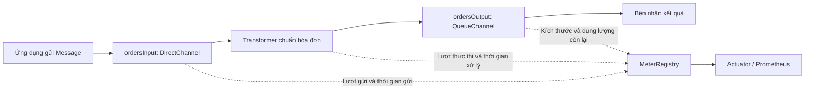

# Micrometer integration metrics

## 1. Mục tiêu và phạm vi

Trong một luồng Spring Integration, message có thể đi qua channel, transformer, router, filter và nhiều handler trước khi hoàn tất nghiệp vụ. Khi luồng chậm hoặc thất bại, cần xác định điểm đang có vấn đề: tốc độ tiếp nhận, thời gian xử lý, lỗi tại endpoint hay hàng đợi tích tụ.

Bài học này thuộc chương **Metrics và observability** của module **SPRING_INTEGRATION_CORE**. Sau bài học, bạn có thể:

- Nhận biết `Counter`, `Timer`, `Gauge` và vai trò của `MeterRegistry`.
- Đọc đúng metric của channel, handler, message source và queue.
- Thiết lập ví dụ Java DSL, xem metric bằng Actuator và xuất dữ liệu cho Prometheus.
- Phân biệt metrics trực tiếp của Spring Integration với metrics qua Micrometer Observation.
- Thiết kế tag có số lượng giá trị hữu hạn và bổ sung phép đo nghiệp vụ khi cần.
- Phân tích số liệu mà không nhầm số lần thực thi với số thông điệp nghiệp vụ hoàn tất.

Ví dụ dùng Java 17, Spring Boot 3.5.x và Spring Integration 6.5.x. Đây là phạm vi phiên bản của bài; các dự án dùng dòng phiên bản khác cần đối chiếu API và tên metric tương ứng. Giả định bạn đã biết `Message`, `MessageChannel` và cách khai báo một `IntegrationFlow`.

## 2. Metrics nằm ở đâu trong observability?

Giả sử hệ thống nhận đơn hàng và chuẩn hóa dữ liệu:



Metrics cho biết xu hướng của nhiều lần xử lý. Log hỗ trợ đọc chi tiết một sự kiện. Trace hỗ trợ theo dõi một lần xử lý qua nhiều thành phần. Ba loại dữ liệu phục vụ các câu hỏi khác nhau:

| Câu hỏi vận hành | Dữ liệu phù hợp |
| --- | --- |
| Mỗi giây tiếp nhận bao nhiêu lần gửi? | Rate tính từ count |
| Độ trễ có tăng trong 15 phút vừa qua? | Timer và histogram |
| Hàng đợi có đang gần đầy? | Gauge |
| Payload nào gây lỗi chuyển đổi? | Log đã kiểm soát dữ liệu nhạy cảm |
| Một request đã đi qua những endpoint nào? | Trace |

Một biểu đồ throughput giảm không tự chỉ ra nguyên nhân. Cần ghép nó với độ trễ, lỗi và backlog để hình thành giả thuyết, rồi dùng log hoặc trace để xác minh.

## 3. Các thành phần Micrometer cần hiểu

### 3.1. MeterRegistry và định danh của meter

`MeterRegistry` là nơi ứng dụng đăng ký và ghi nhận các meter. Registry dành cho Prometheus cung cấp dữ liệu để Prometheus scrape; `SimpleMeterRegistry` giữ số liệu trong bộ nhớ, phù hợp với ví dụ nhỏ và kiểm tra trong tiến trình.

Một meter được nhận diện bằng tên và tập tag. Ví dụ:

```text
name = spring.integration.send
tags = {
  type = channel,
  name = ordersInput,
  result = success,
  exception = none
}
```

Ở đây, `spring.integration.send` là tên metric, còn tag cũng có khóa `name` để chỉ thành phần được đo. Hai khái niệm cùng dùng chữ “name” nhưng nằm ở hai cấp khác nhau.

Khi phân tích, phải giữ đủ các chiều phân biệt cần thiết. Gộp toàn bộ `spring.integration.send` có thể trộn phép đo channel và handler.

### 3.2. Counter: tổng số sự kiện tăng dần

`Counter` dùng để đếm các sự kiện như số message nhận được hoặc số lần loại bỏ theo một quy tắc. Khi quan sát hệ thống lâu dài, rate thường hữu ích hơn tổng count: một instance chạy hai ngày đương nhiên có thể có tổng count cao hơn instance vừa khởi động. `Timer` đã có count, vì vậy thường không cần thêm một counter để đếm chính những lần thực thi đã được timer đo. [Tài liệu Counter của Micrometer](https://docs.micrometer.io/micrometer/reference/concepts/counters.html).

### 3.3. Timer: số lần và thời gian thực thi

`Timer` cung cấp tối thiểu count và tổng thời gian. Backend và cấu hình có thể cung cấp thêm max, histogram hoặc percentile. Đơn vị xuất dữ liệu tùy backend; Prometheus thường dùng giây cho duration. [Tài liệu Timer của Micrometer](https://docs.micrometer.io/micrometer/reference/concepts/timers.html).

Với cùng một tập message:

```text
count      = 120
total time = 3 giây
mean       = 3 / 120 = 0,025 giây = 25 ms
```

Giá trị trung bình 25 ms chưa chứng minh hệ thống luôn phản hồi nhanh. Ví dụ, phần lớn message mất 5 ms nhưng một nhóm nhỏ mất vài giây vẫn có thể bị che khuất bởi trung bình.

### 3.4. Gauge: trạng thái tại thời điểm quan sát

`Gauge` đọc trạng thái hiện tại, chẳng hạn số message đang chờ. Nó không lưu mọi biến động giữa hai lần scrape. Nếu queue tăng lên 500 rồi giảm về 0 giữa hai lần lấy mẫu, backend có thể không nhìn thấy đỉnh 500. Khi tự tạo gauge, cần giữ tham chiếu tới đối tượng được quan sát thay vì chỉ tạo một đối tượng tạm rồi bỏ đi. [Tài liệu Gauge của Micrometer](https://docs.micrometer.io/micrometer/reference/concepts/gauges.html).

Vì vậy, count và gauge bổ sung cho nhau: count mô tả lượng công việc đi qua, gauge mô tả lượng công việc đang tồn tại.

## 4. Hai cơ chế thu thập cần phân biệt

Spring Integration hỗ trợ metrics trực tiếp qua Micrometer và cơ chế Observation. Với cơ chế trực tiếp, việc có bean `MeterRegistry` cho phép framework tạo metrics trên các thành phần được hỗ trợ. Cơ chế Observation cần `ObservationRegistry`, cấu hình lựa chọn thành phần và handler phù hợp để biến observation thành metrics hoặc trace. Khi một thành phần sử dụng Observation, việc ghi nhận thời gian tương ứng được chuyển cho observation handler. [Metrics and Management của Spring Integration 6.5](https://docs.spring.io/spring-integration/reference/6.5/metrics.html).

Bài thực hành ban đầu sử dụng **metrics trực tiếp**. Phần Observation ở cuối bài là một biến thể cấu hình, với họ metric và tag khác.

### 4.1. Metrics trực tiếp thường gặp

| Meter | Loại | Thành phần / tag phân biệt |
| --- | --- | --- |
| `spring.integration.send` | Timer | `type=channel` hoặc `type=handler` |
| `spring.integration.receive` | Counter | `type=channel` hoặc `type=source` |
| `spring.integration.channels` | Gauge | Số channel |
| `spring.integration.handlers` | Gauge | Số handler |
| `spring.integration.sources` | Gauge | Số message source |

Các meter gửi/nhận có những tag như `name`, `result` và `exception`. Hãy đọc chúng cùng `type` để xác định đúng đối tượng đo. Bảng này mô tả cơ chế trực tiếp, theo [danh mục metrics của Spring Integration](https://docs.spring.io/spring-integration/reference/6.5/metrics.html#micrometer-integration).

`MessageSource` là thành phần tạo message cho việc polling; nó khác với một channel có thể nhận message bằng `receive()`. Một luồng xuất phát từ `DirectChannel` không vì thế mà có thêm message source.

### 4.2. Không suy luận tên meter từ tên endpoint

Trong Java DSL, `id` của consumer endpoint và tên bean của handler bên trong có thể khác nhau. Một service bean mà handler gọi tới cũng không nhất thiết là tên xuất hiện trong metric.

Để tìm tên thực tế, có thể liệt kê meter ID trong registry:

```java
registry.getMeters().stream()
        .filter(meter -> meter.getId().getName()
                .startsWith("spring.integration."))
        .map(meter -> meter.getId().toString())
        .sorted()
        .forEach(System.out::println);
```

Dùng danh sách tag thực tế để xây dashboard. Các channel quan trọng nên có tên bean tường minh, ổn định giữa các lần triển khai.

## 5. Ranh giới phép đo quyết định ý nghĩa của số liệu

### 5.1. DirectChannel: lời gọi gửi chạy cùng thread với subscriber

`DirectChannel` gọi subscriber ngay trên thread gửi. Vì vậy, thời gian `send()` có thể bao gồm transformer, handler phía sau và việc chuyển tiếp đồng bộ cho đến khi lời gọi quay về. [API DirectChannel](https://docs.spring.io/spring-integration/api/org/springframework/integration/channel/DirectChannel.html).

Ví dụ minh họa:

```text
ordersInput.send()
  └─ transformer: 2 ms
      └─ handler nghiệp vụ: 35 ms
          └─ chuyển kết quả: 1 ms
```

Timer của channel đầu vào có thể gần 38 ms cộng thêm overhead. Timer của một handler phía trước cũng có thể bao gồm phần chuyển tiếp đồng bộ. Cộng thời gian của tất cả channel và handler dễ đếm lặp những khoảng thời gian lồng nhau.

Nếu handler ném lỗi và lỗi truyền ngược về channel đầu vào, nhiều meter có thể ghi nhận thất bại cho cùng một message. Đó là các góc nhìn khác nhau của một lần lỗi, không nhất thiết là nhiều message bị lỗi.

### 5.2. QueueChannel và ExecutorChannel tạo ranh giới khác

`QueueChannel` lưu message trong queue. Gửi thành công vào queue cho biết message đã được nhận vào hàng đợi, chưa chứng minh bên nhận đã xử lý nghiệp vụ thành công. Queue có giới hạn còn có thể khiến sender phải đợi khi hết chỗ, tùy timeout. [API QueueChannel](https://docs.spring.io/spring-integration/api/org/springframework/integration/channel/QueueChannel.html).

Với `ExecutorChannel`, công việc có thể chuyển sang thread khác. Thời gian gọi gửi thường phản ánh việc dispatch hoặc bàn giao, còn thời gian chạy handler cần được quan sát riêng. Chính sách của executor cũng có thể làm công việc chạy ngay trên thread gọi, nên phải đọc cấu hình thực tế.

Trong luồng bất đồng bộ, độ trễ đầu cuối có thể được phân tách thành:

```text
độ trễ đầu cuối
  = thời gian chờ được xử lý
  + thời gian xử lý
  + thời gian chuyển tiếp và các lần chờ khác
```

Timer đo enqueue không tự bao phủ thời gian message nằm chờ. Muốn đo đầu cuối, cần xác định điểm bắt đầu, điểm hoàn tất, xử lý timeout và cách ghép đúng hai điểm của cùng một nghiệp vụ.

### 5.3. Thành công kỹ thuật và thành công nghiệp vụ

| Tình huống | Điều cần phân biệt |
| --- | --- |
| Filter chủ động loại message không hợp lệ | Handler có thể kết thúc bình thường dù message không đi tiếp |
| Router chọn nhánh từ chối | Định tuyến thành công chưa đồng nghĩa đơn hàng được chấp nhận |
| Retry xử lý lại một message | Số lần thử có thể lớn hơn số message nghiệp vụ |
| Aggregator nhận nhiều message | Nhiều đầu vào có thể tạo một kết quả tổng hợp |
| Splitter chia một message | Một đầu vào có thể tạo nhiều lần xử lý phía sau |
| Recovery chuyển lỗi sang nhánh bù trừ | Kết quả quan sát phụ thuộc vị trí đo so với recovery |

Vì vậy, dashboard cần nêu đơn vị rõ ràng: lượt gửi, lượt nhận, lần thử xử lý, hay đơn hàng đã hoàn tất.

## 6. Thực hành: một luồng Java DSL có thể quan sát

Ví dụ sau tạo hai message thành công và một message cố ý lỗi khi khởi động. Kết quả thành công được đưa vào `ordersOutput` rồi đọc ra. Ứng dụng tiếp tục chạy để bạn xem Actuator.

### 6.1. Dependencies

Trong một dự án Spring Boot 3.5.x dùng dependency management tương ứng, thêm:

```xml
<dependencies>
    <dependency>
        <groupId>org.springframework.boot</groupId>
        <artifactId>spring-boot-starter-integration</artifactId>
    </dependency>
    <dependency>
        <groupId>org.springframework.boot</groupId>
        <artifactId>spring-boot-starter-web</artifactId>
    </dependency>
    <dependency>
        <groupId>org.springframework.boot</groupId>
        <artifactId>spring-boot-starter-actuator</artifactId>
    </dependency>
    <dependency>
        <groupId>io.micrometer</groupId>
        <artifactId>micrometer-registry-prometheus</artifactId>
    </dependency>
</dependencies>
```

`spring-boot-starter-web` cung cấp HTTP server cho Actuator trong ví dụ này. Actuator cấu hình hạ tầng metrics; registry tương ứng quyết định cách xuất dữ liệu. Dùng dependency management của Boot để giữ các phiên bản Micrometer và Spring tương thích. [Hướng dẫn metrics của Spring Boot 3.5](https://docs.spring.io/spring-boot/3.5/reference/actuator/metrics.html).

### 6.2. Cấu hình application.properties

```properties
spring.application.name=orders-integration

# Bài thực hành dùng metrics trực tiếp.
spring.integration.management.observation-patterns=

management.endpoints.web.exposure.include=health,metrics,prometheus
management.metrics.tags.application=${spring.application.name}
```

Trong Spring Boot 3.5, auto-configuration của Integration sử dụng thuộc tính `spring.integration.management.observation-patterns` để cấu hình phạm vi Observation. Giá trị rỗng trong ví dụ không chọn thành phần nào cho Observation. [Mã nguồn IntegrationAutoConfiguration của Boot 3.5](https://github.com/spring-projects/spring-boot/blob/3.5.x/spring-boot-project/spring-boot-autoconfigure/src/main/java/org/springframework/boot/autoconfigure/integration/IntegrationAutoConfiguration.java).

### 6.3. Ứng dụng Java hoàn chỉnh

Đặt lớp sau trong package `vn.example.integration` thuộc source set chính của dự án:

```java
package vn.example.integration;

import java.util.Locale;

import io.micrometer.core.instrument.MeterRegistry;
import io.micrometer.core.instrument.Timer;
import org.springframework.beans.factory.annotation.Qualifier;
import org.springframework.boot.CommandLineRunner;
import org.springframework.boot.SpringApplication;
import org.springframework.boot.autoconfigure.SpringBootApplication;
import org.springframework.context.annotation.Bean;
import org.springframework.integration.channel.DirectChannel;
import org.springframework.integration.channel.QueueChannel;
import org.springframework.integration.dsl.IntegrationFlow;
import org.springframework.messaging.Message;
import org.springframework.messaging.MessageChannel;
import org.springframework.messaging.MessagingException;
import org.springframework.messaging.support.GenericMessage;

@SpringBootApplication
public class IntegrationMetricsApplication {

    public static void main(String[] args) {
        SpringApplication.run(IntegrationMetricsApplication.class, args);
    }

    @Bean
    public DirectChannel ordersInput() {
        return new DirectChannel();
    }

    @Bean
    public QueueChannel ordersOutput() {
        return new QueueChannel(100);
    }

    @Bean
    public IntegrationFlow ordersFlow() {
        return IntegrationFlow.from("ordersInput")
                .transform(String.class, payload -> {
                    if ("FAIL".equals(payload)) {
                        throw new IllegalArgumentException(
                                "Message lỗi dùng cho bài thực hành");
                    }
                    return payload.strip().toUpperCase(Locale.ROOT);
                }, endpoint -> endpoint.id("normalizeOrder"))
                .channel("ordersOutput")
                .get();
    }

    @Bean
    public CommandLineRunner demonstrateMetrics(
            @Qualifier("ordersInput") MessageChannel input,
            @Qualifier("ordersOutput") QueueChannel output,
            MeterRegistry registry) {

        return args -> {
            for (String payload :
                    new String[] {"  order-001  ", "order-002"}) {
                boolean sent = input.send(new GenericMessage<>(payload), 1000);
                if (!sent) {
                    throw new IllegalStateException("Không gửi được message");
                }
            }

            boolean failureObserved = false;
            try {
                input.send(new GenericMessage<>("FAIL"), 1000);
            }
            catch (MessagingException expected) {
                failureObserved = true;
                System.out.println("Đã nhận lỗi mô phỏng: "
                        + expected.getClass().getSimpleName());
            }

            Message<?> first = output.receive(1000);
            Message<?> second = output.receive(1000);
            if (!failureObserved
                    || first == null || second == null
                    || !"ORDER-001".equals(first.getPayload())
                    || !"ORDER-002".equals(second.getPayload())) {
                throw new IllegalStateException("Kết quả luồng chưa đúng");
            }

            Timer success = registry.find("spring.integration.send")
                    .tags("type", "channel", "name", "ordersInput",
                            "result", "success")
                    .timer();

            Timer failure = registry.find("spring.integration.send")
                    .tags("type", "channel", "name", "ordersInput",
                            "result", "failure")
                    .timer();

            if (success == null || failure == null
                    || success.count() != 2 || failure.count() != 1) {
                throw new IllegalStateException(
                        "Cần 2 lượt gửi thành công và 1 lượt gửi lỗi");
            }

            System.out.println("ordersInput: success="
                    + success.count() + ", failure=" + failure.count());

            registry.getMeters().stream()
                    .filter(meter -> meter.getId().getName()
                            .startsWith("spring.integration."))
                    .map(meter -> meter.getId().toString())
                    .sorted()
                    .forEach(System.out::println);
        };
    }
}
```

Trong luồng đồng bộ này, transformer bọc lỗi xử lý thành một `MessagingException` rồi truyền ngược tới sender. Đoạn `catch` chỉ dành cho message lỗi mô phỏng; nó không thiết lập một chiến lược xử lý lỗi cho ứng dụng thực tế.

Biến `normalizeOrder` là ID endpoint. Bài kiểm tra metric dựa vào channel có tên tường minh `ordersInput`, không giả định tên handler do DSL đăng ký.

### 6.4. Kết quả cần quan sát

Khi khởi động thành công trong cấu hình vừa trình bày:

- Timer của `ordersInput` có hai lượt `success` và một lượt `failure`.
- `ordersOutput` nhận hai message và sau hai lần `receive()` thì queue trống.
- Handler chuẩn hóa có metrics riêng; hãy đọc tên và tag từ danh sách meter đã in.
- Ứng dụng vẫn có HTTP server để phục vụ các endpoint Actuator.

Các kiểm tra count trên chỉ dành cho bài thực hành mới khởi động, chưa có producer khác. Khi gửi thêm message, count sẽ thay đổi. Mỗi lần khởi động lại tiến trình, dữ liệu trong registry của tiến trình mới bắt đầu lại.

## 7. Đọc bằng Actuator rồi kiểm tra dữ liệu export

### 7.1. Tìm meter và tag

Các địa chỉ trong ví dụ chạy cổng mặc định 8080:

```text
GET http://localhost:8080/actuator/metrics
GET http://localhost:8080/actuator/metrics/spring.integration.send
GET http://localhost:8080/actuator/metrics/spring.integration.send?tag=type:channel&tag=name:ordersInput&tag=result:success
GET http://localhost:8080/actuator/prometheus
```

`/actuator/metrics` hỗ trợ chẩn đoán meter trong ứng dụng. `/actuator/prometheus` cung cấp định dạng scrape và cần Prometheus registry. Phải cấu hình exposure của endpoint qua HTTP như ở phần trước. [Actuator endpoints của Spring Boot 3.5](https://docs.spring.io/spring-boot/3.5/reference/actuator/endpoints.html).

Khi xem một metric mà chưa lọc tag, các measurement có thể được tổng hợp từ nhiều meter cùng tên. Vì vậy, hãy bắt đầu bằng `availableTags` rồi lọc `type`, `name` và `result` theo câu hỏi đang phân tích.

Nếu một meter chưa xuất hiện, trước tiên hãy kích hoạt đúng thao tác. Các meter theo lượt thực thi thường được tạo khi sử dụng; việc ứng dụng có một handler không có nghĩa handler ấy đã xử lý message.

### 7.2. Tên trong Micrometer và tên trong Prometheus

Với naming convention thông thường, timer `spring.integration.send` được export thành những series như:

```text
spring_integration_send_seconds_count
spring_integration_send_seconds_sum
```

Khi bật histogram, có thêm họ `spring_integration_send_seconds_bucket`. Các series phụ thuộc loại meter và cấu hình, nên hãy kiểm tra trực tiếp kết quả scrape trước khi viết query. Prometheus sử dụng mô hình pull để lấy dữ liệu từ từng instance. [Micrometer Prometheus](https://docs.micrometer.io/micrometer/reference/implementations/prometheus.html).

Endpoint scrape hoạt động chưa đủ để có đồ thị lịch sử: Prometheus còn phải được cấu hình target và scrape thành công qua nhiều thời điểm. Ba message lúc khởi động giúp kiểm tra count; để thấy rate và percentile có ý nghĩa, cần tạo tải kéo dài sau khi target đã được scrape.

## 8. Throughput, error ratio và latency bằng PromQL

Các query sau giả định đang dùng **metrics trực tiếp**, label export như phần trước và đã có dữ liệu trong cửa sổ năm phút. Mỗi query chọn một điểm đo là `ordersInput`.

### 8.1. Tốc độ các lần gửi vào channel

```promql
sum(
  rate(spring_integration_send_seconds_count{
    application="orders-integration",
    type="channel",
    name="ordersInput"
  }[5m])
)
```

Đơn vị là lượt gửi/giây, bao gồm cả thành công và thất bại trong selector này. Thêm `result="success"` nếu câu hỏi là tốc độ các lượt gửi thành công.

Hãy tính `rate` cho từng series rồi mới `sum`. Cách này giữ được khả năng xử lý counter reset của từng instance. [Hàm rate của Prometheus](https://prometheus.io/docs/prometheus/latest/querying/functions/#rate).

### 8.2. Tỷ lệ thất bại tại cùng một điểm đo

```promql
(
  sum(
    rate(spring_integration_send_seconds_count{
      application="orders-integration",
      type="channel",
      name="ordersInput",
      result="failure"
    }[5m])
  ) or vector(0)
)
/
clamp_min(
  sum(
    rate(spring_integration_send_seconds_count{
      application="orders-integration",
      type="channel",
      name="ordersInput"
    }[5m])
  ),
  1e-9
)
```

Ở đây, `or vector(0)` giúp biểu diễn tử số bằng 0 khi chưa có series lỗi, với giả định phép tổng hợp trả về một giá trị chung không giữ label nhóm. `clamp_min` tránh chia cho 0; nó không thay thế điều kiện kiểm tra có traffic khi thiết kế cảnh báo.

Đừng lấy lỗi của toàn bộ handler chia cho lượt gửi của một channel đầu vào rồi gọi đó là tỷ lệ đơn hàng lỗi. Tử số và mẫu số phải cùng đơn vị, cùng ranh giới xử lý và cùng cửa sổ thời gian.

### 8.3. Độ trễ trung bình của các lượt gửi thành công

```promql
sum(
  rate(spring_integration_send_seconds_sum{
    application="orders-integration",
    type="channel",
    name="ordersInput",
    result="success"
  }[5m])
)
/
sum(
  rate(spring_integration_send_seconds_count{
    application="orders-integration",
    type="channel",
    name="ordersInput",
    result="success"
  }[5m])
)
```

Kết quả tính bằng giây. Khi không có lượt gửi trong cửa sổ, giá trị trung bình không xác định; dashboard nên thể hiện không có dữ liệu thay vì diễn giải thành độ trễ 0.

Nếu gộp nhiều instance, cách chia tổng thời gian cho tổng count này tạo trung bình có trọng số. Lấy trung bình các giá trị trung bình của từng instance có thể sai khi lượng traffic khác nhau.

## 9. Histogram và percentile

Để quan sát phần đuôi của phân phối latency, có thể bật histogram cho timer trong bài thực hành:

```properties
management.metrics.distribution.percentiles-histogram.spring.integration.send=true
management.metrics.distribution.slo.spring.integration.send=10ms,50ms,100ms,500ms,1s
```

Cấu hình này tác động tới các timer cùng tên `spring.integration.send`, gồm cả channel và handler. Với hệ thống lớn, nên giới hạn phạm vi cấu hình bằng filter hoặc chính sách riêng để kiểm soát số series.

Histogram cho phép cộng bucket giữa các instance rồi tính percentile tại backend. Percentile được tính sẵn tại client không thể gộp bằng cách lấy trung bình các percentile của từng instance. Mỗi tổ hợp tag và mỗi bucket đều góp phần tăng chi phí lưu trữ. [Histograms and Percentiles của Micrometer](https://docs.micrometer.io/micrometer/reference/concepts/histogram-quantiles.html).

Ví dụ p95 cho những lần gửi thành công:

```promql
histogram_quantile(
  0.95,
  sum by (le) (
    rate(spring_integration_send_seconds_bucket{
      application="orders-integration",
      type="channel",
      name="ordersInput",
      result="success"
    }[5m])
  )
)
```

`le` là label giới hạn trên của bucket và phải được giữ khi gộp classic histogram. [Hàm histogram_quantile của Prometheus](https://prometheus.io/docs/prometheus/latest/querying/functions/#histogram_quantile).

Giá trị p95 là một ước lượng từ phân bố trong cửa sổ đang xét. Trong ví dụ `DirectChannel`, nó mô tả ranh giới gọi gửi đồng bộ, không tự trở thành p95 đầu cuối của một hệ thống có thêm queue hoặc dịch vụ bên ngoài.

## 10. Queue metrics và phát hiện backlog

Trong cơ chế trực tiếp, `QueueChannel` đăng ký hai gauge:

| Tên metric | Ý nghĩa |
| --- | --- |
| `spring.integration.channel.queue.size` | Số message đang nằm trong queue |
| `spring.integration.channel.queue.remaining.capacity` | Số chỗ còn lại |

Chúng có các tag `type=channel` và `name` của channel. [Mã nguồn QueueChannel 6.5](https://github.com/spring-projects/spring-integration/blob/6.5.x/spring-integration-core/src/main/java/org/springframework/integration/channel/QueueChannel.java).

Với queue giới hạn, có thể ước lượng mức sử dụng:

```text
mức sử dụng = size / (size + remaining capacity)
```

Giả sử một queue có capacity 1.000, đang chứa 600 message. Trong một giai đoạn ổn định:

```text
tốc độ đưa vào = 200 message/giây
tốc độ lấy ra  = 150 message/giây
backlog tăng  = 50 message/giây

thời gian dự kiến tới khi đầy = (1.000 - 600) / 50 = 8 giây
```

Đây là suy luận cho tình huống giả định, chỉ hợp lý khi tốc độ đủ ổn định và hai phía đếm cùng một loại message. Splitter, retry, filter hay nhiều consumer có thể làm mô hình thay đổi.

Queue size cũng không cho biết tuổi của message lâu nhất. Một queue nhỏ vẫn có thể chứa message mắc kẹt lâu. Nếu cần cảnh báo theo thời gian chờ, hãy bổ sung phép đo queue age hoặc latency đầu cuối.

Trong bài thực hành, `ordersOutput` sẽ về 0 sau khi runner đọc hai kết quả. Muốn quan sát backlog, có thể tạm ngừng bên nhận và gửi lượng message có kiểm soát dưới capacity.

Một điểm dễ nhầm: ở `AbstractPollableChannel` của dòng 6.5, receive trả về `null` do không có message không tăng counter nhận thành công và không tự bị tính thành lỗi nhận. Không nên coi polling queue trống là một message thất bại. [Mã nguồn AbstractPollableChannel](https://github.com/spring-projects/spring-integration/blob/6.5.x/spring-integration-core/src/main/java/org/springframework/integration/channel/AbstractPollableChannel.java).

## 11. Failure không nhất thiết đi kèm exception

Ở cơ chế trực tiếp, channel send có thể thất bại bằng hai cách: ném exception hoặc trả về `false`. Trường hợp trả về `false` có thể được ghi `result=failure` cùng `exception=none`. Khi ném lỗi, tag exception phản ánh lớp lỗi quan sát được tại ranh giới đó, có thể là exception bọc của messaging. [Mã nguồn AbstractMessageChannel 6.5](https://github.com/spring-projects/spring-integration/blob/6.5.x/spring-integration-core/src/main/java/org/springframework/integration/channel/AbstractMessageChannel.java).

Ví dụ kiểm tra queue đầy với thao tác không chờ:

```java
// Giả sử boundedQueue là QueueChannel bean có capacity = 1,
// được Spring khởi tạo và đang bật metrics trực tiếp.
boolean first = boundedQueue.send(new GenericMessage<>("A"), 0);
boolean second = boundedQueue.send(new GenericMessage<>("B"), 0);

// Không có consumer đọc xen giữa:
// first == true; second == false.
```

Nếu dashboard chỉ tìm `exception!="none"`, nó có thể bỏ sót kiểu thất bại thứ hai. Ở chế độ trực tiếp, `result` là chiều quan trọng để đếm thất bại gửi; exception hỗ trợ phân loại tiếp.

Đồng thời, không thể mặc định mọi lỗi đều xuất hiện trên `errorChannel`. Trong luồng đồng bộ, lỗi thường truyền trực tiếp về caller. Với luồng bất đồng bộ và poller, nơi phát sinh lỗi cùng cấu hình xử lý lỗi quyết định cách chuyển `ErrorMessage`. Đếm message trên error channel và đếm timer failure có thể đang đo hai tập sự kiện khác nhau.

## 12. Tag, cardinality và metrics nghiệp vụ

### 12.1. Chọn tag có tập giá trị hữu hạn

Cardinality là số tổ hợp tên và giá trị tag tạo thành các meter/series khác nhau. Cần thiết kế nó trước khi gửi dữ liệu lên backend.

| Tag | Ví dụ | Cách sử dụng |
| --- | --- | --- |
| `application` | `orders-integration` | Nhận diện ứng dụng |
| `flow` | `orders`, `returns` | Phù hợp nếu danh sách luồng hữu hạn |
| `outcome` | `success`, `failure` | Phân loại kết quả đã chuẩn hóa |
| `reason` | `invalid_format`, `missing_field` | Dùng bộ mã hữu hạn |
| `orderId` | Mã đơn thay đổi liên tục | Dùng trong log/trace phù hợp, tránh làm metric tag |
| `exceptionMessage` | Nội dung lỗi tự do | Chuẩn hóa thành nhóm nguyên nhân |

Ví dụ giả định có 20 flow, 3 outcome và 5 nhóm nguyên nhân thì riêng ba chiều đã có tối đa `20 × 3 × 5 = 300` tổ hợp, trước các chiều instance và histogram. Thêm một mã đơn gần như duy nhất cho từng message sẽ làm số tổ hợp tăng nhanh theo traffic.

Tên bean động cho từng khách hàng cũng có thể tạo nhiều giá trị cho tag tên thành phần. Việc không thêm tag mới chưa đủ bảo đảm cardinality thấp.

### 12.2. Giới hạn bằng MeterFilter

Spring Boot nhận các bean `MeterFilter` và áp dụng vào registry. Ví dụ dưới đây giới hạn số giá trị của `flow` cho metrics ứng dụng:

```java
import io.micrometer.core.instrument.config.MeterFilter;
import org.springframework.context.annotation.Bean;
import org.springframework.context.annotation.Configuration;

@Configuration(proxyBeanMethods = false)
public class MetricsPolicyConfiguration {

    @Bean
    public MeterFilter limitApplicationFlowTags() {
        return MeterFilter.maximumAllowableTags(
                "app.orders.",
                "flow",
                10,
                MeterFilter.deny());
    }
}
```

Filter này chỉ áp dụng theo prefix và tag đã chỉ định; nó không giới hạn mọi chiều còn lại. Meter bị deny trở thành no-op và không thu dữ liệu. Hãy cấu hình filter trước khi tạo meter. [Meter Filters của Micrometer](https://docs.micrometer.io/micrometer/reference/concepts/meter-filters.html).

Đây là một giới hạn bảo vệ, không phải cách hợp thức hóa tag có đầu vào tùy ý. Nếu danh sách flow hợp lệ vượt ngưỡng, cần xem lại chính sách vì dữ liệu có thể bị thiếu.

### 12.3. Bổ sung phép đo có ranh giới nghiệp vụ riêng

Metrics có sẵn mô tả hoạt động framework. Khi cần đo đúng một thao tác nghiệp vụ, có thể bổ sung timer riêng với tag hữu hạn:

```java
import java.util.Locale;

import io.micrometer.core.instrument.MeterRegistry;
import io.micrometer.core.instrument.Timer;

public final class MeasuredOrderService {

    private final MeterRegistry registry;
    private final Timer success;
    private final Timer failure;

    public MeasuredOrderService(MeterRegistry registry) {
        this.registry = registry;
        this.success = Timer.builder("app.orders.normalize.duration")
                .tags("flow", "orders", "outcome", "success")
                .register(registry);
        this.failure = Timer.builder("app.orders.normalize.duration")
                .tags("flow", "orders", "outcome", "failure")
                .register(registry);
    }

    public String normalize(String payload) {
        Timer.Sample sample = Timer.start(registry);
        Timer resultTimer = failure;
        try {
            if (payload == null || payload.isBlank()) {
                throw new IllegalArgumentException("Thiếu nội dung đơn hàng");
            }
            String normalized = payload.strip().toUpperCase(Locale.ROOT);
            resultTimer = success;
            return normalized;
        }
        finally {
            sample.stop(resultTimer);
        }
    }
}
```

Đây là ví dụ bổ sung độc lập. Đăng ký service thành bean rồi gọi nó từ transformer nếu muốn áp dụng vào luồng. `Timer.Sample` cho phép bắt đầu phép đo rồi chọn timer kết quả khi kết thúc. [Cách sử dụng Timer.Sample](https://docs.micrometer.io/micrometer/reference/concepts/timers.html#_storing_start_state_in_timer_sample).

Phép đo trên kết thúc khi phương thức `normalize` trả về hoặc ném lỗi. Nó không bao gồm việc chuyển kết quả vào channel phía sau. Vì vậy, metric nghiệp vụ và metric framework có thể cùng tồn tại để trả lời hai câu hỏi khác nhau; không cộng chúng thành một tổng latency.

Nếu cần đếm đơn hàng hoàn tất, đặt phép đo tại điểm xác nhận hoàn tất theo hợp đồng nghiệp vụ. Với retry hoặc giao nhận lặp, cần xác định có đếm mỗi lần thử hay mỗi định danh nghiệp vụ duy nhất; counter tự nó không cung cấp cơ chế khử trùng lặp.

## 13. Chuyển sang Micrometer Observation

### 13.1. Bật có chủ đích

Trong biến thể Spring Boot 3.5 của bài thực hành, thay cấu hình phạm vi bằng:

```properties
spring.integration.management.observation-patterns=*
```

Đây là lựa chọn quan sát tất cả thành phần khớp mẫu. Khi cấu hình Spring Integration trực tiếp, API tương ứng là `@EnableIntegrationManagement(observationPatterns = "*")`. Mặc định annotation không chọn toàn bộ thành phần; mẫu có thể thu hẹp phạm vi theo tên. [API EnableIntegrationManagement](https://docs.spring.io/spring-integration/api/org/springframework/integration/config/EnableIntegrationManagement.html).

Nếu ứng dụng tự khai báo annotation hoặc `IntegrationManagementConfigurer`, hãy kiểm tra chính cấu hình đó: thuộc tính Boot chỉ có tác dụng khi auto-configuration tương ứng được sử dụng.

### 13.2. ObservationRegistry cần handler xuất metrics

Trong ứng dụng Spring không có Boot, phần hạ tầng có thể khai báo như sau, bên cạnh cấu hình flow:

```java
import io.micrometer.core.instrument.MeterRegistry;
import io.micrometer.core.instrument.observation.DefaultMeterObservationHandler;
import io.micrometer.core.instrument.simple.SimpleMeterRegistry;
import io.micrometer.observation.ObservationRegistry;
import org.springframework.context.annotation.Bean;
import org.springframework.context.annotation.Configuration;
import org.springframework.integration.config.EnableIntegration;
import org.springframework.integration.config.EnableIntegrationManagement;

@Configuration(proxyBeanMethods = false)
@EnableIntegration
@EnableIntegrationManagement(observationPatterns = "*")
public class ObservationInfrastructure {

    @Bean
    public MeterRegistry meterRegistry() {
        return new SimpleMeterRegistry();
    }

    @Bean
    public ObservationRegistry observationRegistry(MeterRegistry meters) {
        ObservationRegistry observations = ObservationRegistry.create();
        observations.observationConfig()
                .observationHandler(
                        new DefaultMeterObservationHandler(meters));
        return observations;
    }
}
```

Đoạn này minh họa hạ tầng cho Spring thuần; không chép thêm vào ứng dụng Boot vốn đã cấu hình registry và handler tương ứng.

`DefaultMeterObservationHandler` chuyển vòng đời Observation thành meter, dùng low-cardinality key values làm tag và bổ sung tag `error`. High-cardinality key values không trở thành metric tag của handler này. Có Observation không đồng nghĩa đã có trace export; trace còn cần hạ tầng tracing tương ứng. [Các thành phần Observation của Micrometer](https://docs.micrometer.io/micrometer/reference/observation/components.html#_defaultmeterobservationhandler).

### 13.3. Tên metric và tag thay đổi

Các timer chính của cơ chế Observation:

| Đối tượng | Timer |
| --- | --- |
| Gửi message qua channel | `spring.integration.producer` |
| Handler nhận/xử lý message | `spring.integration.handler` |
| Gateway inbound request/reply | `spring.integration.gateway` |

Tag định danh thành phần dùng dạng `spring.integration.name`, `spring.integration.type`; gateway còn có `spring.integration.outcome` theo convention. Đây là schema khác với `name`, `type`, `result` ở cơ chế trực tiếp. [Danh mục Observation metrics của Spring Integration 6.5](https://docs.spring.io/spring-integration/reference/6.5/metrics.html#observability-metrics).

Trong quy trình dùng meter observation handler tương ứng, còn có thể thấy họ `.active` dạng `LongTaskTimer`, phục vụ các observation đang chạy. Chúng không phải count của công việc đã hoàn tất; tag được thêm sau lúc bắt đầu cũng có thể không xuất hiện trên active meter.

Khi chạy biến thể Observation của bài thực hành, phải **thay block kiểm tra hai timer `spring.integration.send` trong runner**. Ví dụ kiểm tra tổng ba lần gửi vào channel:

```java
long attempts = registry.find("spring.integration.producer")
        .tag("spring.integration.name", "ordersInput")
        .timers()
        .stream()
        .mapToLong(Timer::count)
        .sum();

if (attempts != 3) {
    throw new IllegalStateException("Cần quan sát đủ 3 lần gửi");
}
```

Giữ phần kiểm tra kết quả message và phần liệt kê meter. Sau đó xem tag `error` thực tế để phân biệt thành công/lỗi; không sao chép nguyên query `result=failure` của chế độ trước.

Khi đổi cơ chế thu thập, cần cập nhật đồng bộ histogram, dashboard và cảnh báo. Ví dụ cấu hình histogram cho `spring.integration.send` không tự chuyển sang `spring.integration.producer`. Không giả định tất cả gauge hoặc counter phụ đều biến mất cùng việc thay cơ chế đo thời gian; kiểm tra registry thực tế của phiên bản đang dùng.

### 13.4. Metrics hỗ trợ trace nhưng không thay thế propagation

Trong hệ thống có queue hoặc đổi thread, cần truyền ngữ cảnh phù hợp để nối các span. Bật timer riêng ở hai phía không tự chứng minh hai phép đo thuộc cùng một message.

Ở cấp thiết kế, hãy tách rõ hai mục tiêu: metrics cho biết tổng thể luồng có khỏe không; trace giúp lần theo một lần thực thi cụ thể. Chỉ thêm dữ liệu nhận diện chi tiết khi thực sự cần cho mục tiêu thứ hai và vẫn kiểm soát nội dung được xuất.

## 14. Đọc triệu chứng và khoanh vùng nguyên nhân

| Quan sát | Giả thuyết cần kiểm tra | Bước kiểm chứng |
| --- | --- | --- |
| Timer channel đầu vào tăng, các bước đồng bộ chậm | Một handler hoặc lời gọi phụ thuộc đang kéo dài chuỗi | Đối chiếu timer từng bước và trace |
| Gửi vào queue nhanh, queue size liên tục tăng | Tốc độ tiêu thụ thấp hơn tốc độ đưa vào | So sánh rate hai phía, trạng thái consumer |
| Queue gần đầy, timer gửi tăng | Sender đang đợi chỗ trống | Kiểm tra timeout và capacity |
| Failure tăng nhưng không có exception | `send()` trả `false` tại một số channel | Lọc `result` và kiểm tra send timeout |
| Framework ghi success nhưng ít kết quả nghiệp vụ | Filter, router hoặc recovery đã kết thúc bình thường | Kiểm tra nhánh discard và metric nghiệp vụ |
| Có log xử lý nhưng không thấy meter mong đợi | Sai schema, filter deny hoặc registry khác | Liệt kê meter ID trong registry được inject |
| Biểu đồ timer không còn sau đổi cấu hình | Thành phần đã chuyển sang Observation | Tìm họ producer/handler/gateway |
| Count tăng nhiều hơn đơn hàng hoàn tất | Retry, split hoặc nhiều điểm đo bị cộng chung | Chọn lại ranh giới và đơn vị đếm |

Đây là các giả thuyết vận hành, không phải kết luận chắc chắn từ một metric đơn lẻ. Ví dụ backlog tăng có thể do consumer chậm, nhưng cũng có thể do consumer dừng hoặc upstream tăng tải đột ngột.

Một thứ tự chẩn đoán thực tế:

1. Xác nhận ứng dụng đang dùng metrics trực tiếp hay Observation cho thành phần cần xem.
2. Kích hoạt đúng một luồng với dữ liệu dễ nhận diện.
3. Liệt kê tên meter và tag thực tế trong registry.
4. Kiểm tra Actuator có nhìn thấy meter đó không.
5. Kiểm tra dữ liệu scrape và target của Prometheus.
6. Viết selector cho một ranh giới xử lý trước khi tổng hợp nhiều instance.
7. Đối chiếu throughput, lỗi, latency và queue, sau đó kiểm chứng bằng log hoặc trace.

## 15. Thực hành củng cố

Thực hiện lần lượt trên ví dụ của bài:

1. **Quan sát ranh giới đồng bộ.** Ghi lại count và latency ở `ordersInput`, handler chuẩn hóa và `ordersOutput`. Giải thích vì sao các thời gian này không được cộng thẳng thành latency đầu cuối.
2. **Quan sát queue đầy.** Tạo một `QueueChannel` bean có capacity 1, gửi hai message với timeout 0 mà chưa nhận message nào. Kiểm tra giá trị trả về của send, tag failure và gauge của queue.
3. **Đổi cơ chế thu thập.** Bật Observation, thay block kiểm tra timer theo phần 13, rồi tìm metric và tag mới. Sửa selector và cấu hình histogram theo schema mới.

Kết quả cần đạt là khả năng trả lời bằng số liệu: đang đo thao tác nào, một đơn vị count đại diện cho điều gì, thời gian bắt đầu/kết thúc ở đâu, và có những công việc nào nằm ngoài ranh giới đó.
