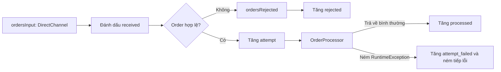

# Counter cho message

> **Chương:** Metrics và observability  
> **Phạm vi:** SPRING_INTEGRATION_CORE — quan sát các luồng thông điệp được xây dựng bằng Message, MessageChannel, endpoint và Java DSL.

Một luồng xử lý đơn hàng nhận 1.000 message nhưng chỉ hoàn thành 930 lần xử lý. Con số còn lại có thể nằm trong hàng đợi, bị filter loại bỏ, đang retry hoặc đã thất bại. Nếu chỉ có một biến `messageCount`, người vận hành không biết biến đó đại diện cho sự kiện nào.

Bài học này hướng dẫn thiết kế counter có ý nghĩa rõ ràng, đặt điểm tăng counter trong Spring Integration và đọc số liệu theo cửa sổ thời gian. Ví dụ xuyên suốt dùng một flow nhận đơn hàng, loại đơn không hợp lệ và xử lý các đơn còn lại.

## 1. Mục tiêu và kiến thức cần có

Sau bài học, bạn có thể:

- Phân biệt số message đi vào flow, số lần thử xử lý và số lần xử lý hoàn thành.
- Dùng `MeterRegistry` và `Counter` để ghi nhận các sự kiện của message.
- Chọn điểm đếm ở endpoint hoặc channel theo câu hỏi cần trả lời.
- Dùng tag có số lượng giá trị hữu hạn, tránh tạo một chuỗi thời gian cho từng message.
- Đọc throughput và tỷ lệ thất bại mà không cộng nhầm các điểm đo.
- Kiểm tra hành vi đếm khi message bị loại, phát sinh lỗi hoặc được thử lại.

Bạn nên biết `Message<T>`, `DirectChannel`, filter và service activator trong Java DSL. Các ví dụ Java sử dụng Java 17 và API của Spring Integration 6.x. Khi áp dụng vào dự án, dùng các phiên bản Spring và Micrometer tương thích theo BOM của dự án.

## 2. Counter đếm sự kiện nào?

### 2.1. Đơn vị đếm phải được định nghĩa trước

Trong bài này, mỗi lần một sự kiện xác định xảy ra sẽ tăng counter tương ứng thêm `1`. “Một message” chưa đủ làm hợp đồng đo; cần nói rõ message đi qua điểm nào và trong điều kiện nào.

Ví dụ:

| Counter theo sự kiện | Thời điểm tăng | Câu hỏi trả lời |
|---|---|---|
| `received` | Message đi vào bước đầu tiên được đo của flow | Flow đã tiếp nhận bao nhiêu lượt đi qua bước này? |
| `rejected` | Message đi tới nhánh discard của filter | Bao nhiêu lượt bị loại theo quy tắc? |
| `attempt` | Ngay trước mỗi lần gọi bộ xử lý nghiệp vụ | Bộ xử lý đã được gọi bao nhiêu lần? |
| `processed` | Bộ xử lý trả về bình thường | Bao nhiêu lần gọi đã hoàn thành bình thường? |
| `attempt_failed` | Lần gọi bộ xử lý ném `RuntimeException` | Bao nhiêu lần thử đã thất bại theo phạm vi bắt lỗi này? |

`received` trong bảng là sự kiện do ứng dụng định nghĩa. Nó không mặc nhiên đồng nghĩa với nhận từ broker, nhận từ một `QueueChannel` hay nhận ở gateway. Hợp đồng đo phải nêu chính xác ranh giới đó.

Một đơn hàng được gửi lại hai lần có thể tạo hai sự kiện `received`. Một lần nhận có retry ba lần có thể tạo ba sự kiện `attempt`. Counter không tự nhận diện các sự kiện cùng thuộc một đơn hàng.

### 2.2. Counter, gauge và timer

`Counter` biểu diễn số lần xuất hiện của một sự kiện; các lần tăng sử dụng lượng dương. Khi cần tốc độ, tính từ biến động của counter trong một khoảng thời gian. Nếu đã có `Timer` cho đúng sự kiện cần đo, có thể dùng số lượt ghi nhận của timer. [Tài liệu Counter của Micrometer](https://docs.micrometer.io/micrometer/reference/concepts/counters.html)

Trong thiết kế của bài:

| Câu hỏi | Loại metric phù hợp |
|---|---|
| Có bao nhiêu lượt bị filter loại? | Counter |
| Hiện có bao nhiêu message chờ trong queue? | Gauge |
| Mỗi lần xử lý mất bao lâu và đã xử lý bao nhiêu lần? | Timer |
| Hiện có bao nhiêu công việc đang chạy? | Gauge hoặc phép đo đang thực thi phù hợp |

Không dùng `counter.increment(-1)` khi một message rời queue. Số message đang chờ có thể tăng và giảm; đó là trạng thái hiện tại, cần được đo bằng gauge.

Với registry tích lũy như `SimpleMeterRegistry` trong ví dụ, `count()` cho biết tổng số sự kiện kể từ lúc meter được tạo trong tiến trình đó. Không suy rộng cách đọc trực tiếp này cho mọi backend: registry theo từng chu kỳ có thể xuất số liệu theo chu kỳ của backend.

## 3. Chọn điểm đếm trong Spring Integration

Xét flow:



Một message hợp lệ xử lý thành công làm tăng `received`, `attempt` và `processed`. Ba lần tăng này mô tả ba sự kiện của cùng một lượt xử lý, không phải ba message độc lập.

### 3.1. Đếm ở channel và đếm ở endpoint trả lời các câu hỏi khác nhau

| Điểm đo | Ý nghĩa | Giới hạn cần nhớ |
|---|---|---|
| `ChannelInterceptor.preSend` | Lời gọi gửi đã đi tới interceptor này | Việc gửi vẫn có thể bị chặn hoặc thất bại |
| Sau khi `send()` trả về `true` | Channel báo gửi thành công theo cơ chế của nó | Chưa đủ để kết luận nghiệp vụ đã hoàn tất ở luồng bất đồng bộ |
| Bắt đầu endpoint nghiệp vụ | Một lần xử lý đã thực sự bắt đầu | Có thể đếm lại do retry |
| Sau khi phương thức nghiệp vụ trả về | Lần gọi đó kết thúc bình thường | Chưa bảo đảm một giao dịch bao ngoài đã commit |
| Nhánh discard của filter | Message đã đi vào nhánh loại bỏ được cấu hình | Không nên gom với lỗi kỹ thuật |
| Nhánh xử lý lỗi | Message lỗi đã tới nhánh đó | Không phải mọi exception đều tự đi qua nhánh này |

Với `DirectChannel` trong ví dụ, subscriber chạy đồng bộ trên luồng gọi. Nếu endpoint ném lỗi, người gửi quan sát được lỗi của lời gọi gửi. Với `ExecutorChannel` hoặc luồng có queue, công việc phía sau có thể chưa hoàn tất khi người gửi nhận kết quả gửi thành công.

Vì vậy, tên “send thành công” và “xử lý hoàn thành” phải được giữ riêng. Đặt counter ở gần sự kiện muốn đo sẽ giúp việc đọc dashboard ít phụ thuộc vào giả định về kiểu channel.

### 3.2. Tận dụng metric có sẵn khi phù hợp

Spring Integration có các meter kỹ thuật sau trong cơ chế Micrometer metrics trực tiếp:

| Meter | Loại | Phạm vi điển hình |
|---|---|---|
| `spring.integration.send` | Timer | Channel hoặc handler; phân biệt bằng tag `type` |
| `spring.integration.receive` | Counter | Nhận từ pollable channel hoặc message source |

Dùng `Timer.count()` nếu cần số lượt đã ghi nhận ở timer đó. Khi bật Micrometer Observation cho component, đường thu thập và tên meter có thể khác; cần đối chiếu cấu hình đang dùng. [Metrics and Management của Spring Integration](https://docs.spring.io/spring-integration/reference/metrics.html)

Counter riêng trong phần tiếp theo phục vụ các mốc nghiệp vụ như `rejected` và `processed`. Không cộng nó với số lượt của meter kỹ thuật để tạo một “tổng message” chung.

## 4. Thiết kế tên metric và tag

Ví dụ dùng một họ metric:

```text
Tên Micrometer: app.integration.message.events
Tag:
  flow=orders
  event=received | rejected | attempt | processed | attempt_failed
```

Các giá trị `event` là một tập đóng được định nghĩa trong mã nguồn. Mỗi bộ `name + tags` xác định một meter. Họ metric này đếm **sự kiện tại các mốc của flow**, vì vậy truy vấn luôn phải chọn rõ `event`.

Không lấy tổng của cả năm `event` để suy ra số đơn hàng. Với flow này, một lượt thành công tạo ba sự kiện và một lượt bị loại tạo hai sự kiện.

### 4.1. Giới hạn cardinality

Cardinality là số tổ hợp giá trị tag có thể xuất hiện. Nếu một metric có 10 flow và 5 loại sự kiện, thiết kế này tạo tối đa 50 tổ hợp trong mỗi instance, trước khi tính tag chung.

Nếu thêm `orderId` với một triệu giá trị, số tổ hợp có thể tăng lên hàng triệu. Dùng `orderId`, `messageId` hoặc `traceId` trong log hay trace để tìm một message cụ thể, thay vì biến chúng thành tag metric.

| Tag | Cách dùng phù hợp |
|---|---|
| `flow` | Tên flow ổn định, như `orders` hoặc `invoices` |
| `event` | Enum hoặc tập giá trị cố định |
| `reason` | Mã lý do đã chuẩn hóa, như `invalid_amount` |
| `orderId` | Đưa vào log hoặc trace |
| `exceptionMessage` | Ghi chi tiết trong log; tránh dùng làm tag |
| Toàn bộ payload | Không dùng làm tag |

Ngay cả `reason` cũng cần danh sách hữu hạn. Thông báo lỗi chứa dữ liệu đầu vào không trở thành giá trị ổn định chỉ vì được đặt dưới tên tag `reason`.

### 4.2. Tạo và giữ tham chiếu counter

Đăng ký các counter cố định lúc khởi tạo bean và giữ tham chiếu để dùng lại. Trong đường xử lý message, chỉ gọi `increment()`. Cách này làm hợp đồng đo dễ tìm trong code và tránh lặp lại thao tác dựng tên, tag cho từng message.

Không cần dùng một biến đếm `static long` rồi tự tăng. Meter phải được đăng ký vào registry mà ứng dụng thực sự xuất ra hệ thống giám sát.

## 5. Ví dụ đầy đủ bằng Java DSL

### 5.1. Thư viện và phạm vi ví dụ

Các dependency cần có:

| Dependency | Mục đích |
|---|---|
| `org.springframework.integration:spring-integration-core` | Channel, endpoint và Java DSL |
| `io.micrometer:micrometer-core` | Counter, MeterRegistry và SimpleMeterRegistry |
| `org.junit.jupiter:junit-jupiter`, phạm vi test | Kiểm tra hành vi đếm |

Chọn version theo BOM đang dùng; ví dụ không cố định một tổ hợp version riêng.

Đoạn cấu hình bên dưới là một ví dụ độc lập, dùng `SimpleMeterRegistry` để quan sát trong bộ nhớ. Nó chưa mở HTTP endpoint và chưa gửi dữ liệu tới Prometheus. `simulateFailure` chỉ dùng để tạo lỗi có thể dự đoán trong bài thực hành.

### 5.2. Cấu hình flow và các counter

Trong ví dụ, lớp có tên `MessageCounterConfiguration`, package `example.metrics`:

```java
package example.metrics;

import io.micrometer.core.instrument.Counter;
import io.micrometer.core.instrument.MeterRegistry;
import io.micrometer.core.instrument.simple.SimpleMeterRegistry;

import org.springframework.context.annotation.Bean;
import org.springframework.context.annotation.Configuration;
import org.springframework.integration.channel.DirectChannel;
import org.springframework.integration.config.EnableIntegration;
import org.springframework.integration.dsl.IntegrationFlow;

@Configuration(proxyBeanMethods = false)
@EnableIntegration
public class MessageCounterConfiguration {

    @Bean
    public MeterRegistry meterRegistry() {
        return new SimpleMeterRegistry();
    }

    @Bean
    public MessageCounters messageCounters(MeterRegistry registry) {
        return new MessageCounters(registry);
    }

    @Bean
    public OrderProcessor orderProcessor() {
        return new OrderProcessor();
    }

    @Bean
    public DirectChannel ordersInput() {
        return new DirectChannel();
    }

    @Bean
    public DirectChannel ordersRejected() {
        return new DirectChannel();
    }

    @Bean
    public IntegrationFlow ordersFlow(
            MessageCounters counters,
            OrderProcessor processor) {

        return IntegrationFlow.from("ordersInput")
                .handle(Order.class, (order, headers) -> {
                    counters.received();
                    return order;
                }, endpoint -> endpoint.id("orders.recordReceipt"))
                .filter(
                        Order.class,
                        Order::isValid,
                        endpoint -> endpoint
                                .discardChannel("ordersRejected"))
                .handle(Order.class, (order, headers) -> {
                    counters.attempt();
                    try {
                        processor.process(order);
                        counters.processed();
                        return null;
                    }
                    catch (RuntimeException ex) {
                        counters.attemptFailed();
                        throw ex;
                    }
                }, endpoint -> endpoint.id("orders.process"))
                .get();
    }

    @Bean
    public IntegrationFlow rejectedOrdersFlow(
            MessageCounters counters) {

        return IntegrationFlow.from("ordersRejected")
                .handle(message -> counters.rejected())
                .get();
    }

    public record Order(
            String id,
            long amount,
            boolean simulateFailure) {

        public boolean isValid() {
            return amount > 0;
        }
    }

    public static final class OrderProcessor {

        public void process(Order order) {
            if (order.simulateFailure()) {
                throw new IllegalStateException(
                        "Simulated processing failure");
            }
            // Điểm thay thế bằng nghiệp vụ thực tế của ứng dụng.
        }
    }

    public static final class MessageCounters {

        private final Counter received;
        private final Counter rejected;
        private final Counter attempt;
        private final Counter processed;
        private final Counter attemptFailed;

        public MessageCounters(MeterRegistry registry) {
            this.received = register(registry, "received");
            this.rejected = register(registry, "rejected");
            this.attempt = register(registry, "attempt");
            this.processed = register(registry, "processed");
            this.attemptFailed = register(
                    registry, "attempt_failed");
        }

        private static Counter register(
                MeterRegistry registry,
                String event) {

            return Counter.builder(
                            "app.integration.message.events")
                    .description(
                            "Message lifecycle events in the orders flow")
                    .tags("flow", "orders", "event", event)
                    .register(registry);
        }

        public void received() {
            received.increment();
        }

        public void rejected() {
            rejected.increment();
        }

        public void attempt() {
            attempt.increment();
        }

        public void processed() {
            processed.increment();
        }

        public void attemptFailed() {
            attemptFailed.increment();
        }
    }
}
```

### 5.3. Đọc đúng hành vi của cấu hình

Endpoint `orders.recordReceipt` trả lại payload để tiếp tục flow sau khi đếm. Đây là bước đánh dấu quan sát; nó không thay đổi dữ liệu nghiệp vụ.

Filter chỉ cho đơn có `amount > 0` đi tiếp. Đơn không hợp lệ được chuyển tới `ordersRejected`; endpoint ở nhánh đó tăng `rejected` và kết thúc xử lý. Trong ví dụ này, loại do quy tắc không ném exception.

Endpoint cuối tăng `attempt` trước lời gọi nghiệp vụ. Nếu phương thức trả về bình thường, nó tăng `processed`. Nếu có `RuntimeException`, nó tăng `attempt_failed` rồi ném lại exception để giữ nguyên tín hiệu lỗi cho Spring Integration.

`return null` kết thúc nhánh thành công của flow một chiều. Không có message trả lời cho một request-reply gateway trong cấu hình này. Nếu nối gateway chờ reply vào đây, cần thiết kế thêm kết quả trả lời hoặc cấu hình lời gọi một chiều phù hợp.

Phạm vi `attempt_failed` ở ví dụ là `RuntimeException` phát sinh trong khối `try`. Nó không đại diện cho lỗi chuyển đổi payload trước endpoint, lỗi filter, lỗi ở một flow khác hay toàn bộ lỗi của JVM.

`processed` chỉ có nghĩa `OrderProcessor.process` đã trả về. Ví dụ không có broker acknowledgement, transaction hay retry; không suy ra các bảo đảm đó từ tên counter.


## 6. Kiểm tra số đếm theo từng đường đi

Đoạn kiểm thử dưới đây dùng một Spring context riêng, không cần broker hay HTTP server. Nó xác nhận cả kết quả gửi và các mốc đếm của ba đường đi chính.

Lớp kiểm thử sử dụng cùng package `example.metrics`:

```java
package example.metrics;

import io.micrometer.core.instrument.MeterRegistry;

import org.junit.jupiter.api.Test;
import org.springframework.context.annotation.AnnotationConfigApplicationContext;
import org.springframework.messaging.MessageChannel;
import org.springframework.messaging.MessagingException;
import org.springframework.messaging.support.MessageBuilder;

import example.metrics.MessageCounterConfiguration.Order;

import static org.junit.jupiter.api.Assertions.assertEquals;
import static org.junit.jupiter.api.Assertions.assertThrows;
import static org.junit.jupiter.api.Assertions.assertTrue;

class MessageCounterConfigurationTest {

    @Test
    void countsReceivedRejectedAndProcessingOutcomes() {
        try (var context = new AnnotationConfigApplicationContext(
                MessageCounterConfiguration.class)) {

            MessageChannel input = context.getBean(
                    "ordersInput", MessageChannel.class);
            MeterRegistry registry = context.getBean(
                    MeterRegistry.class);

            assertEquals(0.0, count(registry, "received"));

            assertTrue(input.send(MessageBuilder.withPayload(
                    new Order("ORD-001", 100_000, false))
                    .build()));

            assertTrue(input.send(MessageBuilder.withPayload(
                    new Order("ORD-002", 0, false))
                    .build()));

            assertThrows(MessagingException.class,
                    () -> input.send(MessageBuilder.withPayload(
                            new Order("ORD-003", 200_000, true))
                            .build()));

            assertEquals(3.0, count(registry, "received"));
            assertEquals(1.0, count(registry, "rejected"));
            assertEquals(2.0, count(registry, "attempt"));
            assertEquals(1.0, count(registry, "processed"));
            assertEquals(1.0, count(registry, "attempt_failed"));
        }
    }

    private static double count(
            MeterRegistry registry,
            String event) {

        return registry.get("app.integration.message.events")
                .tags("flow", "orders", "event", event)
                .counter()
                .count();
    }
}
```

Kết quả mong đợi cho từng message:

| Message | received | rejected | attempt | processed | attempt_failed |
|---|---:|---:|---:|---:|---:|
| ORD-001: hợp lệ, xử lý bình thường | 1 | 0 | 1 | 1 | 0 |
| ORD-002: amount bằng 0 | 1 | 1 | 0 | 0 | 0 |
| ORD-003: hợp lệ, bộ xử lý ném lỗi | 1 | 0 | 1 | 0 | 1 |
| **Tổng** | **3** | **1** | **2** | **1** | **1** |

Ở đây các counter được đăng ký ngay khi tạo bean nên vẫn có thể đọc giá trị `0` trước khi flow nhận message. Không mặc định mọi meter tự động của framework cũng được đăng ký trước lần sử dụng đầu tiên.

### 6.1. Những quan hệ có thể kiểm tra

Sau khi cả ba lời gọi đồng bộ đã kết thúc, với dữ liệu và phạm vi lỗi của ví dụ:

```text
received = rejected + attempt
attempt  = processed + attempt_failed
```

Các quan hệ này cần những điều kiện cụ thể:

- Mỗi message đều có payload `Order` và đi qua đúng một nhánh.
- Không có lỗi giữa bước `received` và việc vào nhánh discard hoặc xử lý.
- Chưa có retry, redelivery, splitter hay fan-out.
- Không còn lần xử lý nào đang thực thi khi so sánh.

Đây là quan hệ của topology và hợp đồng đo đã chọn. Khi thay topology, cần xác định lại quan hệ; không biến nó thành một định luật cho mọi flow Spring Integration.

Với flow bất đồng bộ, kiểm thử phải đợi điều kiện hoàn thành có thời hạn. Đọc counter ngay sau `send()` có thể thấy trạng thái trung gian dù flow hoạt động đúng.

## 7. Khi cần đếm kết quả gửi ở channel

Đôi khi câu hỏi vận hành là “channel báo kết quả gửi ra sao?”, không phải “nghiệp vụ kết thúc ra sao?”. Có thể gắn interceptor vào đúng channel cần theo dõi.

Đoạn dưới là **phương án thay thế bean `ordersInput`** trong ví dụ, không phải một bean thứ hai có cùng tên. Cần thêm import `ChannelInterceptor`, `Message` và `MessageChannel` như bên dưới:

```java
import org.springframework.messaging.Message;
import org.springframework.messaging.MessageChannel;
import org.springframework.messaging.support.ChannelInterceptor;

@Bean
public DirectChannel ordersInput(MeterRegistry registry) {
    Counter sent = Counter.builder("app.integration.channel.sends")
            .tags("channel", "ordersInput", "result", "sent")
            .register(registry);

    Counter refused = Counter.builder("app.integration.channel.sends")
            .tags("channel", "ordersInput", "result", "refused")
            .register(registry);

    Counter failed = Counter.builder("app.integration.channel.sends")
            .tags("channel", "ordersInput", "result", "exception")
            .register(registry);

    DirectChannel channel = new DirectChannel();
    channel.addInterceptor(new ChannelInterceptor() {
        @Override
        public void afterSendCompletion(
                Message<?> message,
                MessageChannel messageChannel,
                boolean wasSent,
                Exception exception) {

            if (exception != null) {
                failed.increment();
            }
            else if (wasSent) {
                sent.increment();
            }
            else {
                refused.increment();
            }
        }
    });
    return channel;
}
```

`afterSendCompletion` nhận cả cờ kết quả và exception. Callback này có điều kiện: `preSend` của interceptor phải hoàn tất và trả về message. Vì vậy, nó không bảo đảm quan sát mọi lời gọi bị chặn trước khi tới interceptor. [Javadoc ChannelInterceptor](https://docs.spring.io/spring-framework/docs/current/javadoc-api/org/springframework/messaging/support/ChannelInterceptor.html)

Với ba message ở kiểm thử chính, nếu dùng phương án này:

- ORD-001 làm tăng `result=sent`.
- ORD-002 cũng làm tăng `result=sent`, vì luồng discard đã xử lý bình thường.
- ORD-003 làm tăng `result=exception`, do bộ xử lý đồng bộ ném lỗi.

Kết quả đó cho thấy `result=sent` không phải số đơn hợp lệ. Nếu thay bằng một channel có queue, việc gửi được chấp nhận cũng không cho biết consumer đã xử lý xong.

Giữ họ metric `channel.sends` riêng với `message.events`. Chọn metric theo câu hỏi cần trả lời và tránh tạo nhiều phép đo trùng nghĩa cho cùng một sự kiện.

## 8. Đưa số liệu ra hệ thống giám sát

### 8.1. Registry trong bộ nhớ và registry xuất dữ liệu

`SimpleMeterRegistry` phù hợp cho ví dụ và kiểm thử. Để Prometheus thu thập, cần registry Prometheus cùng endpoint HTTP xuất dữ liệu scrape. Trong ứng dụng Spring Boot, có thể dùng Actuator và dependency `io.micrometer:micrometer-registry-prometheus`. [Tích hợp Prometheus của Micrometer](https://docs.micrometer.io/micrometer/reference/implementations/prometheus.html)

Khi chuyển cấu hình ví dụ sang ứng dụng Boot đã tự cấu hình registry, bỏ bean `meterRegistry()` tạo `SimpleMeterRegistry` của ví dụ và tiêm `MeterRegistry` do ứng dụng cung cấp. Các counter nghiệp vụ vẫn đăng ký vào cùng registry đó.

Một cấu hình exposure tối thiểu trong ứng dụng Boot có Actuator:

```properties
management.endpoints.web.exposure.include=health,prometheus
```

Với base path mặc định, dữ liệu Prometheus nằm ở `/actuator/prometheus`. Việc mở endpoint là một phần của cấu hình xuất số liệu; backend vẫn cần được cấu hình để scrape từng instance.

Theo quy ước tên mặc định của registry Prometheus, counter ví dụ được xuất thành:

```text
app_integration_message_events_total{flow="orders",event="received"} 3.0
app_integration_message_events_total{flow="orders",event="rejected"} 1.0
app_integration_message_events_total{flow="orders",event="attempt"} 2.0
app_integration_message_events_total{flow="orders",event="processed"} 1.0
app_integration_message_events_total{flow="orders",event="attempt_failed"} 1.0
```

Đây là minh họa cho các series nghiệp vụ, chưa thể hiện tag chung hay thông tin bổ sung của exporter. Kiểm tra tên thực tế được xuất nếu ứng dụng có bộ lọc hoặc quy ước đặt tên riêng. Trong Java vẫn tra cứu bằng tên Micrometer `app.integration.message.events`.

### 8.2. Throughput là tốc độ theo thời gian

Nếu counter tích lũy tăng từ 10.000 lên 10.600 trong 60 giây, tốc độ trung bình trong khoảng đó là:

```text
(10.600 - 10.000) / 60 = 10 sự kiện/giây
```

Phép trừ đơn giản này giả định không reset. Với Prometheus, dùng `rate` để tính tốc độ mỗi giây và xử lý counter reset; dùng `increase` để ước lượng mức tăng trong cửa sổ. Áp dụng `rate` cho từng series trước khi tổng hợp các instance. [Các hàm truy vấn Prometheus](https://prometheus.io/docs/prometheus/latest/querying/functions/#rate)

Tốc độ message đi vào bước nhận của mỗi flow:

```promql
sum by (flow) (
  rate(app_integration_message_events_total{
    event="received"
  }[5m])
)
```

Tốc độ hoàn thành xử lý:

```promql
sum by (flow) (
  rate(app_integration_message_events_total{
    event="processed"
  }[5m])
)
```

Hai truy vấn đo hai sự kiện khác nhau. Khoảng cách giữa chúng có thể liên quan đến message bị loại, các lần xử lý thất bại hoặc công việc chưa hoàn tất; cần đối chiếu các metric liên quan.

Không dùng tổng counter tích lũy để so trực tiếp hai instance có thời điểm khởi động khác nhau. Instance tồn tại lâu hơn thường có tổng lớn hơn dù hiện tại nhận ít tải hơn.

### 8.3. Tỷ lệ thất bại phải có mẫu số đúng

Với hợp đồng đo của bài, tỷ lệ thất bại của **lần thử** là:

```text
Số lần thử thất bại / Tổng số lần thử
```

PromQL:

```promql
sum by (flow) (
  rate(app_integration_message_events_total{
    event="attempt_failed"
  }[5m])
)
/
sum by (flow) (
  rate(app_integration_message_events_total{
    event="attempt"
  }[5m])
)
```

Đây không phải tỷ lệ đơn hàng thất bại cuối cùng. Nếu một đơn thất bại hai lần rồi thành công, tỷ lệ lần thử thất bại phản ánh hai lỗi, dù kết quả cuối của đơn là thành công.

Khi không có lượt thử, phép chia có thể không cho giá trị tỷ lệ hữu ích. Dashboard nên thể hiện “chưa có lưu lượng” khi phù hợp; cảnh báo tỷ lệ cần thêm điều kiện có đủ mẫu. Không tự ép mẫu số về `1` rồi xem đó là tỷ lệ đúng.

Một giá trị `increase` có thể có phần thập phân do cách ước lượng tại biên cửa sổ. Nó không thay thế danh sách message hay sổ đối soát nghiệp vụ.

## 9. Counter khi topology hoặc cơ chế thực thi thay đổi

### 9.1. Retry: một message, nhiều lần thử

Giả sử một message được nhận một lần. Bộ xử lý thất bại hai lần rồi thành công ở lần thứ ba:

| Sự kiện | Số tăng |
|---|---:|
| `received` | 1 |
| `attempt` | 3 |
| `attempt_failed` | 2 |
| `processed` | 1 |

Kết quả này đúng nếu điểm tăng `attempt` và `attempt_failed` nằm bên trong đoạn thực thi được retry. Nếu counter nằm bên ngoài toàn bộ cơ chế retry, nó có thể chỉ thấy một lời gọi bao ngoài.

Khi thêm retry advice vào endpoint, hãy kiểm tra phạm vi advice bao quanh lời gọi nào. Không chỉ nhìn vào số lần khai báo `increment()` trong mã nguồn để suy ra số đếm thực tế.

Nếu cần đo “thất bại sau khi đã dùng hết retry”, tạo một sự kiện riêng, chẳng hạn `exhausted`, tại ranh giới recovery hoặc xử lý thất bại cuối cùng. Không cộng các lần `attempt_failed` rồi coi đó là số message đã bị bỏ cuộc.

### 9.2. Redelivery và xử lý trùng

Broker hoặc bên gửi có thể gửi lại cùng một yêu cầu nghiệp vụ. Message mới có thể mang cùng `orderId` nhưng khác `MessageHeaders.ID`. Việc so sánh UUID message không tự giải quyết yêu cầu đếm đơn duy nhất.

Với flow ví dụ, gửi lại cùng đơn hai lần làm `received` tăng hai lần. Nếu cần đếm đơn được chấp nhận duy nhất, phải có ranh giới deduplication hoặc idempotency riêng và tăng metric sau quyết định đó.

Tính duy nhất phải dựa trên khóa nghiệp vụ cùng cơ chế lưu trạng thái phù hợp. Counter chỉ quan sát quyết định; nó không cung cấp cơ chế chống trùng.

### 9.3. Router, filter và publish-subscribe

Router chọn nơi message đi tiếp. Nếu mỗi message chỉ đi đúng một nhánh và mỗi nhánh đều được đo, có thể so sánh số nhận trước router với tổng số đi vào các nhánh sau khi xử lý đã ổn định.

Với publish-subscribe, một message đầu vào có thể tạo nhiều lượt xử lý ở subscriber. Nếu có ba subscriber đều nhận, một sự kiện vào có thể tạo ba sự kiện xử lý. Thêm tag nhánh ổn định hoặc đo riêng từng subscriber khi cần nhìn phân bố.

Filter cần có điểm quan sát discard nếu muốn giải thích lưu lượng bị loại. Một luồng im lặng không có nhánh đo discard có thể khiến sự giảm số lượng trông giống mất dữ liệu.

### 9.4. Splitter và aggregator

Một message chứa 10 phần tử có thể được splitter tách thành 10 message con. Khi đó phải đặt tên và mô tả phân biệt:

- Số message batch đi vào splitter.
- Số message phần tử đi ra.
- Số phần tử được xử lý.
- Số nhóm được aggregator phát hành.

Aggregator có thể chờ nhóm, phát hành nhóm một phần hoặc hết hạn nhóm theo cấu hình. Không thể lấy số message trước và sau aggregator để kết luận mất message nếu chưa xác định đơn vị đếm.

### 9.5. Error channel và lỗi đồng bộ

Trong ví dụ dùng `DirectChannel`, exception được ném về người gửi. Không mặc định cứ ném exception là global `errorChannel` sẽ nhận được một `ErrorMessage`.

Ở các ranh giới bất đồng bộ, poller hoặc cấu hình gateway, cơ chế xử lý lỗi có thể chuyển lỗi tới error flow. Nếu tăng counter tại error flow, hãy định nghĩa nó là “số error message tới flow này”, trừ khi đã chứng minh quan hệ một-một với thất bại nghiệp vụ.

Đếm tại khối `catch` và đếm tại error flow có thể cùng quan sát một lỗi ở hai mốc. Dùng chúng như hai phép đo riêng; không cộng vào một tổng lỗi duy nhất.

## 10. Giới hạn về giao dịch, khởi động lại và tính đầy đủ

### 10.1. Counter không rollback cùng dữ liệu nghiệp vụ

Giả sử bộ xử lý tăng `processed`, sau đó giao dịch bao ngoài thất bại lúc commit. Dữ liệu có thể rollback nhưng số đếm đã tăng vẫn còn trong registry của tiến trình.

Nếu câu hỏi là “bao nhiêu giao dịch đã commit”, điểm tăng phải gắn với sự kiện sau commit của giao dịch tương ứng. Nếu câu hỏi là “bao nhiêu kết quả đã được hệ thống đích xác nhận”, cần đo ở ranh giới xác nhận đó.

Ngay cả counter sau commit cũng có thể bỏ sót số liệu nếu tiến trình dừng giữa commit và tăng counter hoặc trước lần scrape tiếp theo. Metric vận hành không tạo ra bảo đảm exactly-once cho dữ liệu nghiệp vụ.

Đối soát đơn hàng, thanh toán hoặc hóa đơn cần dựa vào dữ liệu bền vững như bảng nghiệp vụ, event log hoặc outbox theo thiết kế hệ thống.

### 10.2. Restart và nhiều instance

Counter cục bộ được tạo lại khi instance khởi động lại. Không đọc sự giảm giá trị sau restart như “số message âm”.

Với nhiều instance:

- Giữ thông tin nhận dạng instance trong hệ thống thu thập.
- Tính tốc độ trên từng series rồi mới cộng theo `flow`.
- Kiểm tra cả khả năng thu thập khi một instance biến mất.
- Phân biệt series không tồn tại với series có giá trị `0`.

Một tiến trình có thể tăng counter rồi dừng trước khi backend kịp thu thập. Bởi vậy, throughput và xu hướng lỗi là mục tiêu thích hợp của metric; lịch sử giao nhận đầy đủ cần nguồn dữ liệu khác có tính bền vững.

### 10.3. Số lượng chưa hoàn tất không đơn giản là phép trừ counter

Trong đúng ví dụ một nhánh, không retry, có thể dùng chênh lệch giữa `attempt` và các kết quả để gợi ý công việc đang thực thi. Khi có nhiều thread, các phép đọc meter không tạo thành một snapshot giao dịch.

Để quan sát queue backlog, đo kích thước queue. Để quan sát số công việc đang chạy, dùng phép đo trạng thái đang thực thi. Đừng suy ra backlog tổng quát từ một phép trừ các counter có ranh giới khác nhau.

## 11. Các lỗi thường gặp và cách sửa

| Hiện tượng | Nguyên nhân thường gặp | Cách xử lý |
|---|---|---|
| Một đơn thành công bị tính thành ba message | Cộng `received`, `attempt` và `processed` | Chọn đúng một mốc cho câu hỏi đang đo |
| Counter thành công tăng dù consumer lỗi sau đó | Đếm sau khi enqueue hoặc giao việc bất đồng bộ | Đếm hoàn thành tại endpoint xử lý hoặc ranh giới xác nhận |
| Lỗi xuất hiện nhiều hơn số message nhận | Có retry hoặc đo lỗi ở nhiều mốc | Phân biệt lỗi từng lần thử và lỗi cuối cùng |
| Message không hợp lệ biến mất khỏi dashboard | Chưa đo nhánh discard | Tăng counter khi message vào nhánh discard đã định nghĩa |
| Có quá nhiều time series | Tag chứa ID hoặc nội dung lỗi động | Dùng tag hữu hạn; chuyển chi tiết sang log hoặc trace |
| Có counter trong test nhưng backend không thấy | Counter được đăng ký vào registry khác | Kiểm tra registry được tiêm và đường xuất số liệu |
| Tỷ lệ lỗi không hợp lý khi ít traffic | Mẫu nhỏ hoặc mẫu số không cùng loại sự kiện | Dùng cùng cửa sổ và ranh giới; yêu cầu đủ lượt thử |
| Metric giảm sau khi triển khai lại | Instance khởi động lại | Dùng truy vấn counter có xử lý reset |
| Số hoàn thành khác dữ liệu đã commit | Điểm đếm nằm trước commit | Đặt metric theo ranh giới nghiệp vụ cần quan sát |
| Counter kỹ thuật và nghiệp vụ cho số khác nhau | Hai metric đo hai sự kiện khác nhau | Đọc hợp đồng đo trước khi đối chiếu |

## 12. Áp dụng vào một flow thực tế

Bắt đầu từ một câu hỏi cụ thể, chẳng hạn: “Mỗi phút có bao nhiêu đơn vào bước xác thực, bao nhiêu đơn bị loại và bao nhiêu lần xử lý gặp lỗi?”.

1. Vẽ các ranh giới nhận, discard, xử lý và kết quả của flow.
2. Viết một câu mô tả cho mỗi sự kiện, nêu rõ đơn vị đếm và thời điểm tăng.
3. Kiểm tra meter sẵn có; dùng count của timer nếu nó đã đo đúng sự kiện.
4. Tạo các counter nghiệp vụ còn thiếu, với tên ổn định và tag hữu hạn.
5. Kiểm tra riêng đường thành công, discard và lỗi; bổ sung tình huống retry nếu có.
6. Tạo truy vấn rate và tỷ lệ với cùng ranh giới đo, cùng cửa sổ.
7. Đối chiếu dashboard với log hoặc trace của một vài lượt xử lý để hiểu các nhánh.

Với ví dụ trong bài, một cấu hình đo đạt yêu cầu khi bạn giải thích được vì sao ba message đầu vào tạo ba `received`, một `rejected`, hai `attempt`, một `processed` và một `attempt_failed`. Khi bổ sung retry, queue hoặc aggregator, hợp đồng đo cần tiếp tục giải thích được các con số mới.
