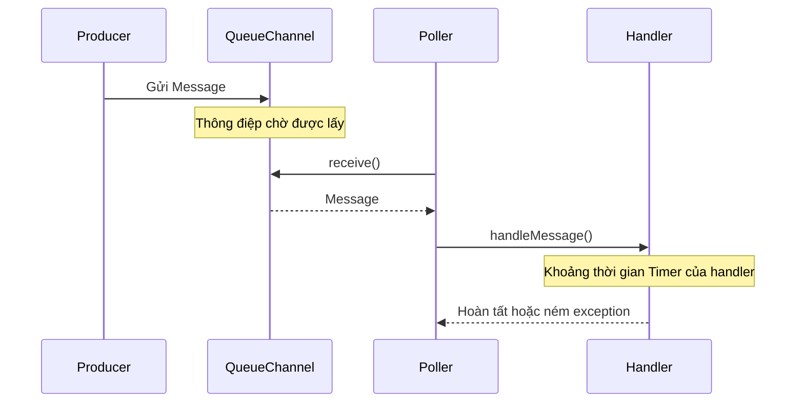

# Timer cho handler

Trong chương **Metrics và observability** của **SPRING_INTEGRATION_CORE**, Timer giúp trả lời hai câu hỏi: handler được gọi bao nhiêu lần và mỗi lần xử lý mất bao lâu. Kết quả đo hỗ trợ tìm điểm chậm trong luồng thông điệp xây bằng Message, MessageChannel, endpoint và Java DSL.

Ví dụ, luồng tiếp nhận đơn hàng có thể xử lý nhanh trong handler nhưng vẫn phản hồi chậm vì thông điệp nằm lâu trong hàng đợi. Ngược lại, một handler có thể trông chậm vì nó gọi đồng bộ cả phần luồng phía sau. Muốn dùng Timer đúng, cần xác định chính xác điểm bắt đầu, điểm kết thúc và ý nghĩa của từng tập nhãn.

## 1. Mục tiêu và phạm vi

Sau bài này, bạn có thể:

- Đọc số lượt, tổng thời gian và thời gian trung bình từ một Timer.
- Xác định handler nào được đo, phân biệt số liệu của handler với channel.
- Cấu hình luồng Java DSL có handler được Micrometer đo tự động.
- Theo dõi riêng các lần xử lý thành công và thất bại.
- Dùng histogram để truy vấn p95 và đọc số liệu của nhiều instance.
- Nhận ra trường hợp cần đo thời gian chờ, thời gian nghiệp vụ hoặc thời gian toàn luồng bằng phép đo khác.

Phần thực hành chọn **Java 17+, Spring Boot 3.5.x và Spring Integration 6.5.x**, sử dụng cơ chế Micrometer metrics trực tiếp. Đây là mốc phiên bản cho ví dụ, không phải yêu cầu nâng hoặc hạ phiên bản dự án hiện tại. Phần cuối giải thích cách nhận diện Timer khi dùng Observation.

Bạn nên biết cách khai báo bean, gửi một `Message` vào `DirectChannel` và nối một handler bằng `IntegrationFlow`.

## 2. Timer ghi nhận những gì?

Một Timer lưu các mẫu thời gian của những lần thực thi đã kết thúc. Nó cung cấp ít nhất số mẫu và tổng thời gian; khả năng xuất max, percentile và histogram tùy registry cùng cấu hình. API đọc thời gian yêu cầu chỉ rõ `TimeUnit`. [Micrometer: Timers](https://docs.micrometer.io/micrometer/reference/concepts/timers.html)

Ví dụ tự xây dựng để đọc số liệu:

| Lần gọi | Thời gian | Kết quả |
| --- | ---: | --- |
| 1 | 20 ms | Thành công |
| 2 | 30 ms | Thành công |
| 3 | 250 ms | Thành công |
| 4 | 10 ms | Thất bại |

Nếu gộp cả bốn mẫu:

```text
count = 4
totalTime = 310 ms
mean = 310 / 4 = 77,5 ms
```

Nếu chỉ chọn các mẫu thành công, trung bình là `300 / 3 = 100 ms`. Hai kết quả đều đúng với tập dữ liệu tương ứng. Vì thế, dashboard phải thể hiện rõ nó đang lọc kết quả nào.

Các khái niệm cần phân biệt:

| Số liệu | Câu hỏi nó trả lời | Cách diễn giải |
| --- | --- | --- |
| Count | Có bao nhiêu lần được ghi nhận? | Số lần gọi handler, chưa chắc là số đơn hàng khác nhau |
| Total time | Tổng thời gian của các mẫu là bao nhiêu? | Có thể cộng thời gian của những lời gọi chạy đồng thời |
| Mean | Trung bình một mẫu mất bao lâu? | Có thể che khuất một nhóm nhỏ xử lý rất chậm |
| p95 | Ngưỡng thời gian mà khoảng 95% mẫu không vượt quá là gì? | Cần xác định cửa sổ truy vấn và cách tính |
| Max | Mẫu lớn nhất trong phạm vi thống kê là bao nhiêu? | Max của Timer có thể theo cửa sổ thời gian, không phải kỷ lục suốt đời |

Micrometer giải thích max và một số thống kê phân phối theo cửa sổ thời gian; không nên coi chúng là giá trị tích lũy vĩnh viễn. [Micrometer: thống kê của Timer](https://docs.micrometer.io/micrometer/reference/concepts/timers.html)

**Ví dụ về tính đồng thời:** hai lời gọi cùng chạy trong một giây, mỗi lời gọi mất một giây, tạo tổng thời gian hai giây. Điều đó không có nghĩa ứng dụng đã chạy hai giây theo đồng hồ thực.

## 3. Ranh giới đo của handler

Trong Spring Integration 6.5, cơ chế metrics trực tiếp của `AbstractMessageHandler` bắt đầu một mẫu trước khi xử lý và dừng mẫu khi lời gọi hoàn tất hoặc ném exception. Exception tiếp tục được ném ra sau khi ghi nhận thất bại. Từ ranh giới này, có thể suy ra các hệ quả ở những ví dụ dưới đây. [Mã nguồn AbstractMessageHandler 6.5](https://raw.githubusercontent.com/spring-projects/spring-integration/6.5.x/spring-integration-core/src/main/java/org/springframework/integration/handler/AbstractMessageHandler.java)

### 3.1. Thời gian chờ trước handler



Giả sử thông điệp chờ trong `QueueChannel` 800 ms rồi được handler xử lý trong 25 ms. Timer của handler phản ánh khoảng xử lý 25 ms, không tự phản ánh 825 ms tính từ lúc gửi.

Muốn phát hiện tồn đọng, cần ghép độ trễ xử lý với độ sâu hàng đợi, tốc độ vào/ra và một phép đo thời gian chờ có điểm bắt đầu, kết thúc rõ ràng. Đừng lấy Timer của thao tác gửi vào hàng đợi để thay cho thời gian nằm trong hàng đợi.

### 3.2. Chuỗi xử lý đồng bộ

Xét luồng:

```text
DirectChannel → handler A → DirectChannel → handler B → kết thúc
```

Nếu handler A tạo kết quả rồi gửi đồng bộ đến B trước khi trả về, khoảng đo A có thể bao gồm thời gian thực thi B. Handler B cũng có Timer riêng cho lời gọi của nó.

Ví dụ A làm việc cục bộ 5 ms và B làm việc 40 ms:

```text
Timer A: xấp xỉ 45 ms, cộng chi phí truyền thông điệp
Timer B: xấp xỉ 40 ms
```

Cộng hai số thành 85 ms sẽ đếm chồng khoảng thực thi B. Muốn đo riêng phần nghiệp vụ bên trong A, hãy đặt Timer tại phương thức nghiệp vụ đó.

### 3.3. Ranh giới bất đồng bộ và aggregator

Với `ExecutorChannel`, cần tách thời gian chờ executor khỏi thời gian handler bắt đầu được gọi. Nếu handler trả về sau khi giao việc sang tác vụ khác, không thể mặc định Timer của lời gọi đó đã bao trùm kết quả hoàn thành ở tác vụ kia. Cần kiểm tra chế độ async, loại adapter và điểm hoàn tất thực tế.

Tương tự, một lần gọi aggregator có thể chỉ thêm một thông điệp vào nhóm rồi kết thúc. Thời gian từ thông điệp đầu tiên đến khi nhóm được release là một đại lượng khác với thời gian của từng lần gọi handler.

## 4. Nhận diện đúng metric và tag

Cơ chế Micrometer metrics trực tiếp dùng tên **`spring.integration.send`** cho cả handler và channel. Timer của handler có các tag sau. Các meter thường được tạo khi thành phần được sử dụng lần đầu. [Spring Integration 6.5: Micrometer Integration](https://docs.spring.io/spring-integration/reference/6.5/metrics.html)

| Thành phần định danh | Giá trị của handler |
| --- | --- |
| Tên meter | `spring.integration.send` |
| `type` | `handler` |
| `name` | Tên component |
| `result` | `success` hoặc `failure` |
| `exception` | `none` hoặc tên lớp exception đơn giản |

Vì một tên meter đại diện nhiều thành phần, truy vấn chỉ theo tên sẽ dễ trộn số liệu. Ví dụ đúng cho một handler cụ thể:

```text
spring.integration.send
    type=handler
    name=orderHandler
    result=success
    exception=none
```

Tên bean của handler và tên endpoint là hai khái niệm riêng. Khi cấu hình Java DSL bằng lambda, không nên suy đoán tên component chỉ từ tên flow hay ID endpoint. Ví dụ thực hành khai báo handler thành bean có tên ổn định để việc truy vấn rõ ràng.

Tag `exception` thể hiện exception quan sát được ở lớp bao quanh handler. Lỗi nghiệp vụ có thể được bọc trong `MessageHandlingException`; không nên mặc định tag luôn mang tên exception ở nguyên nhân sâu nhất.

## 5. Thực hành: Timer tự động cho một handler

### 5.1. Dependency và endpoint quan sát

Trong dự án Maven đã dùng parent hoặc BOM Spring Boot 3.5.x, các dependency cho ví dụ là:

```xml
<dependencies>
    <dependency>
        <groupId>org.springframework.boot</groupId>
        <artifactId>spring-boot-starter-integration</artifactId>
    </dependency>
    <dependency>
        <groupId>org.springframework.boot</groupId>
        <artifactId>spring-boot-starter-actuator</artifactId>
    </dependency>
    <dependency>
        <groupId>org.springframework.boot</groupId>
        <artifactId>spring-boot-starter-web</artifactId>
    </dependency>
    <dependency>
        <groupId>io.micrometer</groupId>
        <artifactId>micrometer-registry-prometheus</artifactId>
    </dependency>
</dependencies>
```

Spring Boot Actuator tự cấu hình hạ tầng Micrometer; registry Prometheus cho phép xuất dữ liệu để Prometheus thu thập. Không cần tự tạo thêm một `SimpleMeterRegistry` cho ứng dụng thực hành này. [Spring Boot 3.5: Metrics](https://docs.spring.io/spring-boot/3.5/reference/actuator/metrics.html)

Cấu hình dưới đây là nội dung minh họa cho `application.yml` trong ứng dụng thực hành:

```yaml
management:
  endpoints:
    web:
      exposure:
        include: health,metrics,prometheus
```

Endpoint `/actuator/metrics` hỗ trợ xem meter và tag, còn `/actuator/prometheus` phục vụ việc scrape dữ liệu. HTTP server ở ví dụ được cung cấp bởi starter web. [Micrometer: xuất metrics Prometheus](https://docs.micrometer.io/micrometer/reference/implementations/prometheus.html)

### 5.2. Ứng dụng Java hoàn chỉnh

Lưu ví dụ Java trong package `example.metrics` của ứng dụng thực hành:

```java
package example.metrics;

import java.util.concurrent.TimeUnit;

import io.micrometer.core.instrument.MeterRegistry;
import io.micrometer.core.instrument.Timer;

import org.springframework.beans.factory.annotation.Qualifier;
import org.springframework.boot.ApplicationRunner;
import org.springframework.boot.SpringApplication;
import org.springframework.boot.autoconfigure.SpringBootApplication;
import org.springframework.context.annotation.Bean;
import org.springframework.integration.channel.DirectChannel;
import org.springframework.integration.config.EnableIntegration;
import org.springframework.integration.config.EnableIntegrationManagement;
import org.springframework.integration.dsl.IntegrationFlow;
import org.springframework.integration.handler.AbstractMessageHandler;
import org.springframework.messaging.Message;
import org.springframework.messaging.MessageHandlingException;
import org.springframework.messaging.support.MessageBuilder;

@SpringBootApplication
@EnableIntegration
@EnableIntegrationManagement(observationPatterns = {})
public class HandlerTimerDemo {

    public static void main(String[] args) {
        SpringApplication.run(HandlerTimerDemo.class, args);
    }

    @Bean
    DirectChannel orderInput() {
        return new DirectChannel();
    }

    @Bean
    OrderHandler orderHandler() {
        return new OrderHandler();
    }

    @Bean
    IntegrationFlow orderFlow(
            @Qualifier("orderInput") DirectChannel input,
            @Qualifier("orderHandler") OrderHandler handler) {

        return IntegrationFlow.from(input)
                .handle(handler)
                .get();
    }

    @Bean
    ApplicationRunner sendExamples(
            @Qualifier("orderInput") DirectChannel input,
            MeterRegistry registry) {

        return args -> {
            input.send(MessageBuilder
                    .withPayload(new Order("O-001", 2)).build());
            input.send(MessageBuilder
                    .withPayload(new Order("O-002", 5)).build());

            try {
                input.send(MessageBuilder
                        .withPayload(new Order("O-003", -1)).build());
            }
            catch (MessageHandlingException ex) {
                System.out.println("Đã quan sát lỗi: "
                        + ex.getClass().getSimpleName());
            }

            for (Timer timer : registry.find("spring.integration.send")
                    .tag("type", "handler")
                    .tag("name", "orderHandler")
                    .timers()) {

                System.out.printf(
                        "%s count=%d totalMs=%.3f meanMs=%.3f%n",
                        timer.getId().getTags(),
                        timer.count(),
                        timer.totalTime(TimeUnit.MILLISECONDS),
                        timer.mean(TimeUnit.MILLISECONDS));
            }
        };
    }

    public record Order(String id, int quantity) {
    }

    static final class OrderHandler extends AbstractMessageHandler {

        @Override
        protected void handleMessageInternal(Message<?> message) {
            Order order = (Order) message.getPayload();
            if (order.quantity() <= 0) {
                throw new IllegalArgumentException(
                        "Số lượng phải lớn hơn 0");
            }
            System.out.printf("Đã tiếp nhận đơn %s, số lượng %d%n",
                    order.id(), order.quantity());
        }
    }
}
```

Handler kế thừa `AbstractMessageHandler` và được Spring quản lý bằng bean `orderHandler`, vì vậy có thể dùng hạ tầng đo của framework. Việc một đối tượng chỉ triển khai interface `MessageHandler` không đủ để khẳng định nó có cùng cơ chế đo tự động. [Spring Integration: phạm vi hỗ trợ metrics](https://docs.spring.io/spring-integration/reference/6.5/metrics.html)

Các điểm cần quan sát:

1. `observationPatterns = {}` giữ ví dụ ở cơ chế metrics trực tiếp. Không thêm cấu hình Observation khác trong lúc đối chiếu tên meter này.
2. Luồng dùng `DirectChannel`, nên khi `send()` kết thúc, handler tương ứng cũng đã hoàn tất hoặc ném lỗi.
3. Handler là điểm kết thúc, không trả kết quả. Vì thế ví dụ không cần `replyChannel`; nếu chuyển sang gateway request/reply thì cần thiết kế đường trả lời.
4. Mã ví dụ in console bên trong handler. Chi phí in console nằm trong thời gian handler; đây là minh họa chức năng, không phải phép đo hiệu năng tải thực.

### 5.3. Kết quả kỳ vọng

Với một lần khởi động, ba thông điệp trên và không có nguồn gửi khác:

| Bộ tag của handler | Count kỳ vọng |
| --- | ---: |
| `result=success, exception=none` | 2 |
| `result=failure` | 1 |
| Tổng các Timer của `orderHandler` | 3 |

Thời gian cụ thể phụ thuộc máy chạy, JVM, logging và mức tải; không cần bằng một con số cố định. Handler thất bại trong ví dụ vẫn có thời gian xử lý được ghi nhận.

Chỉ đếm `type=handler,name=orderHandler`. Nếu cộng thêm Timer của `orderInput` có `type=channel`, bạn đang cộng hai phép đo cho các thao tác khác nhau của cùng luồng.

### 5.4. Xem qua Actuator

Có thể mở endpoint sau sau khi ứng dụng đã xử lý thông điệp:

```text
http://localhost:8080/actuator/metrics/spring.integration.send
```

Để xem riêng lượt thành công của handler:

```text
http://localhost:8080/actuator/metrics/spring.integration.send?tag=type:handler&tag=name:orderHandler&tag=result:success
```

Hãy đối chiếu `availableTags`, `COUNT`, `TOTAL_TIME` và `baseUnit` trong phản hồi thực tế. Nếu bỏ tag `result`, dữ liệu có thể gộp cả các lượt thành công và thất bại. Tên meter ở endpoint này vẫn ở dạng dấu chấm, dù tên xuất cho Prometheus có dạng khác. [Spring Boot: endpoint metrics](https://docs.spring.io/spring-boot/3.5/reference/actuator/metrics.html)

## 6. Thành công kỹ thuật, lỗi nghiệp vụ và retry

### 6.1. Điều gì làm Timer ghi nhận thất bại?

Đối với ranh giới đo đang xét, lời gọi trở về bình thường là thành công kỹ thuật; exception thoát ra là thất bại kỹ thuật. Một handler trả một kết quả nghiệp vụ mang trạng thái `REJECTED` nhưng không ném lỗi vẫn có thể được ghi nhận thành công.

Nếu handler tự bắt exception, ghi log rồi trả về, lớp đo bên ngoài không còn thấy exception đó. Khi cần phân loại `accepted`, `rejected`, `duplicate`, hãy tạo metric nghiệp vụ với tập giá trị hữu hạn.

Transformer, router và filter cũng có hành vi kết thúc khác nhau. Chẳng hạn, filter chủ động loại một thông điệp theo cấu hình không nhất thiết là lỗi kỹ thuật. Không nên đồng nhất số lượt handler thành công với số thông điệp đạt yêu cầu nghiệp vụ.

### 6.2. Retry thay đổi cách hiểu số lượt và thời gian

Giả sử một lần gọi đến handler được bọc bởi retry advice:

```text
Bắt đầu lời gọi handler
    attempt 1: lỗi
    backoff
    attempt 2: thành công
Kết thúc lời gọi handler
```

Nếu retry diễn ra bên trong lời gọi được Timer bao quanh, phép đo có thể phản ánh cả các attempt và backoff như một lần hoàn tất thành công. Nếu thông điệp được gửi lại từ ngoài, khiến `handleMessage()` được gọi thêm lần nữa, count có thể tăng theo mỗi lần gọi mới.

Vì vậy, cần mô tả vị trí retry trước khi kết luận count là số attempt hay số thông điệp ban đầu. Muốn biết số retry, nên đo attempt ở đúng điểm thực thi retry.

### 6.3. Error channel không thay đổi quá khứ của phép đo

Một lỗi có thể được chuyển thành `ErrorMessage` cho luồng xử lý lỗi, tùy endpoint và cơ chế thực thi. Việc luồng lỗi sau đó khôi phục thành công không tự sửa lại mẫu thất bại của handler đã kết thúc trước đó.

Với luồng đồng bộ trong ví dụ, caller bắt lỗi từ `send()`. Khi chuyển sang poller hoặc xử lý bất đồng bộ, cần xác định nơi phát lỗi và cách cấu hình `errorChannel`; không mặc định mọi lỗi đều quay lại thread gửi ban đầu.

## 7. Đo riêng phần nghiệp vụ bằng Timer.Sample

Khi cần đo một đoạn nghiệp vụ nằm trong handler, có thể tạo Timer riêng. Chọn tên diễn tả ranh giới, chẳng hạn `orders.reservation.duration`, để không lẫn với Timer tự động của framework.

Lớp sau nhận một thao tác nghiệp vụ đồng bộ, ghi đúng một mẫu và để exception tiếp tục truyền ra:

```java
package example.metrics;

import io.micrometer.core.instrument.MeterRegistry;
import io.micrometer.core.instrument.Timer;

public final class ReservationTiming {

    private final MeterRegistry registry;
    private final Timer success;
    private final Timer failure;

    public ReservationTiming(MeterRegistry registry) {
        this.registry = registry;
        this.success = Timer.builder("orders.reservation.duration")
                .tag("result", "success")
                .register(registry);
        this.failure = Timer.builder("orders.reservation.duration")
                .tag("result", "failure")
                .register(registry);
    }

    public void run(Runnable reservation) {
        Timer.Sample sample = Timer.start(registry);
        boolean completed = false;
        try {
            reservation.run();
            completed = true;
        }
        finally {
            sample.stop(completed ? success : failure);
        }
    }
}
```

`Timer.Sample` cho phép bắt đầu trước khi biết kết quả và chọn Timer đích khi kết thúc. Hai Timer trong ví dụ được đăng ký một lần, rồi tái sử dụng. [Micrometer: Timer.Sample](https://docs.micrometer.io/micrometer/reference/concepts/timers.html)

Ranh giới của lớp này là thời gian chạy `Runnable`. Nếu Runnable chỉ lập lịch một tác vụ khác rồi trả về, nó đo thời gian lập lịch. Muốn đo đến khi tác vụ thật sự xong, phải dừng mẫu tại điểm hoàn tất tương ứng và bảo đảm mỗi thao tác chỉ dừng một lần.

Không đặt thêm cùng một Timer ở hai lớp bọc cho cùng một ranh giới. Nếu cả Timer nghiệp vụ và Timer framework cùng tồn tại, hãy đọc chúng như hai góc nhìn có phạm vi khác nhau.

## 8. Histogram, p95 và SLO cho một handler

### 8.1. Vì sao cần histogram?

Trung bình 30 ms không cho biết một nhóm nhỏ thông điệp có mất vài giây hay không. Histogram lưu số mẫu trong các khoảng thời gian; backend có thể dùng các bucket để ước lượng percentile.

Percentile tính sẵn ở từng instance không thể gộp bằng cách lấy trung bình các p95. Histogram có thể được gộp theo bucket trước khi tính percentile. [Micrometer: Histograms and Percentiles](https://docs.micrometer.io/micrometer/reference/concepts/histogram-quantiles.html)

### 8.2. Chỉ bật histogram cho handler cần theo dõi

Thêm các import và bean dưới đây vào lớp cấu hình của ứng dụng thực hành:

```java
import java.time.Duration;

import io.micrometer.core.instrument.Meter;
import io.micrometer.core.instrument.config.MeterFilter;
import io.micrometer.core.instrument.distribution.DistributionStatisticConfig;

@Bean
MeterFilter orderHandlerHistogram() {
    return new MeterFilter() {
        @Override
        public DistributionStatisticConfig configure(
                Meter.Id id, DistributionStatisticConfig config) {

            if ("spring.integration.send".equals(id.getName())
                    && "handler".equals(id.getTag("type"))
                    && "orderHandler".equals(id.getTag("name"))) {

                return DistributionStatisticConfig.builder()
                        .percentilesHistogram(true)
                        .serviceLevelObjectives(
                                Duration.ofMillis(50).toNanos(),
                                Duration.ofMillis(100).toNanos(),
                                Duration.ofMillis(250).toNanos())
                        .build()
                        .merge(config);
            }
            return config;
        }
    };
}
```

Cấu hình này áp dụng cho các Timer có đúng tên và hai tag đã chọn, kể cả các tập tag kết quả khác nhau. Các biên SLO là 50 ms, 100 ms và 250 ms. Khi dùng `DistributionStatisticConfig` trực tiếp cho Timer, các giá trị thời gian trên được đưa vào bằng nanosecond; khi xuất Prometheus, đơn vị của chuỗi thời gian là giây.

`merge(config)` giữ các thiết lập còn lại từ cấu hình đã có. MeterFilter cần được đăng ký trước khi meter được tạo; khai báo thành bean giúp Spring Boot đưa cấu hình vào quá trình khởi tạo registry. [Micrometer: cấu hình histogram bằng MeterFilter](https://docs.micrometer.io/micrometer/reference/concepts/histogram-quantiles.html), [Spring Boot: tùy chỉnh metrics](https://docs.spring.io/spring-boot/3.5/reference/actuator/metrics.html)

Thêm bucket không làm handler xử lý nhanh hơn; nó tăng khả năng phân tích phân phối và cũng tăng chi phí lưu trữ. Sau thay đổi này, khởi động lại ứng dụng thực hành rồi tạo tải đủ lớn để đọc một phân phối có ý nghĩa.

### 8.3. Truy vấn Prometheus

Các truy vấn dưới đây dùng tên xuất theo quy ước Prometheus thông thường cho cơ chế metrics trực tiếp. Hãy đối chiếu tên và nhãn trong `/actuator/prometheus` trước khi dùng. Trong hệ thống có nhiều ứng dụng, thêm bộ lọc `job`, môi trường hoặc ứng dụng để chọn đúng nguồn dữ liệu.

**Tốc độ hoàn tất các lần gọi handler, tính theo lần/giây:**

```promql
sum(
  rate(spring_integration_send_seconds_count{
    type="handler",
    name="orderHandler"
  }[5m])
)
```

**Thời gian trung bình trong năm phút, tính theo giây:**

```promql
sum(
  rate(spring_integration_send_seconds_sum{
    type="handler",
    name="orderHandler"
  }[5m])
)
/
sum(
  rate(spring_integration_send_seconds_count{
    type="handler",
    name="orderHandler"
  }[5m])
)
```

**p95 của các lần gọi thành công, gộp các instance được chọn:**

```promql
histogram_quantile(
  0.95,
  sum by (le) (
    rate(spring_integration_send_seconds_bucket{
      type="handler",
      name="orderHandler",
      result="success"
    }[5m])
  )
)
```

Đây là truy vấn cho classic histogram. Cần giữ nhãn `le` khi gộp bucket. p95 là giá trị ước lượng; độ chính xác phụ thuộc khoảng cách bucket và phân phối mẫu. [Prometheus: histograms and summaries](https://prometheus.io/docs/practices/histograms/)

Các lưu ý khi đọc:

- Hai truy vấn đầu gộp cả thành công và thất bại; truy vấn p95 chỉ chọn thành công. Hãy ghi rõ khác biệt này trên dashboard.
- Kết quả trung bình và p95 có đơn vị giây; nhân 1.000 nếu giao diện cần hiển thị mili giây.
- Khi không có mẫu trong cửa sổ, trung bình hoặc p95 có thể không xác định. Điều đó khác với độ trễ bằng 0.
- Ba thông điệp lúc khởi động không đủ tạo biểu đồ tải ổn định. Cần nguồn gửi lặp lại và nhiều lần scrape trong khoảng theo dõi.
- `count` phản ánh mẫu đã hoàn tất; một lời gọi đang treo chưa nhất thiết làm count tăng.

Với SLO “99% lượt thành công hoàn tất trong 100 ms”, có thể đối chiếu bucket `le="0.1"` của tập thành công với count của chính tập đó. Trước hết phải quyết định SLO có tính các lỗi vào mẫu vi phạm hay tách thành mục tiêu tỷ lệ thành công; hai cách sẽ tạo định nghĩa khác nhau.

## 9. Giữ số lượng nhãn có giới hạn

Mỗi tổ hợp tên meter và tag tạo một danh tính meter. Với histogram, mỗi tổ hợp còn có nhiều chuỗi bucket. Vì thế, cần chọn các chiều phân loại có số giá trị kiểm soát được.

| Thông tin | Vị trí phù hợp |
| --- | --- |
| Tên handler ổn định | Tag metric |
| Kết quả `success/failure` | Tag metric |
| Loại luồng thuộc danh sách nhỏ | Có thể làm tag nếu có mục đích phân tích rõ |
| ID đơn hàng hoặc message ID | Log hoặc trace |
| Nội dung exception thay đổi theo dữ liệu | Log |
| Payload đầy đủ | Chỉ dùng ở nơi chẩn đoán được kiểm soát phù hợp |

Ví dụ tự tính: 20 handler × 2 kết quả × 3 vùng triển khai tạo tối đa 120 tổ hợp trước các chiều khác. Nếu thêm ID của 100.000 đơn hàng làm tag, quy mô lý thuyết tăng lên 12 triệu tổ hợp. Bucket histogram tiếp tục nhân số chuỗi cần lưu.

Đặt tên component ổn định cũng giúp so sánh trước và sau khi triển khai. Việc tên handler tự thay đổi theo cấu trúc DSL có thể khiến dashboard tưởng handler cũ ngừng nhận tải.

## 10. Khi ứng dụng dùng Micrometer Observation

Spring Integration từ 6.0 hỗ trợ Observation. Với thành phần được chọn để quan sát, việc sinh metrics được giao cho các `ObservationHandler` trong `ObservationRegistry`, thay cho đường metrics trực tiếp. Convention mặc định của handler dùng Timer `spring.integration.handler` và các khóa như `spring.integration.name`, `spring.integration.type`. [Spring Integration: Micrometer Observation](https://docs.spring.io/spring-integration/reference/metrics.html)

Cấu hình chọn mọi component có thể viết như sau:

```java
@EnableIntegrationManagement(observationPatterns = "*")
```

Đây là cấu hình thay thế cho annotation của ví dụ, cần đi cùng `ObservationRegistry` và handler đo metrics phù hợp. Annotation đơn lẻ không bảo đảm dữ liệu đã được xuất.

| Điểm cần kiểm tra | Metrics trực tiếp trong ví dụ | Observation theo convention mặc định |
| --- | --- | --- |
| Tên Timer của handler | `spring.integration.send` | `spring.integration.handler` |
| Khóa tên component | `name` | `spring.integration.name` |
| Khóa loại component | `type` | `spring.integration.type` |
| Nguồn tạo phép đo | Metrics captor | Observation và ObservationHandler |

Không dùng truy vấn có `name=orderHandler` của cơ chế trực tiếp rồi kết luận Observation bị hỏng. Hãy liệt kê meter thực tế và kiểm tra convention, các tag cùng cấu hình observation handler đang dùng. Những nhãn lỗi bổ sung phụ thuộc hạ tầng Observation; không sao chép nguyên xi giả định về `result` và `exception` sang cơ chế này.

Timer thông thường phục vụ các lượt đã kết thúc. Nếu cần biết có bao nhiêu thao tác vẫn đang chạy hoặc đã chạy quá lâu, hãy xem thêm phép đo cho thao tác đang hoạt động, chẳng hạn LongTaskTimer khi hạ tầng quan sát cung cấp. [Micrometer: Long Task Timers](https://docs.micrometer.io/micrometer/reference/concepts/long-task-timers.html)

## 11. Tự kiểm tra qua tình huống vận hành

### Tình huống A: handler nhanh nhưng người gọi chờ lâu

Số liệu giả định:

```text
Handler mean: 15 ms
Handler p95: 25 ms
Thời gian từ lúc gửi đến hoàn tất: 1.500 ms
Độ sâu hàng đợi: tăng liên tục
```

Một giả thuyết cần kiểm tra là thông điệp chờ lâu trước handler. Hãy đối chiếu tốc độ vào/ra, số worker và thời gian chờ hàng đợi trước khi tối ưu phần nghiệp vụ 15 ms.

### Tình huống B: handler A và B đều chậm gần như nhau

Nếu A gửi kết quả đồng bộ đến B và hai Timer cùng tăng, có thể A đang bao gồm thời gian B. Dùng phép đo bên trong nghiệp vụ hoặc trace để xem B có phải nguồn gây chậm chính không; không cộng hai Timer để suy ra toàn bộ độ trễ.

### Tình huống C: trung bình giảm nhưng số lỗi tăng

Một nhánh lỗi trả về rất nhanh có thể kéo trung bình gộp xuống. Hãy tách `result=success` và `result=failure`, xem thêm tỷ lệ lỗi cùng throughput. Trung bình thấp hơn chưa đủ chứng minh luồng khỏe hơn.

### Tình huống D: không thấy Timer mong đợi

Kiểm tra theo thứ tự:

1. Handler đã thực sự nhận thông điệp chưa? Nhiều meter chỉ xuất hiện khi có hoạt động.
2. Registry dùng để truy vấn có phải registry mà ứng dụng đang ghi nhận không?
3. Bạn đang dùng metrics trực tiếp hay Observation?
4. Tên component thực tế và các tag là gì?
5. Handler có thuộc loại được framework đo tự động không?
6. Có MeterFilter loại meter hoặc cấu hình làm metrics không được xuất không?

## 12. Bài tập thực hành

1. Chạy ví dụ và xác nhận hai lượt thành công, một lượt thất bại của riêng `orderHandler`.
2. Xem riêng Timer của `orderInput` và giải thích vì sao nó khác Timer handler dù dùng chung tên meter.
3. Đổi nhánh dữ liệu không hợp lệ thành ghi log rồi trả về. Dự đoán count theo từng kết quả trước khi chạy lại.
4. Thiết kế phiên bản có hàng đợi; chỉ ra nơi đo thời gian chờ và nơi đo thời gian xử lý. Khi triển khai, nhớ cấu hình poller cho consumer của `QueueChannel`.
5. Bật histogram, tạo tải với nhiều mức thời gian xử lý rồi đối chiếu mean và p95.
6. Mô tả cách dashboard cần đổi khi chuyển sang Observation.

Tiêu chí hoàn thành là xác định được **đúng handler, đúng tập nhãn, đúng ranh giới thời gian và đúng đơn vị**. Khi đọc một biểu đồ Timer, hãy luôn nêu rõ số liệu đó đại diện cho lần gọi nào và phần nào của luồng thông điệp.
