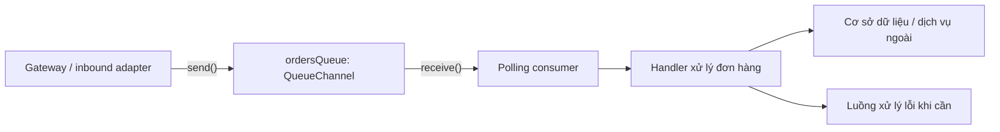

# Send rate và receive rate

## 1. Mục tiêu và bối cảnh

Trong chương **Metrics và observability** của Spring Integration Core, send rate và receive rate giúp trả lời hai câu hỏi: thông điệp đi vào một điểm của luồng nhanh đến mức nào, và được lấy ra nhanh đến mức nào. Khi đặt hai tốc độ cạnh độ sâu hàng đợi, thời gian xử lý và số lỗi, ta có cơ sở để nhận biết luồng đang ổn định, tích tụ công việc hay tạm thời hết dữ liệu.

Bài học sử dụng luồng tiếp nhận đơn hàng: một gateway hoặc inbound adapter tạo `Message`, gửi vào `MessageChannel`, rồi endpoint lấy thông điệp để xử lý. Các khái niệm áp dụng được cho luồng Java DSL có transformer, router, filter hoặc aggregator, nhưng mỗi phép đo phải gắn với một ranh giới cụ thể.

Sau bài học, bạn có thể:

- Phân biệt count, rate, latency và số thông điệp đang chờ.
- Xác định send rate và receive rate có ý nghĩa gì với từng loại channel.
- Lấy số đếm từ Micrometer và tính tốc độ trên một khoảng thời gian.
- Viết truy vấn tốc độ cho Prometheus, đọc được tình huống hàng đợi tăng và chọn bước chẩn đoán tiếp theo.

Kiến thức cần có: `Message<?>`, `MessageChannel.send()`, `PollableChannel.receive()`, `QueueChannel`, endpoint và poller.

## 2. Chọn đúng điểm đo trước khi tính tốc độ

Xét luồng sau:



Có ít nhất ba sự kiện khác nhau:

1. **Đưa vào hàng đợi thành công:** channel đã nhận thông điệp.
2. **Lấy khỏi hàng đợi thành công:** consumer đã lấy được một thông điệp.
3. **Hoàn tất nghiệp vụ:** handler đã đạt điều kiện hoàn thành mà ứng dụng quy định, chẳng hạn giao dịch lưu đơn đã commit.

Trong bài này:

- **Send rate thành công** là số thao tác gửi thành công tại channel được chọn trong một giây.
- **Receive rate thành công** là số thông điệp được lấy ra tại pollable channel được chọn trong một giây.
- **Completion rate** là tốc độ hoàn thành nghiệp vụ; ứng dụng phải chọn và đo ranh giới hoàn thành phù hợp.

Một đơn hàng có thể đã được tính vào receive rate trong khi handler còn đang gọi dịch vụ thanh toán. Nếu lời gọi đó thất bại, bộ đếm lấy khỏi channel không tự trở thành bộ đếm nghiệp vụ thất bại.

Đơn vị thường ghi là `messages/second`, `msg/s` hoặc `ops/s`. Nếu phép đo đếm thao tác gửi, tên panel nên nói rõ điều đó: một thao tác nội bộ không nhất thiết tương ứng với một đơn hàng duy nhất.

## 3. Count và rate khác nhau như thế nào?

### 3.1. Công thức theo cửa sổ thời gian

Gọi:

- `S(t)`: tổng số lần gửi thành công đã ghi nhận tại thời điểm `t`.
- `R(t)`: tổng số lần lấy được thông điệp đã ghi nhận tại thời điểm `t`.
- `Δt = t₂ - t₁`: độ dài khoảng quan sát, tính bằng giây.

Nếu các bộ đếm không bị reset trong khoảng đó:

```text
send_rate    = (S(t₂) - S(t₁)) / Δt
receive_rate = (R(t₂) - R(t₁)) / Δt
```

Ví dụ trong 60 giây:

| Đại lượng | Đầu khoảng | Cuối khoảng | Chênh lệch | Tốc độ |
| --- | ---: | ---: | ---: | ---: |
| Gửi thành công | 10.000 | 17.200 | 7.200 | 120 msg/s |
| Lấy được thông điệp | 9.500 | 15.500 | 6.000 | 100 msg/s |

Count là tổng tích lũy. Rate mô tả hoạt động trong cửa sổ vừa chọn. Hai instance có tuổi đời khác nhau có thể có count rất khác nhau dù đang phục vụ cùng tốc độ. Micrometer khuyến khích dùng tốc độ biến thiên của counter để quan sát tải hiện tại. [Tài liệu Micrometer về counters](https://docs.micrometer.io/micrometer/reference/concepts/counters.html).

### 3.2. Không lấy tổng từ lúc khởi động chia cho thời gian chạy

Giả sử hệ thống từng xử lý 1 triệu thông điệp trong nhiều giờ, nhưng consumer đã dừng trong 5 phút gần nhất. Trung bình từ lúc khởi động vẫn có thể khá cao, trong khi receive rate của 5 phút gần nhất bằng 0.

Cửa sổ cần phù hợp với câu hỏi:

| Khoảng quan sát | Phù hợp để xem | Hạn chế |
| --- | --- | --- |
| Vài chục giây | Biến động ngắn, thử tải có kiểm soát | Dễ dao động khi ít thông điệp |
| Một đến năm phút | Theo dõi hoạt động và cảnh báo | Làm mượt các đợt tăng rất ngắn |
| Mười lăm phút trở lên | Xu hướng tải dài hơn | Phản ánh sự cố mới chậm hơn |

Đây là các khoảng minh họa. Chu kỳ thu thập, tần suất sự kiện và thời gian phản ứng mong muốn quyết định lựa chọn thực tế.

### 3.3. Rate không phải nghịch đảo của latency

Một handler mất trung bình 100 ms không đồng nghĩa toàn luồng luôn đạt 10 msg/s. Kết luận đó chỉ gần đúng với một worker xử lý tuần tự, liên tục có việc và không có thời gian chờ khác.

Nếu có `n` worker độc lập và thời gian phục vụ trung bình là `L` giây, ước lượng sơ bộ khi luôn có việc là:

```text
năng lực phục vụ ≈ n / L
```

Đây là mô hình đơn giản để đặt giả thuyết. Hạn mức dịch vụ ngoài, connection pool, khóa dữ liệu, poller và tài nguyên dùng chung có thể làm năng lực thực tế thấp hơn nhiều.

Timer cũng có count của các sự kiện đã đo, bên cạnh tổng thời gian. Có thể suy ra tốc độ từ phần count này; không cần thêm một counter chỉ để đếm lại cùng sự kiện. [Tài liệu Micrometer về timers](https://docs.micrometer.io/micrometer/reference/concepts/timers.html).

## 4. Ý nghĩa của hai tốc độ theo loại channel

| Loại channel | Ý nghĩa cần chú ý |
| --- | --- |
| `QueueChannel` | `send()` đưa vào hàng đợi; `receive()` lấy ra. Hai tốc độ có thể khác nhau. |
| `DirectChannel` | Gọi handler trên luồng gửi; không có thao tác polling `receive()`. |
| `ExecutorChannel` | Thông thường giao việc qua executor; gửi xong chưa bảo đảm handler đã xong. |
| `PublishSubscribeChannel` | Một lần gửi có thể được phát tới nhiều subscriber; không có polling `receive()`. |

Các đặc điểm này quyết định cách đọc thông lượng và thời gian gửi. [Các triển khai MessageChannel](https://docs.spring.io/spring-integration/reference/channel/implementations.html).

Với `DirectChannel`, send duration có thể bao gồm chuỗi xử lý đồng bộ phía sau. Với `QueueChannel`, send duration chủ yếu phản ánh việc đưa vào queue và có thể gồm thời gian chờ chỗ trống.

Không thấy receive metric cho `DirectChannel` không có nghĩa là consumer ngừng hoạt động. Với luồng này, hãy chọn bộ đếm thực thi handler hoặc bộ đếm nghiệp vụ phù hợp.

Cũng không cộng tất cả channel rate để suy ra số yêu cầu bên ngoài:

- Một thông điệp đi qua ba channel tạo hoạt động gửi ở ba vị trí.
- Splitter có thể biến một thông điệp thành nhiều thông điệp.
- Router chia lưu lượng sang các nhánh.
- Filter có thể dừng một phần thông điệp.
- Aggregator gom nhiều thông điệp thành một kết quả.
- Retry và phát lại có thể làm cùng một công việc xuất hiện nhiều lần.

Do đó, chỉ so sánh hai tốc độ khi đã biết quan hệ giữa hai ranh giới đo. Tốc độ đầu vào gateway và đầu ra aggregator thường không có quan hệ một đổi một.

## 5. Phải đếm đúng sự kiện

### 5.1. Gửi thử, gửi thành công và gửi thất bại

Nên phân biệt:

```text
send_attempt_rate = send_success_rate + send_failure_rate
```

Đẳng thức trên giả định các thao tác trong phạm vi đo đều đã kết thúc và được phân loại đầy đủ. Các thao tác đang chờ chưa nhất thiết xuất hiện trong count của timer.

Một ví dụ dễ quan sát là `QueueChannel` đã đầy. Gọi `send(message, 0)` có thể trả về `false`: có một thao tác gửi thất bại nhưng không thêm thông điệp vào queue. Không dùng tổng số lần thử gửi để tính mức tăng hàng đợi.

Trong cơ chế metrics trực tiếp, đường gửi có nhánh ghi nhận kết quả trả về và nhánh ghi nhận exception. Tình huống trả về `false` vẫn cần được quan sát dù không có exception. [Mã nguồn AbstractMessageChannel 6.5.0](https://raw.githubusercontent.com/spring-projects/spring-integration/v6.5.0/spring-integration-core/src/main/java/org/springframework/integration/channel/AbstractMessageChannel.java).

### 5.2. Polling không có dữ liệu không phải nhận được thông điệp

Trong ví dụ `QueueChannel` của bài học, `receive(0)` trả về `null` khi queue rỗng. Bộ đếm nhận thành công tăng khi có thông điệp được lấy ra, không tăng chỉ vì poller đã thử gọi nhận. Vì vậy, một nghìn lượt kiểm tra queue rỗng vẫn có thể tương ứng với receive count bằng 0. [Mã nguồn AbstractPollableChannel 6.5.0](https://raw.githubusercontent.com/spring-projects/spring-integration/v6.5.0/spring-integration-core/src/main/java/org/springframework/integration/channel/AbstractPollableChannel.java).

Phân biệt ba câu hỏi:

| Câu hỏi | Tín hiệu nên xem |
| --- | --- |
| Poller có chạy không? | Hoạt động scheduler, trạng thái endpoint hoặc phép đo lượt poll |
| Có lấy được thông điệp không? | Receive count/rate thành công |
| Công việc có hoàn thành không? | Kết quả handler và ranh giới hoàn thành nghiệp vụ |

Nếu cần quan sát cả lượt poll rỗng, hãy đặt một phép đo riêng có tên thể hiện rõ ý nghĩa.

### 5.3. Interceptor có thể thay đổi ranh giới quan sát

Channel interceptor cho phép can thiệp trước/sau gửi và nhận. Vì thế, trong hệ thống có interceptor tùy chỉnh, cần xác định phép đo nằm trước hay sau thao tác biến đổi hoặc chặn thông điệp. [Channel Interceptors](https://docs.spring.io/spring-integration/reference/channel/interceptors.html).

Ví dụ của bài học không thêm interceptor. Nhờ vậy, receive thành công có thể được diễn giải trực tiếp là lấy một thông điệp khỏi queue. Khi bổ sung interceptor, không mặc định rằng mọi bộ đếm đều mô tả cùng một sự kiện.

## 6. Đọc metric của Spring Integration

Ở cơ chế Micrometer metrics trực tiếp, các tên và tag chính là:

| Meter | Loại | Tag phân biệt |
| --- | --- | --- |
| `spring.integration.send` | Timer | `type=channel` hoặc `type=handler` |
| `spring.integration.receive` | Counter | `type=channel` hoặc `type=source` |

Chọn thêm `name`, `result=success/failure` và `exception`. Queue có gauge `spring.integration.channel.queue.size`.

Từ Spring Integration 6.0, Observation là một cơ chế khác. Khi component được bật Observation, việc đo được giao cho observation handler; tên có thể là `spring.integration.producer` hoặc `spring.integration.handler`, với tag theo convention. Không dùng nguyên truy vấn của cơ chế trực tiếp cho cơ chế này. [Metrics and Management](https://docs.spring.io/spring-integration/reference/metrics.html).

Trong thực hành, hãy ghi rõ:

```text
component: ordersQueue
operation: send / receive
result: success
instrumentation: Micrometer metrics trực tiếp
window: 5 phút trên dashboard
unit: msg/s
```

Chọn `type=channel` giúp tránh trộn thao tác gửi vào channel với thực thi handler. Nếu ứng dụng có nhiều instance, giữ nhãn instance để chẩn đoán từng máy; chỉ tổng hợp khi muốn xem toàn dịch vụ.

Tên bean nên ổn định như `ordersQueue`. Không dùng mã đơn hàng, UUID hoặc nội dung payload làm tag, vì mỗi giá trị mới có thể tạo thêm chuỗi thời gian.

## 7. Ví dụ Java: đo count rồi tính rate

### 7.1. Phạm vi ví dụ

Ví dụ độc lập dưới đây dùng Java 17 trở lên, Spring Integration 6.5.x và Micrometer tương thích. Các dependency cần có là:

- `org.springframework.integration:spring-integration-core`.
- `io.micrometer:micrometer-core`.

Nếu dự án dùng Spring Boot, lấy phiên bản từ dependency management của dự án. Ví dụ sử dụng Spring context trực tiếp và `SimpleMeterRegistry` để có thể quan sát số đếm mà chưa cần Prometheus.

Cấu hình để `observationPatterns = {}` và không khai báo `ObservationRegistry`. Thuộc tính này chọn component được gắn Observation; mảng rỗng phù hợp với bài thực hành metrics trực tiếp. [API EnableIntegrationManagement](https://docs.spring.io/spring-integration/api/org/springframework/integration/config/EnableIntegrationManagement.html).

### 7.2. Chương trình minh họa

```java
package lesson.observability;

import io.micrometer.core.instrument.Counter;
import io.micrometer.core.instrument.MeterRegistry;
import io.micrometer.core.instrument.Timer;
import io.micrometer.core.instrument.simple.SimpleMeterRegistry;

import org.springframework.context.annotation.AnnotationConfigApplicationContext;
import org.springframework.context.annotation.Bean;
import org.springframework.context.annotation.Configuration;
import org.springframework.integration.channel.QueueChannel;
import org.springframework.integration.config.EnableIntegration;
import org.springframework.integration.config.EnableIntegrationManagement;
import org.springframework.messaging.support.GenericMessage;

@Configuration
@EnableIntegration
@EnableIntegrationManagement(observationPatterns = {})
public class ChannelRateDemo {

    @Bean
    SimpleMeterRegistry meterRegistry() {
        return new SimpleMeterRegistry();
    }

    @Bean
    QueueChannel ordersQueue() {
        return new QueueChannel(10);
    }

    record Snapshot(long sent, double received, long nanoTime) {
    }

    static Snapshot snapshot(MeterRegistry registry) {
        long sent = registry.find("spring.integration.send")
                .tags("type", "channel",
                      "name", "ordersQueue",
                      "result", "success",
                      "exception", "none")
                .timers()
                .stream()
                .mapToLong(Timer::count)
                .sum();

        double received = registry.find("spring.integration.receive")
                .tags("type", "channel",
                      "name", "ordersQueue",
                      "result", "success",
                      "exception", "none")
                .counters()
                .stream()
                .mapToDouble(Counter::count)
                .sum();

        return new Snapshot(sent, received, System.nanoTime());
    }

    public static void main(String[] args) {
        try (var context =
                     new AnnotationConfigApplicationContext(ChannelRateDemo.class)) {

            var registry = context.getBean(SimpleMeterRegistry.class);
            var queue = context.getBean("ordersQueue", QueueChannel.class);

            Snapshot before = snapshot(registry);

            for (int i = 1; i <= 5; i++) {
                boolean sent = queue.send(new GenericMessage<>("ORDER-" + i), 0);
                if (!sent) {
                    throw new IllegalStateException("Không gửi được ORDER-" + i);
                }
            }

            for (int i = 0; i < 3; i++) {
                if (queue.receive(0) == null) {
                    throw new IllegalStateException("Thiếu thông điệp để nhận");
                }
            }

            Snapshot after = snapshot(registry);
            long sentDelta = after.sent() - before.sent();
            double receivedDelta = after.received() - before.received();
            double seconds =
                    (after.nanoTime() - before.nanoTime()) / 1_000_000_000.0;

            System.out.printf("sentDelta=%d%n", sentDelta);
            System.out.printf("receivedDelta=%.0f%n", receivedDelta);
            System.out.printf("queueSize=%d%n", queue.getQueueSize());
            System.out.printf("sendRate=%.2f msg/s%n", sentDelta / seconds);
            System.out.printf("receiveRate=%.2f msg/s%n", receivedDelta / seconds);

            // Lấy nốt hai thông điệp; lần gọi cuối gặp queue rỗng.
            while (queue.receive(0) != null) {
                // Chỉ minh họa thao tác lấy khỏi queue.
            }

            System.out.printf("receivedAfterDrain=%.0f%n",
                    snapshot(registry).received());
            System.out.printf("emptyPoll=%s%n", queue.receive(0));
        }
    }
}
```

Các kết quả đếm mong đợi là:

```text
sentDelta=5
receivedDelta=3
queueSize=2
receivedAfterDrain=5
emptyPoll=null
```

Hai dòng rate phụ thuộc thời gian chạy thực tế nên không có giá trị cố định. Khoảng chạy rất ngắn còn chịu ảnh hưởng của khởi tạo meter, JIT và việc lấy snapshot. Ví dụ chứng minh cách tính; không dùng kết quả đó làm benchmark năng lực hệ thống.

Hàm `snapshot()` dùng `find(...).timers()` và `counters()`. Khi meter chưa xuất hiện, tổng của collection rỗng là 0, nên có thể chụp mốc trước lần gửi/nhận đầu tiên.

Trong ứng dụng thực, snapshot của nhiều meter cũng không phải giao dịch nguyên tử. Sai lệch rất nhỏ có thể xuất hiện khi producer và consumer vẫn đang chạy. Chọn cửa sổ đủ dài và đối chiếu gauge queue thay vì đòi từng mẫu phải khớp tuyệt đối.

### 7.3. Quan sát gửi thất bại khi queue đầy

Sau khi queue đã được lấy hết trong ví dụ trên, có thể thử riêng:

```java
for (int i = 0; i < 10; i++) {
    if (!queue.send(new GenericMessage<>("FILL-" + i), 0)) {
        throw new IllegalStateException("Queue đầy sớm hơn dự kiến");
    }
}

boolean accepted = queue.send(new GenericMessage<>("OVERFLOW"), 0);
System.out.println("accepted=" + accepted);
System.out.println("queueSize=" + queue.getQueueSize());
```

Đoạn này được đặt bên trong scope còn mở của context và không chạy consumer đồng thời. Kết quả mong đợi là `accepted=false`, `queueSize=10`.

Phần count gửi thành công tăng 10. Lượt gửi cuối làm tăng count của nhánh `result=failure, exception=none`, nhưng không làm queue tăng lên 11. Khi đọc rate, giữ hai kết quả thành công và thất bại tách biệt.

### 7.4. Đưa queue vào một endpoint Java DSL

Khi chuyển từ nhận thủ công sang polling consumer, có thể thêm bean sau. Cần import `IntegrationFlow` và `Pollers` từ `org.springframework.integration.dsl`.

```java
@Bean
IntegrationFlow processOrders(QueueChannel ordersQueue) {
    return IntegrationFlow.from(ordersQueue)
            .handle(String.class, (payload, headers) -> {
                System.out.println("Đang xử lý " + payload);
                return null;
            }, endpoint -> endpoint
                    .id("orderProcessor")
                    .poller(Pollers.fixedDelay(1000)
                            .maxMessagesPerPoll(20)))
            .get();
}
```

Đây là cấu hình thay thế để thực hành consumer tự động, không ghép vào bước đếm nhận thủ công ở trên: hai bên sẽ tranh lấy thông điệp và làm thay đổi kết quả.

Trong mô hình một poller tuần tự này, mỗi đợt xử lý tối đa 20 thông điệp, rồi còn thời gian phục vụ và khoảng fixed delay. Con số 20 không phải cam kết 20 msg/s. Nếu mỗi thông điệp mất nhiều thời gian, receive rate thực tế thấp hơn; nếu queue rỗng, số nhận trong đợt cũng thấp hơn.

## 8. Quan sát bằng Prometheus

### 8.1. Giả định về tên xuất ra

Các truy vấn sau dành cho **metrics trực tiếp**, không áp dụng nguyên trạng cho Observation. Giả sử endpoint Prometheus thực tế có:

```text
spring_integration_send_seconds_count{
  job="spring-integration-demo",
  instance="app-1:8080",
  type="channel",
  name="ordersQueue",
  result="success",
  exception="none"
}

spring_integration_receive_total{
  job="spring-integration-demo",
  instance="app-1:8080",
  type="channel",
  name="ordersQueue",
  result="success",
  exception="none"
}
```

Đây là dạng tên thường gặp sau khi registry xuất tên Micrometer sang Prometheus. Hãy xem dữ liệu scrape thực tế trước khi dùng: cấu hình exporter, convention hoặc phiên bản có thể làm tên khác đi. `job` và `instance` trong ví dụ là nhãn do cấu hình thu thập gắn vào.

`SimpleMeterRegistry` trong chương trình trước không tự mở HTTP endpoint. Khi dùng Spring Boot, cấu hình triển khai thường cần Actuator, Prometheus registry và expose endpoint `prometheus`, rồi cấu hình Prometheus scrape endpoint đó.

### 8.2. Send rate thành công

```promql
sum by (job, name) (
  rate(spring_integration_send_seconds_count{
    job="spring-integration-demo",
    type="channel",
    name="ordersQueue",
    result="success"
  }[5m])
)
```

Kết quả thể hiện tổng tốc độ gửi thành công vào `ordersQueue` của các instance thuộc job đã chọn. Muốn xem riêng từng instance, thêm `instance` vào danh sách `by`.

### 8.3. Receive rate thành công

```promql
sum by (job, name) (
  rate(spring_integration_receive_total{
    job="spring-integration-demo",
    type="channel",
    name="ordersQueue",
    result="success"
  }[5m])
)
```

Dùng cùng cửa sổ, cùng job và cùng phạm vi instance khi so sánh với send rate.

`rate()` tính tốc độ trung bình mỗi giây và xử lý reset counter. Luôn tính `rate` cho từng chuỗi trước khi tổng hợp. `increase()` phù hợp khi muốn số sự kiện tăng trong một khoảng; `irate()` dùng hai mẫu cuối nên nhạy với biến động ngắn. [Các hàm truy vấn Prometheus](https://prometheus.io/docs/prometheus/latest/querying/functions/).

### 8.4. Các quy tắc để tránh đọc sai dashboard

- Không lấy `rate()` của gauge queue size để gọi đó là receive rate.
- Không dùng `_seconds_sum` làm số thông điệp; đó là tổng thời gian đã đo.
- Không lấy trung bình đơn giản rate của các instance khi câu hỏi là tổng thông lượng dịch vụ.
- Không cộng trùng các bản scrape cùng một target.
- Giữ nguyên bộ lọc phạm vi khi đặt send rate và receive rate cạnh nhau.
- Chọn cửa sổ có đủ mẫu scrape. Với scrape mỗi 15 giây, cửa sổ 5 phút là điểm bắt đầu thuận tiện cho bài thực hành.

Meter có thể chỉ xuất hiện sau khi thao tác liên quan xảy ra. Một chuỗi không tồn tại hoặc không còn được scrape khác với một chuỗi đang có mẫu và rate bằng 0. Nếu biểu đồ trống, kiểm tra tên metric, nhãn và tình trạng target trước khi kết luận ứng dụng không có tải.

## 9. Dùng chênh lệch tốc độ để đọc hàng đợi

### 9.1. Phương trình cân bằng

Với queue đơn giản, không xóa ngoài luồng, không phát lại vào queue, không restart làm mất dữ liệu và không có thao tác hoàn tác ảnh hưởng nội dung queue:

```text
Q(t₂) - Q(t₁) = Δsend_success - Δreceive_success

tốc độ thay đổi queue ≈ send_success_rate - receive_success_rate
```

Trong đó `Q(t)` là số thông điệp đang nằm trong queue. Công thức mô tả **công việc đang chờ**, không gồm tất cả công việc đã lấy ra nhưng vẫn đang xử lý.

Quay lại ví dụ 60 giây ở trên:

```text
send rate             = 120 msg/s
receive rate          = 100 msg/s
queue tăng trung bình = 20 msg/s
queue tăng trong 60 s = 1.200 thông điệp
```

Nếu xuất phát từ queue có 500 thông điệp, cuối khoảng dự kiến là 1.700. Có thể đối chiếu với gauge queue size; mẫu scrape và các count không nhất thiết được ghi cùng thời điểm nên kết quả có thể lệch nhẹ.

Nếu thực tế không gần với cân bằng này, hãy kiểm tra các đường đưa lại thông điệp, dọn queue, transaction, restart và phạm vi nhãn trước khi kết luận dữ liệu mất.

### 9.2. Khi receive rate lớn hơn send rate

Đây có thể là trạng thái tốt: consumer đang xử lý phần tồn từ trước.

Ví dụ queue có 6.000 thông điệp, đầu vào là 50 msg/s và tốc độ lấy ra duy trì 80 msg/s:

```text
tốc độ rút bớt phần tồn = 80 - 50 = 30 msg/s
thời gian rút hết ước lượng = 6.000 / 30 = 200 giây
```

Ước lượng chỉ hữu ích khi hai tốc độ gần ổn định. Khi queue hết, tốc độ nhận quan sát được sẽ bị giới hạn bởi lượng đầu vào; không thể tiếp tục lấy 80 thông điệp mỗi giây từ queue rỗng.

### 9.3. Ước lượng thời gian đầy queue

Nếu queue có sức chứa `C`, hiện chứa `Q`, và tốc độ vào lớn hơn tốc độ ra:

```text
thời gian đến lúc đầy ≈ (C - Q) / (send_rate - receive_rate)
```

Ví dụ `C=10.000`, `Q=4.000`, send rate 150 và receive rate 100 msg/s:

```text
(10.000 - 4.000) / (150 - 100) = 120 giây
```

Đây là phép ngoại suy để hỗ trợ quyết định vận hành. Khi queue gần đầy, thao tác gửi có thể bị chờ hoặc thất bại, làm thay đổi chính tốc độ đã dùng trong phép tính.

Tăng sức chứa chỉ kéo dài thời gian đệm. Muốn giải quyết tình trạng tích tụ kéo dài, cần cân bằng tốc độ tiếp nhận và năng lực xử lý.

## 10. Đọc các tình huống thường gặp

| Quan sát cùng một phạm vi | Cách hiểu có thể phù hợp | Kiểm tra tiếp |
| --- | --- | --- |
| Send tăng, receive ổn định, queue tăng | Đầu vào vượt tốc độ lấy ra | Poller, worker, thời gian handler, tài nguyên dùng chung |
| Send dương, receive bằng 0, queue tăng | Consumer chưa lấy được việc | Endpoint đã start chưa, scheduler, task bị treo, cấu hình poller |
| Send và receive đều gần 0, queue rỗng | Có thể đang ít tải | Nguồn đầu vào và tình trạng scrape |
| Send và receive đều gần 0, queue còn việc | Luồng có thể đang kẹt hoặc dừng | Thread dump, trạng thái endpoint, lỗi hạ tầng |
| Receive lớn hơn send, queue giảm | Đang xử lý lượng tồn | Queue có giảm đúng xu hướng và lỗi có tăng không |
| Hai rate bằng nhau, queue luôn cao | Lượng tồn chưa được rút bớt | Tuổi thông điệp và độ trễ chờ |
| Hai rate cao, completion thấp | Thông điệp được lấy ra nhưng nghiệp vụ chưa xong | In-flight, timeout, retry, luồng lỗi và commit |

Một cách chẩn đoán có thứ tự:

1. **Kiểm tra dữ liệu quan sát:** target có được scrape, đúng tên meter và đúng label không.
2. **Kiểm tra đầu vào:** nguồn phát có tải, các lượt gửi đang thành công hay thất bại.
3. **Kiểm tra ranh giới queue:** độ sâu và hai tốc độ có phù hợp với nhau không.
4. **Kiểm tra consumer:** endpoint, poller, executor và tài nguyên cần để lấy/xử lý thông điệp.
5. **Kiểm tra kết quả nghiệp vụ:** completion, lỗi, retry và thời gian commit.

Chỉ tăng số worker sau khi biết công việc có thể chạy song song và nút nghẽn nằm ở đâu. Nếu mọi worker cùng chờ một connection pool đã bão hòa, tăng worker chưa chắc tăng receive rate bền vững hoặc completion rate.

## 11. Thiết kế dashboard và cảnh báo

Một dashboard tối thiểu cho `ordersQueue` nên đặt các tín hiệu sau cạnh nhau:

| Panel | Câu hỏi trả lời |
| --- | --- |
| Send rate thành công và thất bại | Đầu vào có được channel nhận không? |
| Receive rate thành công | Queue đang được lấy ra nhanh đến mức nào? |
| Queue size và remaining capacity | Còn bao nhiêu việc chờ, còn bao nhiêu chỗ? |
| Thời gian handler, timeout và lỗi | Bước xử lý có chậm hoặc hỏng không? |
| Completion rate của nghiệp vụ | Bao nhiêu công việc thực sự hoàn tất? |
| Tuổi thông điệp chờ hoặc độ trễ toàn luồng | Người dùng đang phải chờ bao lâu? |

Cảnh báo nên kết hợp điều kiện. Ví dụ:

- Queue còn việc, receive rate gần 0 trong vài phút và dữ liệu scrape vẫn bình thường.
- Queue tăng liên tục trong một khoảng đủ dài, đồng thời dung lượng còn lại thấp.
- Send failure rate tăng khi queue gần đầy.
- Completion rate giảm cùng lúc timeout hoặc lỗi nghiệp vụ tăng.

Các ngưỡng phải dựa vào tải thường ngày và mục tiêu thời gian xử lý của hệ thống. Receive rate bằng 0 khi queue rỗng thường không đáng cảnh báo.

Khi dùng tỷ lệ lỗi, định nghĩa mẫu số rõ ràng:

```text
send_failure_ratio =
    failed_send_operations / all_completed_send_operations
```

Chỉ diễn giải tỷ lệ trong khoảng có lưu lượng phù hợp. Không chia cho 0 khi không có thao tác và không biến dữ liệu thiếu thành kết luận “không có lỗi”.

Ngoài tổng toàn dịch vụ, nên có góc nhìn theo instance. Tổng ổn định có thể che khuất một instance đã ngừng nhận trong khi các instance còn lại gánh tải.

## 12. Thực hành quan sát và kết quả mong đợi

Thực hiện từng bước trên ví dụ độc lập, giữ điều kiện đo rõ ràng:

1. **Gửi năm, lấy ba:** chênh lệch count gửi thành công là 5, nhận là 3, queue còn 2.
2. **Lấy hết rồi poll queue rỗng:** count nhận dừng ở 5; các lần trả về `null` tiếp theo không tăng số thông điệp nhận.
3. **Làm đầy queue sức chứa 10:** lượt gửi thứ 11 với timeout bằng 0 trả về `false`, queue vẫn chứa 10.
4. **Chuyển sang consumer Java DSL:** bỏ đoạn nhận thủ công, phát tải có kiểm soát và theo dõi count qua nhiều khoảng thời gian.
5. **Làm handler chậm hơn trong môi trường thực hành:** quan sát receive rate, queue size và completion rate; sau đó giảm đầu vào để xem queue được rút bớt.

Khi ghi lại kết quả, luôn kèm tên component, loại channel, kết quả thao tác được lọc, khoảng đo và đơn vị. Hai con số cùng ghi “100 msg/s” chỉ so sánh được khi đang đếm các sự kiện tương ứng.

Điều cần nắm là mối liên hệ giữa **đưa vào**, **lấy ra** và **hoàn tất**. Với queue, chênh lệch hai tốc độ giúp giải thích lượng việc đang chờ; để đánh giá chất lượng xử lý, cần đọc thêm thời gian, lỗi và kết quả nghiệp vụ.
