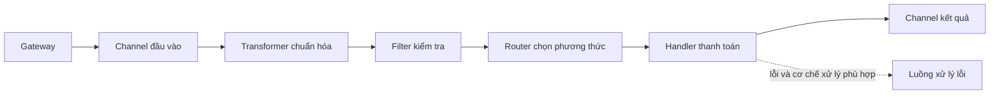

# Error rate của endpoint

Trong chương **Metrics và observability** của **SPRING_INTEGRATION_CORE**, error rate giúp trả lời: trong các lần xử lý đã hoàn tất tại một endpoint, có bao nhiêu lần thất bại? Chỉ số này hỗ trợ phát hiện luồng tích hợp suy giảm và khoanh vùng thành phần cần điều tra. Để con số có ý nghĩa, cần xác định rõ điểm đo, đơn vị đếm và định nghĩa thất bại.

Bài học sử dụng luồng thanh toán minh họa để kết nối các khái niệm `Message`, `MessageChannel`, handler, endpoint, gateway và Java DSL. Phạm vi là đo, diễn giải và cảnh báo lỗi; dịch vụ thanh toán trong ví dụ được mô phỏng trong bộ nhớ.

## 1. Mục tiêu và kiến thức cần có

Sau bài này, bạn có thể:

- Định nghĩa tử số và mẫu số cho error rate của một endpoint.
- Phân biệt tỷ lệ lỗi với tốc độ phát sinh lỗi, lỗi mỗi lần thử và lỗi sau retry.
- Sử dụng số đếm của timer có sẵn hoặc một phép đo tùy chỉnh có hợp đồng rõ ràng.
- Viết truy vấn PromQL gộp nhiều instance đúng trọng số.
- Giải thích ảnh hưởng của channel bất đồng bộ, `errorChannel`, recovery và kết quả nghiệp vụ.
- Thiết kế cảnh báo có cửa sổ thời gian, điều kiện lưu lượng và cách xử lý thiếu dữ liệu.

Bạn cần biết Java DSL ở mức xây dựng một `IntegrationFlow`, cách một handler nhận message và cách exception truyền qua luồng đồng bộ. Phần thực hành giả định Java 17+, ứng dụng Spring Boot với Spring Integration 6.x và Micrometer; phiên bản thư viện do BOM Spring Boot của ứng dụng quản lý.

## 2. Error rate đo điều gì?

Với endpoint `e` và cửa sổ thời gian `W`, đặt:

- `S(e, W)`: số lần xử lý hoàn tất thành công.
- `F(e, W)`: số lần xử lý hoàn tất thất bại.
- `T(e, W) = S(e, W) + F(e, W)`: tổng số lần xử lý hoàn tất.

Khi `T(e, W) > 0`:

```text
error_ratio(e, W) = F(e, W) / T(e, W)
error_percentage(e, W) = 100 × error_ratio(e, W)
```

Ví dụ, trong 5 phút endpoint xử lý thành công 980 lần và thất bại 20 lần:

```text
T = 980 + 20 = 1.000 lần
error_ratio = 20 / 1.000 = 0,02
error_percentage = 2%
```

Không dùng `F / S`: với ví dụ này, `20 / 980` không phải tỷ lệ thất bại trên toàn bộ lần xử lý. Cũng không lấy số lỗi ở handler chia cho số message được gửi vào toàn bộ ứng dụng nếu hai tập dữ liệu không tương ứng.

Cụm từ “error rate” thường được dùng theo hai nghĩa. Dashboard cần ghi rõ đơn vị:

| Chỉ số | Công thức minh họa | Đơn vị | Ý nghĩa |
| --- | --- | --- | --- |
| Tỷ lệ lỗi | `F / (S + F)` | Tỷ lệ từ 0 đến 1 hoặc % | Mức phổ biến của lỗi trong các kết quả |
| Tốc độ lỗi | `F / số giây quan sát` | Lỗi/giây | Khối lượng lỗi cần xử lý |
| Thông lượng hoàn tất | `(S + F) / số giây quan sát` | Lần xử lý/giây | Khối lượng công việc đã có kết quả |

Một endpoint có 1 lỗi/giây trên 1.000 lần/giây có tỷ lệ lỗi 0,1%. Một endpoint có 1 lỗi/giây trên 2 lần/giây có tỷ lệ lỗi 50%. Hai endpoint có cùng tốc độ lỗi nhưng tình trạng vận hành rất khác nhau.

Nếu không có lần xử lý hoàn tất, `0 / 0` không xác định. Dashboard nên biểu diễn “không có lưu lượng” hoặc “chưa đủ dữ liệu” theo quy ước vận hành; không suy ra endpoint khỏe chỉ từ việc chưa thấy lỗi.

## 3. Chọn ranh giới đo trước khi chọn metric

Hãy xét luồng:



Mỗi vị trí trả lời một câu hỏi khác nhau:

| Ranh giới | Đơn vị đếm phù hợp | Câu hỏi được trả lời |
| --- | --- | --- |
| Gửi vào channel | Một lần gọi `send()` | Lần gửi được chấp nhận hay bị thất bại? |
| Handler thanh toán | Một lần thực thi handler hoàn tất | Logic được đo có ném lỗi hay trả về bình thường? |
| Endpoint sau retry | Một lần gọi bao ngoài toàn bộ retry | Retry có giải quyết được lỗi trong lần gọi này không? |
| Gateway yêu cầu/phản hồi | Một lần gọi gateway hoàn tất | Bên gọi có nhận được kết quả theo hợp đồng không? |
| Kết quả nghiệp vụ cuối cùng | Một đơn hoặc một giao dịch đạt trạng thái kết thúc | Yêu cầu nghiệp vụ có hoàn tất thành công không? |

Trong bài này, **endpoint error rate** mặc định là tỷ lệ thất bại của logic handler được gắn phép đo. Một handler trả về bình thường được tính là thành công kỹ thuật. Phép đo đó không tự khẳng định mọi bước phía sau đã thành công.

Tên endpoint và tên handler do framework quản lý có thể khác nhau. Ví dụ, `.id("chargeEndpoint")` xác định endpoint; tên xuất hiện trong tag của handler có thể mang hậu tố hoặc tên được sinh. Khi xây dashboard, đối chiếu tag thực tế thay vì đoán tên từ cấu hình DSL.

Đặc biệt, một lần gọi có thể đi qua nhiều handler. Nếu cùng một exception truyền qua nhiều tầng đồng bộ, nhiều phép đo có thể cùng ghi nhận lỗi. Cộng tất cả lỗi endpoint rồi gọi đó là “số giao dịch thất bại” sẽ đếm trùng một giao dịch.

## 4. Quy ước thành công và thất bại

Trước khi triển khai, viết một hợp đồng đo ngắn gọn. Ví dụ cho `chargeEndpoint`:

```text
Đơn vị: một lần thực thi logic handler thanh toán.
Thành công: logic trả về bình thường, kể cả kết quả null nếu được phép.
Thất bại: logic thoát bằng exception hoặc Error.
Thời điểm đếm: khi lần thực thi kết thúc.
Phạm vi: logic handler, không bao gồm toàn bộ luồng sau nó.
Nhãn định danh: application và endpoint ổn định.
```

Hợp đồng này giúp giải thích các trường hợp dễ nhầm:

| Tình huống | Kết quả theo hợp đồng kỹ thuật trên | Điều cần đo thêm nếu có nhu cầu |
| --- | --- | --- |
| Handler trả `PaymentResult.declined()` bình thường | Thành công kỹ thuật | Tỷ lệ thanh toán bị từ chối |
| Handler bắt exception rồi trả fallback | Thành công tại ranh giới bao ngoài fallback | Số lần fallback và lỗi gốc |
| Filter loại message hợp lệ theo quy tắc | Không tự động là lỗi kỹ thuật | Số message bị loại theo lý do |
| Router chọn nhánh ngoài dự kiến nhưng không ném lỗi | Có thể vẫn là thành công kỹ thuật | Kết quả định tuyến nghiệp vụ |
| Aggregator đang chờ đủ nhóm message | Chưa đủ cơ sở kết luận lỗi | Thời gian chờ, nhóm quá hạn, nhóm không hoàn tất |
| Message bị broker giao lại | Một lần thực thi mới nếu handler chạy lại | Kết quả cuối theo mã nghiệp vụ và trạng thái bền vững |

Nếu nghiệp vụ yêu cầu coi `declined` là thất bại, hãy xây chỉ số kết quả nghiệp vụ với tập outcome riêng. Tránh âm thầm thay định nghĩa `failure` giữa các endpoint rồi so sánh chúng trên cùng dashboard.

## 5. Ưu tiên số đếm có sẵn khi phù hợp

Ở cơ chế Micrometer metrics truyền thống, timer `spring.integration.send` có tag `type=handler` hoặc `type=channel`, `name`, `result=success|failure`, `exception`. Một `failure` của channel với `exception=none` có thể là `send()` trả `false`. Với Prometheus, kiểm tra series thực tế, thường là `spring_integration_send_seconds_count`.

Khi bật Observation cho các component được chọn, phép đo được chuyển cho observation handler; các tên như `spring.integration.handler` thuộc hợp đồng khác. Không ghép tên metric của cơ chế này với tag của cơ chế kia. Xem [Spring Integration — Metrics and Management](https://docs.spring.io/spring-integration/reference/metrics.html).

Một timer đã cung cấp số đếm sự kiện; nếu số đếm và phân loại của timer đáp ứng yêu cầu, dùng chúng làm nguồn dữ liệu. Counter riêng chỉ cần thiết khi bạn muốn một hợp đồng khác được định nghĩa rõ. Tham khảo [Micrometer — Counters](https://docs.micrometer.io/micrometer/reference/concepts/counters.html).

Ví dụ truy vấn **chỉ dành cho cơ chế timer truyền thống**, sau khi đã xác nhận schema xuất ra:

```promql
sum by (application, name) (
  rate(spring_integration_send_seconds_count{
    type="handler", result="failure"
  }[5m])
)
/
sum by (application, name) (
  rate(spring_integration_send_seconds_count{type="handler"}[5m])
)
```

Tử số và mẫu số cùng chọn handler. Tử số gộp tất cả lớp exception, thay vì chỉ chọn một exception cụ thể rồi gọi đó là toàn bộ error rate.

Một series lỗi có thể chưa xuất hiện trước lần thất bại đầu tiên. Khi đó phép chia có thể không trả dữ liệu cho endpoint ấy. Có thể bổ sung tử số bằng `or on (application, name)` với một vector `0 * tổng_tốc_độ` có cùng nhãn. Chỉ bổ sung zero khi series tổng thực sự tồn tại; đừng biến mất dữ liệu thu thập thành một endpoint có 0% lỗi.

Các phần sau dùng metric tùy chỉnh để cố định hợp đồng minh họa. Metric này đứng độc lập; không cộng nó vào số đếm timer của framework.

## 6. Thực hành đo bằng advice tại handler

### 6.1. Chuẩn bị ứng dụng

Ví dụ sử dụng các dependency sau trong một ứng dụng Spring Boot có sẵn:

- `org.springframework.boot:spring-boot-starter-integration`.
- `org.springframework.boot:spring-boot-starter-actuator`.
- `org.springframework.boot:spring-boot-starter-web` để cung cấp HTTP cho Actuator.
- `io.micrometer:micrometer-registry-prometheus`.

Cấu hình minh họa cho môi trường học tập:

```yaml
management:
  endpoints:
    web:
      exposure:
        include: health,metrics,prometheus
  metrics:
    tags:
      application: payment-integration
```

Trong cấu hình web mặc định, dữ liệu Prometheus được lấy tại `/actuator/prometheus`. Trước khi dùng truy vấn, xác nhận endpoint đó truy cập được trong môi trường của bạn và Prometheus đã scrape ứng dụng. Các dependency registry và cơ chế xuất dữ liệu được mô tả trong [Spring Boot — Metrics](https://docs.spring.io/spring-boot/reference/actuator/metrics.html).

### 6.2. Định nghĩa phép đo và flow

Đặt cấu hình Java dưới package được ứng dụng quét. Đây là nội dung của một lớp cấu hình minh họa; không cần sửa logic nghiệp vụ để tăng counter tại từng nhánh trả về.

```java
import io.micrometer.core.instrument.Counter;
import io.micrometer.core.instrument.MeterRegistry;
import org.springframework.context.annotation.Bean;
import org.springframework.context.annotation.Configuration;
import org.springframework.integration.annotation.EnableIntegration;
import org.springframework.integration.channel.DirectChannel;
import org.springframework.integration.dsl.IntegrationFlow;
import org.springframework.integration.handler.advice.AbstractRequestHandlerAdvice;
import org.springframework.messaging.Message;
import org.springframework.messaging.MessageChannel;

@Configuration(proxyBeanMethods = false)
@EnableIntegration
public class PaymentMetricsConfiguration {

    public record PaymentRequest(String orderId, boolean simulateFailure) {
    }

    @Bean
    MessageChannel paymentInput() {
        return new DirectChannel();
    }

    @Bean
    EndpointOutcomeAdvice chargeOutcomeAdvice(MeterRegistry registry) {
        return new EndpointOutcomeAdvice(registry, "chargeEndpoint");
    }

    @Bean
    IntegrationFlow paymentFlow(EndpointOutcomeAdvice chargeOutcomeAdvice) {
        return IntegrationFlow.from("paymentInput")
                .handle(PaymentRequest.class, (request, headers) -> {
                    if (request.simulateFailure()) {
                        throw new IllegalStateException(
                                "Simulated payment provider failure");
                    }
                    return "PAID:" + request.orderId();
                }, endpoint -> endpoint
                        .id("chargeEndpoint")
                        .advice(chargeOutcomeAdvice))
                .get();
    }

    public static final class EndpointOutcomeAdvice
            extends AbstractRequestHandlerAdvice {

        private final Counter success;
        private final Counter failure;

        public EndpointOutcomeAdvice(MeterRegistry registry, String endpoint) {
            this.success = Counter.builder("demo.integration.endpoint.completed")
                    .description("Completed handler executions by outcome")
                    .tags("endpoint", endpoint, "outcome", "success")
                    .register(registry);
            this.failure = Counter.builder("demo.integration.endpoint.completed")
                    .description("Completed handler executions by outcome")
                    .tags("endpoint", endpoint, "outcome", "failure")
                    .register(registry);
        }

        @Override
        protected Object doInvoke(ExecutionCallback callback,
                                  Object target,
                                  Message<?> message) throws Exception {
            boolean completedNormally = false;
            try {
                Object result = callback.execute();
                completedNormally = true;
                return result;
            } finally {
                Counter outcome = completedNormally ? success : failure;
                outcome.increment();
            }
        }
    }
}
```

`AbstractRequestHandlerAdvice` cung cấp callback để gọi logic được bao quanh. Phép đo trên gọi callback đúng một lần, trả nguyên kết quả và không bắt exception để chuyển thành thành công. Tham khảo [Spring Integration — Custom Advice Classes](https://docs.spring.io/spring-integration/reference/handler-advice/custom.html).

Cờ `completedNormally` chỉ được đặt sau khi callback trả về. Vì vậy `finally` chọn đúng một outcome cho một lần gọi kết thúc, kể cả khi logic ném `Error`. Nếu tiến trình bị dừng cưỡng bức trong lúc xử lý, không có bảo đảm lần gọi ấy được ghi nhận; counter trong bộ nhớ không phải sổ giao dịch bền vững.

Cả hai counter được đăng ký từ đầu, giúp series `failure` có thể được xuất với giá trị zero trước khi có lỗi. Nhãn `endpoint` do ví dụ chủ động đặt; nó không phụ thuộc tên handler framework sinh ra. Mỗi endpoint khác cần một advice với tên tương ứng; không dùng cùng instance này cho các endpoint có định danh khác nhau.

Với handler tạo reply, ranh giới request advice không bao gồm toàn bộ việc gửi reply và các bước downstream. Nếu callback trả kết quả thành công nhưng gửi reply sau đó thất bại, metric này vẫn có thể tăng `success`. Đó là lý do phải mô tả nó là kết quả logic handler.

Ví dụ dành cho xử lý đồng bộ. Nếu logic chỉ trả một `CompletableFuture` hoặc một publisher chưa hoàn tất, việc phương thức trả về chưa phản ánh kết quả xử lý nền. Muốn đo loại xử lý đó, cần gắn phép đo vào tín hiệu hoàn tất/lỗi của tác vụ bất đồng bộ tương ứng.

### 6.3. Tạo lưu lượng và đối chiếu kỳ vọng

Trong mã gọi thử hoặc kiểm thử có Spring context, lấy bean `paymentInput` và gửi yêu cầu có phản hồi bằng `MessagingTemplate`:

```java
import org.springframework.context.ApplicationContext;
import org.springframework.integration.core.MessagingTemplate;
import org.springframework.messaging.MessageChannel;
import org.springframework.messaging.MessagingException;

// context là ApplicationContext của ứng dụng đã khởi động.
MessageChannel input = context.getBean("paymentInput", MessageChannel.class);
MessagingTemplate template = new MessagingTemplate();
template.setReceiveTimeout(1000);

int receivedReplies = 0;
int observedFailures = 0;
for (int i = 0; i < 100; i++) {
    boolean simulateFailure = i < 5;
    try {
        String reply = template.convertSendAndReceive(
                input,
                new PaymentMetricsConfiguration.PaymentRequest(
                        "order-" + i, simulateFailure),
                String.class);
        if (reply == null) {
            throw new IllegalStateException("Expected a payment reply");
        }
        receivedReplies++;
    } catch (MessagingException ex) {
        observedFailures++;
    }
}

if (receivedReplies != 95 || observedFailures != 5) {
    throw new IllegalStateException("Unexpected sample execution results");
}
```

Ở ứng dụng mới khởi động, không có lưu lượng khác, dữ liệu counter kỳ vọng là:

```text
demo_integration_endpoint_completed_total{
  application="payment-integration",
  endpoint="chargeEndpoint",
  outcome="success"
} 95

demo_integration_endpoint_completed_total{
  application="payment-integration",
  endpoint="chargeEndpoint",
  outcome="failure"
} 5
```

Cách trình bày trên ngắt dòng để dễ đọc; định dạng xuất thực tế có thể đặt mỗi sample trên một dòng và bổ sung nhãn do môi trường cấu hình. Kết quả mong đợi là 100 lần hoàn tất và tỷ lệ lỗi 5%.

Nếu chạy lại trong cùng tiến trình, dùng chênh lệch counter trước/sau; giá trị tích lũy sẽ tiếp tục tăng. Để quan sát qua `rate()`, cần scrape trước và sau đợt lưu lượng. Những lần tăng xảy ra trước sample đầu tiên không thể được Prometheus tái dựng thành lịch sử đã quan sát.

Một gateway gọi vào cùng channel cũng có thể dùng flow này, nhưng cần đo riêng hợp đồng phản hồi của gateway nếu muốn biết trải nghiệm bên gọi. Ví dụ trên chưa sử dụng gateway để giữ ranh giới đo dễ quan sát.

## 7. Tính error rate bằng PromQL

Với metric tùy chỉnh vừa tạo, truy vấn tỷ lệ lỗi 5 phút là:

```promql
sum by (application, endpoint) (
  rate(demo_integration_endpoint_completed_total{outcome="failure"}[5m])
)
/
sum by (application, endpoint) (
  rate(demo_integration_endpoint_completed_total[5m])
)
```

Kết quả là tỷ lệ từ 0 đến 1; nhân toàn bộ biểu thức với `100` nếu dashboard sử dụng đơn vị phần trăm. Mẫu số bao gồm cả `success` và `failure`.

Dùng `rate()` trên từng series trước khi `sum` để xử lý counter reset theo từng instance. `increase()` phù hợp khi cần ước tính số lần trong một cửa sổ; do cơ chế ngoại suy, kết quả có thể là số thập phân. Xem [Prometheus — Query functions](https://prometheus.io/docs/prometheus/latest/querying/functions/).

Không dùng giá trị tích lũy `failure_total / completed_total` để đại diện tình trạng hiện tại: một đợt lỗi mới có thể bị hàng triệu lần thành công trong quá khứ che khuất.

### 7.1. Gộp nhiều instance theo tổng số lần xử lý

Giả sử trong cùng cửa sổ:

| Instance | Thành công | Thất bại | Tổng | Tỷ lệ lỗi |
| --- | ---: | ---: | ---: | ---: |
| A | 990 | 10 | 1.000 | 1% |
| B | 0 | 10 | 10 | 100% |
| Cả dịch vụ | 990 | 20 | 1.010 | Khoảng 1,98% |

Trung bình cộng hai tỷ lệ là `(1% + 100%) / 2 = 50,5%`, không phản ánh tỷ lệ chung. Phải cộng tử số, cộng mẫu số rồi chia. Truy vấn trên thực hiện điều đó bằng cách bỏ nhãn `instance` khi gộp.

Giữ lại `instance` trong một panel khác để phát hiện một instance hỏng dù tỷ lệ chung còn thấp. Nếu dữ liệu có nhiều môi trường hoặc cluster, thêm bộ lọc hoặc giữ các nhãn ấy trong `by (...)` ở cả tử số và mẫu số.

### 7.2. Zero, không có lưu lượng và thiếu dữ liệu

Ba trạng thái cần hiển thị khác nhau:

| Trạng thái | Quan sát | Cách hiểu |
| --- | --- | --- |
| Có lưu lượng, không lỗi | Tổng tốc độ dương; tốc độ lỗi bằng zero | 0% trong cửa sổ đã đo |
| Không có lưu lượng hoàn tất | Cả hai tốc độ bằng zero | Tỷ lệ không xác định; xem thêm lý do không có lưu lượng |
| Không có series hoặc scrape thất bại | Không đủ dữ liệu | Chưa thể kết luận về endpoint |

Toán tử vector yêu cầu hai vế khớp nhãn; việc so sánh hoặc kết hợp điều kiện cũng cần giữ cùng tập nhãn. Xem [Prometheus — Operators](https://prometheus.io/docs/prometheus/latest/querying/operators/).

Không tự thêm một hằng số lớn vào mẫu số để loại phép chia zero: cách đó có thể hạ thấp tỷ lệ lỗi ở endpoint ít lưu lượng. Hãy để dashboard thể hiện trạng thái không có dữ liệu và dùng điều kiện lưu lượng cho cảnh báo.

## 8. Retry thay đổi đơn vị đếm

Một yêu cầu thất bại hai lần rồi thành công ở lần thứ ba tạo ra:

```text
Lần thử:             failure, failure, success
Kết quả sau retry:   success
```

Nếu đo từng lần thử, tỷ lệ lỗi là `2 / 3`, khoảng 66,7%. Nếu đo kết quả sau toàn bộ retry, có một lần gọi thành công và tỷ lệ lỗi là 0%. Hai con số đều có ích nhưng trả lời hai câu hỏi khác nhau.

Với retry stateless, thứ tự bao advice quyết định ranh giới:

```text
Đo kết quả sau retry:
OutcomeAdvice -> RetryAdvice -> Handler

Đo từng lần thử:
RetryAdvice -> AttemptAdvice -> Handler
```

Ở cấu hình DSL tương ứng, advice được đặt bao ngoài trước:

```java
// Chọn cấu hình đo kết quả sau retry.
endpoint.advice(finalOutcomeAdvice, retryAdvice);

// Hoặc chọn cấu hình đo mỗi lần thử.
endpoint.advice(retryAdvice, attemptOutcomeAdvice);
```

Đây là hai lựa chọn cấu hình minh họa, không phải hai lệnh để áp dụng liên tiếp vào cùng endpoint. Nếu muốn cả hai, dùng hai phép đo có tên hoặc nhãn phạm vi khác nhau, ví dụ `scope="attempt"` và `scope="invocation"`; không cộng hai tập số đếm này.

`RequestHandlerRetryAdvice` hỗ trợ retry và recovery; retry stateful có thể trải qua nhiều lần giao lại. Khi đó một lần gọi advice không tự tương đương kết quả cuối của một message. Xem [Spring Integration — Provided Advice Classes](https://docs.spring.io/spring-integration/reference/handler-advice/classes.html).

Một recovery callback có thể xử lý lỗi cuối rồi trả về bình thường. Advice ở ngoài sẽ ghi nhận thành công kỹ thuật theo hợp đồng hiện tại. Nếu cần biết yêu cầu đã cạn retry và đi vào recovery, ghi một outcome hoặc counter riêng ngay ở điểm recovery.

Đồng thời, circuit breaker đang mở có thể làm lần gọi thất bại trước khi handler thực sự được gọi. Phép đo bao ngoài breaker tính được thất bại của lần gọi; phép đo chỉ nằm sát logic handler không đếm một lần thực thi chưa xảy ra. Hãy đặt tên dashboard theo ranh giới đã chọn.

## 9. Channel bất đồng bộ và errorChannel

Với `DirectChannel`, handler thường chạy trên thread gửi; lỗi có thể truyền về bên gọi. Với channel tách việc xử lý sang thread khác, việc gửi thành công không chứng minh handler đã thành công. Các tác vụ tích hợp có cơ chế phát lỗi có thể gửi `ErrorMessage` tới channel trong header `errorChannel`, hoặc channel lỗi toàn cục khi phù hợp. Tham khảo [Spring Integration — Error Handling](https://docs.spring.io/spring-integration/reference/error-handling.html).

Xét ví dụ vận hành:

```text
100 message được nhận vào hàng đợi.
Trong cửa sổ đo, consumer mới xử lý xong 40 message:
  35 thành công, 5 thất bại.
60 message còn đang chờ hoặc đang xử lý.
```

Theo hợp đồng đếm các lần xử lý hoàn tất, tỷ lệ lỗi handler là `5 / 40 = 12,5%`. Phép chia `5 / 100 = 5%` đã trộn số nhận đầu vào với số có kết quả ở một giai đoạn khác.

Đếm `ErrorMessage` hữu ích để quan sát luồng lỗi nhưng chưa đủ làm tử số cho mọi endpoint:

- Một lỗi có thể được ghi nhận tại handler và được phát tiếp thành error message; đó là hai biểu diễn của cùng sự cố.
- Lỗi có thể được bắt hoặc recovery trước khi phát ra channel lỗi.
- Một channel lỗi dùng chung nhận lỗi từ nhiều nguồn, không có mẫu số chung phù hợp sẵn.
- Handler xử lý lỗi cũng có thể thất bại, tạo thêm sự cố cần đo riêng.

Nếu mục tiêu là tỷ lệ lỗi của `chargeEndpoint`, đo tại ranh giới endpoint ấy rồi dùng error flow để chẩn đoán và xử lý. Nếu mục tiêu là kết quả cuối của mỗi đơn hàng, cần mô hình trạng thái nghiệp vụ có khả năng đối chiếu đơn đã nhận với đơn hoàn tất.

Theo dõi thêm độ sâu hàng đợi, tuổi message hoặc số tác vụ đang chạy khi cần. Một consumer bị treo có thể không tạo lần hoàn tất nào, khiến error rate không tăng dù hệ thống đang không phục vụ được yêu cầu.

## 10. Cảnh báo có điều kiện lưu lượng

Ví dụ dưới đây tạo recording rule cho tốc độ hoàn tất, tốc độ lỗi và tỷ lệ lỗi; sau đó cảnh báo khi tỷ lệ vượt 5% và có ít nhất khoảng 100 lần hoàn tất trong 5 phút.

```yaml
groups:
  - name: integration-endpoint-quality
    interval: 30s
    rules:
      - record: demo_endpoint:completed:rate5m
        expr: |
          sum by (application, endpoint) (
            rate(demo_integration_endpoint_completed_total[5m])
          )

      - record: demo_endpoint:failed:rate5m
        expr: |
          sum by (application, endpoint) (
            rate(demo_integration_endpoint_completed_total{
              outcome="failure"
            }[5m])
          )

      - record: demo_endpoint:error:ratio5m
        expr: |
          demo_endpoint:failed:rate5m
          /
          demo_endpoint:completed:rate5m

      - alert: IntegrationEndpointErrorRatioHigh
        expr: |
          (demo_endpoint:error:ratio5m > 0.05)
          and on (application, endpoint)
          (
            sum by (application, endpoint) (
              increase(demo_integration_endpoint_completed_total[5m])
            ) >= 100
          )
        for: 10m
        labels:
          severity: warning
        annotations:
          summary: "Tỷ lệ lỗi cao tại {{ $labels.endpoint }}"
          description: >-
            Endpoint {{ $labels.endpoint }} của {{ $labels.application }}
            có tỷ lệ lỗi vượt 5% và đủ lưu lượng trong cửa sổ 5 phút;
            điều kiện đã duy trì 10 phút.
```

Đây là cấu hình rule cho Prometheus, không phải cấu hình `application.yml`. Các giá trị 5 phút, 5%, 100 lần và 10 phút là lựa chọn minh họa; cần điều chỉnh theo mục tiêu phục vụ và lưu lượng thực tế.

`[5m]` là cửa sổ quan sát trượt. `for: 10m` yêu cầu điều kiện tiếp tục đúng qua các lần đánh giá trong khoảng đó trước khi chuyển sang firing; không có nghĩa là quan sát một cửa sổ 15 phút. Xem [Prometheus — Alerting rules](https://prometheus.io/docs/prometheus/latest/configuration/alerting_rules/).

Điều kiện lưu lượng giảm cảnh báo từ một vài lần gọi hiếm, đồng thời có thể bỏ qua endpoint quan trọng nhưng ít giao dịch. Với endpoint ấy, có thể bổ sung cảnh báo theo số lỗi tuyệt đối hoặc kiểm tra chủ động. Theo dõi riêng scrape thất bại, mất series dự kiến và backlog; cảnh báo tỷ lệ lỗi không bao phủ các tình huống đó.

## 11. Nhãn metric và dữ liệu chẩn đoán

Giữ nhãn dùng để tổng hợp ở tập giá trị hữu hạn:

| Thuộc tính | Vị trí phù hợp trong ví dụ | Lý do |
| --- | --- | --- |
| Tên ứng dụng | Tag `application` | Gộp theo dịch vụ |
| Tên endpoint cấu hình cố định | Tag `endpoint` | Khoanh vùng điểm đo |
| Kết quả hữu hạn | Tag `outcome` | Tính tử số và mẫu số |
| Nhóm lỗi đã chuẩn hóa | Tag tùy chọn như `error_category` | Phân tích một số nhóm ổn định |
| Mã đơn hàng, message ID, trace ID | Log có cấu trúc hoặc trace | Đối chiếu một lần xử lý cụ thể |
| Nội dung exception đầy đủ | Log phù hợp với dữ liệu được phép ghi | Tránh tạo hàng loạt giá trị nhãn khác nhau |

Nếu mỗi đơn hàng tạo một giá trị tag mới, số series tăng theo số đơn thay vì theo số endpoint. Điều đó làm phép đo vận hành tốn tài nguyên và khó tổng hợp.

Khi bổ sung `error_category`, tổng hợp bỏ nhãn này để tính tỷ lệ lỗi chung. Đừng giữ `error_category` ở tử số nhưng bỏ ở mẫu số mà chưa xử lý vector matching, vì hai vế sẽ không còn tương ứng.

Trong log lỗi, nên có tên endpoint, định danh nghiệp vụ cần thiết và trace ID nếu hệ thống có tracing. Tránh ghi nguyên payload nhạy cảm. Metric giúp phát hiện và định vị; log và trace giúp giải thích sự cố cụ thể.

## 12. Quy trình quan sát và xử lý một đợt lỗi

Khi dashboard cho thấy error rate tăng, thực hiện theo thứ tự:

1. Xác nhận metric còn được thu thập, xem mẫu số và lưu lượng; phân biệt tăng lỗi thật với thiếu dữ liệu.
2. Xem endpoint và instance nào đóng góp số lỗi lớn nhất, dùng cùng cửa sổ thời gian.
3. Đối chiếu tỷ lệ lỗi với tốc độ lỗi, độ trễ, retry, fallback và backlog.
4. Lấy một vài trace hoặc log đại diện để xác định lỗi đầu tiên; tránh coi mọi stack trace downstream là sự cố độc lập.
5. Kiểm tra nhóm nguyên nhân như timeout dịch vụ ngoài, dữ liệu không hợp lệ hoặc tài nguyên cạn.
6. Sau khi xử lý, theo dõi các cửa sổ mới có đủ lưu lượng và tình trạng tồn đọng; counter tích lũy không tự giảm về zero.

Có thể kiểm chứng hợp đồng đo bằng những tình huống nhỏ trước khi vận hành:

| Tình huống kiểm chứng | Kỳ vọng tại ranh giới đã nêu |
| --- | --- |
| 95 lần thành công, 5 lần ném lỗi, không retry | 100 lần hoàn tất; tỷ lệ lỗi 5% |
| Thất bại hai lần rồi thành công | Attempt: `2/3`; sau retry: `0/1` |
| Recovery trả fallback bình thường | Advice ngoài recovery ghi nhận thành công kỹ thuật; có chỉ số recovery riêng |
| Gửi vào queue thành công, consumer ném lỗi | Tách kết quả gửi và kết quả handler |
| Không có lần hoàn tất | Không suy ra 0% lỗi để kết luận khỏe |
| Một instance bị restart | Truy vấn theo rate xử lý reset; kiểm tra đủ sample sau restart |
| Reply hoặc bước downstream thất bại sau handler | Phép đo logic handler có thể vẫn ghi thành công |

Các kỳ vọng này kiểm tra ý nghĩa của phép đo, không chỉ kiểm tra một counter có tăng. Khi triển khai thực tế, chọn ranh giới đo trước, xác nhận tên metric và nhãn xuất ra, rồi mới xây dashboard và cảnh báo dựa trên chúng.