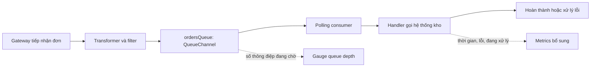

# Queue depth

Trong chương **Metrics và observability** của `SPRING_INTEGRATION_CORE`, queue depth là chỉ số giúp nhận biết thông điệp có đang tích tụ tại một điểm đệm của luồng tích hợp hay không. Khi kết hợp nó với tốc độ tiếp nhận, tốc độ lấy thông điệp, thời gian xử lý và lỗi, ta có thể tìm nút thắt trước khi người dùng nhận thấy độ trễ tăng mạnh.

Bài học tập trung vào `QueueChannel` trong Spring Integration: định nghĩa độ sâu hàng đợi, cách đo bằng Micrometer, cách đọc biểu đồ và cách phản ứng khi hàng đợi tăng. Các ví dụ dùng Java DSL để nối channel với endpoint; gateway, transformer, router, filter và aggregator được đặt trong bối cảnh xác định đúng ranh giới cần quan sát.

## 1. Mục tiêu và kiến thức nền

Sau bài học, bạn có thể:

- Phân biệt số thông điệp đang chờ, số thông điệp đang xử lý và tổng số thông điệp đã đi qua hệ thống.
- Đọc queue depth cùng capacity, remaining capacity, tốc độ vào/ra và tuổi thông điệp.
- Khai báo một `QueueChannel` có giới hạn, một polling consumer và các gauge quan sát hàng đợi.
- Thiết kế truy vấn, cảnh báo và quy trình xử lý khi backlog tăng.
- Giải thích vì sao queue depth bằng không chưa đủ chứng minh luồng xử lý khỏe mạnh.

Bạn nên biết `Message<?>`, `MessageChannel`, `PollableChannel`, service activator và cấu trúc cơ bản của `IntegrationFlow`. Ví dụ cấu hình dùng Java 17 trở lên và API Java DSL của Spring Integration 6.x trở lên; dependency cần đi theo bộ phiên bản mà ứng dụng Spring Boot quản lý.

## 2. Bài toán: nhận đơn hàng nhanh hơn khả năng xử lý

Một dịch vụ nhận đơn hàng qua gateway. Sau khi chuẩn hóa dữ liệu bằng transformer và kiểm tra bằng filter, luồng đưa đơn hợp lệ vào `ordersQueue`. Một polling consumer lấy từng đơn để gọi hệ thống kho.



Khi kho đáp ứng chậm, consumer lấy và xử lý đơn chậm hơn. Queue tăng giúp hấp thụ một đợt tải ngắn, nhưng nếu chênh lệch kéo dài, thời gian chờ tăng và cuối cùng queue có thể đầy.

Một router có thể tách đơn thường và đơn ưu tiên sang hai queue. Khi đó mỗi queue cần được quan sát riêng: tổng backlog nhỏ có thể che giấu việc một nhánh đã hết chỗ. Nếu phía sau còn aggregator chờ đủ nhóm, số phần tử đang giữ trong message store của aggregator cũng là một vùng tích tụ khác cần metric riêng.

## 3. Queue depth thực sự đếm gì?

### 3.1. Định nghĩa và ranh giới

**Queue depth** tại thời điểm `t`, ký hiệu `Q(t)`, là số thông điệp đang nằm trong hàng đợi để chờ được lấy ra tại thời điểm đó. Đơn vị thường là **message**.

Với `QueueChannel`, API đọc số phần tử là `getQueueSize()`; `getRemainingCapacity()` đọc số chỗ còn lại. Đây là các giá trị của channel được đo, không phải số đơn hàng chưa hoàn tất trong toàn hệ thống. Tham khảo [Javadoc của QueueChannel](https://docs.spring.io/spring-integration/api/org/springframework/integration/channel/QueueChannel.html).

Giả sử một queue có capacity bằng 100:

| Sự kiện, không có thao tác đồng thời khác | Depth | Số đang xử lý |
| --- | ---: | ---: |
| Queue đang giữ 30 thông điệp | 30 | 0 |
| Consumer lấy một thông điệp ra | 29 | 1 |
| Handler vẫn đang chờ phản hồi từ hệ thống kho | 29 | 1 |
| Handler hoàn tất thông điệp đó | 29 | 0 |
| Producer đưa thêm hai thông điệp vào thành công | 31 | 0 |

Điểm quan trọng nằm ở hàng thứ hai: depth giảm khi thông điệp được lấy ra, trước khi nghiệp vụ hoàn tất. Nếu consumer lấy hết dữ liệu rồi chuyển sang một executor có queue riêng, `ordersQueue` có thể rỗng trong khi công việc vẫn tồn đọng ở executor.

Trong một mô hình đơn giản, chưa có nhánh phụ, có thể hình dung:

```text
Công việc chưa hoàn tất
    = thông điệp đang chờ trong queue
    + công việc đang xử lý
    + công việc đang chờ retry hoặc nằm ở vùng đệm khác
```

Đây là cách xác định phạm vi quan sát, không phải công thức cộng tùy ý mọi metric. Nếu cùng một công việc bị đếm ở nhiều tầng hoặc sinh ra nhiều thông điệp sau splitter, phải xử lý trùng lặp và khác biệt đơn vị trước khi cộng.

### 3.2. Queue depth là gauge

Depth tăng khi enqueue và giảm khi dequeue, vì vậy phù hợp với **gauge**, loại metric biểu diễn giá trị hiện tại. Counter phù hợp với tổng số sự kiện, chẳng hạn số lần enqueue thành công hoặc số lần bị từ chối. Timer dùng cho thời lượng.

Micrometer đọc gauge tại thời điểm lấy mẫu; biến động nằm giữa hai lần lấy mẫu có thể không xuất hiện trong dữ liệu đã thu thập. Vì thế biểu đồ depth không thay thế counter ghi nhận sự kiện. Xem [Micrometer Gauges](https://docs.micrometer.io/micrometer/reference/concepts/gauges.html).

Ví dụ, Prometheus scrape lúc 10:00:00 và 10:00:15 đều thấy depth bằng 0. Trong khoảng đó queue có thể đã tăng lên 800 rồi được xử lý hết. Hai mẫu bằng 0 không chứng minh không có tải đột biến hoặc không có lần gửi nào thất bại.

## 4. Đọc depth cùng capacity và tốc độ

### 4.1. Capacity và tỷ lệ sử dụng

Với một `QueueChannel` trong bộ nhớ có capacity cố định `C`:

```text
Q = số thông điệp đang chờ
R = số chỗ còn lại
U = Q / C

Trong một trạng thái nhất quán của queue: Q + R = C
```

Nếu `C = 10.000` và `Q = 8.000`, mức sử dụng là 80%, còn khoảng 2.000 chỗ. Hai gauge được đọc lần lượt khi queue có thao tác đồng thời có thể không cộng đúng bằng `C`; chúng không tạo thành một snapshot nguyên tử chung.

Chọn capacity dựa trên tải đột biến có thể chấp nhận, thời gian chờ cho phép và bộ nhớ thực tế. Giới hạn số message không giới hạn chính xác số byte: 10.000 message chứa chuỗi ngắn khác rất nhiều 10.000 message chứa tài liệu lớn.

Constructor không tham số của `QueueChannel` có capacity thực tế là `Integer.MAX_VALUE`. Trong vận hành, đó thường không phải một giới hạn bảo vệ hữu ích trước khi bộ nhớ cạn. Nên khai báo giới hạn rõ ràng như khuyến nghị trong [cấu hình QueueChannel](https://docs.spring.io/spring-integration/reference/channel/configuration.html#queuechannel-configuration).

### 4.2. Tốc độ tăng backlog

Trong một khoảng quan sát, nếu không có purge, rollback hoặc đường vào/ra khác:

```text
ΔQ / Δt ≈ r_enqueue_thành_công - r_dequeue
```

Phân biệt hai tốc độ phía vào:

- **Offered rate:** số thông điệp mà producer cố gửi mỗi giây.
- **Accepted enqueue rate:** số thông điệp thực sự được queue nhận mỗi giây.

Khi queue đầy, producer có thể bị chặn hoặc gửi thất bại. Depth lúc đó có thể đi ngang ở mức capacity dù offered rate vẫn lớn hơn khả năng xử lý. Cần xem cả send timeout, lỗi, mức chặn producer và số yêu cầu bị từ chối.

Giả sử `C = 10.000`, depth hiện tại bằng 4.000, queue nhận thành công 600 message/giây và consumer lấy 500 message/giây. Trong điều kiện tốc độ giữ nguyên:

```text
Tốc độ tăng = 600 - 500 = 100 message/giây
Thời gian ước lượng đến đầy = (10.000 - 4.000) / 100 = 60 giây
```

Đây là phép ngoại suy để hỗ trợ quyết định, không phải cam kết. Tốc độ có thể đổi do autoscaling, retry, tải theo đợt hoặc downstream suy giảm. Nếu tốc độ tăng bằng không hay âm, không áp dụng phép chia này để kết luận một thời điểm đầy hữu hạn.

### 4.3. Thời gian giải phóng backlog

Với depth bằng 4.000, nếu tốc độ lấy ổn định là 500 message/giây:

- Ngừng nhận mới: thời gian lấy hết khỏi queue xấp xỉ `4.000 / 500 = 8 giây`.
- Vẫn nhận 300 message/giây: thời gian về rỗng xấp xỉ `4.000 / (500 - 300) = 20 giây`.

Các giá trị trên chỉ nói về việc rút hết khỏi ranh giới queue. Những thông điệp cuối vẫn có thể đang xử lý. Nếu tốc độ vào bằng hoặc vượt tốc độ ra, queue không được giải phóng theo giả định đó.

## 5. Xác định đúng nơi chứa hàng đợi

Không phải mọi `MessageChannel` đều có cùng ý nghĩa queue depth.

| Thành phần | Nơi cần quan sát |
| --- | --- |
| `QueueChannel` | Số thông điệp đang đệm trong queue của channel |
| `PriorityChannel` | Số thông điệp đang chờ, kết hợp thời gian chờ theo nhóm ưu tiên |
| `DirectChannel` | Thời gian gửi, thời gian handler và luồng gọi; channel không có bộ đệm message nội bộ |
| `ExecutorChannel` | Hàng đợi task và số task đang chạy của executor được cấu hình |
| `RendezvousChannel` | Hành vi bàn giao và thời gian chờ; cấu trúc không tích trữ message như queue có capacity dương |
| Inbound adapter từ broker | Backlog của broker và backlog cục bộ sau adapter là hai phạm vi khác nhau |
| Aggregator | Nhóm chưa hoàn tất, số message đang giữ và tuổi nhóm trong message store |

Các đặc tính channel được mô tả trong [Message Channel Implementations](https://docs.spring.io/spring-integration/reference/channel/implementations.html). Khi dùng executor, cần biết cấu hình executor thực tế mới xác định được nó có đệm task hay không.

Depth thấp của queue nội bộ không chứng minh broker đã hết backlog. Tương tự, depth cao của `PriorityChannel` chưa cho biết thông điệp ưu tiên thấp đã bị chờ bao lâu. Quan sát phải đi theo vị trí dữ liệu tồn tại và cơ chế tiêu thụ tại vị trí đó.

## 6. Metric có sẵn và metric do ứng dụng khai báo

Trong cơ chế Micrometer metrics của Spring Integration, `QueueChannel` có các gauge sau:

| Tên Micrometer | Ý nghĩa | Tag đặc trưng |
| --- | --- | --- |
| `spring.integration.channel.queue.size` | Số message đang chờ | `type=channel`, `name=<componentName>` |
| `spring.integration.channel.queue.remaining.capacity` | Số chỗ còn lại | `type=channel`, `name=<componentName>` |

Từ Spring Integration 6.0 có thêm cơ chế Micrometer Observation. Khi một component được instrument bằng Observation, việc thu metrics của component đó được giao cho các `ObservationHandler` thích hợp; không nên mặc định bộ meter trực tiếp và bộ observation luôn cùng tồn tại. Hãy kiểm tra meter thực tế trước khi viết dashboard. Xem [Metrics and Management](https://docs.spring.io/spring-integration/reference/metrics.html).

Trong bài này, ví dụ chủ động đăng ký gauge dưới tên riêng `app.integration.queue.*`. Cách làm này giúp xác định rõ queue nào được đo, không cần suy ra depth từ tên timer hoặc span. Đây là metric do ứng dụng định nghĩa, không phải tên chuẩn bắt buộc của Spring Integration.

Nếu metric có sẵn đã đáp ứng yêu cầu, có thể sử dụng trực tiếp. Khi giữ cả hai bộ metric, cần chọn một bộ cho từng dashboard và cảnh báo, tránh cộng hai lần cùng một queue. Không đăng ký metric tùy biến với cùng tên và cùng tag của metric framework.

## 7. Ví dụ Java DSL: queue có giới hạn và gauge trực tiếp

### 7.1. Dependency và điều kiện chạy

Đặt các dependency sau trong phần `<dependencies>` của một ứng dụng Spring Boot đã cấu hình parent hoặc BOM tương ứng:

```xml
<dependency>
    <groupId>org.springframework.boot</groupId>
    <artifactId>spring-boot-starter-integration</artifactId>
</dependency>
<dependency>
    <groupId>org.springframework.boot</groupId>
    <artifactId>spring-boot-starter-actuator</artifactId>
</dependency>
<dependency>
    <groupId>io.micrometer</groupId>
    <artifactId>micrometer-registry-prometheus</artifactId>
</dependency>
```

Ví dụ endpoint HTTP ở phần sau giả định ứng dụng đã có web starter và lớp khởi động Spring Boot. Để chạy đoạn kiểm thử JUnit, cần thêm `spring-boot-starter-test` ở test scope. Không tự ghép các phiên bản Spring Integration và Micrometer tùy ý; [Micrometer khuyến nghị quản lý phiên bản bằng BOM hoặc framework](https://docs.micrometer.io/micrometer/reference/implementations/prometheus.html).

### 7.2. Cấu hình queue, consumer và metrics

Đặt cấu hình trong package được ứng dụng quét. Payload `Order` được khai báo ngay trong lớp để ví dụ tự chứa.

```java
import java.time.Duration;

import io.micrometer.core.instrument.Gauge;
import io.micrometer.core.instrument.binder.MeterBinder;
import org.slf4j.Logger;
import org.slf4j.LoggerFactory;
import org.springframework.beans.factory.annotation.Qualifier;
import org.springframework.context.annotation.Bean;
import org.springframework.context.annotation.Configuration;
import org.springframework.integration.channel.QueueChannel;
import org.springframework.integration.config.EnableIntegration;
import org.springframework.integration.dsl.IntegrationFlow;
import org.springframework.integration.dsl.Pollers;

@Configuration(proxyBeanMethods = false)
@EnableIntegration
public class OrderQueueConfiguration {

    private static final Logger log =
            LoggerFactory.getLogger(OrderQueueConfiguration.class);

    private static final int CAPACITY = 10_000;

    public record Order(String id) {
    }

    @Bean
    public QueueChannel ordersQueue() {
        return new QueueChannel(CAPACITY);
    }

    @Bean
    public IntegrationFlow ordersFlow(
            @Qualifier("ordersQueue") QueueChannel queue) {

        return IntegrationFlow.from(queue)
                .handle(Order.class, (order, headers) -> {
                    // Thay bằng xử lý nghiệp vụ thực tế.
                    log.info("Processing order {}", order.id());
                    return null;
                }, endpoint -> endpoint
                        .id("ordersConsumer")
                        .poller(Pollers.fixedDelay(Duration.ofMillis(200))
                                .maxMessagesPerPoll(10)
                                .receiveTimeout(0)))
                .get();
    }

    @Bean
    public MeterBinder ordersQueueMetrics(
            @Qualifier("ordersQueue") QueueChannel queue) {

        return registry -> {
            Gauge.builder("app.integration.queue.depth",
                            queue, QueueChannel::getQueueSize)
                    .tag("channel", "ordersQueue")
                    .description("Messages currently waiting in ordersQueue")
                    .register(registry);

            Gauge.builder("app.integration.queue.remaining.capacity",
                            queue, QueueChannel::getRemainingCapacity)
                    .tag("channel", "ordersQueue")
                    .description("Remaining message slots in ordersQueue")
                    .register(registry);

            Gauge.builder("app.integration.queue.capacity",
                            queue, ignored -> CAPACITY)
                    .tag("channel", "ordersQueue")
                    .description("Configured capacity of ordersQueue")
                    .register(registry);
        };
    }
}
```

Spring Boot gắn các bean `MeterBinder` vào registry được cấu hình. Gauge đọc trực tiếp từ bean queue; Spring giữ vòng đời bean này. Không cần tự duy trì một biến đếm rồi tăng, giảm ở mọi đường send, receive và lỗi. Cách đăng ký meter qua bean được nêu trong [Spring Boot Metrics](https://docs.spring.io/spring-boot/reference/actuator/metrics.html#actuator.metrics.registering-custom).

Gauge capacity ở đây phản ánh hằng cấu hình dùng để tạo queue trong bộ nhớ. Nếu thay bằng queue bên ngoài hoặc capacity thay đổi động, phải thay cách cung cấp capacity cho đúng implementation.

Consumer dùng `QueueChannel`, vì vậy cần poller. `maxMessagesPerPoll(10)` giới hạn số message lấy trong một lần chạy poll; nó không có nghĩa có 10 worker chạy song song. `receiveTimeout(0)` khiến thao tác nhận trên queue rỗng trả về ngay. Với cấu hình không gắn task executor trong ví dụ, handler xử lý tuần tự trong lần poll đó. Xem [Message Endpoints](https://docs.spring.io/spring-integration/reference/endpoint.html) và [API Pollers](https://docs.spring.io/spring-integration/api/org/springframework/integration/dsl/Pollers.html).

`fixedDelay(200 ms)` là khoảng chờ sau khi lần poll trước hoàn tất. Nếu mỗi message cần 50 ms và một lần poll luôn xử lý đủ 10 message, mô hình đơn giản cho throughput là:

```text
Thời gian một chu kỳ ≈ 10 × 50 ms + 200 ms = 700 ms
Throughput ≈ 10 / 0,7 ≈ 14,3 message/giây
```

Đây là phép tính minh họa cho cấu hình tuần tự, bỏ qua chi phí scheduler và sai khác thời gian xử lý. Tăng `maxMessagesPerPoll` có thể giảm tỷ trọng thời gian nghỉ, nhưng không tự tạo xử lý song song hoặc giải quyết được downstream bị nghẽn.

### 7.3. Gửi có timeout và xử lý queue đầy

Một phương thức trong thành phần tiếp nhận có thể gửi qua bean queue đã được inject như sau:

```java
import java.util.concurrent.RejectedExecutionException;

import org.springframework.integration.channel.QueueChannel;
import org.springframework.messaging.Message;
import org.springframework.messaging.support.MessageBuilder;

public class OrderSubmitter {

    private final QueueChannel queue;

    public OrderSubmitter(QueueChannel queue) {
        this.queue = queue;
    }

    public void submit(OrderQueueConfiguration.Order order) {
        Message<OrderQueueConfiguration.Order> message =
                MessageBuilder.withPayload(order).build();

        boolean accepted = queue.send(message, 100L);
        if (!accepted) {
            throw new RejectedExecutionException(
                    "ordersQueue did not accept the message within 100 ms");
        }
    }
}
```

Lớp này minh họa producer; để sử dụng trong ứng dụng, tạo bean `OrderSubmitter` với `ordersQueue` làm đối số constructor. Khi queue hết chỗ, thao tác gửi có timeout chờ tối đa theo timeout đã cấu hình để tìm chỗ trống. Nếu không nhận được message, kết quả có thể là `false`; ứng dụng cũng cần xử lý ngoại lệ phù hợp với luồng gọi. `accepted = true` chỉ xác nhận enqueue thành công, không xác nhận đơn đã xử lý xong.

Định nghĩa chính sách khi không được nhận: trả trạng thái bận cho bên gọi, giảm tốc đầu vào hoặc chuyển tới vùng lưu trữ bền vững đã được thiết kế. Nếu retry, dùng giới hạn số lần, backoff và cơ chế chống xử lý trùng khi nghiệp vụ yêu cầu.

Không dùng mẫu `if (queue.getRemainingCapacity() > 0) { queue.send(...); }` như một bảo đảm có chỗ. Producer khác có thể chiếm chỗ giữa hai thao tác. Kết quả send có timeout mới là căn cứ xử lý admission tại thời điểm gửi.

## 8. Xuất metric và xác minh tên thực tế

Trong cấu hình ứng dụng thực hành có thể expose các endpoint sau cho môi trường giám sát được phép truy cập:

```yaml
management:
  endpoints:
    web:
      exposure:
        include: health,metrics,prometheus
```

Với Actuator và Prometheus registry, endpoint `/actuator/prometheus` cung cấp dữ liệu scrape sau khi được expose. `/actuator/metrics` giúp kiểm tra tên meter trong ứng dụng. Cơ chế xuất được mô tả trong [Spring Boot Prometheus Metrics](https://docs.spring.io/spring-boot/reference/actuator/metrics.html#actuator.metrics.export.prometheus).

Tên Micrometer trong ví dụ dùng dấu chấm; trong cấu hình xuất Prometheus thông thường, ta kỳ vọng các tên sau:

```text
app_integration_queue_depth{channel="ordersQueue"} 420.0
app_integration_queue_remaining_capacity{channel="ordersQueue"} 9580.0
app_integration_queue_capacity{channel="ordersQueue"} 10000.0
```

Đây là dữ liệu minh họa, chưa có các label do Prometheus thêm khi scrape như `job` và `instance`. Meter filter, naming convention hoặc cấu hình common tags có thể thay đổi dữ liệu thực tế. Xác minh endpoint trước khi sao chép truy vấn.

Ưu tiên tag có tập giá trị nhỏ và ổn định: tên channel, tên flow, loại công việc hữu hạn. Không gắn `messageId`, `orderId`, toàn bộ URL hoặc correlation ID vào gauge. Các giá trị theo từng thông điệp thuộc log hoặc trace, tránh tạo thêm time series cho mỗi đơn.

## 9. Truy vấn và cảnh báo bằng PromQL

Các truy vấn dưới đây dùng bộ metric tùy biến của phần 7. Trong hệ thống nhiều ứng dụng, bổ sung bộ lọc `job`, namespace hoặc service phù hợp để không trộn các queue trùng tên.

### 9.1. Depth và mức sử dụng theo từng instance

```promql
app_integration_queue_depth{
  job="spring-integration-core",
  channel="ordersQueue"
}
```

```promql
app_integration_queue_depth{job="spring-integration-core", channel="ordersQueue"}
/
app_integration_queue_capacity{job="spring-integration-core", channel="ordersQueue"}
```

Trong ví dụ, các gauge cùng queue có cùng bộ label nên phép chia ghép đúng các series tương ứng. Với hai giá trị bằng 8.000 và 10.000, kết quả là `0.8`; đặt đơn vị phần trăm trên dashboard hoặc nhân 100 khi cần.

### 9.2. Đỉnh đã quan sát và xu hướng tăng

```promql
max_over_time(
  app_integration_queue_depth{
    job="spring-integration-core", channel="ordersQueue"
  }[5m]
)
```

```promql
deriv(
  app_integration_queue_depth{
    job="spring-integration-core", channel="ordersQueue"
  }[5m]
)
```

`max_over_time` lấy đỉnh trong các mẫu đã thu được; nó không khôi phục đỉnh bị bỏ lỡ giữa hai scrape. `deriv` ước lượng độ dốc của gauge theo giây; kết quả dương gợi ý backlog tăng. Không dùng `rate(queue_depth[5m])` để tính tốc độ vào: `rate` dành cho counter, còn depth có thể tăng giảm hợp lệ. Tham khảo [các hàm truy vấn Prometheus](https://prometheus.io/docs/prometheus/latest/querying/functions/).

### 9.3. Cảnh báo có thời gian duy trì

Ví dụ rule cho các queue cục bộ có capacity dương:

```yaml
groups:
  - name: integration-queue
    rules:
      - alert: OrdersQueueHighUtilization
        expr: |
          (
            app_integration_queue_depth{job="spring-integration-core", channel="ordersQueue"}
            /
            app_integration_queue_capacity{job="spring-integration-core", channel="ordersQueue"}
          ) > 0.8
        for: 5m
        labels:
          severity: warning
        annotations:
          summary: "ordersQueue vượt 80% capacity liên tục trong 5 phút"
          description: "Kiểm tra consumer và downstream tại instance {{ $labels.instance }}"
```

Ngưỡng 80% và 5 phút là điểm khởi đầu minh họa, cần chỉnh theo tải và thời gian phản ứng. Trong ví dụ chỉ còn 60 giây đến đầy ở phần 4, chờ 5 phút sẽ quá muộn; cần ngưỡng sớm hơn hoặc rule dự báo dựa trên tốc độ tăng.

Một bộ cảnh báo thực tế nên phân biệt: queue gần đầy, backlog tăng kéo dài, thông điệp chờ quá lâu, enqueue bị từ chối và dữ liệu giám sát bị mất. Thiếu series hoặc instance ngừng scrape không đồng nghĩa depth bằng 0. Dùng cảnh báo sức khỏe scrape và kiểm tra sự hiện diện của metric theo tập queue được kỳ vọng.

## 10. Nhiều instance và queue dùng chung

Với `QueueChannel` trong bộ nhớ, mỗi instance ứng dụng thường có queue riêng. Dashboard cần vừa có tổng backlog vừa có mức sử dụng lớn nhất theo instance.

Ví dụ, bốn instance cùng capacity 1.000 có depth lần lượt là `980, 10, 5, 5`. Tổng backlog bằng 1.000 và tổng capacity bằng 4.000, tức mức sử dụng gộp chỉ 25%. Instance đầu đã dùng 98% chỗ và có thể bắt đầu từ chối gửi trước các instance khác.

Vì vậy, tổng depth dùng cho câu hỏi “toàn cụm còn bao nhiêu việc đang chờ?”, còn tỷ lệ theo instance dùng cho câu hỏi “điểm nào sắp đầy?”. Kiểm tra thêm cơ chế phân phối tải, định tuyến theo khóa và dữ liệu dồn vào một nhánh.

Nếu nhiều instance đọc cùng một queue bền vững trong store chung, mỗi instance có thể báo cùng một số đếm. Cộng các gauge đó sẽ đếm lặp backlog. Cần xác định quyền sở hữu dữ liệu và chọn một nguồn đo cho queue dùng chung; chỉ dùng tổng khi các series đại diện cho các phần dữ liệu rời nhau.

Queue dùng message store cũng có chi phí đo khác queue trong bộ nhớ: thao tác lấy kích thước có thể cần truy vấn store. Cân nhắc chu kỳ thu thập, timeout và dữ liệu cache có timestamp nếu việc đọc tốn kém. Cấu hình queue bền vững được giới thiệu trong [Persistent QueueChannel Configuration](https://docs.spring.io/spring-integration/reference/channel/configuration.html#persistent-queuechannel-configuration).

## 11. Bổ sung thời gian chờ và tín hiệu nghiệp vụ

### 11.1. Cùng depth, mức ảnh hưởng khác nhau

Một queue chứa 100 tác vụ gửi thông báo nền có thể còn trong khả năng xử lý. Một queue chứa 100 yêu cầu xác nhận thanh toán với SLA vài giây có thể đã vi phạm yêu cầu kinh doanh. Capacity còn nhiều không bảo đảm thời gian chờ đạt mục tiêu.

Theo dõi thêm:

| Tín hiệu | Câu hỏi được giải đáp |
| --- | --- |
| Queue depth | Có bao nhiêu message đang chờ tại queue này? |
| Tuổi message lâu nhất còn chờ | Có message nào bị giữ quá lâu hoặc bị bỏ đói không? |
| Phân phối thời gian chờ | Phần lớn và nhóm chậm nhất phải chờ bao lâu? |
| Số công việc đang xử lý | Có bao nhiêu công việc đã rời queue nhưng chưa xong? |
| Thời lượng handler và lỗi | Downstream chậm hay thất bại ở đâu? |
| Tốc độ hoàn tất nghiệp vụ | Hệ thống có thực sự hoàn thành công việc không? |
| Retry và vùng chứa lỗi | Có công việc đang quay vòng hoặc chuyển sang luồng lỗi không? |

`getQueueSize()` không cung cấp tuổi của message. Nếu đo thời gian chờ bằng header timestamp, phải định nghĩa rõ thời điểm ghi: timestamp tạo message, timestamp bắt đầu thử gửi và timestamp enqueue thành công mang ý nghĩa khác nhau. Đo từ lúc bắt đầu gửi đến lúc consumer nhận sẽ bao gồm cả thời gian producer chờ có chỗ.

Không gọi `receive()` để xem message đầu queue phục vụ quan sát vì thao tác đó lấy message ra khỏi luồng. Với queue trong bộ nhớ dùng cho xử lý nghiệp vụ, cũng không thể mặc định mọi implementation hỗ trợ đọc phần tử đầu mà không thay đổi trạng thái.

### 11.2. Dùng định luật Little đúng phạm vi

Trong trạng thái ổn định dài hạn và cùng một ranh giới đo, có thể dùng quan hệ:

```text
Lq = λ × Wq

Lq: số message chờ trung bình
λ: throughput trung bình đi qua hàng đợi
Wq: thời gian chờ trung bình trong hàng đợi
```

Ví dụ, nếu queue ổn định với depth trung bình 200 và throughput 100 message/giây, thời gian chờ trung bình xấp xỉ 2 giây. Đây là phép ước lượng trung bình, không cho biết p95, tuổi message lâu nhất hay thời gian xử lý sau khi dequeue.

Không lấy depth tức thời chia cho offered rate trong một đợt backlog tăng mạnh rồi khẳng định đó là độ trễ thực tế của mọi message. Khi có retry hoặc splitter, thống nhất đơn vị “message qua queue” trước khi liên hệ với số giao dịch nghiệp vụ.

## 12. Chẩn đoán khi queue tăng

Đọc nhiều biểu đồ trên cùng trục thời gian giúp phân biệt nguyên nhân:

| Hiện tượng | Hướng kiểm tra |
| --- | --- |
| Depth tăng, handler chậm, CPU không cao | Downstream, database, timeout I/O, connection pool |
| Depth tăng, CPU gần bão hòa | Chi phí xử lý, GC, payload lớn, giới hạn tài nguyên |
| Depth tăng, dequeue gần bằng 0 | Endpoint đã start chưa, poller, scheduler, thread bị chặn |
| Depth thấp, executor backlog tăng | Điểm tích tụ đã chuyển sang executor |
| Depth thấp, lỗi nghiệp vụ tăng | Công việc rời queue nhưng xử lý thất bại |
| Depth đi ngang sát capacity, send timeout tăng | Queue đã bão hòa, producer chịu áp lực |
| Chỉ một instance tăng | Phân phối tải, routing theo khóa, dữ liệu lệch giữa instance |
| Retry tăng cùng depth | Vòng retry đang khuếch đại tải hoặc downstream chưa phục hồi |

Một quy trình ứng phó có thể theo thứ tự sau:

1. **Xác nhận dữ liệu:** đúng queue, đúng instance, scrape còn hoạt động, tên meter và nhãn đúng.
2. **Đánh giá ảnh hưởng:** tỷ lệ đầy, xu hướng tăng, tuổi message và thời gian phản ứng còn lại.
3. **Kiểm tra consumer:** trạng thái endpoint, poller, task scheduler, executor và thread dump khi có dấu hiệu bị chặn.
4. **Kiểm tra downstream:** latency, lỗi, timeout, connection pool và giới hạn của hệ thống nhận.
5. **Giảm áp lực hoặc tăng năng lực phù hợp:** giảm tốc producer, điều chỉnh poller, thêm consumer khi bảo toàn thứ tự và nghiệp vụ cho phép.
6. **Theo dõi phục hồi:** backlog giảm bền vững, thời gian chờ trở về mục tiêu, tỷ lệ hoàn tất tăng và lỗi giảm.

Tăng số consumer có thể làm downstream quá tải hơn hoặc phá yêu cầu thứ tự xử lý. Tăng capacity có thể trì hoãn thời điểm đầy nhưng đồng thời tăng bộ nhớ và thời gian chờ; nó không tự thay đổi throughput xử lý.

Không xóa queue chỉ để biểu đồ trở về 0. Với `QueueChannel` trong bộ nhớ, restart cũng có thể làm mất phần đệm hiện có. Mọi thao tác xử lý backlog phải gắn với chính sách bảo toàn dữ liệu và phục hồi công việc.

## 13. Kiểm thử ý nghĩa của gauge

Đoạn JUnit 5 sau kiểm tra gauge trên một queue độc lập, không bật polling consumer. Nó xác minh các chuyển trạng thái enqueue, queue đầy và dequeue mà không phụ thuộc thời gian scheduler.

```java
import io.micrometer.core.instrument.Gauge;
import io.micrometer.core.instrument.simple.SimpleMeterRegistry;
import org.junit.jupiter.api.Test;
import org.springframework.integration.channel.QueueChannel;
import org.springframework.messaging.Message;
import org.springframework.messaging.support.MessageBuilder;

import static org.junit.jupiter.api.Assertions.assertEquals;
import static org.junit.jupiter.api.Assertions.assertFalse;
import static org.junit.jupiter.api.Assertions.assertNotNull;
import static org.junit.jupiter.api.Assertions.assertTrue;

class QueueDepthTest {

    @Test
    void gaugeMeasuresMessagesStillWaitingInQueue() {
        QueueChannel queue = new QueueChannel(2);

        try (SimpleMeterRegistry registry = new SimpleMeterRegistry()) {
            Gauge depth = Gauge.builder("test.queue.depth",
                            queue, QueueChannel::getQueueSize)
                    .register(registry);

            assertEquals(0.0, depth.value(), 0.001);
            assertEquals(2, queue.getRemainingCapacity());

            assertTrue(queue.send(MessageBuilder.withPayload("A").build(), 0));
            assertTrue(queue.send(MessageBuilder.withPayload("B").build(), 0));
            assertEquals(2.0, depth.value(), 0.001);
            assertEquals(0, queue.getRemainingCapacity());

            assertFalse(queue.send(MessageBuilder.withPayload("C").build(), 0));
            assertEquals(2.0, depth.value(), 0.001);

            Message<?> received = queue.receive(0);
            assertNotNull(received);
            assertEquals("A", received.getPayload());
            assertEquals(1.0, depth.value(), 0.001);
            assertEquals(1, queue.getRemainingCapacity());
            // Chưa gọi handler cho A, nhưng A đã không còn nằm trong queue.

            assertNotNull(queue.receive(0));
            assertEquals(0.0, depth.value(), 0.001);
        }
    }
}
```

Trong kiểm thử luồng bất đồng bộ đầy đủ, có thể giữ handler bằng latch để quan sát trạng thái đã dequeue nhưng chưa xử lý xong. Dùng thời hạn chờ hữu hạn và điều kiện xác định thay cho `Thread.sleep()` cố định. Kiểm thử gauge trực tiếp không xác minh tên metric sau export; việc đó cần kiểm tra endpoint và cấu hình registry thực tế.

## 14. Thực hành có hướng dẫn

Thực hiện trong ứng dụng thử nghiệm với dữ liệu có thể tạo lại:

1. Tạo queue capacity 100 và handler có thời gian xử lý mô phỏng 50 ms. Giữ tên queue cố định trong metric.
2. Bật consumer, gửi tải thấp hơn khả năng tiêu thụ và quan sát depth ổn định gần 0. Ghi nhận throughput và thời gian chờ làm mốc.
3. Tăng tốc độ gửi trong một khoảng hữu hạn. Quan sát độ dốc, remaining capacity và đỉnh được scrape; so sánh với số lần gửi không thành công.
4. Dừng riêng endpoint consumer rồi gửi một lượng message đã biết. Xác nhận depth tăng theo số message được queue nhận, không theo số lần cố gửi.
5. Khởi động lại endpoint, giữ tốc độ vào thấp hơn tốc độ ra. So sánh thời gian giải phóng backlog thực tế với ước lượng ở phần 4.
6. Giữ một message trong handler bằng latch. Xác nhận message đã rời queue dù nghiệp vụ chưa hoàn tất.
7. Thử một nhánh lỗi có kiểm soát. Quan sát rằng depth giảm không đủ chứng minh thành công; bổ sung lỗi, retry và số lần hoàn tất vào dashboard.

Kết quả cần có là một dashboard nhận diện được queue và instance, thể hiện depth cùng capacity, xu hướng tăng, tuổi chờ hoặc thời gian chờ, throughput và lỗi. Cảnh báo cần nêu rõ vị trí bị ảnh hưởng và hành động kiểm tra đầu tiên. Queue depth phát huy giá trị khi giúp trả lời đồng thời: **công việc đang chờ ở đâu, đang tích tụ nhanh thế nào và còn bao lâu để can thiệp**.
