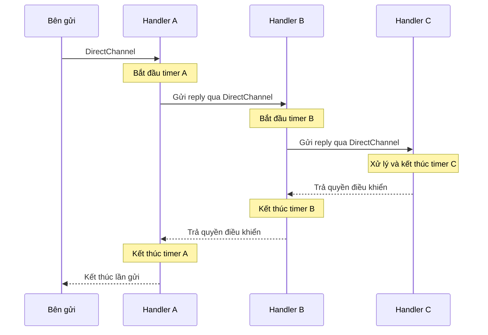

# Handler duration

Trong chương **Metrics và observability** của module **SPRING_INTEGRATION_CORE**, handler duration giúp trả lời câu hỏi: một lần xử lý thông điệp đang giữ luồng thực thi trong bao lâu, và phần thời gian đó thuộc về đâu?

Một luồng tích hợp có thể đi qua transformer, filter, router, service activator và aggregator. Khi đơn hàng xử lý chậm, chỉ nhìn thời gian phản hồi ở gateway chưa đủ để xác định nơi cần điều tra. Ngược lại, nhìn một handler có duration cao rồi kết luận ngay phương thức nghiệp vụ của nó chậm cũng dễ dẫn đến sửa sai chỗ. Muốn đọc đúng số liệu, cần xác định **ranh giới phép đo**, **ranh giới bất đồng bộ** và **tập thông điệp được thống kê**.

Sau bài học, bạn có thể:

- Giải thích duration của một lần gọi handler và phân biệt với thời gian chờ hàng đợi, thời gian CPU, độ trễ toàn luồng.
- Đọc `Timer` qua count, tổng thời gian, trung bình và phân vị.
- Cấu hình một ví dụ Java DSL có tên handler ổn định để quan sát bằng Micrometer và Actuator.
- Viết truy vấn Prometheus cho độ trễ trung bình, p95 và tỷ lệ lỗi.
- Khoanh vùng hiện tượng chậm mà không cộng trùng duration hoặc bỏ sót lỗi và backlog.

Ví dụ sử dụng Java 17+, Spring Boot 3.5.x và Spring Integration 6.5.x, với phiên bản thư viện do Spring Boot quản lý. Đây là phạm vi cụ thể của ví dụ, không phải yêu cầu nâng cấp dự án đang học. Cần biết `Message`, `MessageChannel`, `DirectChannel`, `QueueChannel`, endpoint và cách khai báo `IntegrationFlow`.

## 1. Một mẫu handler duration đo điều gì?

Với handler đồng bộ thông thường, có thể hình dung phép đo như sau:

```text
t0: bắt đầu phần thực thi handler được instrument
    xử lý message, gọi nghiệp vụ, tạo reply, gửi tiếp nếu có
t1: phần thực thi đó trả về hoặc ném exception

duration = t1 - t0
```

Đây là thời gian đã trôi qua trong ranh giới đang đo. Nó có thể chứa thời gian chờ HTTP, database, connection pool, lock hoặc chờ gửi message. Vì vậy, một duration 400 ms không có nghĩa thread đã sử dụng CPU liên tục trong 400 ms.

Trong Spring Integration 6.5, `AbstractMessageHandler` đặt instrumentation quanh `doHandleMessage(...)`. Nếu handler đã được gắn Observation thì dùng nhánh Observation; nếu chưa, nó có thể dùng nhánh Micrometer metrics trực tiếp. Cấu trúc này giải thích tại sao cùng một handler không nhất thiết xuất hiện trong cả hai nhóm metric. Xem [mã nguồn AbstractMessageHandler 6.5.0](https://github.com/spring-projects/spring-integration/blob/v6.5.0/spring-integration-core/src/main/java/org/springframework/integration/handler/AbstractMessageHandler.java).

Cần tách ba câu hỏi:

| Câu hỏi | Ranh giới cần quan sát |
| --- | --- |
| Handler giữ lần gọi hiện tại bao lâu? | Instrumentation của handler |
| Phương thức `reserve(...)` tự nó mất bao lâu? | Timer hoặc span đặt quanh phương thức nghiệp vụ |
| Từ lúc gửi yêu cầu đến khi nhận kết quả mất bao lâu? | Ranh giới request–reply ở gateway hoặc phép đo toàn luồng |

Ba giá trị có thể khác nhau dù cùng liên quan tới một đơn hàng.

## 2. Duration có thể bao gồm handler phía sau

Xét luồng đồng bộ:



`DirectChannel` gọi subscriber ngay trên thread gửi. Handler tạo reply có thể gửi reply ngay trong lần thực thi đang được đo. Khi kênh đầu ra cũng là `DirectChannel`, việc gửi đó kéo theo xử lý phía sau trước khi handler trước trả về. Đây là suy luận từ cách gọi đồng bộ và cách gửi reply, không phải một công thức duration riêng của dashboard. Tham khảo [cách DirectChannel thực thi subscriber](https://docs.spring.io/spring-integration/reference/channel/implementations.html#channel-implementations-directchannel) và [mã nguồn AbstractMessageProducingHandler](https://github.com/spring-projects/spring-integration/blob/v6.5.0/spring-integration-core/src/main/java/org/springframework/integration/handler/AbstractMessageProducingHandler.java).

Giả sử thời gian riêng của A, B, C lần lượt là 12 ms, 80 ms và 8 ms. Bỏ qua overhead, các timer bao quanh lần gọi có thể ghi nhận:

| Timer | Duration quan sát được | Cách diễn giải |
| --- | ---: | --- |
| C | Khoảng 8 ms | Phần thực thi của C |
| B | Khoảng 88 ms | B và lời gọi đồng bộ tới C |
| A | Khoảng 100 ms | A và chuỗi đồng bộ phía sau |

Cộng ba duration thành 196 ms sẽ đếm trùng công việc. Dùng chúng để định vị đoạn gọi chậm, sau đó dùng span con, timer nghiệp vụ hoặc profiler để xác định phần thời gian riêng.

Không nên lấy p95(A) trừ p95(B) để tính p95 phần riêng của A. Hai phân vị có thể đại diện cho hai tập lần gọi khác nhau. Việc trừ thời gian chỉ có ý nghĩa khi đã ghép đúng cùng một lần xử lý và hiểu đầy đủ cấu trúc lời gọi.

## 3. Ranh giới bất đồng bộ làm thay đổi cách đọc

Hãy xét hai mốc khác:

```text
message được đưa vào queue
        |----- thời gian chờ -----|
                                  handler bắt đầu
                                  |--- duration ---|
                                                   handler kết thúc
```

Một message chờ queue 2 giây rồi xử lý 20 ms vẫn có thể tạo mẫu handler duration xấp xỉ 20 ms. Handler khỏe không bảo đảm luồng đạt mục tiêu phản hồi.

| Cách tổ chức luồng | Điều cần kiểm tra khi đọc duration |
| --- | --- |
| Đầu vào là `QueueChannel` với poller | Thời gian nằm trong queue trước lúc handler được gọi không nằm trong mẫu của handler đó |
| Gửi sang `ExecutorChannel` | Công việc phía sau thường chạy ở thread khác; phải quan sát cả executor và thời gian chờ task |
| Handler gửi vào queue đầu ra đã đầy | Thời gian chờ gửi có thể vẫn nằm trong duration của handler đang gửi |
| Executor dùng chính sách chạy task tại thread gọi khi quá tải | Không được mặc định mọi lần gửi đều tạo một ranh giới bất đồng bộ |
| Handler khởi tạo `CompletableFuture` hoặc publisher | Phải kiểm tra instrumentation kết thúc ở lúc trả đối tượng hay lúc công việc bất đồng bộ thực sự hoàn tất |

Đặc biệt, không suy ra rằng mọi timer quanh một phương thức trả `Mono` sẽ tự đo đến khi publisher hoàn tất. Hãy đặt phép đo vào vòng đời hoàn tất phù hợp nếu mục tiêu là đo toàn bộ tác vụ bất đồng bộ.

Với aggregator, thời gian một nhóm message tích lũy đến lúc đủ điều kiện release cũng là một đại lượng khác với duration của từng lần handler được gọi. Khi cần theo dõi tuổi nhóm, phải có phép đo tương ứng với vòng đời nhóm.

## 4. Đọc Timer từ dữ liệu, không chỉ từ một con số

Micrometer `Timer` ghi nhận tối thiểu số lần đo và tổng thời gian; backend và cấu hình quyết định các thống kê bổ sung. Đơn vị xuất ra phụ thuộc registry, nên khi đọc dữ liệu cần kiểm tra đơn vị thực tế. Tham khảo [Timer của Micrometer](https://docs.micrometer.io/micrometer/reference/concepts/timers.html).

| Đại lượng | Ý nghĩa khi đọc handler duration |
| --- | --- |
| `count` | Số lần thực thi đã được ghi nhận trong timer đang xét |
| `totalTime` / `_sum` | Tổng thời gian của các lần đó |
| Trung bình | Tổng thời gian chia số lần; phải dùng cùng tập nhãn và cùng khoảng quan sát |
| `max` | Giá trị cực đại theo cơ chế cửa sổ của timer; không mặc định là cực đại suốt đời tiến trình |
| p95, p99 | Ước lượng ngưỡng bao phủ một tỷ lệ mẫu; cần dữ liệu phân phối tương ứng |

Ví dụ giả định có 1.000 lần xử lý:

- 990 lần mất 10 ms.
- 10 lần mất 1.000 ms.

Trung bình là:

```text
(990 × 10 + 10 × 1.000) / 1.000 = 19,9 ms
```

Trung bình dưới 20 ms vẫn che khuất 10 lần mất 1 giây. Trong tập mẫu này, p95 còn ở vùng 10 ms; một phân vị đơn lẻ cũng có thể chưa thể hiện hết phần đuôi. Nên đọc phân vị cùng tỷ lệ vượt ngưỡng, lỗi và lượng traffic.

Trong hệ thống thực tế, dashboard thường cần trung bình theo cửa sổ 5 phút, không phải trung bình kể từ lúc ứng dụng khởi động. Nếu tiến trình vừa restart, bộ đếm tích lũy cũng bắt đầu lại; truy vấn phải xử lý sự thay đổi này.

## 5. Phân biệt hai cơ chế metric

### 5.1. Micrometer metrics trực tiếp

Với các component được hỗ trợ, cơ chế metrics trực tiếp sử dụng timer `spring.integration.send` cho cả channel lẫn handler. Bộ nhãn phân biệt handler gồm:

| Nhãn | Ví dụ |
| --- | --- |
| `type` | `handler` |
| `name` | `reserveInventoryHandler` |
| `result` | `success` hoặc `failure` |
| `exception` | `none` hoặc tên lớp exception được ghi nhận |

Phải lọc `type=handler` để tránh trộn duration gửi qua channel vào duration handler. Các meter thường chỉ xuất hiện sau khi component được sử dụng. Xem [Micrometer Integration trong Spring Integration 6.5](https://docs.spring.io/spring-integration/reference/6.5/metrics.html#micrometer-integration).

### 5.2. Micrometer Observation

Khi handler được instrument bằng Observation, timer hoàn tất thường có tên `spring.integration.handler`. Các nhãn định danh theo convention mặc định là `spring.integration.name` và `spring.integration.type`. Đừng dùng nguyên bộ lọc `type`, `name`, `result` của cơ chế trên cho metric này. Xem [convention mặc định của handler](https://github.com/spring-projects/spring-integration/blob/v6.5.0/spring-integration-core/src/main/java/org/springframework/integration/support/management/observation/DefaultMessageReceiverObservationConvention.java).

Trong ví dụ dưới đây, ta chủ động dùng cơ chế metrics trực tiếp. `@EnableIntegrationManagement` không khai báo `observationPatterns`; mặc định danh sách pattern rỗng. Chỉ có một `ObservationRegistry` trong context chưa đủ để suy ra mọi integration handler đã được instrument bằng Observation. Quy tắc chọn component nằm trong [Javadoc của EnableIntegrationManagement](https://docs.spring.io/spring-integration/docs/6.5.0/api/org/springframework/integration/config/EnableIntegrationManagement.html).

Không có yêu cầu rằng tên bài “Handler duration” phải tương ứng với một meter tên `handler.duration`. Tên meter là hợp đồng của instrumentation đang dùng.

## 6. Ví dụ Java DSL: quan sát handler giữ tồn kho

### 6.1. Dependencies và cấu hình quan sát

Trong một ứng dụng Spring Boot 3.5.x đã có parent hoặc BOM tương ứng, cần các dependencies sau. Đây là đoạn cấu hình để người học đưa vào dự án thực hành, không phải toàn bộ `pom.xml`:

```xml
<dependencies>
    <dependency>
        <groupId>org.springframework.boot</groupId>
        <artifactId>spring-boot-starter-integration</artifactId>
    </dependency>
    <dependency>
        <groupId>org.springframework.boot</groupId>
        <artifactId>spring-boot-starter-actuator</artifactId>
    </dependency>
    <dependency>
        <groupId>org.springframework.boot</groupId>
        <artifactId>spring-boot-starter-web</artifactId>
    </dependency>
    <dependency>
        <groupId>io.micrometer</groupId>
        <artifactId>micrometer-registry-prometheus</artifactId>
        <scope>runtime</scope>
    </dependency>
</dependencies>
```

`spring-boot-starter-web` cung cấp HTTP server cho Actuator trong ví dụ. Cấu hình thực hành:

```yaml
spring:
  application:
    name: inventory-integration-demo

management:
  endpoints:
    web:
      exposure:
        include: health,metrics,prometheus
  metrics:
    tags:
      application: inventory-integration-demo
    distribution:
      percentiles-histogram:
        "spring.integration.send": true
      slo:
        "spring.integration.send": 50ms,100ms,200ms,500ms
```

Histogram phục vụ truy vấn phân vị; các mốc SLO bổ sung bucket tại ngưỡng quan tâm. Cấu hình theo tên `spring.integration.send` cũng tác động tới timer channel dùng cùng tiền tố; khi muốn giới hạn chi phí cho một handler, có thể chọn lọc theo tag bằng `MeterFilter` từ lúc khởi tạo registry. Spring Boot hỗ trợ các thuộc tính phân phối này và endpoint `metrics` để xem meter đang có. Tham khảo [Spring Boot metrics và cấu hình từng meter](https://docs.spring.io/spring-boot/3.5/reference/actuator/metrics.html#actuator.metrics.customizing.per-meter-properties).

### 6.2. Ứng dụng mẫu

Đặt lớp sau trong package của ứng dụng thực hành. `Thread.sleep` chỉ tạo độ trễ có thể quan sát trong bài; nó không mô phỏng đúng hiệu năng của database hay dịch vụ HTTP.

```java
package example.integration;

import java.util.concurrent.TimeUnit;

import io.micrometer.core.instrument.MeterRegistry;
import io.micrometer.core.instrument.Timer;
import org.springframework.beans.factory.annotation.Qualifier;
import org.springframework.boot.ApplicationRunner;
import org.springframework.boot.SpringApplication;
import org.springframework.boot.autoconfigure.SpringBootApplication;
import org.springframework.context.annotation.Bean;
import org.springframework.integration.channel.DirectChannel;
import org.springframework.integration.channel.QueueChannel;
import org.springframework.integration.config.EnableIntegrationManagement;
import org.springframework.integration.dsl.IntegrationFlow;
import org.springframework.integration.handler.ServiceActivatingHandler;
import org.springframework.messaging.Message;
import org.springframework.messaging.MessageChannel;
import org.springframework.messaging.MessagingException;
import org.springframework.messaging.support.MessageBuilder;

@SpringBootApplication
@EnableIntegrationManagement
public class HandlerDurationApplication {

    public static void main(String[] args) {
        SpringApplication.run(HandlerDurationApplication.class, args);
    }

    @Bean
    DirectChannel reservationRequests() {
        return new DirectChannel();
    }

    @Bean
    QueueChannel reservationResults() {
        return new QueueChannel(10);
    }

    @Bean
    InventoryService inventoryService() {
        return new InventoryService();
    }

    @Bean
    ServiceActivatingHandler reserveInventoryHandler(InventoryService service) {
        ServiceActivatingHandler handler =
                new ServiceActivatingHandler(service, "reserve");
        handler.setRequiresReply(true);
        handler.setSendTimeout(1_000);
        return handler;
    }

    @Bean
    IntegrationFlow reservationFlow(
            ServiceActivatingHandler reserveInventoryHandler) {
        return IntegrationFlow.from("reservationRequests")
                .handle(reserveInventoryHandler,
                        endpoint -> endpoint.id("reserveInventoryEndpoint"))
                .channel("reservationResults")
                .get();
    }

    @Bean
    ApplicationRunner demo(
            @Qualifier("reservationRequests") MessageChannel requests,
            @Qualifier("reservationResults") QueueChannel results,
            MeterRegistry registry) {
        return args -> {
            requests.send(MessageBuilder
                    .withPayload(new Order("ORDER-1", 2, 40))
                    .build());
            requests.send(MessageBuilder
                    .withPayload(new Order("ORDER-2", 1, 250))
                    .build());

            for (int i = 0; i < 2; i++) {
                Message<?> reply = results.receive(1_000);
                if (reply == null) {
                    throw new IllegalStateException("Missing reservation reply");
                }
                System.out.println(reply.getPayload());
            }

            try {
                requests.send(MessageBuilder
                        .withPayload(new Order("ORDER-INVALID", 0, 0))
                        .build());
                throw new IllegalStateException("Expected validation failure");
            }
            catch (MessagingException expected) {
                System.out.println("Validation failure reached the sender");
            }

            for (Timer timer : registry.find("spring.integration.send")
                    .tag("type", "handler")
                    .tag("name", "reserveInventoryHandler")
                    .timers()) {
                System.out.printf(
                        "result=%s exception=%s count=%d meanMs=%.2f%n",
                        timer.getId().getTag("result"),
                        timer.getId().getTag("exception"),
                        timer.count(),
                        timer.mean(TimeUnit.MILLISECONDS));
            }
        };
    }

    public record Order(String orderId, int quantity, long delayMillis) {
    }

    public record Reservation(String orderId, String status) {
    }

    public static class InventoryService {
        public Reservation reserve(Order order) {
            if (order.quantity() <= 0) {
                throw new IllegalArgumentException("quantity must be positive");
            }
            try {
                Thread.sleep(order.delayMillis());
            }
            catch (InterruptedException ex) {
                Thread.currentThread().interrupt();
                throw new IllegalStateException("Reservation interrupted", ex);
            }
            return new Reservation(order.orderId(), "RESERVED");
        }
    }
}
```

Luồng thực thi:

```text
ApplicationRunner
    -> reservationRequests (DirectChannel)
    -> reserveInventoryHandler
    -> reservationResults (QueueChannel)
    -> ApplicationRunner chủ động nhận kết quả
```

Handler là bean riêng tên `reserveInventoryHandler`; endpoint có ID `reserveInventoryEndpoint`. Hai đối tượng có vai trò khác nhau. Tạo bean handler rõ tên giúp chọn đúng series mà không phụ thuộc tên tự sinh khi thay đổi chuỗi DSL. Cách DSL đăng ký endpoint và handler có thể đối chiếu trong [IntegrationFlowBeanPostProcessor](https://github.com/spring-projects/spring-integration/blob/v6.5.0/spring-integration-core/src/main/java/org/springframework/integration/dsl/context/IntegrationFlowBeanPostProcessor.java).

Đầu ra là queue để việc nhận và in kết quả của runner không trở thành chuỗi xử lý đồng bộ phía sau handler. Trong ví dụ, queue đủ chỗ cho hai reply; nếu queue đầy ở một biến thể khác, chờ gửi lại có thể ảnh hưởng duration.

Sau khi runner hoàn tất trên một tiến trình mới, kỳ vọng quan sát hai lần thành công và một lần thất bại cho handler này. Trung bình nhóm thành công ở vùng thời gian của 40 ms và 250 ms cộng overhead; không yêu cầu số đo chính xác 145 ms. Exception ở lớp messaging có thể bọc exception nghiệp vụ, nên không giả định tag `exception` luôn là `IllegalArgumentException`.

### 6.3. Xem đúng meter trên Actuator

Mở danh sách meter trước, rồi lọc timer:

```http
GET http://localhost:8080/actuator/metrics

GET http://localhost:8080/actuator/metrics/spring.integration.send?tag=type:handler&tag=name:reserveInventoryHandler

GET http://localhost:8080/actuator/metrics/spring.integration.send?tag=type:handler&tag=name:reserveInventoryHandler&tag=result:success

GET http://localhost:8080/actuator/prometheus
```

Lần truy vấn không lọc `result` gộp các timer khớp bộ nhãn; khi đọc các thống kê cực đại, không coi giá trị gộp đó là cực đại duy nhất của toàn bộ lần gọi. Để đọc phân phối trên nhiều series, dùng truy vấn histogram phù hợp.

Trong Prometheus với convention thông thường, bạn sẽ tìm các tên:

```text
spring_integration_send_seconds_count
spring_integration_send_seconds_sum
spring_integration_send_seconds_bucket
```

Kiểm tra tên và nhãn thực tế trên endpoint trước khi xây dashboard. Actuator `metrics` vẫn dùng tên Micrometer dạng dấu chấm; Prometheus thường chuyển sang dấu gạch dưới và dùng giây cho duration.

## 7. Truy vấn duration trong Prometheus

Các ví dụ sau dùng classic histogram của cấu hình trên. Giả sử Prometheus đã scrape ứng dụng và các instance đều xuất cùng tên metric, nhãn và cấu hình bucket.

### 7.1. Trung bình theo cửa sổ 5 phút

```promql
1000 *
sum by (application, name) (
  rate(spring_integration_send_seconds_sum{
    application="inventory-integration-demo",
    type="handler",
    name="reserveInventoryHandler"
  }[5m])
)
/
sum by (application, name) (
  rate(spring_integration_send_seconds_count{
    application="inventory-integration-demo",
    type="handler",
    name="reserveInventoryHandler"
  }[5m])
)
```

Kết quả có đơn vị millisecond vì đã nhân 1.000. Truy vấn gộp cả thành công lẫn thất bại. Nếu chỉ muốn nhóm thành công, thêm `result="success"` vào **cả tử số và mẫu số**.

Lấy `rate` cho từng series trước khi cộng giúp xử lý counter reset theo từng instance. Không lấy trung bình cộng các giá trị trung bình của pod: pod có 10 lần xử lý không nên có trọng số bằng pod có 10.000 lần xử lý.

Nếu không có lần xử lý nào trong cửa sổ, mẫu số có thể bằng 0 hoặc thiếu dữ liệu. Dashboard cần hiển thị trạng thái không có mẫu; tự thay bằng “0 ms, khỏe” sẽ che khuất tình trạng không nhận được traffic.

### 7.2. p95 của các lần thành công

```promql
1000 * histogram_quantile(
  0.95,
  sum by (application, name, le) (
    rate(spring_integration_send_seconds_bucket{
      application="inventory-integration-demo",
      type="handler",
      name="reserveInventoryHandler",
      result="success"
    }[5m])
  )
)
```

Giữ nhãn `le` khi gộp classic histogram. Đây là phân vị ước lượng từ bucket, không phải thời gian chính xác của một message cụ thể. Histogram cho phép gộp phân phối giữa các instance; phân vị tính sẵn ở client không thể được gộp đúng bằng cách lấy trung bình p95 của từng instance. Tham khảo [histogram và percentile của Micrometer](https://docs.micrometer.io/micrometer/reference/concepts/histogram-quantiles.html).

### 7.3. Tỷ lệ thành công hoàn tất trong 200 ms

Với bucket SLO 200 ms đã cấu hình:

```promql
sum by (application, name) (
  rate(spring_integration_send_seconds_bucket{
    application="inventory-integration-demo",
    type="handler",
    name="reserveInventoryHandler",
    result="success",
    le="0.2"
  }[5m])
)
/
sum by (application, name) (
  rate(spring_integration_send_seconds_count{
    application="inventory-integration-demo",
    type="handler",
    name="reserveInventoryHandler",
    result="success"
  }[5m])
)
```

Kết quả nằm trong khoảng 0–1 khi có mẫu. Đây là tỷ lệ nhanh trong **nhóm thành công**. Nếu muốn định nghĩa “thành công và nhanh trên tổng yêu cầu”, giữ tử số và bỏ điều kiện `result="success"` ở mẫu số. Hai định nghĩa phục vụ hai câu hỏi vận hành khác nhau.

Bucket classic histogram là tích lũy: bucket 200 ms đã bao gồm các mẫu nhanh hơn 50 ms và 100 ms. Không cộng ba bucket để đếm số lần dưới 200 ms. Xem [cách diễn giải histogram trong Prometheus](https://prometheus.io/docs/practices/histograms/).

### 7.4. Tỷ lệ lỗi phải được đọc cùng độ trễ

```promql
sum by (application, name) (
  rate(spring_integration_send_seconds_count{
    application="inventory-integration-demo",
    type="handler",
    name="reserveInventoryHandler",
    result="failure"
  }[5m])
)
/
sum by (application, name) (
  rate(spring_integration_send_seconds_count{
    application="inventory-integration-demo",
    type="handler",
    name="reserveInventoryHandler"
  }[5m])
)
```

Series failure có thể chưa tồn tại trước lỗi đầu tiên; panel cần phân biệt điều đó với mất toàn bộ dữ liệu scrape. Không coi sự vắng mặt của mọi metric là bằng chứng tỷ lệ lỗi bằng 0.

Ví dụ, dependency hỏng và từ chối yêu cầu trong 2 ms có thể làm trung bình duration giảm mạnh. Đó không phải cải thiện hiệu năng nếu tỷ lệ lỗi tăng từ 0,1% lên 50%.

## 8. Khi chuyển ví dụ sang Observation

Để chọn riêng handler của ví dụ, thay annotation quản lý bằng:

```java
@EnableIntegrationManagement(
        observationPatterns = "reserveInventoryHandler")
```

Ứng dụng cũng cần `ObservationRegistry` và observation handler tạo metrics tương ứng. Trong cấu hình Spring Boot Actuator thông thường, phần hạ tầng này được tự cấu hình. Với Spring thuần, cần tự đăng ký đầy đủ thay vì chỉ tạo một registry rỗng.

Sau thay đổi, hãy tìm `spring.integration.handler` và nhãn `spring.integration.name=reserveInventoryHandler`. Nếu đang chạy một instance mới, timer trực tiếp của handler đã được Observation chọn có thể không còn xuất hiện như trước; phần in timer trực tiếp trong runner cần thay bằng truy vấn Observation tương ứng.

Ví dụ đọc timer hoàn tất bằng Java:

```java
for (Timer timer : registry.find("spring.integration.handler")
        .tag("spring.integration.name", "reserveInventoryHandler")
        .tag("spring.integration.type", "handler")
        .timers()) {
    System.out.println(timer.getId());
    System.out.println(timer.mean(TimeUnit.MILLISECONDS));
}
```

Đồng thời đổi khóa cấu hình histogram và SLO sang `spring.integration.handler`. Với convention Prometheus thông thường, tên duration chuyển thành `spring_integration_handler_seconds_*`, còn nhãn định danh chuyển thành `spring_integration_name` và `spring_integration_type`.

Không chép truy vấn tỷ lệ lỗi dùng `result="failure"` ở phần trước sang đây rồi mặc định nó hoạt động. Hãy kiểm tra nhãn lỗi do observation handler/convention thực tế tạo ra; convention định danh của Spring Integration không hứa cung cấp toàn bộ bộ nhãn của cơ chế metrics trực tiếp.

Ngoài timer hoàn tất, tài liệu Observation mô tả `spring.integration.handler.active` thuộc loại long task timer. Đây là cơ chế để quan sát lần gọi còn đang chạy, tùy observation handler và registry được cấu hình. Xem [các metric Observation của Spring Integration](https://docs.spring.io/spring-integration/reference/6.5/metrics.html#observation-metrics).

Timer thường chỉ cập nhật sau khi lần xử lý hoàn tất. Một handler đang treo chưa chắc đã làm p95 hiện tại tăng ngay. Long task timer cung cấp góc nhìn về công việc đang hoạt động, không thay thế phân phối của công việc đã hoàn tất. Tham khảo [Long Task Timers của Micrometer](https://docs.micrometer.io/micrometer/reference/concepts/long-task-timers.html).

Metrics và trace bổ sung cho nhau: metrics cho biết hiện tượng xảy ra thường xuyên tới đâu; trace của một message chậm cho biết nó đi qua những bước nào. Nếu luồng đổi thread, cần bảo đảm việc truyền context phù hợp với hạ tầng đang dùng trước khi kỳ vọng trace nối liền toàn bộ luồng.

## 9. Đo riêng nghiệp vụ khi cần ranh giới hẹp hơn

Nếu mục tiêu là thời gian của lời gọi tới kho, có thể bọc đúng thao tác nghiệp vụ bằng một timer riêng. Đoạn dưới minh họa một phương thức trong lớp đã có `MeterRegistry registry`; `client` là dependency thực hiện lời gọi đồng bộ:

```java
public Reservation reserveWithBusinessTimer(Order order) {
    Timer.Sample sample = Timer.start(registry);
    String outcome = "failure";
    try {
        Reservation reservation = client.reserve(order);
        outcome = "success";
        return reservation;
    }
    finally {
        sample.stop(Timer.builder("inventory.reservation.duration")
                .description("Duration of the synchronous inventory operation")
                .tag("operation", "reserve")
                .tag("outcome", outcome)
                .register(registry));
    }
}
```

Các kiểu `Order`, `Reservation` có thể dùng từ ví dụ trước; phần `client` cần được thay bằng client của ứng dụng thực tế. `finally` bảo đảm nhánh exception vẫn dừng sample. Timer này trả lời một câu hỏi hẹp hơn timer bao quanh integration handler, nên cần tên khác và định nghĩa rõ trên dashboard.

Giữ tập giá trị tag hữu hạn: `operation=reserve`, `outcome=success|failure` phù hợp hơn dùng mã đơn hàng. Đưa `orderId`, message ID, trace ID, tên khách hàng hoặc toàn bộ thông báo lỗi vào tag sẽ làm số series tăng theo dữ liệu phát sinh. Dùng log có cấu trúc hoặc trace để tra từng message.

Không đặt lại tên custom timer thành `spring.integration.send` để “gộp chung” với framework. Trộn hai ranh giới đo sẽ khiến count và phân phối mất ý nghĩa. Tương tự, khi thêm `@Timed` vào phương thức, cần hạ tầng hỗ trợ annotation và cần xác định rõ ranh giới đo; annotation tự nó không thay đổi định nghĩa timer của Spring Integration.

Với tác vụ bất đồng bộ, `finally` của phương thức trả future thường chạy trước lúc future hoàn tất. Khi đó phải dừng sample ở callback hoàn tất, chỉ dừng một lần và xử lý cả thành công lẫn thất bại. Đừng dùng nguyên đoạn đồng bộ này để đo toàn bộ tác vụ bất đồng bộ.

## 10. Lỗi, retry và kết quả nghiệp vụ

Duration đo thời gian của ranh giới thực thi; nhãn thành công/thất bại phản ánh cách ranh giới đó kết thúc. Cần đối chiếu thêm kết quả nghiệp vụ.

| Tình huống | Cách đọc số liệu |
| --- | --- |
| Nghiệp vụ ném exception ra khỏi handler | Duration thất bại vẫn cần được quan sát; đọc cả root cause trong log/trace |
| Nghiệp vụ bắt lỗi rồi trả `Reservation(..., "REJECTED")` | Lời gọi kỹ thuật có thể thành công dù nghiệp vụ từ chối |
| Recovery xử lý exception và trả giá trị thay thế | Thành công ở ranh giới ngoài không bảo đảm dependency đã khỏe |
| Retry nằm trong một lần thực thi handler | Một mẫu duration có thể chứa nhiều attempt và thời gian backoff |
| Message được đưa trở lại queue để xử lý lại | Có thể phát sinh nhiều lần gọi handler cho cùng một message nghiệp vụ |
| Handler A nhận lỗi từ B qua chuỗi đồng bộ | A có thể ghi nhận lỗi dù nguyên nhân gốc nằm tại B |

Ví dụ giả định một lần thực thi bao quanh ba attempt, mỗi attempt mất 100 ms và có hai backoff 200 ms:

```text
duration ngoài ≈ 100 + 200 + 100 + 200 + 100 = 700 ms
```

Nếu chỉ nhìn count ở ranh giới ngoài, bạn có thể thấy một lần thực thi, trong khi dependency đã nhận ba lần gọi. Trước khi đối chiếu count với số đơn hàng, hãy xác định retry nằm ở đâu và số liệu đếm attempt hay đếm lần gọi handler.

Với `DirectChannel`, exception có thể truyền về bên gửi như trong ví dụ. Với poller hoặc executor, cần theo dõi cơ chế chuyển lỗi và `errorChannel` phù hợp; không giả định mọi lỗi bất đồng bộ sẽ xuất hiện ở nơi gửi ban đầu.

## 11. Quy trình điều tra khi handler duration tăng

1. **Xác định meter và ranh giới.** Đang dùng metrics trực tiếp hay Observation? Series là channel, handler hay gateway? Có thay đổi cấu hình hoặc tên bean sau deploy không?
2. **Xem lượng mẫu.** So sánh traffic, số lần hoàn tất, tỷ lệ lỗi và cửa sổ truy vấn. p99 từ vài mẫu có giá trị chẩn đoán hạn chế.
3. **Xem điểm chờ trước handler.** Kiểm tra queue depth, tuổi message và executor backlog. Duration thấp không loại trừ nghẽn đầu vào.
4. **Xem chuỗi đồng bộ phía sau.** Handler trước có đang chờ router, HTTP handler hoặc database handler sau nó không? Dùng trace để ghép đúng cùng một message.
5. **Xem tài nguyên.** Kiểm tra HTTP timeout, connection pool, lock, CPU, GC và retry. Thêm thread không tự giải quyết được dependency đang quá tải.
6. **Xác nhận kết quả sau thay đổi.** So sánh dưới tải tương đương, đọc cả phân phối độ trễ, lỗi và backlog để tránh đánh đổi vô tình.

Một bảng đối chiếu giúp chọn hướng điều tra tiếp:

| Hiện tượng | Giả thuyết cần kiểm tra |
| --- | --- |
| Duration thấp, gateway chậm, queue tăng | Message đang chờ trước khi được xử lý |
| Duration tăng, CPU thấp | Chờ I/O, pool, lock hoặc backoff |
| Duration tăng, CPU cao | Xử lý nặng, serialize/deserialize, vòng lặp hoặc áp lực GC |
| Cả A và B cùng tăng trong chuỗi `DirectChannel` | A có thể đang bao gồm thời gian tăng tại B |
| Duration giảm, lỗi tăng | Lỗi nhanh hoặc fallback đang làm thay đổi tập kết quả |
| Count hoàn tất ngừng tăng, request vẫn vào | Công việc có thể đang treo; cần xem active task và thread |

Đây là các giả thuyết để thu thập bằng chứng, không phải kết luận tự động từ một biểu đồ.

## 12. Thực hành kiểm chứng ranh giới đo

Thực hiện trên bản sao ứng dụng thực hành, mỗi thay đổi chỉ nhằm kiểm chứng một giả thuyết:

1. Chạy ví dụ ban đầu và xác định đúng các nhãn của `reserveInventoryHandler`. Kiểm tra nhóm success và failure riêng, không gộp channel vào handler.
2. Tăng độ trễ giả lập của một đơn từ 250 ms lên 1.000 ms. Quan sát tổng thời gian và phân phối sau khi lần gọi hoàn tất; không đòi p95 từ ba mẫu có ý nghĩa như hệ thống có tải thật.
3. Thêm một handler đồng bộ chậm sau handler giữ kho. Dự đoán timer phía trước tăng rồi đối chiếu với số đo thực tế.
4. Đưa một queue và poller vào giữa hai bước, tiếp tục quan sát cả độ trễ toàn luồng và queue. Không dùng việc timer phía trước giảm để kết luận toàn luồng nhanh hơn.
5. Tạo lỗi nghiệp vụ và trường hợp recovery. So sánh kết thúc kỹ thuật với trạng thái nghiệp vụ trong payload.

Khi viết kiểm thử cho instrumentation, ưu tiên xác nhận meter đúng tên, đúng tag, count thay đổi đúng và exception không làm mất mẫu. Với thành phần đo tự viết, có thể dùng clock điều khiển được để kiểm tra thời gian. Tránh assertion kiểu “duration phải đúng 40 ms” trên máy thật vì lịch CPU, khởi tạo JVM và I/O tạo dao động.

Một dashboard hữu ích cho handler nên đặt cạnh nhau: tốc độ hoàn tất, độ trễ trung bình và p95, tỷ lệ lỗi, cùng độ sâu/tuổi queue hoặc mức bận executor ở ranh giới liên quan. Định nghĩa rõ panel nào đo riêng handler, panel nào đo toàn bộ request–reply. Cách đặt ranh giới nhất quán giúp số liệu dẫn tới đúng hành động điều tra.
