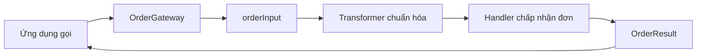
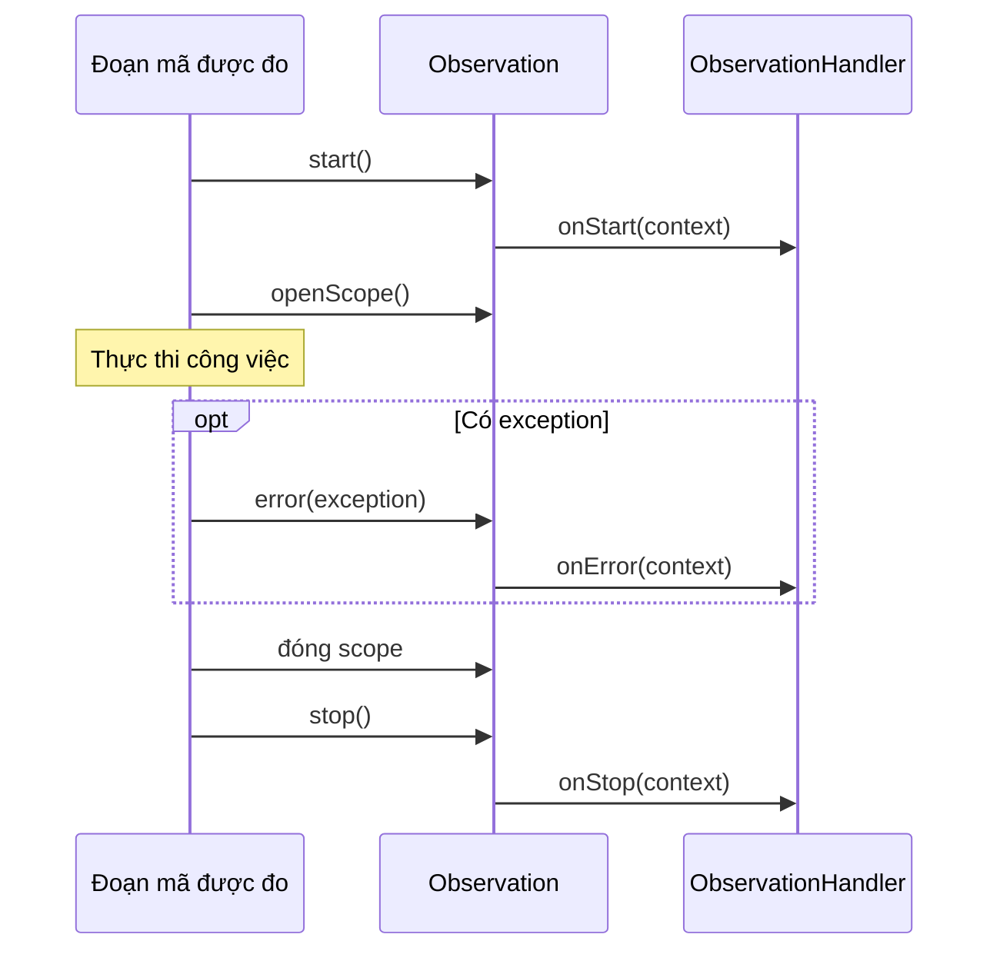
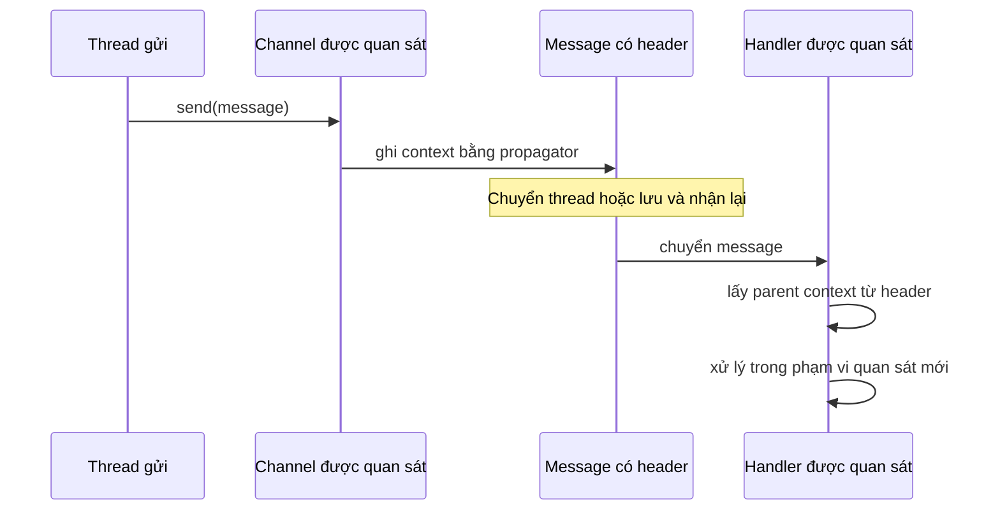

# Observation trong message flow

## 1. Mục tiêu và phạm vi

Trong chương **Metrics và observability** của **SPRING_INTEGRATION_CORE**, bài học này giải thích cách dùng Micrometer Observation để quan sát luồng thông điệp đi qua gateway, channel và handler. Mục tiêu là liên hệ dữ liệu đo được với cấu trúc thực thi của Spring Integration: biết thành phần nào đã chạy, phép đo bao phủ công việc nào và vì sao trace có thể bị đứt khi chuyển luồng xử lý.

Sau bài học, bạn có thể:

- Phân biệt `Observation`, metric, span và phạm vi thực thi hiện tại.
- Cấu hình `ObservationRegistry` và chọn thành phần Spring Integration cần quan sát.
- Viết một flow Java DSL có gateway, transformer và service activator để đọc kết quả đo.
- Giải thích việc truyền trace context qua channel đồng bộ, bất đồng bộ và ranh giới hệ thống.
- Thiết kế thông tin nghiệp vụ bổ sung, xử lý lỗi và kiểm thử vòng đời Observation.

Bạn cần biết `Message<?>`, message header, `DirectChannel`, `ExecutorChannel`, gateway và Java DSL. Các ví dụ lấy **Java 17 trở lên và API Spring Integration 6.5.x** làm mốc. Dự án học tập cần quản lý phiên bản Spring và Micrometer tương thích bằng BOM; không ghép tùy ý các phiên bản thư viện.

## 2. Từ một đơn hàng chậm đến các câu hỏi có thể trả lời

Giả sử ứng dụng nhận đơn hàng qua gateway, chuẩn hóa dữ liệu, kiểm tra và trả kết quả:



Khi người dùng báo thao tác chậm, dòng log “đã nhận đơn” chưa đủ để xác định nguyên nhân. Cần tách những câu hỏi khác nhau:

| Câu hỏi vận hành | Dữ liệu thích hợp |
| --- | --- |
| Tốc độ xử lý và độ trễ thay đổi thế nào trong mười phút? | Metric tổng hợp theo thành phần, loại thao tác và kết quả |
| Một lần gọi cụ thể đi qua những bước nào? | Trace gồm các span có quan hệ với nhau |
| Handler quyết định từ chối đơn vì quy tắc nào? | Log hoặc sự kiện nghiệp vụ có mã lý do phù hợp |
| Có bao nhiêu đơn đã được chấp nhận cuối cùng? | Phép đo nghiệp vụ tại điểm xác nhận kết quả |

Một message có thể đi qua nhiều handler. Một yêu cầu có thể sinh nhiều message do split, retry hoặc fan-out. Vì vậy, đếm hoạt động kỹ thuật của flow chưa đủ để suy ra số giao dịch nghiệp vụ thành công.

### 2.1. Observation là điểm ghi nhận một hoạt động

`Observation` mô tả vòng đời của một hoạt động cùng ngữ cảnh liên quan. `ObservationRegistry` là nơi cấu hình các bên tiếp nhận hoạt động đó. Một `ObservationHandler` có thể biến tín hiệu bắt đầu, kết thúc hoặc lỗi thành dữ liệu đo hay dữ liệu truy vết. Các khái niệm và tín hiệu này được mô tả trong [Micrometer Observation Introduction](https://docs.micrometer.io/micrometer/reference/observation/introduction.html).

Hình dung một lần gọi handler:

```text
Nhận message
  -> bắt đầu Observation
  -> thực thi handler
  -> ghi nhận lỗi nếu có
  -> kết thúc Observation
```

Từ cùng vị trí đo, ứng dụng có thể phục vụ nhiều nhu cầu. Tuy nhiên, cấu hình chỉ tạo metric không đồng nghĩa đã có trace, và có trace trong bộ nhớ không đồng nghĩa dữ liệu đã được xuất đến hệ thống lưu trữ.

### 2.2. Phân biệt hai loại registry

| Thành phần | Trách nhiệm |
| --- | --- |
| `ObservationRegistry` | Điều phối vòng đời Observation và các handler quan sát |
| `MeterRegistry` | Quản lý meter như timer, counter và gauge |
| Tracer và propagator | Tạo span, xác định quan hệ truy vết, đưa context vào và lấy context ra khỏi carrier |
| Exporter hoặc reporter | Chuyển dữ liệu đến nơi thu thập tương ứng |

`DefaultMeterObservationHandler` nối Observation với `MeterRegistry`. Trong ví dụ thực hành, ta dùng handler này cùng `SimpleMeterRegistry` để xem dữ liệu ngay trong tiến trình. Cách kết nối được trình bày trong [Micrometer Observation Components](https://docs.micrometer.io/micrometer/reference/observation/components.html).

## 3. Vòng đời Observation và scope

Hai khái niệm cần tách riêng là **thời gian sống của hoạt động** và **hoạt động đang có hiệu lực trong đoạn mã hiện tại**.

- `start()` bắt đầu hoạt động được đo.
- `openScope()` đưa Observation vào phạm vi hiện tại để đoạn mã bên trong có thể tìm được nó.
- Đóng scope khôi phục phạm vi trước đó.
- `error(exception)` ghi nhận lỗi; bản thân thao tác này không ném lại exception.
- `stop()` kết thúc phép đo.

Đóng scope không thay cho `stop()`. Ngược lại, gọi `stop()` cũng không thay cho việc đóng scope đúng cách. Cần bảo đảm cả hai bước khi tự quản lý vòng đời. Xem [mô tả lifecycle và scope của Micrometer](https://docs.micrometer.io/micrometer/reference/observation/introduction.html).



Với một công việc đồng bộ, có thể dùng `observe(...)` để quản lý các bước thông thường:

```java
Observation.createNotStarted("orders.validate", observationRegistry)
        .lowCardinalityKeyValue("order.kind", "standard")
        .observe(() -> validate(order));
```

Đây là đoạn minh họa trong một lớp đã có biến `observationRegistry`, biến `order` và phương thức `validate`. Nếu thân lambda kết thúc nhưng công việc thực sự tiếp tục ở một task khác, ranh giới đo này chỉ bao phủ phần lambda. Cần thiết kế riêng việc truyền context và thời điểm hoàn thành công việc bất đồng bộ.

## 4. Các ranh giới quan sát trong Spring Integration

Spring Integration hỗ trợ Micrometer Observation từ dòng 6.0. Với cấu hình mặc định tương ứng, các nhóm thao tác quan trọng gồm:

| Nhóm thao tác | Tên Observation mặc định | Vai trò span |
| --- | --- | --- |
| Gateway nhận yêu cầu và trả lời | `spring.integration.gateway` | `SERVER` |
| Gửi qua channel | `spring.integration.producer` | `PRODUCER` |
| Xử lý tại message handler | `spring.integration.handler` | `CONSUMER` |

Các timer có thể đi kèm long task timer với hậu tố `.active`. Metadata nhận diện thành phần gồm `spring.integration.name` và `spring.integration.type`; gateway còn có `spring.integration.outcome`. Nguồn đối chiếu là [Spring Integration 6.5: Metrics and Management](https://docs.spring.io/spring-integration/reference/6.5/metrics.html).

Không suy vai trò span chỉ từ tên lớp Java. Ví dụ, inbound endpoint lấy dữ liệu từ bên ngoài rồi đưa vào flow có góc nhìn khác với thao tác gửi message trên một channel nội bộ. Trong bài này, hãy bám vào ranh giới nhận yêu cầu, gửi message và thực thi handler.

### 4.1. Đọc thời gian theo cơ chế của channel

Giả sử transformer tốn 2 ms và handler cuối tốn 18 ms. Bỏ qua overhead để minh họa:

```text
DirectChannel:
  caller -> send -> transformer -> handler -> quay về caller

ExecutorChannel:
  caller -> send -> giao task cho executor -> quay về
                         worker -> transformer -> handler
```

Với `DirectChannel`, subscriber chạy ngay trên luồng gọi. Thời gian `send()` có thể bao gồm cả công việc phía sau trong chuỗi đồng bộ. Với `ExecutorChannel`, thao tác gửi có thể hoàn thành trước khi worker xử lý xong. Cơ chế luồng thực thi này cũng quyết định cách exception quay về phía gửi, như giải thích trong [Spring Integration: Error Handling](https://docs.spring.io/spring-integration/reference/6.5/error-handling.html).

Các kết luận cần rút ra từ ví dụ:

- Không cộng các timer đang lồng nhau để tính tổng thời gian một yêu cầu. Phần công việc 18 ms có thể đã nằm trong phép đo 20 ms ở bên ngoài.
- Một producer timer ngắn trên channel bất đồng bộ chưa chứng minh hệ thống xử lý nhanh; công việc có thể đang đợi executor hoặc queue.
- Thời gian tồn tại của một span và quan hệ cha–con là hai thông tin khác nhau. Một span con trong xử lý bất đồng bộ có thể tiếp tục sau khi span gửi đã kết thúc.
- `*.active` diễn tả hoạt động đang được đo, không thay thế phép đo số message đang nằm trong hàng đợi.

Nếu cần đo thời gian chờ trong queue, phải xác định rõ mốc enqueue, mốc bắt đầu xử lý và cách đối chiếu chúng. Đừng gán ý nghĩa “độ trễ toàn bộ hệ thống” cho một timer chỉ bao phủ thao tác gửi.

## 5. Bật Observation đúng thành phần

Một cấu hình học tập rõ ràng gồm:

1. Một `ObservationRegistry` được dùng chung trong application context.
2. Handler quan sát phù hợp với loại dữ liệu cần thu thập.
3. Cấu hình quản lý Spring Integration chọn những component cần nhận registry.

Trong Spring thuần, annotation sau là điểm bắt đầu trực tiếp:

```java
@EnableIntegrationManagement(observationPatterns = "*")
```

`observationPatterns` mặc định rỗng; `"*"` chọn tất cả thành phần tích hợp phù hợp. Khi thu hẹp phạm vi, pattern áp dụng theo tên component, không áp dụng theo tên lớp payload hay nội dung message. Tham khảo [Javadoc EnableIntegrationManagement 6.5](https://docs.spring.io/spring-integration/docs/6.5.0/api/org/springframework/integration/config/EnableIntegrationManagement.html).

Ví dụ, sau khi đã xem tên thực tế của gateway, channel và handler, có thể dùng:

```java
@EnableIntegrationManagement(observationPatterns = {
        "orderGateway*",
        "orderInput",
        "normalizeOrder*",
        "acceptOrder*",
        "orderFlow*"
})
```

Đây là ví dụ chọn theo nhóm tên, không phải danh sách bảo đảm bao phủ mọi component do mọi phiên bản DSL tạo ra. Khi đổi cấu trúc flow hoặc thêm channel bất đồng bộ, cần đối chiếu lại các thành phần ở ranh giới gửi và nhận.

Một endpoint id khai báo trong DSL có thể khác tên bean của handler được tạo bên trong. Vì vậy, cách kiểm tra đáng tin cậy là xem tag thực tế trên meter hoặc context thực tế trên Observation, sau đó mới xây dựng pattern và truy vấn dashboard.

### 5.1. Lưu ý với Spring Boot

Trong ứng dụng Boot đã có hạ tầng observability tự cấu hình, hãy sử dụng registry được cấp và kiểm tra cấu hình đang có. Ví dụ Spring thuần bên dưới tự tạo registry để làm rõ cơ chế; không sao chép nguyên phần hạ tầng đó vào ứng dụng Boot đang vận hành.

Boot hỗ trợ đăng ký các bean như `ObservationHandler`, `ObservationFilter` và convention vào registry. Cách mở rộng hạ tầng có sẵn được mô tả trong [Spring Boot: Observability](https://docs.spring.io/spring-boot/reference/actuator/observability.html). Việc thu thập trace còn phụ thuộc tracing bridge, cơ chế xuất dữ liệu và cấu hình tương ứng của phiên bản đang dùng.

## 6. Ví dụ đầy đủ: quan sát một flow xử lý đơn hàng

### 6.1. Dependency cho ví dụ

Đoạn POM sau giả định dự án đã có dependency management tương thích với mốc phiên bản nêu ở đầu bài. Đây là phần dependency bổ sung, không phải toàn bộ `pom.xml`:

```xml
<dependencies>
    <dependency>
        <groupId>org.springframework.integration</groupId>
        <artifactId>spring-integration-core</artifactId>
    </dependency>
    <dependency>
        <groupId>io.micrometer</groupId>
        <artifactId>micrometer-core</artifactId>
    </dependency>
</dependencies>
```

Ví dụ dùng `SimpleMeterRegistry`, vì vậy không cần backend giám sát để đọc timer. Thư viện và cấu hình xuất trace không nằm trong phần demo metric này.

### 6.2. Mã nguồn minh họa

Toàn bộ đoạn dưới đặt trong một tệp ví dụ `OrderObservationDemo.java` thuộc package `example.integration`. `FlowConfig` chứa luồng nghiệp vụ; `DemoConfig` cấp hạ tầng quan sát cho chương trình minh họa.

```java
package example.integration;

import java.math.BigDecimal;

import io.micrometer.core.instrument.MeterRegistry;
import io.micrometer.core.instrument.observation.DefaultMeterObservationHandler;
import io.micrometer.core.instrument.simple.SimpleMeterRegistry;
import io.micrometer.observation.ObservationRegistry;

import org.springframework.context.annotation.AnnotationConfigApplicationContext;
import org.springframework.context.annotation.Bean;
import org.springframework.context.annotation.Configuration;
import org.springframework.context.annotation.Import;
import org.springframework.integration.channel.DirectChannel;
import org.springframework.integration.config.EnableIntegration;
import org.springframework.integration.config.EnableIntegrationManagement;
import org.springframework.integration.dsl.IntegrationFlow;

public class OrderObservationDemo {

    public record Order(String id, BigDecimal amount) {
    }

    public record OrderResult(String orderId, String status) {
    }

    public interface OrderGateway {
        OrderResult submit(Order order);
    }

    @Configuration(proxyBeanMethods = false)
    @EnableIntegration
    @EnableIntegrationManagement(observationPatterns = "*")
    public static class FlowConfig {

        @Bean
        public DirectChannel orderInput() {
            return new DirectChannel();
        }

        @Bean
        public IntegrationFlow orderFlow(DirectChannel orderInput) {
            return IntegrationFlow
                    .from(OrderGateway.class,
                            gateway -> gateway.beanName("orderGateway")
                                    .replyTimeout(2_000L))
                    .channel(orderInput)
                    .<Order, Order>transform(
                            order -> new Order(order.id().strip(), order.amount()),
                            endpoint -> endpoint.id("normalizeOrder"))
                    .<Order>handle((order, headers) -> {
                        if (order.amount().signum() <= 0) {
                            throw new IllegalArgumentException(
                                    "Order amount must be positive");
                        }
                        return new OrderResult(order.id(), "ACCEPTED");
                    }, endpoint -> endpoint.id("acceptOrder"))
                    .get();
        }
    }

    @Configuration(proxyBeanMethods = false)
    @Import(FlowConfig.class)
    public static class DemoConfig {

        @Bean
        public MeterRegistry meterRegistry() {
            return new SimpleMeterRegistry();
        }

        @Bean
        public ObservationRegistry observationRegistry(MeterRegistry meters) {
            ObservationRegistry registry = ObservationRegistry.create();
            registry.observationConfig().observationHandler(
                    new DefaultMeterObservationHandler(meters));
            return registry;
        }
    }

    public static void main(String[] args) {
        try (AnnotationConfigApplicationContext context =
                     new AnnotationConfigApplicationContext(DemoConfig.class)) {

            OrderGateway gateway = context.getBean(OrderGateway.class);
            MeterRegistry meters = context.getBean(MeterRegistry.class);

            OrderResult result = gateway.submit(
                    new Order(" ORD-001 ", new BigDecimal("125000")));
            System.out.println(result);

            meters.find("spring.integration.producer")
                    .tag("spring.integration.name", "orderInput")
                    .timers()
                    .forEach(timer -> System.out.println(
                            "orderInput tags=" + timer.getId().getTags()
                                    + ", count=" + timer.count()));

            meters.getMeters().stream()
                    .filter(meter -> meter.getId().getName()
                            .startsWith("spring.integration."))
                    .forEach(meter -> System.out.println(meter.getId()));
        }
    }
```

Ở đây Java DSL tạo proxy gateway từ interface rồi đưa yêu cầu vào flow. Cách bắt đầu flow từ interface và tùy chỉnh tên gateway có trong [Spring Integration: IntegrationFlow as a Gateway](https://docs.spring.io/spring-integration/reference/6.5/dsl/integration-flow-as-gateway.html).

### 6.3. Điều cần thấy khi chạy ví dụ

Kết quả nghiệp vụ phải là:

```text
OrderResult[orderId=ORD-001, status=ACCEPTED]
```

Sau lần gọi thành công đầu tiên, timer producer của `orderInput` có một lần ghi nhận cho tổ hợp tag tương ứng. Danh sách meter còn giúp nhìn thấy gateway và các handler. Không nên sao chép một con số thời gian cố định làm kết quả mong đợi: thời gian phụ thuộc máy chạy, khởi tạo lớp và tải tại thời điểm thực thi.

Hãy quan sát ba điểm:

1. `orderInput` là channel có tên bean tường minh nên dễ truy vấn theo tag.
2. `normalizeOrder` và `acceptOrder` là endpoint id; cần đọc tên handler thực tế từ dữ liệu in ra.
3. Một lần gọi gateway tạo nhiều hoạt động kỹ thuật. Không cộng count của tất cả meter để đếm số đơn hàng.

Không thêm tracing handler trong ví dụ này nên kết quả mong đợi là metric trong bộ nhớ. Để kiểm chứng quan hệ trace, phải bổ sung hạ tầng truy vết và kiểm tra span ở nơi thu thập tương ứng.

### 6.4. Timer không thay thế counter nghiệp vụ

Nếu flow sau này thêm router, mỗi nhánh có thể thực hiện số bước khác nhau. Nếu thêm splitter, một đơn có nhiều dòng hàng có thể làm handler chạy nhiều lần. Nếu retry xảy ra, một công việc có thể được thử lại.

Do đó, hãy định nghĩa phép đếm nghiệp vụ tại một ranh giới rõ ràng, chẳng hạn “đơn được xác nhận sau khi ghi kết quả thành công”. Cũng phải xác định cách xử lý message trùng lặp trước khi xem phép đếm này là số đơn duy nhất.

## 7. Bổ sung Observation cho một thao tác nghiệp vụ

Observation có sẵn giúp nhận diện component đang chậm. Khi một handler thực hiện nhiều việc, bạn có thể cần đo riêng một công đoạn, chẳng hạn tính giá cuối cùng hoặc kiểm tra hạn mức.

Ví dụ dưới là một lớp mở rộng độc lập dùng kiểu dữ liệu của demo. Nó đo thao tác chấp nhận đơn bằng tên nghiệp vụ ổn định:

```java
package example.integration;

import io.micrometer.observation.Observation;
import io.micrometer.observation.ObservationRegistry;

import example.integration.OrderObservationDemo.Order;
import example.integration.OrderObservationDemo.OrderResult;

public class ObservedOrderService {

    private final ObservationRegistry registry;

    public ObservedOrderService(ObservationRegistry registry) {
        this.registry = registry;
    }

    public OrderResult accept(Order order) {
        return Observation.createNotStarted("orders.accept", registry)
                .lowCardinalityKeyValue("order.kind", "standard")
                .highCardinalityKeyValue("order.id", order.id())
                .observe(() -> {
                    if (order.amount().signum() <= 0) {
                        throw new IllegalArgumentException(
                                "Order amount must be positive");
                    }
                    return new OrderResult(order.id(), "ACCEPTED");
                });
    }
}
```

Để dùng biến thể này trong `FlowConfig`, thêm bean:

```java
@Bean
public ObservedOrderService observedOrderService(ObservationRegistry registry) {
    return new ObservedOrderService(registry);
}
```

Sau đó thêm tham số `ObservedOrderService service` vào phương thức `orderFlow`, và thay bước `.handle(...)` cuối bằng:

```java
.handle(service, "accept", endpoint -> endpoint.id("acceptOrder"))
```

Observation của handler bao phủ công việc của endpoint; `orders.accept` đánh dấu ranh giới nghiệp vụ nằm bên trong. Chỉ thêm phép đo này nếu nó giúp phân tích công việc hoặc tạo một chỉ báo vận hành cần thiết. Với một method chỉ lặp lại nguyên ranh giới đã có và không bổ sung thông tin, phép đo mới dễ làm dữ liệu khó đọc hơn.

Nếu cần thay đổi quy ước tên và metadata cho một loại context, hãy tìm hiểu `ObservationConvention`. Việc thay convention phải phù hợp loại context của component và giữ những key cần thiết cho truy vấn chung. Không dùng convention chung để xóa thông tin nhận diện của mọi flow.

## 8. Chọn tag: hữu ích cho truy vấn và kiểm soát cardinality

Cardinality của một tag thể hiện số giá trị khác nhau có thể xuất hiện. Với nhiều tag, số tổ hợp có thể tăng nhanh hơn từng tag riêng lẻ. Ví dụ, ba nhóm có 4, 5 và 10 giá trị có thể tạo tối đa 200 tổ hợp trước khi tính thêm tag khác.

Micrometer phân biệt **low cardinality** với **high cardinality**. Theo hạ tầng observability thông thường, tag low cardinality tham gia metric và trace; tag high cardinality dùng cho trace, không dùng làm nhãn metric. Xem [Spring Boot: Observability, quy tắc key-value](https://docs.spring.io/spring-boot/reference/actuator/observability.html).

| Dữ liệu đề xuất | Cách dùng trong ví dụ |
| --- | --- |
| Loại đơn từ danh sách cố định | Low cardinality, ví dụ `standard`, `express` |
| Kênh tiếp nhận từ danh sách cố định | Low cardinality, ví dụ `web`, `mobile`, `partner` |
| Nhóm kết quả đã chuẩn hóa | Low cardinality, ví dụ `accepted`, `rejected` |
| Mã đơn cụ thể | High cardinality nếu thực sự cần cho truy vết |
| Toàn bộ payload hoặc nội dung exception tự do | Không dùng làm nhãn metric |

Trong lớp `ObservedOrderService`, mọi đơn dùng tên `orders.accept`. Không tạo tên kiểu `orders.accept.ORD-001`. Tên component cũng nên ổn định giữa những message; không tạo flow hay handler theo từng mã đơn chỉ để phân biệt dữ liệu đo.

`order.id` trong ví dụ là mã giả lập phục vụ học tập. Trong hệ thống thật, hãy chọn thông tin phù hợp chính sách dữ liệu của ứng dụng. Việc một giá trị thuộc high cardinality không quyết định liệu giá trị đó có nên xuất sang hệ thống truy vết hay không.

Khi thêm metadata chỉ biết sau khi chạy xong, cần nhớ phép đo hoạt động đang diễn ra và phép đo đã hoàn thành có thời điểm đọc tag khác nhau. Đừng yêu cầu chúng có tập nhãn giống hệt nhau nếu nhãn chỉ xuất hiện ở cuối công việc.

## 9. Truyền context khi flow chuyển thread hoặc hệ thống

### 9.1. Context truy vết và thông tin tương quan nghiệp vụ

Những giá trị sau có mục đích khác nhau:

| Giá trị | Vai trò |
| --- | --- |
| Mã đơn | Nhận diện thực thể nghiệp vụ |
| Correlation id của message | Liên kết message theo quy tắc ứng dụng hoặc mẫu tích hợp |
| Trace id và span id | Nhận diện lần thực thi và quan hệ truy vết |
| MDC của logging | Giúp gắn thông tin vào log trên phạm vi thực thi được cấu hình |

Đặt header `correlationId` không tự tạo một distributed trace. Tương tự, sao chép chuỗi trace id vào MDC không bảo đảm tracer đã thiết lập đúng parent span.

### 9.2. Truyền qua message cần cả phía gửi lẫn phía nhận

Với hỗ trợ truy vết phù hợp, phía gửi có thể đưa trace context vào message header; phía nhận lấy context từ header để tiếp tục quan hệ quan sát. Đối với Spring Integration, cần bật Observation cho channel cùng consumer liên quan. `MessageSenderContext` và `MessageReceiverContext` phục vụ hai phía này. Xem [Spring Integration 6.5: Observation Propagation](https://docs.spring.io/spring-integration/reference/6.5/metrics.html#observation-propagation).



Các điều kiện thực tế cần kiểm tra gồm:

- Registry đang dùng có các tracing handler cần thiết cho sender và receiver.
- Những component ở ranh giới chuyển giao đã được chọn bởi cấu hình quan sát.
- Header được giữ hoặc ánh xạ đúng khi đi qua adapter, broker hay serializer.
- Hai phía dùng cơ chế propagation tương thích.

Các handler truyền và nhận context cùng cách phối hợp chúng được mô tả trong [Micrometer Tracing: Configuring with Observation](https://docs.micrometer.io/tracing/reference/configuring.html). Một `DefaultMeterObservationHandler` chỉ cung cấp phần metric, chưa đáp ứng các điều kiện truy vết này.

### 9.3. Biến thể ExecutorChannel của demo

Để thử việc xử lý trên worker, thêm các import sau vào demo:

```java
import java.util.concurrent.ExecutorService;
import java.util.concurrent.Executors;

import org.springframework.integration.channel.ExecutorChannel;
import org.springframework.messaging.MessageChannel;
```

Thêm hai bean vào `FlowConfig`:

```java
@Bean(destroyMethod = "shutdown")
public ExecutorService orderExecutor() {
    return Executors.newFixedThreadPool(2);
}

@Bean
public MessageChannel orderAsync(ExecutorService orderExecutor) {
    return new ExecutorChannel(orderExecutor);
}
```

Giữ `orderInput`, thêm `.channel("orderAsync")` ngay sau `.channel(orderInput)` trong flow và giữ hai bước xử lý phía sau. Với pattern `"*"`, channel mới thuộc phạm vi được chọn. Nếu đã thu hẹp pattern theo mục 5, phải đưa `orderAsync` vào danh sách.

Để nhìn thấy ranh giới thread, tạm in tên thread trước lời gọi gateway và bên trong handler. Gateway của demo vẫn trả về `OrderResult`, nên phía gọi vẫn chờ kết quả; phần xử lý nội bộ trên worker không biến method này thành API bất đồng bộ cho caller.

Hãy so sánh producer timer của `orderAsync` với timer handler. Chúng mô tả hai công việc khác nhau. Để kiểm tra trace liên tục, cần chạy biến thể có tracing và xem quan hệ span; chỉ nhìn timer không xác minh được điều đó.

### 9.4. Task tự tạo ngoài ranh giới message

Nếu handler gọi `CompletableFuture`, submit một task riêng hoặc chuyển sang Reactor, đường truyền qua message không tự bao phủ mọi đoạn công việc mới. Cần cấu hình cơ chế phù hợp tại ranh giới đó.

Micrometer Context Propagation có `ContextSnapshot` để chụp và khôi phục context, cùng cơ chế kết nối các nơi lưu context khác nhau. Tham khảo [Purpose của Micrometer Context Propagation](https://docs.micrometer.io/context-propagation/reference/purpose.html). Không giả định biến lưu theo thread sẽ tự đi theo một executor bất kỳ.

Trong thiết kế flow, tránh lưu một đối tượng `Observation` đang mở vào payload hoặc message store để mang sang tiến trình khác. Hãy truyền thông tin context bằng carrier phù hợp, rồi tạo hoặc tiếp tục ranh giới quan sát tại phía thực thi.

## 10. Lỗi kỹ thuật, từ chối nghiệp vụ và retry

Một Observation ghi nhận điều diễn ra trong ranh giới của nó. Nó không tự biết toàn bộ kết luận nghiệp vụ của mọi nhánh phía sau.

| Tình huống | Ý nghĩa cần diễn giải |
| --- | --- |
| Handler ném exception | Lần thực thi tại ranh giới đó thất bại; có thể còn bị wrapper của messaging bao ngoài |
| Service trả kết quả `REJECTED` hợp lệ | Method đã trả lời bình thường; cần thông tin nghiệp vụ để phân biệt từ chối |
| Filter loại message theo quy tắc | Có thể là xử lý bình thường nếu đó là hành vi đã thiết kế |
| Error flow phục hồi và trả fallback | Kết quả phía caller và lỗi tại bước gốc có thể mang hai ý nghĩa khác nhau |
| Retry thành công sau vài lần thử | Cần phân biệt số lần thử với kết quả cuối cùng của giao dịch |

Trong demo đồng bộ, đổi amount thành số âm để tạo lỗi. Exception tại handler có thể được Spring Integration bao lại trước khi tới gateway caller. Với flow bất đồng bộ, việc chuyển lỗi phụ thuộc hạ tầng error handling; không thể mặc định một exception trên worker sẽ nhảy trở lại câu lệnh `try/catch` quanh `channel.send()` ở thread gửi. Quy tắc liên quan `errorChannel` và `ErrorMessage` được trình bày trong [Spring Integration: Error Handling](https://docs.spring.io/spring-integration/reference/6.5/error-handling.html).

Khi tự viết Observation bằng vòng đời tường minh, đừng nuốt exception chỉ để tránh xuất hiện lỗi trên dashboard:

```java
Observation observation = Observation.start("orders.persist", registry);
try (Observation.Scope scope = observation.openScope()) {
    persistOrder(order);
}
catch (RuntimeException exception) {
    observation.error(exception);
    throw exception;
}
finally {
    observation.stop();
}
```

Đây là đoạn minh họa trong một lớp đã có `registry`, `order` và `persistOrder`. Nếu trả fallback là yêu cầu nghiệp vụ, hãy thể hiện rõ fallback trong kết quả hoặc metadata thích hợp. Nếu lỗi đã bị xử lý bên trong method và không đi ra ngoài, ranh giới bao quanh không thể tự suy ra rằng trước đó đã có exception.

Với retry, cần xác định vị trí đặt phép đo: bên ngoài retry để đo tổng nỗ lực, hoặc trong từng attempt để đo mỗi lần thử. Không mặc định timer của endpoint luôn bằng số attempt vì advice có thể bao những phần khác nhau của chuỗi xử lý.

## 11. Quan sát các mẫu tích hợp trong flow

Kiến thức trên giúp diễn giải các thành phần cốt lõi khác mà không cần biến mọi dữ liệu kỹ thuật thành chỉ số nghiệp vụ:

| Thành phần | Câu hỏi nên đặt ra |
| --- | --- |
| Transformer | Thời gian chuyển đổi có tăng theo kích thước dữ liệu không? Có lỗi định dạng ở bước này không? |
| Router | Những nhánh nào đang nhận tải? Nhánh chậm có tương ứng loại yêu cầu nào đã chuẩn hóa? |
| Filter | Bị loại theo quy tắc hợp lệ hay vì một cấu hình không phù hợp? Có điểm quan sát đường discard không? |
| Splitter | Một yêu cầu sinh bao nhiêu message con và ảnh hưởng thế nào đến count handler? |
| Aggregator | Chậm do xử lý từng message hay do chờ đủ nhóm để release? Có timeout hoặc nhóm tồn đọng không? |
| Gateway | Caller nhận kết quả, nhận lỗi hay hết thời gian chờ? |

Ví dụ, aggregator chờ một message còn thiếu trong 30 giây. Timer đo một lần gọi handler ngắn không tự đại diện cho toàn bộ 30 giây sống của nhóm. Nếu mục tiêu là đo thời gian từ khi tạo nhóm đến khi release, phải định nghĩa phép đo gắn với vòng đời nhóm và chính sách timeout.

Tương tự, một nhánh router không có traffic có thể do quy tắc phân tuyến hiện tại. Chỉ kết luận lỗi sau khi đối chiếu dữ liệu đầu vào, cấu hình route và trạng thái xử lý mong đợi.

## 12. Kiểm thử Observation trong flow

Kiểm thử giá trị trả về chỉ chứng minh một phần hành vi. Đối với hạ tầng quan sát, nên kiểm tra thêm rằng hoạt động mong đợi được tạo, kết thúc và không để lại current Observation ngoài phạm vi.

Micrometer cung cấp `micrometer-observation-test`, `TestObservationRegistry` và assertion hỗ trợ vòng đời. Xem [Micrometer: Testing Observations](https://docs.micrometer.io/micrometer/reference/observation/testing.html).

### 12.1. Dependency kiểm thử

Thêm các dependency test dưới đây vào POM đã có quản lý phiên bản tương thích:

```xml
<dependency>
    <groupId>io.micrometer</groupId>
    <artifactId>micrometer-observation-test</artifactId>
    <scope>test</scope>
</dependency>
<dependency>
    <groupId>org.junit.jupiter</groupId>
    <artifactId>junit-jupiter</artifactId>
    <scope>test</scope>
</dependency>
<dependency>
    <groupId>org.assertj</groupId>
    <artifactId>assertj-core</artifactId>
    <scope>test</scope>
</dependency>
```

### 12.2. Kiểm thử đường thành công

Test này dùng `FlowConfig` của demo gốc, chưa thêm biến thể `ObservedOrderService` hay `ExecutorChannel`. Nó cung cấp test registry thay cho hạ tầng của `DemoConfig`:

```java
package example.integration;

import java.math.BigDecimal;

import io.micrometer.observation.ObservationRegistry;
import io.micrometer.observation.tck.TestObservationRegistry;
import org.junit.jupiter.api.Test;
import org.springframework.context.annotation.AnnotationConfigApplicationContext;

import example.integration.OrderObservationDemo.FlowConfig;
import example.integration.OrderObservationDemo.Order;
import example.integration.OrderObservationDemo.OrderGateway;
import example.integration.OrderObservationDemo.OrderResult;

import static io.micrometer.observation.tck.TestObservationRegistryAssert.assertThat;
import static org.junit.jupiter.api.Assertions.assertEquals;

class OrderObservationTest {

    @Test
    void recordsGatewayLifecycle() {
        TestObservationRegistry registry = TestObservationRegistry.create();

        try (AnnotationConfigApplicationContext context =
                     new AnnotationConfigApplicationContext()) {
            context.registerBean(ObservationRegistry.class, () -> registry);
            context.register(FlowConfig.class);
            context.refresh();

            OrderGateway gateway = context.getBean(OrderGateway.class);
            OrderResult result = gateway.submit(
                    new Order(" ORD-001 ", new BigDecimal("125000")));

            assertEquals(new OrderResult("ORD-001", "ACCEPTED"), result);
            assertThat(registry)
                    .hasObservationWithNameEqualTo("spring.integration.gateway")
                    .that()
                    .hasBeenStarted()
                    .hasBeenStopped();
            assertThat(registry).doesNotHaveAnyRemainingCurrentObservation();
        }
    }
}
```

Test dùng context riêng và test registry riêng để tránh dữ liệu của lần kiểm thử khác. Nó kiểm tra instrumentation mà không cần backend trace đang chạy, nhưng chưa chứng minh exporter hay header mapping giữa hai ứng dụng đã hoạt động.

### 12.3. Những tình huống cần mở rộng khi áp dụng thực tế

- Gửi amount âm, kiểm tra exception mong đợi và hoạt động lỗi được kết thúc; không cố định một kiểu wrapper nếu lớp đang kiểm thử có thể thay đổi.
- Dùng `SimpleMeterRegistry` và `DefaultMeterObservationHandler` trong context kiểm thử để kiểm tra timer theo tên cùng tag cụ thể, thay vì chỉ tìm một chuỗi trong log.
- Với channel bất đồng bộ, chờ một tín hiệu hoàn thành có giới hạn thời gian trước khi kiểm tra dữ liệu; tránh dựa vào một khoảng ngủ tùy ý.
- Với tracing, kiểm tra quan hệ trace và parent context qua ranh giới message bằng hạ tầng test của tracer đang dùng.
- Kiểm tra trường hợp không có outer scope sau khi xử lý lỗi, cũng như trường hợp có outer scope cần được khôi phục sau lời gọi.

Không kiểm tra độ trễ bằng cách đòi timer phải bằng một số mili giây cố định. Với kiểm thử chức năng, sự tồn tại, count, metadata và trạng thái kết thúc thường cung cấp tín hiệu ổn định hơn.

## 13. Chẩn đoán khi dữ liệu quan sát không như mong đợi

| Dấu hiệu | Hướng kiểm tra |
| --- | --- |
| Không có Observation cho flow | Registry có được dùng bởi component không? Pattern có khớp tên thực tế không? Flow đã được gọi chưa? |
| Có hoạt động trong test registry nhưng không có metric | Có meter observation handler và `MeterRegistry` phù hợp không? |
| Có timer nhưng không thấy trace | Tracing handler, tracer, sampling và exporter đang được cấu hình thế nào? |
| Trace tách ra ở channel bất đồng bộ | Kiểm tra channel, consumer, propagation handler và việc giữ header tại điểm chuyển giao |
| Không tìm thấy tag theo endpoint id | Xem tên bean handler và tag thực tế thay vì suy từ tên hiển thị trong DSL |
| Producer nhanh nhưng gateway vẫn chậm | Xem thời gian worker, hàng đợi, downstream và thời gian chờ reply |
| Số lần xử lý lớn hơn số đơn | Kiểm tra số endpoint, split, fan-out, retry và message trùng |
| Số chuỗi thời gian tăng nhanh | Tìm tag chứa mã đơn, mã message, người dùng hoặc nội dung thay đổi không giới hạn |
| Bộ đếm lỗi nghiệp vụ bằng không dù nhiều đơn bị từ chối | Kiểm tra kết quả trả về bình thường và định nghĩa phép đo từ chối |

Khi chuyển từ metric trực tiếp sang Observation, cũng cần kiểm tra tên meter và tập tag mà dashboard đang sử dụng. Tránh kết luận flow không chạy chỉ vì truy vấn còn dựa trên quy ước đo cũ.

## 14. Thực hành áp dụng

Thực hiện lần lượt trên một dự án học tập riêng:

1. Chạy demo gốc và ghi lại tên component trên các meter. Giải thích vì sao một lần gọi gateway tạo nhiều hoạt động.
2. Thêm một yêu cầu amount âm. Phân biệt lỗi kỹ thuật được ném ra với một phương án thiết kế trả `REJECTED` bình thường.
3. Thêm `orderAsync`, so sánh thread thực thi và ranh giới thời gian của producer với handler. Giải thích vì sao gateway vẫn có thể chờ kết quả.
4. Dùng `ObservedOrderService` để thêm phép đo `orders.accept`. Chỉ chọn một vài tag có ý nghĩa và giải thích số giá trị có thể có của từng tag.
5. Nếu dự án có tracing, kiểm chứng message đi qua channel bất đồng bộ vẫn giữ quan hệ truy vết. Thử làm mất header tại một điểm chuyển giao trong môi trường học tập và xác định bằng chứng của việc đứt trace.

Khi diễn giải kết quả, luôn ghi rõ **đang đo hoạt động nào, tại ranh giới nào và hoàn thành nghĩa là gì**. Ba thông tin đó quyết định cách dùng Observation để phân tích hiệu năng, lỗi và tiến trình nghiệp vụ trong message flow.
