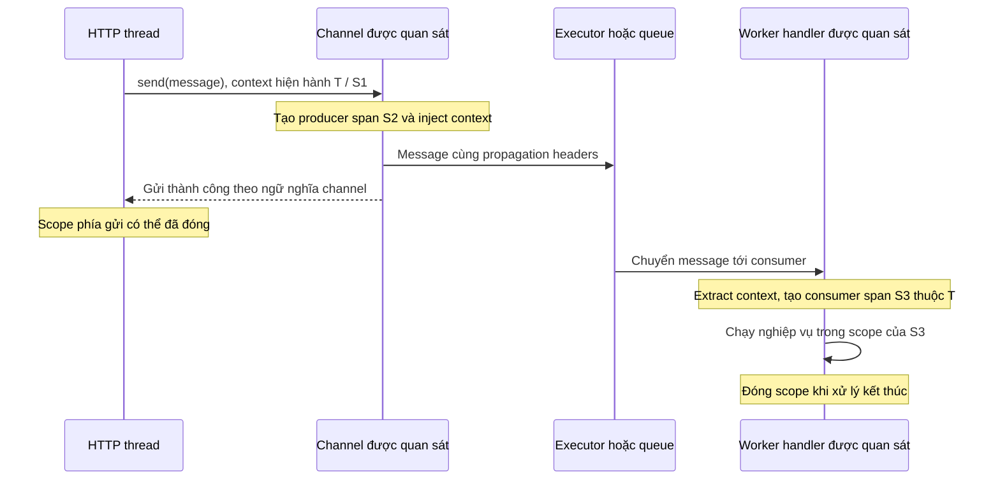

# Trace context qua channel

## 1. Mục tiêu và tình huống thực tế

Trong chương **Metrics và observability** của module **SPRING_INTEGRATION_CORE**, bài này giải thích cách giữ liên kết trace khi thông điệp đi qua `MessageChannel`, đặc biệt tại điểm chuyển từ thread gửi sang thread xử lý. Kiến thức này giúp theo dõi một luồng Spring Integration xây dựng bằng Message, endpoint, gateway và Java DSL mà không buộc các thành phần nghiệp vụ biết về nhau.

Sau bài học, bạn có thể:

- Phân biệt trace context, message header, correlation ID và MDC.
- Xác định điểm dễ mất context khi dùng `ExecutorChannel`, `QueueChannel` hoặc publish-subscribe bất đồng bộ.
- Bật observation cho cả channel và handler để tracing infrastructure truyền và khôi phục context.
- Viết luồng Java DSL minh họa, đọc kết quả và thiết kế kiểm thử phát hiện trace bị đứt hoặc bị trộn giữa thông điệp.
- Áp dụng nguyên tắc tương tự cho gateway, transformer, router, filter, aggregator và luồng xử lý lỗi.

Giả sử dịch vụ nhận yêu cầu tạo đơn hàng. HTTP controller gửi một `OrderCommand` vào luồng chuẩn hóa dữ liệu rồi chuyển sang worker. Controller trả về ngay sau khi giao thông điệp. Khi có lỗi ở worker, bạn muốn tìm được yêu cầu HTTP ban đầu, bước chuẩn hóa và bước lưu đơn trong cùng một trace.

Chỉ tìm `orderId` trong log chưa đủ: một đơn có thể được xử lý nhiều lần, retry có thể chạy sau đó, và cùng một thread trong pool có thể lần lượt xử lý nhiều đơn khác nhau.

**Phạm vi ví dụ:** Java 17+, Spring Boot 3.5.x và Spring Integration 6.5.x, sử dụng Micrometer Tracing. Đây là mốc phiên bản minh họa, không phải yêu cầu dùng phiên bản mới nhất. Không trộn cấu hình Spring Cloud Sleuth của các thế hệ cũ vào ví dụ này.

## 2. Trace context là gì?

Trace biểu diễn chuỗi thao tác có quan hệ nhân quả. Mỗi thao tác được đo riêng là một span.

| Khái niệm | Ý nghĩa | Ví dụ áp dụng |
| --- | --- | --- |
| Trace ID | Định danh của toàn bộ trace | Liên kết yêu cầu nhận đơn và xử lý đơn |
| Span ID | Định danh của một thao tác | Phân biệt span gửi message và span xử lý |
| Parent span ID | Quan hệ cha của span được ghi nhận | Biết thao tác xử lý được kích hoạt từ đâu |
| Sampling decision | Quyết định lấy mẫu được truyền theo context | Điều phối việc ghi và xuất trace |
| Baggage | Dữ liệu ngữ cảnh bổ sung được cấu hình truyền đi | Một mã vùng nghiệp vụ đã được cho phép |
| Scope | Khoảng thực thi mà context được đặt làm hiện hành | Cho phép `tracer.currentSpan()` tìm được span |

Khi qua một ranh giới xử lý, **trace ID thường được giữ nguyên, còn span ID thay đổi** vì thao tác mới có span riêng. Vì thế, so sánh tất cả span ID phải bằng nhau là một tiêu chí kiểm thử sai.

Với W3C Trace Context, dạng điển hình của `traceparent` là:

```text
00-4bf92f3577b34da6a3ce929d0e0e4736-00f067aa0ba902b7-01
│  └──────── trace-id ──────────┘ └── parent-id ──┘ └ flags
└ version
```

`parent-id` trong header là ID của span phía gửi mà bên nhận sẽ dùng làm cha; header không chứa toàn bộ cây span. `tracestate` mang thông tin mở rộng của hệ thống tracing. Tên header cụ thể còn tùy propagator: hệ thống dùng B3 có thể sử dụng `b3` hoặc các trường `X-B3-*`. Hai phía phải thống nhất định dạng sản xuất và tiêu thụ context. Xem [đặc tả W3C Trace Context](https://www.w3.org/TR/trace-context/).

### 2.1. Những định danh không thay thế được trace context

- `MessageHeaders.ID` xác định một message; tạo message mới có thể tạo ID mới.
- `correlationId` thường dùng để gom các message có quan hệ nghiệp vụ, chẳng hạn các phần của một nhóm aggregator.
- `orderId` xác định đơn hàng, có thể xuất hiện trong nhiều trace khác nhau.
- `traceId` là dữ liệu của tracing infrastructure, có sampling và quan hệ span đi kèm.

Không gán `correlationId` bằng trace ID chỉ để làm cho log giống nhau. Một nhóm aggregator có thể nhận đầu vào từ nhiều trace; một trace cũng có thể chứa nhiều nhóm nghiệp vụ.

### 2.2. Header và scope là hai phần khác nhau

Trong mô hình imperative, context hiện hành thường được gắn với thread thông qua tracing scope. MDC có thể phản chiếu trace ID và span ID để logger in ra. Header là carrier để vận chuyển context đến nơi khác.

Vì vậy:

- Message có `traceparent` chưa chứng minh handler đã có current span.
- MDC có chuỗi `traceId` chưa chứng minh một span đang được tracing infrastructure quản lý.
- `Tracer.currentSpan()` trả về span chỉ khi scope phù hợp đang hoạt động trên thread đó.

Micrometer minh họa việc mở scope bằng `tracer.withSpan(...)` và đóng scope khi thoát khối `try`; kết thúc span là một thao tác riêng. Xem [Micrometer Tracing API](https://docs.micrometer.io/tracing/reference/api.html).

## 3. Vì sao thay channel có thể làm đứt trace?

Một luồng chạy đồng bộ có thể che khuất lỗi cấu hình propagation vì sender và consumer cùng nhìn thấy context của một thread. Khi chuyển sang xử lý bất đồng bộ, giả định đó không còn đúng.

| Channel | Cách thực thi chính | Điểm cần chú ý với context |
| --- | --- | --- |
| `DirectChannel` | Gọi subscriber trên thread gửi | Context hiện hành có thể còn sẵn; vẫn cần instrumentation để đo đúng các bước |
| `ExecutorChannel` | Giao việc cho executor | Không được giả định thread worker có context của sender |
| `QueueChannel` | Giữ message chờ consumer nhận | Consumer có thể chạy sau khi scope gửi đã đóng |
| `PublishSubscribeChannel` không executor | Gọi các subscriber trên thread gửi | Có nhiều thao tác xử lý dù không chuyển thread |
| `PublishSubscribeChannel` có executor | Phân phối việc qua executor | Mỗi nhánh cần context và vòng đời span phù hợp |

Đây là các đặc tính channel được mô tả trong [Message Channel Implementations](https://docs.spring.io/spring-integration/reference/6.5/channel/implementations.html). Với `ExecutorChannel`, thread thực thi còn phụ thuộc executor và rejection policy; chẳng hạn `CallerRunsPolicy` có thể khiến tác vụ chạy trên thread gửi khi pool quá tải. Đừng coi việc luôn đổi thread là một bảo đảm của mọi cấu hình executor.



Thông điệp trong queue không được phụ thuộc vào một `ThreadLocal` của HTTP thread còn tồn tại. Context cần nằm trong carrier mà consumer sẽ nhận được.

## 4. Cơ chế propagation của Spring Integration

Ở Spring Integration 6.x, cách chuẩn là bật Micrometer Observation trên thành phần gửi và nhận. Channel dùng sender context để inject tracing vào headers; handler dùng receiver context để extract và bắt đầu observation con. Cơ chế này được mô tả tại [Observation Propagation](https://docs.spring.io/spring-integration/reference/6.5/metrics.html#observation-propagation).

Chuỗi công việc cần phân biệt như sau:

1. **Instrument:** xác định thao tác cần đo, chẳng hạn gửi message hoặc gọi handler.
2. **Inject:** propagator ghi dữ liệu context vào carrier khi gửi.
3. **Transport:** channel, executor hoặc message store chuyển message đi.
4. **Extract:** consumer đọc context từ carrier.
5. **Activate:** consumer mở scope của span xử lý trên thread thực thi.
6. **Close:** scope và observation được đóng khi thao tác kết thúc.

Trong cấu hình này, framework thực hiện vòng đời trên. Không tự giữ scope mở trong HTTP thread để chờ worker, không lưu đối tượng `Span` hoặc `Observation` vào message store, và không tự thêm một header tên `traceId` rồi kỳ vọng framework hiểu toàn bộ quan hệ cha con.

### 4.1. Các lớp hạ tầng cần có

| Thành phần | Trách nhiệm |
| --- | --- |
| `ObservationRegistry` | Nhận và điều phối các observation |
| Observation handlers cho tracing | Chuyển observation thành thao tác tracing, xử lý sender/receiver context |
| Micrometer Tracing bridge | Kết nối API tracing với Brave hoặc OpenTelemetry |
| Propagator | Inject/extract theo định dạng đã cấu hình |
| Exporter/reporter | Gửi span đã hoàn tất tới backend |

Một `MeterRegistry` phục vụ metrics không tự nó tạo đủ tracing infrastructure. Tương tự, chỉ khởi tạo `ObservationRegistry.create()` trong ứng dụng Spring thuần chưa làm xuất hiện tracer và các tracing handler cần thiết.

### 4.2. Bật observation cho đúng thành phần

```java
@EnableIntegrationManagement(observationPatterns = "*")
```

Khi có registry phù hợp, pattern này chọn tất cả integration component có hỗ trợ observation. Mặc định annotation không chọn tất cả component. Nếu thu hẹp pattern, cần chọn cả channel lẫn handler thực thi ở bên kia ranh giới. Xem [Javadoc của `observationPatterns`](https://docs.spring.io/spring-integration/api/org/springframework/integration/config/EnableIntegrationManagement.html#observationPatterns()).

Trong Java DSL, ID của endpoint và tên của message handler bên trong không nhất thiết giống nhau. Khi tối ưu patterns, đối chiếu tên component thực tế; không suy ra rằng pattern trùng `.id(...)` chắc chắn bao phủ mọi handler. Dùng `"*"` giúp ví dụ học tập tránh vướng sự khác biệt này.

## 5. Ví dụ hoàn chỉnh: từ HTTP sang ExecutorChannel

### 5.1. Dependency và cấu hình minh họa

Trong dự án đã dùng dependency management của Spring Boot 3.5.x, cần các dependency sau:

```xml
<dependencies>
    <dependency>
        <groupId>org.springframework.boot</groupId>
        <artifactId>spring-boot-starter-web</artifactId>
    </dependency>
    <dependency>
        <groupId>org.springframework.boot</groupId>
        <artifactId>spring-boot-starter-integration</artifactId>
    </dependency>
    <dependency>
        <groupId>org.springframework.boot</groupId>
        <artifactId>spring-boot-starter-actuator</artifactId>
    </dependency>
    <dependency>
        <groupId>io.micrometer</groupId>
        <artifactId>micrometer-tracing-bridge-brave</artifactId>
    </dependency>
    <dependency>
        <groupId>org.springframework.boot</groupId>
        <artifactId>spring-boot-starter-test</artifactId>
        <scope>test</scope>
    </dependency>
</dependencies>
```

Ví dụ cơ sở quan sát context bằng API và log, chưa cần gửi span ra mạng. Nếu muốn xem cây trace trên Zipkin, bổ sung `io.zipkin.reporter2:zipkin-reporter-brave` và backend tương ứng. Không thêm cả Brave bridge và OpenTelemetry bridge vào ví dụ chỉ để hy vọng tự chọn được một tracer. Các lựa chọn bridge/reporter được trình bày trong [Spring Boot Tracing](https://docs.spring.io/spring-boot/3.5/reference/actuator/tracing.html).

Nội dung cấu hình dưới đây là ví dụ cho ứng dụng thực hành:

```properties
spring.application.name=orders-integration-demo
management.tracing.sampling.probability=1.0
management.tracing.propagation.type=w3c
logging.pattern.correlation=[%X{traceId:-},%X{spanId:-}] 
```

Sampling 100% giúp dễ quan sát trong bài thực hành. Với lưu lượng thật, lựa chọn sampling theo nhu cầu vận hành. Việc không thấy span trên backend cũng có thể do sampling hoặc export, nên không kết luận mất context chỉ dựa vào màn hình backend.

### 5.2. Ứng dụng Java DSL

Đặt mã minh họa sau trong package riêng, ví dụ `vn.example.tracing`. `TraceReceipt` và queue thu kết quả chỉ phục vụ quan sát và kiểm thử bài học; hệ thống thật không cần giữ mọi kết quả tracing trong bộ nhớ.

```java
package vn.example.tracing;

import java.util.concurrent.BlockingQueue;
import java.util.concurrent.LinkedBlockingQueue;

import io.micrometer.tracing.Span;
import io.micrometer.tracing.Tracer;
import org.slf4j.Logger;
import org.slf4j.LoggerFactory;
import org.springframework.beans.factory.annotation.Qualifier;
import org.springframework.boot.SpringApplication;
import org.springframework.boot.autoconfigure.SpringBootApplication;
import org.springframework.context.annotation.Bean;
import org.springframework.http.ResponseEntity;
import org.springframework.integration.channel.DirectChannel;
import org.springframework.integration.channel.ExecutorChannel;
import org.springframework.integration.config.EnableIntegrationManagement;
import org.springframework.integration.dsl.IntegrationFlow;
import org.springframework.messaging.MessageChannel;
import org.springframework.messaging.support.MessageBuilder;
import org.springframework.scheduling.concurrent.ThreadPoolTaskExecutor;
import org.springframework.web.bind.annotation.PathVariable;
import org.springframework.web.bind.annotation.PostMapping;
import org.springframework.web.bind.annotation.RestController;

@SpringBootApplication
@EnableIntegrationManagement(observationPatterns = "*")
public class TraceChannelApplication {

    private static final Logger log =
            LoggerFactory.getLogger(TraceChannelApplication.class);

    public static void main(String[] args) {
        SpringApplication.run(TraceChannelApplication.class, args);
    }

    @Bean
    DirectChannel ordersInput() {
        return new DirectChannel();
    }

    @Bean
    ThreadPoolTaskExecutor ordersExecutor() {
        ThreadPoolTaskExecutor executor = new ThreadPoolTaskExecutor();
        executor.setCorePoolSize(1);
        executor.setMaxPoolSize(1);
        executor.setQueueCapacity(100);
        executor.setThreadNamePrefix("orders-worker-");
        executor.setWaitForTasksToCompleteOnShutdown(true);
        executor.setAwaitTerminationSeconds(5);
        return executor;
    }

    @Bean
    MessageChannel ordersAsync(
            @Qualifier("ordersExecutor") ThreadPoolTaskExecutor executor) {
        return new ExecutorChannel(executor);
    }

    @Bean
    BlockingQueue<TraceReceipt> traceReceipts() {
        return new LinkedBlockingQueue<>();
    }

    @Bean
    IntegrationFlow ordersFlow(Tracer tracer,
                              BlockingQueue<TraceReceipt> receipts) {
        return IntegrationFlow.from("ordersInput")
                .<OrderCommand, OrderCommand>transform(
                        order -> new OrderCommand(order.orderId().trim()),
                        endpoint -> endpoint.id("normalizeOrder"))
                .channel("ordersAsync")
                .handle(OrderCommand.class, (order, headers) -> {
                    Span current = tracer.currentSpan();
                    String traceId = current == null
                            ? "NONE" : current.context().traceId();
                    String spanId = current == null
                            ? "NONE" : current.context().spanId();
                    String thread = Thread.currentThread().getName();

                    log.info("Processed order={} trace={} span={} thread={}",
                            order.orderId(), traceId, spanId, thread);
                    receipts.offer(new TraceReceipt(
                            order.orderId(), traceId, spanId, thread));
                    return null;
                }, endpoint -> endpoint.id("processOrder"))
                .get();
    }
}

record OrderCommand(String orderId) {
}

record TraceReceipt(String orderId, String traceId,
                    String spanId, String threadName) {
}

@RestController
class OrderController {

    private static final Logger log =
            LoggerFactory.getLogger(OrderController.class);

    private final MessageChannel input;
    private final Tracer tracer;

    OrderController(@Qualifier("ordersInput") MessageChannel input,
                    Tracer tracer) {
        this.input = input;
        this.tracer = tracer;
    }

    @PostMapping("/orders/{orderId}")
    ResponseEntity<Void> submit(@PathVariable("orderId") String orderId) {
        Span current = tracer.currentSpan();
        log.info("Submitting order={} trace={} thread={}", orderId,
                current == null ? "NONE" : current.context().traceId(),
                Thread.currentThread().getName());

        boolean accepted = input.send(MessageBuilder
                .withPayload(new OrderCommand(orderId))
                .build(), 1_000);

        return accepted ? ResponseEntity.accepted().build()
                : ResponseEntity.status(503).build();
    }
}
```

Spring quản lý khởi tạo và dừng `ThreadPoolTaskExecutor` vì executor là một bean. Một worker được chọn ở đây để kiểm thử tái sử dụng thread dễ hơn; không có nghĩa ứng dụng thực tế luôn chỉ dùng một worker.

Ứng dụng không tự điền `traceparent`. HTTP observation tạo hoặc tiếp nối trace đầu vào; instrumentation của flow thực hiện việc inject/extract tại các bước messaging.

### 5.3. Gửi yêu cầu và đọc kết quả

Sau khi khởi động ứng dụng minh họa, gửi hai yêu cầu độc lập, không truyền trace header từ client:

```bash
curl -X POST http://localhost:8080/orders/ORD-1001
curl -X POST http://localhost:8080/orders/ORD-1002
```

Dạng kết quả mong đợi, với ID được rút gọn để dễ đọc:

```text
Submitting order=ORD-1001 trace=T1 thread=http-nio-8080-exec-1
Processed order=ORD-1001 trace=T1 span=C1 thread=orders-worker-1
Submitting order=ORD-1002 trace=T2 thread=http-nio-8080-exec-2
Processed order=ORD-1002 trace=T2 span=C2 thread=orders-worker-1
```

Các dòng có thể xen kẽ vì xử lý bất đồng bộ. Điều cần kiểm tra là quan hệ theo từng `orderId`, không phải vị trí dòng log.

- `ORD-1001` giữ trace T1 từ controller đến worker.
- `ORD-1002` giữ trace T2, không bị dính T1 dù worker được tái sử dụng.
- Span xử lý riêng có ID của nó; không yêu cầu bằng ID của HTTP span.
- Giá trị `NONE` tại worker là dấu hiệu cần kiểm tra registry, tracing handler và instrumentation.

`202 Accepted` chỉ xác nhận việc giao công việc theo thiết kế ví dụ. Nó không xác nhận đơn đã lưu thành công. Tham số timeout của `send` cũng không biến toàn bộ flow thành một deadline xử lý nghiệp vụ hay một thời hạn chờ reply.

## 6. Khi thay ExecutorChannel bằng QueueChannel

Với `QueueChannel`, consumer phải có poller. Để thực hành riêng, thay bean `ordersAsync` và cấu hình endpoint cuối; không giữ đồng thời hai bean trùng tên.

```java
import org.springframework.integration.channel.QueueChannel;
import org.springframework.integration.dsl.Pollers;

@Bean
QueueChannel ordersAsync() {
    return new QueueChannel(100);
}
```

Trong flow ở trên, giữ nguyên phần `handle` và thay phần cấu hình endpoint của nó bằng:

```java
endpoint -> endpoint
        .id("processOrder")
        .poller(Pollers.fixedDelay(100).maxMessagesPerPoll(10))
```

Đây là đoạn thay thế trong lời gọi `.handle(...)`, không phải một flow thứ hai hoàn chỉnh. Executor cũ không còn được channel này sử dụng.

Sự khác biệt đáng quan sát là message có thể nằm trong queue sau khi HTTP request đã kết thúc. Bên nhận vẫn phải tiếp nối được trace từ headers. Không kỳ vọng thread poller có sẵn context của HTTP request.

Nếu chuyển sang persistent message store, cần bảo đảm cấu hình lưu trữ giữ được propagation headers. Nếu đi ra broker hoặc tiến trình khác, kiểm tra cả header mapper và instrumentation của adapter. Chỉ bật observation ở channel nội bộ chưa bảo đảm transport bên ngoài sẽ mang mọi header qua biên hệ thống.

Không dùng decorator của executor để thay cho việc lưu context trong message tại ranh giới queue. Tác vụ poller định kỳ có thể được lập lịch từ rất lâu trước khi đơn hàng được gửi; context lúc lập lịch không đại diện cho từng message mà nó nhận sau này.

## 7. Giữ headers khi xử lý message

Transformer thông thường nhận payload và trả payload mới, như ví dụ chuẩn hóa đơn hàng, cho phép framework xử lý việc xây dựng reply message. Khi tự dựng message hoặc tự chọn headers, bạn phải chủ động giữ metadata cần thiết.

Ví dụ xử lý thủ công cùng một message nghiệp vụ:

```java
Message<?> updated = MessageBuilder.fromMessage(incoming)
        .setHeader("processingRegion", "south")
        .build();
```

Nếu thực sự thay payload trong mã tự xây message:

```java
Message<OrderCommand> updated = MessageBuilder
        .withPayload(normalizedOrder)
        .copyHeaders(incoming.getHeaders())
        .build();
```

Các đoạn này dùng `org.springframework.messaging.Message` và `org.springframework.messaging.support.MessageBuilder`. Builder quản lý các header đặc biệt như message ID; sao chép headers không có nghĩa hai message phải có cùng ID.

Các điểm dễ làm mất context gồm header filter loại quá rộng, custom mapper chỉ giữ header nghiệp vụ, hoặc serialize riêng payload rồi dựng một message mới ở tiến trình khác. Với cùng message logic, giữ propagation headers được cho phép. Với một outbound operation được instrument, để instrumentation inject context của lần gửi hiện tại thay vì tự đóng băng header của một lần gửi cũ.

Trước khi sửa header, xác định đang tiếp tục message hiện tại, tạo message con hay tạo công việc nghiệp vụ độc lập. Quyết định đó ảnh hưởng đến quan hệ tracing cần biểu diễn.

## 8. Áp dụng cho các thành phần cốt lõi khác

### 8.1. Gateway

Gateway chuyển lời gọi Java thành giao tiếp message và có thể có observation riêng. Nếu flow đi qua async channel, quy tắc propagation vẫn giữ nguyên. Với gateway trả reply, cần kiểm tra cả đường request lẫn đường reply; timeout ở caller không đồng nghĩa worker đã ngừng xử lý.

Trong ví dụ này, controller gửi trực tiếp để nhìn rõ ranh giới channel. Khi thay bằng `@MessagingGateway`, vẫn quan sát các channel và handler mà gateway sử dụng.

### 8.2. Router và filter

Router quyết định nhánh xử lý, không nên tự đặt trace ID mới chỉ vì nhánh khác nhau. Mỗi nhánh có ranh giới bất đồng bộ cần được cấu hình tương tự nhánh chính.

Filter có thể kết thúc đường đi của message. Không thấy span của handler phía sau có thể là kết quả đúng của việc lọc. Nếu có discard flow, kiểm tra propagation trên discard channel và consumer của nó để phân biệt bị loại theo quy tắc với lỗi kỹ thuật.

### 8.3. Splitter, publish-subscribe và aggregator

Một message tách thành nhiều nhánh thường cần giữ quan hệ với công việc gốc, đồng thời mỗi bước xử lý có span riêng. Trường hợp aggregator phức tạp hơn: nhóm nghiệp vụ có thể chứa message đến từ những request và trace khác nhau.

Không khẳng định rằng aggregator tự tạo quan hệ nhiều cha cho một span. Thiết kế cần xác định sẽ dùng một quan hệ cha, span links khi tracer/instrumentation hỗ trợ, hoặc một observation nghiệp vụ riêng kèm khóa tương quan. Đây là quyết định mô hình hóa cho luồng cụ thể; cần kiểm chứng đầu ra thực tế thay vì chỉ nhìn `correlationId`.

## 9. Tác vụ bất đồng bộ nằm ngoài integration flow

Giả sử handler đã nhận đúng context nhưng tự gọi:

```java
CompletableFuture.runAsync(() -> callAnotherSystem());
```

Tác vụ trên sử dụng một executor khác nếu không truyền executor rõ ràng. Spring Integration không tự quản lý mọi thread do mã ứng dụng tạo ra.

Với tác vụ trong cùng JVM, có thể dùng executor được cấu hình Micrometer Context Propagation, chẳng hạn:

```java
import org.springframework.core.task.support.ContextPropagatingTaskDecorator;
import org.springframework.scheduling.concurrent.ThreadPoolTaskExecutor;

@Bean
ThreadPoolTaskExecutor auxiliaryExecutor() {
    ThreadPoolTaskExecutor executor = new ThreadPoolTaskExecutor();
    executor.setCorePoolSize(2);
    executor.setMaxPoolSize(2);
    executor.setQueueCapacity(50);
    executor.setThreadNamePrefix("auxiliary-");
    executor.setTaskDecorator(new ContextPropagatingTaskDecorator());
    return executor;
}
```

Cần có `io.micrometer:context-propagation` trên classpath và accessor phù hợp cho loại context muốn chuyển. Decorator capture context tại lúc giao task và khôi phục khi task chạy; nó không mặc nhiên tạo một span nghiệp vụ mới. Xem [Context Propagation](https://docs.micrometer.io/context-propagation/reference/purpose.html) và [ContextPropagatingTaskDecorator](https://docs.spring.io/spring-framework/docs/6.2.x/javadoc-api/org/springframework/core/task/support/ContextPropagatingTaskDecorator.html).

Đây là cấu hình bổ sung cho ranh giới task do ứng dụng quản lý. Ví dụ channel ở phần trước dựa vào propagation qua message, không cần thêm decorator chỉ để làm nó chạy đúng. Với reactive flow, phải xét Reactor Context và cơ chế bridge tương ứng; không suy luận từ việc log còn context trên một thread rằng context đã đúng trên toàn chuỗi reactive.

## 10. Lỗi, retry và thời gian xử lý

### 10.1. Luồng lỗi cũng cần được quan sát

Khi handler đồng bộ ném lỗi, lỗi có thể quay về caller trên cùng call stack. Khi worker chạy bất đồng bộ, không thể dựa vào `try/catch` quanh lời gọi gửi để bắt lỗi nghiệp vụ xảy ra sau đó. Spring Integration hỗ trợ đưa lỗi thành `ErrorMessage` đến error channel, với cách phân giải và điều kiện áp dụng được trình bày trong [Error Handling](https://docs.spring.io/spring-integration/reference/6.5/error-handling.html).

Các điểm cần quan sát trong thiết kế:

- Handler thất bại có error trên span của nó hay lỗi đã bị mã ứng dụng nuốt mất.
- Error channel có được instrument cùng consumer xử lý lỗi hay không.
- `ErrorMessage` được tạo từ đâu và còn giữ liên hệ với failed message theo error strategy đang dùng hay không.
- Nếu error flow lại qua queue hoặc broker, context có tiếp tục đi qua ranh giới đó hay không.

Không mặc định mọi custom `ErrorMessage` đều tự sao chép đủ propagation headers từ message gốc. Kiểm tra error strategy và kiểm thử đường lỗi riêng.

### 10.2. Retry không đồng nghĩa một trace mới

Retry đồng bộ bên trong một handler có thể nằm trong cùng handler span; không nhất thiết mỗi lần thử có một span riêng. Nếu cần theo dõi số lần thử, bổ sung event hoặc instrumentation có chủ đích.

Redelivery qua broker hoặc xử lý lại một đơn sau nhiều giờ là tình huống khác. Hãy quy định rõ có tiếp tục trace cũ, tạo trace mới và liên kết, hay dùng một observation nghiệp vụ riêng. Dù chọn cách nào, không ghi đè trace ID bằng `orderId` để biểu diễn retry.

### 10.3. Đọc đúng độ trễ

Với async channel, thời gian gửi thành công không đại diện cho thời gian xử lý xong. Với queue, còn có thời gian đợi trước khi consumer bắt đầu. Với `DirectChannel`, lời gọi gửi có thể bao gồm cả thời gian subscriber chạy.

Trên timeline, nên phân biệt:

1. Thời gian nhận và bàn giao yêu cầu.
2. Thời gian chờ trong executor hoặc queue.
3. Thời gian consumer chạy nghiệp vụ.
4. Thời gian retry, gọi dịch vụ ngoài hoặc ghi dữ liệu.

Khoảng trống giữa các span có thể là thời gian chờ hợp lệ. Đừng cộng đơn giản các duration khi nhiều nhánh chạy song song, và đừng gán tên metric queue-wait nếu instrumentation hiện tại chưa thực sự đo khoảng đó.

## 11. Kiểm thử propagation qua worker

Kiểm thử cần đi qua channel thật và có sự chuyển thread thật trong cấu hình được chọn. Gọi trực tiếp lambda handler không kiểm tra được propagation của channel.

Ví dụ dưới đây đặt cùng package với ứng dụng ở phần 5, sử dụng các dependency cơ sở và **chưa thêm reporter xuất ra ngoài**. `@AutoConfigureObservability` bật cấu hình observability trong full application test. Nếu dùng test slice hoặc registry/tracer giả, phải kiểm tra lại test có đang dùng tracer thực hay chỉ là no-op. Xem [Spring Boot testing: observability](https://docs.spring.io/spring-boot/3.5/reference/testing/spring-boot-applications.html) và [Javadoc `AutoConfigureObservability`](https://docs.spring.io/spring-boot/3.5/api/java/org/springframework/boot/test/autoconfigure/actuate/observability/AutoConfigureObservability.html).

```java
package vn.example.tracing;

import java.util.concurrent.BlockingQueue;
import java.util.concurrent.TimeUnit;

import io.micrometer.tracing.Span;
import io.micrometer.tracing.Tracer;
import org.junit.jupiter.api.Test;
import org.springframework.beans.factory.annotation.Autowired;
import org.springframework.beans.factory.annotation.Qualifier;
import org.springframework.boot.test.autoconfigure.actuate.observability.AutoConfigureObservability;
import org.springframework.boot.test.context.SpringBootTest;
import org.springframework.messaging.MessageChannel;
import org.springframework.messaging.support.MessageBuilder;

import static org.assertj.core.api.Assertions.assertThat;

@SpringBootTest(
        classes = TraceChannelApplication.class,
        webEnvironment = SpringBootTest.WebEnvironment.NONE,
        properties = "management.tracing.sampling.probability=1.0")
@AutoConfigureObservability
class TraceChannelTest {

    @Autowired
    Tracer tracer;

    @Autowired
    @Qualifier("ordersInput")
    MessageChannel input;

    @Autowired
    BlockingQueue<TraceReceipt> receipts;

    @Test
    void preservesEachTraceWhenReusingWorker() throws Exception {
        receipts.clear();

        String firstTrace = sendInNewTrace("ORD-A");
        TraceReceipt first = receipts.poll(5, TimeUnit.SECONDS);
        assertThat(first).isNotNull();
        assertThat(first.orderId()).isEqualTo("ORD-A");
        assertThat(first.traceId()).isEqualTo(firstTrace);
        assertThat(first.spanId()).isNotEqualTo("NONE");
        assertThat(first.threadName()).startsWith("orders-worker-");

        String secondTrace = sendInNewTrace("ORD-B");
        TraceReceipt second = receipts.poll(5, TimeUnit.SECONDS);
        assertThat(second).isNotNull();
        assertThat(second.orderId()).isEqualTo("ORD-B");
        assertThat(second.traceId()).isEqualTo(secondTrace);
        assertThat(secondTrace).isNotEqualTo(firstTrace);
        assertThat(second.threadName()).isEqualTo(first.threadName());

        assertThat(tracer.currentSpan()).isNull();
    }

    private String sendInNewTrace(String orderId) {
        assertThat(tracer.currentSpan()).isNull();
        Span root = tracer.nextSpan().name("test.submit.order").start();
        try (Tracer.SpanInScope ignored = tracer.withSpan(root)) {
            assertThat(input.send(MessageBuilder
                    .withPayload(new OrderCommand(orderId))
                    .build(), 1_000)).isTrue();
            return root.context().traceId();
        }
        finally {
            root.end();
        }
    }
}
```

Không cần `Thread.sleep`: queue thu kết quả cho phép chờ có giới hạn. Hai lần gửi có root scope riêng, và cùng worker xử lý giúp phát hiện trường hợp context trước đó lấn sang message sau.

Giới hạn của kiểm thử này cũng cần rõ ràng: nó xác minh context hiện hành trong hai lần xử lý và scope của thread gửi đã được đóng. Nó chưa chứng minh đầy đủ parent span ID, việc export, hay worker hoàn toàn sạch context sau khi handler rời scope. Nếu cần các tiêu chí đó, dùng bộ thu finished span trong bộ nhớ và một kiểm thử cleanup riêng cho executor.

Các tình huống nên bổ sung khi áp dụng vào dự án:

| Tình huống | Điều cần xác minh |
| --- | --- |
| `QueueChannel` và poller | Handler đọc đúng trace của từng message dù request gửi đã kết thúc |
| Transformer hoặc header mapper tùy biến | Propagation headers còn đi qua ranh giới thực tế |
| Không có trace đầu vào | Instrumentation tạo context hợp lệ theo thiết kế, không lấy nhầm context message trước |
| Handler ném lỗi | Có span lỗi và error flow giữ liên kết theo cấu hình |
| Fan-out | Các nhánh giữ quan hệ trace dự kiến và có span xử lý riêng |
| Collector không hoạt động | Kiểm thử context cục bộ không bị hiểu nhầm thành kiểm thử export |

Không kiểm tra bằng ID cố định và không giả định số span luôn bằng một hằng số. Thay đổi instrumentation có thể thêm span mà vẫn giữ đúng quan hệ nghiệp vụ.

## 12. Chẩn đoán khi trace bị đứt

| Hiện tượng | Giả thuyết cần kiểm tra | Cách kiểm tra tiếp |
| --- | --- | --- |
| Worker có `currentSpan() == null` | Consumer chưa được instrument hoặc thiếu tracing handler | Kiểm tra registry, bridge và component được patterns chọn |
| Worker có trace ID mới ngoài dự kiến | Mất header hoặc khác propagation format | So sánh carrier trước và sau ranh giới, kiểm tra propagator |
| Controller có log trace, worker không có | Context chỉ đang tồn tại trên thread gửi | Kiểm tra cả channel lẫn consumer, sau đó kiểm tra async task tự tạo |
| Current span đúng nhưng log không có trace | MDC correlation hoặc logging pattern chưa phù hợp | Kiểm tra cấu hình log thay vì tự đổi header |
| Log có trace nhưng backend không hiển thị | Sampling, span chưa kết thúc hoặc exporter lỗi | Kiểm tra sampling, reporter và thời gian flush |
| Đơn B có trace của đơn A | Scope bị rò hoặc context cũ được tự gán lại | Kiểm thử hai root trace trên cùng worker và rà mã mở scope |
| Chỉ nhánh lỗi mất trace | Error message hoặc error channel chưa có propagation phù hợp | Kiểm tra error strategy và ranh giới của error flow |

Thứ tự điều tra hiệu quả là xác nhận current span ngay trước khi gửi, xác nhận carrier tại ranh giới cần chuyển, xác nhận current span trong consumer, rồi mới kiểm tra exporter và backend.

Khi quan sát headers, chỉ lấy các trường cần thiết trong môi trường thực hành. Không dump toàn bộ message payload, thông tin xác thực hoặc baggage nhạy cảm vào log.

## 13. Nguyên tắc thiết kế và bài thực hành

Trace context phục vụ quan sát; không dùng nó làm khóa idempotency, quyết định phân quyền hoặc thay cho giao dịch cơ sở dữ liệu. Header từ hệ thống bên ngoài cũng không phải bằng chứng xác thực người dùng.

Không đưa trace ID, message ID hoặc order ID vào nhãn metric có số lượng giá trị không giới hạn. Với nhu cầu tra cứu một lần xử lý cụ thể, dùng trace hoặc log theo chính sách dữ liệu của hệ thống. Baggage chỉ nên mang các trường nhỏ, đã được phép và có mục đích rõ ràng.

Để thực hành bài này:

1. Chạy ví dụ `ExecutorChannel` và gửi hai đơn độc lập; ghi lại trace ID ở controller và worker.
2. Giữ worker đơn luồng để quan sát việc tái sử dụng thread; xác nhận trace hai đơn vẫn tách biệt.
3. Chuyển sang `QueueChannel`, thêm poller như hướng dẫn và quan sát message được xử lý sau bước bàn giao.
4. Trong nhánh thử nghiệm, làm mất propagation headers tại một ranh giới tùy biến rồi quan sát trace mới xuất hiện; khôi phục cấu hình sau đó.
5. Cho handler ném lỗi có chủ đích, kiểm tra span lỗi và đường đi của `ErrorMessage` theo error flow đã cấu hình.
6. Nếu có backend tracing, đối chiếu quan hệ cha con trên backend với các nhận xét từ API và log; phân biệt lỗi propagation với lỗi export.

Bạn đã nắm được chủ đề khi có thể giải thích vì sao một flow chạy đúng với `DirectChannel` vẫn có thể mất trace sau khi chuyển sang async channel, chỉ ra nơi context được inject/extract, và kiểm chứng được từng message có context đúng trên consumer thread.
