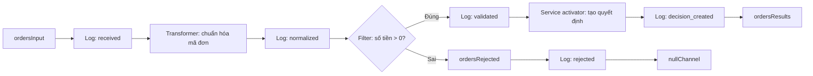
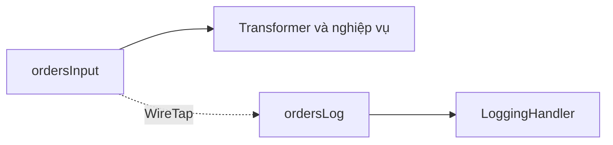

# Log message flow

## 1. Mục tiêu và bối cảnh

Trong Spring Integration Core, một yêu cầu có thể đi qua gateway, nhiều `MessageChannel`, transformer, filter, router và service activator trước khi tạo kết quả. Khi vận hành, câu hỏi thường gặp là: yêu cầu đã đến đâu, dữ liệu đã được biến đổi chưa, vì sao không có kết quả và lỗi xảy ra ở nhánh nào?

**Log message flow** là ghi các sự kiện có ý nghĩa tại những ranh giới đó, kèm định danh đủ để ghép chúng thành hành trình của một yêu cầu. Bài học thuộc chương **Metrics và observability**, tập trung vào việc quan sát luồng thông điệp trong module `SPRING_INTEGRATION_CORE`.

Sau bài học, bạn có thể:

- Đặt `.log()` đúng vị trí trong Java DSL và giải thích chính xác điều một dòng log chứng minh.
- Chọn trường log an toàn, phân biệt ID của message với ID xuyên suốt yêu cầu.
- Dùng wire tap và `LoggingHandler` để tạo nhánh ghi log riêng.
- Theo dấu nhánh filter loại bỏ, nhánh router, lỗi xử lý và các lần thử lại.
- Nhận biết giới hạn của log khi gặp hàng đợi, nhiều thread, giao dịch hoặc hệ thống bên ngoài.

Ví dụ dùng Java 17, Spring Boot 3.x và Spring Integration 6.x. Dự án cần dependency `org.springframework.boot:spring-boot-starter-integration`; để dependency management của Spring Boot chọn phiên bản Spring Integration tương thích.

## 2. Một dòng log chứng minh điều gì?

Xét luồng đơn giản:



Các ô log trong sơ đồ là vị trí quan sát về mặt logic. Trong DSL, `.log()` được triển khai bằng `WireTap` và `LoggingHandler`, quan sát message ở channel hiện tại hoặc trước endpoint tiếp theo. Ví dụ, log đặt sau filter chỉ nhìn thấy những message vượt qua filter. [Tài liệu operator log()](https://docs.spring.io/spring-integration/reference/6.4/dsl/java-log.html)

| Vị trí quan sát | Có thể kết luận | Chưa thể kết luận |
|---|---|---|
| Trước transformer | Message đã tới vị trí nhận đầu vào | Transformer đã chạy thành công |
| Sau transformer | Transformer đã tạo đầu ra đi tới điểm log | Toàn bộ nghiệp vụ đã thành công |
| Sau filter | Message đã vượt qua điều kiện lọc | Mọi message đầu vào đều được xử lý tiếp |
| Trong nhánh discard | Message đã đi vào nhánh bị loại | Đã xảy ra lỗi kỹ thuật |
| Sau handler tạo quyết định | Handler đã tạo đầu ra quan sát được | Giao dịch đã commit hoặc hệ thống ngoài đã nhận |
| Trước channel kết quả | Message chuẩn bị được gửi tiếp | Consumer cuối đã xử lý xong |

Tên sự kiện phải phù hợp với ranh giới quan sát. `decision_created` mô tả việc đã tạo quyết định; `order_persisted` chỉ phù hợp khi có bằng chứng lưu trữ tương ứng. Nếu giao dịch còn có thể rollback sau dòng log, không gọi sự kiện đó là `transaction_committed`.

Ngược lại, **không thấy log chưa đủ để khẳng định message đã mất**. Logger có thể đang tắt ở mức đó, log bị sampling, appender quá tải hoặc việc thu thập log có độ trễ.

## 3. Thiết kế các trường log trước khi thêm code

### 3.1. Bộ trường tối thiểu

Một dòng log thuận tiện để tìm kiếm có thể mang cấu trúc:

```text
event=normalized flow=orders flowRequestId=req-001 messageId=... orderId=ORD-101 payloadType=Order
```

| Trường | Ý nghĩa và cách sử dụng |
|---|---|
| `event` | Tên sự kiện hữu hạn, ổn định: `received`, `normalized`, `rejected` |
| `flow` | Tên luồng nghiệp vụ, ví dụ `orders` |
| `flowRequestId` | Header do ứng dụng quy ước để nối các bước của cùng một yêu cầu |
| `messageId` | Giá trị header `id` của message đang được quan sát |
| `orderId` | Khóa nghiệp vụ được phép ghi; có thể phải bỏ hoặc che tùy dữ liệu |
| `payloadType` | Kiểu payload tại bước hiện tại |
| `route`, `reason` | Mã nhánh hoặc lý do từ chối đã chuẩn hóa, khi có |
| `attempt` | Số lần thử khi có cơ chế cung cấp thông tin này |
| `durationMs` | Thời gian của một phạm vi đo được xác định rõ |
| `traceId`, `spanId` | Định danh do hạ tầng tracing cung cấp, nếu tracing đã được cấu hình |

Timestamp, mức log, logger và thread thường do backend logging thêm vào. Các dòng ví dụ trong bài chỉ thể hiện phần nội dung sự kiện.

Dạng `key=value` ở đây giúp đọc ví dụ. Trong production, có thể dùng encoder JSON hoặc API structured logging của backend để bảo toàn kiểu và escape ký tự. Ghép chuỗi theo ví dụ không tự tạo một bản ghi JSON.

### 3.2. Phân biệt ba loại định danh

`Message` chứa payload cùng headers; `id` định danh message, còn các header bổ sung có thể mang metadata do ứng dụng đặt. Khi tạo message mới trong quá trình xử lý, ID có thể thay đổi. Vì vậy, không dùng một `messageId` làm cam kết định danh cho toàn bộ hành trình. [Mô hình Message và headers](https://docs.spring.io/spring-integration/reference/6.4/message.html)

Trong bài này:

- `messageId` giúp phân biệt từng message quan sát được.
- `flowRequestId` là hợp đồng của ứng dụng, được tạo hoặc kiểm tra tại đầu vào và giữ lại khi đi qua các bước.
- `orderId` liên kết với thực thể nghiệp vụ; một đơn có thể có nhiều yêu cầu cập nhật khác nhau.

Không mặc định dùng header `correlationId` của mẫu tích hợp để thay `flowRequestId`: splitter và aggregator có nhu cầu tương quan nhóm riêng. Có thể ghi thêm ID nhóm khi chẩn đoán aggregator, nhưng phải xác định rõ nó liên quan đến nhóm nào.

Header tự đặt không tự đi qua mọi adapter hoặc mọi hệ thống ngoài. Tại ranh giới HTTP, broker hay giao thức khác, cần kiểm tra header mapping và hợp đồng truyền định danh.

### 3.3. Ghi theo danh sách cho phép

Chỉ lấy những trường đã chọn. Tránh log trực tiếp `message`, toàn bộ `headers` hoặc `payload.toString()` trong luồng nghiệp vụ:

- Payload có thể chứa thông tin cá nhân, địa chỉ, dữ liệu thanh toán hoặc nội dung tài liệu.
- Headers có thể chứa token, cookie, thông tin xác thực hoặc đối tượng channel nội bộ.
- Payload lớn làm tăng chi phí định dạng, lưu trữ và truyền log.
- Payload dạng stream có thể bị đọc hoặc tiêu thụ nếu logic tạo log tự mở và đọc nội dung.

Chuẩn hóa ký tự và giới hạn độ dài giúp tránh chèn dòng log hoặc tạo bản ghi quá lớn. Tuy nhiên, **chuẩn hóa ký tự không phải là ẩn danh hóa**: dữ liệu nhạy cảm vẫn phải được loại bỏ hoặc xử lý theo chính sách dữ liệu.

## 4. Ví dụ hoàn chỉnh bằng Java DSL

### 4.1. Luồng nhận và phân loại đơn hàng

Đặt lớp sau trong một dự án Spring Boot dành cho bài thực hành. Ví dụ không gọi cơ sở dữ liệu hay dịch vụ ngoài; handler chỉ tạo một `Receipt` trong bộ nhớ.

```java
package example.integration;

import java.util.Locale;

import org.springframework.boot.SpringApplication;
import org.springframework.boot.autoconfigure.SpringBootApplication;
import org.springframework.context.ConfigurableApplicationContext;
import org.springframework.context.annotation.Bean;
import org.springframework.integration.channel.DirectChannel;
import org.springframework.integration.channel.QueueChannel;
import org.springframework.integration.config.EnableIntegration;
import org.springframework.integration.dsl.IntegrationFlow;
import org.springframework.integration.handler.LoggingHandler;
import org.springframework.messaging.Message;
import org.springframework.messaging.support.MessageBuilder;

@SpringBootApplication
@EnableIntegration
public class OrderLogApplication {

    private static final String FLOW_LOGGER =
            "learning.integration.orders";

    public record Order(String orderId, long amountVnd) {
    }

    public record Receipt(String orderId, String status) {
    }

    @Bean
    public DirectChannel ordersInput() {
        return new DirectChannel();
    }

    @Bean
    public DirectChannel ordersRejected() {
        return new DirectChannel();
    }

    @Bean
    public QueueChannel ordersResults() {
        return new QueueChannel(10);
    }

    @Bean
    public IntegrationFlow ordersFlow() {
        return IntegrationFlow.from("ordersInput")
                .log(LoggingHandler.Level.INFO, FLOW_LOGGER,
                        m -> summary("received", m))
                .transform(Order.class,
                        order -> new Order(
                                order.orderId().trim()
                                        .toUpperCase(Locale.ROOT),
                                order.amountVnd()),
                        endpoint -> endpoint.id("normalizeOrder"))
                .log(LoggingHandler.Level.DEBUG, FLOW_LOGGER,
                        m -> summary("normalized", m))
                .filter(Order.class,
                        order -> order.amountVnd() > 0,
                        endpoint -> endpoint
                                .id("positiveAmountFilter")
                                .discardChannel("ordersRejected"))
                .log(LoggingHandler.Level.DEBUG, FLOW_LOGGER,
                        m -> summary("validated", m))
                .handle(Order.class,
                        (order, headers) ->
                                new Receipt(order.orderId(), "ACCEPTED"),
                        endpoint -> endpoint.id("createOrderDecision"))
                .log(LoggingHandler.Level.INFO, FLOW_LOGGER,
                        m -> summary("decision_created", m))
                .channel("ordersResults")
                .get();
    }

    @Bean
    public IntegrationFlow rejectedOrdersFlow() {
        return IntegrationFlow.from("ordersRejected")
                .log(LoggingHandler.Level.INFO, FLOW_LOGGER,
                        m -> summary("rejected", m)
                                + " reason=NON_POSITIVE_AMOUNT")
                .nullChannel();
    }

    private static String summary(String event, Message<?> message) {
        Object payload = message.getPayload();

        String orderId = payload instanceof Order order
                ? order.orderId()
                : payload instanceof Receipt receipt
                        ? receipt.orderId()
                        : "unknown";

        return "event=" + event
                + " flow=orders"
                + " flowRequestId="
                + token(message.getHeaders().get("flowRequestId"))
                + " messageId=" + message.getHeaders().getId()
                + " orderId=" + token(orderId)
                + " payloadType="
                + token(payload.getClass().getSimpleName());
    }

    private static String token(Object value) {
        if (value == null) {
            return "unknown";
        }

        String text = String.valueOf(value);
        String limited = text.substring(0, Math.min(text.length(), 96));
        return limited.replaceAll("[^A-Za-z0-9_.:-]", "_");
    }

    private static Message<Order> request(
            String requestId, String orderId, long amountVnd) {

        return MessageBuilder
                .withPayload(new Order(orderId, amountVnd))
                .setHeader("flowRequestId", requestId)
                .build();
    }

    public static void main(String[] args) {
        try (ConfigurableApplicationContext context =
                     SpringApplication.run(OrderLogApplication.class, args)) {

            DirectChannel input =
                    context.getBean("ordersInput", DirectChannel.class);
            QueueChannel results =
                    context.getBean("ordersResults", QueueChannel.class);

            input.send(request("req-001", "ord-101", 125_000));
            input.send(request("req-002", "ord-102", 0));

            Message<?> result = results.receive(1_000);
            if (result == null
                    || !(result.getPayload() instanceof Receipt)) {
                throw new IllegalStateException("Missing order receipt");
            }

            Receipt receipt = (Receipt) result.getPayload();
            if (!"ORD-101".equals(receipt.orderId())
                    || !"ACCEPTED".equals(receipt.status())) {
                throw new IllegalStateException("Unexpected order receipt");
            }

            if (results.receive(0) != null) {
                throw new IllegalStateException("Unexpected extra receipt");
            }

            System.out.println("Da nhan receipt hop le cho ORD-101");
        }
    }
}
```

Các điểm cần đọc trong code:

1. `ordersInput` và `ordersRejected` là `DirectChannel`; phần xử lý nối bằng các channel đồng bộ chạy theo lời gọi gửi message.
2. Transformer tạo payload mới với mã đơn đã chuẩn hóa. Không sửa trực tiếp payload đầu vào.
3. Filter chuyển message có số tiền không dương sang `ordersRejected`; nhánh này có log lý do và kết thúc rõ bằng `nullChannel()`.
4. `decision_created` đứng sau handler tạo `Receipt`. Nó xác nhận đã quan sát đầu ra của handler, chưa xác nhận consumer của `ordersResults` đã nhận.
5. `ordersResults` là hàng đợi giới hạn 10 message để chương trình minh họa nhận kết quả bằng `receive()`. Không có poller tự động xử lý kết quả trong ví dụ này.
6. `token()` chỉ nhận các giá trị đã chọn cho log. Với đầu vào thực tế, hãy xác thực `orderId`, kiểu payload và hợp đồng header ngay tại biên ứng dụng.

Các điều kiện trong `main()` phục vụ bài thực hành: kết quả nghiệp vụ được kiểm tra trực tiếp qua channel. Số dòng log không được dùng làm tiêu chí duy nhất xác định flow thành công.

### 4.2. Cấu hình mức log

Trong cấu hình Spring Boot của ứng dụng thực hành:

```yaml
logging:
  level:
    root: INFO
    learning.integration.orders: DEBUG
    learning.integration.orders.error: ERROR
    learning.integration.orders.tap: DEBUG
    org.springframework.integration: INFO
```

Một log `DEBUG` chỉ xuất hiện khi logger và các bộ lọc của backend cho phép. Đặt `root: INFO` không ngăn một logger con được cấu hình riêng ở `DEBUG`.

Không cần bật toàn bộ `org.springframework.integration` ở `TRACE` để thấy các sự kiện nghiệp vụ đã thiết kế. Khi cần log nội bộ, khoanh vùng logger và thời gian bật để dữ liệu chẩn đoán vẫn đọc được.

Đây là cấu hình ứng dụng dùng cho ví dụ, không phải yêu cầu sửa tệp cấu hình của module trong lúc đọc bài.

### 4.3. Kết quả quan sát dự kiến

Bỏ qua prefix và thay UUID bằng ký hiệu minh họa, phần nội dung log có dạng:

```text
event=received flow=orders flowRequestId=req-001 messageId=<m1> orderId=ord-101 payloadType=Order
event=normalized flow=orders flowRequestId=req-001 messageId=<m2> orderId=ORD-101 payloadType=Order
event=validated flow=orders flowRequestId=req-001 messageId=<m2> orderId=ORD-101 payloadType=Order
event=decision_created flow=orders flowRequestId=req-001 messageId=<m3> orderId=ORD-101 payloadType=Receipt

event=received flow=orders flowRequestId=req-002 messageId=<m4> orderId=ord-102 payloadType=Order
event=normalized flow=orders flowRequestId=req-002 messageId=<m5> orderId=ORD-102 payloadType=Order
event=rejected flow=orders flowRequestId=req-002 messageId=<m5> orderId=ORD-102 payloadType=Order reason=NON_POSITIVE_AMOUNT
```

Các ký hiệu `<m1>` đến `<m5>` chỉ giúp phân biệt message trong ví dụ, không phải giá trị UUID thực.

Với `req-002`, việc thiếu `validated` và `decision_created` là đúng thiết kế: message đã đi vào nhánh discard. Không đánh dấu trường hợp từ chối theo điều kiện nghiệp vụ này là một `ERROR` kỹ thuật.

Khi hạ logger xuống `INFO`, các log `normalized` và `validated` biến mất; kết quả nhận qua `ordersResults` vẫn phải giống trước đó.

## 5. Phân biệt operator log() với LoggingHandler

Hai cách sau có vai trò khác nhau:

| Cách dùng | Vai trò trong flow |
|---|---|
| `.log(level, loggerName, expression)` | Quan sát tại vị trí hiện tại bằng nhánh tap |
| `.handle(loggingHandler)` | Giao message cho handler ghi log; handler này không tạo reply |

`LoggingHandler` mặc định ghi payload. Có thể đặt tên logger và biểu thức chọn nội dung; chế độ ghi toàn bộ message sẽ bao gồm cả headers. Vì thế, không coi việc bỏ cấu hình là một mặc định an toàn cho dữ liệu nghiệp vụ. [Logging Channel Adapter](https://docs.spring.io/spring-integration/reference/6.4/logging-adapter.html)

Một điểm phụ thuộc phiên bản cần nhớ: **từ Spring Integration 6.0, `.log()` ở cuối flow có hành vi phù hợp với cách dùng ở giữa flow**. Không dựa vào việc đặt `.log()` cuối cùng để tiêu thụ hoặc bỏ reply. Với nhánh một chiều cần bỏ đầu ra, kết thúc bằng `.nullChannel()`; với flow cần trả lời gateway, bảo đảm đường trả lời vẫn tồn tại. [Hành vi log() từ phiên bản 6.0](https://docs.spring.io/spring-integration/reference/6.4/dsl/java-log.html)

Ví dụ nhánh chỉ quan sát rồi kết thúc:

```java
@Bean
public IntegrationFlow diagnosticsOnlyFlow() {
    return IntegrationFlow.from("diagnosticsInput")
            .log(LoggingHandler.Level.DEBUG,
                    "learning.integration.diagnostics",
                    m -> "event=diagnostic"
                            + " messageId=" + m.getHeaders().getId())
            .nullChannel();
}
```

Nếu đặt `.handle(loggingHandler)` giữa flow rồi chờ nó trả message cho bước tiếp theo, bạn có thể khiến đường đi kết thúc ở đó. Khi mục tiêu là vừa ghi log vừa đi tiếp, dùng `.log()` hoặc một wire tap phù hợp.

## 6. Tạo nhánh log riêng bằng wire tap

### 6.1. Nhánh quan sát không tranh message với nghiệp vụ

Giả sử cần tách phần ghi log khỏi định nghĩa nghiệp vụ. Trong `ordersFlow()`, có thể **thay log đầu tiên** bằng:

```java
return IntegrationFlow.from("ordersInput")
        .wireTap("ordersLog");
```

Đây chỉ là đoạn đầu builder thay thế; giữ nguyên các bước transformer, filter, handler và `.get()` của flow đã trình bày. Không đăng ký một flow thứ hai cùng đọc `ordersInput`.

Thêm hai bean sau vào lớp cấu hình:

```java
@Bean
public DirectChannel ordersLog() {
    return new DirectChannel();
}

@Bean
public IntegrationFlow ordersLogFlow() {
    LoggingHandler handler =
            new LoggingHandler(LoggingHandler.Level.DEBUG);
    handler.setLoggerName("learning.integration.orders.tap");
    handler.setLogExpressionString(
            "'event=tapped messageId=' + headers.id"
                    + " + ' payloadType='"
                    + " + payload.getClass().getSimpleName()");

    return IntegrationFlow.from("ordersLog")
            .handle(handler)
            .get();
}
```

Nhánh này ghi ID và kiểu payload, không ghi toàn bộ payload. `LoggingHandler` là consumer cuối của nhánh tap.



Không gắn một logging consumer trực tiếp vào `ordersInput` như một subscriber nghiệp vụ thứ hai rồi kỳ vọng cả hai đều nhận mọi message. `DirectChannel` thực hiện dispatch tới một consumer cho một lần gửi theo cấu hình của nó; wire tap tạo nhánh quan sát riêng. [Các triển khai MessageChannel](https://docs.spring.io/spring-integration/reference/channel/implementations.html)

### 6.2. Wire tap không mặc định bất đồng bộ

Wire tap gửi message sang channel quan sát. Nhánh đó chạy đồng bộ hay qua thread khác phụ thuộc loại channel đích, không phụ thuộc tên gọi “tap”. [Cấu hình Wire Tap](https://docs.spring.io/spring-integration/reference/channel/configuration.html#channel-wiretap)

| Channel của nhánh log | Hệ quả cần dự tính |
|---|---|
| `DirectChannel` | Handler log chạy trong đường gọi đồng bộ, có thể làm tăng thời gian gửi |
| `ExecutorChannel` | Chuyển xử lý sang executor; cần quản lý dung lượng, rejection và shutdown |
| `QueueChannel` | Cần consumer/poller để lấy message; phải xác định capacity và cách xử lý khi đầy |

Tách thread không làm mất chi phí: nó chuyển chi phí sang queue, executor và bộ thu thập log. Khi nhánh quan sát nghẽn, phải có chính sách rõ về chờ, từ chối hoặc bỏ sự kiện; không dùng một queue tăng vô hạn để che vấn đề.

Wire tap cũng không bảo đảm deep copy payload. Nếu payload là đối tượng mutable và nhánh chính thay đổi nó, nhánh log bất đồng bộ có thể đọc trạng thái khác thời điểm tap. Với yêu cầu quan sát chặt chẽ, tạo một bản tóm tắt bất biến ngay tại ranh giới cần ghi.

Biểu thức log phải đơn giản, không gọi API ngoài, không đọc database và không làm thay đổi trạng thái. Một nhánh quan sát có thể làm chậm hoặc phát sinh lỗi; không coi nó là thành phần hoàn toàn miễn phí hay luôn vô hại.

## 7. Ghi lại quyết định router, filter và aggregator

Một log `received` chỉ cho biết có đầu vào. Các endpoint ra quyết định cần sự kiện tương ứng:

| Thành phần | Vị trí log hữu ích | Trường nên cân nhắc |
|---|---|---|
| Filter | Nhánh accepted hoặc discard theo nhu cầu | `reason`, `flowRequestId` |
| Router | Đầu từng nhánh sau khi chọn route | `route`, `businessId` |
| Splitter | Khi tạo hoặc nhận từng phần cần theo dõi | ID yêu cầu, ID nhóm, số thứ tự |
| Aggregator | Khi nhóm được phát hành, hết hạn hoặc bị loại | ID nhóm, số phần, lý do phát hành |
| Gateway | Ranh giới request, reply hoặc timeout | ID yêu cầu, đích gọi, thời gian chờ |
| Outbound adapter | Ranh giới gửi và cơ chế xác nhận tương ứng | Đích đã chuẩn hóa, trạng thái xác nhận |

Một router có thể gửi tới nhiều nhánh. Do đó, tổng số log tại các nhánh có thể lớn hơn số yêu cầu đầu vào mà không phải xử lý trùng ngoài ý muốn.

Với aggregator, nhiều message con có thể cùng một `flowRequestId` nhưng khác ID hoặc số thứ tự. Đừng xóa log chỉ vì chúng có cùng ID yêu cầu. Khi nhóm không phát hành được, cần xem chính sách release, expiry và dữ liệu nhóm, thay vì chỉ tìm log sau aggregator.

Không tính lại điều kiện router trong biểu thức log nếu điều kiện có thể thay đổi hoặc có tác dụng phụ. Ghi ở đầu nhánh đã được chọn giúp mô tả quyết định thực tế.

## 8. Log lỗi: giữ liên hệ với message gốc

### 8.1. Lỗi đồng bộ và lỗi bất đồng bộ

Với luồng đồng bộ qua `DirectChannel`, lỗi xử lý có thể truyền ngược về bên gọi. Chỉ đặt header `errorChannel` không có nghĩa mọi exception đồng bộ khi gửi trực tiếp sẽ tự động trở thành một bản tin lỗi. Gateway có cơ chế xử lý lỗi riêng cần được cấu hình phù hợp.

Với xử lý bất đồng bộ do các thành phần Spring Integration quản lý, lỗi có thể được xuất bản dưới dạng `ErrorMessage`: payload là exception. Cơ chế phát lỗi thường ưu tiên channel trong header `errorChannel` của request, rồi mới tới channel lỗi chung. [Cơ chế xử lý lỗi](https://docs.spring.io/spring-integration/reference/error-handling.html)

Vì vậy, **ID của ErrorMessage không phải ID của message nghiệp vụ bị lỗi**. Khi có `MessagingException`, kiểm tra `getFailedMessage()` để lấy lại header tương quan của message gặp lỗi.

### 8.2. Consumer ghi log lỗi an toàn

Có thể thêm bean sau vào `OrderLogApplication`. Cần thêm import `org.springframework.messaging.MessagingException`.

```java
@Bean
public IntegrationFlow ordersErrorsFlow() {
    return IntegrationFlow.from("ordersErrors")
            .log(LoggingHandler.Level.ERROR,
                    "learning.integration.orders.error",
                    errorMessage -> {
                        Object payload = errorMessage.getPayload();
                        Throwable failure = payload instanceof Throwable t
                                ? t : null;

                        Message<?> failed =
                                failure instanceof
                                        org.springframework.messaging.MessagingException ex
                                        ? ex.getFailedMessage()
                                        : null;

                        String requestId = failed == null
                                ? "unknown"
                                : token(failed.getHeaders()
                                        .get("flowRequestId"));

                        String errorType = failure == null
                                ? "UnexpectedErrorPayload"
                                : failure.getClass().getSimpleName();

                        return "event=flow_failed"
                                + " flow=orders"
                                + " flowRequestId=" + requestId
                                + " failedMessageId="
                                + (failed == null ? "unknown"
                                        : failed.getHeaders().getId())
                                + " errorType=" + errorType;
                    })
            .nullChannel();
}
```

Trong đoạn code, tên đầy đủ của `MessagingException` được giữ để thể hiện rõ kiểu cần kiểm tra; import có thể dùng để rút gọn tên khi đưa vào ứng dụng.

Bean trên chỉ tạo **điểm nhận lỗi để ghi log**, chưa nối mọi nguồn lỗi vào đó. Cần cấu hình thành phần phát lỗi, gateway hoặc chính sách recovery để gửi `ErrorMessage` tới `ordersErrors`. Ví dụ đơn hàng ở mục 4 không tự gửi lỗi tới channel này.

Nếu exception bị bọc qua nhiều lớp, hoặc nguồn lỗi cung cấp message gốc bằng cách khác, cần mở rộng logic trích xuất tương quan. Khi không tìm thấy, ghi `unknown` một cách rõ ràng; không thay bằng ID của bản tin lỗi rồi coi đó là ID yêu cầu.

Đoạn trên chỉ ghi tên lớp lỗi. Đây là lựa chọn hạn chế nội dung log, không phải một bộ xử lý lỗi đầy đủ. Stack trace và exception message có thể chứa payload hoặc dữ liệu của `failedMessage`; nếu cần lưu, dùng nơi thu thập phù hợp và xử lý dữ liệu trước khi xuất.

Log lỗi không tự retry, không chuyển DLQ, không rollback và không xác nhận đã phục hồi. Mỗi hành vi đó cần chính sách xử lý riêng.

### 8.3. Phân biệt lần thử và thất bại cuối cùng

Một handler có retry có thể phát sinh nhiều sự kiện cho cùng yêu cầu:

```text
event=attempt_failed flow=orders flowRequestId=req-009 attempt=1 errorType=RemoteTimeout
event=attempt_failed flow=orders flowRequestId=req-009 attempt=2 errorType=RemoteTimeout
event=recovered flow=orders flowRequestId=req-009 attempt=3
```

Đây là mẫu dữ liệu do ứng dụng thiết kế, không phải log mà `.log()` tự sinh. Lấy số lần thử từ cơ chế retry/recovery đang dùng; không giả định mọi message đều có sẵn header `attempt`.

Nếu lỗi đã được retry và xử lý thành công, không gộp từng lần thử vào số lượng yêu cầu thất bại cuối cùng. Thống nhất nơi ghi sự kiện cuối để tránh gateway, error handler và recovery handler cùng ghi một lỗi nhiều lần mà không có vai trò phân biệt.

## 9. Dùng Message History khi cần biết đường đi

Log nghiệp vụ trả lời “đã xảy ra sự kiện gì”; đôi khi cần thêm danh sách component message đã đi qua.

Có thể bật theo dõi cho các channel đã đặt tên trong ví dụ bằng annotation sau trên lớp cấu hình:

```java
import org.springframework.integration.config.EnableMessageHistory;

@EnableMessageHistory({
        "ordersInput",
        "ordersRejected",
        "ordersResults"
})
```

Trong ứng dụng thực tế, đặt `@EnableMessageHistory` cùng các annotation cấu hình của lớp; đoạn trên chỉ minh họa annotation cần bổ sung.

Đọc thông tin đã được framework gắn vào header:

```java
import org.springframework.integration.history.MessageHistory;

MessageHistory history = message.getHeaders().get(
        MessageHistory.HEADER_NAME, MessageHistory.class);
```

Message History ghi thông tin về những component được chọn theo dõi và hỗ trợ lọc theo tên hoặc pattern. Chỉ những component được theo dõi mới đóng góp lịch sử; nó không tự trở thành distributed trace xuyên tất cả dịch vụ. [Cấu hình Message History](https://docs.spring.io/spring-integration/reference/message-history.html)

Trong ví dụ, pattern được giới hạn ở ba channel nên không kỳ vọng thấy đầy đủ mọi handler. Muốn theo dõi thêm, mở rộng danh sách component có chủ đích.

Đọc history ở cuối đường đi cần khảo sát. Nếu đọc ở trước một bước, lịch sử lúc đó chưa phản ánh việc đã hoàn thành bước phía sau. Không suy ra thời gian xử lý chính xác của endpoint chỉ bằng cách trừ tùy ý các timestamp trong history.

## 10. Log, MDC, metrics và tracing phối hợp thế nào?

Bốn công cụ có câu hỏi sử dụng khác nhau:

| Công cụ | Câu hỏi phù hợp |
|---|---|
| Log sự kiện | Vì sao `req-002` bị loại? Message đã tới nhánh nào? |
| Metrics | Tỷ lệ lỗi, lưu lượng và phân bố độ trễ đang thay đổi ra sao? |
| Tracing | Yêu cầu đi qua những dịch vụ nào, mất thời gian ở span nào? |
| Message History | Trong phạm vi theo dõi của Spring Integration, message đã đi qua component nào? |

MDC giúp đưa giá trị tương quan vào prefix log, nhưng dữ liệu MDC gắn với ngữ cảnh thực thi; không mặc định đi theo message qua executor hoặc poller. Nếu dùng MDC, cần cơ chế truyền và dọn ngữ cảnh đúng vòng đời để tránh ID của yêu cầu trước rò sang yêu cầu sau.

Ví dụ trong bài đọc `flowRequestId` từ headers tại mỗi điểm log nên không phụ thuộc vào việc MDC có được truyền hay không. Tuy nhiên, nếu bước xử lý làm mất header thì phương pháp này cũng mất tương quan.

Khi đã có Micrometer Observation và tracing phù hợp, sử dụng trace context do hệ thống tracing quản lý. Không tự tạo một header tên `traceId` rồi cho rằng đã có tracing.

ID yêu cầu phù hợp để tìm trong log hoặc trace, nhưng thường không phù hợp làm nhãn metrics vì số lượng giá trị tăng theo từng yêu cầu. Dùng các chiều hữu hạn như flow, tên endpoint, kết quả và mã lỗi đã chuẩn hóa cho metrics.

## 11. Chi phí, mức log và lượng dữ liệu

### 11.1. Chọn mức log theo ý nghĩa

| Mức | Cách dùng tham khảo |
|---|---|
| `INFO` | Sự kiện quan trọng tại ranh giới, kết quả nghiệp vụ cần vận hành |
| `DEBUG` | Chi tiết bước trung gian, kiểu payload, quyết định dùng để chẩn đoán |
| `WARN` | Điều kiện bất thường cần chú ý nhưng vẫn có cách xử lý |
| `ERROR` | Lỗi kỹ thuật cần được xử lý hoặc thất bại cuối theo quy ước vận hành |
| `TRACE` | Chi tiết rất sâu, chỉ bật trong phạm vi kiểm soát |

Một đơn bị từ chối đúng quy tắc kinh doanh không bắt buộc phải là `WARN` hay `ERROR`. Mức log phải phù hợp với kỳ vọng và cách đội vận hành xử lý sự kiện.

### 11.2. Ước lượng trước khi log ở mọi bước

Giả sử có 2.000 message mỗi giây, mỗi message tạo 6 dòng log và mỗi dòng trung bình 500 byte:

```text
2.000 × 6 × 500 = 6.000.000 byte/giây
6.000.000 × 86.400 = 518.400.000.000 byte/ngày
```

Đó là khoảng 518,4 GB/ngày theo đơn vị thập phân, chưa tính metadata thu thập, bản sao và index.

Giữ log ở ranh giới có giá trị chẩn đoán cao. Nếu cần sampling, chọn nhất quán theo ID yêu cầu để các bước của một yêu cầu có cơ hội được quan sát cùng nhau. Mọi cơ chế sampling đều cần được phản ánh trong cách đọc kết quả: thiếu dòng không còn tương đương với thiếu bước xử lý.

Với trường hợp cần audit bền vững, thiết kế kênh lưu trữ, xác nhận và chính sách lưu giữ phù hợp. Log chẩn đoán thông thường không tự bảo đảm tính đầy đủ hoặc khả năng khôi phục sau sự cố.

## 12. Quy trình thực hành và kiểm chứng

Thực hiện trên dự án ví dụ độc lập; quan sát cả dữ liệu ở channel kết quả và nội dung log.

| Tình huống | Kết quả nghiệp vụ cần thấy | Dấu vết log cần đối chiếu |
|---|---|---|
| `ord-101`, số tiền dương | Một receipt `ACCEPTED`, mã `ORD-101` | Cùng `flowRequestId` qua các bước; payload cuối là `Receipt` |
| `ord-102`, số tiền bằng 0 | Không có receipt từ nhánh chính | `rejected` cùng lý do; không có `decision_created` cho yêu cầu đó |
| Logger nghiệp vụ ở `INFO` | Kết quả giống khi bật `DEBUG` | Log trung gian `DEBUG` không xuất hiện |
| ID đầu vào chứa ký tự xuống dòng | Kết quả theo quy tắc xác thực của ứng dụng | Khi được phép ghi, giá trị log đã giới hạn độ dài và không chèn dòng |
| Handler cố ý phát sinh lỗi trên flow đồng bộ | Bên gọi nhận được lỗi tương ứng | Không mặc định kỳ vọng consumer `ordersErrors` được gọi |
| Nhánh log dùng executor chậm | Kiểm tra riêng kết quả và hành vi quá tải | Thứ tự log giữa các thread có thể khác thứ tự quan sát ở một thread |

Bài tập mở rộng:

1. Thêm router theo loại đơn và log `route` ở đầu từng nhánh; kiểm tra log phản ánh nhánh thật sự nhận message.
2. Đưa một bước qua channel bất đồng bộ, rồi đối chiếu `flowRequestId`, thread và chính sách lỗi; kiểm tra MDC riêng nếu có.
3. Bổ sung một trường nhạy cảm vào payload và xác nhận trường đó không xuất hiện trong sự kiện tóm tắt.
4. Chọn một phạm vi đo thời gian rõ ràng, chẳng hạn từ lúc handler bắt đầu tới khi trả kết quả; không gọi đó là độ trễ toàn hệ thống nếu chưa tính thời gian xếp hàng.

Không có log `ERROR` không phải là tiêu chí đủ để kết luận bài thực hành thành công. Cần kiểm tra receipt, nhánh discard, đường lỗi và hợp đồng tương quan.

## 13. Các lỗi thiết kế thường gặp

| Lỗi | Hệ quả | Cách sửa |
|---|---|---|
| Chỉ log đầu flow | Không biết message bị chặn hoặc rẽ nhánh ở đâu | Ghi thêm quyết định và kết quả tại các ranh giới cần thiết |
| Chỉ log sau filter | Yêu cầu bị loại trông như biến mất | Ghi trong nhánh discard kèm mã lý do |
| Dùng `messageId` làm ID của toàn bộ yêu cầu | Không nối được log sau khi tạo message mới | Giữ một ID yêu cầu theo hợp đồng ứng dụng |
| Log toàn bộ message | Lộ dữ liệu hoặc tạo log quá lớn | Chọn trường theo danh sách cho phép |
| Đặt tên sự kiện `success` quá sớm | Hiểu sai kết quả khi bước sau lỗi hoặc giao dịch rollback | Dùng tên mô tả đúng điều đã quan sát |
| Gắn thêm logging consumer vào `DirectChannel` chính | Consumer quan sát có thể cạnh tranh nhận message | Dùng wire tap hoặc thiết kế broadcast có chủ đích |
| Cho rằng wire tap luôn chạy nền | Đánh giá sai độ trễ và đường lỗi | Xem loại channel của nhánh tap |
| Trông chờ MDC tự qua thread | Mất hoặc nhầm ID tương quan | Truyền, phục hồi và dọn ngữ cảnh; kiểm tra bằng nhiều yêu cầu |
| Dùng `.log()` cuối flow để bỏ đầu ra trong 6.x | Kết thúc flow không đúng kỳ vọng | Thể hiện rõ đích kết thúc như `nullChannel()` |
| Dùng số dòng log để đếm chính xác giao dịch | Sai khi có retry, nhiều nhánh, sampling hoặc mất log | Đối chiếu metrics và trạng thái nghiệp vụ |

Khi thiết kế một điểm log mới, hãy xác định ba điều: sự kiện nào đã thực sự xảy ra, trường nào giúp tìm lại yêu cầu, và điều gì vẫn chưa thể kết luận từ dòng log đó. Ba câu hỏi này giúp log hỗ trợ chẩn đoán đúng đường đi của message trong Spring Integration.
