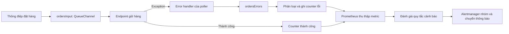

# Alert theo error channel

## 1. Mục tiêu và tình huống thực tế

Trong chương **Metrics và observability** của **SPRING_INTEGRATION_CORE**, bài học này sử dụng `Message`, `MessageChannel`, endpoint và Java DSL để xây dựng cảnh báo từ luồng lỗi. Khi hoàn thành, bạn có thể:

- Xác định lỗi nào thực sự được đưa vào error channel và lỗi nào quay về phía gọi.
- Đọc `ErrorMessage`, tìm thông điệp thất bại và chuẩn hóa nhóm nguyên nhân.
- Ghi nhận lỗi bằng Micrometer với tập nhãn có giới hạn.
- Thiết lập cảnh báo theo số lỗi, tỷ lệ lỗi và mức ảnh hưởng.
- Kiểm thử đường đi của lỗi, tránh đếm trùng và phát hiện khi cơ chế giám sát bị gián đoạn.

Giả sử một luồng nhận yêu cầu giữ hàng cho đơn đặt mua. Sau khi nhận thông điệp, endpoint gọi hệ thống kho. Một số yêu cầu có số lượng không hợp lệ; một số thất bại vì hệ thống kho không truy cập được; một số gặp lỗi lập trình chưa dự kiến.

Nếu chỉ xem log, người vận hành khó biết lỗi đang tăng trên toàn bộ các instance hay chỉ xuất hiện lẻ tẻ. Nếu gửi một thông báo cho từng exception, một sự cố kho có thể tạo hàng nghìn thông báo. Thiết kế phù hợp là đưa lỗi đến nơi xử lý rõ ràng, ghi metric tại một điểm đã xác định, rồi để hệ thống cảnh báo đánh giá mức độ ảnh hưởng theo thời gian.

## 2. Phân biệt sự kiện lỗi, metric và cảnh báo

Ba đối tượng này có vai trò khác nhau:

| Đối tượng | Ý nghĩa | Ví dụ |
|---|---|---|
| Sự kiện lỗi | Một lần xử lý thất bại tại một ranh giới cụ thể | Endpoint giữ hàng ném exception |
| Metric | Số liệu tổng hợp để quan sát xu hướng | Có 25 lỗi phụ thuộc trong 5 phút |
| Cảnh báo | Điều kiện cần con người hoặc hệ thống khác phản ứng | Lỗi kho tăng liên tục và ảnh hưởng việc xử lý đơn |

Một `ErrorMessage` không tự tạo thành một cảnh báo gửi đến người trực. Nó là dữ liệu đầu vào cho cơ chế quan sát. Ngưỡng, thời gian duy trì, phân nhóm và nơi nhận thông báo thuộc chính sách vận hành.



Trong thiết kế này, consumer của `ordersErrors` chỉ thực hiện công việc ngắn: phân loại, tăng counter và ghi ngữ cảnh cần thiết. Việc gọi webhook hoặc gửi thư trực tiếp trong consumer sẽ kéo độ trễ và sự cố của dịch vụ thông báo vào đường xử lý lỗi.

Trước khi viết code, hãy ghi rõ hợp đồng đo lường: **mỗi sự kiện đi vào `ordersErrors` được đếm một lần tại consumer của kênh đó**. Đây là số sự kiện lỗi được quan sát, chưa phải số đơn hàng duy nhất bị hỏng.

## 3. Khi nào exception đi vào error channel?

### 3.1. Ranh giới thực thi quyết định đường đi của lỗi

| Cách thực thi | Nơi quan sát lỗi cần chú ý |
|---|---|
| Gửi trực tiếp qua `DirectChannel`, handler chạy trên luồng gọi | Exception có thể truyền về phía gửi |
| `QueueChannel` được endpoint lấy thông điệp bằng poller | Error handler của poller có thể phát `ErrorMessage` |
| Luồng sử dụng `ExecutorChannel` | Cần theo dõi cơ chế xử lý lỗi ở ranh giới executor |
| Gọi qua messaging gateway | Kiểm tra hợp đồng trả lời và cấu hình error channel của gateway |

Đặc biệt, thêm header `errorChannel` vào một thông điệp gửi trực tiếp không biến mọi exception đồng bộ thành sự kiện lỗi. Việc phát `ErrorMessage` cần một thành phần xử lý lỗi tương ứng. Cơ chế đồng bộ và bất đồng bộ được giải thích trong [Spring Integration: Error Handling](https://docs.spring.io/spring-integration/reference/7.0/error-handling.html).

Gateway còn có hợp đồng trả lời cho phía gọi. Nếu cấu hình error flow để xử lý lỗi của một lời gọi có kết quả trả về, cần quyết định rõ sẽ trả fallback hay tiếp tục báo thất bại; chỉ ghi metric rồi kết thúc error flow có thể khiến phía gọi không nhận được phản hồi phù hợp. Xem [Messaging Gateways](https://docs.spring.io/spring-integration/reference/gateway.html).

### 3.2. Header riêng và đích lỗi mặc định

Với error handler phát thông điệp theo cơ chế chuẩn, header `MessageHeaders.ERROR_CHANNEL` của thông điệp thất bại có thể chỉ định đích nhận lỗi. Khi không có đích riêng, handler dùng đích mặc định được cấu hình; đích toàn cục thông thường có tên bean `errorChannel`.

Ví dụ trong bài đặt đích mặc định của poller thành `ordersErrors` bằng `PollerSpec.errorChannel(...)`. API này nhận tên bean hoặc một `MessageChannel`, theo [Javadoc của PollerSpec](https://docs.spring.io/spring-integration/api/org/springframework/integration/dsl/PollerSpec.html).

Điều này tạo ra hai tình huống cần kiểm thử: thông điệp không có header lỗi và thông điệp có header lỗi riêng. Nếu một header riêng chuyển lỗi sang kênh khác, counter của `ordersErrors` sẽ không nhìn thấy sự kiện đó. Chính sách tại đầu vào nên kiểm soát các header định tuyến nội bộ thay vì nhận tùy ý từ dữ liệu bên ngoài.

## 4. Đọc đúng cấu trúc `ErrorMessage`

`ErrorMessage` là một `Message<Throwable>`. Payload của nó là exception, không phải payload nghiệp vụ ban đầu. Thông tin về thông điệp hỏng có thể nằm ở:

1. `MessagingException.getFailedMessage()` trong chuỗi nguyên nhân.
2. `ErrorMessage.getOriginalMessage()` nếu quá trình tạo lỗi đã cung cấp thông điệp gốc.
3. Không có ở cả hai vị trí, chẳng hạn lỗi xảy ra trước khi lấy được thông điệp từ nguồn.

`failedMessage` có thể là thông điệp đã qua transformer, còn `originalMessage` biểu diễn thông điệp tại điểm tạo ngữ cảnh lỗi. Hai đối tượng không nhất thiết giống nhau; cả hai cũng không được bảo đảm luôn tồn tại. Đây là hợp đồng được mô tả trong [Javadoc của ErrorMessage](https://docs.spring.io/spring-framework/docs/current/javadoc-api/org/springframework/messaging/support/ErrorMessage.html).

Không nên ép kiểu như sau:

```java
// Sai: payload của ErrorMessage là Throwable.
Order order = (Order) errorMessage.getPayload();
```

Một lỗi thường được bọc như sau:

```text
ErrorMessage
  payload: MessageHandlingException
    failedMessage: Message<Order>
    cause: InventoryUnavailableException
```

Để phân loại, có thể duyệt chuỗi nguyên nhân và ánh xạ về một danh sách nhỏ: `validation`, `dependency`, `unexpected`. Không dùng toàn bộ nội dung exception làm nhãn metric. Để tra cứu chi tiết, hãy lấy `messageId`, mã tương quan và định danh endpoint từ ngữ cảnh có sẵn rồi ghi vào log có cấu trúc.

## 5. Chọn loại channel cho đường lỗi

| Loại channel | Phù hợp khi | Hệ quả cần thiết kế |
|---|---|---|
| `DirectChannel` | Có một consumer lỗi nhanh, chạy ngay trên luồng phát lỗi | Consumer chậm hoặc ném lỗi sẽ ảnh hưởng bên phát |
| `PublishSubscribeChannel` | Nhiều nhánh cần quan sát cùng một lỗi | Cần kiểm soát lỗi từng subscriber và người sở hữu counter |
| `QueueChannel` | Muốn tách nhịp phát lỗi khỏi consumer | Cần poller, giới hạn hàng đợi và theo dõi tồn đọng |

`DirectChannel` không phát bản sao cho tất cả subscriber. Cấu hình mặc định có cơ chế phân phối tới một handler cùng khả năng failover. Vì vậy, không gắn ba consumer độc lập để giả định rằng cả metric, log và lưu trữ đều nhận mỗi lỗi. Nếu muốn phát đến nhiều nhánh, hãy chọn publish-subscribe hoặc điều phối các bước trong một flow. Xem [Configuring Message Channels](https://docs.spring.io/spring-integration/reference/channel/configuration.html).

Ví dụ dưới đây chọn một `DirectChannel` riêng cho lỗi và một consumer duy nhất để làm rõ trách nhiệm. `QueueChannel` đầu vào là hàng đợi trong bộ nhớ; thành công của thao tác gửi chỉ xác nhận đã đưa được thông điệp vào hàng đợi, chưa xác nhận xử lý nghiệp vụ thành công hay lưu bền dữ liệu.

## 6. Ví dụ Java DSL: thu thập lỗi của luồng đơn hàng

### 6.1. Điều kiện áp dụng

Ví dụ sử dụng cú pháp Java 17 trở lên và API Java DSL có trong các dòng Spring Integration hiện đại. Đặt các lớp trong phạm vi quét cấu hình của ứng dụng Spring Boot; để BOM của Spring Boot quản lý phiên bản tương thích giữa các thư viện.

Trong một ứng dụng Spring Boot hiện có, cần các dependency tương ứng sau:

```xml
<dependency>
    <groupId>org.springframework.boot</groupId>
    <artifactId>spring-boot-starter-integration</artifactId>
</dependency>
<dependency>
    <groupId>org.springframework.boot</groupId>
    <artifactId>spring-boot-starter-actuator</artifactId>
</dependency>
<dependency>
    <groupId>io.micrometer</groupId>
    <artifactId>micrometer-registry-prometheus</artifactId>
</dependency>
```

Để gọi endpoint HTTP trong ví dụ, ứng dụng cũng cần cấu hình web tương ứng, chẳng hạn starter web phù hợp với phiên bản Boot đang sử dụng. Boot tự cấu hình registry theo implementation có trên classpath. Registry Prometheus và endpoint Actuator được trình bày trong [Spring Boot: Metrics](https://docs.spring.io/spring-boot/reference/actuator/metrics.html).

### 6.2. Cấu hình flow và bộ ghi metric

```java
package example.integration;

import java.util.Map;

import io.micrometer.core.instrument.Counter;
import io.micrometer.core.instrument.MeterRegistry;
import org.slf4j.Logger;
import org.slf4j.LoggerFactory;
import org.springframework.beans.factory.annotation.Qualifier;
import org.springframework.context.annotation.Bean;
import org.springframework.context.annotation.Configuration;
import org.springframework.integration.channel.DirectChannel;
import org.springframework.integration.channel.QueueChannel;
import org.springframework.integration.config.EnableIntegration;
import org.springframework.integration.dsl.IntegrationFlow;
import org.springframework.integration.dsl.Pollers;
import org.springframework.messaging.Message;
import org.springframework.messaging.MessageHandler;
import org.springframework.messaging.MessagingException;
import org.springframework.messaging.support.ErrorMessage;

@Configuration(proxyBeanMethods = false)
@EnableIntegration
public class OrdersObservabilityConfig {

    public record Order(String orderId, String sku, int quantity) {
    }

    public static class InventoryUnavailableException extends RuntimeException {
        public InventoryUnavailableException(String message) {
            super(message);
        }
    }

    @Bean
    QueueChannel ordersInput() {
        return new QueueChannel(100);
    }

    @Bean
    DirectChannel ordersErrors() {
        return new DirectChannel();
    }

    @Bean
    OrderMetrics orderMetrics(MeterRegistry registry) {
        return new OrderMetrics(registry);
    }

    @Bean
    IntegrationFlow ordersFlow(
            @Qualifier("ordersInput") QueueChannel input,
            OrderMetrics metrics) {

        return IntegrationFlow.from(input)
                .handle(Order.class, (order, headers) -> {
                    if (order.quantity() <= 0) {
                        throw new IllegalArgumentException("quantity must be positive");
                    }

                    // Mô phỏng sự cố hệ thống kho cho bài thực hành.
                    if ("OUTAGE".equals(order.sku())) {
                        throw new InventoryUnavailableException("inventory unavailable");
                    }

                    // Trong ứng dụng thật, gọi dịch vụ giữ hàng tại đây.
                    metrics.recordSuccess();
                    return null; // Endpoint kết thúc, không tạo reply.
                }, endpoint -> endpoint
                        .id("reserveStock")
                        .poller(Pollers.fixedDelay(250)
                                .maxMessagesPerPoll(10)
                                .errorChannel("ordersErrors")))
                .get();
    }

    @Bean
    IntegrationFlow ordersErrorFlow(
            @Qualifier("ordersErrors") DirectChannel errors,
            OrderMetrics metrics) {

        MessageHandler observer = message ->
                metrics.recordFailure((ErrorMessage) message);

        return IntegrationFlow.from(errors)
                .handle(observer)
                .get();
    }

    public static final class OrderMetrics {
        private static final Logger log =
                LoggerFactory.getLogger(OrderMetrics.class);

        private final Counter completed;
        private final Map<String, Counter> failures;

        public OrderMetrics(MeterRegistry registry) {
            completed = Counter.builder("integration.order.completed")
                    .description("Successful order-processing events")
                    .tag("flow", "orders")
                    .register(registry);

            failures = Map.of(
                    "validation", failureCounter(registry, "validation"),
                    "dependency", failureCounter(registry, "dependency"),
                    "unexpected", failureCounter(registry, "unexpected"));
        }

        private static Counter failureCounter(
                MeterRegistry registry, String reason) {
            return Counter.builder("integration.order.failures")
                    .description("Failure events observed on ordersErrors")
                    .tag("flow", "orders")
                    .tag("channel", "ordersErrors")
                    .tag("reason", reason)
                    .register(registry);
        }

        public void recordSuccess() {
            completed.increment();
        }

        public void recordFailure(ErrorMessage error) {
            String reason = classify(error.getPayload());
            failures.get(reason).increment();

            Message<?> failed = findFailedMessage(error);
            Object messageId = failed == null
                    ? "unknown" : failed.getHeaders().getId();
            Object correlationId = failed == null
                    ? "unknown"
                    : failed.getHeaders().getOrDefault("correlationId", "unknown");

            log.warn("event=integration_failure flow=orders channel=ordersErrors "
                            + "reason={} messageId={} correlationId={}",
                    reason, messageId, correlationId);
        }

        private static String classify(Throwable failure) {
            Throwable current = failure;
            while (current != null) {
                if (current instanceof InventoryUnavailableException) {
                    return "dependency";
                }
                if (current instanceof IllegalArgumentException) {
                    return "validation";
                }
                Throwable next = current.getCause();
                current = next == current ? null : next;
            }
            return "unexpected";
        }

        private static Message<?> findFailedMessage(ErrorMessage error) {
            Throwable current = error.getPayload();
            while (current != null) {
                if (current instanceof MessagingException messaging
                        && messaging.getFailedMessage() != null) {
                    return messaging.getFailedMessage();
                }
                Throwable next = current.getCause();
                current = next == current ? null : next;
            }
            return error.getOriginalMessage();
        }
    }
}
```

Mẫu này giả định chuỗi nguyên nhân exception thông thường, không có vòng tham chiếu giữa nhiều exception. Nếu nhận exception từ thư viện có thể tạo đồ thị nguyên nhân phức tạp, có thể bổ sung tập đối tượng đã duyệt hoặc giới hạn độ sâu.

`ordersErrors` chỉ dành cho `ErrorMessage` do cơ chế phát lỗi đưa vào, vì vậy consumer ép kiểu cả thông điệp. Nếu dùng handler nhận **payload** thay vì `MessageHandler`, payload mà handler thấy sẽ là `Throwable`; cần giữ rõ hai kiểu đầu vào này khi viết DSL.

Ba counter lỗi được đăng ký ngay khi khởi tạo, kể cả khi chưa có lỗi. Việc này tạo các chuỗi giá trị 0 trước khi sự cố xảy ra, thuận lợi cho quan sát và tính mức tăng sau khi Prometheus đã thu được mẫu nền.

Quy tắc coi mọi `IllegalArgumentException` là lỗi validation chỉ phù hợp với mô hình đơn giản của bài. Trong ứng dụng thật, nên sử dụng loại exception nghiệp vụ riêng để tránh che một lỗi lập trình dưới nhãn dữ liệu không hợp lệ.

### 6.3. Gửi một thông điệp tạo lỗi

Đoạn sau được gọi sau khi application context đã khởi động, với `ordersInput` được inject đúng tên bean:

```java
import org.springframework.messaging.Message;
import org.springframework.messaging.MessageHeaders;
import org.springframework.messaging.support.MessageBuilder;

Message<OrdersObservabilityConfig.Order> request = MessageBuilder
        .withPayload(new OrdersObservabilityConfig.Order("O-101", "OUTAGE", 1))
        .setHeader("correlationId", "C-101")
        .setHeader(MessageHeaders.ERROR_CHANNEL, "ordersErrors")
        .build();

boolean accepted = ordersInput.send(request, 1_000);
if (!accepted) {
    throw new IllegalStateException("ordersInput is full");
}
```

Giá trị `accepted` chỉ phản ánh thao tác đưa vào queue. Sau đó poller mới lấy thông điệp, endpoint ném `InventoryUnavailableException`, error handler phát lỗi và consumer tăng counter `reason="dependency"`.

Thử bỏ header `MessageHeaders.ERROR_CHANNEL`: lỗi vẫn phải đến `ordersErrors` nhờ cấu hình mặc định của poller. Thử số lượng bằng 0: counter `validation` phải tăng. Với SKU bình thường và số lượng dương, chỉ counter thành công tăng.

Lỗi gửi do queue đầy trong chính đoạn code phía gửi không nằm trong phần xử lý nghiệp vụ của poller. Nếu cần cảnh báo quá tải đầu vào, hãy đo riêng kết quả gửi thất bại, độ sâu hàng đợi hoặc thời gian chờ; không kỳ vọng counter của `ordersErrors` tự bao phủ trường hợp đó.

### 6.4. Xuất metric cho Prometheus

Ví dụ cấu hình ứng dụng:

```yaml
spring:
  application:
    name: orders-demo

management:
  endpoints:
    web:
      exposure:
        include: health,prometheus
  metrics:
    tags:
      application: ${spring.application.name}
      environment: ${APP_ENV:local}
```

Khi ứng dụng có HTTP management endpoint hoạt động, Prometheus thu thập từ `/actuator/prometheus`. Quyền truy cập endpoint nên tương ứng với hạ tầng quan sát nội bộ của ứng dụng. Cấu hình trên tạo nhãn môi trường là `local` nếu không truyền `APP_ENV`; các rule mẫu phía sau dành cho `prod` nên cần giá trị triển khai tương ứng.

Với quy ước đặt tên mặc định của Prometheus registry, counter lỗi có dạng:

```text
integration_order_failures_total{
  application="orders-demo",
  environment="prod",
  flow="orders",
  channel="ordersErrors",
  reason="dependency"
} 12.0
```

Đây là một mẫu đã xuống dòng để dễ đọc, không phải toàn bộ response scrape. Micrometer khuyến khích tên meter theo dạng chữ thường phân tách bằng dấu chấm, rồi registry chuyển sang quy ước của backend. Xem [Naming Meters](https://docs.micrometer.io/micrometer/reference/concepts/naming.html). Counter của Prometheus có hậu tố `_total`; tránh tự đặt thêm hậu tố `.total` trong tên Java để giảm nguy cơ trùng tên sau chuyển đổi, như mô tả trong [Micrometer Prometheus migration guide](https://github.com/micrometer-metrics/micrometer/wiki/1.17-Migration-Guide).

## 7. Thiết kế metric để cảnh báo có ý nghĩa

### 7.1. Tập nhãn phải có giới hạn

| Thuộc tính | Nơi nên lưu | Lý do |
|---|---|---|
| Tên flow, error channel, nhóm nguyên nhân | Nhãn metric | Tập giá trị được kiểm soát |
| Ứng dụng, môi trường, vùng triển khai | Nhãn chung khi cần phân tách | Tránh gộp các phạm vi vận hành khác nhau |
| `messageId`, `orderId`, `correlationId` | Log hoặc thuộc tính trace | Mỗi thông điệp có thể sinh một giá trị mới |
| Stack trace, payload, nội dung exception | Log được chọn lọc và kiểm soát | Dài, khó tổng hợp, có thể chứa dữ liệu nhạy cảm |

Nếu mỗi order ID trở thành một nhãn, số chuỗi thời gian tăng theo số đơn hàng. Nếu chỉ có ba nhóm nguyên nhân, số chuỗi được giới hạn theo số flow, channel và phạm vi triển khai.

Ví dụ có 4 flow, 3 nhóm nguyên nhân và 10 instance: riêng tổ hợp ba chiều này đã tạo tối đa 120 chuỗi. Thêm một nhãn với hàng triệu giá trị sẽ thay đổi hoàn toàn chi phí lưu trữ và truy vấn. Giới hạn này cần được quyết định khi thiết kế metric, không đợi đến lúc hệ thống giám sát quá tải.

### 7.2. Counter tích lũy và cửa sổ thời gian

Counter tăng trong vòng đời tiến trình và thường bắt đầu lại khi tiến trình khởi động lại. So sánh trực tiếp `counter > 10` sẽ khiến cảnh báo tiếp tục đúng sau một đợt lỗi cũ. Với Prometheus, dùng `increase(counter[5m])` để ước lượng số lần tăng trong cửa sổ hoặc `rate(counter[5m])` để xem tốc độ. Cách hiểu counter theo tốc độ được giải thích trong [Micrometer: Counters](https://docs.micrometer.io/micrometer/reference/concepts/counters.html).

Khi có nhiều instance, tính `rate` hoặc `increase` cho từng chuỗi trước rồi mới cộng. Cách này cho phép Prometheus nhận biết reset của từng counter. Dữ liệu scrape là dữ liệu lấy mẫu; mức tăng ước lượng có thể là số thập phân, và lỗi xảy ra trước mẫu đầu tiên hoặc giữa các khoảng tiến trình sống rất ngắn có thể không được quan sát đầy đủ.

### 7.3. Tách metric lỗi kỹ thuật khỏi kết quả nghiệp vụ

Metric có sẵn của channel hay handler giúp xem thời gian xử lý và hoạt động của thành phần. Counter tùy chỉnh trong bài biểu diễn sự kiện nhận tại một error channel cụ thể. Không cộng hai nguồn này thành tổng lỗi nếu chúng có thể cùng phản ánh một sự cố.

Tương tự, filter loại thông điệp hoặc router đưa đến nhánh từ chối không nhất thiết ném exception. Aggregator hết thời gian chờ cũng cần xem chính sách xử lý nhóm, đầu ra và discard flow. Nếu các kết quả đó ảnh hưởng mục tiêu nghiệp vụ, cần metric tương ứng ở chính nhánh kết thúc, không suy ra từ sự im lặng của error channel.

## 8. Viết quy tắc cảnh báo

### 8.1. Cảnh báo theo số lỗi trong một khoảng thời gian

Ví dụ rule Prometheus, với giả định job scrape đã thu thập các metric trên:

```yaml
groups:
  - name: spring-integration-orders
    rules:
      - alert: OrdersDependencyFailuresHigh
        expr: |
          sum by (application, environment, flow, channel) (
            increase(integration_order_failures_total{
              application="orders-demo",
              environment="prod",
              reason="dependency"
            }[5m])
          ) >= 10
        for: 2m
        labels:
          severity: warning
          team: order-platform
        annotations:
          summary: "Luồng {{ $labels.flow }} đang gặp nhiều lỗi phụ thuộc"
          description: "Ước lượng {{ $value }} lỗi trong cửa sổ 5 phút. Kiểm tra hệ thống kho và backlog."

      - alert: OrdersUnexpectedFailure
        expr: |
          sum by (application, environment, flow, channel) (
            increase(integration_order_failures_total{
              application="orders-demo",
              environment="prod",
              reason="unexpected"
            }[5m])
          ) > 0
        labels:
          severity: critical
          team: order-platform
        annotations:
          summary: "Luồng {{ $labels.flow }} phát sinh lỗi chưa phân loại"
          description: "Tra log integration_failure theo ứng dụng, môi trường và khoảng thời gian xảy ra lỗi."
```

Rule đầu yêu cầu điều kiện về mức tăng trong cửa sổ 5 phút duy trì liên tục 2 phút qua các lần đánh giá. `for: 2m` không có nghĩa là cộng thêm lỗi chỉ trong 2 phút. Rule thứ hai không có `for`, vì chính sách minh họa muốn quan sát lỗi chưa phân loại ngay ở lần đánh giá thỏa điều kiện. Hành vi pending và firing được mô tả trong [Prometheus: Alerting rules](https://prometheus.io/docs/prometheus/latest/configuration/alerting_rules/).

Ngưỡng 10 lỗi và mức `critical` cho lỗi chưa phân loại là lựa chọn minh họa, không phải giá trị mặc định phù hợp mọi hệ thống. Một luồng tài chính quan trọng và một luồng đồng bộ dữ liệu có khả năng phát lại sẽ cần chính sách khác nhau.

### 8.2. Cảnh báo theo tỷ lệ lỗi

Với mô hình đơn giản trong bài, mỗi lần xử lý kết thúc bằng thành công hoặc một lỗi được đưa tới `ordersErrors`. Tỷ lệ lỗi được tính như sau:

```text
tỷ lệ lỗi = số kết quả thất bại / (số kết quả thất bại + số kết quả thành công)
```

Biểu thức PromQL dưới đây kiểm tra tỷ lệ lớn hơn 5%, đồng thời yêu cầu ít nhất khoảng 100 kết quả trong 5 phút:

```promql
(
  sum by (application, environment, flow) (
    increase(integration_order_failures_total{
      application="orders-demo", environment="prod"
    }[5m])
  )
  /
  clamp_min(
    sum by (application, environment, flow) (
      increase(integration_order_failures_total{
        application="orders-demo", environment="prod"
      }[5m])
    )
    +
    sum by (application, environment, flow) (
      increase(integration_order_completed_total{
        application="orders-demo", environment="prod"
      }[5m])
    ),
    1
  )
) > 0.05
and on (application, environment, flow)
(
  sum by (application, environment, flow) (
    increase(integration_order_failures_total{
      application="orders-demo", environment="prod"
    }[5m])
  )
  +
  sum by (application, environment, flow) (
    increase(integration_order_completed_total{
      application="orders-demo", environment="prod"
    }[5m])
  )
) >= 100
```

Điều kiện lưu lượng tối thiểu tránh trường hợp một lỗi trong một yêu cầu tạo tỷ lệ 100% rồi liên tục báo động. Tuy nhiên, nó cũng làm luồng ít lưu lượng khó đạt ngưỡng. Với luồng quan trọng nhưng ít thông điệp, nên bổ sung cảnh báo số lỗi hoặc thời hạn hoàn thành nghiệp vụ.

Tử số và mẫu số phải cùng đơn vị và cùng ranh giới kết thúc. Nếu một error channel chứa lỗi kỹ thuật của nhiều endpoint, hoặc recovery đã trả kết quả thành công nhưng vẫn bị đếm thất bại, biểu thức này không còn đại diện đúng cho tỷ lệ thất bại nghiệp vụ.

Không dùng số thông điệp vừa nhận vào làm mẫu số một cách máy móc: queue có thể tồn đọng, nên một cửa sổ có nhiều thông điệp nhận mới nhưng rất ít kết quả xử lý. Tỷ lệ trên đo các kết quả hoàn thành trong cửa sổ, không đo một tập đơn hàng cố định theo thời điểm nhận.

### 8.3. Nhóm thông báo và gắn ngữ cảnh hành động

Giữ nhãn cảnh báo ổn định như `application`, `environment`, `flow`, `channel`, `severity`. Đặt số liệu hiện tại và giải thích dài trong annotation. Không đưa `messageId` vào nhãn cảnh báo vì mỗi giá trị sẽ tạo danh tính cảnh báo mới.

Alertmanager có thể nhóm các cảnh báo theo ứng dụng và flow, định tuyến theo đội phụ trách, áp dụng silence trong bảo trì và inhibition khi một sự cố gốc đã có cảnh báo. Các chức năng này được mô tả trong [Alertmanager](https://prometheus.io/docs/alerting/latest/alertmanager/).

Một thông báo hữu ích cần chỉ ra flow nào đang ảnh hưởng, môi trường nào, loại lỗi nào, mức tăng hoặc tỷ lệ trong bao lâu, và nơi tra cứu log/runbook. Nếu triển khai ở nhiều cluster, thêm nhãn cluster vào cả metric và nhóm truy vấn khi cần tách phạm vi xử lý sự cố.

## 9. Retry, recovery và nguy cơ đếm trùng

Giả sử một thông điệp gọi kho ba lần: hai lần đầu timeout, lần thứ ba thành công. Có ít nhất hai đại lượng khác nhau:

- Số lần gọi thất bại: 2.
- Số kết quả xử lý cuối cùng thất bại: 0.

Counter tăng bên trong mỗi lần gọi và counter tăng tại nhánh lỗi sau khi hết retry không thể dùng thay cho nhau. Hãy đặt tên và mô tả để người đọc hiểu rõ đang đo lần thử hay kết quả cuối cùng.

Trong Spring Integration, `RequestHandlerRetryAdvice` có thể điều khiển retry quanh handler; khi hết retry, recovery có thể sử dụng `ErrorMessageSendingRecoverer` để phát lỗi tới một channel. Nếu không có recovery phù hợp, exception cuối có thể tiếp tục ra phía gọi. Cấu hình retry còn tùy dòng phiên bản đang dùng; không giả định số lần thử mặc định. Xem [Provided Advice Classes: Retry Advice](https://docs.spring.io/spring-integration/reference/handler-advice/classes.html).

Ví dụ chính của bài chưa cấu hình retry. Khi bổ sung, cần chọn rõ một nơi chịu trách nhiệm ghi nhận kết quả thất bại cuối:

1. Recovery phát một sự kiện tới kênh lỗi cuối cùng, hoặc exception cuối đi tới error handler của poller.
2. Consumer của kênh đó tăng counter kết quả thất bại.
3. Nếu cần đếm các lần thử trung gian, ghi vào metric riêng.

Các tình huống dễ đếm trùng gồm bridge từ `ordersErrors` sang `errorChannel` toàn cục mà cả hai consumer đều tăng cùng counter; consumer lỗi ghi metric rồi ném lại để một lớp khác tiếp tục ghi; hoặc nhiều subscriber cùng nhận một lỗi và cùng sở hữu việc đếm.

Counter cũng không tự bảo đảm chỉ đếm một lần cho mỗi đơn hàng qua nhiều lần redelivery hoặc phát lại sau sự cố. Nếu cần thống kê đơn hàng duy nhất, phải có khóa nghiệp vụ, phạm vi khử trùng và nơi lưu trạng thái phù hợp. `ErrorMessage` ID là định danh sự kiện mới, không thay thế khóa nghiệp vụ để khử trùng qua các lần phát lỗi khác nhau.

Recovery xử lý xong exception còn có thể thay đổi hành vi rollback, acknowledgment hoặc redelivery của nguồn bên ngoài. Việc ghi metric không quyết định thông điệp đã được lưu vào dead-letter queue hay dữ liệu nghiệp vụ đã commit; các hợp đồng này phải được thiết kế riêng tại nguồn và transaction boundary.

## 10. Quan sát chính đường xử lý lỗi

Không có sự kiện lỗi mới chưa đủ để kết luận hệ thống đang khỏe. Có thể flow không nhận được thông điệp, poller đã dừng, error consumer chưa hoạt động hoặc Prometheus không còn scrape được ứng dụng.

| Rủi ro | Tín hiệu bổ sung nên quan sát |
|---|---|
| Error consumer chậm | Độ trễ xử lý; độ sâu và tuổi thông điệp nếu dùng queue |
| Endpoint nghiệp vụ dừng | Trạng thái lifecycle, throughput và backlog |
| Dịch vụ quan sát mất kết nối | Trạng thái scrape, mất chuỗi metric hoặc lỗi exporter |
| Queue đầu vào đầy | Số lần gửi thất bại và thời gian chờ gửi |
| Đường lỗi bị lặp | Tốc độ tăng lỗi bất thường và chuỗi log lặp cùng ngữ cảnh |
| Luồng bị kẹt trước khi ném exception | Timeout, tuổi công việc và giới hạn thời gian nghiệp vụ |

Đây là các tín hiệu cần bổ sung theo hạ tầng thực tế, chưa được tất cả hiện thực trong code mẫu. Khi dùng error queue, cần giới hạn dung lượng và xác định cách phản ứng khi queue đầy. Queue trong bộ nhớ cũng không thay thế kho lưu lỗi bền vững.

Không đưa lỗi của consumer thông báo quay lại chính đường thông báo một cách vô hạn. Nếu tách một nhánh gửi thông báo hoặc lưu trữ, nhánh đó cần giới hạn thời gian, chính sách retry và tín hiệu thất bại riêng. Với `DirectChannel` trong bài, một exception từ consumer quan sát có thể làm thao tác phát lỗi thất bại; đây là lý do giữ consumer ngắn và tránh phụ thuộc mạng trong nó.

Trace có thể nối các bước xử lý cùng một yêu cầu, còn log giữ chi tiết của sự kiện. Không giả định MDC hoặc thread-local tự truyền qua queue/executor. Nếu cần liên kết xuyên ranh giới luồng, phải cấu hình cơ chế truyền ngữ cảnh tương ứng; header `correlationId` trong bài chỉ là khóa tra cứu do ứng dụng tự quản lý, không tự tạo span hay trace.

## 11. Kiểm thử hành vi đo lường

### 11.1. Kiểm thử bộ phân loại mà không cần Prometheus

Ví dụ JUnit 5 sau sử dụng `SimpleMeterRegistry` trong bộ nhớ. Đặt lớp kiểm thử cùng package với cấu hình ví dụ; test không cần khởi động ứng dụng hoặc gửi thông báo ra bên ngoài.

```java
package example.integration;

import io.micrometer.core.instrument.simple.SimpleMeterRegistry;
import org.junit.jupiter.api.Test;
import org.springframework.messaging.Message;
import org.springframework.messaging.MessageHandlingException;
import org.springframework.messaging.support.ErrorMessage;
import org.springframework.messaging.support.MessageBuilder;

import static org.junit.jupiter.api.Assertions.assertEquals;

class OrderMetricsTest {

    @Test
    void countsWrappedDependencyFailureOnlyInDependencyGroup() {
        SimpleMeterRegistry registry = new SimpleMeterRegistry();
        var metrics = new OrdersObservabilityConfig.OrderMetrics(registry);

        Message<?> failed = MessageBuilder
                .withPayload(new OrdersObservabilityConfig.Order(
                        "O-201", "OUTAGE", 1))
                .setHeader("correlationId", "C-201")
                .build();

        var cause = new OrdersObservabilityConfig
                .InventoryUnavailableException("inventory unavailable");
        metrics.recordFailure(new ErrorMessage(
                new MessageHandlingException(failed, cause)));

        assertEquals(1.0, registry.get("integration.order.failures")
                .tag("reason", "dependency").counter().count());
        assertEquals(0.0, registry.get("integration.order.failures")
                .tag("reason", "validation").counter().count());
        assertEquals(0.0, registry.get("integration.order.completed")
                .counter().count());
        registry.close();
    }

    @Test
    void countsFailureEvenWhenOriginalMessageIsMissing() {
        SimpleMeterRegistry registry = new SimpleMeterRegistry();
        var metrics = new OrdersObservabilityConfig.OrderMetrics(registry);

        metrics.recordFailure(new ErrorMessage(
                new RuntimeException("failure without message context")));

        assertEquals(1.0, registry.get("integration.order.failures")
                .tag("reason", "unexpected").counter().count());
        registry.close();
    }
}
```

Các test này bảo vệ hai hành vi quan trọng: wrapper không làm mất nhóm nguyên nhân, và thiếu ngữ cảnh thông điệp không làm hỏng consumer quan sát. Chúng chưa xác minh poller thực sự gửi lỗi tới đúng channel.

### 11.2. Kiểm thử tích hợp đường đi của lỗi

Trong một context riêng cho kiểm thử, cần kiểm tra các tình huống sau:

| Đầu vào hoặc điều kiện | Kết quả cần xác minh |
|---|---|
| Đơn hợp lệ | Thành công tăng 1, tổng lỗi không tăng |
| Số lượng bằng 0 | `validation` tăng 1 |
| SKU `OUTAGE` | `dependency` tăng 1 |
| Không có header lỗi | Poller vẫn chuyển lỗi tới `ordersErrors` |
| Có header lỗi riêng tới một kênh test | Lỗi tới kênh test; counter của kênh cũ không tăng |
| Thêm retry, sau đó thành công | Counter thất bại cuối không tăng |
| Thêm retry và hết số lần thử | Counter thất bại cuối chỉ tăng theo hợp đồng đã chọn |
| Error consumer bị dừng | Test phát hiện lỗi dispatch hoặc backlog theo loại channel |

Vì xử lý qua poller là bất đồng bộ, hãy chờ điều kiện với thời hạn rõ ràng thay vì kiểm tra counter ngay sau `send()`. Dùng context hoặc registry mới cho từng test, hoặc so sánh mức tăng từ giá trị nền để tránh nhiễu do thứ tự chạy.

### 11.3. Kiểm thử rule cảnh báo

Metric đúng chưa bảo đảm rule đúng. Chuỗi dữ liệu kiểm thử cho rule nên bao gồm counter bình thường, một đợt tăng ngắn, đợt tăng kéo dài, counter reset, thiếu dữ liệu và lưu lượng thấp. Kiểm tra cả nhãn đầu ra lẫn thời điểm pending/firing.

Khi kiểm thử trên môi trường thực hành, để Prometheus scrape các counter ở mức nền trước khi tạo lỗi. Sau đó tạo đủ lỗi cho ngưỡng, chờ các lần đánh giá tương ứng và xác nhận thông báo được định tuyến tới receiver kiểm thử. Việc chờ này kiểm tra cả chuỗi thu thập, rule và cơ chế nhóm thông báo, không chỉ riêng code Java.

## 12. Quy trình xử lý khi cảnh báo xuất hiện

Một runbook cho `OrdersDependencyFailuresHigh` có thể thực hiện theo thứ tự:

1. Xác nhận đúng ứng dụng, môi trường, flow và thời điểm; xem cảnh báo phát sinh trên một instance hay toàn bộ cụm.
2. So sánh lỗi với throughput, số kết quả thành công, backlog và tuổi yêu cầu lâu nhất để đánh giá mức ảnh hưởng.
3. Tra log `integration_failure` trong cùng khoảng thời gian; dùng `correlationId` để theo một yêu cầu cụ thể.
4. Kiểm tra hệ thống kho, timeout, kết nối, giới hạn tài nguyên và thay đổi triển khai gần nhất.
5. Xem retry có đang làm tăng tải lên hệ thống phụ thuộc hay không; áp dụng biện pháp giảm tải theo quyền vận hành đã định.
6. Xác định thông điệp thất bại được giữ ở đâu và điều kiện phát lại an toàn, kể cả khả năng một phần nghiệp vụ đã thực hiện trước lỗi.
7. Sau phục hồi, xác minh tốc độ lỗi giảm, xử lý thành công phục hồi và backlog được giải phóng; lưu lại nguyên nhân cùng thay đổi cần thiết cho metric hoặc rule.

Thông báo cảnh báo nên liên kết đến runbook thực tế của đội vận hành. Không dùng việc tắt cảnh báo làm bằng chứng hệ thống đã phục hồi: tín hiệu còn có thể biến mất do flow dừng hoặc giám sát mất dữ liệu.

## 13. Bài thực hành mở rộng

Thực hiện lần lượt trên ứng dụng thử nghiệm:

1. Khởi động luồng mẫu, để hệ thống giám sát thu được counter nền rồi gửi 20 đơn hợp lệ và 5 đơn có SKU `OUTAGE`. Xác nhận mức tăng thành công và lỗi theo từng nhóm.
2. Gửi 3 đơn số lượng bằng 0. Kiểm tra chúng không làm tăng counter `dependency` và không kích hoạt rule dành riêng cho lỗi kho.
3. Bỏ header lỗi khỏi thông điệp, sau đó chuyển header sang một kênh test có consumer riêng. Ghi lại vì sao counter của `ordersErrors` thay đổi khác nhau.
4. Thêm retry có giới hạn cho lời gọi kho, tách metric lần thử khỏi metric kết quả cuối và kiểm tra một thông điệp không bị đếm thành nhiều kết quả cuối.
5. Thay error channel bằng queue có giới hạn trong cấu hình thử nghiệm, bổ sung poller và quan sát tồn đọng khi consumer chậm. Xác định giới hạn và cách xử lý khi queue đầy.
6. Dừng đường thu thập metric hoặc endpoint xử lý trong môi trường thử nghiệm. Bổ sung tín hiệu để phân biệt không có lỗi với không còn dữ liệu quan sát.

Kết quả mong đợi là một chuỗi quan sát có thể giải thích được: biết lỗi phát sinh ở ranh giới nào, một counter đang đếm điều gì, điều kiện nào làm cảnh báo phát ra và người nhận cần làm gì tiếp theo.
