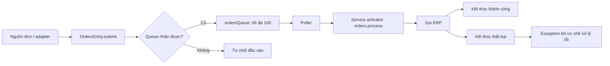
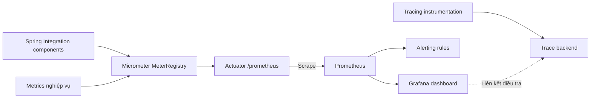

# Dashboard cho integration flow

## 1. Mục tiêu và phạm vi

Trong chương **Metrics và observability** của module **SPRING_INTEGRATION_CORE**, dashboard là nơi nối kiến thức về `Message`, `MessageChannel`, endpoint, gateway và Java DSL với việc vận hành một luồng tích hợp thực tế. Người trực hệ thống cần biết thông điệp đang đi qua đâu, chậm ở đâu và đã đạt kết quả nghiệp vụ nào.

Sau bài học này, bạn có thể:

- Xác định ranh giới đo cho một integration flow đồng bộ hoặc bất đồng bộ.
- Kết hợp metrics có sẵn của Spring Integration với metrics nghiệp vụ tự định nghĩa.
- Thiết kế dashboard về lưu lượng, lỗi, độ trễ và mức tồn đọng.
- Viết PromQL để tổng hợp đúng khi ứng dụng có nhiều instance.
- Đi từ một panel bất thường đến endpoint, log hoặc trace cần điều tra.
- Xây dựng cảnh báo có điều kiện tải và hướng xử lý rõ ràng.

Bài dùng tình huống nhận đơn hàng vào `QueueChannel`, sau đó một service activator chuyển đơn sang hệ thống ERP. Ví dụ mã dành cho ứng dụng Spring Boot 3.5.x, Spring Integration 6.5.x và Java 17 trở lên; phiên bản thư viện do dependency management của Spring Boot quản lý. Các đoạn cấu hình là nội dung thực hành, không yêu cầu tạo một dashboard JSON riêng.

## 2. Bắt đầu bằng câu hỏi vận hành

Một dashboard hữu ích phải trả lời được những câu hỏi cụ thể:

| Câu hỏi | Tín hiệu cần xem | Hành động tiếp theo |
| --- | --- | --- |
| Flow có đang nhận đơn không? | Tốc độ nhận thành công vào queue | Đối chiếu với lịch chạy và nguồn phát |
| Đơn đã xử lý xong chưa? | Tốc độ kết thúc, tách thành công và thất bại | Kiểm tra tồn đọng nếu đầu vào cao hơn đầu ra |
| Người dùng phải chờ bao lâu? | Độ trễ từ đầu vào đến kết quả cuối | Phân biệt chờ queue và thời gian xử lý |
| Bước nào đang gặp vấn đề? | Thời gian và lỗi theo handler | Mở log hoặc trace của endpoint đó |
| Tài nguyên có đủ không? | Độ đầy queue, executor, CPU, JVM | Điều tra giới hạn consumer và hệ thống đích |
| Có thể tin các panel này không? | Trạng thái scrape, khoảng trống dữ liệu | Sửa đường thu thập trước khi kết luận |

Một panel CPU thấp không chứng minh flow đang hoạt động. Consumer có thể đã dừng trong khi queue vẫn tăng. Ngược lại, queue bằng 0 cũng có thể do upstream đã ngừng gửi.

## 3. Định nghĩa ranh giới đo trước khi vẽ

### 3.1. Flow mẫu



Các mốc phải được phân biệt:

1. **Được nhận vào flow:** `send()` vào queue trả về `true`.
2. **Bắt đầu xử lý:** consumer lấy thông điệp khỏi queue và gọi handler.
3. **Kết thúc thành công:** thao tác ERP hoàn thành theo hợp đồng nghiệp vụ.
4. **Kết thúc thất bại:** thông điệp kết thúc mà chưa đạt hợp đồng đó.
5. **Bị từ chối đầu vào:** queue không nhận được thông điệp; nó chưa thuộc tập đơn được nhận.

Với flow này, gateway một chiều trả về thành công hoặc thao tác gửi vào channel thành công chỉ xác nhận việc chuyển giao. Kết quả cuối cùng xuất hiện sau đó tại consumer. Với gateway request-reply, thời gian chờ reply có thể gần ranh giới nghiệp vụ hơn, nhưng vẫn phải xác định reply là xác nhận tiếp nhận hay kết quả xử lý cuối.

### 3.2. Hợp đồng metric của ví dụ

| Tên Micrometer tự định nghĩa | Loại | Khi cập nhật | Nhãn riêng |
| --- | --- | --- | --- |
| `integration.flow.admitted` | Counter | Queue đã nhận đơn | `flow` |
| `integration.flow.rejected` | Counter | Queue từ chối vì không còn chỗ | `flow` |
| `integration.flow.completed` | Counter | Đơn kết thúc tại processor | `flow`, `outcome` |
| `integration.flow.duration` | Timer | Cùng thời điểm kết thúc | `flow`, `outcome` |

Trong bài, `flow="orders"`; `outcome` chỉ có `success` hoặc `failure`. Các tên bắt đầu bằng `integration.flow.*` trong bảng là **do ứng dụng định nghĩa**, không phải metrics Spring Integration tự sinh.

Độ trễ được đo từ ngay trước lần gửi vào queue đến lúc processor kết thúc. Chỉ những thông điệp được nhận mới có mẫu độ trễ kết thúc. Mẫu này bao gồm thời gian enqueue, chờ trong queue và xử lý ERP; không bao gồm thời gian đơn tồn tại ở hệ thống nguồn.

Ở một thời điểm ổn định của cùng tiến trình, khi không mất thông điệp, không retry và không chia nhánh:

```text
admitted = completed_success + completed_failure + queued + processing
```

Đây là quan hệ kiểm tra ý nghĩa dữ liệu, không phải phép đối soát giao dịch chính xác giữa các mẫu scrape. Counter và gauge có thể được đọc vào những thời điểm khác nhau.

Khi thêm splitter, một đơn có thể tạo nhiều message con. Khi thêm aggregator, nhiều message con có thể chỉ tạo một kết quả. Vì vậy phải định nghĩa đơn vị đo là **đơn hàng**, **message con** hay **nhóm**, rồi đặt tên panel theo đúng đơn vị.

## 4. Kiến trúc thu thập và hai cơ chế instrumentation



Spring Boot Actuator cùng registry Prometheus cung cấp đường xuất metrics. Endpoint `metrics` phục vụ khám phá meter; endpoint `prometheus` cung cấp dữ liệu để scrape. Xem [Spring Boot: Metrics](https://docs.spring.io/spring-boot/3.5/reference/actuator/metrics.html) và [Actuator endpoints](https://docs.spring.io/spring-boot/3.5/reference/actuator/endpoints.html).

### 4.1. Metrics thông thường và Observation

Trong cơ chế metrics thông thường, các meter đáng chú ý gồm:

| Meter Micrometer | Ý nghĩa |
| --- | --- |
| `spring.integration.send` | Timer cho channel hoặc handler; phân biệt bằng `type` |
| `spring.integration.receive` | Counter nhận từ pollable channel hoặc source |
| `spring.integration.channel.queue.size` | Số message đang chờ trong QueueChannel |
| `spring.integration.channel.queue.remaining.capacity` | Số chỗ còn lại của QueueChannel |

Timer gửi có các tag như `name`, `type`, `result`, `exception`. Khi dùng Observation cho component, các meter chuyển sang họ như `spring.integration.handler`, `spring.integration.producer`, `spring.integration.gateway`, cùng quy ước tag khác. Việc bật Observation cần registry và lựa chọn component qua `observationPatterns`. Xem [Spring Integration 6.5: Metrics and Management](https://docs.spring.io/spring-integration/reference/6.5/metrics.html).

**Ví dụ chính sử dụng metrics thông thường**, không cấu hình `observationPatterns`. PromQL cho meter có sẵn ở phần sau áp dụng cho lựa chọn này. Các metrics nghiệp vụ tự định nghĩa vẫn giữ hợp đồng của chúng khi bạn thay cơ chế instrumentation.

Trước khi nhập dashboard từ một dự án khác, hãy kiểm tra meter thực tế. Không đổi tên truy vấn theo phỏng đoán hoặc cộng cả meter cũ và meter Observation cho cùng một công việc.

### 4.2. Tên Micrometer và tên Prometheus

Trong cấu hình và Actuator `metrics`, dùng tên có dấu chấm. Khi xuất qua registry Prometheus với quy ước đặt tên mặc định, các ví dụ trong bài có dạng:

| Trong ứng dụng | Trong Prometheus |
| --- | --- |
| Counter `integration.flow.admitted` | `integration_flow_admitted_total` |
| Counter `integration.flow.completed` | `integration_flow_completed_total` |
| Timer `integration.flow.duration` | `integration_flow_duration_seconds_count`, `_sum`, `_bucket` |
| Gauge `spring.integration.channel.queue.size` | `spring_integration_channel_queue_size` |

Hãy đối chiếu trực tiếp bản xuất `/actuator/prometheus` nếu đã tùy biến naming convention. Timer vốn có số lần và tổng thời gian; histogram bổ sung buckets khi được bật. Xem [Micrometer: Timers](https://docs.micrometer.io/micrometer/reference/concepts/timers.html).

## 5. Cấu hình ứng dụng thực hành

### 5.1. Dependencies

Thêm các dependency sau vào ứng dụng đã có Spring Boot parent hoặc BOM. Dependency web giúp cung cấp HTTP endpoint cho Actuator.

```xml
<dependencies>
    <dependency>
        <groupId>org.springframework.boot</groupId>
        <artifactId>spring-boot-starter-integration</artifactId>
    </dependency>
    <dependency>
        <groupId>org.springframework.boot</groupId>
        <artifactId>spring-boot-starter-actuator</artifactId>
    </dependency>
    <dependency>
        <groupId>org.springframework.boot</groupId>
        <artifactId>spring-boot-starter-web</artifactId>
    </dependency>
    <dependency>
        <groupId>io.micrometer</groupId>
        <artifactId>micrometer-registry-prometheus</artifactId>
        <scope>runtime</scope>
    </dependency>
</dependencies>
```

### 5.2. Cấu hình Actuator và histogram

```yaml
spring:
  application:
    name: orders-integration

management:
  endpoints:
    web:
      exposure:
        include: health,metrics,prometheus,integrationgraph
  metrics:
    tags:
      application: orders-integration
      env: local
    distribution:
      percentiles-histogram:
        "integration.flow.duration": true
      minimum-expected-value:
        "integration.flow.duration": 1ms
      maximum-expected-value:
        "integration.flow.duration": 30s
      slo:
        "integration.flow.duration": 500ms,2s,10s
```

Các ngưỡng là lựa chọn cho bài thực hành. Chúng phải được điều chỉnh theo yêu cầu thời gian thực tế của hệ thống. `maximum-expected-value` điều chỉnh phạm vi histogram, không tạo timeout cho flow.

Histogram cho phép tính percentile sau khi tổng hợp nhiều instance. Percentile tính sẵn ở từng instance không thể đem lấy trung bình để suy ra percentile toàn hệ thống. Xem [Micrometer: Histograms and Percentiles](https://docs.micrometer.io/micrometer/reference/concepts/histogram-quantiles.html).

Chỉ cho hệ thống giám sát và người vận hành có quyền truy cập các endpoint quản trị. Endpoint `integrationgraph` hỗ trợ tra cấu trúc và tên component; đồ thị cấu trúc không tự thể hiện tốc độ, độ trễ hoặc kết quả nghiệp vụ.

### 5.3. Flow và metrics tại ranh giới nghiệp vụ

Lớp dưới đây chứa cấu hình và các kiểu hỗ trợ trong cùng một ví dụ. Đặt nó trong package được ứng dụng Spring Boot quét. Adapter hoặc controller đầu vào gọi bean `OrdersEntry`; ví dụ không phụ thuộc một giao thức đầu vào cụ thể.

```java
import java.util.concurrent.TimeUnit;

import io.micrometer.core.instrument.Counter;
import io.micrometer.core.instrument.MeterRegistry;
import io.micrometer.core.instrument.Timer;

import org.springframework.context.annotation.Bean;
import org.springframework.context.annotation.Configuration;
import org.springframework.integration.channel.QueueChannel;
import org.springframework.integration.config.EnableIntegration;
import org.springframework.integration.config.EnableIntegrationManagement;
import org.springframework.integration.dsl.IntegrationFlow;
import org.springframework.integration.dsl.Pollers;
import org.springframework.messaging.Message;
import org.springframework.messaging.support.MessageBuilder;

@Configuration(proxyBeanMethods = false)
@EnableIntegration
@EnableIntegrationManagement
public class FlowDashboardConfig {

    private static final String FLOW = "orders";
    private static final String STARTED_AT = "flowStartedNanos";

    public record Order(String orderId) {
    }

    @Bean
    public QueueChannel ordersQueue() {
        return new QueueChannel(100);
    }

    @Bean
    public OrdersMetrics ordersMetrics(MeterRegistry registry) {
        return new OrdersMetrics(registry);
    }

    @Bean
    public OrdersEntry ordersEntry(
            QueueChannel ordersQueue, OrdersMetrics metrics) {
        return new OrdersEntry(ordersQueue, metrics);
    }

    @Bean
    public OrderProcessor orderProcessor(OrdersMetrics metrics) {
        return new OrderProcessor(metrics);
    }

    @Bean
    public IntegrationFlow ordersFlow(
            QueueChannel ordersQueue, OrderProcessor orderProcessor) {
        return IntegrationFlow.from(ordersQueue)
                .handle(orderProcessor, "process", endpoint -> endpoint
                        .id("orders.process")
                        .poller(Pollers.fixedDelay(100)
                                .maxMessagesPerPoll(10)))
                .get();
    }

    public static final class OrdersEntry {

        private final QueueChannel input;
        private final OrdersMetrics metrics;

        public OrdersEntry(QueueChannel input, OrdersMetrics metrics) {
            this.input = input;
            this.metrics = metrics;
        }

        public boolean submit(Order order) {
            Message<Order> message = MessageBuilder.withPayload(order)
                    .setHeader(STARTED_AT, System.nanoTime())
                    .build();

            // Timeout 0: khong cho doi neu queue da day.
            boolean accepted = this.input.send(message, 0);

            if (accepted) {
                this.metrics.admitted.increment();
            }
            else {
                this.metrics.rejected.increment();
            }

            return accepted;
        }
    }

    public static final class OrdersMetrics {

        private final Counter admitted;
        private final Counter rejected;
        private final Counter completedSuccess;
        private final Counter completedFailure;
        private final Timer successDuration;
        private final Timer failureDuration;

        public OrdersMetrics(MeterRegistry registry) {
            this.admitted = Counter.builder("integration.flow.admitted")
                    .tag("flow", FLOW)
                    .register(registry);
            this.rejected = Counter.builder("integration.flow.rejected")
                    .tag("flow", FLOW)
                    .register(registry);
            this.completedSuccess = Counter
                    .builder("integration.flow.completed")
                    .tags("flow", FLOW, "outcome", "success")
                    .register(registry);
            this.completedFailure = Counter
                    .builder("integration.flow.completed")
                    .tags("flow", FLOW, "outcome", "failure")
                    .register(registry);
            this.successDuration = Timer
                    .builder("integration.flow.duration")
                    .tags("flow", FLOW, "outcome", "success")
                    .register(registry);
            this.failureDuration = Timer
                    .builder("integration.flow.duration")
                    .tags("flow", FLOW, "outcome", "failure")
                    .register(registry);
        }

        public void finished(boolean successful, long startedNanos) {
            Timer duration = successful
                    ? this.successDuration : this.failureDuration;
            Counter completed = successful
                    ? this.completedSuccess : this.completedFailure;

            duration.record(
                    System.nanoTime() - startedNanos,
                    TimeUnit.NANOSECONDS);
            completed.increment();
        }
    }

    public static final class OrderProcessor {

        private final OrdersMetrics metrics;

        public OrderProcessor(OrdersMetrics metrics) {
            this.metrics = metrics;
        }

        public void process(Message<Order> message) {
            long startedNanos =
                    (Long) message.getHeaders().get(STARTED_AT);
            boolean successful = false;

            try {
                callErp(message.getPayload());
                successful = true;
            }
            finally {
                this.metrics.finished(successful, startedNanos);
            }
        }

        private void callErp(Order order) {
            // Gia lap ket qua ERP; thay bang adapter thuc te khi thuc hanh.
            if (order.orderId().startsWith("FAIL-")) {
                throw new IllegalStateException("ERP demo failure");
            }
        }
    }
}
```

Poller được gắn tại endpoint tiêu thụ `QueueChannel`. `maxMessagesPerPoll(10)` là số message tối đa trong một lần polling, không có nghĩa là tạo mười consumer chạy song song. Xem [Spring Integration: Pollers](https://docs.spring.io/spring-integration/reference/dsl/java-pollers.html).

Các quyết định trong ví dụ:

- `submit()` trả `true` nghĩa là queue đã nhận; nguồn vào vẫn cần biết kết quả nghiệp vụ đến sau.
- Nhánh `FAIL-` tạo lỗi mô phỏng để quan sát `outcome="failure"`.
- `finally` ghi kết quả rồi để exception truyền tiếp. Với endpoint polling, exception tiếp tục đi vào cơ chế xử lý lỗi của poller; ví dụ không biến lỗi thành thành công.
- Mỗi message được xử lý một lần và không có retry. Vì vậy một lần processor thất bại được coi là thất bại cuối cùng của message trong ví dụ.
- Các counter cho cả hai outcome được tạo trước, nên một chuỗi failure có thể tồn tại với giá trị 0 trước khi có lỗi.
- `System.nanoTime()` chỉ dùng để lấy chênh lệch thời gian trong cùng JVM. Không gửi giá trị này qua broker sang tiến trình khác để tính độ trễ.
- Queue trong ví dụ lưu trong bộ nhớ. Khi tiến trình dừng, số liệu trước và sau restart không đủ để khẳng định không mất đơn; hệ thống cần giao nhận bền vững phải có cơ chế lưu trữ và đối soát tương ứng.

Ví dụ lời gọi tại adapter đầu vào đã được inject `OrdersEntry`:

```java
boolean accepted = ordersEntry.submit(
        new FlowDashboardConfig.Order("ORDER-001"));

boolean acceptedButWillFail = ordersEntry.submit(
        new FlowDashboardConfig.Order("FAIL-002"));
```

Cả hai lời gọi đều có thể trả `true`. Sau khi consumer chạy, kết quả cuối cùng của chúng khác nhau.

Timer đã có `count`, nên counter `completed` trong ví dụ là một lựa chọn để làm rõ hợp đồng nghiệp vụ. Có thể dùng timer count thay cho counter này nếu giữ nguyên được định nghĩa và cách lọc. Không cộng hai nguồn đó với nhau.

### 5.4. Khi flow có thêm EIP

Bài thực hành ngắn chỉ cần queue và service activator. Khi mở rộng bằng các thành phần cốt lõi khác, bổ sung tín hiệu theo hợp đồng của chúng:

| Thành phần | Tín hiệu cần thêm | Điều dễ hiểu sai |
| --- | --- | --- |
| Transformer | Thời gian chuyển đổi, lỗi dữ liệu | Chuyển đổi xong chưa có nghĩa gửi ERP xong |
| Filter | Số chấp nhận và loại bỏ theo lý do hữu hạn | Loại bỏ theo quy tắc nghiệp vụ không nhất thiết là lỗi kỹ thuật |
| Router | Tốc độ từng nhánh với tên nhánh ổn định | Một nhánh không có dữ liệu có thể do điều kiện định tuyến |
| Splitter và aggregator | Số message con, nhóm chờ, nhóm hết hạn | Không so số message con với số đơn gốc như cùng đơn vị |
| Retry advice | Số attempt, số retry, số kết thúc cuối | Một lỗi attempt có thể được phục hồi ở lần sau |
| Error flow | Số recovery, số dead-letter, lỗi của chính error handler | Exception đã được log không bảo đảm message đã được xử lý xong |

Nếu bổ sung retry bao ngoài processor, phải chuyển phép tăng `completed_failure` sang chỗ đã hết retry hoặc recovery xác nhận kết quả cuối. Không giữ nguyên cách đếm trong ví dụ rồi gọi mọi attempt thất bại là đơn thất bại cuối.

## 6. Khám phá dữ liệu trước khi dựng panel

Sau khi tạo lưu lượng, có thể kiểm tra bằng PowerShell:

```powershell
Invoke-RestMethod 'http://localhost:8080/actuator/metrics'

Invoke-RestMethod 'http://localhost:8080/actuator/metrics/integration.flow.completed'

Invoke-RestMethod 'http://localhost:8080/actuator/metrics/spring.integration.send?tag=type:handler'

(Invoke-WebRequest 'http://localhost:8080/actuator/prometheus').Content

Invoke-RestMethod 'http://localhost:8080/actuator/integrationgraph'
```

Kiểm tra lần lượt:

1. Meter nghiệp vụ đã xuất hiện với các tag `application`, `env`, `flow`, `outcome` đúng hợp đồng.
2. Bản xuất Prometheus có `_count`, `_sum` và `_bucket` cho timer đã bật histogram.
3. Meter queue mang `name="ordersQueue"`.
4. Tag `name` của handler thực tế là gì; endpoint ID và tên handler được framework quản lý không nên được coi là luôn giống nhau.
5. Sau một đơn `FAIL-`, counter kết thúc thất bại tăng, đồng thời có thông tin lỗi để điều tra.

Một số meter component chỉ xuất hiện sau khi component được sử dụng. Việc chưa có time series ngay sau startup không đủ để kết luận instrumentation bị hỏng.

Giá trị trong endpoint Actuator `metrics` hỗ trợ chẩn đoán tại ứng dụng. Tốc độ theo cửa sổ thời gian và tổng hợp giữa các instance nên được tính tại Prometheus.

## 7. Thiết kế bố cục dashboard

Dashboard đề xuất có ba hàng:

| Hàng | Panel | Cách hiển thị và đơn vị |
| --- | --- | --- |
| Tổng quan | Đầu vào được nhận, kết thúc thành công/thất bại | Time series, đơn/giây |
| Tổng quan | Tỷ lệ thất bại cuối | Stat và time series, phần trăm |
| Tổng quan | p95 độ trễ của đơn thành công | Time series, giây |
| Tồn đọng | Độ dài queue theo instance | Time series, message |
| Tồn đọng | Mức đầy queue theo instance | Gauge hoặc time series, phần trăm |
| Chẩn đoán | Thời gian xử lý trung bình theo handler | Time series, giây |
| Chẩn đoán | Tốc độ lỗi endpoint | Time series, lần/giây |
| Chẩn đoán | Scrape thành công, CPU, JVM, executor nếu có | Trạng thái và time series |

Đặt panel đầu vào và đầu ra cạnh nhau, dùng cùng cửa sổ thời gian. Mức tồn đọng đặt ngay phía dưới để giải thích chênh lệch. Mỗi panel cần phần mô tả ngắn về đơn vị, ranh giới đo và những gì được tính vào mẫu số.

### 7.1. Bộ lọc và tên component

Tạo các biến dashboard:

- `application`: ứng dụng cần xem.
- `env`: môi trường.
- `flow`: flow nghiệp vụ.
- `instance`: tùy chọn để điều tra một tiến trình.
- `component`: tùy chọn cho hàng handler, lấy từ tag `name` của meter thực tế.

Biến kiểu Query có thể lấy giá trị label từ data source; biến sau có thể phụ thuộc biến trước. Xem [Grafana: Add variables](https://grafana.com/docs/grafana/latest/visualizations/dashboards/variables/add-template-variables/).

Các truy vấn dưới đây giả sử `application`, `env`, `flow` chọn **một giá trị**. Khi bật chọn nhiều hoặc All, đổi selector thích hợp sang regex và kiểm tra phép tổng hợp giữa các flow.

Metrics nghiệp vụ có tag `flow` vì ứng dụng gắn tag đó. Meter Spring Integration mặc định không tự có tag nghiệp vụ này. Panel queue của ví dụ dùng ánh xạ cố định `orders → ordersQueue`; dashboard nhiều flow cần biến tên queue hoặc ánh xạ được quản lý rõ ràng.

### 7.2. Quy ước nhãn

Dùng các giá trị hữu hạn và ổn định như `flow=orders`, `outcome=success|failure`, `route=erp|manual`. Đưa `orderId`, `messageId`, `traceId`, exception message và URL chứa định danh vào log hoặc trace.

Ví dụ, 8 flow × 2 outcome × 6 instance tạo 96 tổ hợp trước khi xét thêm nhãn và các chuỗi histogram. Nếu thêm hàng trăm nghìn `orderId`, số tổ hợp tăng theo số đơn; dashboard vừa tốn chi phí vừa khó truy vấn.

Tên component cũng cần ổn định giữa các lần triển khai. Không tạo tên endpoint theo mã đơn hoặc thời điểm chạy.

## 8. PromQL cho những panel chính

Prometheus có thể scrape ứng dụng bằng cấu hình tối thiểu:

```yaml
global:
  scrape_interval: 15s

scrape_configs:
  - job_name: spring-integration
    metrics_path: /actuator/prometheus
    static_configs:
      - targets:
          - localhost:8080
```

`localhost` ở đây chỉ phù hợp khi Prometheus truy cập được ứng dụng qua cùng máy. Trong container hoặc cluster, dùng địa chỉ có thể truy cập từ Prometheus. Tham khảo [Prometheus: Configuration](https://prometheus.io/docs/prometheus/latest/configuration/configuration/).

Ví dụ dưới dùng cửa sổ `[5m]`. Với scrape 15 giây, khoảng này chứa đủ nhiều mẫu để quan sát xu hướng. Có thể dùng cửa sổ động của Grafana sau khi dashboard cơ bản đã đúng.

### 8.1. Tốc độ đầu vào được nhận

```promql
sum by (flow) (
  rate(integration_flow_admitted_total{
    application="$application", env="$env", flow="$flow"
  }[5m])
)
```

Đơn vị là đơn được nhận/giây. Lưu lượng gửi thử bị queue từ chối không nằm trong đường này.

### 8.2. Tốc độ kết thúc theo outcome

```promql
sum by (flow, outcome) (
  rate(integration_flow_completed_total{
    application="$application", env="$env", flow="$flow"
  }[5m])
)
```

Dùng legend `{{flow}} / {{outcome}}`. Tổng hai đường là tốc độ kết thúc; chỉ đường `success` thể hiện đầu ra đạt kết quả nghiệp vụ.

Áp dụng `rate()` cho từng counter trước rồi mới tổng hợp để xử lý reset của từng instance. Xem [Prometheus: Query functions](https://prometheus.io/docs/prometheus/latest/querying/functions/).

### 8.3. Tỷ lệ thất bại cuối cùng

```promql
100 *
sum by (flow) (
  rate(integration_flow_completed_total{
    application="$application", env="$env",
    flow="$flow", outcome="failure"
  }[5m])
)
/
sum by (flow) (
  rate(integration_flow_completed_total{
    application="$application", env="$env", flow="$flow"
  }[5m])
)
```

Mẫu số là các đơn **đã kết thúc**, cùng ranh giới với tử số. Không chia failure của consumer cho input của cùng cửa sổ rồi coi đó là tỷ lệ kết quả chính xác: các đơn đầu vào có thể vẫn đang chờ.

Khi không có đơn kết thúc, phép chia có thể trả `NaN`. Hiển thị trạng thái không đủ dữ liệu; tránh tự biến thành 0% khỏe mạnh. Với ít mẫu, luôn xem thêm số đơn kết thúc trong cửa sổ.

### 8.4. p95 độ trễ của đơn thành công

```promql
histogram_quantile(
  0.95,
  sum by (le, flow) (
    rate(integration_flow_duration_seconds_bucket{
      application="$application", env="$env",
      flow="$flow", outcome="success"
    }[5m])
  )
)
```

Giữ nhãn `le` khi tổng hợp classic histogram. p95 là ước lượng từ buckets và có thể thiếu ý nghĩa khi mẫu quá ít. Không lấy trung bình p95 của các instance. Xem [Prometheus: Histograms and summaries](https://prometheus.io/docs/practices/histograms/).

Panel này chỉ xét đơn thành công. Cần đặt tỷ lệ thất bại cạnh nó, vì lỗi xảy ra nhanh có thể khiến độ trễ tổng hợp trông đẹp hơn trong khi kết quả nghiệp vụ xấu đi.

Với bucket SLO 2 giây đã cấu hình, tỷ lệ đơn thành công kết thúc trong 2 giây trên tổng các đơn kết thúc là:

```promql
100 *
sum by (flow) (
  rate(integration_flow_duration_seconds_bucket{
    application="$application", env="$env", flow="$flow",
    outcome="success", le="2.0"
  }[5m])
)
/
sum by (flow) (
  rate(integration_flow_completed_total{
    application="$application", env="$env", flow="$flow"
  }[5m])
)
```

Đối chiếu giá trị label `le` ở bản xuất; nếu registry biểu diễn bucket là `"2"`, sửa selector tương ứng. Đây là chỉ số trên **đơn đã kết thúc** trong cửa sổ, chưa bao gồm đơn còn treo. Muốn SLO theo thời hạn của toàn bộ đơn được nhận, cần theo dõi thêm tuổi đơn chưa kết thúc và định nghĩa cohort theo thời điểm tiếp nhận.

### 8.5. Số message đang chờ theo instance

```promql
max by (instance, name) (
  spring_integration_channel_queue_size{
    application="$application", env="$env", name="ordersQueue"
  }
)
```

Mỗi instance sở hữu một queue trong bộ nhớ của riêng nó. Tổng theo instance phù hợp khi hỏi toàn hệ thống đang chờ bao nhiêu; xem từng instance phù hợp để tìm phân phối tải lệch.

Queue size không bao gồm message đã được consumer lấy ra nhưng vẫn đang xử lý. Nó cũng không thể hiện tuổi message lâu nhất. Nếu thời hạn xử lý quan trọng, cần thêm phép đo tuổi đơn hoặc queue wait tại ranh giới dequeue.

### 8.6. Tỷ lệ đầy queue theo instance

```promql
100 *
max by (instance, name) (
  spring_integration_channel_queue_size{
    application="$application", env="$env", name="ordersQueue"
  }
)
/
(
  max by (instance, name) (
    spring_integration_channel_queue_size{
      application="$application", env="$env", name="ordersQueue"
    }
  )
  +
  max by (instance, name) (
    spring_integration_channel_queue_remaining_capacity{
      application="$application", env="$env", name="ordersQueue"
    }
  )
)
```

Trong ví dụ bounded queue, `size + remaining capacity = 100`. Tỷ lệ này không phải tín hiệu capacity hữu ích cho một queue thực tế gần như không giới hạn.

Nếu ứng dụng có queue size thấp nhưng `integration_flow_rejected_total` vẫn tăng, hãy xem theo instance và thời gian chi tiết hơn: việc queue chạm ngưỡng trong khoảng ngắn có thể không xuất hiện ở mỗi lần scrape.

### 8.7. Thời gian trung bình và lỗi theo handler

Với cơ chế metrics thông thường, thời gian trung bình:

```promql
sum by (name) (
  rate(spring_integration_send_seconds_sum{
    application="$application", env="$env", type="handler"
  }[5m])
)
/
sum by (name) (
  rate(spring_integration_send_seconds_count{
    application="$application", env="$env", type="handler"
  }[5m])
)
```

Tốc độ các lần xử lý handler thất bại:

```promql
sum by (name) (
  rate(spring_integration_send_seconds_count{
    application="$application", env="$env",
    type="handler", result="failure"
  }[5m])
)
```

Không bỏ `type="handler"` rồi coi tổng channel và handler là số đơn duy nhất. Một message có thể đi qua nhiều component.

Với `DirectChannel`, lời gọi đồng bộ có thể bao gồm thời gian xử lý downstream. Do đó tổng thời gian của nhiều channel và handler có thể đếm chồng cùng khoảng thời gian. Với queue hoặc executor channel, đo thời gian gửi cũng không bao trùm toàn bộ phần xử lý bất đồng bộ. Xem đặc điểm các channel tại [Spring Integration: Message Channel Implementations](https://docs.spring.io/spring-integration/reference/channel/implementations.html).

Các truy vấn handler trên xét mọi handler của ứng dụng đã chọn. Khi ứng dụng có nhiều flow, bổ sung selector tên component từ ánh xạ của flow để hàng chẩn đoán không trộn các flow.

### 8.8. Trạng thái thu thập

```promql
up{job="spring-integration"}
```

`up` là metric do Prometheus tạo cho target. Nó không tự nhận tag `application` hay `env` được gắn trong `MeterRegistry`. Với scrape config của bài, lọc `up` bằng `job` và `instance`.

`up=1` xác nhận lần scrape thành công, không xác nhận nghiệp vụ đang tiến triển. Target bị bỏ khỏi service discovery cũng cần cơ chế phát hiện thiếu target theo danh sách kỳ vọng; chỉ biểu thức `up == 0` không bao phủ trường hợp đó.

## 9. Từ dashboard sang cảnh báo

Ngưỡng thực hành dưới đây là ví dụ, không phải SLO mặc định của Spring Integration:

- Tỷ lệ thất bại cuối vượt 5% kéo dài.
- Chỉ đánh giá tỷ lệ khi có ít nhất 100 đơn kết thúc trong 5 phút.
- Scrape thất bại liên tục trong 2 phút.
- Với queue, cân nhắc cảnh báo khi mức đầy vượt 80% trong 5 phút, kết hợp tuổi đơn hoặc tình trạng consumer.

Ví dụ một tệp rule được khai báo qua `rule_files` của Prometheus:

```yaml
groups:
  - name: orders-integration-flow
    rules:
      - alert: IntegrationFlowFailureRatioHigh
        expr: |
          (
            sum by (application, env, flow) (
              rate(integration_flow_completed_total{
                application="orders-integration",
                outcome="failure"
              }[5m])
            )
            /
            sum by (application, env, flow) (
              rate(integration_flow_completed_total{
                application="orders-integration"
              }[5m])
            )
            > 0.05
          )
          and on (application, env, flow)
          (
            sum by (application, env, flow) (
              increase(integration_flow_completed_total{
                application="orders-integration"
              }[5m])
            ) >= 100
          )
        for: 10m
        labels:
          severity: warning
        annotations:
          summary: "Flow {{ $labels.flow }} có tỷ lệ thất bại cao"
          description: "Mở dashboard theo application, env và flow; đối chiếu ERP, handler và log lỗi."

      - alert: IntegrationMetricsScrapeFailed
        expr: up{job="spring-integration"} == 0
        for: 2m
        labels:
          severity: critical
        annotations:
          summary: "Không scrape được {{ $labels.instance }}"
          description: "Kiểm tra target, kết nối và endpoint Actuator trước khi diễn giải các panel."
```

`for` yêu cầu điều kiện tồn tại liên tục trước khi alert chuyển sang firing. Cửa sổ `[5m]` và `for: 10m` có vai trò khác nhau: một cái tính tín hiệu, một cái yêu cầu tín hiệu kéo dài. Xem [Prometheus: Alerting rules](https://prometheus.io/docs/prometheus/latest/configuration/alerting_rules/).

Cảnh báo không có lưu lượng cần hiểu lịch hoạt động. Flow xử lý tệp theo đợt có thể im lặng nhiều giờ đúng thiết kế. Flow có tải kỳ vọng liên tục nên so thêm nguồn đầu vào và tiến triển đầu ra.

Mỗi cảnh báo cần có người sở hữu, dashboard tương ứng và bước điều tra đầu tiên. Việc gửi thông báo còn cần cấu hình Alertmanager hoặc cơ chế cảnh báo của nền tảng đang dùng.

## 10. Điều tra một sự cố qua dashboard

Giả sử có số liệu minh họa:

| Thời điểm | Nhận vào | Kết thúc thành công | Queue | p95 thành công |
| --- | --- | --- | --- | --- |
| 09:00 | 20 đơn/s | 20 đơn/s | 3 | 0,4 s |
| 09:05 | 20 đơn/s | 6 đơn/s | 90 | 8 s |
| 09:08 | 3 đơn/s | 3 đơn/s | 100 | 16 s |

Ở 09:08, tốc độ nhận được vào queue giảm vì queue đã đầy; tốc độ nguồn **gửi thử** có thể vẫn là 20 đơn/s. Xem `rejected` và số liệu upstream để tránh suy luận rằng nhu cầu đã giảm.

Trình tự điều tra hợp lý:

1. Xác nhận scrape vẫn tốt và các panel cùng môi trường, flow, khoảng thời gian.
2. Xem queue theo instance để biết tồn đọng là toàn hệ thống hay chỉ một consumer.
3. Xem thời gian handler và trace gọi ERP. Queue tăng cùng thời gian gọi ERP tăng gợi ý hệ thống đích chậm.
4. Nếu handler vẫn nhanh nhưng queue tăng, kiểm tra endpoint có chạy không, poller, lịch polling, executor nếu có và phân phối tải.
5. Xem outcome và cơ chế retry. Retry dồn dập có thể tiêu thụ tài nguyên mà không tăng kết quả cuối.
6. Xác định timeout, giới hạn kết nối và khả năng nhận tải của ERP trước khi tăng concurrency.
7. Sau khi khắc phục, quan sát tốc độ kết thúc vượt tốc độ nhận trong giai đoạn xả backlog và queue giảm dần.

Không kết luận nguyên nhân chỉ từ tương quan một panel. Ví dụ CPU thấp đồng thời queue tăng có thể do chờ I/O, consumer ngừng hoặc poller bị giới hạn.

### Liên kết metrics với log và trace

Một log kết thúc nên có các trường như `flow`, `endpoint`, `orderId`, `messageId`, `outcome` và `traceId` nếu đã có tracing. Khi mở panel theo handler, chuyển sang log cùng application, instance và khoảng thời gian.

Không giả định việc gọi `MeterRegistry` tự tạo trace. Nếu bật tracing và Observation, cần kiểm tra propagation khi qua channel, executor, gateway hoặc broker. Khi đó hãy cập nhật truy vấn theo meter thực tế của cơ chế mới. Correlation ID nghiệp vụ và trace ID giải quyết hai nhu cầu khác nhau; giữ cả hai trong nơi điều tra thích hợp.

## 11. Thực hành theo kịch bản

Các kịch bản sau nhằm giúp người học kiểm tra dashboard sau khi triển khai ví dụ:

| Kịch bản | Cách tạo tình huống | Kết quả cần quan sát |
| --- | --- | --- |
| Luồng bình thường | Gửi các mã `ORDER-` với tải thấp | admitted và completed success gần nhau, queue thấp |
| Lỗi ERP | Trộn một tỷ lệ mã `FAIL-` | completed failure tăng đúng tỷ lệ kết quả |
| ERP chậm | Dùng stub ERP có độ trễ kiểm soát | Thời gian handler tăng; sau đó queue và độ trễ toàn flow tăng |
| Queue đầy | Gửi vượt năng lực xử lý đủ lâu | Queue chạm 100, rejected tăng, admitted thấp hơn gửi thử |
| Consumer dừng | Dừng endpoint `orders.process` trong môi trường thực hành | Queue tăng, completed ngừng, up có thể vẫn bằng 1 |
| Nhiều instance | Chạy hai instance và phân phối đầu vào | Tổng throughput tăng theo tải; queue vẫn phân biệt instance |
| Restart một instance | Khởi động lại trong môi trường thực hành | Counter reset; rate vẫn xử lý được reset khi đủ mẫu |
| Nguồn ngừng gửi | Tạm dừng phát đơn | Đầu vào giảm; queue được xả rồi đầu ra giảm |

Kịch bản consumer dừng chỉ hữu ích nếu thử trong môi trường thực hành có thể khôi phục endpoint. Nếu dữ liệu biến mất khỏi panel, cần phân biệt không còn sự kiện, không có series và scrape thất bại.

### Bài tập tự triển khai

1. Tạo các panel mục 8 và điền mô tả ranh giới đo cho từng panel.
2. Thêm metric queue wait tại lúc processor nhận message; so sánh nó với độ trễ toàn flow.
3. Thêm filter loại bỏ đơn theo một quy tắc nghiệp vụ. Định nghĩa trước đơn bị loại có thuộc completed hay một nhóm kết quả riêng.
4. Thêm một retry có giới hạn cho lỗi ERP tạm thời. Tách số attempt thất bại với số đơn thất bại cuối.
5. Nếu thêm aggregator, xây dựng panel về số nhóm chưa release và nhóm timeout mà không dùng `orderId` làm nhãn.
6. Viết hướng xử lý ngắn cho tình huống queue đầy nhưng CPU thấp.

## 12. Những sai lầm cần tránh

| Sai lầm | Hậu quả | Cách sửa |
| --- | --- | --- |
| Coi channel send thành công là hoàn tất nghiệp vụ | Dashboard xanh dù ERP chưa xử lý | Đo tại kết quả cuối |
| Cộng số lần gọi mọi channel và handler | Đếm một đơn nhiều lần | Chọn một ranh giới nghiệp vụ hoặc một component cụ thể |
| Trộn meter thường với meter Observation | Truy vấn sai tên hoặc đếm chồng | Khám phá meter và cố định cơ chế cho từng panel |
| Cộng thời gian nhiều bước đồng bộ | Đếm chồng khoảng xử lý downstream | Dùng timer toàn flow và trace để phân rã |
| Lấy trung bình percentile các instance | p95 tổng hợp sai | Tổng hợp buckets rồi tính quantile |
| Lấy rate của queue size | Mất ý nghĩa số message đang chờ | Dùng gauge trực tiếp; xem xu hướng riêng khi cần |
| Bỏ qua đơn còn treo khi đọc latency | Độ trễ trông đẹp dù backlog lớn | Đặt queue và tuổi đơn cạnh latency |
| Gắn ID thông điệp làm metric label | Cardinality tăng theo số sự kiện | Đưa định danh vào log hoặc trace |
| Coi không có dữ liệu là 0 lỗi | Che khuất lỗi thu thập hoặc thiếu mẫu | Hiển thị trạng thái thiếu dữ liệu riêng |
| Tăng consumer ngay khi queue tăng | Có thể làm ERP quá tải hơn | Xác định giới hạn thực trước khi tăng concurrency |

## 13. Tiêu chí hoàn thành dashboard

Dashboard đạt mục tiêu vận hành khi người xem có thể:

- Phân biệt số được nhận, số bị từ chối và số đã kết thúc.
- Nêu rõ đơn vị của mỗi panel và ý nghĩa mẫu số của mọi tỷ lệ.
- Xem độ trễ toàn flow cùng backlog, thay vì chỉ xem thời gian handler.
- Phân tích theo instance nhưng vẫn có tổng toàn flow đúng cách.
- Xác định tên endpoint thực tế và chuyển tiếp sang log hoặc trace.
- Phân biệt lỗi của flow với lỗi của đường giám sát.
- Hiểu ảnh hưởng của filter, router, splitter, aggregator và retry đến số đếm.
- Biết cảnh báo nào cần hành động và bước điều tra đầu tiên.

Giá trị của dashboard nằm ở những quyết định nó hỗ trợ: phát hiện mất tiến triển, xác định ranh giới bị chậm và kiểm chứng việc phục hồi. Các biểu đồ chỉ đáng tin khi hợp đồng đo của chúng phù hợp với cách integration flow thực sự xử lý thông điệp.
