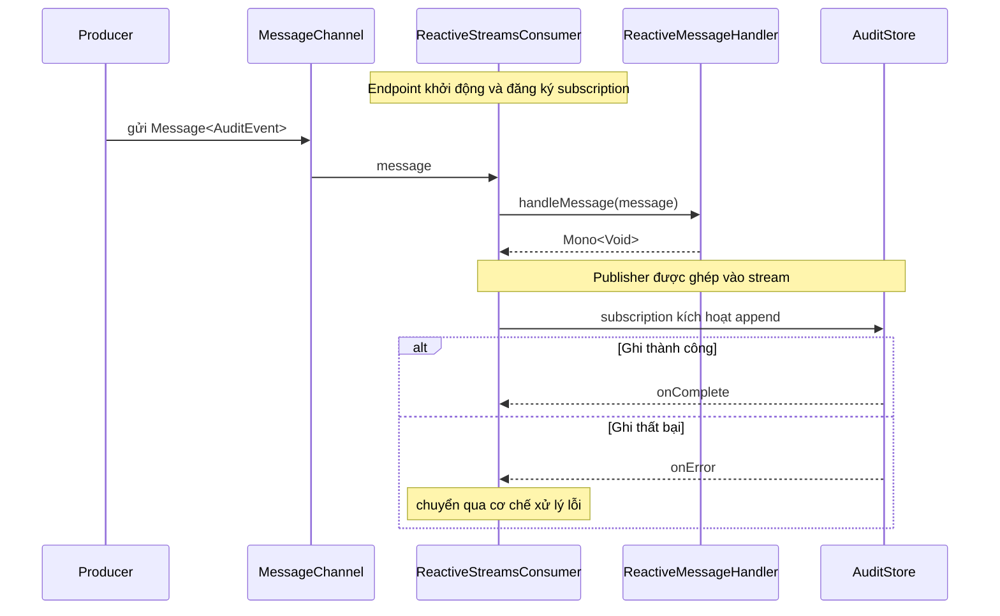

# ReactiveMessageHandler

## 1. Mục tiêu và vị trí trong Spring Integration Core

Trong chương **Reactive support** của module **SPRING_INTEGRATION_CORE**, bài học này giải thích cách dùng `ReactiveMessageHandler` để xử lý một `Message<?>` bằng thao tác reactive có tín hiệu hoàn tất nhưng không tạo thông điệp trả lời.

Sau bài học, bạn có thể:

- Đọc đúng hợp đồng `Mono<Void> handleMessage(Message<?> message)`.
- Viết handler giữ nguyên vòng đời của thao tác I/O trong publisher trả về.
- Kết nối handler với `MessageChannel` và endpoint bằng Java DSL.
- Phân biệt việc tiếp nhận message, hoàn tất xử lý và xác nhận nghiệp vụ.
- Thiết kế đường lỗi, retry, tính idempotent và kiểm thử subscription.

Bạn nên biết cấu trúc `Message` gồm payload và headers, vai trò của channel và endpoint, cùng các toán tử cơ bản `Mono.defer`, `then`, `onErrorMap`. Các ví dụ dùng Java 17 trở lên và Spring Integration 6.1 trở lên vì sử dụng `handleReactive(...)`; hãy để BOM của dự án quản lý phiên bản Spring và Reactor tương thích. API DSL này được bổ sung từ Spring Integration 6.1. [Tài liệu Reactive Streams Support](https://docs.spring.io/spring-integration/reference/reactive-streams.html).

### Bài toán xuyên suốt

Một hệ thống đơn hàng cần lưu sự kiện audit sau khi đơn được xác nhận:

```text
Message<AuditEvent>
    → auditInput
    → endpoint auditWriter
    → AuditMessageHandler
    → AuditStore.append(event)
    → hoàn tất hoặc báo lỗi
```

Payload chứa dữ liệu audit; headers mang thông tin như `traceId`, `errorChannel`. Nơi nhận audit chỉ cần biết thao tác ghi đã kết thúc hay thất bại. Nó không cần tạo payload mới để transformer hoặc router tiếp tục xử lý. Đây là trường hợp phù hợp với handler kết thúc nhánh tích hợp.

Nếu bên gọi cần nhận mã biên nhận hoặc đối tượng đơn hàng đã cập nhật, hãy thiết kế một bước request–reply với dữ liệu trả lời rõ ràng. `ReactiveMessageHandler` phục vụ hợp đồng hoàn tất của thao tác một chiều.

## 2. Hợp đồng của ReactiveMessageHandler

Interface thuộc **Spring Messaging**:

```java
import org.springframework.messaging.Message;
import org.springframework.messaging.ReactiveMessageHandler;
import reactor.core.publisher.Mono;

// Chữ ký phương thức của interface:
Mono<Void> handleMessage(Message<?> message);
```

Đây là functional interface, nên có thể triển khai bằng một lớp, lambda hoặc method reference. Giá trị trả về biểu diễn kết quả hoàn tất của việc xử lý message. [Javadoc ReactiveMessageHandler](https://docs.spring.io/spring-framework/docs/current/javadoc-api/org/springframework/messaging/ReactiveMessageHandler.html).

| Thành phần | Ý nghĩa |
| --- | --- |
| `Message<?>` | Toàn bộ message, gồm payload và headers |
| `Mono<Void>` | Publisher biểu diễn hoàn tất hoặc lỗi, không phát dữ liệu nghiệp vụ |
| `onComplete` | Thao tác mà handler đại diện đã thành công theo hợp đồng của nó |
| `onError` | Thao tác thất bại |
| Cancellation | Subscriber hủy theo dõi hoặc hủy công việc; không phải tín hiệu thành công |
| Không có terminal signal | Thao tác vẫn đang chờ hoặc bị treo |

Reactor không dùng `null` làm phần tử phát ra. `Mono<Void>` thành công bằng cách hoàn tất mà không phát giá trị; `Mono.empty()` là publisher hợp lệ, còn trả về `null` từ handler là sai hợp đồng. [Javadoc Mono](https://projectreactor.io/docs/core/release/api/reactor/core/publisher/Mono.html).

### 2.1. Mono<Void> vẫn có thông tin quan trọng

Không có dữ liệu trả về không có nghĩa là không có kết quả:

```text
onSubscribe → yêu cầu thực thi → thao tác ghi hoàn thành → onComplete
onSubscribe → yêu cầu thực thi → thao tác ghi thất bại   → onError
```

Với audit store, `onComplete` phải có nghĩa là `append` đã thành công ở mức mà store cam kết. Nếu store chỉ đẩy công việc sang một hàng đợi khác rồi hoàn tất, tín hiệu đó chỉ xác nhận việc đưa vào hàng đợi. Ranh giới thành công phải được quy định trong hợp đồng `AuditStore`.

### 2.2. then() giữ thời điểm hoàn tất, bỏ dữ liệu

Một reactive repository có thể trả về entity đã lưu:

```java
// repository.save(event) có kiểu Mono<AuditEvent>.
return repository.save(event).then();
```

`then()` bỏ giá trị entity nhưng vẫn chờ publisher nguồn kết thúc và truyền lỗi của nguồn. Vì vậy handler không cần tự gọi `subscribe()` để thực thi thao tác. [Reactor: Lựa chọn toán tử](https://projectreactor.io/docs/core/release/reference/apdx-operatorChoice.html).

Ngược lại, `map` hoặc `flatMap` dựa vào giá trị phát ra sẽ không được gọi khi nguồn là một `Mono<Void>` hoàn tất rỗng. Để thực hiện tác vụ tiếp theo sau khi ghi xong, dùng:

```java
return store.append(event)
        .then(Mono.defer(() -> anotherStore.append(event)));
```

Ở đây, hợp đồng hoàn tất bao phủ cả hai thao tác theo thứ tự. Nếu thao tác đầu lỗi, thao tác sau không được chạy.

## 3. Handler, endpoint và subscription có vai trò khác nhau

Ba đối tượng thường bị nhầm lẫn:

| Đối tượng | Trách nhiệm |
| --- | --- |
| `ReactiveMessageHandler` | Tạo publisher đại diện cho việc xử lý một message |
| `ReactiveStreamsConsumer` | Kết nối nguồn message với xử lý reactive và quản lý subscription của endpoint |
| `ReactiveMessageHandlerAdapter` | Đưa handler reactive vào hợp đồng `MessageHandler` dạng `void` |

`ReactiveMessageHandlerAdapter` là cầu nối với API imperative. Khi gọi adapter trực tiếp theo hợp đồng `MessageHandler`, adapter subscribe vào publisher do delegate trả về. Khi có thể ghép reactive stream, framework có thể lấy delegate ra khỏi adapter để ghép vào stream. Do đó tên “adapter cho lời gọi đồng bộ” không có nghĩa là nó chờ I/O hoàn tất. [Javadoc ReactiveMessageHandlerAdapter](https://docs.spring.io/spring-integration/api/org/springframework/integration/handler/ReactiveMessageHandlerAdapter.html).

Trong cấu hình endpoint chuẩn của Spring Integration 6.1, factory nhận diện adapter này và tạo `ReactiveStreamsConsumer`, kể cả khi input không phải `FluxMessageChannel`. Vì vậy không được suy luận rằng mọi flow dùng `DirectChannel` đều subscribe tách rời từng thao tác. [Mã nguồn ConsumerEndpointFactoryBean 6.1.4](https://github.com/spring-projects/spring-integration/blob/v6.1.4/spring-integration-core/src/main/java/org/springframework/integration/config/ConsumerEndpointFactoryBean.java).

### Vòng đời trong cấu hình reactive



Đây là sơ đồ logic, không khẳng định mỗi bước dùng một thread riêng. Một chuỗi reactive có thể chạy trên thread hiện tại cho đến khi gặp nguồn hoặc toán tử đổi lịch thực thi.

Trong handler, hãy trả publisher cho framework. Tự subscribe bên trong sẽ tách thao tác khỏi tín hiệu hoàn tất mà endpoint đang theo dõi; lỗi, hủy và khả năng điều phối nhu cầu cũng trở nên khó quản lý.

## 4. Xây dựng ví dụ audit tự chứa

Các lớp Java dưới đây cùng thuộc package `demo.audit`. Mỗi lớp hoặc interface `public` được đặt trong file Java cùng tên khi người học thực hành. Đây là mã minh họa để đưa vào ứng dụng, không yêu cầu thêm dịch vụ ngoài.

Các dependency cần có trong dự án Maven đã cấu hình BOM tương thích:

```xml
<dependencies>
    <dependency>
        <groupId>org.springframework.integration</groupId>
        <artifactId>spring-integration-core</artifactId>
    </dependency>
    <dependency>
        <groupId>io.projectreactor</groupId>
        <artifactId>reactor-core</artifactId>
    </dependency>
    <dependency>
        <groupId>io.projectreactor</groupId>
        <artifactId>reactor-test</artifactId>
        <scope>test</scope>
    </dependency>
    <dependency>
        <groupId>org.junit.jupiter</groupId>
        <artifactId>junit-jupiter</artifactId>
        <scope>test</scope>
    </dependency>
</dependencies>
```

Các đoạn dependency không khai báo phiên bản vì giả định BOM của dự án đã quản lý chúng. Dự án chưa có dependency management cần cấu hình phần đó trước.

### 4.1. Payload và hợp đồng lưu trữ

```java
package demo.audit;

public record AuditEvent(
        String eventId,
        String orderId,
        String action) {
}
```

```java
package demo.audit;

import reactor.core.publisher.Mono;

public interface AuditStore {

    // Hoàn tất khi store đã chấp nhận ghi theo hợp đồng của nó.
    // Publisher phải giữ được lỗi và vòng đời của thao tác ghi.
    Mono<Void> append(AuditEvent event);
}
```

`eventId` là khóa nghiệp vụ ổn định để nhận diện cùng một sự kiện qua các lần gửi lại. `orderId` dùng để liên hệ sự kiện với đơn hàng. `action` mô tả thay đổi, chẳng hạn `ORDER_CONFIRMED`.

### 4.2. Store trong bộ nhớ để chạy minh họa

```java
package demo.audit;

import java.util.concurrent.ConcurrentHashMap;
import java.util.concurrent.ConcurrentMap;
import reactor.core.publisher.Mono;

public final class InMemoryAuditStore implements AuditStore {

    private final ConcurrentMap<String, AuditEvent> events =
            new ConcurrentHashMap<>();

    @Override
    public Mono<Void> append(AuditEvent event) {
        return Mono.fromRunnable(() ->
                events.compute(event.eventId(), (key, existing) -> {
                    if (existing != null && !existing.equals(event)) {
                        throw new IllegalStateException(
                                "eventId đã tồn tại với nội dung khác");
                    }
                    return event;
                }));
    }

    public AuditEvent find(String eventId) {
        return events.get(eventId);
    }
}
```

Store chỉ sửa map khi có subscription. Gửi lại cùng `eventId` và nội dung tương đương không tạo bản ghi mới; dùng lại khóa với nội dung khác gây lỗi. `compute` giúp thao tác kiểm tra và cập nhật theo khóa có tính nguyên tử trong store minh họa.

Dữ liệu này mất khi tiến trình kết thúc và không chia sẻ giữa nhiều instance ứng dụng. Với database thật, cần cơ chế tương đương dựa trên unique constraint và thao tác ghi nguyên tử; chỉ kiểm tra tồn tại trước rồi insert có thể xảy ra race condition.

### 4.3. Handler xác thực dữ liệu và giữ message gốc khi lỗi

```java
package demo.audit;

import java.util.Objects;
import org.springframework.messaging.Message;
import org.springframework.messaging.MessageHandlingException;
import org.springframework.messaging.MessagingException;
import org.springframework.messaging.ReactiveMessageHandler;
import reactor.core.publisher.Mono;

public final class AuditMessageHandler implements ReactiveMessageHandler {

    private final AuditStore store;

    public AuditMessageHandler(AuditStore store) {
        this.store = Objects.requireNonNull(store);
    }

    @Override
    public Mono<Void> handleMessage(Message<?> message) {
        return Mono.<Void>defer(() -> {
            if (!(message.getPayload() instanceof AuditEvent event)) {
                return Mono.error(new IllegalArgumentException(
                        "Payload phải là AuditEvent"));
            }

            if (isBlank(event.eventId())
                    || isBlank(event.orderId())
                    || isBlank(event.action())) {
                return Mono.error(new IllegalArgumentException(
                        "eventId, orderId và action không được rỗng"));
            }

            return store.append(event);
        }).onErrorMap(error ->
                error instanceof MessagingException
                        ? error
                        : new MessageHandlingException(
                                message, "Không thể ghi sự kiện audit", error));
    }

    private static boolean isBlank(String value) {
        return value == null || value.isBlank();
    }
}
```

`Mono.defer` đưa cả kiểm tra payload và lời gọi `store.append` vào thời điểm subscription. Ngoại lệ phát sinh lúc dựng publisher của store cũng trở thành lỗi reactive. Mỗi subscription tạo lại công việc tương ứng; không nên subscribe nhiều lần nếu không chủ đích thực thi lại.

`onErrorMap` bổ sung ngữ cảnh bằng `MessageHandlingException`, gồm message thất bại và nguyên nhân. Nếu đã nhận một `MessagingException`, ví dụ giữ nguyên thay vì bọc thêm. Điều này giả định exception từ tầng dưới đã mô tả đúng ngữ cảnh của nó.

Handler không giữ biến “message đang xử lý” trong field. Một bean có thể xử lý nhiều message đang thực thi đồng thời; trạng thái theo message phải nằm trong biến cục bộ hoặc trong chuỗi publisher.

## 5. Kết nối bằng Java DSL

### 5.1. Cấu hình flow và error channel

```java
package demo.audit;

import org.springframework.context.annotation.Bean;
import org.springframework.context.annotation.Configuration;
import org.springframework.integration.channel.FluxMessageChannel;
import org.springframework.integration.channel.QueueChannel;
import org.springframework.integration.config.EnableIntegration;
import org.springframework.integration.dsl.IntegrationFlow;

@Configuration
@EnableIntegration
public class AuditIntegrationConfiguration {

    @Bean
    public FluxMessageChannel auditInput() {
        return new FluxMessageChannel();
    }

    @Bean
    public QueueChannel auditErrors() {
        return new QueueChannel(100);
    }

    @Bean
    public AuditStore auditStore() {
        return new InMemoryAuditStore();
    }

    @Bean
    public AuditMessageHandler auditMessageHandler(AuditStore auditStore) {
        return new AuditMessageHandler(auditStore);
    }

    @Bean
    public IntegrationFlow auditFlow(
            FluxMessageChannel auditInput,
            AuditMessageHandler auditMessageHandler) {

        return IntegrationFlow.from(auditInput)
                .handleReactive(
                        auditMessageHandler,
                        endpoint -> endpoint
                                .id("auditWriter")
                                .reactive());
    }
}
```

`handleReactive(...)` kết thúc định nghĩa flow và trả về `IntegrationFlow`. Không nối thêm `.get()`, `.channel(...)` hay transformer phía sau. Overload thứ hai cho phép cấu hình endpoint bao quanh handler. [Mã nguồn Java DSL 6.1.4](https://github.com/spring-projects/spring-integration/blob/v6.1.4/spring-integration-core/src/main/java/org/springframework/integration/dsl/BaseIntegrationFlowDefinition.java).

`endpoint.reactive()` diễn đạt rõ ý định dùng consumer reactive. Với `FluxMessageChannel` và handler này, framework đã có cơ sở chọn consumer đó; lời gọi trên không phải điều kiện bắt buộc duy nhất để handler được thực thi reactive. Tùy chọn cũng cho phép cấu hình consumer reactive độc lập với kiểu input channel. [Javadoc ConsumerEndpointSpec.reactive](https://docs.spring.io/spring-integration/api/org/springframework/integration/dsl/ConsumerEndpointSpec.html).

`FluxMessageChannel` đóng vai trò `Publisher` cho consumer downstream và có thể nhận một nguồn publisher qua `subscribeTo(...)`. Chọn channel reactive giúp giữ liên kết demand ở đoạn stream đó. Tuy nhiên, một channel reactive không tự biến các đoạn xử lý blocking hoặc producer imperative thành một chuỗi có backpressure xuyên suốt. [Tài liệu Message Channel Implementations](https://docs.spring.io/spring-integration/reference/channel/implementations.html#flux-message-channel).

### 5.2. Gửi một message và quan sát kết quả

Trong đoạn sau, `auditInput` là bean channel được lấy từ application context đã khởi động:

```java
import org.springframework.messaging.Message;
import org.springframework.messaging.support.MessageBuilder;

AuditEvent event =
        new AuditEvent("evt-1001", "order-42", "ORDER_CONFIRMED");

Message<AuditEvent> message = MessageBuilder.withPayload(event)
        .setHeader("traceId", "trace-42")
        .setErrorChannelName("auditErrors")
        .build();

boolean accepted = auditInput.send(message);
```

`accepted` mô tả kết quả gửi vào channel. Không dùng giá trị này làm bằng chứng tổng quát rằng thao tác ghi bất đồng bộ đã hoàn tất. Ví dụ trong bộ nhớ có thể hoàn thành rất nhanh trên cùng thread, nhưng store thật có thể vẫn đang chờ I/O khi `send` trả về.

Nếu cần chờ kết quả nghiệp vụ, phải có hợp đồng phản hồi hoặc cơ chế theo dõi riêng, chẳng hạn sự kiện `AuditRecorded` có correlation ID. Chỉ gắn `replyChannel` vào input không khiến handler này tự sinh reply.

### 5.3. Khi đọc mã DSL cũ

Một cách nối handler tương đương về ý tưởng sử dụng adapter tường minh:

```java
import org.springframework.integration.dsl.IntegrationFlow;
import org.springframework.integration.handler.ReactiveMessageHandlerAdapter;

IntegrationFlow flow = IntegrationFlow.from("legacyAuditInput")
        .handle(
                new ReactiveMessageHandlerAdapter(auditMessageHandler),
                endpoint -> endpoint.reactive())
        .get();
```

Đây là cách cấu hình thay thế, không đăng ký song song với flow chính để xử lý cùng một nguồn. Trong mẫu này, `.handle(...)` vẫn trả builder nên cần `.get()`. Phân biệt nó với toán tử kết thúc `.handleReactive(...)`.

Không thay adapter bằng lambda `MessageHandler` có `store.append(...).subscribe()` bên trong. Cách đó chỉ che reactive handler sau một lời gọi `void` và làm mất liên hệ giữa hoàn tất của store với vòng đời xử lý message.

## 6. Backpressure, concurrency và thứ tự

### 6.1. Trả Mono giúp ghép thao tác đang chờ vào stream

Khi consumer reactive ghép publisher của từng message, thao tác ghi chưa hoàn tất vẫn thuộc công việc đang được stream quản lý. Triển khai `ReactiveStreamsConsumer` 6.1.4 dùng `flatMap` cho đường xử lý `ReactiveMessageHandler` và hủy subscription khi endpoint dừng. [Mã nguồn ReactiveStreamsConsumer](https://github.com/spring-projects/spring-integration/blob/v6.1.4/spring-integration-core/src/main/java/org/springframework/integration/endpoint/ReactiveStreamsConsumer.java).

Điều đó có hai hệ quả thiết kế:

- Không mặc định mọi thao tác ghi đều diễn ra tuần tự.
- Không mặc định thứ tự hoàn tất giống thứ tự message đi vào.

Ví dụ, hai sự kiện `ORDER_CREATED` và `ORDER_CONFIRMED` của cùng đơn đi vào theo thứ tự đó. Nếu tác vụ thứ hai hoàn thành trước, nơi nhận có thể quan sát thứ tự ghi khác thứ tự nghiệp vụ. Tính idempotent giải quyết việc lặp lại cùng sự kiện, còn thứ tự giữa hai sự kiện khác nhau cần chính sách riêng.

### 6.2. Giới hạn nhu cầu không đồng nghĩa giới hạn thao tác I/O

Một nguồn bị gọi `send(...)` trong vòng lặp imperative không tự biết cách chậm lại chỉ vì downstream dùng Reactor. Cần xem cả cơ chế admission của nguồn, bộ đệm ở channel, số thao tác đang thực thi và sức chứa connection pool.

Có thể ước lượng lượng công việc đang chờ bằng:

```text
số tác vụ đang thực thi trung bình
    ≈ tốc độ nhận mỗi giây × thời gian xử lý trung bình theo giây

Ví dụ: 400 message/giây × 0,2 giây ≈ 80 tác vụ
```

Đây là ước lượng cho trạng thái tương đối ổn định. Khi độ trễ tăng hoặc đầu vào bùng nổ, lượng chờ có thể tăng mạnh hơn mức dự tính. Giới hạn tài nguyên phải phù hợp với database và chính sách quá tải.

Nếu tự thiết kế một ranh giới Reactor riêng, có thể lựa chọn rõ cách ghép:

```java
// messages có kiểu Flux<Message<?>>.
// Đây là hai phương án thay thế cho một pipeline tự quản lý.
Mono<Void> atMostEightInFlight =
        messages.flatMap(auditMessageHandler::handleMessage, 8).then();

Mono<Void> sequential =
        messages.concatMap(auditMessageHandler::handleMessage).then();
```

Đây không phải tùy chọn `concurrency` của `handleReactive`, cũng không phải đoạn mã để chạy thêm bên cạnh consumer đã đăng ký. Chỉ một thành phần nên sở hữu việc tiêu thụ nguồn của pipeline đó. Với flow chuẩn, hãy chọn thành phần hoặc thiết kế phân vùng phù hợp nếu yêu cầu nghiệp vụ buộc xử lý tuần tự theo đơn hàng.

Đặt `limitRate(1)` lên nguồn không đủ để khẳng định chỉ có một thao tác I/O đang thực thi khi phía sau vẫn ghép bằng `flatMap`. Tham số concurrency của `flatMap` giới hạn số publisher con được subscribe đồng thời, còn `concatMap` ghép tuần tự. [Javadoc Flux](https://projectreactor.io/docs/core/release/api/reactor/core/publisher/Flux.html).

### 6.3. Reactive không tự có nghĩa là không blocking

Mẫu sau chạy lời gọi blocking trước khi tạo publisher:

```java
// Không dùng cho một lời gọi I/O blocking.
legacyAuditClient.write(event);
return Mono.empty();
```

Chỉ chuyển lời gọi vào `Mono.defer` cũng chưa đổi thread. Khi bắt buộc dùng client blocking, có thể cô lập nó:

```java
return Mono.fromRunnable(() -> legacyAuditClient.write(event))
        .subscribeOn(reactor.core.scheduler.Schedulers.boundedElastic())
        .then();
```

`boundedElastic` thích hợp để cô lập công việc blocking; nó vẫn dùng tài nguyên và có giới hạn. Với client reactive thực sự, thông thường trả publisher của client để tận dụng cơ chế I/O và scheduler mà client đã cung cấp. Việc có một `Mono` không tự tạo thread riêng. [Reactor: Threading and Schedulers](https://projectreactor.io/docs/core/release/reference/coreFeatures/schedulers.html).

## 7. Lỗi, timeout và retry theo từng message

### 7.1. Giữ lỗi trong publisher trả về

`try/catch` xung quanh `auditInput.send(message)` có thể bắt lỗi phát sinh ngay trong lời gọi gửi, nhưng không phải cơ chế để chờ mọi lỗi I/O xảy ra sau đó.

Trong ví dụ, handler bọc lỗi vào `MessageHandlingException`, giữ `failedMessage` cùng nguyên nhân. Cơ chế xử lý lỗi của endpoint có thể dùng header `errorChannel` để chọn `auditErrors`; nếu không có header, cơ chế mặc định dùng error channel toàn cục. [Spring Integration: Error Handling](https://docs.spring.io/spring-integration/reference/error-handling.html).

Khi chạy minh họa, có thể đọc error channel từ thread kiểm thử:

```java
import org.springframework.messaging.Message;
import org.springframework.messaging.MessagingException;
import org.springframework.messaging.support.ErrorMessage;

Message<?> received = auditErrors.receive(1_000);

if (received instanceof ErrorMessage errorMessage) {
    Throwable failure = errorMessage.getPayload();

    if (failure instanceof MessagingException messagingException) {
        Message<?> failed = messagingException.getFailedMessage();
        // Dùng failed để lấy eventId, traceId và thông tin chẩn đoán.
    }
}
```

`auditErrors` là `QueueChannel(100)` chỉ phục vụ demo và kiểm thử. Ứng dụng thật cần consumer xử lý lỗi liên tục. Queue đầy có thể làm đường báo lỗi bị chặn; một queue trong bộ nhớ cũng không bảo đảm giữ lỗi sau khi ứng dụng dừng.

Không khẳng định mọi lỗi đều làm chết toàn bộ stream, hoặc mọi lỗi đều được bỏ qua an toàn. Hành vi phụ thuộc đường lỗi, toán tử và cấu hình consumer. Chính sách xử lý một message thất bại nên được mô tả và kiểm thử rõ ràng.

### 7.2. Timeout phải bao phủ đúng thao tác

Timeout cần đặt trên publisher thật sự đại diện cho việc ghi. Timeout trên một publisher đã tách khỏi thao tác vì gọi `subscribe()` nội bộ sẽ không theo dõi đúng công việc.

Hết timeout cũng không chứng minh hệ thống ngoài chưa ghi gì. Chẳng hạn database đã commit nhưng phản hồi bị mất, caller vẫn thấy lỗi timeout. Vì vậy retry thao tác ghi cần đi kèm idempotency key ổn định.

### 7.3. Decorator retry cho AuditStore

Ví dụ chỉ retry lỗi `TimeoutException` để chính sách dễ kiểm chứng:

```java
package demo.audit;

import java.time.Duration;
import java.util.Objects;
import java.util.concurrent.TimeoutException;
import reactor.core.publisher.Mono;
import reactor.util.retry.Retry;

public final class RetryingAuditStore implements AuditStore {

    private final AuditStore delegate;

    public RetryingAuditStore(AuditStore delegate) {
        this.delegate = Objects.requireNonNull(delegate);
    }

    @Override
    public Mono<Void> append(AuditEvent event) {
        return Mono.defer(() -> delegate.append(event))
                .timeout(Duration.ofSeconds(2))
                .retryWhen(
                        Retry.backoff(2, Duration.ofMillis(100))
                                .maxBackoff(Duration.ofSeconds(1))
                                .filter(TimeoutException.class::isInstance)
                                .onRetryExhaustedThrow(
                                        (spec, signal) -> signal.failure()));
    }
}
```

Để dùng decorator, thay phần tạo store trong bean `auditStore()` bằng:

```java
return new RetryingAuditStore(new InMemoryAuditStore());
```

Store trong bộ nhớ thường hoàn tất ngay; decorator thể hiện vị trí gắn chính sách khi thay bằng client lưu trữ thật. Lỗi dữ liệu hoặc trùng khóa khác nội dung không nằm trong bộ lọc retry.

`Retry.backoff(2, ...)` cho phép tối đa hai lần retry sau lần đầu, tức tối đa ba lần thực thi. `onRetryExhaustedThrow` giữ lỗi cuối thay vì exception báo hết retry mặc định. [Javadoc RetryBackoffSpec](https://projectreactor.io/docs/core/release/api/reactor/util/retry/RetryBackoffSpec.html).

Trong chuỗi trên, `timeout` nằm trước `retryWhen`, nên áp dụng riêng cho mỗi lần thử. Tổng thời gian có thể gồm ba lần chờ tối đa hai giây và các khoảng backoff. Nếu muốn thêm ngân sách tổng, đặt một timeout khác sau `retryWhen`.

Đặt retry trong publisher xử lý từng sự kiện giúp giới hạn phạm vi thực thi lại. Retry toàn bộ nguồn message có thể đăng ký lại nguồn hoặc chạy lại phần khác của flow, tùy nguồn có khả năng phát lại và cách ghép stream.

### 7.4. Tránh biến thất bại thành thành công giả

```java
// Chỉ đúng khi nghiệp vụ chấp nhận bỏ qua lỗi này.
return store.append(event)
        .onErrorResume(error -> Mono.empty());
```

Publisher trên hoàn tất thành công dù audit chưa ghi được. Nếu cần chuyển sự kiện sang kho lỗi để xử lý lại, publisher phục hồi phải chờ thao tác ghi kho lỗi thành công và giữ đủ dữ liệu để khôi phục. Một dòng log đơn thuần không tương đương với lưu lỗi bền vững.

## 8. Những cách triển khai dễ sai

| Cách làm | Hậu quả | Cách sửa |
| --- | --- | --- |
| Gọi `store.append(event).subscribe()`, rồi trả `Mono.empty()` | Endpoint thấy hoàn tất trước thao tác ghi | Trả chính publisher ghi |
| Dùng `block()` trong handler | Chặn thread và làm suy giảm mô hình reactive | Ghép publisher bằng toán tử |
| Trả `null` | Vi phạm hợp đồng publisher | Trả `Mono.empty()` khi thực sự không có việc |
| Dùng `Mono.just(blockingCall())` | Lời gọi blocking chạy ngay lúc dựng publisher | Dùng nguồn lazy và scheduler phù hợp |
| Nối `map` để chạy tiếp sau `Mono<Void>` | Không có giá trị để kích hoạt lambda | Dùng `then(...)` |
| Retry mọi exception | Lặp lại lỗi dữ liệu và gây tải vô ích | Lọc lỗi có khả năng phục hồi |
| Tạo `eventId` mới mỗi lần retry | Store không nhận ra cùng một sự kiện | Tạo khóa trước và giữ nguyên qua retry |
| Kỳ vọng `replyChannel` tự nhận kết quả | Bên gọi chờ reply không tồn tại | Thiết kế bước request–reply riêng |
| Giữ payload hiện tại trong field của bean | Message đồng thời ghi đè trạng thái nhau | Dùng biến cục bộ và thành phần thread-safe |

Nếu muốn đo thời gian xử lý, mốc bắt đầu phải gắn với subscription và mốc kết thúc phải nằm trong chuỗi publisher. Đo quanh lời gọi `handleMessage(...)` chỉ đo thời gian dựng publisher. Với `Mono<Void>`, `doOnNext` không quan sát được thành công; có thể dùng callback hoàn tất phù hợp, đồng thời đo riêng lỗi và cancellation.

## 9. Kiểm thử hợp đồng reactive

Kiểm thử handler cần chứng minh publisher giữ đúng vòng đời của thao tác. Chỉ kiểm tra phương thức trả về đối tượng `Mono` là chưa đủ.

`reactor-test` cung cấp `StepVerifier` để kiểm tra các tín hiệu của publisher; `withVirtualTime` hỗ trợ kịch bản có thời gian mà không phải chờ backoff thực tế. Publisher dùng các toán tử thời gian nên được tạo bên trong supplier của `withVirtualTime`. [Reactor: Testing](https://projectreactor.io/docs/core/release/reference/testing.html).

### 9.1. Kiểm thử handler và retry bằng JUnit 5

```java
package demo.audit;

import java.time.Duration;
import java.util.concurrent.TimeoutException;
import java.util.concurrent.atomic.AtomicInteger;
import org.junit.jupiter.api.Test;
import org.springframework.messaging.Message;
import org.springframework.messaging.MessageHandlingException;
import org.springframework.messaging.support.MessageBuilder;
import reactor.core.publisher.Mono;
import reactor.core.publisher.Sinks;
import reactor.test.StepVerifier;

import static org.junit.jupiter.api.Assertions.*;

class AuditMessageHandlerTest {

    private static AuditEvent event() {
        return new AuditEvent(
                "evt-test-1", "order-test-1", "ORDER_CONFIRMED");
    }

    @Test
    void startsOnSubscriptionAndWaitsForStoreCompletion() {
        AtomicInteger starts = new AtomicInteger();
        Sinks.Empty<Void> completion = Sinks.empty();

        AuditStore store = event -> Mono.defer(() -> {
            starts.incrementAndGet();
            return completion.asMono();
        });

        AuditMessageHandler handler = new AuditMessageHandler(store);
        Message<AuditEvent> message =
                MessageBuilder.withPayload(event()).build();

        Mono<Void> result = handler.handleMessage(message);

        assertEquals(0, starts.get());

        StepVerifier.create(result)
                .expectSubscription()
                .then(() -> assertEquals(1, starts.get()))
                .expectNoEvent(Duration.ofMillis(20))
                .then(() -> assertEquals(
                        Sinks.EmitResult.OK, completion.tryEmitEmpty()))
                .expectComplete()
                .verify(Duration.ofSeconds(1));
    }

    @Test
    void propagatesFailureWithOriginalMessage() {
        IllegalStateException cause =
                new IllegalStateException("Kho audit không khả dụng");

        AuditMessageHandler handler =
                new AuditMessageHandler(event -> Mono.error(cause));

        Message<AuditEvent> message =
                MessageBuilder.withPayload(event()).build();

        StepVerifier.create(handler.handleMessage(message))
                .expectErrorSatisfies(error -> {
                    MessageHandlingException failure =
                            assertInstanceOf(
                                    MessageHandlingException.class, error);
                    assertSame(message, failure.getFailedMessage());
                    assertSame(cause, failure.getCause());
                })
                .verify(Duration.ofSeconds(1));
    }

    @Test
    void rejectsWrongPayloadBeforeCallingStore() {
        AtomicInteger calls = new AtomicInteger();

        AuditMessageHandler handler =
                new AuditMessageHandler(event -> {
                    calls.incrementAndGet();
                    return Mono.empty();
                });

        Message<String> message =
                MessageBuilder.withPayload("không phải audit event").build();

        StepVerifier.create(handler.handleMessage(message))
                .expectErrorSatisfies(error -> {
                    MessageHandlingException failure =
                            assertInstanceOf(
                                    MessageHandlingException.class, error);
                    assertSame(message, failure.getFailedMessage());
                    assertInstanceOf(
                            IllegalArgumentException.class, failure.getCause());
                })
                .verify(Duration.ofSeconds(1));

        assertEquals(0, calls.get());
    }

    @Test
    void retriesTwoTimeoutFailuresThenCompletes() {
        AtomicInteger attempts = new AtomicInteger();

        AuditStore delegate = event -> Mono.defer(() -> {
            if (attempts.incrementAndGet() < 3) {
                return Mono.error(new TimeoutException("Phản hồi chậm"));
            }
            return Mono.empty();
        });

        RetryingAuditStore store = new RetryingAuditStore(delegate);

        StepVerifier.withVirtualTime(() -> store.append(event()))
                .expectSubscription()
                .thenAwait(Duration.ofSeconds(5))
                .expectComplete()
                .verify(Duration.ofSeconds(1));

        assertEquals(3, attempts.get());
    }
}
```

Test đầu dùng nguồn hoàn tất do test điều khiển để xác nhận hai điều: store chưa chạy khi mới gọi handler, và kết quả chưa hoàn tất trước store. Khoảng `expectNoEvent` ngắn giúp phát hiện việc trả `Mono.empty()` quá sớm.

Test lỗi xác nhận nguyên nhân và message gốc không bị mất. Test payload sai xác nhận không gọi store. Test retry xác nhận có đúng ba lần thực thi khi hai lần đầu phát `TimeoutException`; nó chưa thay thế cho kiểm thử riêng việc một client treo bị toán tử `timeout` hủy.

### 9.2. Kiểm thử endpoint thực và định tuyến lỗi

Kiểm thử trực tiếp handler không kiểm chứng việc Spring đăng ký endpoint và chọn error channel. Test sau dùng cấu hình ở phần 5:

```java
package demo.audit;

import org.junit.jupiter.api.Test;
import org.springframework.context.annotation.AnnotationConfigApplicationContext;
import org.springframework.integration.channel.FluxMessageChannel;
import org.springframework.integration.channel.QueueChannel;
import org.springframework.messaging.Message;
import org.springframework.messaging.MessageHandlingException;
import org.springframework.messaging.support.ErrorMessage;
import org.springframework.messaging.support.MessageBuilder;

import static org.junit.jupiter.api.Assertions.*;

class AuditFlowTest {

    @Test
    void routesReactiveFailureToRequestedErrorChannel() {
        try (AnnotationConfigApplicationContext context =
                     new AnnotationConfigApplicationContext(
                             AuditIntegrationConfiguration.class)) {

            FluxMessageChannel input =
                    context.getBean("auditInput", FluxMessageChannel.class);

            QueueChannel errors =
                    context.getBean("auditErrors", QueueChannel.class);

            Message<String> invalid = MessageBuilder
                    .withPayload("payload sai kiểu")
                    .setHeader("traceId", "trace-invalid-1")
                    .setErrorChannelName("auditErrors")
                    .build();

            assertTrue(input.send(invalid));

            Message<?> received = errors.receive(1_000);
            ErrorMessage error = assertInstanceOf(
                    ErrorMessage.class, received);

            MessageHandlingException failure = assertInstanceOf(
                    MessageHandlingException.class, error.getPayload());

            assertSame(invalid, failure.getFailedMessage());
            assertInstanceOf(
                    IllegalArgumentException.class, failure.getCause());
        }
    }
}
```

Test chờ một message cụ thể với timeout hữu hạn thay vì dùng `Thread.sleep`. Việc `send` được chấp nhận và sau đó nhận `ErrorMessage` minh họa vì sao kết quả gửi không thể đại diện cho thành công của handler. Application context được đóng sau test để dừng endpoint và giải phóng subscription.

Khi đưa vào dự án thật, nên bổ sung các kịch bản theo yêu cầu vận hành: cùng `eventId` được gửi lại, hai nội dung khác nhau dùng chung khóa, store bị hủy giữa chừng, và một message hợp lệ sau một message lỗi vẫn được xử lý theo chính sách đã chọn.

## 10. Đưa handler vào luồng tích hợp lớn hơn

Một nhánh xử lý audit thường nhận dữ liệu sau các bước EIP khác:

```text
gateway hoặc inbound adapter
    → transformer chuẩn hóa dữ liệu
    → filter loại bản ghi không hợp lệ
    → router chọn nơi nhận
    → nhánh audit
    → ReactiveMessageHandler
```

Transformer tạo `AuditEvent`, filter áp dụng điều kiện nghiệp vụ, router chọn nhánh, còn handler cuối thực hiện thao tác ghi. Nếu có aggregator, hãy làm rõ payload sau tổng hợp là một sự kiện hay một tập sự kiện và handler cần xử lý loại nào. Không chuyển trách nhiệm tổng hợp hoặc định tuyến vào handler chỉ vì handler có thể truy cập toàn bộ message.

Một gateway một chiều có thể là lối vào để gửi audit. Nếu gateway mang hợp đồng request–reply, phải bảo đảm có bước tạo reply; việc nhánh cuối trả `Mono<Void>` không tự tạo thông điệp phản hồi cho gateway.

### 10.1. Chọn loại thành phần theo đầu ra

| Nhu cầu | Hướng thiết kế |
| --- | --- |
| Ghi một sự kiện rồi kết thúc nhánh | `ReactiveMessageHandler` |
| Chuẩn hóa payload rồi chuyển tiếp | Transformer |
| Chọn kênh theo loại sự kiện | Router |
| Chỉ chấp nhận một số message | Filter |
| Gọi dịch vụ và cần dữ liệu trả về | Thành phần request–reply hỗ trợ kết quả reactive phù hợp |
| Gom nhiều sự kiện thành một kết quả | Aggregator trước bước xử lý tiếp theo |

Một lambda trả `Mono<T>` trong API xử lý thông thường không tự mang cùng hợp đồng với `ReactiveMessageHandler`. Kiểu endpoint, chế độ async và cách xử lý reply quyết định publisher có được ghép thành xử lý reactive hay được xem như dữ liệu trả về.

### 10.2. Quan sát và vận hành

Khi triển khai nhánh audit, tối thiểu nên theo dõi:

- Thời gian từ subscription đến thành công, lỗi hoặc hủy.
- Số thao tác đang thực thi và độ đầy của hàng đợi.
- Số lần retry, số sự kiện trùng và số lỗi cần xử lý lại.
- `eventId`, `orderId` và `traceId` để liên hệ lỗi với yêu cầu ban đầu.

Không mặc định giá trị trong `ThreadLocal` còn nguyên sau khi chuyển thread. Header của message là nơi thích hợp để truyền định danh ứng dụng qua các bước tích hợp; nếu dùng tracing hoặc Reactor Context, cần cơ chế truyền context tương thích với các ranh giới đó.

Hủy subscription khi dừng endpoint không đồng nghĩa chắc chắn rollback được tác động bên ngoài. Cần kiểm tra client có hỗ trợ hủy, quy trình shutdown có chờ tác vụ đang xử lý, và hệ thống có thể phục hồi các sự kiện chưa rõ kết quả hay không.

## 11. Bài thực hành mở rộng có tiêu chí quan sát

Dùng ví dụ audit làm nền để thực hành các bước sau:

1. Gửi hai lần cùng sự kiện vào `InMemoryAuditStore`; xác nhận chỉ có một giá trị theo `eventId`.
2. Gửi cùng khóa nhưng đổi `action`; xác nhận nhận lỗi và tìm được message gây lỗi.
3. Tạo store giả chỉ trả kết quả khi test phát tín hiệu; xác nhận handler không hoàn tất sớm.
4. Tạo store giả hai lần timeout rồi thành công; xác nhận giữ nguyên `eventId` và thực thi ba lần.
5. Thay nguồn lỗi bằng lỗi dữ liệu; xác nhận không retry theo chính sách hiện tại.
6. Đặt hai thời gian xử lý khác nhau cho hai message và quan sát khả năng hoàn tất lệch thứ tự.
7. Viết chính sách mong muốn khi ghi audit thất bại: báo lỗi, lưu kho lỗi hay phản hồi một sự kiện trạng thái.

Kết quả mong đợi là một luồng có ranh giới thành công rõ ràng: handler trả publisher của công việc, endpoint sở hữu subscription, và đường lỗi giữ đủ ngữ cảnh để chẩn đoán hoặc thực thi lại. Đây là nền tảng để ghép reactive I/O vào các thành phần Message, MessageChannel, endpoint, gateway và Java DSL của Spring Integration Core.
