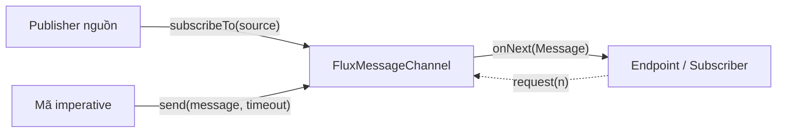

# FluxMessageChannel

## Mục tiêu và bối cảnh

Trong chương **Reactive support** của module **SPRING_INTEGRATION_CORE**, `FluxMessageChannel` là điểm nối giữa mô hình `Message`, `MessageChannel`, endpoint của Spring Integration và giao thức Reactive Streams. Khi nguồn phát sinh đơn hàng là một `Publisher`, ta cần đưa dữ liệu vào transformer, filter hoặc service activator mà vẫn quan sát được nhu cầu tiêu thụ ở phía sau.

Sau bài học, bạn có thể:

- Phân biệt việc gửi một `Message` vào kênh với việc đăng ký tiêu thụ một publisher.
- Khai báo `FluxMessageChannel` và sử dụng trong Java DSL.
- Giải thích giới hạn của backpressure tại ranh giới giữa mã imperative và reactive.
- Xử lý công việc blocking, lỗi từng phần tử và vòng đời subscription.
- Viết kiểm thử có giới hạn thời gian bằng `StepVerifier`.

Bạn nên biết cấu trúc `Message<T>`, header, cách nối endpoint bằng Java DSL và các khái niệm `Flux`, `Mono`, `Subscriber`. Ví dụ cấu hình dưới đây dùng Java 17 và API của Spring Integration 6.5; các chi tiết triển khai được nhắc riêng theo phiên bản, không phải cam kết về kích thước bộ đệm cho mọi bản phát hành.

## 1. Hai mặt của cùng một kênh

`FluxMessageChannel` vừa là `MessageChannel`, vừa là `Publisher<Message<?>>`. Nó còn triển khai `ReactiveStreamsSubscribableChannel` để nhận một publisher đầu vào và `Lifecycle` để quản lý việc đăng ký nguồn. Nó không triển khai `PollableChannel` hoặc `SubscribableChannel` theo nghĩa đăng ký một `MessageHandler` thông thường. [API FluxMessageChannel](https://docs.spring.io/spring-integration/api/org/springframework/integration/channel/FluxMessageChannel.html)

| Thao tác | Vai trò | Điểm cần nhớ |
| --- | --- | --- |
| `channel.send(message, timeout)` | Đưa một message từ mã imperative vào kênh | Kết quả gửi không phải kết quả nghiệp vụ |
| `Flux.from(channel)` | Tạo chuỗi operator trên publisher của kênh | Chưa tạo consumer cho đến khi có subscription |
| `channel.subscribe(subscriber)` | Đăng ký subscriber Reactive Streams ở phía nhận | Subscriber điều khiển demand bằng `request(n)` |
| `channel.subscribeTo(source)` | Nối publisher nguồn vào kênh | Dữ liệu nguồn phải là các `Message` |
| `start()`, `stop()`, `destroy()` | Điều khiển vòng đời | Để Spring quản lý khi kênh là bean |

Hai tên phương thức dễ gây nhầm:

- `subscribe(...)`: subscriber **nhận từ** kênh.
- `subscribeTo(...)`: kênh **nhận từ** publisher nguồn.

`Flux.from(channel)` không có nghĩa là chuyển payload sang `Flux`. Kiểu phần tử vẫn là `Message<?>`; muốn lấy payload, phải dùng `map(Message::getPayload)` hoặc phép chuyển đổi phù hợp.

### Message chứa Flux khác với Flux chứa Message

`Message<Flux<Order>>` là một message có payload dạng publisher. `Flux<Message<Order>>` là một publisher phát ra nhiều message. Hai cấu trúc này có đơn vị header, định danh và xử lý lỗi khác nhau.

Ví dụ, ba đơn hàng đi vào `subscribeTo` thường được biểu diễn bằng ba `Message<Order>`, mỗi message có header riêng. Không nên gom chúng thành một `Message<Flux<Order>>` chỉ để làm cho dữ liệu trông có vẻ reactive. Việc endpoint trả về payload reactive và framework làm phẳng kết quả là một cơ chế khác, được trình bày ở phần 7.

## 2. Dòng dữ liệu và dòng nhu cầu

`FluxMessageChannel` sử dụng nguồn hot nội bộ để tiếp nhận message được gửi vào; subscriber nhận dữ liệu thông qua publisher của kênh. Khi endpoint tiêu thụ kênh reactive, Spring Integration sử dụng `ReactiveStreamsConsumer` để nối cơ chế xử lý message với Reactive Streams. [Reactive Streams Support](https://docs.spring.io/spring-integration/reference/reactive-streams.html)



Demand cho biết subscriber sẵn sàng nhận thêm bao nhiêu phần tử. Nó không phải số thread, kích thước transaction hay xác nhận dữ liệu đã ghi xuống cơ sở dữ liệu.

Với nguồn imperative, `send` vẫn là lời gọi Java thông thường. Khi phía nhận không theo kịp, thời gian chờ và khả năng gửi phụ thuộc trạng thái kênh cùng timeout. Không được suy luận rằng mọi lời gọi `send` đều trả về ngay chỉ vì tên kênh có chữ `Flux`.

### Hot source, nhiều subscriber và giới hạn lưu trữ

Trong triển khai Spring Integration 6.5.0, kênh dùng sink dạng multicast, yêu cầu có subscriber khi gửi trực tiếp và có thể chờ khi chưa phát được message. Vì vậy, cần đăng ký phía nhận trước khi producer gọi `send`; không dùng kênh như nơi cất dữ liệu chờ consumer xuất hiện. Chi tiết này được đối chiếu từ [mã nguồn FluxMessageChannel 6.5.0](https://raw.githubusercontent.com/spring-projects/spring-integration/v6.5.0/spring-integration-core/src/main/java/org/springframework/integration/channel/FluxMessageChannel.java).

Khi nhiều subscriber cùng hoạt động, hãy thiết kế theo hướng phát dữ liệu cho các subscription hiện có. Đừng xem đây là mô hình nhiều worker cạnh tranh để mỗi đơn hàng chỉ được một worker xử lý. Subscriber đến muộn cũng không có quyền mặc định đọc lại toàn bộ lịch sử.

Nếu cần lưu bền vững, xác nhận nhận message hoặc phát lại sau sự cố tiến trình, phải thiết kế thêm broker hoặc cơ chế lưu trữ tương ứng. `FluxMessageChannel` tự nó không giải quyết các yêu cầu đó.

### So sánh để chọn kênh

| Kênh | Cách tiêu thụ chính | Phù hợp khi |
| --- | --- | --- |
| `DirectChannel` | Gọi trực tiếp một handler, thường trên thread gửi | Luồng đồng bộ đơn giản |
| `QueueChannel` | Consumer gọi `receive` hoặc endpoint dùng poller | Cần hàng đợi và cách tiêu thụ polling |
| `ExecutorChannel` | Giao tác vụ cho `TaskExecutor` | Cần tách việc thực thi bằng executor |
| `FluxMessageChannel` | Subscriber Reactive Streams yêu cầu phần tử | Cần nối message flow với publisher và operator reactive |

`DirectChannel` và `ExecutorChannel` có cơ chế phân phối point-to-point; `QueueChannel` có hợp đồng gửi/nhận của hàng đợi. Việc thay chúng bằng `FluxMessageChannel` cần xem lại cả cách tiêu thụ lẫn hành vi nhiều subscriber. [Message Channel Implementations](https://docs.spring.io/spring-integration/reference/channel/implementations.html)

## 3. Chuẩn bị ví dụ

Dự án thực hành cần các dependency sau:

| Dependency | Mục đích |
| --- | --- |
| `org.springframework.integration:spring-integration-core` | Channel, endpoint và Java DSL |
| `io.projectreactor:reactor-core` | `Flux`, `Mono` và scheduler |
| `io.projectreactor:reactor-test`, phạm vi test | `StepVerifier` |
| `org.junit.jupiter:junit-jupiter`, phạm vi test | Chạy kiểm thử JUnit 5 |

Sử dụng dependency management hoặc BOM phù hợp của dự án để đồng bộ phiên bản Spring và Reactor. Không trộn các phiên bản ngẫu nhiên chỉ để một đoạn mã biên dịch.

Ví dụ nghiệp vụ nhận mã đơn hàng dạng chuỗi:

1. Chuẩn hóa khoảng trắng và chữ hoa.
2. Loại mã rỗng.
3. Tạo yêu cầu đóng gói có tiền tố `PACK:`.
4. Giữ header nghiệp vụ `source` để truy vết nguồn đơn.

Luồng được thiết kế như sau:

```text
rawOrders
    -> transformer
    -> normalizedOrders
    -> filter
    -> acceptedOrders
    -> service activator
    -> packingRequests
```

Cả bốn kênh trong ví dụ đều là `FluxMessageChannel`. Việc đặt kênh reactive giữa các endpoint giữ các ranh giới tiêu thụ theo hợp đồng Reactive Streams; bản thân logic xử lý cũng phải tránh blocking nếu muốn luồng hoạt động không blocking.

## 4. Cấu hình Java DSL đầy đủ

Đặt cấu hình sau trong lớp `ReactiveOrderConfiguration` của dự án thực hành:

```java
import java.util.Locale;

import org.springframework.beans.factory.annotation.Qualifier;
import org.springframework.context.annotation.Bean;
import org.springframework.context.annotation.Configuration;
import org.springframework.integration.channel.FluxMessageChannel;
import org.springframework.integration.config.EnableIntegration;
import org.springframework.integration.dsl.IntegrationFlow;
import org.springframework.messaging.MessageChannel;

@Configuration(proxyBeanMethods = false)
@EnableIntegration
public class ReactiveOrderConfiguration {

    @Bean
    public FluxMessageChannel rawOrders() {
        return new FluxMessageChannel();
    }

    @Bean
    public FluxMessageChannel normalizedOrders() {
        return new FluxMessageChannel();
    }

    @Bean
    public FluxMessageChannel acceptedOrders() {
        return new FluxMessageChannel();
    }

    @Bean
    public FluxMessageChannel packingRequests() {
        return new FluxMessageChannel();
    }

    @Bean
    public IntegrationFlow packingFlow(
            @Qualifier("rawOrders") FluxMessageChannel raw,
            @Qualifier("normalizedOrders") FluxMessageChannel normalized,
            @Qualifier("acceptedOrders") FluxMessageChannel accepted,
            @Qualifier("packingRequests") FluxMessageChannel packing) {

        return IntegrationFlow.from((MessageChannel) raw)
                .<String, String>transform(
                        id -> id.strip().toUpperCase(Locale.ROOT))
                .channel(normalized)
                .<String>filter(
                        id -> !id.isEmpty(),
                        endpoint -> endpoint.discardChannel("nullChannel"))
                .channel(accepted)
                .handle(String.class, (id, headers) -> "PACK:" + id)
                .channel(packing)
                .get();
    }
}
```

Phép ép kiểu `(MessageChannel) raw` là có chủ đích. `FluxMessageChannel` đồng thời có hai vai trò trong khi `IntegrationFlow.from` có overload nhận channel và overload nhận publisher. Chỉ rõ kiểu giúp chọn điểm bắt đầu từ kênh, tránh mơ hồ khi gọi overload. Có thể dùng tên bean với `IntegrationFlow.from("rawOrders")` nếu muốn tham chiếu theo tên. [API IntegrationFlow 6.5.0](https://raw.githubusercontent.com/spring-projects/spring-integration/v6.5.0/spring-integration-core/src/main/java/org/springframework/integration/dsl/IntegrationFlow.java)

Các endpoint thực hiện ba việc riêng:

- Transformer đổi payload; các header nghiệp vụ được truyền sang message kết quả theo cơ chế của endpoint.
- Filter chỉ cho mã hợp lệ đi tiếp. `nullChannel` là lựa chọn loại bỏ có chủ đích trong bài thực hành.
- Service activator tạo payload kết quả; `packingRequests` là nơi consumer quan sát đầu ra.

Trong hệ thống thật, có thể thay `nullChannel` bằng kênh tiếp nhận đơn bị từ chối để ghi lý do và số liệu. Filter từ chối message khác với một lỗi kỹ thuật xảy ra khi xử lý message. [Filter và discard channel](https://docs.spring.io/spring-integration/reference/filter.html)

`packingRequests` chưa có consumer trong cấu hình trên. Phần kiểm thử sẽ đăng ký trước khi gửi đầu vào. Trong ứng dụng, một endpoint hoặc thành phần reactive ở đầu ra đảm nhiệm vai trò này.

## 5. Kiểm thử luồng bằng StepVerifier

Không cần polling `receive` vì `FluxMessageChannel` không có hợp đồng `PollableChannel`. Ta kiểm tra publisher đầu ra:

```java
import java.time.Duration;

import org.junit.jupiter.api.Test;
import org.springframework.context.annotation.AnnotationConfigApplicationContext;
import org.springframework.integration.channel.FluxMessageChannel;
import org.springframework.messaging.support.MessageBuilder;
import reactor.core.publisher.Flux;
import reactor.test.StepVerifier;

import static org.junit.jupiter.api.Assertions.assertEquals;
import static org.junit.jupiter.api.Assertions.assertTrue;

class ReactiveOrderFlowTest {

    @Test
    void normalizesFiltersAndPreservesBusinessHeader() {
        try (var context = new AnnotationConfigApplicationContext(
                ReactiveOrderConfiguration.class)) {

            var input = context.getBean(
                    "rawOrders", FluxMessageChannel.class);
            var output = context.getBean(
                    "packingRequests", FluxMessageChannel.class);

            StepVerifier.create(Flux.from(output))
                    .expectSubscription()
                    .then(() -> assertTrue(input.send(
                            MessageBuilder.withPayload("  a-001 ")
                                    .setHeader("source", "web")
                                    .build(),
                            1_000)))
                    .assertNext(message -> {
                        assertEquals("PACK:A-001", message.getPayload());
                        assertEquals(
                                "web", message.getHeaders().get("source"));
                    })
                    .then(() -> assertTrue(input.send(
                            MessageBuilder.withPayload("   ").build(),
                            1_000)))
                    .then(() -> assertTrue(input.send(
                            MessageBuilder.withPayload("b-002").build(),
                            1_000)))
                    .assertNext(message ->
                            assertEquals(
                                    "PACK:B-002", message.getPayload()))
                    .thenCancel()
                    .verify(Duration.ofSeconds(5));
        }
    }
}
```

`verify` thực hiện subscription; các hành động trong `then` diễn ra trong kịch bản sau bước đăng ký. Vì vậy, producer không gửi vào đầu ra chưa có subscriber.

Kiểm thử còn chứng minh mã rỗng không tạo `PACK:`: sau đầu vào rỗng và `b-002`, phần tử kế tiếp phải là `PACK:B-002`. Header `source` được kiểm tra như dữ liệu nghiệp vụ, không dựa vào việc message đầu ra có cùng `id` hoặc `timestamp` với đầu vào.

Kênh là nguồn dùng chung có vòng đời của ứng dụng nên kiểm thử kết thúc bằng `thenCancel`. Không dùng `verifyComplete` chỉ vì đã gửi xong một vài đơn hàng. `verify(Duration)` giới hạn thời gian chờ khi có sai sót trong cấu hình. [Testing với StepVerifier](https://projectreactor.io/docs/core/release/reference/testing.html)

## 6. Nối một publisher nguồn bằng subscribeTo

Nếu nguồn đã là `Flux`, không cần viết vòng lặp tự `subscribe` rồi `send` từng phần tử. Hãy để kênh quản lý subscription nguồn:

```java
import java.time.Duration;

import org.junit.jupiter.api.Test;
import org.springframework.integration.channel.FluxMessageChannel;
import org.springframework.messaging.Message;
import org.springframework.messaging.support.MessageBuilder;
import reactor.core.publisher.Flux;
import reactor.test.StepVerifier;

class PublisherBridgeTest {

    @Test
    void receivesMessagesFromPublisher() {
        var channel = new FluxMessageChannel();

        try {
            Flux<Message<?>> source = Flux.just("A-101", "A-102")
                    .map(id -> MessageBuilder.withPayload(id)
                            .setHeader("source", "batch")
                            .build());

            channel.subscribeTo(source);

            StepVerifier.create(
                            Flux.from(channel)
                                    .map(message ->
                                            (String) message.getPayload()))
                    .expectNext("A-101", "A-102")
                    .thenCancel()
                    .verify(Duration.ofSeconds(5));
        }
        finally {
            channel.destroy();
        }
    }
}
```

Trong cách nối này, framework chờ có phía nhận trước khi tiêu thụ publisher được gắn vào kênh. Tuy nhiên, việc hoàn tất một publisher nguồn không có nghĩa là đóng publisher đầu ra của kênh dùng chung. Kênh còn có thể nhận message từ nguồn khác hoặc từ `send`; bởi vậy ví dụ vẫn hủy subscription sau hai phần tử mong đợi. [Triển khai subscribeTo trong Spring Integration 6.5.0](https://raw.githubusercontent.com/spring-projects/spring-integration/v6.5.0/spring-integration-core/src/main/java/org/springframework/integration/channel/FluxMessageChannel.java)

Trong Java DSL, `IntegrationFlow.from(publisher)` là lựa chọn để bắt đầu flow từ publisher. Với flow cần được tiêu thụ như một publisher ở đầu ra, có thể tìm hiểu thêm `toReactivePublisher`. Đây là các cách nối do framework quản lý, thay cho việc rải các lời gọi `subscribe()` trong từng service. [Java DSL và Reactive Streams](https://docs.spring.io/spring-integration/reference/reactive-streams.html#reactive-java-dsl)

### Backpressure cần được đánh giá trên cả luồng

Một subscriber có thể yêu cầu một phần tử, nhưng operator phía trước vẫn có prefetch hoặc bộ đệm nội bộ. Vì vậy, `request(1)` không đồng nghĩa toàn hệ thống chỉ giữ đúng một message trong bộ nhớ.

Với lời gọi `send(message, timeout)`:

- `true` cho biết message được chấp nhận theo hợp đồng gửi của kênh.
- `false` cần được xử lý bằng chính sách rõ ràng, chẳng hạn báo quá tải cho caller hoặc lưu vào nơi tiếp nhận phù hợp.
- Exception do không có subscriber hoặc kênh không hoạt động cần được phân biệt với lỗi nghiệp vụ của đơn hàng.

Giới hạn concurrency cũng phải được đặt tại thao tác bất đồng bộ tốn tài nguyên. Ví dụ, `flatMap(callRemote, 8)` giới hạn số publisher con hoạt động đồng thời trong operator đó; nó không giới hạn toàn bộ hệ thống còn tám message. Nếu cần giữ thứ tự xử lý từng phần tử, cân nhắc `concatMap`. [API Flux: flatMap và concatMap](https://docs.spring.io/projectreactor/reactor-core/docs/current/api/reactor/core/publisher/Flux.html)

## 7. Thread, công việc blocking và payload reactive

`FluxMessageChannel` không tự tạo thread riêng cho từng message. Các operator có thể tiếp tục trên thread đang phát tín hiệu; việc chuyển nơi thực thi phụ thuộc scheduler và thành phần tham gia. `publishOn` tác động đến các operator phía sau, còn `subscribeOn` điều khiển ngữ cảnh đăng ký nguồn. [Threading and Schedulers](https://projectreactor.io/docs/core/release/reference/coreFeatures/schedulers.html)

Vì vậy, đoạn xử lý này vẫn làm chặn thread thực thi nó:

```java
.handle(String.class, (id, headers) -> legacyClient.reserve(id))
```

Giả sử `legacyClient.reserve` gọi một API đồng bộ và phải chờ mạng. Đổi channel thành `FluxMessageChannel` không làm lời gọi đó trở thành I/O không blocking.

Một cách cô lập client cũ là trả về `Mono` có trì hoãn thực thi:

```java
import java.util.function.Function;

import reactor.core.publisher.Mono;
import reactor.core.scheduler.Schedulers;

public final class LegacyReservationService {

    private final Function<String, String> blockingReservation;

    public LegacyReservationService(
            Function<String, String> blockingReservation) {
        this.blockingReservation = blockingReservation;
    }

    public Mono<String> reserve(String orderId) {
        return Mono.fromCallable(
                        () -> blockingReservation.apply(orderId))
                .subscribeOn(Schedulers.boundedElastic());
    }
}
```

`fromCallable` trì hoãn lời gọi đến lúc subscription. `boundedElastic` bố trí công việc chờ trên nguồn thread có giới hạn. Đây là cách bao bọc một API blocking; tài nguyên của API cũ vẫn cần timeout và giới hạn tải phù hợp. [Reactor FAQ: wrapping a blocking call](https://projectreactor.io/docs/core/release/reference/faq.html#faq.wrap-blocking)

Khi dùng service đó trong flow, phần nối có thể là:

```java
.handle(reservationService, "reserve")
.channel(reservationResults)
```

Trong đoạn minh họa, `reservationService` là instance `LegacyReservationService` đã được đăng ký bean và `reservationResults` là một `FluxMessageChannel` có consumer. Với output channel reactive, endpoint tạo reply có thể nối publisher kết quả để framework tiêu thụ theo nhu cầu; không cần gọi `block()` để lấy chuỗi bên trong service. [Asynchronous Service Activator](https://docs.spring.io/spring-integration/reference/service-activator.html#async-service-activator)

Tránh gọi `subscribe()` rồi trả `null` trong `reserve`: cách đó tách công việc khỏi reply của endpoint, khiến flow khó biết lúc nào thao tác hoàn thành và nhận lỗi bằng đường nào.

## 8. Phân biệt các đường lỗi

| Nơi phát sinh | Ý nghĩa | Cách quan sát |
| --- | --- | --- |
| Lời gọi `send` | Không giao được vào channel hoặc trạng thái không phù hợp | Kiểm tra giá trị trả về và exception tại chỗ gửi |
| Handler do Spring Integration quản lý | Lỗi xử lý một message | Xem endpoint, `ErrorHandler` và cơ chế phát `ErrorMessage` tương ứng |
| Operator trong chuỗi Reactor tự tạo | Tín hiệu `onError` của subscription đó | Dùng operator xử lý lỗi và consumer lỗi tại ranh giới subscription |

Trong cơ chế phát `ErrorMessage` của Spring Integration, header `errorChannel` và kênh lỗi mặc định tham gia định tuyến theo ngữ cảnh thực thi. Không được giả định mọi exception trong mọi chuỗi Reactor tự viết đều tự động đi vào global `errorChannel`. [Error Handling trong Spring Integration](https://docs.spring.io/spring-integration/reference/error-handling.html)

`ReactiveStreamsConsumer` có cơ chế phối hợp handler và xử lý lỗi riêng. Do đó, một lỗi nghiệp vụ trong handler được framework quản lý không thể được suy luận giống hệt lỗi trong một `Flux.map` tự viết. Cần kiểm thử đúng endpoint và cấu hình lỗi thực tế. [ReactiveStreamsConsumer 6.5.0](https://raw.githubusercontent.com/spring-projects/spring-integration/v6.5.0/spring-integration-core/src/main/java/org/springframework/integration/endpoint/ReactiveStreamsConsumer.java)

### Phục hồi từng phần tử

Trong Reactor, `onError` kết thúc chuỗi đang lỗi. `onErrorResume` thay phần đã kết thúc bằng một publisher khác. Nếu chỉ muốn một đơn hàng không hợp lệ trở thành kết quả bị từ chối và vẫn xử lý đơn kế tiếp, đặt phục hồi bên trong publisher của từng đơn:

```java
import java.util.function.Function;

import reactor.core.publisher.Flux;
import reactor.core.publisher.Mono;

public final class ReservationPipeline {

    public record Result(
            String orderId, boolean accepted, String reason) {
    }

    public static Flux<Result> reserveEach(
            Flux<String> orderIds,
            Function<String, Mono<Void>> reserve) {

        return orderIds.concatMap(id ->
                Mono.defer(() -> reserve.apply(id))
                        .thenReturn(new Result(id, true, "OK"))
                        .onErrorResume(
                                IllegalArgumentException.class,
                                error -> Mono.just(new Result(
                                        id, false, error.getMessage()))));
    }
}
```

Ở ví dụ này, quy ước riêng là `IllegalArgumentException` biểu thị đầu vào bị từ chối. Các lỗi khác vẫn phát ra ngoài để thành phần sở hữu subscription quyết định chính sách. `Mono.defer` bao cả trường hợp hàm `reserve.apply` ném lỗi ngay khi được gọi.

Đặt `onErrorResume` sau toàn bộ `concatMap` có ý nghĩa khác: khi một đơn làm chuỗi nguồn kết thúc, publisher fallback thay thế chuỗi đó, không tự khôi phục việc đọc các đơn còn lại. `doOnError` chỉ quan sát lỗi, không phục hồi. `retry` tạo đăng ký lại nên cần đánh giá nguy cơ thực hiện lại thao tác đã có tác dụng phụ. [Handling Errors trong Reactor](https://projectreactor.io/docs/core/release/reference/coreFeatures/error-handling.html)

Nếu cần gửi lỗi sang một flow khác, hãy thiết kế nơi chuyển exception thành `ErrorMessage` hoặc kết quả nghiệp vụ rõ ràng, kèm định danh đơn hàng. Đừng chỉ ghi log rồi coi đơn hàng là thành công.

## 9. Vòng đời và quyền sở hữu subscription

Khi channel và flow là bean, Spring quản lý endpoint cùng vòng đời liên quan. Với đối tượng tạo bằng `new` như bài kiểm thử `PublisherBridgeTest`, mã tạo nó phải chủ động giải phóng.

Cần phân biệt ba tình huống:

- **Subscriber hủy:** consumer đó không nhận thêm dữ liệu; không có nghĩa đã xác nhận nghiệp vụ cho mọi message từng nhận.
- **Nguồn hữu hạn hoàn tất:** nguồn ấy không phát thêm; không nên coi publisher channel dùng chung cũng đã hoàn tất.
- **Ứng dụng dừng:** cần dừng producer, xử lý hoặc kết thúc phần việc đang thực hiện theo chính sách, rồi giải phóng tài nguyên.

`Lifecycle` của `FluxMessageChannel` quản lý subscription tới các publisher được gắn bằng `subscribeTo`, kể cả hành vi khi restart. Việc restart có thể đăng ký lại một nguồn còn được giữ; phải xét xem nguồn là cold, hot hay có thể phát lại tác dụng phụ. [Lifecycle trong API FluxMessageChannel](https://docs.spring.io/spring-integration/api/org/springframework/integration/channel/FluxMessageChannel.html)

Một lời gọi `send` hoặc một lần `request` không tự thiết lập transaction nghiệp vụ kéo dài qua các scheduler. Nếu đơn hàng có yêu cầu chống trùng, dùng khóa idempotency hoặc cơ chế lưu trạng thái phù hợp với nghiệp vụ.

## 10. Chẩn đoán các lỗi thường gặp

| Hiện tượng | Điểm cần kiểm tra trước |
| --- | --- |
| Không nhận được message dù đã tạo `Flux.from(channel)` | Có subscriber thực sự chưa; chỉ lắp operator chưa khởi động tiêu thụ |
| Gửi báo không có subscriber | Consumer đã đăng ký và endpoint đã chạy trước producer chưa |
| Không gọi được `receive()` | Đang áp dụng hợp đồng của `QueueChannel` cho channel reactive |
| Kiểm thử chờ mãi ở bước hoàn tất | Đang chờ complete trên channel dùng chung; dùng hủy hoặc giới hạn số phần tử |
| Có `Flux` nhưng thread vẫn bị chặn | Client đồng bộ, `block` hoặc lời gọi chờ nằm ở đâu |
| Một subscriber quan sát làm xuất hiện tác dụng phụ hai lần | Có nhiều subscription cùng xử lý trên channel multicast không |
| Một đơn lỗi làm chuỗi tự viết không nhận đơn sau | Phạm vi `onErrorResume` có nằm ngoài toàn bộ chuỗi không |
| `send` trả `true` nhưng tác vụ từ xa chưa xong | Đã nhầm việc giao message với kết quả nghiệp vụ |
| Bộ nhớ tăng khi tải cao | Prefetch, buffer, concurrency và tốc độ nguồn có được khống chế không |

Để quan sát hệ thống, nên theo dõi số message vào, số kết quả thành công, số bị từ chối, thời gian xử lý và số thao tác từ xa đang thực hiện. Các con số này trả lời những câu hỏi khác nhau; chỉ đếm số lần gửi thành công không đủ đánh giá luồng nghiệp vụ.

## 11. Thực hành mở rộng

1. Thay `nullChannel` của filter bằng một kênh tiếp nhận đơn bị loại. Kiểm tra rằng mã rỗng đi vào nhánh đó và không sinh yêu cầu đóng gói.
2. Viết kiểm thử cho `ReservationPipeline.reserveEach` với ba mã đơn, trong đó mã ở giữa trả `Mono.error(new IllegalArgumentException(...))`. Kỳ vọng ba kết quả lần lượt là chấp nhận, từ chối, chấp nhận.
3. Cho một nguồn `Flux<Message<?>>` hữu hạn đi qua flow chuẩn hóa. Đăng ký đầu ra trước khi kích hoạt nguồn và dùng timeout để tránh kiểm thử treo.
4. Thử thêm một subscriber chỉ phục vụ quan sát vào kênh đầu ra. Ghi nhận sự khác nhau giữa quan sát cùng một sự kiện và triển khai các worker chia nhau sự kiện.

Khi thực hành, hãy xác định rõ bên sở hữu subscription, nơi kết thúc flow, vị trí chờ I/O và cách một lỗi trở thành kết quả có thể quan sát. Những quyết định này giúp dùng `FluxMessageChannel` đúng vai trò trong luồng Spring Integration.