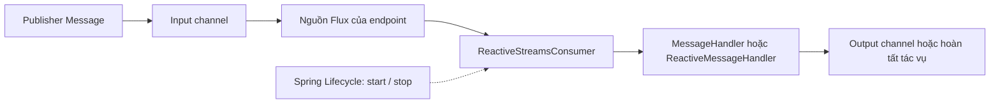

# ReactiveStreamsConsumer

## 1. Mục tiêu và phạm vi

Trong chương **Reactive support** của **SPRING_INTEGRATION_CORE**, `ReactiveStreamsConsumer` là endpoint nối mô hình thông điệp của Spring Integration với cơ chế subscription của Reactive Streams. Nó giúp một handler tiêu thụ `Message<?>` qua một nguồn reactive mà vẫn sử dụng các thành phần quen thuộc như channel, transformer, service activator và Java DSL.

Sau bài học, bạn có thể:

- Phân biệt channel truyền thông điệp, handler xử lý nghiệp vụ và consumer quản lý việc tiêu thụ.
- Nhận biết khi nào Spring Integration tạo `ReactiveStreamsConsumer`.
- Cấu hình endpoint bằng `FluxMessageChannel`, `.reactive()` và `@Reactive`.
- Kết hợp `ReactiveMessageHandler` với vòng đời xử lý bất đồng bộ.
- Xác định giới hạn backpressure, chọn nơi chuyển scheduler và quan sát lỗi.
- Viết kiểm thử xác nhận loại endpoint, kết quả nghiệp vụ và thông điệp lỗi.

Ví dụ sử dụng Java 17, Spring Integration 6.3.x và Reactor đi cùng bộ dependency tương thích. `reactive()` và `@Reactive` có từ Spring Integration 5.5; `handleReactive(...)` trong phần mở rộng yêu cầu Spring Integration 6.1 trở lên. Đây là mốc API để đọc ví dụ, không phải yêu cầu nâng hoặc hạ phiên bản dự án.

Bạn nên biết `Message` gồm payload và headers, sự khác nhau giữa `DirectChannel` và `QueueChannel`, cách khai báo `IntegrationFlow`, cùng ý nghĩa cơ bản của `Mono` và `Flux`.

## 2. Bài toán: handler phải tham gia vào subscription như thế nào?

Giả sử một dịch vụ nhận sự kiện đơn hàng từ một nguồn trả về `Flux<Order>`. Sau đó hệ thống chuẩn hóa mã khách hàng và gửi kết quả đến bước lưu trữ.

Trong luồng imperative, bên gửi thường gọi `channel.send(message)`, rồi handler được gọi theo đặc tính của channel. Trong một chuỗi Reactive Streams, subscriber phải đăng ký với publisher; dữ liệu được phát theo demand thông qua `Subscription.request(n)`.

Đưa một handler thông thường vào giữa hai mô hình đó cần một endpoint quản lý phần kết nối. `ReactiveStreamsConsumer` đảm nhiệm vai trò này. Nó thuộc package:

```java
org.springframework.integration.endpoint.ReactiveStreamsConsumer
```

Ba vai trò cần tách rõ:

| Thành phần | Trách nhiệm | Ví dụ |
| --- | --- | --- |
| Message channel | Chuyển hoặc cung cấp thông điệp cho bước tiếp theo | `FluxMessageChannel` |
| Message handler | Thực hiện biến đổi hoặc tác vụ nghiệp vụ | `MessageTransformingHandler`, `ReactiveMessageHandler` |
| Consumer endpoint | Gắn nguồn đầu vào với handler và quản lý subscription | `ReactiveStreamsConsumer` |

Một endpoint reactive vẫn có thể bọc một transformer đồng bộ. Ngược lại, một phương thức trả về `Mono` cũng chưa đủ để kết luận toàn bộ integration flow có backpressure từ đầu đến cuối. Cần xem cả nguồn, channel, handler và ranh giới đầu ra.

Theo [API của ReactiveStreamsConsumer](https://docs.spring.io/spring-integration/docs/current/api/org/springframework/integration/endpoint/ReactiveStreamsConsumer.html), lớp này là một `AbstractEndpoint` dành cho subscription vào input channel và tiêu thụ thông điệp theo mô hình reactive.

## 3. Mô hình hoạt động và vòng đời



Sơ đồ mô tả đường đi của dữ liệu. Demand được truyền theo chiều ngược lại trên các đoạn có hợp đồng Reactive Streams.

Có thể hình dung vòng đời như sau:

1. Spring tạo endpoint, gắn input channel và handler.
2. Khi endpoint khởi động, nó xây dựng hoặc sử dụng nguồn `Flux` từ channel.
3. Nếu có reactive customizer, endpoint áp dụng customizer lên nguồn này.
4. Endpoint tạo subscription để chuyển thông điệp đến handler.
5. Khi endpoint dừng, subscription do nó quản lý được hủy.

Trong ứng dụng Spring, nên để container quản lý vòng đời. Khai báo `IntegrationFlow` hoặc messaging annotation thường đủ; không cần tự tạo endpoint rồi gọi `start()` trong mã nghiệp vụ.

Một số constructor nhận `MessageHandler`, `Subscriber<Message<?>>` hoặc `ReactiveMessageHandler`. Chúng phục vụ các cách tích hợp khác nhau. Việc tự khởi tạo lớp cần xử lý cả khởi tạo bean, error handler và lifecycle, nên không phải lựa chọn đầu tiên cho cấu hình thông thường.

**Dừng endpoint không đồng nghĩa hoàn tác nghiệp vụ.** Nếu một yêu cầu ghi dữ liệu đã được hệ thống ngoài chấp nhận, cancellation không tự đảo ngược bản ghi. Với thao tác có tác dụng phụ, hãy xác định riêng chính sách idempotency và khôi phục.

Có thể đối chiếu cơ chế start, stop và adaptation trong [mã nguồn ReactiveStreamsConsumer 6.3.0](https://raw.githubusercontent.com/spring-projects/spring-integration/v6.3.0/spring-integration-core/src/main/java/org/springframework/integration/endpoint/ReactiveStreamsConsumer.java).

## 4. Phân biệt các kiểu consumer

| Consumer | Đầu vào điển hình | Cách kích hoạt | Lưu ý |
| --- | --- | --- | --- |
| `EventDrivenConsumer` | `SubscribableChannel` như `DirectChannel` | Channel dispatch tới handler đã đăng ký | Có thể đồng bộ hoặc bất đồng bộ tùy channel |
| `PollingConsumer` | `PollableChannel` như `QueueChannel` | Poller định kỳ gọi nhận thông điệp | Cần cấu hình poller phù hợp |
| `ReactiveStreamsConsumer` | Channel dạng publisher hoặc channel được thích nghi thành nguồn reactive | Subscription trên nguồn `Flux` | Demand và buffering vẫn phụ thuộc từng đoạn |

Không nên dùng bảng này để suy ra rằng `DirectChannel` chỉ có thể đi với `EventDrivenConsumer`. Khi cấu hình `reactive()`, Spring có thể dùng `ReactiveStreamsConsumer` cho endpoint lấy dữ liệu từ `DirectChannel`.

Theo [IntegrationReactiveUtils 6.3.0](https://raw.githubusercontent.com/spring-projects/spring-integration/v6.3.0/spring-integration-core/src/main/java/org/springframework/integration/util/IntegrationReactiveUtils.java), việc chuyển channel thành `Flux` có các hướng chính:

- Channel đã là `Publisher`: tận dụng publisher đó.
- `SubscribableChannel`: gắn một cầu nối từ cơ chế dispatch sang nguồn reactive.
- `PollableChannel`: thích nghi thao tác nhận thành nguồn reactive.

Sự thích nghi này không thay đổi hợp đồng của producer bên ngoài. Ví dụ, chữ ký `boolean send(Message<?>)` vẫn không có tham số demand; một vòng lặp gọi `send()` không tự trở thành nguồn có khả năng chờ `request(n)`.

## 5. Ba cách đưa ReactiveStreamsConsumer vào luồng

### 5.1. Đặt FluxMessageChannel trước endpoint

`FluxMessageChannel` kết hợp vai trò message channel với publisher của thông điệp. Khi endpoint tiêu thụ từ channel này, framework chọn cơ chế consumer reactive thích hợp.

```java
@Bean
public FluxMessageChannel reactiveInput() {
    return new FluxMessageChannel();
}

@Bean
public IntegrationFlow uppercaseFlow() {
    return IntegrationFlow.from(reactiveInput())
            .transform(String.class, String::toUpperCase,
                    endpoint -> endpoint.id("uppercaseEndpoint"))
            .channel("uppercaseResults")
            .get();
}
```

Đoạn mã đặt trong một lớp `@Configuration` có `@EnableIntegration`. Khi ghép vào ứng dụng, cần cung cấp nơi tiêu thụ `uppercaseResults`. Ví dụ đầy đủ ở phần 6 sẽ khai báo rõ toàn bộ channel.

Channel reactive trước transformer làm thay đổi cách transformer được tiêu thụ. Nó không làm phép `String::toUpperCase` chạy trên thread khác, cũng không làm output channel tự trở thành reactive.

### 5.2. Chọn reactive cho một endpoint bằng Java DSL

Khi cần giữ input channel hiện có, cấu hình `reactive()` tại endpoint:

```java
@Bean
public DirectChannel rawCodes() {
    return new DirectChannel();
}

@Bean
public IntegrationFlow selectedReactiveEndpointFlow() {
    return IntegrationFlow.from(rawCodes())
            .transform(String.class, String::trim,
                    endpoint -> endpoint
                            .id("trimCodeEndpoint")
                            .reactive())
            .channel("trimmedCodes")
            .get();
}
```

Đây cũng là đoạn cấu hình ghép vào ứng dụng; `trimmedCodes` cần có consumer phù hợp.

`.reactive()` áp dụng cho endpoint của bước `transform` này. Nó không phải công tắc toàn cục cho mọi bước phía sau. Nếu DSL tạo channel trung gian theo mặc định, cần kiểm tra channel thực tế trước khi kết luận về tính reactive của cả luồng.

Có thể tùy biến nguồn vào bằng hàm:

```java
endpoint -> endpoint.reactive(
        flux -> flux.publishOn(Schedulers.parallel(), 16))
```

`16` là giá trị prefetch của `publishOn` trong ví dụ. Nó không phải giới hạn số đơn hàng đang xử lý trên toàn hệ thống. Customizer tác động vào nguồn trước handler; không phải lớp bao tự động mọi publisher do nghiệp vụ tạo ra.

Hợp đồng của customizer được mô tả trong [Java DSL: reactive() endpoint](https://docs.spring.io/spring-integration/reference/6.3/dsl/java-reactive.html).

### 5.3. Sử dụng annotation @Reactive

Với cách khai báo endpoint bằng annotation, tham chiếu một customizer bean:

```java
@Bean
public Function<Flux<Message<?>>, Publisher<Message<?>>> cpuBoundary() {
    return flux -> flux.publishOn(Schedulers.parallel(), 16);
}

@ServiceActivator(
        inputChannel = "rawCodes",
        outputChannel = "trimmedCodes",
        reactive = @Reactive("cpuBoundary"))
public String trimCode(String value) {
    return value.trim();
}
```

Các import liên quan:

```java
import java.util.function.Function;
import org.reactivestreams.Publisher;
import org.springframework.integration.annotation.Reactive;
import org.springframework.integration.annotation.ServiceActivator;
import org.springframework.messaging.Message;
import reactor.core.publisher.Flux;
import reactor.core.scheduler.Schedulers;
```

Đặt phương thức trong bean do Spring quản lý, bật `@EnableIntegration` và khai báo các channel được tham chiếu. Ví dụ này là phương án thay thế cho cấu hình DSL, vì vậy không đăng ký cả hai endpoint cùng tiêu thụ một `DirectChannel` nếu chỉ muốn một lần xử lý.

Khi không cần customizer, có thể dùng `reactive = @Reactive`. Thuộc tính `reactive` và `poller` trên cùng messaging annotation loại trừ nhau; không gắn `@Poller` để “hỗ trợ thêm” cho endpoint đã chọn reactive. Xem [Annotation Support: Using @Reactive](https://docs.spring.io/spring-integration/reference/6.3/configuration/annotations.html#reactive-annotation-support).

## 6. Ví dụ đầy đủ: chuẩn hóa mã khách hàng của đơn hàng

### 6.1. Hành vi cần đạt

Mỗi `Message<Order>` chứa mã đơn hàng và mã khách hàng:

- `" acme "` được chuẩn hóa thành `"ACME"`.
- Mã khách hàng rỗng bị từ chối bằng lỗi nghiệp vụ.
- Kết quả hợp lệ đi đến `normalizedOrders`.
- Lỗi xử lý đi đến `orderErrors` khi message có header `errorChannel` tương ứng.

Ví dụ dùng `QueueChannel` ở đầu ra để dễ quan sát trong demo và kiểm thử. Đây là ranh giới chuyển về mô hình imperative; không dùng ví dụ này để khẳng định toàn bộ đường đi có backpressure.

Các dependency cần có trong dự án thực hành:

| Phạm vi | Dependency |
| --- | --- |
| Chính | `org.springframework.integration:spring-integration-core` |
| Chính | `io.projectreactor:reactor-core` |
| Kiểm thử | `org.junit.jupiter:junit-jupiter` |
| Kiểm thử phần Reactor | `io.projectreactor:reactor-test` |

Chọn phiên bản đồng bộ bằng dependency management/BOM của dự án. Với Spring Boot, có thể dùng `spring-boot-starter-integration` và quản lý dependency theo phiên bản Boot tương thích. Không trộn tùy ý các phiên bản Spring Framework, Spring Integration và Reactor.

### 6.2. Cấu hình luồng

```java
package example.integration.reactive;

import java.util.Locale;

import org.springframework.context.annotation.Bean;
import org.springframework.context.annotation.Configuration;
import org.springframework.integration.channel.FluxMessageChannel;
import org.springframework.integration.channel.QueueChannel;
import org.springframework.integration.config.EnableIntegration;
import org.springframework.integration.dsl.IntegrationFlow;

@Configuration
@EnableIntegration
public class ReactiveOrderConfig {

    public record Order(String orderId, String customerCode) {
    }

    public record NormalizedOrder(String orderId, String customerCode) {
    }

    @Bean
    public FluxMessageChannel orderInput() {
        return new FluxMessageChannel();
    }

    @Bean
    public QueueChannel normalizedOrders() {
        return new QueueChannel(16);
    }

    @Bean
    public QueueChannel orderErrors() {
        return new QueueChannel(16);
    }

    @Bean
    public IntegrationFlow normalizeOrderFlow() {
        return IntegrationFlow.from(orderInput())
                .transform(Order.class, order -> {
                    if (order.customerCode() == null
                            || order.customerCode().isBlank()) {
                        throw new IllegalArgumentException(
                                "customerCode khong duoc rong");
                    }

                    return new NormalizedOrder(
                            order.orderId(),
                            order.customerCode().trim()
                                    .toUpperCase(Locale.ROOT));
                }, endpoint -> endpoint.id("normalizeOrderEndpoint"))
                .channel(normalizedOrders())
                .get();
    }
}
```

Đầu vào của transformer là `orderInput`, một `FluxMessageChannel`, nên endpoint `normalizeOrderEndpoint` được tạo dưới dạng `ReactiveStreamsConsumer`. Không cần bổ sung `.reactive()` chỉ để chọn lại loại endpoint đó.

`Locale.ROOT` giúp phép chuẩn hóa mã có kết quả ổn định theo quy tắc không phụ thuộc locale mặc định của máy. Trong miền nghiệp vụ có quy tắc ký tự khác, cần thay quy tắc này bằng chính sách đã thống nhất.

Transformer tạo payload mới và framework xây dựng reply message; các header nghiệp vụ thông thường được truyền tiếp nếu không có cấu hình thay đổi chúng. Không nên dựa vào việc `id` hoặc `timestamp` của message đầu ra bằng message đầu vào.

Hai queue có capacity `16` để demo có giới hạn rõ ràng. Khi queue đầy, thao tác gửi có thể phải chờ theo chính sách timeout; queue có giới hạn vẫn cần consumer và cơ chế xử lý quá tải. `receive(timeout)` ở ví dụ dưới là thời gian chờ nhận, không phải timeout gửi của transformer.

### 6.3. Đưa Publisher vào channel mà không tự subscribe

```java
package example.integration.reactive;

import org.springframework.context.annotation.AnnotationConfigApplicationContext;
import org.springframework.integration.channel.FluxMessageChannel;
import org.springframework.integration.channel.QueueChannel;
import org.springframework.messaging.Message;
import org.springframework.messaging.MessageHeaders;
import org.springframework.messaging.support.MessageBuilder;

import reactor.core.publisher.Flux;

public class ReactiveOrderDemo {

    public static void main(String[] args) {
        try (var context =
                     new AnnotationConfigApplicationContext(
                             ReactiveOrderConfig.class)) {

            var input = context.getBean(
                    "orderInput", FluxMessageChannel.class);
            var output = context.getBean(
                    "normalizedOrders", QueueChannel.class);

            Flux<Message<ReactiveOrderConfig.Order>> source = Flux.just(
                    new ReactiveOrderConfig.Order("O-001", " acme "),
                    new ReactiveOrderConfig.Order("O-002", " beta "))
                    .map(order -> MessageBuilder.withPayload(order)
                            .setHeader(
                                    MessageHeaders.ERROR_CHANNEL,
                                    "orderErrors")
                            .build());

            input.subscribeTo(source);

            for (int i = 0; i < 2; i++) {
                Message<?> result = output.receive(1_000);
                if (result == null) {
                    throw new IllegalStateException(
                            "Khong nhan du ket qua trong thoi gian cho");
                }
                System.out.println(result.getPayload());
            }
        }
    }
}
```

Kết quả mong đợi:

```text
NormalizedOrder[orderId=O-001, customerCode=ACME]
NormalizedOrder[orderId=O-002, customerCode=BETA]
```

`input.subscribeTo(source)` giao publisher cho channel để framework quản lý việc nối subscription. Không gọi thêm `source.subscribe(...)` cho cùng công việc. Với cold publisher, subscription thứ hai có thể thực hiện lại việc đọc dữ liệu hoặc gọi dịch vụ ngoài.

`Flux<Message<Order>>` biểu diễn nhiều message. Nó khác `Message<Flux<Order>>`, tức một message có payload là một publisher. Nếu nguồn nghiệp vụ trả về `Flux<Order>`, bước `map` trong ví dụ chính là nơi tạo message và thêm header.

Vòng `receive` được đặt trong chương trình demo chạy trên main thread. Không sao chép cách chờ blocking này vào callback của WebFlux hay thread xử lý reactive.

## 7. ReactiveMessageHandler: biểu diễn thời điểm tác vụ hoàn tất

Một handler đồng bộ có hợp đồng khái quát:

```java
void handleMessage(Message<?> message);
```

`ReactiveMessageHandler` có hợp đồng:

```java
Mono<Void> handleMessage(Message<?> message);
```

`Mono<Void>` biểu diễn hoàn tất hoặc lỗi của tác vụ. Không có payload trả về để chuyển tiếp như reply của transformer.

Giả sử tầng lưu trữ cung cấp abstraction riêng của ứng dụng:

```java
public interface OrderArchive {
    Mono<Void> store(ReactiveOrderConfig.NormalizedOrder order);
}
```

Trong một lớp cấu hình khác có `@EnableIntegration`, có thể khai báo:

```java
@Bean
public IntegrationFlow archiveFlow(OrderArchive archive) {
    return IntegrationFlow.from("archiveInput")
            .handleReactive(
                    message -> Mono.defer(() -> archive.store(
                                    (ReactiveOrderConfig.NormalizedOrder)
                                            message.getPayload()))
                            .onErrorMap(error ->
                                    new MessageHandlingException(
                                            message,
                                            "Luu don hang that bai",
                                            error)),
                    endpoint -> endpoint
                            .id("archiveEndpoint")
                            .reactive());
}
```

Các import bổ sung là `org.springframework.messaging.MessageHandlingException` và `reactor.core.publisher.Mono`. Ứng dụng phải cung cấp bean `OrderArchive` thực tế; interface này không phải lớp có sẵn của Spring Integration.

Có ba chi tiết:

1. `Mono.defer` trì hoãn lời gọi tới `archive.store` cho đến subscription, đồng thời đưa lỗi ném ngay lúc gọi phương thức vào chuỗi reactive.
2. `MessageHandlingException` giữ lại message liên quan, giúp error handler truy ra đơn hàng thất bại.
3. `handleReactive(...)` là bước kết thúc luồng, trả về `IntegrationFlow`; không nối `.get()` sau nó.

Spring Integration nối publisher hoàn tất của reactive handler vào quá trình tiêu thụ. Không tự gọi `subscribe()` trong lambda rồi trả về `Mono.empty()`: cách đó làm endpoint nhìn thấy “đã xong” trước khi thao tác lưu thật sự hoàn tất.

Việc dùng reactive handler có thể dẫn đến xử lý nhiều tác vụ đồng thời tùy cơ chế composition. Nếu thứ tự hoàn tất của từng đơn hàng là yêu cầu nghiệp vụ, hãy thiết kế và kiểm thử thứ tự một cách tường minh.

Cơ chế này và terminal operator được trình bày trong [Reactive Streams Support: ReactiveMessageHandler](https://docs.spring.io/spring-integration/reference/6.3/reactive-streams.html#reactive-message-handler).

## 8. Backpressure: xác định đúng phạm vi tác dụng

Backpressure cho phép subscriber báo nhu cầu với publisher. Nó không phải khả năng làm biến mất thông điệp đã được đưa vào một queue hoặc làm một thiết bị bên ngoài ngừng phát dữ liệu nếu thiết bị đó không hỗ trợ điều tiết.

Đối với ví dụ đơn hàng, cần phân biệt:

| Đoạn | Khả năng cần xem xét |
| --- | --- |
| `Flux` nguồn tới `FluxMessageChannel` | Publisher có tuân thủ request và cancellation không? |
| Channel tới reactive endpoint | Subscriber và operator yêu cầu bao nhiêu phần tử? |
| Handler nghiệp vụ | Tác vụ có hoàn tất qua publisher được composition không? |
| Đầu ra `QueueChannel` | Capacity, send timeout và tốc độ consumer |
| Hệ thống ngoài | Có điều tiết tốc độ, retry hoặc xác nhận riêng không? |

Không có quy tắc rằng một `ReactiveStreamsConsumer` chỉ xử lý `request(1)` tại mọi thời điểm. Demand thực tế phụ thuộc subscriber, prefetch và các operator. Một handler thích nghi theo cách thông thường còn có thể yêu cầu demand không giới hạn.

Giả sử nguồn đưa vào **2.000 message/giây**, còn dịch vụ ngoài chỉ hoàn tất **200 message/giây**. Chênh lệch là **1.800 message/giây**. Nếu một ranh giới chỉ tiếp tục buffer, sau mười giây có thể tích thêm khoảng **18.000 message** trước khi xét biến động tải và lỗi. Đổi tên channel thành “reactive” không thay đổi phép tính đó.

Các lựa chọn thiết kế phải dựa vào yêu cầu nghiệp vụ: làm chậm nguồn khi có thể, giới hạn số tác vụ đồng thời, giới hạn bộ đệm, từ chối có quan sát được, hoặc chuyển sang nơi lưu trữ bền vững. Với dữ liệu tài chính hay đơn hàng, bỏ phần tử tùy tiện thường làm sai nghiệp vụ.

`limitRate(n)` điều chỉnh cách yêu cầu phần tử trên chuỗi, không phải bộ giới hạn `n` message mỗi giây. `publishOn(..., n)` kiểm soát một phần prefetch tại ranh giới scheduler, không phải quota toàn ứng dụng.

Để nối các bước reactive, có thể đặt `FluxMessageChannel` giữa các endpoint. Tuy nhiên, vẫn phải xem cách từng handler xử lý dữ liệu, đặc biệt khi có splitter, router nhiều nhánh hoặc aggregator giữ trạng thái.

## 9. Scheduler và công việc blocking

`.reactive()` không tự tạo thread mới. Trong Reactor, khi không chỉ định scheduler, nhiều operator tiếp tục chạy trên thread đã phát tín hiệu. `publishOn` tạo ranh giới thực thi cho các operator phía sau nó. Xem [Threading and Schedulers của Reactor](https://projectreactor.io/docs/core/release/reference/coreFeatures/schedulers.html).

Với phép chuẩn hóa chuỗi ngắn, thường không cần chuyển thread. Mỗi lần chuyển scheduler có chi phí điều phối; cần có lý do đo được trước khi thêm.

Với API legacy blocking, chẳng hạn phương thức `legacyArchive.store(order)` trả về `void`, dùng mẫu:

```java
Mono.fromRunnable(() -> legacyArchive.store(order))
        .subscribeOn(Schedulers.boundedElastic());
```

Nếu phương thức blocking trả về giá trị, dùng `Mono.fromCallable(...)`. Đặt lời gọi trong lambda để nó xảy ra khi subscribe. Mẫu bao này được giải thích trong [Reactor FAQ: Wrap a Synchronous, Blocking Call](https://projectreactor.io/docs/core/release/reference/faq.html#faq.wrap-blocking).

Đây là cách cô lập thời gian chờ trên worker phù hợp. Driver bên dưới vẫn blocking, nên throughput còn phụ thuộc số worker, pool kết nối và thời gian phục vụ. Khi có client reactive thực sự, ưu tiên composition trực tiếp với publisher mà client trả về.

Tránh các mẫu sau trong handler reactive:

```java
// Chờ blocking ngay trong callback:
String result = remoteClient.lookup(id).block();

// Tách tác vụ khỏi lifecycle và error path của endpoint:
archive.store(order).subscribe();
return Mono.empty();

// Thực thi quá sớm trước khi Mono được tạo:
return Mono.just(legacyClient.lookup(id));
```

Ở dòng cuối, Java đánh giá `legacyClient.lookup(id)` trước khi gọi `Mono.just`. Việc bọc kết quả không trì hoãn lời gọi đã chạy.

## 10. Xử lý lỗi ở đúng ranh giới

### 10.1. Lỗi xử lý một message

Trong ví dụ chuẩn hóa, transformer ném lỗi khi mã khách hàng rỗng. Framework bọc lỗi xử lý để giữ thông tin message và consumer có cơ chế chuyển lỗi đến error handler.

Với cơ chế phát lỗi theo message, đích thường được xác định từ:

1. Header `MessageHeaders.ERROR_CHANNEL` của message thất bại, nếu có.
2. Kênh toàn cục `errorChannel` khi không có đích riêng và error handler dùng cấu hình mặc định.

Ví dụ đã gắn `"orderErrors"` vào header và khai báo queue cùng tên. Payload của thông điệp lỗi là exception; đây không phải một `Order` có trạng thái lỗi.

Nếu dùng cùng logic nghiệp vụ sau một `DirectChannel` imperative thông thường, đường đi exception có thể khác. Chỉ thêm header `errorChannel` không làm mọi lời gọi Java tự chuyển exception thành `ErrorMessage`. Cần biết endpoint hoặc adapter nào sở hữu cơ chế phát lỗi. Xem [Error Handling của Spring Integration](https://docs.spring.io/spring-integration/reference/error-handling.html).

### 10.2. Lỗi terminal của nguồn Publisher

Nếu nguồn dữ liệu phát `onError`, đó là tín hiệu kết thúc của subscription nguồn. Nó khác lỗi khi xử lý một message cụ thể.

Một lỗi kết nối xảy ra trước khi tạo message có thể không có `failedMessage` và không có header `errorChannel` riêng để tra cứu. Khi cần kết nối lại, phải đặt chính sách retry/recovery vào publisher nguồn hoặc adapter sở hữu kết nối.

Không suy ra rằng vì một lỗi handler đã được định tuyến thành công thì mọi lỗi nguồn cũng sẽ tự phục hồi. Cancellation, lỗi terminal và lỗi xử lý message cần được quan sát riêng.

### 10.3. Retry theo phạm vi tác vụ

Giả sử cần retry thao tác lưu reactive đã giới thiệu:

```java
Mono.defer(() -> archive.store(order))
        .timeout(Duration.ofSeconds(2))
        .retryWhen(Retry.backoff(2, Duration.ofMillis(100))
                .filter(error -> error instanceof TimeoutException));
```

Các import là `java.time.Duration`, `java.util.concurrent.TimeoutException` và `reactor.util.retry.Retry`. Đặt chuỗi này trong handler có các biến `archive` và `order` tương ứng.

Ví dụ retry tối đa hai lần sau lần thử đầu, chỉ với nhóm lỗi timeout đã chọn. Trong hệ thống thật, cần phân loại thêm lỗi transient của client và đặt khóa idempotency trước khi retry thao tác ghi.

`retryWhen` hoạt động bằng cách subscribe lại upstream trong phạm vi operator. Nếu đặt retry ở nguồn bao quanh nhiều công việc đã có tác dụng phụ, có nguy cơ thực hiện lại những việc đó. Nếu đặt `retry()` trong customizer trước handler, cũng không nên mặc định nó sẽ bắt mọi exception do handler xử lý sau ranh giới ấy.

Không dùng `onErrorResume(error -> Mono.empty())` chỉ để làm mất log đỏ. Sau khi swallow lỗi, endpoint có thể xem tác vụ là hoàn tất bình thường; hệ thống giám sát và quy trình khôi phục sẽ thiếu tín hiệu thất bại. Đặc tính lỗi terminal và retry được giải thích tại [Handling Errors của Reactor](https://projectreactor.io/docs/core/release/reference/coreFeatures/error-handling.html).

## 11. Kiểm thử: xác nhận hành vi của endpoint

Những ví dụ dưới đây là mã kiểm thử để đưa vào dự án thực hành. Chúng tách kiểm tra cấu hình consumer khỏi kiểm tra protocol của một publisher; một test nhận được kết quả đúng chưa chứng minh toàn bộ luồng có backpressure.

### 11.1. Xác nhận endpoint và kết quả chuẩn hóa

```java
package example.integration.reactive;

import org.junit.jupiter.api.Test;
import org.springframework.context.annotation.AnnotationConfigApplicationContext;
import org.springframework.integration.channel.FluxMessageChannel;
import org.springframework.integration.channel.QueueChannel;
import org.springframework.integration.endpoint.ReactiveStreamsConsumer;
import org.springframework.messaging.Message;
import org.springframework.messaging.MessageHeaders;
import org.springframework.messaging.support.MessageBuilder;

import reactor.core.publisher.Flux;

import static org.junit.jupiter.api.Assertions.*;

class ReactiveOrderFlowTest {

    @Test
    void shouldCreateReactiveConsumerAndNormalizeOrder() {
        try (var context =
                     new AnnotationConfigApplicationContext(
                             ReactiveOrderConfig.class)) {

            assertInstanceOf(
                    ReactiveStreamsConsumer.class,
                    context.getBean("normalizeOrderEndpoint"));

            var input = context.getBean(
                    "orderInput", FluxMessageChannel.class);
            var output = context.getBean(
                    "normalizedOrders", QueueChannel.class);
            var errors = context.getBean(
                    "orderErrors", QueueChannel.class);

            Message<ReactiveOrderConfig.Order> request =
                    MessageBuilder.withPayload(
                                    new ReactiveOrderConfig.Order(
                                            "O-001", " acme "))
                            .setHeader(
                                    MessageHeaders.ERROR_CHANNEL,
                                    "orderErrors")
                            .build();

            input.subscribeTo(Flux.just(request));

            Message<?> actual = output.receive(1_000);

            assertNotNull(actual);
            assertEquals(
                    new ReactiveOrderConfig.NormalizedOrder(
                            "O-001", "ACME"),
                    actual.getPayload());
            assertNull(errors.receive(0));
        }
    }
}
```

`assertInstanceOf` kiểm tra bean endpoint do container cung cấp, thay vì đoán loại consumer từ việc có `Flux` trên classpath. Timeout nhận giới hạn thời gian treo khi cấu hình sai; không dùng `Thread.sleep` để chờ kết quả một cách mơ hồ.

### 11.2. Xác nhận lỗi mang theo message thất bại

Thêm phương thức dưới đây vào cùng lớp test và thêm import `org.springframework.messaging.MessagingException`:

```java
@Test
void shouldRouteInvalidOrderToErrorChannel() {
    try (var context =
                 new AnnotationConfigApplicationContext(
                         ReactiveOrderConfig.class)) {

        var input = context.getBean(
                "orderInput", FluxMessageChannel.class);
        var output = context.getBean(
                "normalizedOrders", QueueChannel.class);
        var errors = context.getBean(
                "orderErrors", QueueChannel.class);

        var invalidOrder =
                new ReactiveOrderConfig.Order("O-002", " ");

        Message<ReactiveOrderConfig.Order> request =
                MessageBuilder.withPayload(invalidOrder)
                        .setHeader(
                                MessageHeaders.ERROR_CHANNEL,
                                "orderErrors")
                        .build();

        input.subscribeTo(Flux.just(request));

        Message<?> errorMessage = errors.receive(1_000);

        assertNotNull(errorMessage);
        MessagingException failure = assertInstanceOf(
                MessagingException.class, errorMessage.getPayload());
        assertNotNull(failure.getFailedMessage());
        assertEquals(
                invalidOrder,
                failure.getFailedMessage().getPayload());
        assertNull(output.receive(0));
    }
}
```

Test xác nhận yêu cầu sai không tạo kết quả thành công và lỗi vẫn truy được payload đầu vào. Khi thay phiên bản framework hoặc cấu hình error handler, đây là một hợp đồng cần kiểm tra lại.

### 11.3. Kiểm tra demand của publisher bằng StepVerifier

Ví dụ độc lập sau minh họa điều khiển demand trên một nguồn hữu hạn:

```java
@Test
void shouldRespectRequestedAmountForSource() {
    Flux<Integer> source = Flux.range(1, 3);

    StepVerifier.create(source, 0)
            .thenRequest(1)
            .expectNext(1)
            .thenRequest(2)
            .expectNext(2, 3)
            .expectComplete()
            .verify(Duration.ofSeconds(1));
}
```

Các import bổ sung là `reactor.test.StepVerifier` và `java.time.Duration`. Initial request bằng `0` giúp test chủ động tăng demand.

Đây là kiểm thử nguồn `Flux.range`, không phải bằng chứng backpressure cho integration flow ở phần 6. Khi kiểm thử flow thực tế, cần quan sát request tại publisher đầu vào, giữ tác vụ downstream chưa hoàn tất bằng tín hiệu điều khiển, rồi xác nhận số tác vụ đã bắt đầu phù hợp với cấu hình. Không hardcode `request(1)` nếu chưa có hợp đồng như vậy.

`StepVerifier` hỗ trợ mô tả chuỗi tín hiệu và giới hạn thời gian xác minh; xem [Testing của Reactor](https://projectreactor.io/docs/core/release/reference/testing.html).

## 12. Vận hành và chẩn đoán

Đặt ID endpoint rõ nghĩa, chẳng hạn `normalizeOrderEndpoint`, giúp liên hệ log, cấu hình và kết quả kiểm thử. Gắn `orderId` hoặc correlation ID vào header nghiệp vụ khi cần theo dõi qua nhiều bước; tránh dùng riêng message ID làm khóa nghiệp vụ vì các bước tạo message mới có thể đổi ID.

| Hiện tượng | Điều cần kiểm tra |
| --- | --- |
| Không nhận được kết quả | Context và endpoint đã chạy chưa; channel có consumer chưa; nguồn đã được nối đúng chưa |
| Endpoint có kiểu ngoài dự kiến | Input channel thực tế, vị trí `reactive()`, bean ID đang lấy |
| Dữ liệu bị xử lý hai lần | Có subscribe thủ công song song với framework; retry hoặc redelivery có chạy lại tác vụ không |
| Bộ nhớ tăng dưới tải | Buffer, queue, prefetch, số tác vụ đang chạy và tốc độ nguồn |
| Tác vụ gọi dịch vụ ngoài chưa xong nhưng flow đã báo hoàn tất | Handler có tự subscribe rồi trả `Mono.empty()` không |
| Lỗi không về kênh riêng | Exception có giữ failed message không; header còn không; lỗi phát ở adapter, nguồn hay handler |
| Thứ tự kết quả thay đổi | Tác vụ bất đồng bộ, mức concurrency và operator giữ/thay đổi thứ tự |
| Dừng ứng dụng vẫn còn tác vụ ngoài | Có subscription hoặc executor nằm ngoài lifecycle của container không |

Với lưu lượng thực, theo dõi ít nhất tốc độ nhận, tốc độ hoàn tất, độ trễ, số lỗi, queue depth và số tác vụ đang chạy. Nếu tốc độ nhận liên tục lớn hơn tốc độ hoàn tất, việc chỉ tăng buffer sẽ kéo dài thời gian trước khi quá tải.

Đối với dữ liệu phải tồn tại qua restart, sử dụng nơi lưu trữ hoặc broker phù hợp. Subscription reactive và `FluxMessageChannel` trong bộ nhớ không tự cung cấp độ bền dữ liệu hay bảo đảm exactly-once.

## 13. Bài thực hành củng cố

Thực hiện trong một dự án thực hành riêng dựa trên ví dụ:

1. Gửi ba đơn hàng gồm hợp lệ, mã khách hàng rỗng, rồi hợp lệ. Quan sát kênh kết quả và kênh lỗi; xác nhận hành vi tiếp tục xử lý sau lỗi message trên cấu hình đang dùng.
2. Thay input bằng `DirectChannel` và chọn `.reactive()` ở transformer. Giữ kiểm tra bean endpoint để chứng minh lựa chọn cấu hình.
3. Nối một `FluxMessageChannel` sau transformer rồi thêm reactive handler lưu trữ giả lập. Theo dõi khi publisher lưu chưa hoàn tất để hiểu thời điểm một tác vụ được coi là xong.
4. Mô phỏng downstream chậm với số tác vụ hữu hạn và đo số tác vụ đang chạy. Thử thay prefetch ở một ranh giới, ghi nhận ảnh hưởng thay vì giả định đó là giới hạn toàn luồng.
5. Dừng context trong lúc có tác vụ đang chờ. Kiểm tra subscription do framework sở hữu được hủy và phân biệt điều đó với khả năng hủy thao tác bên ngoài.

Kết quả cần đạt là giải thích được **endpoint nào sở hữu subscription, publisher nào biểu diễn hoàn tất nghiệp vụ và ranh giới nào làm gián đoạn backpressure**.

## 14. Ghi nhớ

`ReactiveStreamsConsumer` là consumer endpoint đưa handler vào cơ chế tiêu thụ reactive của Spring Integration. `FluxMessageChannel`, `reactive()` và `@Reactive` là những cách cấu hình thường gặp; `ReactiveMessageHandler` bổ sung hợp đồng hoàn tất bất đồng bộ qua `Mono<Void>`.

Khi thiết kế luồng, kiểm tra từng ranh giới channel, demand, scheduler và error path. Cấu hình consumer đúng là bước đầu; hành vi tải, thứ tự xử lý và khôi phục vẫn phải được xác nhận theo yêu cầu nghiệp vụ.
