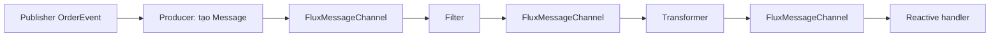

# ReactiveStreamsProducer

## 1. Mục tiêu và phạm vi

Trong chương **Reactive support** của module **SPRING_INTEGRATION_CORE**, bài này tìm hiểu vai trò producer tiếp nhận một luồng Reactive Streams và đưa từng sự kiện vào mô hình `Message → MessageChannel → endpoint` của Spring Integration.

Sau bài học, bạn có thể:

- Phân biệt `Publisher<T>`, `Message<Publisher<T>>` và `Publisher<Message<T>>`.
- Nối một nguồn Reactor với Java DSL bằng `IntegrationFlow.from(publisher)`.
- Tạo inbound adapter có vòng đời bằng `MessageProducerSupport.subscribeToPublisher(...)`.
- Xác định nơi truyền demand, nơi có thể blocking và nơi cần xử lý lỗi.
- Kiểm thử message, header và nhu cầu nhận dữ liệu bằng `StepVerifier`.

**Quy ước tên:** `ReactiveStreamsProducer` trong đề mục được dùng để chỉ vai trò producer của một luồng Reactive Streams. Các ví dụ bên dưới sử dụng API Spring Integration thực tế là `MessageProducerSupport`, `FluxMessageChannel` và `IntegrationFlow`; không giả định có một lớp Spring Integration cần import tên `ReactiveStreamsProducer`.

Ví dụ chọn **Java 17 và Spring Integration 6.5.x** làm mốc API. Đây là mốc minh họa, không phải khẳng định về phiên bản mới nhất. Những dependency Spring, Spring Integration và Reactor cần được quản lý theo cùng bộ phiên bản tương thích của ứng dụng. API nền tảng được mô tả trong [Javadoc MessageProducerSupport](https://docs.spring.io/spring-integration/api/org/springframework/integration/endpoint/MessageProducerSupport.html).

## 2. Producer giải quyết bài toán nào?

Giả sử hệ thống nhận sự kiện đơn hàng từ một driver cung cấp `Flux<OrderEvent>`. Luồng tích hợp cần thêm nguồn phát vào header, bỏ đơn có giá trị không hợp lệ, chuẩn hóa mã đơn rồi chuyển đến bộ xử lý nghiệp vụ.

Nếu tự gọi `subscribe()` trong mã nghiệp vụ và tự gửi từng phần tử vào channel, ứng dụng phải tự quản lý subscription, lỗi và shutdown. Một adapter do Spring quản lý tập trung trách nhiệm kết nối nguồn vào endpoint; logic lọc và chuyển đổi vẫn được biểu diễn bằng các thành phần Integration quen thuộc.



Các mũi tên trên biểu diễn hướng dữ liệu. Demand truyền theo chiều ngược lại trong từng chuỗi Reactive Streams đã được nối. Mỗi ranh giới channel, adapter hoặc client bên ngoài cần được xem xét riêng; chỉ nhìn thấy `Flux` ở đầu vào chưa đủ kết luận toàn bộ hệ thống hỗ trợ backpressure.

## 3. Hợp đồng Reactive Streams cần hiểu

### 3.1. Bốn thành phần

| Thành phần | Trách nhiệm | Liên hệ với luồng tích hợp |
|---|---|---|
| `Publisher<T>` | Cho phép đăng ký nhận chuỗi phần tử | Nguồn sự kiện từ driver hoặc Reactor |
| `Subscriber<T>` | Nhận subscription và các tín hiệu | Bên tiêu thụ luồng |
| `Subscription` | Nhận `request(n)` và `cancel()` | Điều khiển nhu cầu và hủy nhận |
| `Processor<T, R>` | Vừa tiêu thụ vừa phát dữ liệu | Hợp đồng trung gian; không bắt buộc tự cài đặt khi dùng Reactor |

Một subscription có chuỗi tín hiệu dạng:

```text
onSubscribe(subscription)
    request(n) từ phía subscriber
    onNext(item) tối đa theo demand tích lũy còn lại
    ...
    onComplete() hoặc onError(error)
```

`request(n)` cần có `n > 0`. `onComplete` và `onError` là tín hiệu kết thúc và không cần chờ demand cho một phần tử dữ liệu. `cancel()` yêu cầu ngừng phát; việc giải phóng tài nguyên cụ thể còn phụ thuộc nguồn và adapter. Hợp đồng gốc được công bố tại [Reactive Streams](https://www.reactive-streams.org/).

### 3.2. Demand không đồng nghĩa số tác vụ đang chạy

Nếu subscriber yêu cầu 8 phần tử, điều đó không tự tạo 8 thread và cũng không bảo đảm chỉ có 8 truy vấn cơ sở dữ liệu đang chạy. Số tác vụ đồng thời phụ thuộc các operator như `flatMap`, cấu hình concurrency, prefetch và các hàng đợi giữa các bước.

Ví dụ thiết kế: dịch vụ đích chỉ cho phép 16 yêu cầu đang xử lý. Khi đó cần giới hạn số lời gọi đang hoạt động tại bước gọi dịch vụ; tăng buffer ở producer chỉ trì hoãn thời điểm quá tải. Khi đo hệ thống, nên tách số message đã nhận, số tác vụ đang chạy và số message đang chờ.

### 3.3. Reactive không tự chọn thread mới

Một `Flux` có thể thực thi đồng bộ trên thread đăng ký. `publishOn` thay đổi nơi chạy các operator phía sau; `subscribeOn` tác động đến việc đăng ký lên nguồn. Hai operator này phục vụ điều phối thực thi, không tự biến một driver blocking thành driver non-blocking. Xem [Reactor: Threading and Schedulers](https://projectreactor.io/docs/core/release/reference/coreFeatures/schedulers.html).

## 4. Hình dạng dữ liệu ở biên producer

| Kiểu | Ý nghĩa | Khi dùng |
|---|---|---|
| `Flux<OrderEvent>` | Chuỗi payload nghiệp vụ | API của nguồn dữ liệu |
| `Message<OrderEvent>` | Một sự kiện cùng header | Đơn vị trao đổi trong Spring Integration |
| `Publisher<Message<OrderEvent>>` | Chuỗi message | Đầu vào cho DSL nhận Publisher |
| `Message<Flux<OrderEvent>>` | Một message chứa cả publisher trong payload | Trường hợp xử lý reactive payload riêng biệt |

Ví dụ chuyển từng sự kiện thành message:

```java
Flux<Message<OrderEvent>> messages = events.map(event ->
        MessageBuilder.withPayload(event)
                .setHeader("source", "orders-api")
                .setHeader("businessKey", event.id())
                .build());
```

Ở đây có một message cho mỗi sự kiện. Ngược lại, `MessageBuilder.withPayload(events).build()` chỉ tạo một message có payload là đối tượng `Flux`; các phần tử của nó chưa trở thành các message độc lập.

Nên dùng khóa nghiệp vụ ổn định như `businessKey` để phục vụ chống trùng. `MessageHeaders.ID` là định danh message của framework; tạo lại message sau một lần đọc lại nguồn có thể sinh ID khác dù vẫn là cùng đơn hàng.

## 5. Hai cách đưa Publisher vào Spring Integration

### 5.1. Dùng Java DSL trực tiếp

Nếu nguồn đã cung cấp publisher phù hợp và chưa cần adapter tùy biến, có thể khai báo:

```java
@Bean
IntegrationFlow orderInputFlow(OrderClient client) {
    Flux<Message<OrderEvent>> input = Flux.defer(client::events)
            .map(event -> MessageBuilder.withPayload(event)
                    .setHeader("source", "orders-api")
                    .setHeader("businessKey", event.id())
                    .build());

    return IntegrationFlow.from(input)
            .handleReactive(message -> Mono.fromRunnable(() ->
                    System.out.println(message.getPayload())));
}
```

Đoạn này là cấu hình minh họa với hợp đồng ứng dụng `OrderClient.events(): Flux<OrderEvent>`. Các import chính là `IntegrationFlow`, `Message`, `MessageBuilder`, `Flux`, `Mono` và `Bean`. Dữ liệu `OrderEvent` được định nghĩa trong ví dụ đầy đủ ở phần sau.

`Flux.defer` trì hoãn việc gọi `client.events()` đến lúc có subscription. Nó hữu ích khi cần tạo lại thao tác đọc nguồn mỗi lần đăng ký; bản thân `defer` không tạo thêm thread.

DSL nhận `Publisher` sử dụng `FluxMessageChannel` nội bộ để nối nguồn vào flow. Chi tiết khai báo overload này có trong [mã nguồn IntegrationFlow 6.5.0](https://github.com/spring-projects/spring-integration/blob/v6.5.0/spring-integration-core/src/main/java/org/springframework/integration/dsl/IntegrationFlow.java).

### 5.2. Tạo producer có vòng đời

Khi cần đóng gói logic kết nối, đặt tên endpoint hoặc điều khiển start/stop, tạo lớp kế thừa `MessageProducerSupport`. Trong `doStart()`, xây dựng chuỗi `Publisher<Message<?>>` và truyền nó vào `subscribeToPublisher(...)`.

```text
Spring bắt đầu endpoint
    → doStart()
    → xây dựng Publisher<Message<?>>
    → subscribeToPublisher(...)
    → output channel tiếp nhận nguồn
```

Phần producer chịu trách nhiệm lấy dữ liệu và tạo message. Filter, transformer và xử lý nghiệp vụ nên nằm ở các bước riêng của flow để dễ tái sử dụng và kiểm thử.

## 6. Ví dụ đầy đủ: producer sự kiện đơn hàng

### 6.1. Chuẩn bị dependency

Ví dụ dưới đây dùng Spring context thông thường. Nếu dự án đã có BOM hoặc cơ chế dependency management tương thích với Spring Integration 6.5.x, các dependency cần thiết có dạng:

```xml
<dependencies>
    <dependency>
        <groupId>org.springframework.integration</groupId>
        <artifactId>spring-integration-core</artifactId>
    </dependency>
    <dependency>
        <groupId>io.projectreactor</groupId>
        <artifactId>reactor-core</artifactId>
    </dependency>
    <dependency>
        <groupId>io.projectreactor</groupId>
        <artifactId>reactor-test</artifactId>
        <scope>test</scope>
    </dependency>
    <dependency>
        <groupId>org.junit.jupiter</groupId>
        <artifactId>junit-jupiter</artifactId>
        <scope>test</scope>
    </dependency>
</dependencies>
```

Đây là danh sách dependency, không phải toàn bộ `pom.xml`. Nếu không có dependency management, phải khai báo các phiên bản tương thích; không thể dùng nguyên đoạn XML thiếu version như một dự án Maven độc lập.

### 6.2. Mã chương trình

Đặt đoạn sau vào một tệp Java tên `ReactiveOrderDemo.java` trong dự án thực hành. Nguồn giả lập là cold publisher hữu hạn, giúp quan sát luồng mà không cần broker hay dịch vụ ngoài.

```java
import java.util.Locale;
import java.util.Objects;
import java.util.concurrent.CountDownLatch;
import java.util.concurrent.TimeUnit;
import java.util.function.Supplier;

import org.springframework.context.annotation.AnnotationConfigApplicationContext;
import org.springframework.context.annotation.Bean;
import org.springframework.context.annotation.Configuration;
import org.springframework.integration.channel.FluxMessageChannel;
import org.springframework.integration.config.EnableIntegration;
import org.springframework.integration.dsl.IntegrationFlow;
import org.springframework.integration.endpoint.MessageProducerSupport;
import org.springframework.messaging.Message;
import org.springframework.messaging.support.MessageBuilder;

import reactor.core.publisher.Flux;
import reactor.core.publisher.Mono;

public class ReactiveOrderDemo {

    public record OrderEvent(String id, long amount) {
    }

    public static final class OrderEventProducer extends MessageProducerSupport {

        private final Supplier<Flux<OrderEvent>> sourceFactory;

        public OrderEventProducer(Supplier<Flux<OrderEvent>> sourceFactory) {
            this.sourceFactory = Objects.requireNonNull(sourceFactory);
        }

        @Override
        protected void doStart() {
            Flux<Message<OrderEvent>> messages =
                    Flux.defer(this.sourceFactory::get)
                            .map(event -> MessageBuilder.withPayload(event)
                                    .setHeader("source", "demo-orders")
                                    .setHeader("businessKey", event.id())
                                    .build());

            subscribeToPublisher(messages);
        }
    }

    @Configuration(proxyBeanMethods = false)
    @EnableIntegration
    public static class Config {

        @Bean
        CountDownLatch delivered() {
            return new CountDownLatch(2);
        }

        @Bean
        OrderEventProducer orderProducer() {
            return new OrderEventProducer(() -> Flux.just(
                    new OrderEvent("o-101", 120_000),
                    new OrderEvent("o-102", 0),
                    new OrderEvent("o-103", 450_000)));
        }

        @Bean
        IntegrationFlow orderFlow(OrderEventProducer orderProducer,
                                  CountDownLatch delivered) {
            return IntegrationFlow.from(orderProducer)
                    .channel(new FluxMessageChannel())
                    .filter(OrderEvent.class,
                            event -> event.amount() > 0,
                            endpoint -> endpoint.discardChannel("nullChannel"))
                    .channel(new FluxMessageChannel())
                    .transform(OrderEvent.class, event -> new OrderEvent(
                            event.id().toUpperCase(Locale.ROOT),
                            event.amount()))
                    .channel(new FluxMessageChannel())
                    .handleReactive(message -> Mono.fromRunnable(() -> {
                        System.out.printf("%s | source=%s%n",
                                message.getPayload(),
                                message.getHeaders().get("source"));
                        delivered.countDown();
                    }));
        }
    }

    public static void main(String[] args) throws InterruptedException {
        try (var context = new AnnotationConfigApplicationContext(Config.class)) {
            boolean finished = context.getBean(CountDownLatch.class)
                    .await(5, TimeUnit.SECONDS);
            if (!finished) {
                throw new IllegalStateException("Chua nhan du hai don hop le");
            }
        }
    }
}
```

Kết quả dự kiến có hai đơn hợp lệ sau khi chuẩn hóa, chẳng hạn:

```text
OrderEvent[id=O-101, amount=120000] | source=demo-orders
OrderEvent[id=O-103, amount=450000] | source=demo-orders
```

`o-102` bị filter loại và chuyển đến `nullChannel`. Trong ứng dụng cần kiểm toán đơn bị loại, thay đích này bằng một flow ghi nhận lý do loại. Nếu xử lý bất đồng bộ được bổ sung, thứ tự xuất hiện cần được xác định theo operator và cấu hình concurrency, thay vì suy từ thứ tự khai báo dữ liệu.

### 6.3. Đọc ví dụ theo trách nhiệm

- `sourceFactory` cho phép producer lấy một publisher mới khi bắt đầu; `Flux.just` là nguồn có khả năng phát lại trong ví dụ này.
- Producer thêm `source` và `businessKey` trước khi giao message cho output channel.
- Các `FluxMessageChannel` giữ ranh giới giữa các endpoint ở mô hình reactive.
- Transformer chỉ thay payload; header `source` được giữ để bước cuối quan sát được nguồn dữ liệu.
- `handleReactive` nhận một hàm trả `Mono<Void>`; framework quản lý subscription cho bước xử lý đó.
- `CountDownLatch` chỉ giúp chương trình console chờ kết quả trước khi đóng context. Không đặt `await()` vào handler reactive.

Việc in console là thao tác quan sát trong bài thực hành, không phải mẫu I/O hiệu năng cao. Khi thay bằng client thực tế, trả publisher của client từ handler để việc hoàn tất và lỗi nằm trong cùng chuỗi xử lý.

## 7. Vì sao output channel quyết định cách nối nguồn?

`FluxMessageChannel` vừa là `MessageChannel`, vừa là `Publisher<Message<?>>`, đồng thời triển khai `ReactiveStreamsSubscribableChannel`. Nhờ vậy, nó có thể tiếp nhận publisher upstream thay vì chỉ nhận từng lệnh `send()` từ bên ngoài. Các hợp đồng này được liệt kê trong [Javadoc FluxMessageChannel 6.5](https://docs.spring.io/spring-integration/docs/6.5.x/api/org/springframework/integration/channel/FluxMessageChannel.html).

Với `subscribeToPublisher(...)`, producer kiểm tra loại output channel. Kênh hỗ trợ reactive được giao publisher để nối; với kênh thông thường, lớp hỗ trợ đăng ký vào nguồn và chuyển từng message bằng cơ chế gửi message. Cách phân nhánh được thể hiện trong [mã nguồn MessageProducerSupport 6.5.0](https://github.com/spring-projects/spring-integration/blob/v6.5.0/spring-integration-core/src/main/java/org/springframework/integration/endpoint/MessageProducerSupport.java).

| Output channel | Mô hình cần hiểu | Hệ quả thiết kế |
|---|---|---|
| `FluxMessageChannel` | Có hợp đồng Publisher và đăng ký upstream | Phù hợp để nối demand giữa các đoạn reactive |
| `DirectChannel` | Gửi message trực tiếp đến handler trong lời gọi đồng bộ | Không cung cấp `Subscription.request(n)` cho bên gửi |
| `QueueChannel` | Producer ghi vào queue, consumer lấy message ra | Cần quản lý dung lượng queue và tốc độ lấy |
| `ExecutorChannel` | Chuyển xử lý qua executor | Cần quản lý pool, queue công việc và lỗi bất đồng bộ |

Việc handler chạy chậm trên `DirectChannel` có thể khiến lời gọi gửi chờ lâu hơn. Đó là tác động đồng bộ của lời gọi Java, không phải cùng hợp đồng demand của Reactive Streams.

`FluxMessageChannel` cũng có API imperative `send()`. Trong bài này producer dùng đường nối publisher; không suy rằng mọi cách gọi `send()` đều non-blocking. Khi tích hợp nguồn callback chỉ biết đẩy dữ liệu, phải quyết định riêng cách xử lý khi bên nhận chưa sẵn sàng hoặc không theo kịp. Chi tiết hành vi gửi có thể đối chiếu tại [mã nguồn FluxMessageChannel 6.5.0](https://github.com/spring-projects/spring-integration/blob/v6.5.0/spring-integration-core/src/main/java/org/springframework/integration/channel/FluxMessageChannel.java).

## 8. Vòng đời, nguồn cold/hot và việc đăng ký lại

### 8.1. Cold publisher và hot publisher

Với nguồn cold trong ví dụ, mỗi subscription có thể đọc lại ba đơn. Với nguồn hot như một luồng sự kiện trực tiếp, subscriber đến sau có thể không nhận các sự kiện trước đó nếu nguồn không có cơ chế lưu hoặc replay.

`Flux.defer` tạo hoặc lấy nguồn khi đăng ký; nó không bổ sung lịch sử cho một nguồn hot. Vì vậy, cần hỏi cụ thể: khi restart, driver mở lại truy vấn, đăng ký listener mới hay tiếp tục đọc từ offset nào?

### 8.2. Start và stop

Trong thiết kế adapter, `doStart()` tạo chuỗi còn Spring quản lý endpoint. Lớp nền `MessageProducerSupport` giữ subscription cho đường nối publisher và xử lý hủy khi dừng. Nếu override `doStop()` để đóng tài nguyên riêng, cần gọi `super.doStop()` để giữ hành vi của lớp nền.

Mã ví dụ không override `doStop()` vì không tự sở hữu một client cần đóng. Với tài nguyên tạo riêng cho từng subscription, có thể cân nhắc `usingWhen` hoặc cơ chế giải phóng của driver để gắn cleanup vào complete, error và cancel.

### 8.3. Những việc restart không bảo đảm

Restart không đồng nghĩa đọc tiếp đúng bản ghi cuối và không cung cấp exactly-once. Ví dụ nguồn `Flux.just` sẽ phát lại dữ liệu khi đăng ký lại. Với nguồn ngoài cần xác định offset, acknowledgement, thao tác commit và chống trùng tại nghiệp vụ.

Cũng cần phân biệt hoàn tất nguồn với hoàn tất channel dùng chung. Một publisher hữu hạn kết thúc không có nghĩa mọi subscriber của một `FluxMessageChannel` phải nhận `onComplete` ngay; kênh có thể còn được nối với nguồn khác. Điều này ảnh hưởng trực tiếp đến cách viết test.

## 9. Xử lý lỗi ở đúng ranh giới

### 9.1. Phân biệt lỗi nguồn và lỗi message

| Loại lỗi | Ví dụ | Điểm đặt chính sách |
|---|---|---|
| Lỗi kết nối/đọc nguồn | Kết nối bị ngắt khi đang nhận sự kiện | Publisher của nguồn và adapter |
| Dữ liệu không hợp lệ | Số tiền bằng 0 | Filter hoặc nhánh nghiệp vụ |
| Lỗi xử lý một message | Lưu đơn thất bại | Handler/endpoint và nhánh phục hồi phù hợp |
| Lỗi thiết lập ứng dụng | Thiếu output channel | Cấu hình bean và khởi tạo endpoint |

Một `onError` kết thúc subscription hiện tại. `doOnError` chỉ thực hiện tác vụ quan sát, không phục hồi. `onErrorResume` chuyển sang publisher thay thế; `retryWhen` đăng ký lại vào đoạn upstream mà nó bao quanh. Xem [Reactor: Handling Errors](https://projectreactor.io/docs/core/release/reference/coreFeatures/error-handling.html).

### 9.2. Retry có giới hạn và đúng loại lỗi

Nếu driver biểu diễn lỗi kết nối bằng `IOException`, có thể đặt chính sách sau trước bước tạo message:

```java
Flux<OrderEvent> input = Flux.defer(sourceFactory::get)
        .retryWhen(Retry.backoff(3, Duration.ofMillis(200))
                .maxBackoff(Duration.ofSeconds(2))
                .filter(IOException.class::isInstance));
```

Các import bổ sung là `java.io.IOException`, `java.time.Duration` và `reactor.util.retry.Retry`. Trong thực tế phải lọc theo loại exception mà driver thực sự trả về. Cấu hình này cho phép tối đa ba lần thử lại sau lần đăng ký ban đầu; khi hết số lần thử, lỗi vẫn cần được tiếp nhận và ghi nhận.

Vị trí operator giới hạn phạm vi retry. Retry đặt trên publisher nguồn không tự bao quanh mọi handler phía sau các channel. Một lỗi dữ liệu ở transformer không trở thành lỗi đọc nguồn chỉ vì cả flow dùng Reactor.

Trước khi retry, hãy xét tình huống đơn đã được lưu nhưng acknowledgement thất bại. Đọc lại có thể tạo xử lý lặp. Khóa nghiệp vụ `businessKey` và thao tác lưu idempotent cần được thiết kế ở nơi có side effect.

### 9.3. `errorChannel` và `onError` là hai cơ chế cần nối rõ ràng

Spring Integration có mô hình gửi `ErrorMessage` đến error channel cho các cơ chế xử lý lỗi tương ứng. Reactor có tín hiệu `onError` của subscription. Việc tồn tại bean `errorChannel` không tự bảo đảm mọi lỗi từ driver publisher được biến thành `ErrorMessage`.

Cần xác định thành phần nào bắt lỗi, thành phần nào tạo `ErrorMessage` và subscriber nào chịu trách nhiệm quan sát lỗi kết thúc. Có thể chủ động xây nhánh chuyển lỗi nguồn sang một publisher lỗi nghiệp vụ hoặc một error flow, nhưng phải quy định sau đó dừng, phục hồi hay thử lại. Tham khảo cơ chế message lỗi trong [Spring Integration: Error Handling](https://docs.spring.io/spring-integration/reference/6.5/error-handling.html).

## 10. Làm việc với I/O blocking

Nếu phải gọi API đồng bộ, bao lời gọi trong `Mono.fromCallable` và đưa nó sang scheduler phù hợp:

```java
Mono<OrderEvent> oneOrder = Mono.fromCallable(() -> legacyClient.load(orderId))
        .subscribeOn(Schedulers.boundedElastic());
```

Đây là mẫu minh họa với `legacyClient.load(...)` là lời gọi blocking của ứng dụng. Không gọi `load()` trước rồi đưa kết quả vào `Mono.just(...)`, vì như vậy thao tác đã chạy ngay trên thread hiện tại.

`boundedElastic` giúp cách ly blocking khỏi thread cần giữ non-blocking; nó vẫn có giới hạn thread và hàng đợi. Cần giới hạn số yêu cầu đang chạy theo khả năng của hệ thống đích, đồng thời đặt timeout ở client hoặc chuỗi xử lý thích hợp. Chuyển thread không tạo khả năng backpressure cho một nguồn ngoài vốn không hỗ trợ dừng hoặc giảm tốc độ phát.

## 11. Kiểm thử producer và reactive channel

### 11.1. Những hành vi cần quan sát

Bài thực hành có ba ranh giới kiểm thử riêng:

1. Producer chuyển payload thành message và thêm header đúng.
2. Subscriber nhận dữ liệu theo demand mà nó đã cấp.
3. Toàn bộ flow loại đơn không hợp lệ và tạo hai kết quả đã chuẩn hóa.

Test dưới đây tập trung vào hai ranh giới đầu. Nó dùng producer của phần 6, nhưng không đăng ký `ReactiveOrderDemo.Config`, để không có consumer nghiệp vụ cạnh tranh nhận dữ liệu.

```java
import java.time.Duration;

import org.junit.jupiter.api.Test;
import org.springframework.context.annotation.AnnotationConfigApplicationContext;
import org.springframework.context.annotation.Bean;
import org.springframework.context.annotation.Configuration;
import org.springframework.integration.channel.FluxMessageChannel;
import org.springframework.integration.config.EnableIntegration;

import reactor.core.publisher.Flux;
import reactor.test.StepVerifier;

import static org.junit.jupiter.api.Assertions.assertEquals;

class ReactiveOrderProducerTest {

    @Configuration(proxyBeanMethods = false)
    @EnableIntegration
    static class TestConfig {

        @Bean
        FluxMessageChannel output() {
            return new FluxMessageChannel();
        }

        @Bean
        ReactiveOrderDemo.OrderEventProducer producer(FluxMessageChannel output) {
            var producer = new ReactiveOrderDemo.OrderEventProducer(() -> Flux.just(
                    new ReactiveOrderDemo.OrderEvent("o-101", 120_000),
                    new ReactiveOrderDemo.OrderEvent("o-102", 0),
                    new ReactiveOrderDemo.OrderEvent("o-103", 450_000)));
            producer.setOutputChannel(output);
            producer.setAutoStartup(false);
            return producer;
        }
    }

    @Test
    void receivesMessagesWithExplicitDemand() {
        try (var context = new AnnotationConfigApplicationContext(TestConfig.class)) {
            var channel = context.getBean(FluxMessageChannel.class);
            var producer = context.getBean(ReactiveOrderDemo.OrderEventProducer.class);

            try {
                StepVerifier.create(Flux.from(channel), 0)
                        .then(producer::start)
                        .thenRequest(1)
                        .assertNext(message -> {
                            assertEquals(new ReactiveOrderDemo.OrderEvent(
                                    "o-101", 120_000), message.getPayload());
                            assertEquals("demo-orders",
                                    message.getHeaders().get("source"));
                            assertEquals("o-101",
                                    message.getHeaders().get("businessKey"));
                        })
                        .thenRequest(1)
                        .assertNext(message -> assertEquals(
                                new ReactiveOrderDemo.OrderEvent("o-102", 0),
                                message.getPayload()))
                        .thenCancel()
                        .verify(Duration.ofSeconds(5));
            }
            finally {
                producer.stop();
            }
        }
    }
}
```

`StepVerifier` đăng ký trước rồi mới start producer. Demand ban đầu là 0; mỗi `thenRequest(1)` mở quyền nhận một message tiếp theo ở biên subscriber. Test kết thúc bằng cancel và có timeout để tránh treo khi flow không phát dữ liệu. Cách sử dụng `StepVerifier` được hướng dẫn trong [Reactor: Testing](https://projectreactor.io/docs/core/release/reference/testing.html).

Test không có filter nên message thứ hai vẫn là `o-102`. Nó cũng không chứng minh nguồn upstream được yêu cầu đúng từng phần tử: channel hoặc operator có thể prefetch. Muốn kiểm tra lượng đọc upstream và mức concurrency phải đo thêm ở đúng nguồn hoặc bước I/O đó.

Để kiểm tra flow đầy đủ, dùng cấu hình nghiệp vụ và thu kết quả tại bước cuối, rồi xác nhận có `O-101`, `O-103`, vẫn có header `source` và không có `O-102`. Khi kiểm thử hủy, nên quan sát callback cleanup của nguồn; chỉ gọi `thenCancel()` ở một subscriber của channel chưa đủ kết luận mọi tài nguyên upstream đã được giải phóng tức thời.

## 12. Lỗi thường gặp và hướng xử lý

| Biểu hiện | Nguyên nhân cần kiểm tra | Hướng xử lý |
|---|---|---|
| Nguồn không phát dữ liệu | Chưa có subscription, producer chưa start hoặc flow chưa nối | Kiểm tra lifecycle và điểm subscriber được đăng ký |
| Khởi tạo thất bại vì thiếu output channel | Producer được khai báo nhưng chưa gắn channel | Gắn bằng DSL hoặc `setOutputChannel(...)` |
| Một message có payload là `Flux` | Đã bọc cả publisher vào một message | Map từng phần tử thành `Message` khi cần xử lý từng sự kiện |
| Bộ nhớ tăng theo tải | Nguồn đẩy nhanh, queue/prefetch lớn hoặc tác vụ chậm | Đo queue và in-flight, giới hạn concurrency tại bước chậm |
| Restart xử lý lại đơn | Nguồn cold hoặc nguồn ngoài phát lại | Dùng offset/ack phù hợp và idempotency theo khóa nghiệp vụ |
| Lỗi nguồn chỉ xuất hiện ở log Reactor | Chưa định nghĩa chính sách cho tín hiệu lỗi nguồn | Gắn chính sách lỗi tại publisher và nhánh quan sát cụ thể |
| Test chờ complete mãi | Đồng nhất nguồn hữu hạn với vòng đời channel | Test số message cần thiết rồi cancel, dừng bean và đóng context |
| Reactive flow bị nghẽn thread | Có lời gọi blocking trong operator hoặc handler | Cách ly lời gọi blocking hoặc dùng client reactive phù hợp |

## 13. Vận dụng vào một luồng tích hợp thực tế

Với hệ thống nhận đơn hàng từ nguồn reactive, có thể phân chia như sau: producer kết nối nguồn và gắn định danh nghiệp vụ; filter xử lý điều kiện chấp nhận; transformer chuẩn hóa dữ liệu; router chọn nhánh theo loại đơn; handler gọi hệ thống đích. Nếu cần aggregator, phải xác định thời điểm hoàn tất nhóm, timeout và giới hạn bộ nhớ, đặc biệt khi nguồn có thể chạy vô hạn.

Gateway thường phục vụ lời gọi vào flow với quan hệ request/reply. Producer của bài này phục vụ nguồn chủ động phát nhiều sự kiện; mỗi sự kiện không mặc nhiên có một lời gọi gateway đang chờ nhận kết quả. Vì vậy, thiết kế reply, acknowledgement và lỗi cần theo đúng vai trò của biên tích hợp.

Khi lựa chọn cách triển khai, ưu tiên `IntegrationFlow.from(publisher)` cho nguồn đã phù hợp với DSL; dùng adapter kế thừa `MessageProducerSupport` khi cần đóng gói kết nối và vòng đời. Chất lượng của luồng phụ thuộc việc nối đúng hợp đồng ở từng ranh giới, giới hạn công việc đang chạy và chứng minh được hành vi khi nguồn hoàn tất, lỗi hoặc bị hủy.
