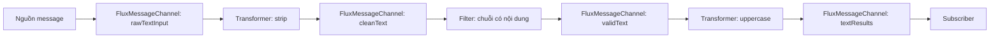

# Reactive channel flow

## 1. Mục tiêu và phạm vi

Trong chương **Reactive support** của module **SPRING_INTEGRATION_CORE**, bài này giải thích cách tổ chức luồng thông điệp có channel reactive: message đi qua các endpoint theo Java DSL, còn việc tiêu thụ dữ liệu tham gia cơ chế subscription và demand của Reactive Streams.

Sau bài học, bạn có thể:

- Chọn vị trí đặt `FluxMessageChannel` và nhận diện các đoạn imperative trong một flow.
- Kết nối `Publisher<Message<?>>` với `IntegrationFlow` theo cả hai chiều.
- Kết hợp transformer, filter và xử lý bất đồng bộ mà vẫn giữ ngữ cảnh message.
- Thiết kế giới hạn concurrency, chính sách lỗi và vòng đời subscription.
- Viết kiểm thử xác nhận payload, header, demand và việc hủy subscription.

Ví dụ chính dùng luồng chuẩn hóa lệnh dạng chuỗi để làm rõ cấu trúc channel. Ví dụ mở rộng dùng kiểm tra đơn hàng để minh họa I/O bất đồng bộ và kết quả lỗi của từng message. Những kỹ thuật này tiếp nối mô hình Message, MessageChannel, endpoint và gateway trong phạm vi Spring Integration Core.

Các ví dụ Java DSL nhắm đến **Spring Integration 6.5.x, Java 17 trở lên**. Các đoạn có `handleReactive()` cần Spring Integration từ 6.1. Ứng dụng nên dùng dependency management tương thích cho Spring Integration, Spring Framework và Reactor; bài học không giả định một phiên bản Spring Boot cụ thể.

## 2. Reactive channel flow thay đổi điều gì?

### 2.1. Vẫn là message, channel và endpoint

Một message tiếp tục chứa payload cùng headers. Transformer biến đổi dữ liệu; filter quyết định message nào được đi tiếp; router chọn nhánh; endpoint gọi logic nghiệp vụ.

Điểm thay đổi nằm ở cách các thành phần trao đổi dữ liệu. Với channel reactive, phía tiêu thụ tham gia giao thức Reactive Streams thông qua subscription và lượng phần tử được yêu cầu. Spring Integration cung cấp `ReactiveStreamsConsumer` để nối endpoint với nguồn reactive. `FluxMessageChannel` đồng thời đóng vai trò `MessageChannel`, `Publisher<Message<?>>` và `ReactiveStreamsSubscribableChannel`. [Tài liệu Reactive Streams của Spring Integration](https://docs.spring.io/spring-integration/reference/6.5/reactive-streams.html#fluxmessagechannel-and-reactivestreamsconsumer).



Sơ đồ biểu diễn đường đi của message. Demand đi theo chiều ngược lại qua các subscription tương ứng; các operator, buffer và endpoint trung gian có thể thay đổi cách demand được truyền lên nguồn.

Một chuỗi khai báo Java DSL chưa mô tả đầy đủ mô hình thực thi. Muốn đánh giá flow, phải nhìn cả loại channel được đăng ký, cách endpoint tiêu thụ dữ liệu và hành vi của client bên ngoài.

### 2.2. Phân biệt bốn khái niệm

| Khái niệm | Câu hỏi cần trả lời | Ví dụ |
| --- | --- | --- |
| Reactive | Việc tiêu thụ có tham gia giao thức subscription và demand không? | Subscriber gọi `request(n)` |
| Asynchronous | Kết quả có thể đến sau khi lời gọi ban đầu trả về không? | HTTP client trả `Mono<Response>` |
| Non-blocking | Luồng thực thi có phải đứng chờ tài nguyên hoặc kết quả không? | I/O qua client reactive |
| Concurrency | Có bao nhiêu công việc được xử lý đồng thời? | `flatMap(..., 8)` trong một đoạn Reactor |

Một flow có `ExecutorChannel` có thể chạy bất đồng bộ mà vẫn gọi JDBC blocking. Một hàm trả `Mono` có thể thực hiện công việc blocking ngay trước khi tạo `Mono`. Vì vậy, nhìn kiểu trả về hoặc tên channel chưa đủ để kết luận toàn bộ flow non-blocking.

### 2.3. Chọn channel theo hợp đồng giao tiếp

| Channel | Cách tiêu thụ chủ yếu | Điều cần hiểu |
| --- | --- | --- |
| `DirectChannel` | Gọi trực tiếp một `MessageHandler` được chọn | Thường chạy trên thread gửi |
| `ExecutorChannel` | Dispatch qua executor | Cần quản lý executor và tải công việc |
| `QueueChannel` | Consumer lấy message bằng receive/poll | Cần quản lý dung lượng queue, timeout và poller |
| `FluxMessageChannel` | Subscriber nhận message theo giao thức reactive | Cần quản lý demand, subscription và ranh giới imperative |

`FluxMessageChannel` không triển khai `PollableChannel` hoặc `SubscribableChannel`. Không gắn poller để đọc nó như queue và không đăng ký một `MessageHandler` trực tiếp theo API của `DirectChannel`. Để tổ chức một flow reactive xuyên qua các endpoint, tài liệu hướng dẫn đặt channel reactive giữa các endpoint. [Các triển khai MessageChannel](https://docs.spring.io/spring-integration/reference/6.5/channel/implementations.html#fluxmessagechannel).

Lựa chọn này xác định cơ chế giao tiếp. Độ bền dữ liệu, acknowledgment của broker, transaction và số lần xử lý nghiệp vụ vẫn cần thiết kế riêng.

## 3. Hai cửa vào của FluxMessageChannel

### 3.1. Gửi imperative bằng send()

Bạn có thể gửi một `Message` vì `FluxMessageChannel` cũng là `MessageChannel`:

```java
Message<String> command = MessageBuilder
        .withPayload("  create-order  ")
        .setHeader("requestId", "req-101")
        .build();

boolean accepted = input.send(command, 1000);

if (!accepted) {
    throw new IllegalStateException("Không gửi được command trong thời hạn");
}
```

Đây là đoạn mã bên trong ứng dụng đã có bean `input` và subscriber được đăng ký. Tham số `1000` là timeout gửi, tính bằng mili giây.

`accepted == true` xác nhận lời gọi gửi đã được channel chấp nhận theo hợp đồng của channel. Nó không chứng minh hệ thống ngoài đã cập nhật thành công, không xác nhận transaction đã commit và không thay thế một message trả lời nghiệp vụ.

Cần gắn consumer trước khi gửi. Trong mã nguồn Spring Integration 6.5.0, `doSend()` kiểm tra subscriber; khi việc phát message gặp tình trạng đầy hoặc phát đồng thời, lời gọi có thể chờ/thử lại theo timeout. Vì thế không giả định `send()` luôn trả về ngay hoặc luôn an toàn để gọi trên event loop. [Mã nguồn FluxMessageChannel 6.5.0](https://raw.githubusercontent.com/spring-projects/spring-integration/v6.5.0/spring-integration-core/src/main/java/org/springframework/integration/channel/FluxMessageChannel.java).

Nếu nguồn là callback không có cơ chế điều tiết, cần quyết định trước cách phản ứng khi không gửi được: từ chối đầu vào, lưu bền vững hoặc sử dụng cơ chế điều tiết của nguồn. Việc tự gọi `send()` trong vòng lặp không tạo ra hợp đồng demand cho callback đó.

### 3.2. Nối một Publisher vào channel

Ở chiều reactive, channel có thể nhận một publisher của message:

```java
Flux<Message<String>> commands = Flux
        .just("create-order", "cancel-order")
        .map(value -> MessageBuilder.withPayload(value).build());

input.subscribeTo(commands);
```

`subscribeTo(...)` có nghĩa là channel tiếp nhận một nguồn publisher. Ngược lại, `Flux.from(input)` tạo một cách quan sát channel từ phía consumer. Hai thao tác này có hướng dữ liệu khác nhau. Chữ ký và vai trò vòng đời của channel được mô tả trong [API FluxMessageChannel](https://docs.spring.io/spring-integration/docs/6.5.0/api/org/springframework/integration/channel/FluxMessageChannel.html).

Trong cấu hình ứng dụng, nên để Spring quản lý channel và flow thay vì tự tạo nhiều channel, subscription và lệnh start/stop rời rạc. Đặc biệt, không gọi đồng thời `subscribeTo(source)` và tự `source.subscribe(...)` để đưa cùng dữ liệu vào flow, trừ khi chủ đích là có nhiều subscription.

## 4. Cấu hình Java DSL có channel reactive giữa các endpoint

### 4.1. Dependency tối thiểu

Ví dụ sử dụng các artifact sau:

| Artifact | Mục đích |
| --- | --- |
| `org.springframework.integration:spring-integration-core` | Channel, endpoint, cấu hình Java DSL |
| `io.projectreactor:reactor-core` | `Flux`, `Mono`, scheduler |
| `io.projectreactor:reactor-test` | `StepVerifier`, dùng trong test |
| `org.junit.jupiter:junit-jupiter` | JUnit 5 |

Khai báo version qua BOM hoặc dependency management của ứng dụng. Nếu ứng dụng đã có các starter phù hợp, kiểm tra dependency đã được cung cấp trước khi khai báo thêm.

### 4.2. Cấu hình hoàn chỉnh

```java
package example.integration;

import java.util.Locale;

import org.springframework.context.annotation.Bean;
import org.springframework.context.annotation.Configuration;
import org.springframework.integration.channel.FluxMessageChannel;
import org.springframework.integration.config.EnableIntegration;
import org.springframework.integration.dsl.IntegrationFlow;

@Configuration
@EnableIntegration
public class ReactiveTextFlowConfig {

    @Bean
    public FluxMessageChannel rawTextInput() {
        return new FluxMessageChannel();
    }

    @Bean
    public FluxMessageChannel cleanText() {
        return new FluxMessageChannel();
    }

    @Bean
    public FluxMessageChannel validText() {
        return new FluxMessageChannel();
    }

    @Bean
    public FluxMessageChannel textResults() {
        return new FluxMessageChannel();
    }

    @Bean
    public IntegrationFlow normalizeTextFlow() {
        return IntegrationFlow.from("rawTextInput")
                .transform(String.class, String::strip)
                .channel("cleanText")
                .filter(String.class, value -> !value.isBlank())
                .channel("validText")
                .transform(String.class,
                        value -> value.toUpperCase(Locale.ROOT))
                .channel("textResults")
                .get();
    }
}
```

Các tên trong `from(...)` và `channel(...)` tham chiếu tới bean `FluxMessageChannel` đã khai báo. Nhờ đó, các ranh giới giữa transformer, filter và transformer tiếp theo đều được xác định rõ.

Không nên bỏ các `channel(...)` trung gian rồi mặc định rằng mọi liên kết Java DSL vẫn reactive. DSL có thể tạo channel ngầm định giữa các endpoint; cần kiểm tra cấu hình thực tế thay vì suy luận từ việc đầu vào và đầu ra có kiểu reactive.

Dữ liệu mong đợi:

| Payload đầu vào | Kết quả |
| --- | --- |
| `"  create-order  "` | `"CREATE-ORDER"` |
| `"  cancel-order "` | `"CANCEL-ORDER"` |
| Chuỗi chỉ có khoảng trắng | Bị filter loại khỏi nhánh kết quả |

Trong ví dụ, filter chủ ý không tạo reply cho chuỗi rỗng. Với một yêu cầu request-reply thực tế, cần trả kết quả từ chối hoặc cấu hình nhánh xử lý khác để caller biết kết cục của yêu cầu.

### 4.3. Ai thực hiện subscription?

Ở các channel bên trong flow, Spring Integration quản lý endpoint và consumer tương ứng. Ở channel cuối `textResults`, ứng dụng cần một consumer: endpoint khác, adapter đầu ra hoặc subscriber trong bài kiểm thử.

Không cần chèn `subscribe()` vào transformer. Một transformer có trách nhiệm tạo kết quả biến đổi, còn quyền thực thi luồng nằm ở subscription do framework hoặc bên sử dụng kết quả quản lý.

Nếu cần truyền trực tiếp một `FluxMessageChannel` vào `IntegrationFlow.from(...)`, hãy chú ý các overload nhận `MessageChannel` và `Publisher`: đối tượng này thực hiện cả hai interface. Tham chiếu theo tên như ví dụ giúp tránh lựa chọn overload không rõ ràng; một cách khác là ép kiểu rõ thành `MessageChannel`.

## 5. Kết nối Java DSL với Publisher ở hai chiều

### 5.1. Từ Publisher<Message<?>> vào flow

Nguồn publisher cần phát **message**, vì flow còn sử dụng headers để mang correlation, reply và ngữ cảnh theo dõi. Nếu nguồn ban đầu là `Flux<String>`, hãy chuyển từng phần tử thành `Message<String>` trước khi đưa vào DSL.

Overload `IntegrationFlow.from(Publisher<? extends Message<?>>)` tạo điểm vào bằng `FluxMessageChannel` và nối nguồn publisher vào đó. [API IntegrationFlow.from(Publisher)](https://docs.spring.io/spring-integration/docs/6.5.0/api/org/springframework/integration/dsl/IntegrationFlow.html#from(org.reactivestreams.Publisher)).

### 5.2. Từ flow ra Publisher<Message<T>>

Cấu hình dưới đây độc lập với ví dụ chuẩn hóa nhiều endpoint ở trên. Có thể thêm phương thức này vào một lớp `@Configuration` đã bật Spring Integration:

```java
@Bean
public Publisher<Message<String>> sampleCommands() {
    Flux<Message<String>> source = Flux
            .just(" create-order ", " cancel-order ")
            .map(value -> MessageBuilder.withPayload(value).build());

    return IntegrationFlow.from(source)
            .transform(String.class, String::strip)
            .<String>toReactivePublisher(true);
}
```

Các import bổ sung:

```java
import org.reactivestreams.Publisher;
import reactor.core.publisher.Flux;
import org.springframework.messaging.Message;
import org.springframework.messaging.support.MessageBuilder;
```

`toReactivePublisher(true)` là thao tác kết thúc builder, nên không nối thêm `get()`. Cờ `true` yêu cầu bắt đầu flow khi publisher kết quả có subscription, thay vì tự khởi động các thành phần của flow khi context khởi tạo. [API IntegrationFlowBuilder.toReactivePublisher](https://docs.spring.io/spring-integration/docs/6.5.0/api/org/springframework/integration/dsl/IntegrationFlowBuilder.html#toReactivePublisher(boolean)).

Ví dụ tiêu thụ hữu hạn trong test:

```java
StepVerifier.create(
        Flux.from(sampleCommands)
                .map(Message::getPayload)
                .take(2))
        .expectNext("create-order", "cancel-order")
        .expectComplete()
        .verify(Duration.ofSeconds(5));
```

Ở đây `sampleCommands` là bean được lấy từ application context. `take(2)` chủ động hoàn thành phía quan sát sau hai kết quả và hủy subscription lên trên.

Không suy ra channel kết quả tự hoàn tất chỉ vì `Flux.just(...)` đầu nguồn đã phát hết phần tử. Một flow qua message channel có vòng đời riêng; nó có thể tồn tại để nhận thêm message hoặc nhiều nguồn khác. Cũng không giả định mỗi subscriber đến sau sẽ chạy lại toàn bộ chuỗi: channel là ranh giới có trạng thái và không tự cung cấp cơ chế replay cho mọi consumer.

Cần xác định bên sở hữu subscription, thời điểm hủy và hành vi khi có nhiều subscriber. Việc hủy publisher do DSL tạo còn ảnh hưởng tới vòng đời flow đứng sau; tránh dùng một publisher chung như thể mỗi caller có một pipeline hoàn toàn độc lập.

## 6. Backpressure, buffer và concurrency

### 6.1. Demand không đồng nghĩa với số lời gọi nghiệp vụ

Giả sử subscriber cuối yêu cầu một message. Trước khi kết quả đó được giao, một số endpoint có thể đã xử lý dữ liệu vào buffer; operator như `publishOn` hoặc `flatMap` có thể yêu cầu trước nhiều phần tử.

Vì vậy, các phát biểu sau khác nhau:

- “Subscriber cuối chưa nhận quá số phần tử đã request.”
- “Nguồn chưa đọc quá số phần tử đã request.”
- “Chưa có quá tám HTTP request đang chạy.”
- “Toàn flow không giữ quá 100 message trong bộ nhớ.”

Mỗi phát biểu cần quan sát ở đúng ranh giới. Một test kiểm tra đầu ra chưa đủ để chứng minh cả bốn điều.

### 6.2. Chọn operator theo yêu cầu nghiệp vụ

| Operator | Cách sử dụng trong một đoạn Reactor |
| --- | --- |
| `map` | Biến đổi đồng bộ, nhanh, không trả publisher con |
| `flatMap` | Ghép publisher con, cho phép nhiều công việc cùng chạy; kết quả có thể đổi thứ tự |
| `concatMap` | Xử lý từng publisher con nối tiếp, phù hợp khi đoạn đó cần thứ tự |
| `flatMapSequential` | Cho phép xử lý đồng thời nhưng phát kết quả theo thứ tự nguồn, có thể phải đệm |
| `publishOn` | Chuyển nơi thực thi các operator phía sau, kèm ranh giới queue/prefetch |

Các tham số concurrency và prefetch có ý nghĩa tại operator được cấu hình. Chúng không trở thành hạn mức toàn ứng dụng khi có nhiều flow hoặc nhiều instance. [API Flux và các operator ghép publisher](https://projectreactor.io/docs/core/release/api/reactor/core/publisher/Flux.html).

Với đơn hàng cần giữ thứ tự theo từng khách hàng, `concatMap` trên một đoạn duy nhất chỉ bảo đảm thứ tự của đoạn đó. Nó chưa đủ để điều phối nhiều nguồn, nhiều partition hoặc nhiều replica. Khi tăng tải, cần xác định khóa thứ tự và vị trí thực thi hợp đồng này.

### 6.3. Tính thử chi phí khi nguồn nhanh hơn consumer

Giả sử một nguồn không thể giảm tốc tạo 1.200 message/giây, còn phía xử lý hoàn thành 600 message/giây. Sau 20 giây, lượng công việc chưa xử lý xấp xỉ:

```text
(1.200 - 600) × 20 = 12.000 message
```

Nếu ước tính mỗi message chiếm 4 KiB, riêng dữ liệu đang giữ đã khoảng 47 MiB, chưa tính cấu trúc queue và object phụ. Đây là phép tính minh họa theo giả định, không phải số đo của Spring Integration.

Tăng buffer chỉ kéo dài thời gian trước khi chạm giới hạn. Hãy xác định nguồn có hỗ trợ điều tiết hay không, tổng dung lượng đang đệm và hành động khi hết chỗ.

Nếu tự đưa callback vào Reactor qua `Sinks`, phải chọn loại sink và xử lý kết quả `tryEmitNext(...)`. Bỏ qua lỗi phát hoặc chọn buffer không giới hạn có thể che khuất tình trạng quá tải. [Tài liệu Reactor Sinks](https://projectreactor.io/docs/core/release/reference/coreFeatures/sinks.html).

## 7. Gọi nghiệp vụ reactive bằng fluxTransform()

### 7.1. Khi nào nên dùng?

`fluxTransform()` hữu ích khi một đoạn của flow cần operator Reactor để điều khiển publisher con, concurrency, thứ tự hoặc xử lý lỗi. Đầu vào của hàm là `Flux<Message<I>>`; đầu ra có thể phát payload hoặc message. API này tạo các ranh giới `FluxMessageChannel` cho đoạn xử lý. [API fluxTransform](https://docs.spring.io/spring-integration/docs/6.5.0/api/org/springframework/integration/dsl/BaseIntegrationFlowDefinition.html#fluxTransform(java.util.function.Function)).

Khi tạo message kết quả trong đoạn này, cần giữ các headers mà phần sau cần. Việc chỉ tạo `new GenericMessage<>(result)` sẽ bỏ ngữ cảnh nghiệp vụ nếu không chủ động sao chép hoặc bổ sung lại.

### 7.2. Ví dụ kiểm tra đơn hàng, timeout theo từng message

Đây là cấu hình độc lập. Ứng dụng cần cung cấp một bean triển khai `OrderClient` bằng client reactive; interface trả `Mono<Boolean>` không tự bảo đảm phần triển khai non-blocking.

```java
package example.integration;

import java.time.Duration;
import java.util.concurrent.TimeoutException;

import reactor.core.publisher.Mono;

import org.springframework.context.annotation.Bean;
import org.springframework.context.annotation.Configuration;
import org.springframework.integration.channel.FluxMessageChannel;
import org.springframework.integration.config.EnableIntegration;
import org.springframework.integration.dsl.IntegrationFlow;
import org.springframework.messaging.Message;
import org.springframework.messaging.support.MessageBuilder;

@Configuration
@EnableIntegration
public class ReactiveOrderFlowConfig {

    public record OrderCommand(String orderId) {
    }

    public record OrderOutcome(String orderId, String status) {
    }

    public interface OrderClient {
        Mono<Boolean> approve(OrderCommand command);
    }

    @Bean
    public FluxMessageChannel orderRequests() {
        return new FluxMessageChannel();
    }

    @Bean
    public FluxMessageChannel orderResults() {
        return new FluxMessageChannel();
    }

    @Bean
    public IntegrationFlow orderFlow(OrderClient client) {
        return IntegrationFlow.from("orderRequests")
                .<OrderCommand, Message<OrderOutcome>>fluxTransform(messages ->
                        messages.concatMap(message ->
                                Mono.defer(() ->
                                                client.approve(message.getPayload()))
                                        .timeout(Duration.ofMillis(800))
                                        .map(approved -> new OrderOutcome(
                                                message.getPayload().orderId(),
                                                approved ? "APPROVED" : "DECLINED"))
                                        .onErrorResume(TimeoutException.class,
                                                error -> Mono.just(
                                                        new OrderOutcome(
                                                                message.getPayload().orderId(),
                                                                "TIMEOUT")))
                                        .map(outcome ->
                                                MessageBuilder.withPayload(outcome)
                                                        .copyHeaders(message.getHeaders())
                                                        .build()),
                                1))
                .channel("orderResults")
                .get();
    }
}
```

Các quyết định trong ví dụ:

1. `Mono.defer(...)` đưa lời gọi tạo publisher nghiệp vụ vào thời điểm subscription và đưa exception đồng bộ khi tạo publisher vào chuỗi lỗi.
2. `timeout(...)` giới hạn thời gian chờ cho một đơn hàng, vì operator nằm bên trong publisher con của đơn hàng đó.
3. `onErrorResume(TimeoutException.class, ...)` chỉ chuyển timeout thành một kết quả nghiệp vụ. Các lỗi khác vẫn cần chính sách riêng.
4. `concatMap(..., 1)` xử lý nối tiếp trong đoạn này và cấu hình prefetch bằng 1; nó không đặt giới hạn bộ nhớ cho toàn flow.
5. `copyHeaders(...)` giữ ngữ cảnh như `requestId`. Message mới vẫn có định danh hệ thống riêng; không dùng `MessageHeaders.ID` thay cho mã nghiệp vụ ổn định.

`OrderClient` có hợp đồng phát đúng một quyết định cho mỗi lệnh hợp lệ. Nếu implementation có thể trả `Mono.empty()`, cần bổ sung `switchIfEmpty(...)` để định nghĩa kết quả thiếu dữ liệu; nếu không, đơn hàng đó sẽ không tạo `OrderOutcome`.

Để tăng throughput, có thể đổi đoạn ghép thành `flatMap(..., concurrency, prefetch)`. Khi đó, phải chấp nhận hoặc xử lý việc kết quả về khác thứ tự, đồng thời chọn giới hạn dựa trên năng lực của hệ thống ngoài.

## 8. Lỗi theo message và lỗi kết thúc stream

### 8.1. Đặt recovery ở đúng cấp

Trong Reactor, `onError` kết thúc sequence mà nó thuộc về. Recovery không làm sequence gốc tiếp tục; nó thay phần bị lỗi bằng một sequence khác. [Cơ chế xử lý lỗi của Reactor](https://projectreactor.io/docs/core/release/reference/coreFeatures/error-handling.html).

So sánh hai cách đặt recovery trong một đoạn Reactor:

```java
// Mỗi message có publisher con và recovery riêng.
messages.concatMap(message ->
        processOne(message)
                .onErrorResume(this::recoverOne));

// Một lỗi có thể kết thúc chuỗi messages gốc.
// Fallback được chọn cho toàn đoạn, không tự tiếp tục nguồn cũ.
messages.concatMap(this::processOne)
        .onErrorResume(this::recoverWholeSequence);
```

Đây là mã minh họa vị trí operator; `processOne` và các hàm recovery phải trả publisher có kiểu tương thích.

Với nguồn sự kiện sống lâu, hãy phân loại lỗi của từng message trước khi quyết định cho phép nó kết thúc đoạn reactive đang dùng chung. Lỗi dữ liệu dự kiến có thể trở thành kết quả từ chối. Lỗi kết nối tạm thời có thể được retry có giới hạn. Lỗi lập trình cần được nhìn thấy và xử lý theo quy trình vận hành.

### 8.2. Phân biệt ErrorMessage với onError

Spring Integration có cơ chế gửi `ErrorMessage` qua error channel; message có thể chỉ định `errorChannel` trong headers. Reactor lại truyền tín hiệu lỗi qua subscription. Hai cơ chế phải được nối theo hành vi cụ thể của endpoint và adapter, không thể thay thế cho nhau chỉ bằng việc khai báo bean có tên `errorChannel`. [Error Handling của Spring Integration](https://docs.spring.io/spring-integration/reference/6.5/error-handling.html).

Khi đọc một cấu hình, cần xác định:

- Lỗi phát sinh trong handler do framework gọi hay trong publisher nghiệp vụ?
- Có đoạn nào đã tự subscribe và tách lỗi khỏi flow không?
- Lỗi được chuyển thành message, trả cho request-reply caller hay kết thúc một subscription?
- Sau lỗi, ai chịu trách nhiệm khởi động lại nguồn hoặc tạo subscription mới?

Một publisher của channel kết quả không tự trở thành nơi nhận mọi lỗi từ tất cả endpoint đứng trước. Phải kiểm thử đường đi lỗi thực tế của cấu hình sử dụng.

### 8.3. Retry và tác dụng phụ

Retry tại publisher của một message có thể gọi lại thao tác ngoài. Retry đặt quanh cả nguồn có thể tạo subscription mới, đọc lại dữ liệu hoặc lặp lại các tác dụng phụ.

Với thao tác tạo đơn hàng, hãy dùng khóa nghiệp vụ ổn định như `orderId` hoặc idempotency key. Timeout chỉ cho biết phía caller chưa có kết quả đúng hạn; thao tác ở hệ thống ngoài có thể đã thực hiện xong. Hủy subscription cũng không tự hoàn tác một tác dụng phụ đã xảy ra.

## 9. Thread, blocking và endpoint reactive

### 9.1. Reactive channel không tự tạo thread mới

Mặc định, nhiều operator Reactor tiếp tục chạy trên thread đang phát dữ liệu. `publishOn` và `subscribeOn` có vị trí tác động khác nhau; lấy được một `Mono` hoặc `Flux` chưa xác định nơi công việc chạy. [Threading and Schedulers của Reactor](https://projectreactor.io/docs/core/release/reference/coreFeatures/schedulers.html).

Không đặt `block()`, `Thread.sleep(...)`, truy vấn JDBC đồng bộ hoặc HTTP client blocking trực tiếp vào operator chạy trên event loop.

Nếu bắt buộc gọi một thư viện blocking, có thể cô lập chính lời gọi đó:

```java
import java.util.function.Supplier;

import reactor.core.publisher.Mono;
import reactor.core.scheduler.Schedulers;

Mono<String> invokeLegacy(Supplier<String> blockingLookup) {
    return Mono.fromCallable(blockingLookup::get)
            .subscribeOn(Schedulers.boundedElastic());
}
```

Đây là phương thức hỗ trợ để ghép vào publisher nghiệp vụ. Hàm `blockingLookup` vẫn blocking; scheduler chỉ bố trí nơi thực thi phù hợp hơn. Cần giới hạn cả concurrency của đoạn ghép và năng lực tài nguyên bên ngoài.

Tránh cách bọc sau:

```java
// lookup() đã chạy trước khi Mono được tạo.
Mono.just(legacyClient.lookup(command));
```

Muốn trì hoãn công việc đồng bộ, đưa công việc vào `fromCallable(...)`, không đưa kết quả đã tính xong vào `just(...)`.

### 9.2. Dùng reactive() ở mức endpoint

Có thể yêu cầu một endpoint dùng consumer reactive ngay cả khi đầu vào chưa phải `FluxMessageChannel`:

```java
@Bean
public IntegrationFlow reactiveEndpointFlow() {
    return IntegrationFlow.from("legacyInput")
            .handle(String.class,
                    (payload, headers) -> payload.strip(),
                    endpoint -> endpoint.reactive())
            .channel("legacyOutput")
            .get();
}
```

Đoạn này cần hai channel `legacyInput` và `legacyOutput` được ứng dụng khai báo. `reactive()` còn có biến thể nhận hàm tùy biến nguồn `Flux<Message<?>>`. [API ConsumerEndpointSpec.reactive](https://docs.spring.io/spring-integration/docs/6.5.0/api/org/springframework/integration/dsl/ConsumerEndpointSpec.html#reactive()).

Tùy chọn này tạo một ranh giới tiêu thụ reactive. Nó không biến client blocking thành client reactive, cũng không bổ sung khả năng điều tiết cho mọi nguồn imperative đứng trước.

## 10. Gateway và consumer cuối flow

### 10.1. Gateway Mono dành cho request-reply

Một gateway trả `Mono` có thể là điểm vào thuận tiện cho một yêu cầu có một kết quả:

```java
@MessagingGateway
public interface NormalizeGateway {

    @Gateway(requestChannel = "normalizeRequests")
    Mono<String> normalize(String text);
}
```

Ứng dụng phải đăng ký gateway, chẳng hạn bằng `@IntegrationComponentScan`, và khai báo flow nhận `normalizeRequests`. Trong mô hình gateway reactive, việc thực thi request được trì hoãn đến khi `Mono` trả về được subscribe. [Messaging Gateways và Reactor Mono](https://docs.spring.io/spring-integration/reference/6.5/gateway.html#reactor-mono).

Flow phía sau gateway cần tạo reply và giữ `replyChannel` cần thiết. Cấu hình mẫu ở mục 4 đưa kết quả vào `textResults` để quan sát, nên không thể chỉ đổi tên đầu vào rồi mặc định nó đã đáp ứng đầy đủ hợp đồng request-reply.

Nếu filter loại request, hãy xác định kết quả từ chối hoặc timeout cho caller. Một request bị loại mà không tạo reply sẽ khiến caller không nhận được kết quả nghiệp vụ mong đợi.

### 10.2. handleReactive() dành cho tác vụ cuối không trả reply

Khi bước cuối là một side effect có client trả `Mono<Void>`, có thể dùng terminal operator `handleReactive()`:

```java
@Bean
public IntegrationFlow auditFlow(AuditClient auditClient) {
    return IntegrationFlow.from("auditRequests")
            .handleReactive(message ->
                    auditClient.store(message.getPayload()));
}

public interface AuditClient {
    Mono<Void> store(Object event);
}
```

Ứng dụng cần khai báo channel `auditRequests` và bean `AuditClient`. `handleReactive()` trả trực tiếp `IntegrationFlow`, nên không nối `get()` phía sau. Framework quản lý subscription cho `Mono<Void>` mà handler trả về. [API handleReactive](https://docs.spring.io/spring-integration/docs/6.5.0/api/org/springframework/integration/dsl/BaseIntegrationFlowDefinition.html#handleReactive(org.springframework.integration.handler.ReactiveMessageHandler)).

Consumer cuối cần có trách nhiệm rõ ràng với lỗi, timeout và cancellation. Không gọi `auditClient.store(...).subscribe()` bên trong handler rồi trả về ngay: thao tác đó tách vòng đời công việc khỏi chuỗi mà framework đang quản lý.

## 11. Kiểm thử reactive channel flow

### 11.1. Kiểm tra payload, headers và khả năng tiêu thụ

Bài kiểm thử sau sử dụng đúng `ReactiveTextFlowConfig` ở mục 4. Mỗi test tạo application context riêng, đăng ký subscriber kết quả trước khi gửi dữ liệu và đóng context sau khi hoàn thành.

```java
package example.integration;

import java.time.Duration;

import org.junit.jupiter.api.Test;

import reactor.core.publisher.Flux;
import reactor.test.StepVerifier;

import org.springframework.context.annotation.AnnotationConfigApplicationContext;
import org.springframework.integration.channel.FluxMessageChannel;
import org.springframework.messaging.Message;
import org.springframework.messaging.support.MessageBuilder;

import static org.junit.jupiter.api.Assertions.assertEquals;
import static org.junit.jupiter.api.Assertions.assertTrue;

class ReactiveTextFlowTest {

    @Test
    void normalizesPayloadAndPreservesRequestId() {
        try (var context = new AnnotationConfigApplicationContext(
                ReactiveTextFlowConfig.class)) {

            var input = context.getBean(
                    "rawTextInput", FluxMessageChannel.class);
            var output = context.getBean(
                    "textResults", FluxMessageChannel.class);

            StepVerifier.create(Flux.from(output), 0)
                    .expectSubscription()
                    .thenRequest(1)
                    .then(() -> assertTrue(input.send(
                            command("  create-order  ", "req-101"), 1000)))
                    .assertNext(message -> {
                        assertEquals("CREATE-ORDER", message.getPayload());
                        assertEquals("req-101",
                                message.getHeaders().get("requestId"));
                    })
                    .thenRequest(1)
                    .then(() -> assertTrue(input.send(
                            command(" cancel-order ", "req-102"), 1000)))
                    .assertNext(message -> {
                        assertEquals("CANCEL-ORDER", message.getPayload());
                        assertEquals("req-102",
                                message.getHeaders().get("requestId"));
                    })
                    .thenCancel()
                    .verify(Duration.ofSeconds(5));
        }
    }

    @Test
    void filtersBlankTextAndStillProcessesTheNextMessage() {
        try (var context = new AnnotationConfigApplicationContext(
                ReactiveTextFlowConfig.class)) {

            var input = context.getBean(
                    "rawTextInput", FluxMessageChannel.class);
            var output = context.getBean(
                    "textResults", FluxMessageChannel.class);

            StepVerifier.create(Flux.from(output), 0)
                    .expectSubscription()
                    .thenRequest(1)
                    .then(() -> assertTrue(input.send(
                            command("   ", "req-blank"), 1000)))
                    .expectNoEvent(Duration.ofMillis(100))
                    .then(() -> assertTrue(input.send(
                            command("  query-order  ", "req-103"), 1000)))
                    .assertNext(message ->
                            assertEquals("QUERY-ORDER", message.getPayload()))
                    .thenCancel()
                    .verify(Duration.ofSeconds(5));
        }
    }

    private static Message<String> command(
            String payload, String requestId) {

        return MessageBuilder.withPayload(payload)
                .setHeader("requestId", requestId)
                .build();
    }
}
```

`thenCancel()` phù hợp vì đầu ra là channel sống lâu. Test không chờ `onComplete` từ channel sau khi gửi một số message hữu hạn.

Các test dùng thời hạn rõ ràng để tránh treo khi không có dữ liệu. `StepVerifier` chỉ chạy kịch bản khi gọi `verify(...)` hoặc một biến thể kết thúc tương ứng. [Hướng dẫn kiểm thử Reactor](https://projectreactor.io/docs/core/release/reference/testing.html).

Khoảng `expectNoEvent(...)` chỉ xác nhận quan sát trong khoảng thời gian đó. Việc message hợp lệ sau đó vẫn đi qua giúp kiểm tra filter không làm gián đoạn flow, nhưng không biến một quan sát thời gian hữu hạn thành chứng minh cho mọi tình huống tải.

### 11.2. Tách kiểm thử demand khỏi kiểm thử nghiệp vụ

Test đầu tiên bắt đầu với demand bằng 0 nhưng cấp demand trước khi gửi từng message. Nó kiểm tra phối hợp gửi/nhận và kết quả nghiệp vụ, chưa kiểm tra tình huống có dữ liệu đang chờ khi demand bằng 0.

Có thể thêm một test chỉ cho channel với đúng một message:

```java
@Test
void waitsForDemandBeforeDeliveringToTheSubscriber() {
    try (var context = new AnnotationConfigApplicationContext(
            ReactiveTextFlowConfig.class)) {

        var output = context.getBean(
                "textResults", FluxMessageChannel.class);

        StepVerifier.create(Flux.from(output), 0)
                .expectSubscription()
                .then(() -> assertTrue(output.send(
                        command("READY", "req-demand"), 0)))
                .expectNoEvent(Duration.ofMillis(100))
                .thenRequest(1)
                .assertNext(message ->
                        assertEquals("READY", message.getPayload()))
                .thenCancel()
                .verify(Duration.ofSeconds(5));
    }
}
```

Đặt phương thức này trong `ReactiveTextFlowTest` để dùng lại helper và imports. Nó kiểm tra việc giao một phần tử ở subscription cuối; không khẳng định toàn nguồn dừng đọc hoặc mọi HTTP request phía trước đều dừng khi subscriber chưa request.

### 11.3. Các kịch bản cần mở rộng cho flow đơn hàng

| Kịch bản | Quan sát cần thiết |
| --- | --- |
| Client phát `true` hoặc `false` | Có đúng `OrderOutcome` cùng `orderId` |
| Client quá thời hạn | Đơn hiện tại nhận `TIMEOUT`; đơn tiếp theo vẫn được xử lý |
| Client phát `Mono.empty()` | Hành vi khớp chính sách thiếu dữ liệu đã chọn |
| Client lỗi ngoài nhóm recovery | Lỗi xuất hiện ở đúng cơ chế quan sát; có chính sách phục hồi phù hợp |
| Xử lý đồng thời | Đếm số tác vụ in-flight tại client, so với giới hạn của đoạn ghép |
| Subscriber chậm hoặc hủy | Quan sát công việc đang chạy, buffer và việc giải phóng tài nguyên |
| Nguồn không điều tiết được | Kiểm tra hành vi từ chối, overflow hoặc lưu bền vững đã cấu hình |

Để đo concurrency, dùng một client giả có bộ đếm tăng khi publisher thực sự được subscribe và giảm khi kết thúc hoặc bị hủy. Đếm số lần gọi hàm tạo `Mono` có thể sai nếu công việc chưa bắt đầu tại thời điểm đó.

Các đoạn test trong bài là ví dụ để người học đưa vào dự án tương thích; chúng không đại diện cho một báo cáo đã chạy test trên repository hiện tại.

## 12. Nhận diện lỗi thiết kế thường gặp

| Hiện tượng | Điểm cần kiểm tra | Hướng xử lý |
| --- | --- | --- |
| Không có kết quả dù source đã khai báo | Có subscriber cuối và có demand chưa? | Xác định bên sở hữu subscription |
| Gửi thất bại ngay khi khởi động | Channel đã có consumer và đã hoạt động chưa? | Sắp xếp vòng đời trước khi nhận dữ liệu |
| Event loop bị giữ lâu | Có `send()` chờ, `block()` hoặc client blocking không? | Dùng client phù hợp hoặc cô lập lời gọi blocking |
| Có reactive ở hai đầu nhưng giữa flow vẫn imperative | Có channel ngầm định hoặc channel executor/queue không? | Khai báo và kiểm tra các ranh giới channel |
| Đơn hàng không tạo reply | Filter loại dữ liệu, publisher rỗng hoặc mất `replyChannel`? | Xác định kết quả cho mọi nhánh request-reply |
| Kết quả về khác thứ tự | Có dùng `flatMap` và nhiều công việc đồng thời không? | Chọn thứ tự phát phù hợp và khóa nghiệp vụ |
| Lỗi một message làm ngừng một đoạn flow | Recovery đặt bên ngoài toàn sequence? | Đặt chính sách theo từng publisher con khi phù hợp |
| Tác vụ chạy hai lần | Có tự subscribe hoặc retry lại nguồn không? | Quản lý subscription tập trung và idempotency |
| Bộ nhớ tăng khi tải cao | Tổng buffer, prefetch và nguồn không điều tiết được? | Đặt ngân sách tải và chính sách quá tải |
| Test chờ mãi | Đang chờ complete từ channel sống lâu? | Dùng số lượng kết quả rõ ràng, cancel và timeout |

Nếu thêm subscriber để log trên cùng channel, phải đánh giá tác động của việc thêm một bên tiêu thụ. `FluxMessageChannel` không phải queue chia việc cho các competing consumer; subscriber bổ sung còn tham gia vào cấu trúc phát dữ liệu và demand. Với một nhánh audit cần cách ly tải hoặc bảo đảm lưu riêng, hãy thiết kế nhánh tích hợp đó một cách tường minh.

Các số đo vận hành nên gắn với ranh giới có ý nghĩa: số message vào/ra, thời gian xử lý, tác vụ in-flight, retry, timeout, gửi thất bại và số subscription đang hoạt động. Dùng `requestId` hoặc mã nghiệp vụ ổn định để theo dấu một message khi nó đi qua nhiều endpoint.

## 13. Thực hành áp dụng

1. Đưa cấu hình chuẩn hóa chuỗi và các test vào một dự án có dependency tương thích. Kiểm tra payload và `requestId` sau từng bước biến đổi.
2. Thay một channel trung gian bằng `DirectChannel`. Quan sát loại consumer và thread thực thi, rồi mô tả chính xác đoạn nào còn imperative.
3. Triển khai `OrderClient` giả phát kết quả có độ trễ. Gửi ba đơn hàng, cho đơn thứ hai timeout và xác nhận đơn thứ ba vẫn tạo kết quả.
4. Đổi từ `concatMap` sang `flatMap` có giới hạn. Đo concurrency thực tế tại client và quan sát thứ tự kết quả.
5. Hủy subscriber khi một tác vụ đang chạy. Ghi nhận phần nào được hủy, phần nào đã tạo tác dụng phụ và cách ứng dụng theo dõi kết cục của tác vụ đó.

Khi mô tả thiết kế cuối cùng, hãy chỉ rõ đường đi của message, các ranh giới channel, bên sở hữu subscription, nơi giới hạn tải và chính sách lỗi của từng message. Đây là những thông tin cần thiết để đánh giá một reactive channel flow có đáp ứng yêu cầu nghiệp vụ và vận hành hay không.
