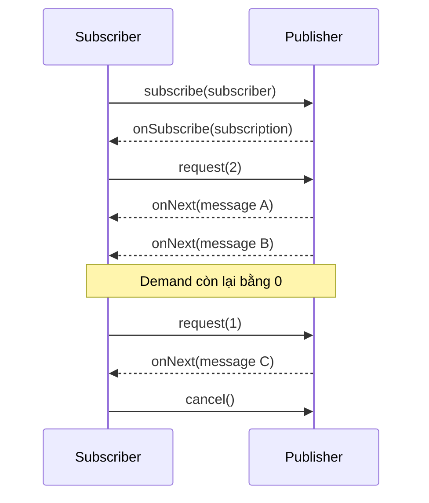

# Backpressure trong reactive flow

## 1. Mục tiêu và tình huống đặt ra

Trong chương **Reactive support** của module **SPRING_INTEGRATION_CORE**, backpressure là cơ chế giúp thiết kế luồng thông điệp phù hợp với khả năng tiếp nhận của bên xử lý. Bài học tập trung vào quan hệ giữa `Message`, `MessageChannel`, endpoint và các toán tử Reactor trong Java DSL.

Sau bài này, bạn có thể:

- Giải thích demand, `request(n)` và sự khác nhau giữa tiếp nhận phần tử với hoàn thành nghiệp vụ.
- Xác định đoạn nào trong integration flow có thể truyền demand về upstream.
- Phối hợp giới hạn concurrency, prefetch và buffer để kiểm soát tải.
- Chọn cách xử lý khi nguồn không thể tạm dừng hoặc khi downstream quá chậm.
- Viết kiểm thử kiểm soát demand, phát hiện overflow và xác minh giới hạn xử lý đồng thời.

Giả sử luồng nhận đơn hàng có tải vào 1.000 message/giây, trong khi dịch vụ giữ hàng chỉ hoàn thành 200 message/giây. Nếu mọi message đều được nhận rồi xếp trong bộ nhớ, backlog tăng xấp xỉ:

```text
Tốc độ tăng backlog = tốc độ nhận - tốc độ hoàn thành
                   = 1.000 - 200
                   = 800 message/giây
```

Với chênh lệch này, một hàng đợi còn trống 4.000 vị trí chỉ hấp thụ được khoảng 5 giây tải vượt mức, theo giả định tốc độ không đổi. Tăng buffer chỉ kéo dài thời gian trước khi đầy; hệ thống vẫn cần giảm tiếp nhận, tăng năng lực xử lý hoặc áp dụng chính sách quá tải.

Đây là ví dụ tính toán phục vụ thiết kế, không phải số đo hiệu năng của Spring Integration.

## 2. Backpressure bắt đầu từ demand

### 2.1. Giao thức giữa Publisher và Subscriber

Trong Reactive Streams, `Publisher` phát dữ liệu, `Subscriber` nhận dữ liệu và `Subscription` quản lý demand cùng thao tác hủy. Subscriber gọi `request(n)` để báo rằng nó có thể tiếp nhận thêm `n` phần tử. Các lần yêu cầu được cộng dồn; publisher không được phát `onNext` vượt quá demand còn lại. `n` phải dương, còn `Long.MAX_VALUE` biểu diễn nhu cầu thực tế không giới hạn. Tín hiệu kết thúc `onComplete` và `onError` không cần chờ demand. Xem [hợp đồng Subscription](https://www.reactive-streams.org/reactive-streams-1.0.4-javadoc/org/reactivestreams/Subscription.html) và [đặc tả Reactive Streams](https://github.com/reactive-streams/reactive-streams-jvm#specification).



Trong ví dụ này, publisher có thể phát ít hơn số đã được yêu cầu nếu nguồn hết dữ liệu hoặc gặp lỗi. Demand cho phép phát, không bắt buộc nguồn tạo đủ dữ liệu ngay lập tức.

Mỗi subscription có trạng thái demand riêng. Không thể lấy một `request(10)` ở một nhánh làm ngân sách chung cho tất cả subscriber hoặc tất cả instance ứng dụng.

### 2.2. Demand không đồng nghĩa với hoàn thành nghiệp vụ

`request(1)` có nghĩa “có thể nhận thêm một phần tử”, không có nghĩa “đã lưu thành công một đơn hàng”.

Xét đoạn sau:

```java
// Ví dụ sai khi muốn khống chế số lời gọi đang chạy.
messages.doOnNext(message ->
    inventoryClient.reserve(message.getPayload()).subscribe()
);
```

Subscription bên trong bị tách khỏi chuỗi bên ngoài. Việc `doOnNext` trả về chỉ cho biết callback đã khởi động công việc. Nó không cho biết giữ hàng đã xong. Chuỗi ngoài không còn dùng thời điểm hoàn thành của từng lời gọi để giải phóng một suất xử lý.

Thay vào đó, cần ghép `Mono` trả về vào chuỗi:

```java
messages.flatMap(
    message -> inventoryClient.reserve(message.getPayload()),
    8,
    1
);
```

Khi mỗi lời gọi được biểu diễn bằng một `Mono` kết thúc đúng lúc thao tác hoàn tất, số inner publisher đang hoạt động trở thành một cách biểu diễn số tác vụ đang xử lý. Đây là cơ sở để giới hạn concurrency có ý nghĩa nghiệp vụ.

Nếu client trả `Mono.empty()` trước khi công việc bên ngoài thực sự kết thúc, hoặc tự tạo subscription trong nội bộ, giả định này không còn đúng.

### 2.3. Backpressure và các giới hạn khác

| Cơ chế | Kiểm soát điều gì? | Ví dụ |
|---|---|---|
| Backpressure | Số phần tử downstream sẵn sàng tiếp nhận qua subscription | `request(16)` |
| Giới hạn concurrency | Số công việc bất đồng bộ đang hoạt động | Tối đa 8 lời gọi giữ hàng |
| Rate limiting | Số lần thực hiện trong một khoảng thời gian | Tối đa 100 lời gọi/giây |
| Bounded buffer | Số phần tử được giữ tại một vị trí chờ | Tối đa 500 message |
| Timeout | Thời gian chờ một thao tác | Chờ phản hồi tối đa 2 giây |
| Acknowledgment | Xác nhận theo giao thức nguồn hoặc broker | ACK sau khi kết quả được lưu |

Một giới hạn concurrency bằng 8 không tương đương 8 request/giây. Nếu mỗi request mất 10 ms, thông lượng có thể khác rất nhiều so với khi mỗi request mất 1 giây. Tương tự, một buffer 500 phần tử không tự quy định thời điểm ACK ở broker.

## 3. Demand đi qua Spring Integration như thế nào?

### 3.1. Vai trò của channel

Spring Integration tổ chức luồng bằng message, channel và endpoint. Loại channel quyết định đáng kể cách endpoint phối hợp.

| Thành phần | Đặc điểm cần nhớ khi thiết kế tải |
|---|---|
| `DirectChannel` | Gọi handler đồng bộ trên luồng gửi trong cách dùng thông thường; handler chậm làm lời gọi gửi chậm theo |
| `QueueChannel` có capacity | Đệm message để consumer lấy sau; cần cấu hình capacity và hành vi gửi khi đầy |
| `ExecutorChannel` | Giao việc qua executor; cần xem cả giới hạn pool, hàng đợi và rejection policy |
| `FluxMessageChannel` | Kết nối với Reactive Streams, cung cấp `Publisher<Message<?>>` và nhận nguồn publisher qua `subscribeTo` |

Việc thread gửi bị chặn và việc subscriber phát tín hiệu demand là hai cơ chế khác nhau. Có thể dùng cả hai trong một ứng dụng, nhưng phải chỉ ra ranh giới chuyển đổi. Tham khảo [Message Channels của Spring Integration](https://docs.spring.io/spring-integration/reference/channel/implementations.html).

### 3.2. FluxMessageChannel và ReactiveStreamsConsumer

`FluxMessageChannel` hỗ trợ tiêu thụ theo giao thức Reactive Streams. Spring Integration dùng `ReactiveStreamsConsumer` để kết nối channel reactive với endpoint phù hợp. Java DSL cũng hỗ trợ bắt đầu flow từ một `Publisher` và dùng `fluxTransform` để đưa một đoạn xử lý Reactor vào flow. Các cơ chế này được mô tả trong [Reactive Streams Support](https://docs.spring.io/spring-integration/reference/reactive-streams.html).

Tuy nhiên, thấy tên `FluxMessageChannel` trong cấu hình chưa đủ để kết luận toàn bộ hệ thống có bộ nhớ được giới hạn:

- Nguồn publisher có thể hợp tác với demand, còn callback bên ngoài có thể tiếp tục đẩy dữ liệu.
- Đoạn imperative gọi `send(message)` không tự biến thành nguồn pull có thể trì hoãn việc tạo message.
- Mỗi toán tử hoặc adapter có thể có prefetch, hàng đợi và chính sách riêng.
- Endpoint có thể gọi JDBC, SDK đồng bộ hoặc thao tác blocking khác.
- Thư viện client có thể có connection pool và hàng đợi chờ độc lập.

Không nên suy ra “gửi vào channel thành công” nghĩa là “downstream đã xử lý thành công”. Kết quả gửi và kết quả nghiệp vụ cần được phân biệt trong hợp đồng của ứng dụng.

### 3.3. Vẽ cả đường dữ liệu và đường demand

```mermaid
flowchart LR
    A["Nguồn hỗ trợ demand"] --> B["Publisher Message"]
    B --> C["Đoạn reactive trong IntegrationFlow"]
    C --> D["flatMap với concurrency hữu hạn"]
    D --> E["Client I/O trả Mono"]
    E --> F["Endpoint nhận kết quả"]
    F -. "demand" .-> E
    E -. "demand qua từng toán tử" .-> D
    D -. "request đã được điều chỉnh" .-> C
    C -. "request" .-> B
    B -. "đọc tiếp khi có khả năng" .-> A
```



Sơ đồ là mô hình khái niệm. Trong thực tế, `flatMap` có subscription cho nguồn ngoài và cho từng inner publisher; không có một bộ đếm demand duy nhất xuyên suốt mọi lớp.

Nếu nguồn đầu là callback từ một thiết bị luôn phát 1.000 sự kiện/giây và không có API pause, đường demand dừng ở adapter chuyển đổi. Tại đó phải có quyết định cụ thể về buffer, từ chối, lưu bền hoặc loại bỏ dữ liệu.

## 4. Các toán tử cần dùng đúng mục đích

### 4.1. limitRate: chia nhỏ yêu cầu về upstream

`limitRate(32)` chia yêu cầu lớn từ downstream thành các đợt nhỏ hơn khi truyền ngược lên upstream. Biến thể `limitRate(32, 0)` dùng các đợt không bổ sung sớm theo cơ chế low tide; một đợt có thể nhỏ hơn 32 nếu demand tương ứng nhỏ hơn. Xem [phần điều chỉnh demand trong Reactor](https://projectreactor.io/docs/core/release/reference/coreFeatures/simple-ways-to-create-a-flux-or-mono-and-subscribe-to-it.html#_on_backpressure_and_ways_to_reshape_requests).

Ví dụ:

```java
Flux<Message<Order>> controlled = source
    .doOnRequest(n -> System.out.println("Source nhận request: " + n))
    .limitRate(32, 0);
```

Tên `limitRate` dễ gây nhầm với giới hạn theo thời gian. Toán tử này không tạo ngân sách “32 message/giây”, cũng không tự giới hạn số lời gọi HTTP đang hoạt động. Nó tác động vào hình dạng yêu cầu dữ liệu ở vị trí được đặt.

Đặt `doOnRequest` trước hoặc sau `limitRate` sẽ quan sát các cạnh subscription khác nhau. Đừng coi mọi con số log được là demand gốc của subscriber cuối.

### 4.2. flatMap: ghép công việc bất đồng bộ với giới hạn concurrency

```java
Flux<ReservationResult> results = source.flatMap(
    message -> inventoryClient.reserve(message.getPayload()),
    8,
    1
);
```

Ở đây:

- `8` giới hạn số inner publisher được subscribe đồng thời.
- `1` là prefetch cho từng inner publisher.
- Kết quả có thể xuất hiện khác thứ tự đầu vào.
- Với inner `Mono` chỉ phát tối đa một kết quả, prefetch bằng 1 đã thể hiện rõ ý định.

`flatMap` không tự tạo thread cho một hàm Java đồng bộ. Khi mapper thực hiện blocking trước khi trả publisher, chỉ cấu hình concurrency không làm phần blocking đó trở thành bất đồng bộ.

Nếu cần xử lý tuần tự, có thể chọn `concatMap`. Nếu cần nhiều thao tác hoạt động đồng thời nhưng phát kết quả theo thứ tự nguồn, cân nhắc `flatMapSequential` và tính cả phần kết quả phải chờ thao tác trước. Xem [API Flux](https://projectreactor.io/docs/core/release/api/reactor/core/publisher/Flux.html).

### 4.3. publishOn: chuyển vị trí thực thi và tạo ranh giới chờ

Một cách dùng thường gặp:

```java
source.publishOn(Schedulers.parallel(), 16);
```

Tham số prefetch giúp kiểm soát phần đọc trước tại ranh giới này. `publishOn` đổi ngữ cảnh thực thi cho các toán tử phía sau; nó không có nghĩa mỗi message sẽ được xử lý song song trên một thread riêng. Tạo nhiều ranh giới như vậy cũng tạo thêm những vị trí có thể giữ dữ liệu. Xem [Threading and Schedulers](https://projectreactor.io/docs/core/release/reference/coreFeatures/schedulers.html).

Với việc blocking, cần cách bố trí khác ở phần 7 thay vì đưa công việc blocking lên scheduler dành cho tác vụ không blocking.

### 4.4. buffer và onBackpressureBuffer giải quyết hai nhu cầu khác nhau

`buffer(20)` tạo batch: một phần tử downstream lúc này là một danh sách, không còn là một message đầu vào. `onBackpressureBuffer(500)` giữ phần tử dư khi downstream chưa có đủ demand.

Đặc biệt, các toán tử `onBackpressureBuffer`, `onBackpressureDrop` và `onBackpressureLatest` yêu cầu upstream theo kiểu không giới hạn rồi áp dụng chính sách cục bộ. Vì vậy, thêm chúng vào một nguồn vốn hỗ trợ demand có thể thay đổi cách demand tác động đến nguồn. Chi tiết nằm trong [nhóm API onBackpressure của Flux](https://projectreactor.io/docs/core/release/api/reactor/core/publisher/Flux.html#onBackpressureBuffer-int-).

Đó là lý do không nên thêm `onBackpressureBuffer()` vào mọi flow như một cấu hình mặc định. Cần biết vì sao phải đệm, đệm ở đâu, giữ tối đa bao nhiêu và làm gì khi đầy.

## 5. Ví dụ Java DSL: giữ hàng với tối đa 8 thao tác đang chạy

### 5.1. Phạm vi ví dụ

Ví dụ dưới đây dùng API Java DSL của Spring Integration 6.x, Java 17 trở lên và Reactor. Các dependency cần có là `spring-integration-core`, `reactor-core`; phần kiểm thử dùng JUnit Jupiter và `reactor-test`. Phiên bản nên được quản lý nhất quán bằng BOM của ứng dụng.

Mã là một cấu hình minh họa để đưa vào ứng dụng Spring đã có bootstrap. Client giả lập dùng `Mono.delay` để thể hiện độ trễ I/O. Nó không gửi yêu cầu giữ hàng thật và không cung cấp lưu trữ bền. Các kiểm thử ở phần sau là mã thực hành, chưa được thực thi trong bài viết.

Ý tưởng:

1. Tạo nguồn hữu hạn gồm 100 `Message<Order>`.
2. Chia demand tại đoạn xử lý thành các đợt tối đa 16.
3. Giữ tối đa 8 inner publisher đang hoạt động tại một subscription của pipeline.
4. Chuyển timeout của từng đơn thành kết quả `TIMED_OUT`.
5. Giữ header nghiệp vụ để liên hệ kết quả với đơn ban đầu.

### 5.2. Cấu hình và pipeline

```java
import java.time.Duration;
import java.util.concurrent.TimeoutException;

import org.springframework.context.annotation.Bean;
import org.springframework.context.annotation.Configuration;
import org.springframework.integration.config.EnableIntegration;
import org.springframework.integration.dsl.IntegrationFlow;
import org.springframework.messaging.Message;
import org.springframework.messaging.support.MessageBuilder;

import reactor.core.publisher.Flux;
import reactor.core.publisher.Mono;

@Configuration
@EnableIntegration
public class BackpressureLesson {

    public record Order(String orderId, String sku, int quantity) {
    }

    public record ReservationResult(String orderId, String status) {
    }

    public interface InventoryClient {
        Mono<ReservationResult> reserve(Order order);
    }

    @Bean
    InventoryClient inventoryClient() {
        return order -> Mono.delay(Duration.ofMillis(100))
            .map(ignored ->
                new ReservationResult(order.orderId(), "RESERVED"));
    }

    @Bean
    IntegrationFlow reservationFlow(InventoryClient client) {
        Flux<Message<Order>> source = Flux.range(1, 100)
            .map(index -> {
                Order order = new Order(
                    "ORDER-" + index, "BOOK-001", 1);

                return MessageBuilder.withPayload(order)
                    .setHeader("orderId", order.orderId())
                    .build();
            });

        return IntegrationFlow.from(source)
            .<Order, Message<ReservationResult>>fluxTransform(
                messages -> reserve(messages, client, 8))
            .handle(ReservationResult.class, (result, headers) -> {
                // Chỉ để quan sát trong demo.
                System.out.println(
                    headers.get("orderId") + " -> " + result.status());
                return null;
            })
            .get();
    }

    static Flux<Message<ReservationResult>> reserve(
            Flux<Message<Order>> messages,
            InventoryClient client,
            int concurrency) {

        return messages
            .limitRate(16, 0)
            .flatMap(message ->
                Mono.defer(() -> client.reserve(message.getPayload()))
                    .timeout(Duration.ofSeconds(2))
                    .map(result -> reply(message, result))
                    .onErrorResume(TimeoutException.class, error ->
                        Mono.just(reply(
                            message,
                            new ReservationResult(
                                message.getPayload().orderId(),
                                "TIMED_OUT")))),
                concurrency,
                1);
    }

    private static Message<ReservationResult> reply(
            Message<Order> request,
            ReservationResult result) {

        return MessageBuilder.withPayload(result)
            .copyHeaders(request.getHeaders())
            .setHeader("reservationStatus", result.status())
            .build();
    }
}
```

`fluxTransform` nhận một hàm xử lý `Flux<Message<I>>`, kết nối đoạn Reactor vào flow và dùng các reactive channel ở hai phía theo cách triển khai của DSL. Ví dụ trả về từng `Message<ReservationResult>` để chủ động giữ header. Tham khảo [API fluxTransform](https://docs.spring.io/spring-integration/docs/6.3.1/api/org/springframework/integration/dsl/BaseIntegrationFlowDefinition.html).

### 5.3. Đọc đúng những bảo đảm của cấu hình

Giới hạn 8 đến từ `flatMap` và vòng đời `Mono` của client. `limitRate(16, 0)` phục vụ cách yêu cầu dữ liệu về upstream, không phải một giới hạn 16 tác vụ và cũng không phải cam kết “toàn ứng dụng chỉ giữ 16 message”.

Con số 8 áp dụng cho mỗi subscription của pipeline. Nếu tạo nhiều pipeline cùng gọi một dịch vụ hoặc chạy nhiều instance, phải tính tổng ngân sách kết nối và tài nguyên bên ngoài. Ví dụ 4 instance, mỗi instance có 8 suất xử lý, có thể tạo tổng cộng khoảng 32 thao tác đồng thời nếu cùng hoạt động.

`Mono.defer` trì hoãn việc gọi client đến lúc inner publisher được subscribe; ngoại lệ đồng bộ từ lời gọi đó cũng có thể trở thành tín hiệu lỗi. Tuy vậy, nếu phần thân của client vẫn blocking thì nó vẫn chiếm thread thực thi. `defer` không phải công cụ chuyển scheduler.

`copyHeaders` giữ các header như `orderId`. Message mới vẫn có danh tính và timestamp riêng theo quy tắc builder; không nên dùng `MessageHeaders.ID` như khóa chống xử lý trùng cho toàn bộ vòng đời nghiệp vụ.

Endpoint cuối trả `null` vì đây là consumer kết thúc demo. `System.out.println` chỉ giúp quan sát; trong hệ thống thật, đoạn ghi kết quả cũng cần được thiết kế theo khả năng tải của nó. Nếu thay bằng một lời gọi bất đồng bộ, phải tiếp tục compose publisher đó vào flow, thay vì gọi `subscribe()` thủ công.

### 5.4. Timeout và kết quả chưa xác định

Ví dụ chỉ phục hồi `TimeoutException` thành dữ liệu `TIMED_OUT`. Các lỗi khác không được cố ý chuyển thành “thành công”.

Timeout cho biết phía gọi đã hết thời gian chờ. Dịch vụ giữ hàng có thể đã nhận yêu cầu và vẫn hoàn thành sau đó. Vì vậy, kết quả `TIMED_OUT` cần dẫn tới quy trình tra cứu hoặc đối soát theo `orderId`; không nên tự động hiểu là hàng chắc chắn chưa được giữ.

Nếu mỗi kết quả bắt buộc phải được lưu trước khi xác nhận nguồn, hãy ghép bước lưu vào cùng publisher và chỉ ACK sau khi bước đó hoàn tất. Việc in log của demo không đáp ứng yêu cầu này.

## 6. Khi nguồn không thể giảm tốc

### 6.1. Xác định chính sách trước khi chọn toán tử

Đối với nguồn callback, cần hỏi: “Khi hệ thống đã đầy, sự kiện tiếp theo sẽ đi đâu?”

| Chính sách | Trường hợp có thể dùng | Điều cần thiết kế thêm |
|---|---|---|
| Buffer hữu hạn | Burst ngắn, có thể chờ trong ngân sách độ trễ | Capacity, tuổi message, hành vi khi đầy |
| Từ chối tiếp nhận | Bên gửi có thể biết việc từ chối và thử lại | Mã phản hồi, backoff, khóa chống trùng |
| Lưu vào nơi bền | Dữ liệu quan trọng, có thể xử lý trễ | Dung lượng, thời hạn lưu, ACK và replay |
| Drop | Mất một số sự kiện được nghiệp vụ chấp nhận | Đếm và quan sát số sự kiện mất |
| Latest | Chỉ cần trạng thái mới nhất của một luồng | Ý nghĩa trạng thái, khóa phân vùng nếu có |
| Kết thúc với lỗi | Không thể tiếp tục đúng hợp đồng | Cách khởi động lại và nguồn dữ liệu để phục hồi |

Một đơn thanh toán và một bản cập nhật nhiệt độ trên dashboard có yêu cầu khác nhau. Không thể chọn drop chỉ vì nó giúp bộ nhớ ổn định.

### 6.2. Buffer hữu hạn có lỗi khi tràn

```java
import reactor.core.publisher.BufferOverflowStrategy;

Flux<Message<Order>> admitted = callbackFlux
    .onBackpressureBuffer(
        500,
        message -> overflowCounter.increment(),
        BufferOverflowStrategy.ERROR);
```

Đây là đoạn ghép minh họa: `callbackFlux` do adapter cung cấp, còn `overflowCounter` là bộ đếm của ứng dụng.

Buffer này giữ hữu hạn tại chính vị trí toán tử. Nó không giới hạn bộ nhớ ở callbackFlux, driver, channel phía trước hoặc hàng đợi executor. Nếu adapter đã đệm không giới hạn trước khi dữ liệu đến đây, thêm buffer hữu hạn ở sau không loại bỏ được vấn đề ở đầu nguồn.

Với overload dùng `BufferOverflowStrategy.ERROR`, lỗi overflow có thể được chuyển xuống sau khi phần backlog hiện có được tiêu thụ. Không nên giả định subscriber nhận lỗi ngay tại thời điểm phần tử đầu tiên vượt capacity; hãy đọc đúng hợp đồng overload đang dùng.

Callback đếm overflow cần ngắn và tránh blocking. Nếu muốn chuyển dữ liệu sang nơi lưu khác, thiết kế một đường tiếp nhận có quản lý khả năng tải và lỗi; không thực hiện một lời gọi lưu trữ chậm ngay trong callback rồi coi đó là cơ chế phục hồi hoàn chỉnh.

### 6.3. Kiểm soát từ điểm callback bằng Sinks

Nếu tự viết adapter, có thể bắt đầu bằng một sink có hàng đợi hữu hạn và kiểm tra kết quả phát:

```java
import java.util.concurrent.ArrayBlockingQueue;

import org.springframework.messaging.Message;
import reactor.core.publisher.Sinks;

Sinks.Many<Message<Order>> ingress = Sinks.many()
    .unicast()
    .onBackpressureBuffer(
        new ArrayBlockingQueue<Message<Order>>(500));

void onExternalEvent(Message<Order> message) {
    Sinks.EmitResult result = ingress.tryEmitNext(message);

    if (result == Sinks.EmitResult.OK) {
        return;
    }

    // Thực hiện hợp đồng từ chối hoặc phục hồi của adapter.
    // Không được bỏ qua các kết quả thất bại.
    handleAdmissionFailure(message, result);
}
```

Đoạn này minh họa các thành viên đặt trong lớp adapter; `handleAdmissionFailure` cần được ứng dụng triển khai. Có thể dùng `ingress.asFlux()` làm publisher đầu vào cho flow. Sink `unicast` chỉ hỗ trợ một subscriber, phù hợp khi adapter có một consumer reactive trực tiếp.

`FAIL_OVERFLOW` cần chính sách quá tải. `FAIL_NON_SERIALIZED` cho biết có phát đồng thời chưa được chấp nhận; `FAIL_CANCELLED` hoặc `FAIL_TERMINATED` liên quan vòng đời sink. Không nên gom tất cả thành “queue đầy” rồi retry vô hạn. Xem [tài liệu Reactor Sinks](https://projectreactor.io/docs/core/release/reference/coreFeatures/sinks.html).

Hàng đợi hữu hạn ở sink là một ranh giới tiếp nhận rõ ràng, nhưng dữ liệu đã được phát sang downstream vẫn có thể đang nằm trong buffer hoặc đang xử lý ở những đoạn khác.

### 6.4. Latest phải phù hợp với ý nghĩa dữ liệu

`onBackpressureLatest()` giữ giá trị mới nhất đang chờ tại một subscription. Nó không tự duy trì “giá trị mới nhất cho mỗi thiết bị” trên một luồng gộp nhiều thiết bị.

Ví dụ, hai cập nhật liên tiếp của thiết bị A và B có thể cạnh tranh cùng một vị trí pending. Nếu nghiệp vụ yêu cầu latest theo từng khóa, cần thiết kế phân vùng hoặc trạng thái theo khóa, có giới hạn số khóa và chính sách hết hạn.

Với lệnh đặt hàng, việc chỉ giữ lệnh mới nhất thường làm mất công việc bắt buộc. Đối với trạng thái hiển thị nhất thời, chính sách này có thể hợp lý sau khi đã xác định rõ yêu cầu.

## 7. Bọc thư viện blocking mà vẫn giữ ngân sách tải

Giả sử client tồn kho chỉ có API đồng bộ. Mẫu bọc phù hợp là trì hoãn lời gọi và chuyển nó sang scheduler dành cho blocking:

```java
Flux<ReservationResult> results = messages.flatMap(
    message -> Mono.fromCallable(() ->
            blockingClient.reserve(message.getPayload()))
        .subscribeOn(Schedulers.boundedElastic()),
    8,
    1
);
```

`blockingClient.reserve` ở đây trả trực tiếp `ReservationResult`, không trả `Mono`. Mẫu `fromCallable` kết hợp `boundedElastic` được hướng dẫn trong [Reactor FAQ về blocking call](https://projectreactor.io/docs/core/release/reference/faq.html#faq.wrap-blocking).

Đối với cấu hình này, cần xét đồng thời:

- Ngân sách 8 inner publisher của pipeline.
- Số connection mà JDBC/HTTP/SDK client thực sự cung cấp.
- Năng lực scheduler và những pipeline khác dùng cùng scheduler.
- Thời gian chờ trong pool và timeout của chính driver.

Giả sử ứng dụng chỉ dành 4 connection cho thao tác này, concurrency bằng 8 có thể khiến một phần công việc chờ lấy connection. Không thể coi mọi thao tác đã được subscribe là một request đã đi ra mạng.

Khi thêm `timeout` cho lời gọi blocking, subscription có thể bị hủy trong khi thread hoặc I/O phía dưới vẫn chưa dừng. Nếu các tác vụ mới được nhận sau timeout nhưng công việc cũ chưa kết thúc thật, số thao tác vật lý có thể vượt giả định dựa trên số subscription đang hoạt động. Vì vậy phải cấu hình timeout và khả năng hủy ở client, cùng giới hạn pool thực tế.

Cũng cần giữ đoạn blocking trong supplier của `fromCallable`. Viết `Mono.just(blockingClient.reserve(order))` sẽ thực hiện lời gọi ngay trước khi `Mono` được tạo.

## 8. Transformer, filter, router và aggregator ảnh hưởng đến tải

Backpressure cần được xem cùng ngữ nghĩa các mẫu tích hợp doanh nghiệp:

| Thành phần | Câu hỏi về tải cần trả lời |
|---|---|
| Transformer | Chuyển đổi có blocking không? Một payload mới có lớn hơn nhiều không? |
| Filter | Sau khi loại message, downstream có cần thêm dữ liệu để đủ demand không? Message bị loại có cần ghi nhận không? |
| Router | Mỗi nhánh có giới hạn riêng không? Tổng số lời gọi vào cùng dịch vụ có vượt ngân sách không? |
| Splitter | Một message được tách thành bao nhiêu phần? Nguồn đã dựng toàn bộ collection trước khi bắt đầu phát chưa? |
| Aggregator | Có bao nhiêu nhóm chưa hoàn thành? Khi nào release hoặc expire? Trạng thái nhóm lưu ở đâu? |
| Gateway | Publisher trả về có được compose vào vòng đời xử lý không? Hủy hoặc timeout có ý nghĩa gì đối với yêu cầu bên ngoài? |

Chẳng hạn, downstream yêu cầu 10 message đi qua filter, nhưng chỉ 1 trong 100 message thỏa điều kiện. Upstream có thể cần xét nhiều hơn 10 message để tạo đủ 10 kết quả. Demand của kết quả không phải giới hạn cứng cho số message nguồn đã được kiểm tra.

Một splitter phát từng phần theo demand vẫn không giảm được bộ nhớ của một danh sách một triệu phần tử đã được tạo từ trước. Muốn tiết kiệm bộ nhớ ở nguồn, phải thay đổi cả cách đọc hoặc tạo các phần tử đó.

Aggregator lại giữ trạng thái giữa nhiều message. Flow có demand hữu hạn vẫn có thể tích lũy nhiều nhóm không bao giờ đủ điều kiện release. Hãy đặt ngân sách cho số nhóm mở, thời gian sống và dung lượng message store, ngoài các buffer của Reactor.

Với gateway trả `Mono`, việc trả reactive type chỉ cung cấp một hợp đồng để compose và trì hoãn xử lý phù hợp. Nó không chứng minh mọi adapter phía dưới đều non-blocking hoặc giao thức nguồn có backpressure xuyên qua mạng.

## 9. Xử lý lỗi, retry và vòng đời subscription

### 9.1. Lỗi của một message và lỗi của nguồn

Có hai lựa chọn thiết kế thường gặp:

- Chuyển lỗi được dự kiến của một message thành kết quả nghiệp vụ, rồi tiếp tục xử lý message khác.
- Cho lỗi đi ra publisher để tầng bao ngoài hoặc cơ chế lỗi của endpoint xử lý.

Trong ví dụ giữ hàng, `onErrorResume` nằm trong mapper của `flatMap` và chỉ xử lý timeout. Vì vậy, timeout của một đơn được gắn lại với chính đơn đó. Nếu đặt phục hồi ở ngoài toàn bộ `flatMap`, bạn đang thay thế chuỗi đã lỗi; đó không phải thao tác tự động tiếp tục từng message còn lại của nguồn cũ.

`doOnError` phù hợp để quan sát lỗi, không tự phục hồi luồng. Khi kết hợp với error channel của Spring Integration, cần phân biệt lỗi phát sinh trong endpoint với lỗi phát ra từ publisher và kiểm tra đúng hành vi của adapter/endpoint đang dùng. Không nên giả định mọi `onError` đều tự được chuyển tới một error channel chung. Xem [xử lý lỗi trong Spring Integration](https://docs.spring.io/spring-integration/reference/error-handling.html).

### 9.2. Retry cũng tiêu thụ năng lực xử lý

Nếu mỗi đơn thử tối đa 3 lần, tải vào dịch vụ phụ thuộc cả số đơn mới và số lần thử lại. Trong một đợt lỗi diện rộng, retry thiếu kiểm soát có thể giữ kín toàn bộ các suất concurrency.

Một chính sách hợp lý cần quyết định loại lỗi được retry, giới hạn số lần thử, backoff, thời hạn tổng và khóa idempotency. Đặt retry quanh một inner publisher thường dễ gắn trách nhiệm với một đơn hơn đặt retry quanh toàn bộ nguồn có khả năng phát lại các đơn trước đó.

Với lệnh giữ hàng, `orderId` hoặc khóa yêu cầu riêng cần được dịch vụ đích dùng để chống thực hiện trùng. Backpressure không tạo ra bảo đảm exactly-once.

### 9.3. Hủy và dừng ứng dụng

Hủy subscription là tín hiệu yêu cầu dừng nhận và giải phóng tài nguyên theo hợp đồng của nguồn. Nó không thu hồi được giao dịch đã commit hoặc chắc chắn đảo ngược yêu cầu đã được hệ thống ngoài chấp nhận.

Khi dừng ứng dụng, cần có quy tắc ngừng tiếp nhận, chờ công việc đang chạy trong thời hạn và xử lý phần chưa hoàn tất. Đối với callback adapter tự viết, đăng ký listener và gỡ listener phải gắn với vòng đời adapter. Nếu downstream đã hủy mà nguồn callback vẫn phát, cần xử lý rõ các kết quả phát thất bại.

## 10. Kiểm thử demand và quá tải bằng StepVerifier

Các kiểm thử dưới đây dùng `reactor-test` và JUnit Jupiter. Đặt lớp kiểm thử cùng package với `BackpressureLesson` ở phần 5 để truy cập phương thức `reserve`. Đây là mã thực hành minh họa; cần chạy trong dự án có dependency tương ứng.

### 10.1. Không phát vượt demand của subscriber

```java
import static org.junit.jupiter.api.Assertions.assertEquals;
import static org.junit.jupiter.api.Assertions.assertFalse;
import static org.junit.jupiter.api.Assertions.assertTrue;

import java.time.Duration;
import java.util.ArrayList;
import java.util.List;
import java.util.concurrent.atomic.AtomicInteger;

import org.junit.jupiter.api.Test;
import org.springframework.messaging.Message;
import org.springframework.messaging.support.MessageBuilder;

import reactor.core.Exceptions;
import reactor.core.publisher.BufferOverflowStrategy;
import reactor.core.publisher.Flux;
import reactor.core.publisher.Mono;
import reactor.test.StepVerifier;

class BackpressureLessonTest {

    @Test
    void emitsOnlyWhatDownstreamRequests() {
        List<Long> upstreamRequests = new ArrayList<>();
        AtomicInteger delivered = new AtomicInteger();

        Flux<Integer> tested = Flux.range(1, 5)
            .hide()
            .doOnRequest(upstreamRequests::add)
            .limitRate(2, 0)
            .doOnNext(value -> delivered.incrementAndGet());

        StepVerifier.create(tested, 0)
            .expectSubscription()
            .then(() -> assertEquals(0, delivered.get()))
            .thenRequest(2)
            .expectNext(1, 2)
            .then(() -> assertEquals(2, delivered.get()))
            .thenRequest(3)
            .expectNext(3, 4, 5)
            .expectComplete()
            .verify(Duration.ofSeconds(1));

        assertFalse(upstreamRequests.isEmpty());
        assertTrue(upstreamRequests.stream()
            .allMatch(n -> n > 0 && n <= 2));
    }

    @Test
    void startsAtMostThreeUnfinishedCalls() {
        AtomicInteger started = new AtomicInteger();

        BackpressureLesson.InventoryClient neverCompletes = order ->
            Mono.defer(() -> {
                started.incrementAndGet();
                return Mono
                    .<BackpressureLesson.ReservationResult>never();
            });

        Flux<Message<BackpressureLesson.Order>> source =
            Flux.range(1, 20)
                .map(index -> MessageBuilder.withPayload(
                    new BackpressureLesson.Order(
                        "ORDER-" + index, "BOOK-001", 1))
                    .build());

        StepVerifier.create(
                BackpressureLesson.reserve(
                    source, neverCompletes, 3),
                1)
            .expectSubscription()
            .then(() -> assertEquals(3, started.get()))
            .thenCancel()
            .verify(Duration.ofSeconds(1));
    }

    @Test
    void reportsOverflowAfterBufferedValuesAreConsumed() {
        Flux<Integer> tested = Flux.range(1, 5)
            .hide()
            .onBackpressureBuffer(
                2, BufferOverflowStrategy.ERROR);

        StepVerifier.create(tested, 0)
            .expectSubscription()
            .thenRequest(2)
            .expectNext(1, 2)
            .expectErrorMatches(Exceptions::isOverflow)
            .verify(Duration.ofSeconds(1));
    }
}
```

Ở ca đầu, `StepVerifier.create(tested, 0)` đặt demand ban đầu bằng 0. Khi downstream chưa yêu cầu, nó không nhận `onNext`. Upstream vẫn có thể đã được `limitRate` yêu cầu đọc trước; đó là lý do bộ đếm `delivered` được đặt sau `limitRate`.

`hide()` được dùng để làm rõ đường quan sát request, tránh một số tối ưu fusion che khuất hành vi mà bài thực hành muốn quan sát. Không cần thêm toán tử này vào production chỉ để mô phỏng kiểm thử.

### 10.2. Đọc đúng ca kiểm thử concurrency

Client giả ở ca thứ hai không bao giờ hoàn thành. Với 3 suất xử lý, pipeline chỉ được bắt đầu 3 lời gọi trước khi test hủy. Kiểm thử kết thúc sớm, trước timeout 2 giây được cấu hình trong pipeline.

Ca này xác minh giới hạn khi các inner publisher còn mở. Nó chưa xác minh việc giải phóng rồi tái sử dụng suất xử lý, timeout, retry hay giới hạn của pool thật. Các yêu cầu đó cần các ca riêng trong dự án.

### 10.3. Overflow vẫn có thể xảy ra với nguồn tuân thủ demand

Ca thứ ba dùng `Flux.range`, một nguồn hỗ trợ demand. Buffer operator tự yêu cầu upstream không giới hạn, trong khi subscriber cuối ban đầu chưa yêu cầu gì. Với capacity bằng 2, nguồn có thể làm đầy buffer rồi gây overflow dù bản thân nguồn không vi phạm Reactive Streams.

Kiểm thử nhận hai giá trị đã đệm trước khi quan sát lỗi theo overload `ERROR` được chọn. Điều này giúp phân biệt lỗi chính sách đệm với lỗi publisher phát vượt demand.

`StepVerifier` hỗ trợ mô tả các bước request, nhận dữ liệu và cancel; thời hạn của `verify` giúp kiểm thử không chờ vô hạn. Xem [hướng dẫn kiểm thử Reactor](https://projectreactor.io/docs/core/release/reference/testing.html) và [API StepVerifier](https://projectreactor.io/docs/test/release/api/reactor/test/StepVerifier.html).

## 11. Chọn capacity và concurrency bằng ngân sách cụ thể

Đừng bắt đầu bằng câu hỏi “buffer bao nhiêu là đủ?”. Hãy bắt đầu từ các giới hạn của hệ thống.

Giả sử dịch vụ giữ hàng cho phép tối đa 20 kết nối từ ứng dụng, trong đó phải dành 4 kết nối cho tác vụ khác. Ngân sách còn lại là 16. Nếu có hai pipeline dùng cùng pool, đặt mỗi pipeline concurrency bằng 16 sẽ có khả năng tranh chấp; cần phân bổ tổng hoặc có một cơ chế giới hạn dùng chung.

Nếu tốc độ ổn định là khoảng 80 message/giây và thời gian trung bình mỗi thao tác là 100 ms, số thao tác trung bình đang xử lý có thể được ước lượng:

```text
L = λ × W
  = 80 × 0,1
  = 8 thao tác
```

Đây là áp dụng quan hệ Little cho một ranh giới ổn định với các đại lượng được đo nhất quán. Nó giúp có giả thuyết ban đầu để thử tải, không bảo đảm concurrency bằng 8 sẽ đáp ứng percentile latency khi tải biến động hoặc khi dịch vụ chậm. Quan hệ này được trình bày trong [ghi chú về queueing theory của MIT](https://web.mit.edu/course/other/urban_or_book/www/book/chapter4/4.4.html).

Khi ước lượng buffer cho burst, có thể dùng:

```text
Backlog tăng thêm ≈ max(0, λ_in - λ_out) × thời gian burst

Bộ nhớ chờ gần đúng
    ≈ tổng số message đang giữ × kích thước message trung bình
      + overhead của object, queue và trạng thái xử lý
```

Ví dụ, burst tăng thêm 300 message/giây trong 2 giây tạo khoảng 600 message chờ nếu downstream giữ nguyên tốc độ. Nếu deadline chỉ cho phép chờ 200 ms, một buffer chứa được 600 message chưa chắc là lựa chọn đúng; message có thể hết hạn trước khi đến lượt.

Kích thước payload trung bình cũng chưa đủ để dự toán heap khi có vài message rất lớn. Cần giới hạn kích thước message hoặc đo thêm phân bố kích thước và các phần dữ liệu được giữ đồng thời.

## 12. Quan sát đúng dấu hiệu hệ thống đang quá tải

Nên theo dõi các đại lượng có ý nghĩa đối với chính flow:

- Số message đã tiếp nhận, hoàn thành, thất bại và bị từ chối.
- Số tác vụ đang chạy, connection đang dùng và tác vụ chờ tài nguyên.
- Độ sâu từng hàng đợi do ứng dụng quản lý và tuổi của message cũ nhất.
- Số lần overflow, drop, timeout, retry và độ trễ hoàn thành.
- Số subscription đang hoạt động, bị hủy hoặc kết thúc do lỗi.

Không phải buffer nội bộ nào cũng có sẵn một gauge chuẩn. Chỉ đo ở điểm có API hoặc instrumentation phù hợp; nếu cần quản lý capacity chính xác, hãy tạo ranh giới tiếp nhận rõ như adapter có hàng đợi hữu hạn.

Một flow có heap ổn định vẫn có thể thất bại về nghiệp vụ nếu message chờ quá lâu, drop không được ghi nhận hoặc mọi suất xử lý đều bị giữ bởi retry. Vì vậy cần xem tuổi message và tỷ lệ hoàn thành cùng với bộ nhớ.

Có thể thêm `doOnRequest` trong giai đoạn học và chẩn đoán để quan sát demand. Trên tải lớn, nên tránh ghi một dòng log cho mỗi tín hiệu; bản thân logging cũng tiêu thụ tài nguyên và có thể làm thay đổi hành vi tải đang đo.

## 13. Các lỗi thường gặp

| Cách làm | Hệ quả | Hướng điều chỉnh |
|---|---|---|
| Thêm `FluxMessageChannel` rồi coi mọi nguồn đều chậm lại được | Bỏ sót điểm đẩy callback và các hàng đợi khác | Xác định rõ ranh giới có thể truyền demand |
| Dùng `limitRate(10)` để giới hạn 10 request/giây | Nhầm batch demand với giới hạn theo thời gian | Chọn thêm cơ chế rate limiting nếu cần |
| Gọi `subscribe()` trong handler cho từng message | Tách vòng đời tác vụ khỏi flow | Compose bằng publisher và giới hạn concurrency |
| Bọc lời gọi blocking trong `Mono.just` | Lời gọi đã chạy trước khi tạo publisher | Dùng `fromCallable` và scheduler phù hợp |
| Dùng `onBackpressureBuffer()` không capacity cho tải kéo dài | Backlog có thể tiếp tục tăng | Đặt giới hạn cùng chính sách quá tải |
| Dùng latest cho mọi loại message | Mất lệnh nghiệp vụ bắt buộc | Chọn chính sách theo ý nghĩa dữ liệu |
| ACK ngay khi xếp vào bộ nhớ | Có thể mất công việc khi tiến trình dừng | ACK theo mốc lưu bền hoặc hoàn thành đã thỏa thuận |
| Tăng concurrency để chữa mọi timeout | Tạo thêm tranh chấp ở dịch vụ hoặc pool | Đo bottleneck trước khi tăng |
| Giới hạn từng flow nhưng bỏ qua nhiều instance | Tổng tải vượt ngân sách hệ thống ngoài | Phân bổ ngân sách ở cấp phù hợp |

## 14. Bài thực hành

Dùng pipeline giữ hàng ở phần 5 và thực hiện lần lượt:

1. Đổi concurrency từ 8 xuống 2, giữ client giả lập 100 ms; quan sát số thao tác hoạt động và thời gian hoàn thành 100 đơn.
2. Giữ concurrency bằng 2, tăng độ trễ client lên 500 ms; giải thích vì sao chỉ tăng `limitRate` không tăng được năng lực hoàn thành của client.
3. Thay nguồn hữu hạn bằng sink có capacity nhỏ; cho producer phát nhanh, kiểm tra `EmitResult` và ghi lại chính sách khi đầy.
4. Thêm một lỗi có chủ đích cho một `orderId`; xử lý riêng lỗi đó bên trong mapper và giữ thông tin liên hệ đơn hàng.
5. Thay bước in kết quả bằng client lưu bất đồng bộ; compose bước lưu và kiểm thử mốc được coi là hoàn thành.
6. Giả lập client không hoàn thành; xác minh timeout tạo trạng thái cần đối soát và không bị hiểu thành chắc chắn chưa thực hiện.
7. Thêm filter hoặc splitter; phân biệt số message nguồn, số message qua filter và số tác vụ bên dịch vụ giữ hàng.
8. Chạy thử tải trong dự án, đo throughput, latency, tuổi message, in-flight và lượng bị từ chối theo cùng một khoảng thời gian.

Kết quả cần giải thích được cho mỗi ranh giới: message được nhận khi nào, có bao nhiêu message có thể chờ, bao nhiêu tác vụ được chạy, khi nào được xem là xong và việc gì xảy ra khi hết khả năng tiếp nhận.

Backpressure phát huy tác dụng khi vòng đời công việc được ghép vào reactive chain và nguồn có thể tuân theo demand. Tại những điểm không đáp ứng được điều đó, flow cần một hợp đồng tiếp nhận và quá tải rõ ràng, phù hợp với dữ liệu nghiệp vụ.
