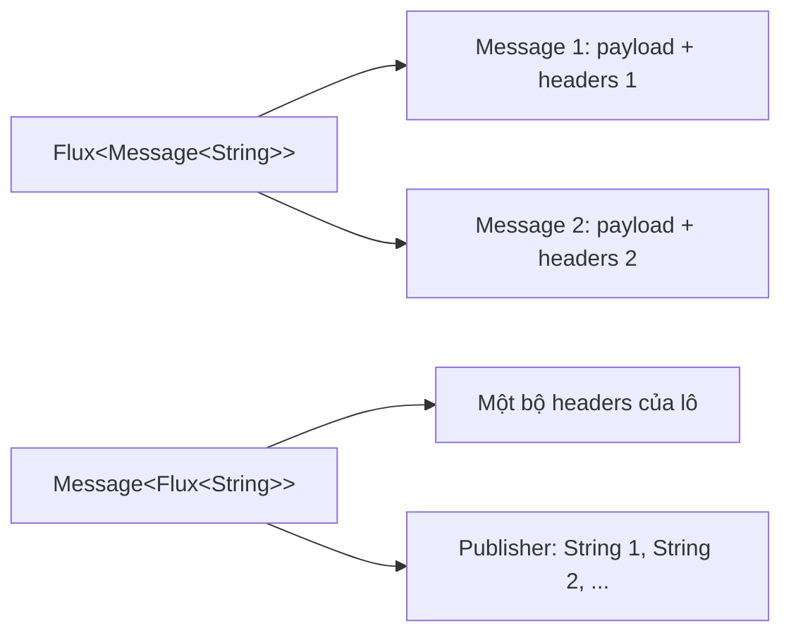
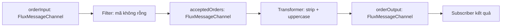

# Flux và Message

## 1. Mục tiêu và phạm vi

Trong chương **Reactive support** của module **SPRING_INTEGRATION_CORE**, bài này kết nối hai mô hình: thông điệp của Spring Integration và luồng dữ liệu của Project Reactor. Đích đến là thiết kế được luồng tích hợp mà dữ liệu, header, nhu cầu tiêu thụ và lỗi đều có ranh giới rõ ràng.

Sau bài học, bạn có thể:

- Phân biệt `Flux<T>`, `Message<T>`, `Flux<Message<T>>` và `Message<Flux<T>>`.
- Đổi payload trong một luồng Reactor mà vẫn giữ metadata nghiệp vụ.
- Dùng `FluxMessageChannel` và Java DSL để nối các endpoint.
- Chọn đúng nơi tách một publisher thành nhiều message, đăng ký subscription và xử lý lỗi.
- Viết kiểm thử cho cả phép biến đổi Reactor và luồng Spring Integration.

Ví dụ dùng Java 17 trở lên, API Spring Integration dòng 6.5 và Reactor. Các thư viện cần có là `spring-integration-core`, `reactor-core`; phần kiểm thử dùng `reactor-test` và JUnit Jupiter. Phiên bản thư viện cần đồng bộ theo BOM của ứng dụng. Các ví dụ ở đây không cần HTTP server hoặc module WebFlux.

## 2. Hai lớp trách nhiệm: phần tử và phong bì

`Message<T>` là một thông điệp gồm payload kiểu `T` và headers. Nó không tự tạo lịch chạy, không có thao tác `request(n)` và không đại diện cho một subscription. Đây là hợp đồng dữ liệu được endpoint và channel trao đổi. Xem [API Message của Spring Framework](https://docs.spring.io/spring-framework/docs/current/javadoc-api/org/springframework/messaging/Message.html).

`Flux<T>` là một `Publisher<T>` có thể phát từ không đến nhiều phần tử. Luồng có thể kết thúc thành công, kết thúc bằng lỗi hoặc tiếp tục tồn tại nếu nguồn chưa kết thúc. Chữ `T` cho biết kiểu của **mỗi phần tử**, không phải kiểu của toàn bộ tập dữ liệu. Xem [API Flux](https://projectreactor.io/docs/core/release/api/reactor/core/publisher/Flux.html).

| Kiểu | Đơn vị đang mô tả | Ví dụ ý nghĩa |
| --- | --- | --- |
| `Message<String>` | Một phong bì chứa chuỗi | Một mã đơn hàng và thông tin tenant |
| `Flux<String>` | Luồng chuỗi | Các mã đơn hàng được phát dần |
| `Flux<Message<String>>` | Luồng các phong bì độc lập | Mỗi đơn có header riêng |
| `Message<Flux<String>>` | Một phong bì chứa một publisher | Một yêu cầu xử lý lô có danh sách đơn đến dần |
| `Mono<Message<String>>` | Kết quả reactive có tối đa một message | Một phản hồi cho một yêu cầu |

Việc đặt hai kiểu lồng nhau ở thứ tự khác nhau làm thay đổi hợp đồng xử lý. Khi thiết kế, hãy ghi ra kiểu ở mỗi ranh giới trước khi chọn operator hoặc endpoint.

### 2.1. Luồng nhiều message

```java
import org.springframework.messaging.Message;
import org.springframework.messaging.support.MessageBuilder;
import reactor.core.publisher.Flux;

Flux<Message<String>> orders = Flux.just(
    MessageBuilder.withPayload(" order-001 ")
        .setHeader("tenantId", "tenant-a")
        .setHeader("traceId", "trace-001")
        .build(),
    MessageBuilder.withPayload(" order-002 ")
        .setHeader("tenantId", "tenant-b")
        .setHeader("traceId", "trace-002")
        .build()
);
```

Subscriber nhận hai lần `onNext`, mỗi lần là một `Message<String>`. Router có thể xét `tenantId` của từng message; filter có thể loại một đơn; cơ chế ghi nhận kết quả cũng có thể gắn với từng `traceId`.

### 2.2. Một message chứa luồng

```java
Message<Flux<String>> batch = MessageBuilder
    .withPayload(Flux.just("order-001", "order-002"))
    .setHeader("batchId", "batch-2026-11-19")
    .setHeader("tenantId", "tenant-a")
    .build();
```

Ở ranh giới gửi message thông thường, đây là **một** message có payload là `Flux<String>`. `batch.getPayload()` chỉ trả về đối tượng publisher; nó không trả ngay một danh sách chuỗi.

Hai chuỗi bên trong chưa có phong bì riêng. Nếu muốn route hoặc retry theo từng đơn, cần tách chúng thành các message con tại một bước được xác định rõ. Một channel thông thường không tự hiểu rằng mọi publisher nằm trong payload đều phải được mở ra. Một số endpoint có hợp đồng xử lý reactive reply riêng; phải xét hợp đồng của endpoint đó.



## 3. Subscription, demand và thời điểm thực thi

Một chuỗi operator là mô tả cách xử lý. Với nguồn cold, dữ liệu được tạo cho mỗi subscription; nguồn hot có thể phát độc lập với thời điểm một subscriber tham gia. Vì vậy, không thể dùng quy tắc “chưa subscribe thì tuyệt đối chưa có việc gì xảy ra” cho mọi nguồn. Tham khảo [Hot versus cold của Reactor](https://projectreactor.io/docs/core/release/reference/advancedFeatures/reactor-hotCold.html).

Vòng tương tác cơ bản là:

```text
Subscriber -- subscribe --> Publisher
Subscriber <-- onSubscribe(Subscription) -- Publisher
Subscriber -- request(n) --> Subscription
Subscriber <-- onNext(message), tối đa theo demand -- Publisher
Subscriber <-- onComplete hoặc onError -- Publisher
Subscriber -- cancel --> Subscription, nếu muốn dừng sớm
```

`request(n)` thể hiện số phần tử subscriber có thể nhận thêm; demand được cộng dồn. `cancel()` yêu cầu nguồn dừng và giải phóng tài nguyên, nhưng không hoàn tác các tác động đã thực hiện. `onComplete` và `onError` là tín hiệu kết thúc, không phải message dữ liệu. Xem [hợp đồng Subscription](https://www.reactive-streams.org/reactive-streams-1.0.4-javadoc/org/reactivestreams/Subscription.html).

Trong `Flux<Message<String>>`, phần tử được đếm là message. Trong publisher bên trong `Message<Flux<String>>`, phần tử được đếm là chuỗi. Hai lớp demand này không tự nối với nhau chỉ vì kiểu Java có lồng `Flux`.

Một message được gửi thành công cũng không chứng minh rằng mọi tác động nghiệp vụ đã hoàn tất. Ví dụ, một channel có thể đã nhận message trong khi subscriber phía sau còn đang ghi dữ liệu. Nếu phía gọi cần biết kết quả cuối, cần một hợp đồng phản hồi hoặc hoàn tất tương ứng.

## 4. Biến đổi payload và bảo toàn headers

Giả sử cần chuẩn hóa mã đơn bằng cách bỏ khoảng trắng và chuyển thành chữ hoa. Với Reactor thuần, có thể giữ message làm đơn vị xử lý:

```java
import java.util.Locale;

import org.springframework.messaging.Message;
import org.springframework.messaging.support.MessageBuilder;
import reactor.core.publisher.Flux;

public final class OrderMessages {

    private OrderMessages() {
    }

    public static Message<String> normalize(Message<String> input) {
        String normalized = input.getPayload()
            .strip()
            .toUpperCase(Locale.ROOT);

        return MessageBuilder.withPayload(normalized)
            .copyHeaders(input.getHeaders())
            .setHeader("normalized", true)
            .build();
    }

    public static Flux<Message<String>> normalizeAll(
            Flux<Message<String>> source) {

        return source
            .filter(message -> !message.getPayload().isBlank())
            .map(OrderMessages::normalize);
    }
}
```

Kết quả của `normalizeAll(orders)` vẫn có kiểu `Flux<Message<String>>`. Header `tenantId` và `traceId` đi cùng kết quả thay vì bị tách khỏi payload.

`MessageBuilder.withPayload(...)` tạo phong bì mới; `copyHeaders(...)` chuyển các header có thể sao chép từ message nguồn. `id` và `timestamp` là header do framework quản lý, không nên dùng chúng làm khóa nghiệp vụ cần giữ nguyên qua mọi phép biến đổi. Hãy dùng header như `traceId`, `orderId` hoặc `batchId` cho mục đích đó. Xem [API MessageBuilder](https://docs.spring.io/spring-framework/docs/current/javadoc-api/org/springframework/messaging/support/MessageBuilder.html).

`MessageHeaders` không cho sửa trực tiếp qua các thao tác như `put`. Điều này cũng không làm cho đối tượng payload tự trở thành bất biến. Dùng `String`, record hoặc kiểu miền bất biến giúp giảm rủi ro chia sẻ trạng thái khi có nhiều nhánh xử lý. Xem [API MessageHeaders](https://docs.spring.io/spring-framework/docs/current/javadoc-api/org/springframework/messaging/MessageHeaders.html).

### 4.1. Hai phép map dễ làm sai hợp đồng

```java
Flux<String> payloadsOnly = orders.map(Message::getPayload);

Flux<Message<String>> rebuiltWithoutBusinessHeaders = payloadsOnly
    .map(value -> MessageBuilder.withPayload(value).build());
```

Phép map đầu tiên hợp lệ nếu phía sau chỉ cần chuỗi. Tuy nhiên, phép map thứ hai không thể tự khôi phục `tenantId` hay `traceId` đã bỏ đi.

Một nhầm lẫn khác là dùng `map` khi hàm trả về publisher:

```java
// normalizeAsync có kiểu: Mono<Message<String>> normalizeAsync(Message<String> m)
// orders.map(service::normalizeAsync)     -> Flux<Mono<Message<String>>>
// orders.concatMap(service::normalizeAsync) -> Flux<Message<String>>
```

Các dòng trên minh họa kiểu kết quả, không khai báo thêm một service cụ thể. Khi đã chọn xử lý bất đồng bộ, cần đồng thời quyết định mức đồng thời và thứ tự đầu ra.

| Nhu cầu | Operator phù hợp | Điều cần xem xét |
| --- | --- | --- |
| Một đầu vào thành một kết quả đồng bộ | `map` | Hàm phải trả về phần tử, không trả `null` |
| Một đầu vào thành publisher, xử lý tuần tự | `concatMap` | Một tác vụ chậm làm các tác vụ sau phải chờ |
| Nhiều publisher được xử lý đồng thời | `flatMap` | Giới hạn concurrency; kết quả có thể xen kẽ |
| Xử lý đồng thời nhưng phát theo thứ tự nguồn | `flatMapSequential` | Có thể cần giữ kết quả đã xong để chờ phần tử trước |

Các hợp đồng về thứ tự và concurrency được mô tả trong [API các operator Flux](https://projectreactor.io/docs/core/release/api/reactor/core/publisher/Flux.html).

## 5. Đưa luồng message vào Spring Integration

### 5.1. Vai trò của FluxMessageChannel

`FluxMessageChannel` vừa là `MessageChannel`, vừa là `Publisher<Message<?>>`. Nó còn nhận nguồn publisher thông qua hợp đồng `ReactiveStreamsSubscribableChannel`. Consumer theo reactive contract là `Subscriber`, khác với cách đăng ký `MessageHandler` trực tiếp trên `SubscribableChannel`.

Để các ranh giới giữa endpoint tiếp tục tham gia xử lý reactive, cần chọn channel tương ứng ở từng ranh giới. Chỉ thay channel đầu tiên chưa đủ để kết luận toàn bộ flow đã có backpressure. Xem [phần FluxMessageChannel trong tài liệu channel](https://docs.spring.io/spring-integration/reference/channel/implementations.html#channel-implementations-fluxmessagechannel).

| Thành phần | Ý nghĩa trong ví dụ |
| --- | --- |
| `FluxMessageChannel` đầu vào | Nhận các message cần chuẩn hóa |
| Filter endpoint | Loại mã chỉ có khoảng trắng |
| `FluxMessageChannel` trung gian | Ranh giới giữa filter và transformer |
| Transformer endpoint | Chuẩn hóa payload |
| `FluxMessageChannel` đầu ra | Publisher cho bên tiêu thụ kết quả |

`FluxMessageChannel` không phải broker bền vững hoặc kho replay lịch sử. Không dùng nó thay cho yêu cầu lưu trữ, xác nhận xử lý và khôi phục sau sự cố của một hệ thống hàng đợi chuyên dụng.

### 5.2. Cấu hình Java DSL có đầy đủ bean

```java
import java.util.Locale;

import org.springframework.beans.factory.annotation.Qualifier;
import org.springframework.context.annotation.Bean;
import org.springframework.context.annotation.Configuration;
import org.springframework.integration.channel.FluxMessageChannel;
import org.springframework.integration.config.EnableIntegration;
import org.springframework.integration.dsl.IntegrationFlow;

@Configuration
@EnableIntegration
public class OrderFlowConfig {

    @Bean
    public FluxMessageChannel orderInput() {
        return new FluxMessageChannel();
    }

    @Bean
    public FluxMessageChannel acceptedOrders() {
        return new FluxMessageChannel();
    }

    @Bean
    public FluxMessageChannel orderOutput() {
        return new FluxMessageChannel();
    }

    @Bean
    public IntegrationFlow normalizeOrderFlow(
            @Qualifier("orderInput") FluxMessageChannel input,
            @Qualifier("acceptedOrders") FluxMessageChannel accepted,
            @Qualifier("orderOutput") FluxMessageChannel output) {

        return IntegrationFlow.from(input)
            .filter(String.class, value -> !value.isBlank())
            .channel(accepted)
            .transform(String.class,
                value -> value.strip().toUpperCase(Locale.ROOT))
            .channel(output)
            .get();
    }
}
```

`@Qualifier` làm rõ bean được nối vì cấu hình có nhiều channel cùng kiểu. `.get()` tạo định nghĩa `IntegrationFlow`; Spring đăng ký và quản lý các thành phần khi cấu hình trở thành một phần của application context.

Transformer ở đây chỉ nhận `String` payload. Với kiểu biến đổi payload này, framework xây dựng reply message và chuyển các header phù hợp từ request. Khi transformer chủ động trả về `Message<?>`, việc xây dựng phong bì cần được xem xét theo hợp đồng trả về đó. Xem [tài liệu Transformer](https://docs.spring.io/spring-integration/reference/6.5/transformer.html).



### 5.3. Hai cách nhập liệu có ý nghĩa khác nhau

Đối với một caller imperative, có thể gửi một message vào `orderInput`:

```java
boolean accepted = input.send(
    MessageBuilder.withPayload(" order-001 ")
        .setHeader("tenantId", "tenant-a")
        .setHeader("traceId", "trace-001")
        .build()
);
```

Ở đây `input` là bean `orderInput` đã lấy từ context; cần gắn subscriber kết quả trước khi phát dữ liệu trong ví dụ. Giá trị trả về của `send()` biểu thị kết quả gửi theo hợp đồng channel, không phải kết quả hoàn tất chuẩn hóa và lưu đơn.

Nếu nguồn đã là publisher, có thể nối nguồn qua `input.subscribeTo(source)` hoặc dùng `IntegrationFlow.from(source)`, với `source` phát các `Message<?>`. Hai cách này cho framework quản lý việc nối nguồn reactive; tránh tự duyệt publisher bằng `block()` rồi gửi từng phần tử.

Việc nối được publisher chưa đủ để bảo đảm tốc độ xử lý nghiệp vụ cuối cùng sẽ điều tiết mọi nguồn bên ngoài. Nguồn phải hỗ trợ demand, và các ranh giới giữa nguồn với tác vụ cuối phải giữ được hợp đồng đó.

## 6. Bắt đầu và kết thúc DSL bằng Publisher

Đây là **cấu hình thay thế độc lập** cho ví dụ channel ở trên. Nó minh họa việc nhập `Flux<Message<String>>` và xuất một publisher message từ DSL:

```java
import java.util.Locale;

import org.reactivestreams.Publisher;
import org.springframework.context.annotation.Bean;
import org.springframework.context.annotation.Configuration;
import org.springframework.integration.config.EnableIntegration;
import org.springframework.integration.dsl.IntegrationFlow;
import org.springframework.messaging.Message;
import org.springframework.messaging.support.MessageBuilder;
import reactor.core.publisher.Flux;

@Configuration
@EnableIntegration
public class PublisherOrderConfig {

    @Bean
    public Publisher<Message<String>> normalizedOrderPublisher() {
        Flux<Message<String>> source = Flux.just(
            MessageBuilder.withPayload(" order-001 ")
                .setHeader("traceId", "trace-001")
                .build(),
            MessageBuilder.withPayload(" order-002 ")
                .setHeader("traceId", "trace-002")
                .build()
        );

        return IntegrationFlow.from(source)
            .transform(String.class,
                value -> value.strip().toUpperCase(Locale.ROOT))
            .toReactivePublisher(true);
    }
}
```

`IntegrationFlow.from(Publisher)` dùng channel reactive làm cầu nối đầu vào. `toReactivePublisher(true)` tạo đầu ra publisher và trì hoãn khởi động flow đến lúc có subscription. Khi publisher kết thúc hoặc bị hủy, vòng đời flow được xử lý tương ứng. Xem [Reactive Streams Support, phần Java DSL](https://docs.spring.io/spring-integration/reference/6.5/reactive-streams.html#reactive-streams-java-dsl).

Đây là publisher gắn với các thành phần có vòng đời của Spring Integration. Không mặc định coi mỗi subscription là một flow hoàn toàn mới, hoặc coi nó là bản sao cold nguyên vẹn của `source`. Với nguồn nóng và nhiều subscriber, cần thiết kế rõ việc chia sẻ, thời điểm khởi động và hủy đăng ký.

Một nguồn hữu hạn phát hai phần tử cũng không tự chứng minh rằng channel đầu ra của một flow dài hạn sẽ đóng ngay sau hai phần tử. Kiểm thử cần dựa trên hợp đồng đầu ra đã chọn; nếu chỉ cần kiểm tra hai message trên channel còn hoạt động, có thể nhận hai message rồi hủy subscription.

## 7. Chuyển Message<Flux<T>> thành Flux<Message<T>>

### 7.1. Tách bằng Reactor và quyết định header rõ ràng

Phương thức sau có thể thêm vào lớp `OrderMessages` ở mục 4:

```java
public static Flux<Message<String>> expandBatch(
        Message<Flux<String>> batch) {

    return batch.getPayload()
        .map(value -> MessageBuilder.withPayload(value)
            .setHeader("batchId", batch.getHeaders().get("batchId"))
            .setHeader("tenantId", batch.getHeaders().get("tenantId"))
            .build());
}
```

Ở đây mỗi mã đơn được gói vào message mới. Chỉ `batchId` và `tenantId` được chọn để truyền xuống. Không sao chép mù quáng `replyChannel` của yêu cầu lô vào mọi message con nếu caller chỉ chờ một phản hồi tổng hợp.

Nếu có một luồng lô:

```java
Flux<Message<Flux<String>>> batches = Flux.just(batch);

Flux<Message<String>> individualOrders = batches
    .concatMap(OrderMessages::expandBatch);
```

`concatMap` xử lý xong publisher của lô trước mới sang lô sau. Nếu mỗi lô là luồng vô hạn, các lô phía sau sẽ không được bắt đầu theo cấu trúc này. Với dữ liệu sự kiện liên tục, cần quyết định xử lý xen kẽ và concurrency phù hợp với nghiệp vụ.

### 7.2. Tách bằng splitter của Spring Integration

Trong DSL, `.split()` mặc định có thể tách payload là `Publisher`. Để việc tách được thực hiện theo cơ chế reactive, đặt output của splitter là một `ReactiveStreamsSubscribableChannel`, chẳng hạn `FluxMessageChannel`. Nếu output là channel imperative, không được suy ra rằng thao tác tách vẫn giữ nguyên đặc tính non-blocking. Xem [Splitter: Stream and Flux](https://docs.spring.io/spring-integration/reference/6.5/splitter.html#splitter-stream-and-flux).

Ví dụ sau là phương thức bean bổ sung; `batchInput` và `batchItems` phải được khai báo là các bean `FluxMessageChannel` riêng như cách khai báo ở mục 5:

```java
@Bean
public IntegrationFlow splitBatchFlow(
        @Qualifier("batchInput") FluxMessageChannel input,
        @Qualifier("batchItems") FluxMessageChannel items,
        @Qualifier("orderOutput") FluxMessageChannel output) {

    return IntegrationFlow.from(input)
        .split()
        .channel(items)
        .transform(String.class,
            value -> value.strip().toUpperCase(Locale.ROOT))
        .channel(output)
        .get();
}
```

Đầu vào của flow này là `Message<Flux<String>>`, nhưng transformer sau splitter nhận payload `String`. Việc tách không thay thế bước kiểm tra hợp lệ từng đơn; có thể bổ sung filter và channel ở ranh giới cần thiết.

Không ghép mặc định “split publisher rồi aggregate theo tổng số phần tử” khi chưa biết tổng số. Với nguồn không xác định kích thước, `sequenceSize` có thể là `0`; release strategy dựa vào kích thước nhóm khi đó không đủ. Cần điều kiện hoàn tất nghiệp vụ, cửa sổ thời gian hoặc chiến lược giải phóng nhóm phù hợp. Tham khảo [hợp đồng splitter và sequence headers](https://docs.spring.io/spring-integration/reference/6.5/splitter.html).

## 8. Backpressure phải được đọc theo từng ranh giới

Giả sử nguồn có thể phát 10.000 đơn mỗi giây nhưng dịch vụ đích chỉ xử lý được 1.000 đơn mỗi giây. Bọc payload vào `Flux` không giải quyết được chênh lệch này.

| Ranh giới | Điều cần xác định |
| --- | --- |
| Nguồn dữ liệu | Nguồn có phản ứng với `request(n)` không? |
| Adapter hoặc channel | Có nhận publisher trực tiếp hay chỉ nhận lời gọi `send()`? |
| Chuỗi operator | Có prefetch, buffer hoặc mức đồng thời nào? |
| Dịch vụ ngoài | Giới hạn kết nối và số yêu cầu đang xử lý là bao nhiêu? |
| Khi quá tải | Chờ, từ chối, bỏ dữ liệu theo chính sách hay lưu vào hàng đợi bền vững? |

Demand của subscriber cuối có thể được operator trung gian điều chỉnh. Ví dụ, operator có prefetch có thể yêu cầu trước nhiều phần tử; `flatMap` có thể giữ nhiều tác vụ đang chạy. Vì vậy, không dùng số `request(1)` ở đầu ra để khẳng định mọi bước phía trên chỉ có đúng một message trong bộ nhớ.

### 8.1. send() là một ranh giới imperative

```java
// Vòng lặp imperative: không chờ demand của nguồn qua Reactive Streams.
for (String code : codes) {
    input.send(MessageBuilder.withPayload(code).build());
}
```

`codes` ở đây là tập mã đã có của ứng dụng. Khi producer gọi `send()` liên tục, cần kiểm tra khả năng nhận, lỗi và chính sách quá tải ở chính ranh giới đó. Việc channel phía sau cho phép subscribe không tự biến vòng lặp thành một nguồn được điều tiết bằng demand.

Khi có thể, nối một nguồn hỗ trợ Reactive Streams vào channel bằng hợp đồng nhận publisher. Với nguồn không thể giảm tốc, hãy lựa chọn và đo chính sách buffering hoặc từ chối thay vì mặc định giữ vô hạn trong bộ nhớ.

### 8.2. Reactive không tự đổi thread và không tự xóa blocking

`Flux` không mặc định tạo thread riêng cho từng message. `publishOn` và `subscribeOn` quyết định các khía cạnh khác nhau của lịch thực thi. Xem [Threading and Schedulers](https://projectreactor.io/docs/core/release/reference/coreFeatures/schedulers.html).

Nếu buộc phải gọi thư viện blocking, có thể bọc lời gọi bằng `Mono.fromCallable(...).subscribeOn(Schedulers.boundedElastic())`. Cách này chuyển công việc chờ sang scheduler thích hợp; thư viện gốc vẫn blocking và cần giới hạn concurrency. Xem [hướng dẫn bọc lời gọi blocking của Reactor](https://projectreactor.io/docs/core/release/reference/faq.html#faq.wrap-blocking).

Không đặt `block()` trong transformer để lấy giá trị từ publisher. Điều đó làm mất khả năng kết hợp reactive, có thể chặn thread xử lý sự kiện và khiến timeout hoặc hủy đăng ký khó kiểm soát.

## 9. Xử lý lỗi: lỗi luồng và kết quả thất bại của từng message

Trong Reactor, `onError` kết thúc chuỗi hiện tại. `onErrorResume` thay chuỗi bị lỗi bằng một publisher khác; nó không quay lại tiếp tục chuỗi nguồn đã hỏng. Đặt recovery ở ngoài cùng có thể khiến các đơn phía sau không còn được xử lý. Xem [Handling Errors của Reactor](https://projectreactor.io/docs/core/release/reference/coreFeatures/error-handling.html).

### 9.1. Ví dụ lỗi kết thúc luồng

```java
Flux<Integer> parsed = Flux.just("10", "bad", "20")
    .map(Integer::parseInt);
```

Khi subscribe, chuỗi phát `10`, sau đó báo lỗi ở `bad`. Nó không phát `20`. Viết `parsed.onErrorResume(error -> Flux.empty())` biến lỗi thành hoàn tất của nhánh thay thế, nhưng cũng không khôi phục phần tử `20` của chuỗi nguồn ban đầu.

### 9.2. Biến lỗi hợp lệ của từng đơn thành kết quả dữ liệu

Nếu nghiệp vụ yêu cầu xử lý tiếp các đơn còn lại, đặt recovery trong publisher của từng message. Ví dụ độc lập dưới đây phân tích payload thành số và trả kết quả có cấu trúc:

```java
import org.springframework.messaging.Message;
import org.springframework.messaging.support.MessageBuilder;
import reactor.core.publisher.Flux;
import reactor.core.publisher.Mono;

public final class ParsingFlow {

    public record ParseResult(String input, Integer value, String error) {
    }

    private ParsingFlow() {
    }

    public static Flux<Message<ParseResult>> parseEach(
            Flux<Message<String>> source) {

        return source.concatMap(message ->
            Mono.fromCallable(() -> new ParseResult(
                    message.getPayload(),
                    Integer.parseInt(message.getPayload()),
                    null))
                .onErrorResume(NumberFormatException.class,
                    error -> Mono.just(new ParseResult(
                        message.getPayload(), null, "INVALID_INTEGER")))
                .map(result -> MessageBuilder.withPayload(result)
                    .copyHeaders(message.getHeaders())
                    .build())
        );
    }
}
```

Với ba message có payload `10`, `bad`, `20`, hàm trả ba message kết quả. Phần tử giữa có `error = "INVALID_INTEGER"`; hai phần tử còn lại có giá trị phân tích thành công. Giá trị `null` ở đây là trường bên trong record, không phải phần tử `null` được phát vào Reactor.

Chỉ lỗi dự kiến `NumberFormatException` được chuyển thành kết quả dữ liệu. Lỗi lập trình hoặc hỏng hạ tầng vẫn cần chính sách riêng. Phía sau có thể dùng router để chuyển `ParseResult` thất bại sang nhánh xử lý lỗi nghiệp vụ.

### 9.3. ErrorMessage và errorChannel là hợp đồng khác

Spring Integration có `ErrorMessage` và cơ chế `errorChannel` cho các tình huống messaging. Đường đi của lỗi còn phụ thuộc endpoint, channel, adapter và cơ chế điều khiển thực thi. Không mặc định mọi tín hiệu `onError` của một publisher bất kỳ đều sẽ thành message trên bean `errorChannel`. Xem [Error Handling của Spring Integration](https://docs.spring.io/spring-integration/reference/6.5/error-handling.html).

Khi thiết kế, xác định rõ lỗi được trả qua publisher, phản hồi gateway, `ErrorMessage` hay kết quả nghiệp vụ. Nếu cần truy vết đơn bị lỗi, giữ `traceId` hoặc tham chiếu request tại điểm chuyển đổi.

Retry cũng tạo subscription lại trong phạm vi được cấu hình. Nếu retry bao quanh cả một nguồn cold có tác động ghi, các đơn đã xử lý trước đó có thể chạy lại. Phạm vi retry nên bám sát thao tác thất bại, đi kèm khóa idempotency khi nghiệp vụ cần chống ghi trùng.

## 10. Kiểm thử hợp đồng Flux và Message

`StepVerifier` tạo subscription và mô tả các tín hiệu mong đợi. Có thể bắt đầu với demand bằng `0`, yêu cầu từng phần tử, kiểm tra lỗi hoặc chủ động hủy. Đặt thời hạn `verify(...)` giúp kiểm thử không chờ vô hạn. Xem [Testing của Reactor](https://projectreactor.io/docs/core/release/reference/testing.html).

Các đoạn sau là mã kiểm thử minh họa để đặt trong dự án có các dependency đã nêu ở mục 1; kết quả mong đợi được giải thích theo hợp đồng, không phải báo cáo đã chạy kiểm thử.

### 10.1. Kiểm thử phép biến đổi và headers

Lớp kiểm thử này dùng `OrderMessages` ở mục 4:

```java
import java.time.Duration;

import org.junit.jupiter.api.Test;
import org.springframework.messaging.Message;
import org.springframework.messaging.support.MessageBuilder;
import reactor.core.publisher.Flux;
import reactor.test.StepVerifier;

import static org.junit.jupiter.api.Assertions.assertEquals;

class OrderMessagesTest {

    @Test
    void normalizesPayloadAndRetainsBusinessHeaders() {
        Message<String> input = MessageBuilder
            .withPayload(" order-001 ")
            .setHeader("tenantId", "tenant-a")
            .setHeader("traceId", "trace-001")
            .build();

        StepVerifier.create(
                OrderMessages.normalizeAll(Flux.just(input)), 0)
            .thenRequest(1)
            .assertNext(message -> {
                assertEquals("ORDER-001", message.getPayload());
                assertEquals("tenant-a",
                    message.getHeaders().get("tenantId"));
                assertEquals("trace-001",
                    message.getHeaders().get("traceId"));
                assertEquals(Boolean.TRUE,
                    message.getHeaders().get("normalized"));
            })
            .expectComplete()
            .verify(Duration.ofSeconds(3));
    }

    @Test
    void filtersBlankPayloads() {
        Flux<Message<String>> source = Flux.just(
            MessageBuilder.withPayload("   ").build());

        StepVerifier.create(OrderMessages.normalizeAll(source))
            .expectComplete()
            .verify(Duration.ofSeconds(3));
    }
}
```

Kiểm thử đầu xác nhận cả dữ liệu lẫn metadata; kiểm thử thứ hai xác nhận hợp đồng không phát phần tử khi bị filter. Không chỉ so sánh chuỗi rồi bỏ qua khả năng mất header.

### 10.2. Kiểm thử flow với application context thật

Kiểm thử sau dùng `OrderFlowConfig` ở mục 5. Nó gắn subscriber đầu ra trước, sau đó mới gửi dữ liệu. Vì channel đầu ra được giữ sống cùng context, kiểm thử hủy sau khi nhận đủ message thay vì chờ channel tự hoàn tất.

```java
import java.time.Duration;

import org.junit.jupiter.api.Test;
import org.springframework.context.annotation.AnnotationConfigApplicationContext;
import org.springframework.integration.channel.FluxMessageChannel;
import org.springframework.messaging.Message;
import org.springframework.messaging.support.MessageBuilder;
import reactor.core.publisher.Flux;
import reactor.test.StepVerifier;

import static org.junit.jupiter.api.Assertions.assertEquals;
import static org.junit.jupiter.api.Assertions.assertTrue;

class OrderFlowTest {

    @Test
    void filtersAndTransformsMessagesThroughReactiveChannels() {
        try (var context = new AnnotationConfigApplicationContext(
                OrderFlowConfig.class)) {

            FluxMessageChannel input = context.getBean(
                "orderInput", FluxMessageChannel.class);
            FluxMessageChannel output = context.getBean(
                "orderOutput", FluxMessageChannel.class);

            Message<String> first = MessageBuilder
                .withPayload(" order-001 ")
                .setHeader("traceId", "trace-001")
                .build();

            StepVerifier.create(Flux.from(output), 0)
                .thenRequest(1)
                .then(() -> assertTrue(input.send(first)))
                .assertNext(message -> {
                    assertEquals("ORDER-001", message.getPayload());
                    assertEquals("trace-001",
                        message.getHeaders().get("traceId"));
                })
                .thenRequest(1)
                .then(() -> assertTrue(input.send(
                    MessageBuilder.withPayload("   ").build())))
                .then(() -> assertTrue(input.send(
                    MessageBuilder.withPayload(" order-002 ").build())))
                .assertNext(message ->
                    assertEquals("ORDER-002", message.getPayload()))
                .thenCancel()
                .verify(Duration.ofSeconds(3));
        }
    }
}
```

Nếu filter không hoạt động, message chứa khoảng trắng sẽ trở thành phần tử tiếp theo và assertion cho `ORDER-002` thất bại. Vì vậy, kiểm thử không cần dựa vào `Thread.sleep()` để suy đoán rằng một message đã bị loại.

Việc dùng demand bằng `0` rồi `thenRequest(1)` ở đây kiểm tra hành vi tiêu thụ đầu ra. Nó không chứng minh producer dùng `send()` đã được điều tiết theo demand đến tận nguồn.

### 10.3. Kiểm thử một lỗi terminal của Reactor

Đoạn sau có thể thêm làm một phương thức `@Test` trong lớp kiểm thử đã import `Flux`, `StepVerifier`, `Duration` và `Test`:

```java
@Test
void parseErrorTerminatesTheSequence() {
    StepVerifier.create(
            Flux.just("10", "bad", "20").map(Integer::parseInt))
        .expectNext(10)
        .expectError(NumberFormatException.class)
        .verify(Duration.ofSeconds(3));
}
```

Kiểm thử này áp dụng cho pipeline Reactor trực tiếp. Với lỗi phát sinh bên trong endpoint Spring Integration, cần kiểm tra thêm cách endpoint bọc hoặc chuyển lỗi theo cấu hình cụ thể.

## 11. Quản lý subscription, vòng đời và metadata

### 11.1. Ai sở hữu subscription?

Ở biên ngoài cùng của ứng dụng, một thành phần có trách nhiệm subscribe và hủy khi dừng. Trong flow do Spring quản lý, framework thiết lập các consumer cần thiết. Trong kiểm thử, `StepVerifier` đóng vai trò subscriber.

Tránh gọi `subscribe()` bên trong một hàm `map`, transformer hoặc service chỉ để khởi chạy publisher rồi trả về ngay. Cách làm đó tạo công việc tách khỏi chuỗi chính: bên gọi khó biết khi nào xong, lỗi khó quay về đúng request và cancellation của chuỗi ngoài có thể không quản lý được tác vụ bên trong.

Khi caller thực sự phải tự subscribe ở biên ứng dụng, cần quản lý đối tượng đăng ký trả về và đường xử lý lỗi. Không thêm subscriber phục vụ log nếu việc đăng ký lại có thể làm chạy lại nguồn; quan sát trong chuỗi bằng `doOnNext` hoặc công cụ quan sát thích hợp.

### 11.2. Header của message và Reactor Context

Header gắn với message; Reactor `Context` gắn với subscription. Chúng không tự đồng bộ chỉ vì cùng chứa giá trị tên `traceId`. Nếu cần chuyển metadata giữa hai cơ chế, phải có quy tắc cầu nối tại ranh giới. Xem [Adding a Context to a Reactive Sequence](https://projectreactor.io/docs/core/release/reference/advancedFeatures/context.html).

Một subscription có thể xử lý message từ nhiều tenant. Vì thế, dữ liệu tenant của từng đơn nên tiếp tục đi cùng message, không nên được suy ra từ một biến dùng chung hoặc một `ThreadLocal` không được quản lý theo reactive context.

### 11.3. Gateway không thay thế việc xác định kiểu phản hồi

Gateway giúp caller gọi một hợp đồng ứng dụng thay vì tự gửi qua channel. Tuy nhiên, vẫn phải xác định caller đang chờ một kết quả, nhiều kết quả hay một message chứa publisher.

Không mặc định khai báo một phương thức trả `Flux<T>` là đã biến toàn bộ flow phía sau thành nhiều phản hồi độc lập. Cần xác định gateway và endpoint hỗ trợ kiểu reactive nào, reply channel được quản lý ra sao và ai subscribe publisher trả về. Trong bài này, publisher đầu ra được minh họa trực tiếp để làm rõ các ranh giới đó.

## 12. Lỗi thiết kế thường gặp

| Hiện tượng | Nguyên nhân có thể | Hướng xử lý |
| --- | --- | --- |
| Router nhận payload là `Flux`, không phải mã đơn | Gửi `Message<Flux<String>>` mà chưa tách | Thêm splitter hoặc bước chuyển đổi có chủ đích |
| Mất `tenantId` sau khi chuẩn hóa | Chỉ lấy payload rồi xây message mới | Giữ message hoặc sao chép header cần thiết |
| Dữ liệu đầu ra xuất hiện sai thứ tự | Dùng `flatMap` với tác vụ có thời gian khác nhau | Chọn `concatMap` hoặc `flatMapSequential` theo yêu cầu |
| Một lỗi làm dừng xử lý các đơn sau | Recovery nằm ở cấp toàn luồng | Chuyển lỗi dự kiến thành kết quả ở cấp từng message |
| Ghi dữ liệu bị lặp khi bật retry | Subscription lại nguồn có side effect | Thu hẹp retry và thiết kế idempotency |
| Kiểm thử chờ mãi sau khi đã nhận đủ message | Chờ `onComplete` trên channel dài hạn | Hủy sau số phần tử cần kiểm tra; giới hạn thời gian verify |
| Có kết quả bất ngờ khi thêm log | Tạo thêm subscription vào nguồn cold | Quan sát trong chuỗi, kiểm soát số lần đăng ký |
| Bộ nhớ vẫn tăng dù có channel reactive | Nguồn push hoặc buffer không có giới hạn phù hợp | Kiểm tra từng ranh giới, concurrency và chính sách quá tải |
| Không bắt được lỗi bằng `try/catch` quanh lúc tạo Flux | Lỗi phát sinh sau đó lúc subscription | Xử lý trong chuỗi hoặc tại subscriber sở hữu kết quả |
| Mã reactive vẫn chặn thread | Có I/O blocking hoặc `block()` trong endpoint | Dùng client reactive hoặc cô lập lời gọi blocking có giới hạn |

## 13. Áp dụng vào luồng tích hợp nghiệp vụ

Với yêu cầu “nhận nhiều đơn, chuẩn hóa, phân tuyến và ghi kết quả”, hãy xác định hợp đồng theo trình tự:

1. **Đơn vị xử lý:** mỗi đơn là một `Message<Order>` hay một lô là `Message<Flux<Order>>`?
2. **Metadata:** giá trị nào cần giữ theo từng đơn, chẳng hạn tenant, trace và khóa chống trùng?
3. **Số lượng đầu ra:** filter có thể tạo không phần tử; splitter tạo nhiều phần tử; aggregator cần điều kiện hoàn tất rõ ràng.
4. **Điều tiết:** nguồn nào hỗ trợ demand, nơi nào có buffering và nơi nào còn lời gọi imperative?
5. **Thứ tự:** cần theo toàn luồng, theo đơn hay theo từng khóa nghiệp vụ?
6. **Lỗi:** lỗi nào thành kết quả thất bại của một đơn, lỗi nào phải kết thúc luồng hoặc đi vào cơ chế lỗi của integration?
7. **Vòng đời:** ai subscribe, ai hủy, ai biết tác động nghiệp vụ cuối đã hoàn tất?
8. **Kiểm thử:** xác nhận payload, header, phần tử bị loại, lỗi và hủy đăng ký theo đúng hợp đồng.

Ví dụ trong bài dùng chuỗi để giữ phần chuyển đổi rõ ràng. Khi thay bằng kiểu miền `Order`, nguyên tắc vẫn giữ nguyên: `Flux` điều khiển chuỗi phần tử; `Message` mang dữ liệu và metadata của từng đơn vị tích hợp. Chọn đúng cấu trúc kiểu giúp transformer, router, filter, splitter và các nhánh xử lý lỗi nối với nhau mà không phải đoán ý nghĩa payload.
