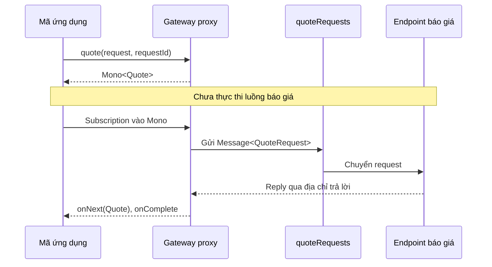

# Reactive gateway

Trong chương **Reactive support** của module **SPRING_INTEGRATION_CORE**, reactive gateway là điểm nối giữa mã ứng dụng dùng Project Reactor và luồng thông điệp Spring Integration. Ứng dụng gọi một phương thức nghiệp vụ; phía sau phương thức vẫn là `Message`, `MessageChannel`, endpoint và cơ chế trả lời của luồng tích hợp.

Bài này xây dựng một luồng báo giá bằng Java DSL. Sau khi học, bạn có thể khai báo gateway trả về `Mono`, xác định lúc thông điệp được gửi, ghép gateway vào một chuỗi Reactor và thiết kế đường thành công, đường lỗi, thời hạn chờ cho từng yêu cầu.

Ví dụ dùng Java 17 và API Spring Integration 6.5.x. Cần biết cấu trúc message, `DirectChannel`, service activator và hai tín hiệu kết thúc `onComplete`, `onError` của Reactor. Đây là ví dụ về Spring Integration Core; không cần máy chủ HTTP hay hệ thống bên ngoài.

## 1. Hợp đồng của reactive gateway

Gateway che giấu API gửi và nhận thông điệp sau một interface Java. Với kiểu trả về `Mono<T>`, việc thực thi luồng được trì hoãn đến khi có subscription. `Mono` hỗ trợ tối đa một giá trị; nó cũng có thể kết thúc bằng lỗi. Xem [Messaging Gateways](https://docs.spring.io/spring-integration/reference/6.5/gateway.html) và [hợp đồng Mono](https://projectreactor.io/docs/core/release/api/reactor/core/publisher/Mono.html).

Ví dụ một hợp đồng nghiệp vụ:

```java
@MessagingGateway(defaultRequestChannel = "quoteRequests")
public interface QuoteGateway {

    Mono<Quote> quote(
            QuoteRequest request,
            @Header("requestId") String requestId);
}
```

Ý nghĩa của interface này trong bài:

| Thành phần | Vai trò trong yêu cầu báo giá |
|---|---|
| `QuoteRequest` | Payload gồm mã sản phẩm và số lượng |
| `requestId` | Header nghiệp vụ để theo dõi cùng một yêu cầu |
| `quoteRequests` | Kênh tiếp nhận request |
| `Mono<Quote>` | Kết quả của một lần trao đổi request–reply |
| Endpoint báo giá | Kiểm tra dữ liệu và tạo kết quả |

`requestId` giúp tìm log và liên kết dữ liệu nghiệp vụ. Nó không tự thay thế cơ chế chuyển reply về đúng gateway.

### 1.1. Gọi phương thức và thực thi yêu cầu là hai thời điểm khác nhau

```java
Mono<Quote> pending =
        gateway.quote(new QuoteRequest("BOOK-01", 2), "req-1001");

// Chưa có subscriber: luồng báo giá chưa được thực thi.
Mono<Quote> observed = pending.doOnNext(System.out::println);

// doOnNext chỉ bổ sung hành vi; observed vẫn cần được subscribe.
```

Một publisher đã được tạo nhưng bị bỏ quên là nguyên nhân phổ biến khiến ứng dụng không gửi yêu cầu. Trong ứng dụng reactive, hãy trả publisher lên tầng quản lý vòng đời subscription hoặc ghép nó vào publisher lớn hơn.



Đừng diễn giải tính trì hoãn thành cam kết rằng mọi lỗi đều xuất hiện sau subscription. Việc tạo proxy, tìm cấu hình hoặc ánh xạ lời gọi vẫn có thể thất bại sớm. Khi cần đưa cả lời gọi gateway vào cùng đường xử lý tín hiệu, có thể bọc nó bằng `Mono.defer`:

```java
Mono<Quote> result = Mono.defer(() ->
        gateway.quote(new QuoteRequest("BOOK-01", 2), "req-1001"));
```

### 1.2. Reply quay về đâu?

Với luồng request–reply, gateway cung cấp địa chỉ trả lời trong header `replyChannel`. Endpoint cuối có thể dùng địa chỉ đó khi không cấu hình output channel riêng. Vì vậy ví dụ không cần một bean `quoteReplies`. Cơ chế này được mô tả trong [Service Activator](https://docs.spring.io/spring-integration/reference/6.5/service-activator.html).

Nếu tự tạo lại toàn bộ message trong một transformer, cần giữ các header kỹ thuật cần thiết. Ví dụ, đổi payload nhưng làm mất `replyChannel` có thể khiến endpoint tính đúng báo giá mà caller vẫn không nhận được kết quả.

## 2. Xây dựng luồng báo giá bằng Java DSL

Thiết kế của ví dụ:

```text
QuoteGateway
    -> quoteRequests (DirectChannel)
    -> service activator trả về Mono<Quote>, async = true
    -> replyChannel của request
    -> Mono<Quote> phía caller
```

Dịch vụ tính giá trong bộ nhớ để tập trung vào gateway. Không có truy cập I/O, `sleep` hay lời gọi blocking trong phép tính.

### 2.1. Dependency

Dự án cần các artifact sau:

```xml
<dependency>
    <groupId>org.springframework.integration</groupId>
    <artifactId>spring-integration-core</artifactId>
</dependency>
<dependency>
    <groupId>io.projectreactor</groupId>
    <artifactId>reactor-core</artifactId>
</dependency>

<!-- Dùng cho các ví dụ kiểm thử bên dưới -->
<dependency>
    <groupId>org.springframework</groupId>
    <artifactId>spring-test</artifactId>
    <scope>test</scope>
</dependency>
<dependency>
    <groupId>org.junit.jupiter</groupId>
    <artifactId>junit-jupiter</artifactId>
    <scope>test</scope>
</dependency>
<dependency>
    <groupId>io.projectreactor</groupId>
    <artifactId>reactor-test</artifactId>
    <scope>test</scope>
</dependency>
```

Đoạn dependency giả định dự án đã quản lý phiên bản tương thích bằng BOM hoặc cấu hình dependency management. Nếu chưa có, phải bổ sung phiên bản trước khi chạy. `reactor-test` là artifact cung cấp công cụ kiểm thử Reactor, theo [tài liệu Testing](https://projectreactor.io/docs/core/release/reference/testing.html).

Các kiểu Java ở phần tiếp theo nằm trong package `example.reactive`; mỗi kiểu `public` nằm trong file cùng tên.

### 2.2. Mô hình request và reply

`QuoteRequest.java`:

```java
package example.reactive;

public record QuoteRequest(String sku, int quantity) {
}
```

`Quote.java`:

```java
package example.reactive;

import java.math.BigDecimal;

public record Quote(
        String sku,
        int quantity,
        BigDecimal total,
        String requestId) {
}
```

Đơn giá của bài thực hành được hiểu là VND. Dùng `BigDecimal` để phép nhân số lượng không phụ thuộc biểu diễn dấu phẩy động.

### 2.3. Interface gateway

`QuoteGateway.java`:

```java
package example.reactive;

import org.springframework.integration.annotation.MessagingGateway;
import org.springframework.messaging.handler.annotation.Header;
import reactor.core.publisher.Mono;

@MessagingGateway(defaultRequestChannel = "quoteRequests")
public interface QuoteGateway {

    Mono<Quote> quote(
            QuoteRequest request,
            @Header("requestId") String requestId);
}
```

Đối tượng sử dụng `QuoteGateway` chỉ cần hiểu `QuoteRequest`, `Quote` và `Mono`. Nó không phải tự tạo `MessageBuilder`, tìm channel hay đọc reply message.

### 2.4. Dịch vụ tạo kết quả khi được subscribe

`PricingService.java`:

```java
package example.reactive;

import java.math.BigDecimal;
import java.util.Locale;
import java.util.Map;
import java.util.concurrent.atomic.AtomicInteger;

import reactor.core.publisher.Mono;

public class PricingService {

    private final Map<String, BigDecimal> prices = Map.of(
            "BOOK-01", new BigDecimal("120000"),
            "PEN-01", new BigDecimal("10000"));

    private final AtomicInteger subscriptionCount = new AtomicInteger();

    public Mono<Quote> quote(QuoteRequest request, String requestId) {
        return Mono.fromSupplier(() -> {
            subscriptionCount.incrementAndGet();

            if (request.sku() == null || request.sku().isBlank()) {
                throw new IllegalArgumentException("SKU must not be blank");
            }
            if (request.quantity() <= 0) {
                throw new IllegalArgumentException("Quantity must be positive");
            }

            String sku = request.sku().trim().toUpperCase(Locale.ROOT);
            BigDecimal unitPrice = prices.get(sku);
            if (unitPrice == null) {
                throw new IllegalArgumentException("Unknown SKU: " + sku);
            }

            BigDecimal total = unitPrice.multiply(
                    BigDecimal.valueOf(request.quantity()));

            return new Quote(sku, request.quantity(), total, requestId);
        });
    }

    public int subscriptions() {
        return subscriptionCount.get();
    }
}
```

Bộ đếm chỉ phục vụ quan sát trong bài và kiểm thử. Mỗi lần publisher nghiệp vụ được subscribe, phép kiểm tra và tính giá mới chạy.

Đặt công việc trong supplier còn giúp tránh lỗi thiết kế sau:

```java
// Nếu calculate() thực hiện công việc ngay, công việc đã xảy ra
// trước khi Mono được tạo.
return Mono.just(calculate(request));

// Phiên bản trì hoãn công việc đến subscription.
return Mono.fromSupplier(() -> calculate(request));
```

Hai dòng trên là minh họa riêng; `calculate` đại diện cho một hàm tính toán đồng bộ. Với I/O blocking cần xử lý thêm scheduler như phần 4.

### 2.5. Cấu hình Spring Integration

`ReactiveGatewayConfig.java`:

```java
package example.reactive;

import org.springframework.context.annotation.Bean;
import org.springframework.context.annotation.Configuration;
import org.springframework.integration.channel.DirectChannel;
import org.springframework.integration.config.EnableIntegration;
import org.springframework.integration.config.IntegrationComponentScan;
import org.springframework.integration.dsl.IntegrationFlow;
import org.springframework.messaging.MessageChannel;

@Configuration
@EnableIntegration
@IntegrationComponentScan(basePackageClasses = QuoteGateway.class)
public class ReactiveGatewayConfig {

    @Bean
    public MessageChannel quoteRequests() {
        return new DirectChannel();
    }

    @Bean
    public PricingService pricingService() {
        return new PricingService();
    }

    @Bean
    public IntegrationFlow quoteFlow(PricingService pricingService) {
        return IntegrationFlow.from("quoteRequests")
                .handle(
                        QuoteRequest.class,
                        (request, headers) -> pricingService.quote(
                                request,
                                headers.get("requestId", String.class)),
                        endpoint -> endpoint
                                .async(true)
                                .requiresReply(true))
                .get();
    }
}
```

`@IntegrationComponentScan` đăng ký proxy cho interface gateway. Bean channel mang tên khớp với `defaultRequestChannel`. Lambda trong `.handle(...)` đọc payload và header rồi gọi dịch vụ.

Cấu hình `async(true)` cho phép xử lý kết quả reactive của handler trong tình huống output/reply dùng channel thông thường. Trả về `Mono` từ dịch vụ và trả về `Mono` từ gateway là hai hợp đồng ở hai vị trí khác nhau; cần cấu hình cả phần nối ở endpoint. Xem [Reactive Reply Payload](https://docs.spring.io/spring-integration/reference/6.5/reactive-streams.html).

`requiresReply(true)` biểu đạt yêu cầu handler phải cung cấp kết quả. Tuy nhiên, đừng dùng nó thay cho chính sách trường hợp publisher hoàn tất rỗng; phần 6 giải thích sự khác nhau.

### 2.6. Kết quả mong đợi

Với request `new QuoteRequest(" book-01 ", 2)` và header `req-1001`, kết quả nghiệp vụ là:

```text
sku       = BOOK-01
quantity  = 2
total     = 240000
requestId = req-1001
```

Bạn có thể đưa publisher này vào một tầng dịch vụ:

```java
public Mono<Quote> requestQuote(QuoteGateway gateway) {
    return Mono.defer(() ->
                    gateway.quote(
                            new QuoteRequest(" book-01 ", 2),
                            "req-1001"))
            .timeout(java.time.Duration.ofSeconds(2));
}
```

Phương thức này trả publisher cho caller. Phần kiểm thử ở cuối bài sẽ đóng vai subscriber để quan sát đầy đủ kết quả.

## 3. Quyền sở hữu subscription và việc gửi lại request

Ở ranh giới ứng dụng, phải xác định ai chịu trách nhiệm subscribe. Ví dụ: tầng HTTP reactive quản lý publisher của response; test dùng `StepVerifier`; một tiến trình xử lý nền có thể quản lý subscription và vòng đời riêng.

Trong endpoint cần trả reply, hãy trả publisher cho framework thay vì tự subscribe:

```java
// Minh họa anti-pattern bên trong một handler cần trả lời.
pricingService.quote(request, requestId).subscribe();
return null;

// Hướng xử lý phù hợp với endpoint async của ví dụ.
return pricingService.quote(request, requestId);
```

Ở phiên bản đầu, kết quả của dịch vụ không còn là giá trị trả về của handler. Caller khó ghép kết quả và lỗi vào chuỗi của chính nó, còn gateway thiếu reply.

### 3.1. Hai subscription có thể tạo hai lần xử lý

Với publisher gateway trong ví dụ, mỗi subscription thực hiện lại trao đổi. Chẳng hạn dùng `StepVerifier` hai lần trên cùng một biến `Mono<Quote>` sẽ tạo hai lần tính giá. Đây là điều cần cân nhắc nếu đổi bài toán từ đọc báo giá sang tạo đơn hàng.

```java
Mono<Quote> pending =
        gateway.quote(new QuoteRequest("BOOK-01", 2), "req-2001");

// Khi hai thành phần độc lập subscribe vào pending,
// có thể có hai request được thực thi.
```

Đối với thao tác có tác dụng phụ, nên thiết kế khóa idempotency ở nghiệp vụ. Header `requestId` chỉ trở thành khóa chống lặp khi nơi xử lý thực sự kiểm tra và lưu dấu khóa đó.

`cache()` có thể chia sẻ tín hiệu của một publisher cho các subscriber sau, nhưng nó cũng thay đổi vòng đời dữ liệu và có thể lưu cả lỗi. Không dùng cache như sự thay thế mặc định cho chống lặp ở nơi ghi dữ liệu. Các hành vi `cache`, `retry` được mô tả trong [Mono API](https://projectreactor.io/docs/core/release/api/reactor/core/publisher/Mono.html).

## 4. Mô hình luồng thực thi và ranh giới blocking

Một `Mono` không tự tạo thread riêng. Reactor cho phép điều khiển nơi thực thi bằng scheduler; công việc có thể tiếp tục trên thread đang subscribe. Vì vậy cần kiểm tra đường đi thực tế đến driver hoặc hệ thống đích. Xem [Threading and Schedulers](https://projectreactor.io/docs/core/release/reference/coreFeatures/schedulers.html).

Trong bài, `DirectChannel` đưa request tới handler trực tiếp. Phép tra cứu map rất ngắn nên phù hợp để minh họa. Nếu thay nó bằng JDBC blocking, đọc file đồng bộ hoặc SDK đồng bộ, kiểu trả về `Mono` không xóa đi thời gian chiếm thread của những thao tác đó.

Với một API blocking chưa thể thay thế, có thể cô lập lời gọi theo mẫu sau. Đây là đoạn thay thế giả định, không phải phần bổ sung vào `PricingService` ở trên:

```java
public Mono<Quote> quote(QuoteRequest request, String requestId) {
    return Mono.fromCallable(() -> legacyClient.quote(request, requestId))
            .subscribeOn(reactor.core.scheduler.Schedulers.boundedElastic());
}
```

`legacyClient` là client đồng bộ do ứng dụng cung cấp. Mẫu `fromCallable` kết hợp `subscribeOn(boundedElastic())` được Reactor hướng dẫn cho trường hợp bao bọc lời gọi blocking trong [FAQ](https://projectreactor.io/docs/core/release/reference/faq.html).

Cần giới hạn số yêu cầu đồng thời theo tài nguyên phía sau. Ví dụ, tăng số tác vụ đang chờ mà connection pool chỉ có ít kết nối có thể làm thời gian chờ tăng mạnh. Scheduler là một phần của thiết kế năng lực phục vụ; nó không thay đổi giao thức I/O của client.

Tương tự, đưa `publishOn(...)` vào sau một đoạn đã blocking không làm công việc trước đó được dời sang thread mới. Vị trí chuyển scheduler phải bao quanh đúng công việc cần cô lập.

## 5. Ghép nhiều lời gọi gateway trong Reactor

Giả sử ứng dụng nhận một danh sách yêu cầu và chỉ muốn cho tối đa tám lời gọi gateway hoạt động đồng thời:

```java
import java.time.Duration;
import java.util.List;
import java.util.UUID;

import reactor.core.publisher.Flux;

public Flux<Quote> quoteAll(
        QuoteGateway gateway,
        List<QuoteRequest> requests) {

    return Flux.fromIterable(requests)
            .flatMap(
                    request -> gateway.quote(
                                    request,
                                    UUID.randomUUID().toString())
                            .timeout(Duration.ofSeconds(2)),
                    8);
}
```

Ở đây `Flux<Quote>` được tạo bằng cách kết hợp nhiều lời gọi trả `Mono<Quote>`. Nó không xuất phát từ việc đổi chữ ký gateway thành `Flux<Quote>`.

`flatMap` có thể cho kết quả khác thứ tự input; dùng `concatMap` nếu cần xử lý tuần tự, hoặc cân nhắc `flatMapSequential` khi cần giữ thứ tự phát kết quả và vẫn cho phép xử lý đồng thời. Xem [Flux API](https://projectreactor.io/docs/core/release/api/reactor/core/publisher/Flux.html).

Trong ví dụ, số tám là lựa chọn minh họa. Khi tích hợp hệ thống thật, hãy chọn theo giới hạn kết nối, khả năng xử lý của dịch vụ và mức tải chấp nhận được.

### 5.1. Gateway không phải toàn bộ cơ chế backpressure

Với một request báo giá, chỉ có một reply nghiệp vụ. Giới hạn concurrency phía caller giúp kiểm soát số request đang thực hiện.

Khi nguồn dữ liệu là một dòng sự kiện dài, hãy thiết kế thêm channel và consumer theo Reactive Streams. Spring Integration cung cấp `FluxMessageChannel` cho việc kết nối đó; một gateway trả `Mono` ở đầu luồng không đủ để suy ra mọi endpoint bên trong đều tuân thủ backpressure. Xem [Reactive Streams Support](https://docs.spring.io/spring-integration/reference/6.5/reactive-streams.html).

Ví dụ, một flow chứa nhiều gateway con, queue và thao tác ghi bên ngoài cần được xét năng lực ở từng đoạn. Concurrency tám ở đoạn mã trên chỉ giới hạn nhóm lời gọi được tạo tại chính toán tử đó.

## 6. Chọn kiểu trả về và thiết kế trường hợp không có dữ liệu

| Nhu cầu của caller | Hướng thiết kế |
|---|---|
| Một báo giá | `Mono<Quote>` với một reply hợp lệ |
| Một tập kết quả hữu hạn trả trong một reply | Chẳng hạn `Mono<List<Quote>>`; endpoint phải tạo đúng payload danh sách |
| Nhiều request độc lập | Kết hợp nhiều lời gọi gateway bằng Reactor |
| Dòng sự kiện nhiều giá trị | Thiết kế cầu nối publisher/channel phù hợp |
| Chỉ quan sát thao tác gửi một chiều | Cân nhắc `Mono<Void>` với đúng ngữ nghĩa của gateway |

Bảng này hướng dẫn lựa chọn hợp đồng nghiệp vụ. Đổi generic của phương thức không khiến framework tự gom nhiều reply thành một danh sách hoặc tự thiết lập một dòng sự kiện.

### 6.1. Hoàn tất rỗng của handler không tương đương một reply “không tìm thấy”

Ví dụ handler tra cứu giá rồi trả `Mono.empty()` khi SKU không tồn tại. Khi endpoint cần phát một reply từ giá trị của publisher, hoàn tất không có giá trị có thể khiến không có message reply nào được tạo. Caller vì thế có thể tiếp tục chờ.

Đừng trông chờ `switchIfEmpty` đặt ở phía caller sẽ chữa được mọi trường hợp này: nó chỉ hoạt động khi publisher caller thực sự hoàn tất rỗng.

Có thể chọn một trong các hợp đồng ứng dụng:

- Trả một đối tượng kết quả rõ ràng, chẳng hạn `QuoteResult` có trạng thái `NOT_FOUND`.
- Phát lỗi nghiệp vụ trong publisher của handler khi không thể báo giá.
- Nếu thao tác thực sự một chiều, khai báo gateway theo hợp đồng gửi một chiều.

Trong ví dụ chính, SKU không có đơn giá gây `IllegalArgumentException`, nên có đường kết thúc bằng lỗi.

`requiresReply(true)` kiểm tra kết quả handler theo cơ chế của reply-producing handler; bản thân một đối tượng `Mono` không phải `null`. Không nên suy ra nó sẽ tự chuyển mọi publisher rỗng thành lỗi. Nếu nghiệp vụ bắt buộc có dữ liệu, xử lý trực tiếp trên publisher của dịch vụ:

```java
return repository.findQuote(request)
        .switchIfEmpty(Mono.error(
                new IllegalStateException("Quote not found")));
```

Đây là đoạn minh họa với một repository reactive giả định.

### 6.2. Phân biệt hai cách dùng Void

Từ Spring Integration 6.0, phương thức gateway trả `Mono<Void>` hỗ trợ ngữ nghĩa gửi một chiều có tín hiệu hoàn tất hoặc lỗi của thao tác gửi. Với flow có queue hay xử lý tách thread, hoàn tất gửi không phải xác nhận rằng toàn bộ công việc nghiệp vụ phía sau đã kết thúc. Xem phần asynchronous void trong [Messaging Gateways](https://docs.spring.io/spring-integration/reference/6.5/gateway.html).

Nếu cần chờ một reply thực sự rồi chỉ bỏ giá trị ở phía caller, giữ hợp đồng request–reply và dùng:

```java
Mono<Void> finished = gateway
        .quote(new QuoteRequest("BOOK-01", 2), "req-3001")
        .then();
```

Publisher này phụ thuộc vào kết quả trao đổi báo giá trước khi hoàn tất thành công. Với lệnh tạo đơn hàng, có thể áp dụng cùng ý tưởng bằng một reply chứa mã đơn hoặc biên nhận nghiệp vụ.

## 7. Xử lý lỗi tại ranh giới gateway

Trong bài báo giá, cần tách ba quyết định ứng dụng:

| Tình huống | Quyết định phù hợp cho ví dụ |
|---|---|
| Số lượng không hợp lệ | Báo lỗi dữ liệu, yêu cầu caller sửa |
| SKU chưa có đơn giá | Báo lỗi hoặc reply nghiệp vụ thể hiện không tìm thấy |
| Hệ thống giá tạm thời không khả dụng | Cân nhắc thử lại có giới hạn |
| Vượt thời hạn chờ | Báo timeout theo hợp đồng dịch vụ |
| Lỗi cấu hình channel | Sửa cấu hình, không lặp request vô hạn |

Lỗi đi qua messaging có thể được bọc trong exception của Spring. Khi phân loại lỗi nghiệp vụ, cần xét chuỗi nguyên nhân thay vì chỉ kiểm tra lớp exception ngoài cùng.

Để đưa lời gọi và chính sách timeout vào cùng publisher:

```java
import java.time.Duration;
import java.util.concurrent.TimeoutException;

Mono<Quote> result = Mono.defer(() ->
                gateway.quote(
                        new QuoteRequest("BOOK-01", 2),
                        "req-4001"))
        .timeout(Duration.ofSeconds(2))
        .onErrorMap(
                TimeoutException.class,
                cause -> new IllegalStateException(
                        "Quá thời gian chờ báo giá", cause));
```

Thông báo timeout của đoạn này không được đổi thành báo giá bằng không. Giá trị bằng không có thể bị hệ thống khác diễn giải là một báo giá hợp lệ.

Nếu ứng dụng cấu hình `errorChannel` riêng cho gateway, phải xác định error flow sẽ trả kết quả nghiệp vụ hay tiếp tục phát lỗi. Một error flow chỉ ghi log có thể không cung cấp reply mà caller đang đợi. Vì ví dụ đang học hợp đồng cơ bản, cấu hình chính giữ đường lỗi về publisher của caller.

### 7.1. Retry cần đi cùng chống lặp và ngân sách thời gian

Thử lại bằng Reactor có thể dẫn tới subscription mới và gửi lại request. Với thao tác đọc báo giá, tác dụng phụ thường nhỏ; với thu tiền hoặc ghi đơn hàng, cần cơ chế idempotency ở nơi xử lý.

Giữ cùng khóa nghiệp vụ cho một yêu cầu logic qua các lần thử. Đồng thời phân biệt lỗi tạm thời với lỗi dữ liệu: SKU sai sẽ không tự trở thành đúng sau ba lần gọi.

Vị trí đặt timeout cũng thể hiện chính sách:

```text
source.timeout(perAttempt).retryWhen(policy)
    -> mỗi lần thử có thời hạn riêng

source.retryWhen(policy).timeout(totalBudget)
    -> toàn bộ chuỗi thử lại có một ngân sách thời gian
```

Đây là mô hình lựa chọn, không phải cấu hình retry mặc định cho luồng báo giá. Với một hệ thống thật, chính sách còn phải nêu số lần thử, khoảng chờ và nhóm lỗi cho phép thử lại.

## 8. Timeout, cancellation và công việc còn chạy

Trong nhánh reactive request–reply của Spring Integration 6.5.x, reply được chờ qua `MonoReplyChannel`. Từ cách triển khai nhánh này, không nên dựa vào `defaultReplyTimeout` của gateway đồng bộ để giới hạn thời gian chờ `Mono`; hãy đặt timeout rõ ràng trên chuỗi Reactor. Đây là nhận định từ [mã nguồn MessagingGatewaySupport](https://raw.githubusercontent.com/spring-projects/spring-integration/6.5.x/spring-integration-core/src/main/java/org/springframework/integration/gateway/MessagingGatewaySupport.java).

Với yêu cầu báo giá, có thể phân chia như sau:

| Ranh giới | Điều cần giới hạn |
|---|---|
| Caller chờ báo giá | Thời gian đến tín hiệu kết quả, bằng `.timeout(...)` |
| Gửi vào channel có khả năng chờ | Thời gian gửi theo cấu hình channel/gateway |
| Client gọi hệ thống giá | Timeout kết nối và đọc của chính client |
| Nghiệp vụ có tác dụng phụ | Quy tắc xử lý khi caller ngừng chờ |

Timeout của caller phát lỗi và hủy subscription upstream theo cơ chế Reactor. Tuy nhiên không thể từ đó kết luận rằng một message đã vào queue bị xóa, một giao dịch ngoài hệ thống bị hoàn tác hay một lời gọi blocking lập tức bị ngắt.

Ví dụ thực tế: caller hết thời hạn sau hai giây, nhưng hệ thống nhận lệnh tạo đơn đã bắt đầu ghi dữ liệu. Caller cần tra cứu bằng khóa yêu cầu hoặc áp dụng quy trình đối soát trước khi quyết định gửi lại lệnh.

Không dùng timeout như cách che đi hợp đồng reply chưa đầy đủ. Nếu filter loại message, router đưa request vào một nhánh chỉ ghi log hoặc aggregator không release group, cần sửa đường kết thúc tương ứng. Việc tăng thời hạn chờ chỉ kéo dài biểu hiện.

## 9. Kiểm thử hợp đồng bằng StepVerifier

Lớp dưới đây dùng các kiểu ở phần 2. Các kiểm thử tập trung vào hành vi có thể quan sát: request chưa chạy trước subscription, reply đúng và lỗi được trả lại. Mỗi lần `verify` đều có giới hạn thời gian để bài kiểm thử không chờ vô hạn.

`QuoteGatewayTest.java`:

```java
package example.reactive;

import java.math.BigDecimal;
import java.time.Duration;

import org.junit.jupiter.api.Test;
import org.springframework.beans.factory.annotation.Autowired;
import org.springframework.test.context.junit.jupiter.SpringJUnitConfig;
import reactor.core.publisher.Mono;
import reactor.test.StepVerifier;

import static org.junit.jupiter.api.Assertions.assertEquals;

@SpringJUnitConfig(ReactiveGatewayConfig.class)
class QuoteGatewayTest {

    @Autowired
    private QuoteGateway gateway;

    @Autowired
    private PricingService pricingService;

    @Test
    void sendsOnlyAfterSubscriptionAndReturnsQuote() {
        int before = pricingService.subscriptions();

        Mono<Quote> pending = gateway.quote(
                new QuoteRequest(" book-01 ", 2), "test-1");

        assertEquals(before, pricingService.subscriptions());

        StepVerifier.create(pending)
                .assertNext(quote -> {
                    assertEquals("BOOK-01", quote.sku());
                    assertEquals(2, quote.quantity());
                    assertEquals(new BigDecimal("240000"), quote.total());
                    assertEquals("test-1", quote.requestId());
                })
                .expectComplete()
                .verify(Duration.ofSeconds(3));

        assertEquals(before + 1, pricingService.subscriptions());
    }

    @Test
    void propagatesBusinessFailure() {
        StepVerifier.create(gateway.quote(
                        new QuoteRequest("MISSING", 1), "test-2"))
                .expectErrorMatches(error -> {
                    Throwable root = rootCause(error);
                    return root instanceof IllegalArgumentException
                            && "Unknown SKU: MISSING".equals(root.getMessage());
                })
                .verify(Duration.ofSeconds(3));
    }

    @Test
    void resubscriptionExecutesAnotherRequest() {
        int before = pricingService.subscriptions();

        Mono<Quote> pending = gateway.quote(
                new QuoteRequest("PEN-01", 3), "test-3");

        StepVerifier.create(pending)
                .expectNextCount(1)
                .expectComplete()
                .verify(Duration.ofSeconds(3));

        StepVerifier.create(pending)
                .expectNextCount(1)
                .expectComplete()
                .verify(Duration.ofSeconds(3));

        assertEquals(before + 2, pricingService.subscriptions());
    }

    private static Throwable rootCause(Throwable error) {
        Throwable current = error;
        while (current.getCause() != null && current.getCause() != current) {
            current = current.getCause();
        }
        return current;
    }
}
```

Các assertion về bộ đếm giả định những test dùng chung context này không chạy đồng thời. Nếu bật chạy test song song, cần cô lập đối tượng dịch vụ hoặc context để yêu cầu khác không làm thay đổi phép đếm.

Đối với biến thể có tác vụ bất đồng bộ thật, nên bổ sung kiểm thử:

- Endpoint không phát reply: caller nhận timeout đã định.
- Dịch vụ trả publisher rỗng: ứng dụng chuyển sang lỗi hoặc kết quả nghiệp vụ theo hợp đồng đã chọn.
- Caller hủy subscription: quan sát riêng trạng thái công việc phía sau.
- Error flow tùy chỉnh: xác nhận kết quả cuối cùng về caller.
- Có retry: xác nhận số lần gửi và khóa idempotency.

`StepVerifier` kiểm tra tín hiệu của publisher. Muốn chứng minh tác vụ bên ngoài đã bị hủy hay không bị ghi lặp, cần thêm bằng chứng từ stub, adapter hoặc hệ thống đích.

## 10. Chẩn đoán các lỗi thường gặp

| Biểu hiện | Điểm cần kiểm tra |
|---|---|
| Gateway trả `Mono` nhưng dịch vụ không chạy | Publisher có được subscribe hoặc được trả về tầng quản lý subscription không? |
| Gọi hai lần ngoài ý muốn | Có nhiều subscriber, `retry`, `repeat` hoặc đăng ký phụ trong handler không? |
| Luồng xử lý xong nhưng caller vẫn đợi | Reply có được tạo; header trả lời có còn; có nhánh chỉ ghi log không? |
| Nhận publisher ở vị trí mong đợi dữ liệu | Kiểm tra việc xử lý kết quả reactive tại endpoint và kiểu reply |
| Thread phục vụ bị giữ lâu | Có I/O blocking hoặc `block()` trong đường xử lý không? |
| Timeout không dừng ghi dữ liệu | Kiểm tra khả năng hủy của client và trạng thái nghiệp vụ độc lập với subscription |
| Chỉ thấy log lỗi, caller không có kết quả | Kiểm tra error flow có kết thúc đúng hợp đồng request–reply không? |
| Kết quả nhiều request bị đảo thứ tự | Xem lựa chọn `flatMap`, `concatMap` hoặc `flatMapSequential` |

Khi mở rộng luồng bằng transformer, router, filter hoặc aggregator, hãy lần theo từng request đến một điểm kết thúc rõ ràng. Với báo giá, điểm kết thúc phải là một kết quả nghiệp vụ hoặc lỗi được caller quan sát; subscriber và thời hạn chờ của caller cũng phải có chủ sở hữu cụ thể.

