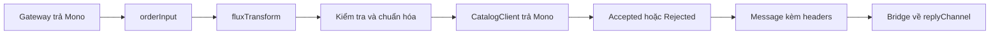

# Reactive transformer

Reactive transformer là cách tổ chức bước biến đổi thông điệp trong một luồng có sử dụng Reactive Streams. Phép biến đổi có thể chỉ chuẩn hóa dữ liệu trong bộ nhớ, hoặc phải chờ một API reactive trước khi tạo kết quả. Khi thiết kế, cần xác định rõ kiểu dữ liệu đi qua channel, nơi sở hữu subscription và chính sách khi một thông điệp không thể biến đổi.

Trong module `SPRING_INTEGRATION_CORE`, bài thuộc chương **Reactive support**, kết nối kiến thức về `Message`, `MessageChannel`, endpoint, gateway và Java DSL với việc biến đổi dữ liệu bằng Reactor. Mục tiêu thực hành là xây dựng một bước chuyển đơn hàng đầu vào thành dữ liệu chuẩn, giữ thông tin truy vết, giới hạn số yêu cầu đang xử lý và trả kết quả lỗi có chủ đích.

## 1. Kiến thức và môi trường cần có

Người học cần hiểu payload và headers của `Message<T>`, sự khác nhau giữa `DirectChannel` và channel reactive, cùng ý nghĩa của `Mono<T>` và `Flux<T>`. `Mono<T>` biểu diễn tối đa một giá trị; `Flux<T>` biểu diễn nhiều giá trị. Cả hai có thể hoàn tất hoặc phát tín hiệu lỗi.

Ví dụ dùng Java 17 và các API có trong Spring Integration 6.5: `IntegrationFlow.from(...)`, `transformWith(...)`, `fluxTransform(...)` và `bridge()`. Không cần một lớp framework có tên `ReactiveTransformer` để thực hiện mẫu này; logic biến đổi có thể là hàm Java được ghép vào luồng Reactor.

Trong dự án Spring Boot đã quản lý phiên bản dependency bằng parent hoặc BOM, các dependency phục vụ ví dụ là:

```xml
<dependency>
    <groupId>org.springframework.boot</groupId>
    <artifactId>spring-boot-starter-integration</artifactId>
</dependency>
<dependency>
    <groupId>io.projectreactor</groupId>
    <artifactId>reactor-core</artifactId>
</dependency>
<dependency>
    <groupId>org.springframework.boot</groupId>
    <artifactId>spring-boot-starter-test</artifactId>
    <scope>test</scope>
</dependency>
<dependency>
    <groupId>io.projectreactor</groupId>
    <artifactId>reactor-test</artifactId>
    <scope>test</scope>
</dependency>
```

Các đoạn khai báo lớp dưới đây thuộc cùng package `example.reactive`; mỗi lớp `public` đặt trong tệp Java tương ứng khi thực hành. Đây là mã minh họa trong bài học, không phải yêu cầu tạo thêm tệp trong module.

## 2. Xác định đúng hợp đồng biến đổi

Cần phân biệt ba dạng dữ liệu:

| Dạng | Ý nghĩa | Trách nhiệm xử lý |
| --- | --- | --- |
| `Message<OrderRequest>` | Một thông điệp mang yêu cầu cụ thể | Endpoint đọc payload và headers của yêu cầu |
| `Message<Mono<OrderOutcome>>` | Một thông điệp mang đối tượng publisher | Phải xác định thành phần nào sẽ subscribe hoặc flatten payload |
| `Flux<Message<OrderRequest>>` | Một chuỗi thông điệp độc lập | Có thể điều chỉnh demand, ghép xử lý bất đồng bộ và tạo thông điệp đầu ra |

Có `Mono` trong payload chưa đủ chứng minh toàn bộ luồng là reactive. Cách framework xử lý reply reactive còn phụ thuộc output channel và cấu hình async. Đặc biệt, output channel triển khai `ReactiveStreamsSubscribableChannel`, chẳng hạn `FluxMessageChannel`, cho phép framework ghép kết quả reactive vào luồng downstream. Với channel thông thường, phải xem xét cấu hình async và dạng publisher trả về. Xem [Reactive Reply Payload](https://docs.spring.io/spring-integration/reference/reactive-streams.html#reactive-reply-payload).

Với yêu cầu chuyển đổi một đầu vào thành một đầu ra, hợp đồng nghiệp vụ nên rõ ràng:

```text
OrderRequest
    -> Accepted khi tạo được đơn hàng chuẩn
    -> Rejected khi gặp lỗi đã được quy định trong hợp đồng
    -> onError khi gặp lỗi ngoài chính sách phục hồi
```

Không dùng `null` làm kết quả để bỏ qua dữ liệu. Transformer truyền thống yêu cầu kết quả hợp lệ; việc lọc dữ liệu thuộc trách nhiệm của filter. Với Reactor, `Mono.empty()` có nghĩa là không phát phần tử, nên có thể làm một gateway đang chờ reply không nhận được thông điệp trả lời. Xem [quy ước của Transformer](https://docs.spring.io/spring-integration/reference/transformer.html).

## 3. Chọn điểm ghép vào Spring Integration

### 3.1. `transform()` cho phép biến đổi từng payload

Một phép đổi dữ liệu ngắn, không chờ I/O, vẫn nên viết trực tiếp:

```java
@Bean
IntegrationFlow skuNormalizationFlow() {
    return IntegrationFlow.from("sku.input")
            .transform(String.class,
                    value -> value.strip().toUpperCase(Locale.ROOT))
            .channel("sku.output")
            .get();
}
```

Đoạn này giả định cấu hình đã bật Spring Integration, có import `java.util.Locale`, và có consumer cho `sku.output`. Tên channel và phép biến đổi trên chưa tự thiết lập một luồng reactive.

Nếu cần endpoint tiêu thụ đầu vào dưới dạng reactive, có thể cấu hình:

```java
.transformWith(spec -> spec
        .<String, String>transformer(
                value -> value.strip().toUpperCase(Locale.ROOT))
        .reactive())
```

`reactive()` chọn `ReactiveStreamsConsumer` cho endpoint, kể cả khi input channel không phải `FluxMessageChannel`. Nó không tự biến lời gọi JDBC thành non-blocking và không tự tạo thêm thread. Chi tiết tại [The reactive() Endpoint](https://docs.spring.io/spring-integration/reference/dsl/java-reactive.html).

### 3.2. `fluxTransform()` cho một đoạn xử lý cả chuỗi

Khi cần ghép các lời gọi `Mono`, kiểm soát concurrency hoặc lựa chọn thứ tự đầu ra, `fluxTransform()` là điểm nối thuận tiện. Hàm đầu vào nhận `Flux<Message<I>>`; trong bài này, hàm luôn trả publisher phát ra `Message<O>` đã được xây dựng đầy đủ.

```java
.<OrderRequest, Message<OrderOutcome>>fluxTransform(transformer::apply)
```

Tham số kiểu thứ hai ở đây là **kiểu phần tử mà publisher phát ra**, vì vậy dùng `Message<OrderOutcome>`, không phải chỉ `OrderOutcome`. `fluxTransform()` dựng các `FluxMessageChannel` để nối đoạn Reactor với phần luồng Integration phía trước và phía sau. Xem [Java DSL API của fluxTransform()](https://docs.spring.io/spring-integration/docs/6.5.0/api/org/springframework/integration/dsl/BaseIntegrationFlowDefinition.html#fluxTransform(java.util.function.Function)).

Thiết kế này cũng tránh phụ thuộc vào suy luận nguồn gốc phần tử khi dữ liệu bị đổi thứ tự hoặc một đầu vào sinh nhiều kết quả: mỗi kết quả tự mang headers của yêu cầu tương ứng.

### 3.3. Chọn API theo mục đích

| Nhu cầu | Cách biểu diễn phù hợp |
| --- | --- |
| Chuẩn hóa chuỗi, đổi DTO, tính trường dẫn xuất | `transform()` hoặc `transformWith()` |
| Endpoint nhận đầu vào bằng reactive consumer | Cấu hình `reactive()` cho endpoint |
| Ghép chuỗi thông điệp với các `Mono`, giới hạn xử lý đồng thời | `fluxTransform()` kết hợp operator Reactor |
| Gọi một dịch vụ nghiệp vụ trả dữ liệu | Service activator hoặc outbound gateway phù hợp |
| Thực hiện tác vụ reactive chỉ trả tín hiệu hoàn tất | `handleReactive()` ở cuối flow |

`ReactiveMessageHandler` trả `Mono<Void>` và `handleReactive()` là operator kết thúc flow; chúng không phải lựa chọn cho bước cần trả payload để tiếp tục biến đổi. Xem [ReactiveMessageHandler](https://docs.spring.io/spring-integration/reference/reactive-streams.html#reactive-message-handler).

## 4. Bài toán: chuyển yêu cầu thành đơn hàng chuẩn

Một yêu cầu chứa mã đơn hàng, SKU và số lượng. Bước biến đổi cần chuẩn hóa SKU, đọc giá sản phẩm từ catalog reactive rồi tạo kết quả. Nếu số lượng không hợp lệ, không có sản phẩm hoặc catalog quá hạn, đầu ra là `Rejected` với mã lỗi xác định.



Đây là ví dụ phép biến đổi cần dữ liệu tham chiếu. Trong hệ thống lớn, phần tra cứu có thể được tách thành service activator, outbound gateway hoặc content enricher; phần chuyển cấu trúc dữ liệu vẫn có thể giữ thành hàm thuần để dễ kiểm thử.

### 4.1. Các kiểu dữ liệu

```java
package example.reactive;

import java.math.BigDecimal;
import reactor.core.publisher.Mono;

public final class OrderTypes {

    private OrderTypes() {
    }

    public record OrderRequest(String orderId, String sku, int quantity) {
    }

    public record Product(String sku, BigDecimal unitPrice) {
    }

    public sealed interface OrderOutcome permits Accepted, Rejected {
    }

    public record Accepted(
            String orderId,
            String sku,
            int quantity,
            BigDecimal total) implements OrderOutcome {
    }

    public record Rejected(
            String orderId,
            String code) implements OrderOutcome {
    }

    public interface CatalogClient {
        Mono<Product> findBySku(String sku);
    }
}
```

`Accepted` và `Rejected` là hai kết quả nghiệp vụ riêng. Không biểu diễn sự cố catalog bằng một `Accepted` có giá bằng không, vì downstream có thể hiểu nhầm đó là đơn hàng hợp lệ.

Ví dụ giả định catalog trả sản phẩm có đơn giá hợp lệ và các sản phẩm cùng một đơn vị tiền tệ. Việc chuyển đổi tiền tệ, thuế và làm tròn không thuộc bài toán này.

### 4.2. Hàm biến đổi reactive

```java
package example.reactive;

import java.math.BigDecimal;
import java.time.Duration;
import java.util.Locale;
import java.util.concurrent.TimeoutException;

import org.springframework.messaging.Message;
import org.springframework.messaging.support.MessageBuilder;

import reactor.core.publisher.Flux;
import reactor.core.publisher.Mono;

import example.reactive.OrderTypes.Accepted;
import example.reactive.OrderTypes.CatalogClient;
import example.reactive.OrderTypes.OrderOutcome;
import example.reactive.OrderTypes.OrderRequest;
import example.reactive.OrderTypes.Rejected;

public final class OrderReactiveTransformer {

    private static final Duration CATALOG_TIMEOUT = Duration.ofMillis(800);
    private static final int MAX_IN_FLIGHT = 8;

    private final CatalogClient catalog;

    public OrderReactiveTransformer(CatalogClient catalog) {
        this.catalog = catalog;
    }

    public Flux<Message<OrderOutcome>> apply(
            Flux<Message<OrderRequest>> requests) {

        return requests.flatMap(this::transformSafely, MAX_IN_FLIGHT);
    }

    public Mono<Message<OrderOutcome>> transformSafely(
            Message<OrderRequest> request) {

        return transformOne(request)
                .onErrorResume(InvalidOrderException.class,
                        error -> reject(request, "INVALID_ORDER"))
                .onErrorResume(ProductNotFoundException.class,
                        error -> reject(request, "PRODUCT_NOT_FOUND"))
                .onErrorResume(TimeoutException.class,
                        error -> reject(request, "CATALOG_TIMEOUT"));
    }

    public Mono<Message<OrderOutcome>> transformOne(
            Message<OrderRequest> request) {

        return Mono.defer(() -> {
            OrderRequest input = request.getPayload();

            if (input.orderId() == null || input.orderId().isBlank()
                    || input.sku() == null || input.sku().isBlank()
                    || input.quantity() <= 0) {
                return Mono.error(new InvalidOrderException());
            }

            String sku = input.sku().strip().toUpperCase(Locale.ROOT);

            return catalog.findBySku(sku)
                    .switchIfEmpty(Mono.error(new ProductNotFoundException()))
                    .timeout(CATALOG_TIMEOUT)
                    .<OrderOutcome>map(product -> new Accepted(
                            input.orderId(),
                            product.sku(),
                            input.quantity(),
                            product.unitPrice().multiply(
                                    BigDecimal.valueOf(input.quantity()))))
                    .map(outcome -> toReply(request, outcome));
        });
    }

    private Mono<Message<OrderOutcome>> reject(
            Message<OrderRequest> request, String code) {

        OrderOutcome result = new Rejected(
                request.getPayload().orderId(), code);
        return Mono.just(toReply(request, result));
    }

    private Message<OrderOutcome> toReply(
            Message<?> request, OrderOutcome outcome) {

        return MessageBuilder.withPayload(outcome)
                .copyHeaders(request.getHeaders())
                .setHeader("canonicalSchema", "order.v1")
                .build();
    }

    private static final class InvalidOrderException
            extends RuntimeException {
    }

    private static final class ProductNotFoundException
            extends RuntimeException {
    }
}
```

Các điểm cần đọc trong mã:

1. `Mono.defer()` trì hoãn việc kiểm tra và gọi catalog đến lúc publisher được subscribe. Exception phát sinh đồng bộ bên trong supplier cũng trở thành tín hiệu lỗi của `Mono`.
2. `switchIfEmpty()` chuyển trường hợp không có sản phẩm thành lỗi cụ thể; yêu cầu vẫn có thể nhận một `Rejected`.
3. `timeout()` bao quanh thao tác catalog cho từng yêu cầu. Giá trị 800 ms là cấu hình minh họa, cần chọn lại theo thời gian đáp ứng của hệ thống thực.
4. `transformSafely()` chỉ phục hồi ba loại lỗi đã quy định. Lỗi lập trình và lỗi hạ tầng chưa phân loại tiếp tục đi theo `onError`.
5. `flatMap(..., 8)` giới hạn tối đa tám inner publisher đang được subscribe trong một subscription của đoạn này. Nó không đồng nghĩa có tám thread hoặc toàn ứng dụng chỉ có tám HTTP request.
6. `toReply()` tạo một message mới cho mỗi kết quả, mang theo headers của chính request đó.

Không đặt `subscribe()` hoặc `block()` trong transformer. Phương thức chỉ xây dựng rồi trả publisher; thành phần quản lý luồng sẽ ghép và subscribe publisher theo vòng đời của flow.

## 5. Nối transformer với gateway và Java DSL

### 5.1. Khai báo gateway

```java
package example.reactive;

import org.springframework.integration.annotation.MessagingGateway;
import org.springframework.messaging.handler.annotation.Header;
import reactor.core.publisher.Mono;

import example.reactive.OrderTypes.OrderOutcome;
import example.reactive.OrderTypes.OrderRequest;

@MessagingGateway(defaultRequestChannel = "orderInput")
public interface OrderGateway {

    Mono<OrderOutcome> prepare(
            OrderRequest request,
            @Header("traceId") String traceId);
}
```

`Mono` trả về cho phép caller tiếp tục ghép operator hoặc chuyển kết quả cho WebFlux. Đối với gateway reactive, việc gửi yêu cầu được trì hoãn đến subscription; điều này khác với việc cho rằng mọi channel và consumer trong application context chỉ được khởi tạo khi gọi gateway. Flow và các endpoint vẫn được Spring quản lý vòng đời. Xem [Messaging Gateways — Reactor Mono](https://docs.spring.io/spring-integration/reference/gateway.html).

### 5.2. Cấu hình flow

```java
package example.reactive;

import java.math.BigDecimal;

import org.springframework.context.annotation.Bean;
import org.springframework.context.annotation.Configuration;
import org.springframework.integration.annotation.IntegrationComponentScan;
import org.springframework.integration.channel.DirectChannel;
import org.springframework.integration.config.EnableIntegration;
import org.springframework.integration.dsl.IntegrationFlow;
import org.springframework.messaging.Message;

import reactor.core.publisher.Mono;

import example.reactive.OrderTypes.CatalogClient;
import example.reactive.OrderTypes.OrderOutcome;
import example.reactive.OrderTypes.OrderRequest;
import example.reactive.OrderTypes.Product;

@Configuration
@EnableIntegration
@IntegrationComponentScan(basePackageClasses = OrderGateway.class)
public class OrderFlowConfig {

    @Bean
    DirectChannel orderInput() {
        return new DirectChannel();
    }

    @Bean
    CatalogClient catalogClient() {
        return sku -> Mono.defer(() -> {
            if ("SKU-01".equals(sku)) {
                return Mono.just(new Product(
                        sku, new BigDecimal("125000")));
            }
            return Mono.empty();
        });
    }

    @Bean
    OrderReactiveTransformer orderReactiveTransformer(CatalogClient client) {
        return new OrderReactiveTransformer(client);
    }

    @Bean
    IntegrationFlow orderFlow(
            DirectChannel orderInput,
            OrderReactiveTransformer transformer) {

        return IntegrationFlow.from(orderInput)
                .<OrderRequest, Message<OrderOutcome>>fluxTransform(
                        transformer::apply)
                .bridge()
                .get();
    }
}
```

Catalog trong ví dụ là stub lưu trong mã, không tạo kết nối mạng. Khi thay bằng client thực, `findBySku()` cần trả publisher của một client non-blocking hoặc phải cô lập lời gọi blocking như mục 9.

`bridge()` chuyển kết quả cuối về địa chỉ trong `replyChannel` của request khi không có output channel cố định. Gateway cung cấp địa chỉ trả lời này; vì vậy phải giữ header qua đoạn biến đổi. Một lời gọi trực tiếp vào `orderInput` cũng phải mang địa chỉ trả lời thích hợp nếu muốn dùng nguyên cấu hình trên.

Ví dụ gọi từ một service đang trả reactive type:

```java
public Mono<OrderOutcome> prepareOrder(OrderGateway gateway) {
    return gateway.prepare(
                    new OrderRequest("ORD-101", " sku-01 ", 2),
                    "trace-101")
            .timeout(Duration.ofSeconds(2));
}
```

Khi có subscription, kết quả mong đợi là:

```text
Accepted[orderId=ORD-101, sku=SKU-01, quantity=2, total=250000]
```

Timeout ngoài gateway bảo vệ thời gian caller chờ; timeout catalog bên trong bảo vệ từng lần tra cứu. Hai timeout có phạm vi khác nhau. Việc caller hủy subscription không tự chứng minh mọi tác vụ đã đi vào một flow dùng channel chung cũng bị hủy tương ứng.

## 6. Headers là một phần của kết quả biến đổi

Nếu chỉ phát payload mới từ một chuỗi có thể xử lý đồng thời, không nên kỳ vọng framework đoán được request nào là nguồn của payload đó. Mẫu trong bài luôn xây dựng `Message` đầu ra ngay trong nhánh đang giữ request.

| Header | Lý do cần xem xét |
| --- | --- |
| `replyChannel` | Giúp kết quả quay lại caller của gateway |
| `errorChannel` | Mang địa chỉ xử lý lỗi khi thành phần đang xử lý hỗ trợ cơ chế này |
| `correlationId` | Giữ quan hệ với một nhóm thông điệp hoặc lượt trao đổi |
| `sequenceNumber`, `sequenceSize` | Cần khi downstream có aggregator dựa vào sequence |
| `traceId`, mã tenant | Giữ thông tin truy vết và phân vùng nghiệp vụ |
| `contentType`, phiên bản schema | Phải được cập nhật hoặc loại bỏ nếu payload mới không còn phù hợp |

`MessageBuilder.withPayload(...).copyHeaders(...)` phù hợp để tạo message với payload khác kiểu. `id` và `timestamp` là các header do framework quản lý; thao tác copy không giữ nguyên chúng như một định danh message cũ. Nếu cần liên kết hai message, dùng correlation hoặc một header nghiệp vụ riêng. Xem [MessageBuilder.copyHeaders()](https://docs.spring.io/spring-framework/docs/current/javadoc-api/org/springframework/messaging/support/MessageBuilder.html#copyHeaders(java.util.Map)).

Việc copy toàn bộ headers trong ví dụ phù hợp với các message Java nội bộ đang sử dụng. Khi đi qua adapter mạng hoặc đổi định dạng, cần lựa chọn lại headers hợp lệ; chẳng hạn không giữ `contentType` của JSON cho một payload nhị phân không tương ứng.

Nếu một đầu vào sinh nhiều message, mỗi message con cần giữ được quan hệ với đầu vào. Nếu thay đổi số lượng phần tử trong nhóm đã đánh sequence, phải thiết kế lại sequence và điều kiện release của aggregator. Giữ các con số cũ sau khi loại bỏ phần tử có thể làm aggregator chờ vô hạn.

## 7. `map`, `flatMap` và thứ tự đầu ra

Giả sử `findBySku()` trả `Mono<Product>`:

```java
// Kết quả còn lồng publisher: Flux<Mono<Product>>.
requests.map(message -> catalog.findBySku(message.getPayload().sku()));

// Ghép từng Mono vào chuỗi: Flux<Product>.
requests.flatMap(
        message -> catalog.findBySku(message.getPayload().sku()),
        8);
```

Đoạn thứ hai chỉ minh họa thao tác flatten. Trong flow thực, vẫn phải tạo `Message` trong nhánh tương ứng để giữ headers như `OrderReactiveTransformer` đã làm.

| Operator | Đặc điểm | Phù hợp khi |
| --- | --- | --- |
| `map` | Biến đổi đồng bộ một phần tử thành một giá trị | Đổi DTO hoặc tính trường từ dữ liệu có sẵn |
| `flatMap` | Subscribe nhiều inner publisher, cho phép kết quả xen kẽ | Các yêu cầu độc lập, không cần thứ tự phát ra |
| `concatMap` | Chờ inner publisher hiện tại hoàn tất trước khi xử lý tiếp | Cần thực hiện tuần tự trong cùng subscription |
| `flatMapSequential` | Có thể xử lý đồng thời nhưng phát kết quả theo thứ tự nguồn | Cần giữ thứ tự đầu ra và chấp nhận bộ đệm chờ |

Các khác biệt về thứ tự và subscription được mô tả trong [Flux API](https://projectreactor.io/docs/core/release/api/reactor/core/publisher/Flux.html).

Trong bài, ba yêu cầu `A`, `B`, `C` có thể trả kết quả theo thứ tự `B`, `C`, `A` nếu catalog xử lý `A` chậm hơn. Header truy vết của `B` vẫn phải theo kết quả `B`, không được lấy headers từ một biến lưu “request gần nhất”.

Nếu nghiệp vụ yêu cầu tuần tự, có thể thay thân `apply()` bằng:

```java
return requests.concatMap(this::transformSafely);
```

Giữ thứ tự phát kết quả không đồng nghĩa giữ thứ tự side effect. `flatMapSequential` vẫn có thể khởi chạy các thao tác phía trong đồng thời. Các cam kết thứ tự trong đoạn này cũng không tự mở rộng sang flow khác, instance ứng dụng khác hoặc một endpoint downstream tự xử lý đồng thời.

## 8. Phạm vi phục hồi lỗi quyết định tuổi thọ của luồng

Một lỗi Reactor không được xử lý là tín hiệu kết thúc sequence. `onErrorResume()` thay sequence đã lỗi bằng một publisher khác tại vị trí đặt operator; nó không làm sequence upstream bị lỗi tiếp tục chạy. Xem [Handling Errors](https://projectreactor.io/docs/core/release/reference/coreFeatures/error-handling.html).

Vì vậy, hai cấu trúc sau có ý nghĩa khác nhau:

```java
// Phục hồi riêng từng yêu cầu.
requests.flatMap(message ->
        transformOne(message)
                .onErrorResume(ExpectedException.class,
                        error -> fallbackFor(message, error)),
        8);
```

```java
// Phục hồi sau khi sequence xử lý nhiều yêu cầu đã lỗi.
requests.flatMap(this::transformOne, 8)
        .onErrorResume(error -> replacementSequence(error));
```

`ExpectedException`, `fallbackFor()` và `replacementSequence()` ở hai đoạn trên là tên minh họa cho chính sách do ứng dụng định nghĩa. `transformSafely()` trong ví dụ chính là hiện thực cụ thể của cách thứ nhất.

Nếu muốn lỗi của một yêu cầu tạo `Rejected` rồi tiếp tục xử lý yêu cầu khác, đặt recovery **bên trong** inner publisher. Đặt recovery ngoài cùng có thể khiến các inner publisher còn lại bị hủy khi một lỗi lan ra, rồi chỉ còn sequence thay thế.

Một `Rejected` là message dữ liệu bình thường, không phải `ErrorMessage`. Downstream có thể dùng router theo kiểu payload `Accepted`/`Rejected`, gửi kết quả thành công đến luồng tiếp theo và đưa kết quả từ chối đến luồng theo dõi. Filter có thể loại một loại kết quả theo chính sách, nhưng với gateway request–reply cần xác định caller nhận gì khi không còn message trả về.

`errorChannel` cũng không phải cơ chế bắt mọi lỗi Reactor ở mọi vị trí. Cách lỗi được ném về caller hay chuyển thành `ErrorMessage` phụ thuộc endpoint và ranh giới đồng bộ/bất đồng bộ. Lỗi phát sinh trong hàm stream của `fluxTransform()` cần chính sách rõ ràng trong chuỗi Reactor và cần được kiểm thử ở mức flow. Xem [Error Handling của Spring Integration](https://docs.spring.io/spring-integration/reference/error-handling.html).

Trong ví dụ, lỗi ngoài ba nhóm đã biết vẫn có thể kết thúc đoạn stream dùng chung. Khi triển khai, cần xác định nhóm lỗi nào được chuyển thành kết quả, nhóm nào chuyển sang kênh xử lý lỗi, và cơ chế giám sát/khôi phục khi stream kết thúc. Không mặc định message tiếp theo sẽ tự làm sống lại subscription đã bị kết thúc.

Nếu thêm retry, đặt nó vào lời gọi phù hợp cho từng request, giới hạn số lần và chỉ retry lỗi tạm thời. Retry là subscribe lại publisher: mọi side effect trong phạm vi đó có thể thực hiện lại. Với thao tác ghi, phải thiết kế idempotency và xác định điều gì xảy ra khi hệ thống đích đã ghi thành công nhưng caller nhận timeout.

## 9. Back-pressure và lời gọi blocking

`FluxMessageChannel` là cầu nối tới Reactive Streams subscriber, không phải queue bền vững hoặc broker. Nó hỗ trợ ghép nguồn publisher qua `subscribeTo(...)`; các đặc tính của toàn flow vẫn phụ thuộc producer, channel và endpoint xung quanh. Xem [FluxMessageChannel](https://docs.spring.io/spring-integration/reference/6.5/channel/implementations.html#flux-message-channel).

Trong ví dụ, gateway đi qua `DirectChannel` trước khi vào đoạn `fluxTransform()`. Đây là ranh giới cần phân biệt: một producer gọi `MessageChannel.send()` liên tục không tự trở thành nguồn tuân thủ demand của downstream. Để giới hạn tải toàn hệ thống, còn phải xem xét tốc độ tiếp nhận, dung lượng buffer, connection pool và chính sách khi quá tải.

`flatMap(..., 8)` giới hạn số inner publisher đồng thời của đoạn xử lý, nhưng không giới hạn mọi buffer ở mọi channel. Nếu có nhiều instance ứng dụng, tổng số thao tác đang chờ catalog có thể lớn hơn tám.

Một lỗi thường gặp là:

```java
// Sai: thực hiện tác vụ blocking trước khi Mono được tạo.
Mono.just(legacyCatalog.findBySku(sku));
```

Nếu buộc phải tích hợp một API đồng bộ, hãy trì hoãn lời gọi và chuyển nó sang scheduler phù hợp:

```java
Mono.fromCallable(() -> legacyCatalog.findBySku(sku))
        .subscribeOn(Schedulers.boundedElastic());
```

Đoạn này giả định có import `reactor.core.scheduler.Schedulers` và `legacyCatalog` là client đồng bộ. Nó cô lập thời gian chờ khỏi thread phục vụ phần non-blocking; API gốc vẫn là blocking. Cần giới hạn concurrency và cấu hình timeout ở client đích. Hủy subscription hoặc timeout ở Reactor không bảo đảm dừng được một thao tác blocking không hỗ trợ hủy. Xem [Reactor FAQ về wrapping blocking calls](https://projectreactor.io/docs/core/release/reference/faq.html#faq.wrap-blocking).

Thêm `publishOn()` chỉ điều chỉnh nơi chạy các operator phía sau nó; không thay đổi bản chất JDBC hay HTTP client đồng bộ. Với phép chuẩn hóa chuỗi rất ngắn, việc đổi scheduler thường không mang lại lợi ích tương ứng với chi phí chuyển ngữ cảnh.

## 10. Kiểm thử hợp đồng reactive bằng `StepVerifier`

Kiểm thử nên quan sát cả tín hiệu và dữ liệu: publisher có thực hiện công việc trước subscription không, có phát đủ kết quả không, headers có còn không và lỗi một phần tử có ảnh hưởng đến phần tử khác không.

`StepVerifier` cho phép khai báo các tín hiệu mong đợi, còn virtual time giúp kiểm tra timeout bằng nguồn giả lập mà không chờ thời gian thật. Các operator dùng timer phải được tạo trong supplier của `withVirtualTime()`. Xem [Testing của Reactor](https://projectreactor.io/docs/core/release/reference/testing.html).

### 10.1. Kiểm thử transformer độc lập với Spring

```java
package example.reactive;

import static org.assertj.core.api.Assertions.assertThat;

import java.math.BigDecimal;
import java.time.Duration;
import java.util.concurrent.atomic.AtomicInteger;

import org.junit.jupiter.api.Test;
import org.springframework.integration.channel.QueueChannel;
import org.springframework.messaging.Message;
import org.springframework.messaging.support.MessageBuilder;

import reactor.core.publisher.Flux;
import reactor.core.publisher.Mono;
import reactor.test.StepVerifier;

import example.reactive.OrderTypes.Accepted;
import example.reactive.OrderTypes.CatalogClient;
import example.reactive.OrderTypes.OrderRequest;
import example.reactive.OrderTypes.Product;
import example.reactive.OrderTypes.Rejected;

class OrderReactiveTransformerTest {

    @Test
    void defersWorkAndPreservesHeaders() {
        AtomicInteger catalogCalls = new AtomicInteger();
        CatalogClient client = sku -> {
            catalogCalls.incrementAndGet();
            return Mono.just(new Product(sku, new BigDecimal("125000")));
        };
        OrderReactiveTransformer transformer =
                new OrderReactiveTransformer(client);

        QueueChannel replyChannel = new QueueChannel();
        Message<OrderRequest> request = MessageBuilder
                .withPayload(new OrderRequest("ORD-101", " sku-01 ", 2))
                .setHeader("traceId", "trace-101")
                .setHeader("correlationId", "batch-7")
                .setReplyChannel(replyChannel)
                .build();

        var result = transformer.transformSafely(request);
        assertThat(catalogCalls.get()).isZero();

        StepVerifier.create(result)
                .assertNext(reply -> {
                    assertThat(reply.getPayload())
                            .isInstanceOfSatisfying(Accepted.class, order -> {
                                assertThat(order.orderId()).isEqualTo("ORD-101");
                                assertThat(order.sku()).isEqualTo("SKU-01");
                                assertThat(order.quantity()).isEqualTo(2);
                                assertThat(order.total())
                                        .isEqualByComparingTo("250000");
                            });
                    assertThat(reply.getHeaders().get("traceId"))
                            .isEqualTo("trace-101");
                    assertThat(reply.getHeaders().get("correlationId"))
                            .isEqualTo("batch-7");
                    assertThat(reply.getHeaders().getReplyChannel())
                            .isSameAs(replyChannel);
                    assertThat(reply.getHeaders().get("canonicalSchema"))
                            .isEqualTo("order.v1");
                    assertThat(reply.getHeaders().getId())
                            .isNotEqualTo(request.getHeaders().getId());
                })
                .expectComplete()
                .verify(Duration.ofSeconds(2));

        assertThat(catalogCalls.get()).isEqualTo(1);
    }

    @Test
    void oneInvalidRequestDoesNotDiscardTheNextRequest() {
        CatalogClient client = sku ->
                Mono.just(new Product(sku, new BigDecimal("125000")));
        OrderReactiveTransformer transformer =
                new OrderReactiveTransformer(client);

        var input = Flux.just(
                request("ORD-BAD", 0),
                request("ORD-GOOD", 2));

        StepVerifier.create(transformer.apply(input).collectList())
                .assertNext(messages -> {
                    assertThat(messages).hasSize(2);
                    assertThat(messages.stream()
                            .map(Message::getPayload)
                            .toList())
                            .containsExactlyInAnyOrder(
                                    new Rejected("ORD-BAD", "INVALID_ORDER"),
                                    new Accepted("ORD-GOOD", "SKU-01", 2,
                                            new BigDecimal("250000")));
                })
                .expectComplete()
                .verify(Duration.ofSeconds(2));
    }

    @Test
    void timeoutBecomesARejectedResult() {
        CatalogClient client = sku -> Mono.never();
        OrderReactiveTransformer transformer =
                new OrderReactiveTransformer(client);

        StepVerifier.withVirtualTime(() ->
                        transformer.transformSafely(request("ORD-SLOW", 1)))
                .expectSubscription()
                .thenAwait(Duration.ofSeconds(1))
                .assertNext(reply -> assertThat(reply.getPayload())
                        .isEqualTo(new Rejected(
                                "ORD-SLOW", "CATALOG_TIMEOUT")))
                .expectComplete()
                .verify(Duration.ofSeconds(2));
    }

    @Test
    void unexpectedFailureRemainsAnErrorSignal() {
        CatalogClient client = sku ->
                Mono.error(new IllegalStateException("catalog failure"));
        OrderReactiveTransformer transformer =
                new OrderReactiveTransformer(client);

        StepVerifier.create(
                        transformer.transformSafely(request("ORD-FAIL", 1)))
                .expectError(IllegalStateException.class)
                .verify(Duration.ofSeconds(2));
    }

    private static Message<OrderRequest> request(String orderId, int quantity) {
        return MessageBuilder.withPayload(
                        new OrderRequest(orderId, " sku-01 ", quantity))
                .setHeader("traceId", "trace-" + orderId)
                .build();
    }
}
```

`QueueChannel` trong test đầu chỉ đóng vai trò một địa chỉ trả lời để kiểm tra việc copy header. Test không gửi kết quả qua queue đó. `collectList()` trong test thứ hai an toàn vì nguồn giả lập hữu hạn với đúng hai phần tử; không áp dụng cách gom toàn bộ dữ liệu này lên một nguồn không kết thúc.

Test thứ hai so sánh kết quả không phụ thuộc thứ tự, phù hợp với hợp đồng của `flatMap`. Test cuối ghi nhận rõ giới hạn của chính sách phục hồi, tránh che lỗi ngoài dự kiến bằng một kết quả thành công giả.

### 10.2. Kiểm thử việc nối flow và gateway

Kiểm thử hàm chưa phát hiện được lỗi sai tên channel, thiếu consumer, thiếu gateway scanning hoặc mất địa chỉ trả lời. Bổ sung kiểm thử với cấu hình Spring:

```java
package example.reactive;

import static org.assertj.core.api.Assertions.assertThat;

import java.math.BigDecimal;
import java.time.Duration;

import org.junit.jupiter.api.Test;
import org.springframework.beans.factory.annotation.Autowired;
import org.springframework.test.context.junit.jupiter.SpringJUnitConfig;

import reactor.test.StepVerifier;

import example.reactive.OrderTypes.Accepted;
import example.reactive.OrderTypes.OrderRequest;

@SpringJUnitConfig(OrderFlowConfig.class)
class OrderFlowTest {

    @Autowired
    private OrderGateway gateway;

    @Test
    void returnsTheCanonicalOrderThroughTheGateway() {
        StepVerifier.create(gateway.prepare(
                        new OrderRequest("ORD-201", " sku-01 ", 2),
                        "trace-201"))
                .assertNext(outcome -> assertThat(outcome).isEqualTo(
                        new Accepted("ORD-201", "SKU-01", 2,
                                new BigDecimal("250000"))))
                .expectComplete()
                .verify(Duration.ofSeconds(2));
    }
}
```

Các ca nên bổ sung khi mở rộng ví dụ:

| Ca kiểm thử | Điều cần chứng minh |
| --- | --- |
| Catalog trả `Mono.empty()` | Nhận `PRODUCT_NOT_FOUND`, không mất reply |
| Nhiều yêu cầu hoàn tất trái thứ tự | Payload và headers vẫn thuộc cùng request |
| Nguồn hỗ trợ demand, downstream yêu cầu ít phần tử | Đoạn xử lý không phát vượt demand downstream; quan sát riêng prefetch |
| Catalog chậm với nhiều yêu cầu | Số inner subscription đang hoạt động không vượt cấu hình của đoạn |
| Hủy subscription | Nguồn giả lập nhận cancellation trong phạm vi đã ghép |
| Lỗi ngoài chính sách trong flow dùng chung | Hành vi kết thúc và khôi phục flow đúng thiết kế |

Không dùng `Thread.sleep()` để suy đoán một kết quả đã xuất hiện. Dùng tín hiệu Reactor, nguồn điều khiển được và timeout kiểm thử hữu hạn để thất bại được quan sát rõ.

## 11. Những lỗi thiết kế thường gặp

| Biểu hiện | Nguyên nhân có thể gặp | Cách sửa |
| --- | --- | --- |
| Consumer nhận một `Mono` thay vì dữ liệu | Publisher đang được giữ trong payload hoặc còn lồng sau `map` | Xác định output channel, async và điểm flatten; với chuỗi dùng operator thích hợp |
| Gateway chờ mà không nhận kết quả | Không có subscription, mất `replyChannel`, nhánh trả rỗng hoặc message bị filter | Kiểm thử subscription và số reply theo từng nhánh |
| Header truy vết bị gán nhầm | Dùng trạng thái mutable chung khi `flatMap` xử lý đồng thời | Giữ request trong từng nhánh và tạo message ngay tại đó |
| Một yêu cầu lỗi làm mất các yêu cầu khác | Lỗi đã thoát khỏi inner publisher ra sequence dùng chung | Phục hồi trong từng nhánh nếu hợp đồng cho phép |
| Dữ liệu đã gửi nhưng transformer không có kết quả | Tự `subscribe()` rồi trả về trước khi xử lý xong | Trả publisher để framework compose |
| Tăng tải làm cạn connection pool | Concurrency quá cao hoặc có nhiều tầng xử lý đồng thời | Điều chỉnh theo năng lực hệ thống đích và đo số thao tác đang hoạt động |
| Thread reactive bị giữ lâu | Có `block()`, I/O đồng bộ hoặc tính toán nặng trên thread xử lý | Dùng client non-blocking hoặc cô lập công việc phù hợp |
| Aggregator không release nhóm | Đã làm rơi phần tử nhưng giữ sequence size cũ | Định nghĩa lại cardinality và điều kiện hoàn tất nhóm |

Headers của message và Reactor Context là hai cơ chế khác nhau. Khi cần truy vết qua nhiều loại channel hoặc giao thức, hãy chỉ rõ dữ liệu nào nằm trong headers và dữ liệu nào nằm trong context. Việc đổi thread cũng đòi hỏi xem xét cơ chế truyền context; không mặc định mọi giá trị `ThreadLocal` luôn theo cùng request.

## 12. Thực hành mở rộng

1. Thêm một SKU không tồn tại vào luồng yêu cầu và kiểm tra nó tạo `Rejected` trong khi SKU hợp lệ vẫn được xử lý.
2. Tạo catalog giả lập cho mỗi SKU có độ trễ khác nhau; so sánh `flatMap`, `concatMap` và `flatMapSequential` bằng cùng một tập yêu cầu.
3. Đặt `traceId` và `correlationId` khác nhau cho từng request; xác nhận từng kết quả giữ đúng giá trị sau khi đổi thứ tự hoàn tất.
4. Tách đầu ra `Accepted` và `Rejected` bằng router; xác định rõ nhánh nào trả lời gateway và nhánh nào chỉ ghi nhận sự kiện.
5. Nếu muốn gom kết quả của nhiều đơn hàng, bổ sung chiến lược correlation, thời hạn chờ và điều kiện release cho aggregator; không chỉ dựa vào thứ tự kết quả đến.

Một reactive transformer hoàn chỉnh cần có hợp đồng dữ liệu và tín hiệu nhất quán: biết một request tạo bao nhiêu message, ai subscribe, metadata nào phải được giữ, mức xử lý đồng thời cho phép và lỗi nào có thể phục hồi tại chỗ. Các quyết định này giúp bước biến đổi ghép được với gateway, router, filter và aggregator mà vẫn giữ hành vi của luồng dễ quan sát và kiểm thử.
