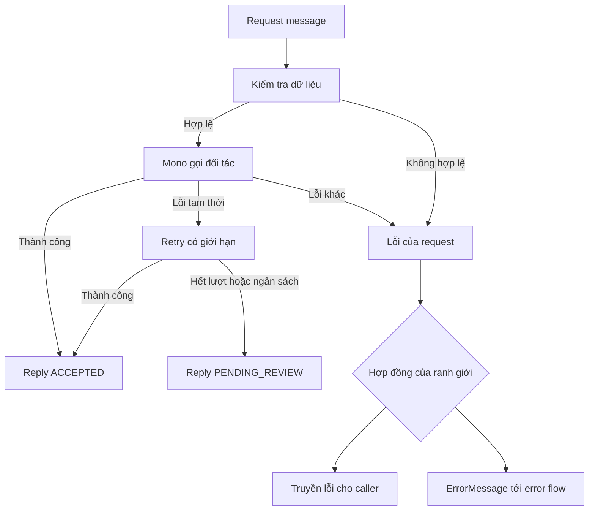

# Reactive error handling

## 1. Mục tiêu và phạm vi

Trong chương **Reactive support** của module **SPRING_INTEGRATION_CORE**, xử lý lỗi reactive là thiết kế đường đi cho cả kết quả lẫn thất bại khi một message được xử lý qua `Mono` hoặc `Flux`. Một luồng hoàn chỉnh cần trả lời được: lỗi thuộc message nào, thao tác nào được thử lại, caller nhận gì khi thất bại và bằng chứng lỗi được giữ ở đâu.

Sau bài này, bạn có thể:

- Phân biệt exception đồng bộ, tín hiệu `onError` và `ErrorMessage`.
- Đặt fallback và retry đúng phạm vi một request hoặc một message.
- Kết nối service activator trả `Mono` với messaging gateway qua Java DSL.
- Chuyển lỗi sang luồng thông điệp có đủ ngữ cảnh để điều tra.
- Thiết kế kiểm thử cho retry, timeout, lỗi nghiệp vụ và khả năng tiếp tục xử lý message sau.

Ví dụ dùng Java 17 trở lên, API Spring Integration **6.5.x** và Reactor **3.7.x** làm mốc. Đây là mốc giải thích API, không phải yêu cầu nâng phiên bản của dự án. Các đoạn kiểm thử dùng JUnit Jupiter và `reactor-test`; phiên bản thư viện nên được quản lý bằng BOM phù hợp với ứng dụng.

Tình huống xuyên suốt là gửi đơn hàng đến đối tác: đơn không hợp lệ bị từ chối; gián đoạn tạm thời được thử lại có giới hạn; hết ngân sách xử lý thì trả trạng thái chờ xem xét; lỗi lập trình vẫn phải lộ ra để sửa.

## 2. Ba dạng lỗi cần phân biệt

| Dạng lỗi | Xuất hiện ở đâu | Cách tiếp cận |
| --- | --- | --- |
| Exception đồng bộ | Ngay khi gọi phương thức, tạo publisher hoặc xử lý qua chuỗi gọi đồng bộ | Bắt ở ranh giới gọi; dùng `Mono.defer` nếu cần đưa thao tác vào vòng đời subscription |
| Tín hiệu `onError` | Khi publisher đang thực thi | Dùng operator reactive để thử lại, thay thế, ánh xạ hoặc truyền lỗi |
| `ErrorMessage` | Khi một thành phần messaging đóng gói lỗi thành message | Gửi qua channel, router, endpoint hoặc luồng lưu vết lỗi |

Một lời gọi đi qua `DirectChannel` thường chạy trên thread của sender, nên exception đồng bộ có thể quay lại sender. Với xử lý bất đồng bộ, thread gửi có thể đã rời đi; cần cơ chế chuyển lỗi phù hợp với thành phần đang sở hữu thao tác. Không thể suy ra mọi exception đều tự xuất hiện trên global `errorChannel`. [Spring Integration — Error Handling](https://docs.spring.io/spring-integration/reference/6.5/error-handling.html)

Ví dụ sau có thể ném exception trước khi tạo được `Mono`:

```java
Mono<OrderResult> submit(OrderCommand command) {
    validate(command);
    return partnerClient.submit(command);
}
```

Nếu chủ đích là để subscriber quan sát cả lỗi validation và lỗi đối tác qua cùng một hợp đồng reactive:

```java
Mono<OrderResult> submit(OrderCommand command) {
    return Mono.defer(() -> {
        validate(command);
        return partnerClient.submit(command);
    });
}
```

`defer` gọi supplier theo từng subscription. Điều đó cũng khiến lời gọi tới client được thực hiện lại khi chính publisher này được retry; bản thân client vẫn phải cung cấp thao tác có thể thực thi lại theo thiết kế.

## 3. Một lỗi kết thúc publisher nào?

Theo Reactive Streams, `onError` kết thúc sequence đang phát tín hiệu đó. `onErrorResume` thay phần upstream đã thất bại bằng publisher khác; nó không khôi phục phần còn lại của sequence cũ. [Reactor — Handling Errors](https://docs.spring.io/projectreactor/reactor-core/docs/3.7.x/reference/html/coreFeatures/error-handling.html)

Xem ví dụ độc lập với Spring:

```java
Flux<String> results = Flux.just("A", "B", "C")
        .map(id -> {
            if ("B".equals(id)) {
                throw new IllegalArgumentException("Invalid order B");
            }
            return "OK:" + id;
        })
        .onErrorResume(error -> Flux.just("FALLBACK"));
```

Kết quả dự kiến:

```text
OK:A
FALLBACK
onComplete
```

`C` không được xử lý vì publisher chứa cả ba phần tử đã kết thúc ở `B`.

Nếu yêu cầu là mỗi đơn độc lập, tạo một publisher cho từng đơn rồi đặt nhánh phục hồi bên trong:

```java
Flux<String> results = Flux.just("A", "B", "C")
        .concatMap(id ->
                Mono.fromCallable(() -> {
                    if ("B".equals(id)) {
                        throw new IllegalArgumentException("Invalid order B");
                    }
                    return "OK:" + id;
                })
                .onErrorResume(IllegalArgumentException.class,
                        error -> Mono.just("REJECTED:" + id)));
```

Kết quả dự kiến:

```text
OK:A
REJECTED:B
OK:C
onComplete
```

Trong ví dụ này, publisher của `B` được thay bằng kết quả từ chối, còn publisher ngoài tiếp tục nhận `C`.

`concatMap` được chọn để dễ quan sát thứ tự. Nếu các đơn độc lập và cần xử lý song song, có thể dùng `flatMap` với concurrency hữu hạn; khi đó thứ tự kết quả có thể thay đổi.

Điều này không có nghĩa “một message lỗi luôn làm chết toàn bộ Spring Integration flow”. Framework có ranh giới endpoint và cơ chế chuyển lỗi riêng. Chẳng hạn, triển khai `ReactiveStreamsConsumer` ở mốc 6.5.0 có các đường chuyển lỗi handler tới `ErrorHandler`. Cần phân biệt lỗi của publisher nguồn với lỗi trong thao tác xử lý một message. Đây là nhận xét từ triển khai cụ thể, không phải cam kết bất biến cho mọi phiên bản. [Mã nguồn ReactiveStreamsConsumer 6.5.0](https://raw.githubusercontent.com/spring-projects/spring-integration/v6.5.0/spring-integration-core/src/main/java/org/springframework/integration/endpoint/ReactiveStreamsConsumer.java)

## 4. Chọn hành động theo ý nghĩa nghiệp vụ

Trước khi chọn operator, hãy xác định kết quả mà hệ thống được phép công bố.

| Loại thất bại trong bài toán đơn hàng | Hành động đề xuất | Caller hoặc vận hành nhìn thấy |
| --- | --- | --- |
| Số lượng không hợp lệ | Không gọi đối tác, không retry | Từ chối rõ lý do |
| Đối tác tạm mất kết nối | Retry ít lần nếu thao tác có thể lặp an toàn | Kết quả thật nếu lần sau thành công |
| Hết retry hoặc hết ngân sách chờ | Chuyển trạng thái suy giảm theo hợp đồng | `PENDING_REVIEW` |
| Đối tác trả dữ liệu sai hợp đồng | Báo lỗi kỹ thuật để điều tra | Không giả lập thành công |
| Lỗi lập trình ngoài dự kiến | Truyền lỗi tới ranh giới chịu trách nhiệm | Cảnh báo có đủ ngữ cảnh |

Một fallback tốt thể hiện điều hệ thống biết chắc. Khi chưa xác nhận đối tác nhận đơn, trả `ACCEPTED` sẽ tạo thông tin sai. `PENDING_REVIEW` diễn tả rằng ứng dụng chưa có kết luận và cần một quy trình tiếp theo.

Trong bài này, fallback chỉ tạo kết quả trong bộ nhớ. Nó **không** tự lưu đơn chờ xử lý, mở ticket hoặc cung cấp khả năng khôi phục sau khi tiến trình dừng. Nếu nghiệp vụ yêu cầu điều đó, cần bổ sung bước lưu bền vững trước khi thông báo đã tiếp nhận trách nhiệm xử lý tiếp.

### Các operator thường dùng

| Operator | Tác dụng chính | Ví dụ dùng |
| --- | --- | --- |
| `doOnError` | Quan sát lỗi; không tự biến lỗi thành thành công | Ghi metric lỗi cuối cùng |
| `onErrorMap` | Chuyển lỗi thành loại lỗi khác, giữ cause | Chuẩn hóa lỗi SDK thành lỗi của ứng dụng |
| `onErrorReturn` | Thay lỗi phù hợp bằng một giá trị | Trả kết quả mặc định cố định |
| `onErrorResume` | Chuyển sang publisher thay thế | Gọi nguồn dự phòng hoặc tạo kết quả theo request |
| `onErrorComplete` | Chuyển lỗi phù hợp thành hoàn tất rỗng | Chủ động kết thúc tác vụ không cần kết quả |

Các operator này có overload theo loại exception hoặc predicate. Nên giới hạn lỗi được phục hồi để lỗi lập trình không bị gom thành kết quả bình thường. [Reactor Mono API](https://projectreactor.io/docs/core/3.7.6/api/reactor/core/publisher/Mono.html)

Hoàn tất rỗng cũng là một quyết định nghiệp vụ: nó không mang theo kết quả từ chối. Trong request–reply, phải xác định rõ caller xử lý “không có kết quả” thế nào.

Không dùng `onErrorContinue` như công tắc chung để bỏ qua mọi lỗi. Operator này cần hỗ trợ từ upstream và có phạm vi tác động dễ lan vào code thư viện. Xử lý trên publisher con của từng message thường giúp chỉ rõ phần tử nào bị từ chối và vì sao. [Reactor Flux — onErrorContinue](https://projectreactor.io/docs/core/3.7.6/api/reactor/core/publisher/Flux.html#onErrorContinue-java.util.function.BiConsumer-)

## 5. Thiết kế retry và timeout theo một request

### 5.1. Retry là đăng ký lại upstream

`retryWhen` đăng ký lại phần upstream của nó. Nếu upstream bao gồm validation, gọi đối tác và ghi dữ liệu, tất cả phần đó có thể bị thực hiện lại.

Do vậy, nên đặt retry sát thao tác cần lặp:

```text
validate
  -> [gọi đối tác -> timeout mỗi lần -> retry có giới hạn]
  -> tạo kết quả
```

Với `Retry.backoff(2, ...)`, giới hạn là hai lần thử lại sau lần đầu: tối đa ba lần gọi. `Retry.fixedDelay` dùng khoảng chờ cố định; `Retry.backoff` cung cấp chính sách lùi thời gian theo cấp số nhân. [Reactor — Retry API](https://projectreactor.io/docs/core/3.7.6/api/reactor/util/retry/Retry.html)

### 5.2. Phân biệt thời gian mỗi lần và ngân sách tổng

Hai bố trí sau có ý nghĩa khác nhau:

```java
// Mỗi lần subscription vào call() có tối đa 2 giây.
Mono.defer(() -> call())
        .timeout(Duration.ofSeconds(2))
        .retryWhen(retryPolicy);

// Toàn bộ các lần gọi và thời gian chờ retry có tối đa 7 giây.
Mono.defer(() -> call())
        .timeout(Duration.ofSeconds(2))
        .retryWhen(retryPolicy)
        .timeout(Duration.ofSeconds(7));
```

Trong bố trí thứ hai, timeout ngoài đặt sau retry nên lỗi timeout tổng không quay lại retry đó. Nếu fallback nằm sau timeout ngoài, thời gian thực thi fallback không nằm trong ngân sách bảy giây này.

Cần thêm giới hạn cho fallback nếu nó cũng gọi mạng hoặc đọc cơ sở dữ liệu. Đừng công bố SLA bằng cách chỉ cộng timeout của từng lần gọi mà bỏ qua backoff, thời gian chờ scheduler và đường phục hồi.

### 5.3. Không để chính sách retry che mất nguyên nhân cuối

`RetryBackoffSpec` cho phép lọc exception, giới hạn backoff, cấu hình jitter và chọn exception trả ra khi hết lượt. Mặc định, hết lượt có thể sinh exception biểu thị retry exhausted với lỗi cuối làm cause. Ví dụ bên dưới dùng `onRetryExhaustedThrow` để giữ nguyên lỗi cuối, giúp predicate fallback xử lý trực tiếp. [Reactor — RetryBackoffSpec API](https://projectreactor.io/docs/core/3.7.6/api/reactor/util/retry/RetryBackoffSpec.html)

Đặt fallback trước retry sẽ làm đổi chính sách: nếu fallback đã chuyển lỗi thành kết quả hoặc hoàn tất rỗng, retry phía sau không còn nhận lỗi đó để thử lại.

## 6. Ví dụ: bộ xử lý đơn hàng có phạm vi lỗi rõ ràng

Đây là mã Java minh họa có đủ kiểu dữ liệu và chính sách xử lý. Đặt lớp trong package `example.integration`.

```java
package example.integration;

import java.time.Duration;
import java.util.concurrent.TimeoutException;

import reactor.core.publisher.Mono;
import reactor.util.retry.Retry;

public final class OrderProcessor {

    private final PartnerClient partnerClient;

    public OrderProcessor(PartnerClient partnerClient) {
        this.partnerClient = partnerClient;
    }

    public Mono<OrderResult> process(OrderCommand command) {
        return Mono.defer(() -> {
            if (command.quantity() <= 0) {
                return Mono.error(new InvalidOrderException(
                        "Quantity must be positive: " + command.orderId()));
            }

            return submitWithRetry(command)
                    .onErrorResume(this::isTemporary,
                            error -> Mono.just(new OrderResult(
                                    command.orderId(),
                                    "PENDING_REVIEW",
                                    "DEGRADED")));
        });
    }

    private Mono<OrderResult> submitWithRetry(OrderCommand command) {
        return Mono.defer(() -> partnerClient.submit(command))
                .switchIfEmpty(Mono.error(new EmptyPartnerReplyException(
                        "No reply for order " + command.orderId())))
                .timeout(Duration.ofSeconds(2))
                .retryWhen(Retry.backoff(2, Duration.ofMillis(200))
                        .maxBackoff(Duration.ofSeconds(1))
                        .jitter(0.5)
                        .filter(this::isTemporary)
                        .onRetryExhaustedThrow(
                                (spec, signal) -> signal.failure()))
                .timeout(Duration.ofSeconds(7));
    }

    private boolean isTemporary(Throwable error) {
        return error instanceof TemporaryPartnerException
                || error instanceof TimeoutException;
    }

    public record OrderCommand(String orderId, int quantity) {
    }

    public record OrderResult(String orderId, String state, String source) {
    }

    public interface PartnerClient {
        Mono<OrderResult> submit(OrderCommand command);
    }

    public static final class InvalidOrderException
            extends RuntimeException {

        public InvalidOrderException(String message) {
            super(message);
        }
    }

    public static final class TemporaryPartnerException
            extends RuntimeException {

        public TemporaryPartnerException(String message) {
            super(message);
        }
    }

    public static final class EmptyPartnerReplyException
            extends RuntimeException {

        public EmptyPartnerReplyException(String message) {
            super(message);
        }
    }
}
```

Các lựa chọn trong ví dụ:

1. Validation nằm ngoài vùng retry. Đơn có số lượng không hợp lệ không phát sinh lần gọi đối tác nào.
2. Mỗi lần retry gọi lại `partnerClient.submit(command)` bên trong `defer`; không chỉ đăng ký lại vào một kết quả đã được tạo sẵn.
3. Cả lỗi client ném ngay lúc gọi và lỗi client phát khi subscription đều đi qua publisher của lần thử đó.
4. `switchIfEmpty` xem phản hồi rỗng là vi phạm hợp đồng. Loại lỗi này không nằm trong danh sách retry hoặc fallback.
5. Chỉ lỗi tạm thời và timeout được phục hồi thành `PENDING_REVIEW`.
6. Lỗi ngoài danh sách, chẳng hạn `IllegalStateException`, vẫn truyền ra ngoài.

Ứng dụng thực tế cần ánh xạ exception cụ thể của HTTP client, database client hoặc SDK vào phân loại của mình. Không đánh đồng mọi HTTP 4xx hay 5xx với lỗi tạm thời; quyết định còn phụ thuộc giao thức, hợp đồng đối tác và tính an toàn khi lặp thao tác.

### Retry và idempotency

Giả sử đối tác đã tạo đơn, nhưng đường truyền mất trước khi ứng dụng nhận phản hồi. Timeout chỉ cho biết ứng dụng chưa nhận được kết quả đúng hạn. Một lần gửi lại có thể tạo đơn thứ hai.

Vì vậy, với lệnh có side effect, dùng khóa nghiệp vụ ổn định như `orderId` hoặc idempotency key mà đối tác hỗ trợ. Khóa phải giữ nguyên giữa các lần retry. Khi giao thức không bảo đảm điều này, chính sách phù hợp có thể là tra cứu trạng thái hoặc chuyển đối soát thay vì gửi lại ngay.

Tương tự, không đặt retry quanh cả bước thanh toán lẫn ghi nhận đơn nếu việc đăng ký lại có thể thu tiền thêm một lần.

## 7. Đưa bộ xử lý vào Spring Integration bằng Java DSL

Một gateway trả `Mono` cho phép caller ghép request–reply vào chuỗi Reactor. Luồng phía sau gateway bắt đầu khi có subscription vào `Mono` trả về. Việc có kiểu trả về reactive không tự làm mọi endpoint bên trong trở thành non-blocking. [Spring Integration — Reactive Streams Support](https://docs.spring.io/spring-integration/reference/6.5/reactive-streams.html)

### 7.1. Hợp đồng gateway

```java
package example.integration;

import org.springframework.integration.annotation.MessagingGateway;
import reactor.core.publisher.Mono;

import example.integration.OrderProcessor.OrderCommand;
import example.integration.OrderProcessor.OrderResult;

@MessagingGateway(defaultRequestChannel = "orderRequests")
public interface OrderGateway {

    Mono<OrderResult> submit(OrderCommand command);
}
```

### 7.2. Cấu hình flow

```java
package example.integration;

import org.springframework.context.annotation.Bean;
import org.springframework.context.annotation.Configuration;
import org.springframework.integration.annotation.IntegrationComponentScan;
import org.springframework.integration.channel.DirectChannel;
import org.springframework.integration.config.EnableIntegration;
import org.springframework.integration.dsl.IntegrationFlow;

import example.integration.OrderProcessor.OrderResult;
import example.integration.OrderProcessor.PartnerClient;

import reactor.core.publisher.Mono;

@Configuration
@EnableIntegration
@IntegrationComponentScan(basePackageClasses = OrderGateway.class)
public class ReactiveOrderConfiguration {

    @Bean
    public DirectChannel orderRequests() {
        return new DirectChannel();
    }

    @Bean
    public PartnerClient partnerClient() {
        // Client giả để minh họa đường thành công.
        // Thay bằng implementation reactive của đối tác trong ứng dụng.
        return command -> Mono.just(new OrderResult(
                command.orderId(), "ACCEPTED", "PARTNER"));
    }

    @Bean
    public OrderProcessor orderProcessor(PartnerClient partnerClient) {
        return new OrderProcessor(partnerClient);
    }

    @Bean
    public IntegrationFlow orderSubmissionFlow(OrderProcessor processor) {
        return IntegrationFlow.from("orderRequests")
                .handle(processor, "process",
                        endpoint -> endpoint.async(true))
                .get();
    }
}
```

Ở service activator này, `async(true)` yêu cầu framework xử lý kết quả bất đồng bộ của handler. Không cấu hình output channel riêng nên reply sử dụng `replyChannel` của request. Framework chịu trách nhiệm xử lý subscription và gửi kết quả vào đường reply. [Spring Integration — Service Activator](https://docs.spring.io/spring-integration/reference/6.5/service-activator.html#async-service-activator)

Flow trên có ranh giới gọi qua `DirectChannel` và phần xử lý đối tác bằng `Mono`. Nó là ví dụ phối hợp messaging với reactive, chưa phải chứng minh toàn bộ hệ thống đáp ứng backpressure từ đầu đến cuối.

### 7.3. Quan sát kết quả ở caller

Trong một thành phần trả publisher cho tầng phía trên:

```java
Mono<OrderResult> result =
        gateway.submit(new OrderCommand("ORDER-101", 2))
                .doOnNext(reply ->
                        log.info("order={} state={} source={}",
                                reply.orderId(),
                                reply.state(),
                                reply.source()))
                .doOnError(error ->
                        log.error("Order submission failed", error));
```

Đoạn trên giả định `gateway` và logger `log` đã được inject hoặc khai báo. Hãy trả `result` cho tầng gọi để tầng đó quản lý subscription.

Hợp đồng kết quả của ví dụ:

| Tình huống | Caller quan sát |
| --- | --- |
| Đối tác thành công | Một `OrderResult` có state `ACCEPTED` |
| Gián đoạn tạm thời đã hết chính sách phục hồi | Một `OrderResult` có state `PENDING_REVIEW` |
| Validation không đạt | Tín hiệu lỗi của request |
| Lỗi kỹ thuật ngoài dự kiến | Tín hiệu lỗi của request |

Gateway có thể unwrap exception theo cause chain; nếu caller cần kiểm tra cả `MessagingException` hoặc loại lỗi cụ thể, phải kiểm thử hợp đồng đó trên cấu hình thực tế. Gateway cũng có tùy chọn `errorChannel` để đưa lỗi qua một error flow và tạo phản hồi thay thế. [Spring Integration — Messaging Gateways](https://docs.spring.io/spring-integration/reference/6.5/gateway.html#error-handling)

Không thêm `subscribe()` bên trong `OrderProcessor.process`. Subscription tự tạo sẽ tách thao tác khỏi publisher mà gateway đang chờ, khiến kết quả, cancellation và lỗi của hai đường không còn cùng vòng đời.

## 8. Khi nào dùng ReactiveRequestHandlerAdvice?

Nếu nhiều endpoint cần cùng chính sách timeout hoặc retry cho reply `Mono`, có thể đưa phần kỹ thuật này vào `ReactiveRequestHandlerAdvice`. Java DSL cung cấp `customizeMonoReply` để cấu hình việc tùy biến reply cùng request message làm ngữ cảnh. [Spring Integration — Reactive Advice](https://docs.spring.io/spring-integration/reference/6.5/handler-advice/reactive.html)

Ví dụ dưới đây là đoạn thay thế cho một endpoint riêng, giả định `rawPartnerService.submit` trả `Mono` và chưa gắn retry:

```java
.handle(rawPartnerService, "submit", endpoint -> endpoint
        .async(true)
        .customizeMonoReply((request, reply) ->
                reply.timeout(Duration.ofSeconds(2))
                        .retryWhen(Retry.backoff(
                                        2, Duration.ofMillis(200))
                                .filter(error ->
                                        error instanceof TimeoutException)
                                .onRetryExhaustedThrow(
                                        (spec, signal) -> signal.failure()))))
```

Không gắn đoạn retry này chồng lên `OrderProcessor` vừa viết. Nếu cả service và advice đều cho phép ba lần gọi, số lần gọi thực tế có thể tăng theo tích giữa hai tầng.

Advice tùy biến publisher reply đã được handler trả ra. Nó không biến mọi exception ném trước lúc tạo reply thành lỗi của publisher đó, và retry trên reply cũng không mặc nhiên gọi lại phương thức Java tạo reply. Nếu cần tái tạo thao tác theo mỗi subscription, chính service nên trả publisher có tính trì hoãn phù hợp.

Đây cũng là lý do không suy rằng một advice retry đồng bộ quanh lời gọi phương thức sẽ bắt được lỗi phát sinh muộn từ `Mono`. Hãy chọn ranh giới thực sự bao quanh thời điểm lỗi xuất hiện.

## 9. Nối tín hiệu lỗi với ErrorMessage

### 9.1. Hai đường kết thúc có chủ đích



Gửi lỗi để giám sát và trả lỗi cho caller là hai mục tiêu riêng. Có thể thực hiện cả hai, nhưng cần chỉ rõ hành động nào quyết định kết quả request và hành động nào là ghi nhận phụ trợ.

Khi một thành phần dùng cơ chế publish lỗi chuẩn, error channel có thể được lấy từ header `errorChannel` của request rồi mới đến global `errorChannel`. Việc thêm header chỉ cung cấp địa chỉ; vẫn cần thành phần phát hiện, đóng gói và gửi lỗi. [Spring Integration — Error Handling](https://docs.spring.io/spring-integration/reference/6.5/error-handling.html)

### 9.2. Giữ ngữ cảnh message thất bại

`ErrorMessage` có payload là `Throwable`. Payload thường là `MessagingException` với `failedMessage`; `originalMessage` là thông tin tùy chọn về message tại nơi tạo thông báo lỗi. Hai giá trị có thể khác nhau nếu dữ liệu đã được biến đổi trước lúc thất bại. [Spring Framework — ErrorMessage API](https://docs.spring.io/spring-framework/docs/6.2.x/javadoc-api/org/springframework/messaging/support/ErrorMessage.html)

Khi lưu hoặc route lỗi, nên giữ tối thiểu:

- Khóa nghiệp vụ ổn định, chẳng hạn `orderId`.
- Message tại điểm thất bại hoặc dữ liệu cần thiết để tái hiện.
- Loại exception và cause chain.
- Endpoint hoặc công đoạn xảy ra lỗi.
- Thông tin số lần thử hoặc thời điểm nếu hệ thống có thu thập.

Không giả định mọi `ErrorMessage` luôn chứa `failedMessage`. Một exception thuần hoặc lỗi ở cấp nguồn có thể thiếu thông tin của một message cụ thể.

### 9.3. Một cầu nối chủ động cho luồng một chiều

Ví dụ sau minh họa việc ứng dụng tự chọn gửi lỗi sang channel. Helper **không tự resolve header** `errorChannel`; đích được truyền rõ qua tham số.

```java
package example.integration;

import org.springframework.messaging.Message;
import org.springframework.messaging.MessageChannel;
import org.springframework.messaging.MessageDeliveryException;
import org.springframework.messaging.MessageHandlingException;
import org.springframework.messaging.support.ErrorMessage;

import reactor.core.publisher.Mono;

public final class FailureBridge {

    private FailureBridge() {
    }

    public static Mono<Void> forward(
            Message<?> original,
            Throwable cause,
            MessageChannel failureChannel) {

        return Mono.fromRunnable(() -> {
            var failure = new MessageHandlingException(
                    original, "Reactive one-way operation failed", cause);

            var errorMessage = new ErrorMessage(failure, original);

            if (!failureChannel.send(errorMessage, 0)) {
                throw new MessageDeliveryException(
                        original, "Failure channel did not accept error");
            }
        });
    }
}
```

Một endpoint terminal có thể ghép helper theo dạng sau. Đây là đoạn cấu hình cần một implementation `receiptStore.save(Message<?>)` trả `Mono<Void>` và một bean channel `processingFailures`:

```java
.handleReactive(message ->
        Mono.defer(() -> receiptStore.save(message))
                .onErrorResume(error ->
                        FailureBridge.forward(
                                message, error, processingFailures)))
```

`handleReactive` là terminal operator cho `ReactiveMessageHandler`; framework xử lý subscription của `Mono<Void>` trả về. Đây là một điểm dùng phù hợp khi không cần reply để tiếp tục flow. [Spring Integration — ReactiveMessageHandler](https://docs.spring.io/spring-integration/reference/6.5/reactive-streams.html#reactive-message-handler)

Những giới hạn của ví dụ:

- Nếu `processingFailures` là `QueueChannel` hữu hạn, timeout gửi bằng `0` giúp thất bại ngay khi không còn chỗ, thay vì chờ chỗ trống.
- Nếu đích là `DirectChannel`, subscriber chạy đồng bộ; timeout gửi bằng `0` không bảo đảm handler phía sau non-blocking.
- Nếu gửi lỗi thất bại, helper phát lỗi tiếp. Không thêm fallback rỗng để tuyên bố đã ghi nhận thành công.
- Channel trong bộ nhớ không cung cấp lưu trữ bền vững. Chỉ gọi đây là dead-letter queue khi có cơ chế lưu, nhận lại và vận hành tương ứng.
- Không dùng mẫu “forward rồi hoàn tất rỗng” làm nhánh duy nhất của request–reply: caller vẫn cần kết quả hoặc lỗi theo hợp đồng đã chọn.

Khi chuyển dữ liệu lỗi ra broker hoặc kho lưu trữ, nên ánh xạ sang một DTO rõ ràng. Không gửi nguyên exception Java và mọi header nội bộ nếu đích cần dữ liệu có thể tuần tự hóa hoặc có giới hạn thông tin.

## 10. Quan hệ với transformer, router, filter và aggregator

Xử lý lỗi cần phù hợp với các Enterprise Integration Patterns còn lại trong flow.

| Thành phần | Điểm cần thiết kế trong luồng reactive |
| --- | --- |
| Transformer | Khi tự tạo `Message` mới, bảo toàn các header cần cho correlation, reply và lỗi |
| Router | Tách quyết định nghiệp vụ như `ACCEPTED`/`PENDING_REVIEW` khỏi việc route exception kỹ thuật |
| Filter | Chọn rõ discard, kết quả từ chối hoặc exception; tránh làm request cần reply biến mất |
| Aggregator | Nếu một nhánh thất bại, quyết định nhóm sẽ nhận kết quả lỗi đại diện hay chờ tới timeout |
| Gateway | Xác định một request hoàn thành bằng reply, tín hiệu lỗi hay trường hợp rỗng được chấp nhận |

Ví dụ một đơn được tách thành ba dòng hàng và aggregator đang chờ đủ ba kết quả. Nếu một nhánh dùng `onErrorResume(error -> Mono.empty())`, chỉ hai kết quả có thể đến nhóm. Việc “không còn exception” không đồng nghĩa nghiệp vụ đã hoàn tất.

Một lựa chọn là cho nhánh thất bại phát kết quả như `LineResult(lineId, "FAILED")` và giữ metadata correlation/sequence cần thiết. Nhóm vẫn phải có release strategy và timeout phù hợp với ý nghĩa của kết quả đó.

Khi lỗi thuộc kết nối nguồn thay vì một đơn riêng, nhánh phục hồi cấp message không sửa được nguồn. Cần chính sách reconnect hoặc restart ở adapter/publisher nguồn, cùng cách xác định vị trí đọc lại và xử lý dữ liệu có thể lặp.

## 11. Kiểm thử hành vi bằng StepVerifier

Dùng `StepVerifier` để xác minh giá trị, lỗi và tín hiệu kết thúc. Với retry có khoảng chờ, `withVirtualTime` giúp điều khiển thời gian; publisher chứa operator thời gian phải được tạo bên trong supplier để sử dụng scheduler ảo đúng lúc. [Reactor — Testing](https://projectreactor.io/docs/core/snapshot/reference/testing.html)

Lớp dưới đây kiểm thử trực tiếp `OrderProcessor`, không khởi động Spring context và không gọi mạng. Các đoạn này là mã kiểm thử minh họa để chạy trong dự án có dependency phù hợp.

```java
package example.integration;

import java.time.Duration;
import java.util.concurrent.atomic.AtomicInteger;

import org.junit.jupiter.api.Test;

import reactor.core.publisher.Flux;
import reactor.core.publisher.Mono;
import reactor.test.StepVerifier;

import example.integration.OrderProcessor.InvalidOrderException;
import example.integration.OrderProcessor.OrderCommand;
import example.integration.OrderProcessor.OrderResult;
import example.integration.OrderProcessor.PartnerClient;
import example.integration.OrderProcessor.TemporaryPartnerException;

import static org.junit.jupiter.api.Assertions.assertEquals;

class OrderProcessorTest {

    @Test
    void retriesTemporaryFailureAndReturnsActualReply() {
        var calls = new AtomicInteger();

        PartnerClient client = command -> {
            if (calls.incrementAndGet() < 3) {
                return Mono.error(
                        new TemporaryPartnerException("Partner unavailable"));
            }
            return Mono.just(new OrderResult(
                    command.orderId(), "ACCEPTED", "PARTNER"));
        };

        var processor = new OrderProcessor(client);

        StepVerifier.withVirtualTime(() ->
                        processor.process(new OrderCommand("ORDER-1", 1)))
                .thenAwait(Duration.ofSeconds(7))
                .expectNext(new OrderResult(
                        "ORDER-1", "ACCEPTED", "PARTNER"))
                .expectComplete()
                .verify(Duration.ofSeconds(2));

        assertEquals(3, calls.get());
    }

    @Test
    void returnsDegradedReplyAfterRetryExhaustion() {
        var calls = new AtomicInteger();

        PartnerClient client = command -> {
            calls.incrementAndGet();
            return Mono.error(
                    new TemporaryPartnerException("Still unavailable"));
        };

        var processor = new OrderProcessor(client);

        StepVerifier.withVirtualTime(() ->
                        processor.process(new OrderCommand("ORDER-2", 1)))
                .thenAwait(Duration.ofSeconds(7))
                .expectNext(new OrderResult(
                        "ORDER-2", "PENDING_REVIEW", "DEGRADED"))
                .expectComplete()
                .verify(Duration.ofSeconds(2));

        assertEquals(3, calls.get());
    }

    @Test
    void rejectsInvalidOrderWithoutCallingPartner() {
        var calls = new AtomicInteger();

        PartnerClient client = command -> {
            calls.incrementAndGet();
            return Mono.just(new OrderResult(
                    command.orderId(), "ACCEPTED", "PARTNER"));
        };

        var processor = new OrderProcessor(client);

        StepVerifier.create(
                        processor.process(new OrderCommand("ORDER-3", 0)))
                .expectError(InvalidOrderException.class)
                .verify(Duration.ofSeconds(2));

        assertEquals(0, calls.get());
    }

    @Test
    void propagatesUnexpectedFailureWithoutRetryOrFallback() {
        var calls = new AtomicInteger();

        PartnerClient client = command -> {
            calls.incrementAndGet();
            return Mono.error(new IllegalStateException("Broken mapping"));
        };

        var processor = new OrderProcessor(client);

        StepVerifier.create(
                        processor.process(new OrderCommand("ORDER-4", 1)))
                .expectError(IllegalStateException.class)
                .verify(Duration.ofSeconds(2));

        assertEquals(1, calls.get());
    }

    @Test
    void continuesWithNextOrderWhenValidationIsRecoveredPerMessage() {
        PartnerClient client = command -> Mono.just(new OrderResult(
                command.orderId(), "ACCEPTED", "PARTNER"));

        var processor = new OrderProcessor(client);

        Flux<OrderResult> results = Flux.just(
                        new OrderCommand("BAD", 0),
                        new OrderCommand("GOOD", 1))
                .concatMap(command -> processor.process(command)
                        .onErrorResume(InvalidOrderException.class,
                                error -> Mono.just(new OrderResult(
                                        command.orderId(),
                                        "REJECTED",
                                        "VALIDATION"))));

        StepVerifier.create(results)
                .expectNext(
                        new OrderResult("BAD", "REJECTED", "VALIDATION"),
                        new OrderResult("GOOD", "ACCEPTED", "PARTNER"))
                .expectComplete()
                .verify(Duration.ofSeconds(2));
    }
}
```

Hai kiểm thử đầu chờ tối đa bảy giây **ảo** để bao phủ khoảng backoff có jitter; chúng kiểm tra số lần gọi và kết quả, không khẳng định thời điểm retry chính xác. Nếu cần kiểm tra lịch chờ cụ thể, truyền chính sách retry có `jitter(0)` vào bộ xử lý trong thiết kế dành cho kiểm thử.

Ở cấp integration test, nên bổ sung những hành vi phụ thuộc Spring:

| Tình huống | Điều cần chứng minh |
| --- | --- |
| Gọi gateway nhưng chưa subscribe | Chưa phát sinh xử lý đối tác |
| Gateway gặp lỗi validation hoặc lỗi kỹ thuật | Caller nhận được tín hiệu lỗi theo hợp đồng, không chờ reply vô ích |
| Error flow nhận lỗi | Giữ được khóa nghiệp vụ và message thất bại cần thiết |
| Một message bị từ chối rồi đến message hợp lệ | Endpoint vẫn xử lý được message kế tiếp |
| Channel lỗi đầy hoặc handler lỗi không khả dụng | Có đường báo thất bại tiếp theo rõ ràng |
| Đối tác không bao giờ trả lời | Timeout/retry/fallback thực thi theo ngân sách đã chọn |

Kiểm thử publisher đơn thuần không thay thế kiểm thử cơ chế routing, reply header và error channel của flow thực tế.

## 12. Quan sát, cancellation và vận hành

Ghi nhận riêng ba loại sự kiện: một lần gọi đối tác thất bại, một request đã dùng hết retry và một request kết thúc bằng kết quả suy giảm. Nếu chỉ đếm lỗi cuối cùng, hệ thống có thể đang retry rất nhiều nhưng dashboard vẫn trông bình thường.

Ví dụ cách đặt điểm quan sát theo ý nghĩa:

```java
Mono.defer(() -> callPartner(command))
        .doOnError(error -> recordAttemptFailure(command, error))
        .retryWhen(retryPolicy)
        .doOnError(error -> recordFinalFailure(command, error))
        .onErrorResume(this::canDegrade,
                error -> degradedReply(command, error));
```

Đây là đoạn ghép minh họa; các hàm metric và chính sách do ứng dụng cung cấp. Callback quan sát cần nhẹ và tránh tự ném exception che mất lỗi đang xử lý.

Để đo kết thúc subscription, có thể dùng `doFinally` và phân biệt hoàn tất, lỗi, cancellation. Cancellation là việc subscriber không tiếp tục chờ; nó không chứng minh thao tác ngoài hệ thống đã được rollback. [Reactor Mono — doFinally](https://projectreactor.io/docs/core/3.7.6/api/reactor/core/publisher/Mono.html#doFinally-java.util.function.Consumer-)

Trong vận hành, cần liên kết log bằng khóa nghiệp vụ hoặc trace id. Với metric, ưu tiên nhãn ít giá trị như loại lỗi, tên endpoint và kết quả xử lý; không đặt mỗi `orderId` thành một metric label.

Nếu phải gọi thư viện blocking, việc trả `Mono` không tự loại bỏ blocking. Cần ranh giới scheduler và giới hạn tài nguyên phù hợp; đồng thời kiểm tra lỗi vẫn đi theo publisher được trả về. Không dùng `block()` trên event loop hoặc thread xử lý reactive để đơn giản hóa đường lỗi.

## 13. Các lỗi thiết kế thường gặp

| Biểu hiện | Nguyên nhân thường gặp | Điều chỉnh |
| --- | --- | --- |
| Bỏ qua các message sau phần tử lỗi | Fallback nằm ngoài publisher chứa cả batch | Đặt phục hồi trong publisher của từng message nếu nghiệp vụ độc lập |
| Retry không xảy ra | Lỗi đã bị fallback hoặc chuyển thành hoàn tất rỗng | Đặt thứ tự retry rồi mới phục hồi cuối |
| Validation cũng gọi lại nhiều lần | Phạm vi retry quá rộng | Tách validation khỏi thao tác cần thử lại |
| Lỗi trong `Mono` không bị advice đồng bộ bắt | Exception phát sinh sau khi phương thức đã trả | Đặt chính sách trên publisher hoặc dùng reactive advice phù hợp |
| Số lần gọi đối tác tăng mạnh | Nhiều tầng retry chồng nhau | Chỉ định tầng sở hữu retry và ngân sách tổng |
| Global `errorChannel` không nhận lỗi | Chưa có thành phần publish lỗi ở ranh giới đó | Xác định bên sở hữu subscription và đường chuyển lỗi cụ thể |
| Caller chờ dù error flow đã log | Nhánh lỗi không tạo reply hoặc không truyền lỗi về | Hoàn thiện hợp đồng request–reply |
| Aggregator không đủ kết quả | Một nhánh bị đổi thành publisher rỗng | Chọn kết quả lỗi đại diện hoặc release/timeout phù hợp |
| Tạo đơn trùng sau timeout | Retry side effect không có idempotency | Dùng khóa ổn định, tra cứu trạng thái hoặc quy trình đối soát |

## 14. Bài tập thực hành

Mở rộng ví dụ theo những yêu cầu sau, giữ nguyên tính rõ ràng của hợp đồng kết quả:

1. Cho `PartnerClient` trả `Mono.never()`, dùng thời gian ảo để chứng minh request kết thúc theo chính sách timeout.
2. Thêm một loại lỗi từ chối vĩnh viễn của đối tác và chứng minh nó không được retry.
3. Tạo error flow nhận `ErrorMessage`, trích xuất `orderId` từ message thất bại và ánh xạ sang DTO để lưu.
4. Thêm router phân `ACCEPTED` sang bước tiếp tục nghiệp vụ, `PENDING_REVIEW` sang bước lưu chờ đối soát.
5. Thử một `QueueChannel` lỗi có capacity nhỏ; xác định hành vi khi đầy và kiểm thử rằng ứng dụng không báo đã lưu lỗi thành công.
6. Với flow tách dòng hàng rồi aggregate, mô tả và kiểm thử kết quả khi một dòng bị từ chối.

Tiêu chí hoàn thành là có thể chỉ ra, với từng loại thất bại: **publisher nào kết thúc, message nào bị ảnh hưởng, thao tác nào có thể lặp, caller nhận gì và hệ thống giữ lại bằng chứng gì**.
