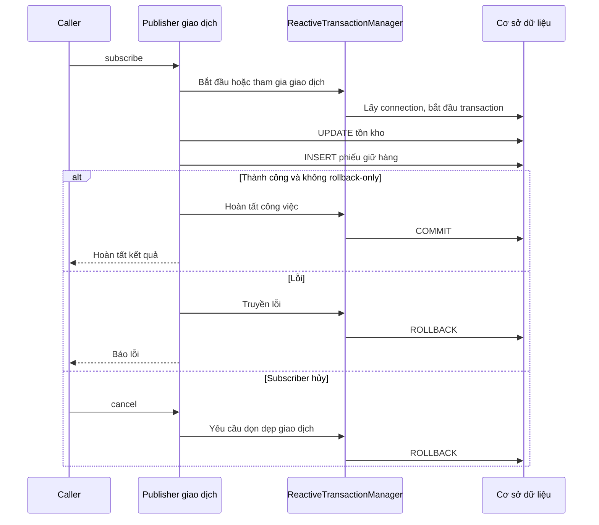

# Reactive transaction boundary

## 1. Ranh giới giao dịch trong một luồng thông điệp

Trong chương **Reactive support** của **SPRING_INTEGRATION_CORE**, reactive transaction boundary là phạm vi công việc được một giao dịch reactive bảo vệ: những thao tác dữ liệu nào phải cùng commit hoặc cùng rollback, ai subscribe vào công việc đó và tín hiệu nào kết thúc giao dịch.

Xét luồng đặt giữ hàng:

```text
Message<ReserveCommand>
    → gateway
    → service activator
    → trừ tồn kho
    → ghi phiếu giữ hàng
    → trả kết quả
```

Yêu cầu nghiệp vụ là: nếu không ghi được phiếu giữ hàng thì lượng tồn kho đã trừ cũng phải được khôi phục. Việc các bước nằm trong một `IntegrationFlow` chưa đủ chứng minh yêu cầu này. Ta cần đặt cả hai thao tác SQL vào đúng transaction và giữ chúng trong phần công việc mà subscriber thực sự theo dõi.

Sau bài này, người học có thể:

- Phân biệt transaction gắn với thread và transaction gắn với Reactor Context.
- Đặt `TransactionalOperator` quanh một đơn vị công việc rõ ràng.
- Nối gateway, service activator và R2DBC bằng Java DSL.
- Nhận diện các điểm làm sai phạm vi giao dịch: subscription tách rời, xử lý lỗi quá sớm, hủy luồng và retry sai vị trí.
- Thiết kế kiểm thử xác nhận trạng thái dữ liệu sau commit hoặc rollback.

## 2. Mô hình thực thi: assembly, subscription và termination

Một phương thức trả về `Mono` thường mới mô tả công việc. Việc tạo publisher, subscribe và hoàn tất là ba thời điểm khác nhau:



Sơ đồ mô tả một transaction cục bộ mới và bỏ qua các trường hợp lỗi ngay khi lấy connection, commit hoặc rollback. Khi tham gia transaction đã tồn tại, thời điểm hoàn tất vật lý còn phụ thuộc phạm vi bao ngoài.

### 2.1. Context thay cho ThreadLocal

| Khía cạnh | Imperative | Reactive |
| --- | --- | --- |
| Abstraction quản lý | `PlatformTransactionManager` | `ReactiveTransactionManager` |
| Ngữ cảnh điển hình | Gắn với thread | Gắn với subscriber qua Reactor Context |
| Dạng phương thức | Giá trị thường hoặc `void` | `Mono`, `Flux`, `Publisher` |
| Điều phải bảo toàn | Luồng gọi và tài nguyên giao dịch | Chuỗi reactive, Context và tài nguyên giao dịch |

Spring xác định cơ chế transaction khai báo dựa trên kiểu trả về của phương thức. Reactive transaction yêu cầu các thao tác tham gia nằm trong cùng reactive pipeline và Context phù hợp. Xem [cơ chế transaction khai báo của Spring](https://docs.spring.io/spring-framework/reference/data-access/transaction/declarative/tx-decl-explained.html).

Một transaction reactive không được vận chuyển bằng cách gắn connection vào `MessageHeaders`. Header `correlationId` giúp theo dõi nghiệp vụ; nó không đại diện cho giao dịch đang mở.

### 2.2. Đổi thread khác với tạo subscription riêng

`publishOn` hoặc `subscribeOn` trong một pipeline Reactor không tự động làm mất Reactor Context. Ngược lại, tự gọi `subscribe()` tạo một subscription độc lập, không mặc nhiên kế thừa transaction hiện tại.

```java
// Sai: việc ghi phiếu bị tách khỏi chuỗi mà caller đang chờ.
return updateInventory(command)
        .doOnSuccess(ignored -> insertReservation(command).subscribe());

// Đúng về quan hệ thực thi: caller chờ cả hai thao tác.
return updateInventory(command)
        .then(insertReservation(command));
```

Đoạn thứ hai vẫn cần transaction bao ngoài nếu yêu cầu tính nguyên tử. `then` chỉ ghép quan hệ hoàn tất; nó không tự tạo giao dịch. Context là cơ chế gắn với subscriber và được truyền khi subscribe, như trình bày trong [tài liệu Reactor Context](https://projectreactor.io/docs/core/release/reference/advancedFeatures/context.html).

## 3. Chọn đúng tài nguyên và transaction manager

Bài thực hành dùng Java 17 trở lên, API Spring Integration Java DSL, Spring R2DBC và Reactor. Dùng bộ phiên bản tương thích do dependency management của dự án quản lý. Các snippet là các lớp trong cùng package `example.reservation`; chỉ lưu thành mã nguồn khi thực hiện bài tập trong ứng dụng riêng.

Cần có:

- `spring-integration-core` để dựng gateway và endpoint.
- `spring-r2dbc` cùng driver R2DBC cho cơ sở dữ liệu hỗ trợ transaction, chẳng hạn PostgreSQL.
- Một `ConnectionFactory` hoặc pool đã được cấu hình.
- `reactor-test` và JUnit Jupiter cho phần kiểm thử.

```java
package example.reservation;

import io.r2dbc.spi.ConnectionFactory;
import org.springframework.beans.factory.annotation.Qualifier;
import org.springframework.context.annotation.Bean;
import org.springframework.context.annotation.Configuration;
import org.springframework.r2dbc.connection.R2dbcTransactionManager;
import org.springframework.r2dbc.core.DatabaseClient;
import org.springframework.transaction.ReactiveTransactionManager;
import org.springframework.transaction.reactive.TransactionalOperator;

@Configuration
public class ReservationDataConfiguration {

    @Bean
    public DatabaseClient reservationDb(ConnectionFactory connectionFactory) {
        return DatabaseClient.create(connectionFactory);
    }

    @Bean
    public ReactiveTransactionManager r2dbcTransactionManager(
            ConnectionFactory connectionFactory) {
        return new R2dbcTransactionManager(connectionFactory);
    }

    @Bean
    public TransactionalOperator reservationTx(
            @Qualifier("r2dbcTransactionManager")
            ReactiveTransactionManager transactionManager) {
        return TransactionalOperator.create(transactionManager);
    }
}
```

`DatabaseClient` và manager phải dùng cùng `ConnectionFactory` phù hợp. `R2dbcTransactionManager` quản lý transaction cho một factory; `DatabaseClient` lấy connection theo cơ chế nhận biết transaction của Spring. Mở connection riêng bằng `connectionFactory.create()` có thể bỏ qua connection đang được quản lý. Xem [quản lý connection R2DBC](https://docs.spring.io/spring-framework/reference/data-access/r2dbc.html#r2dbc-R2dbcTransactionManager).

Bọc `JdbcTemplate` hoặc JPA trong `Mono.fromCallable` không biến chúng thành tài nguyên R2DBC. Nếu một bước vẫn dùng JDBC, cần thiết kế transaction imperative tương ứng và xác định rõ nơi chuyển tiếp giữa hai mô hình.

## 4. Thực hành: trừ tồn kho và ghi phiếu trong cùng transaction

### 4.1. Hợp đồng nghiệp vụ và schema

Mỗi lệnh có `commandId` để phân biệt yêu cầu. Ví dụ dùng hai bảng:

```sql
CREATE TABLE inventory (
    sku VARCHAR(64) PRIMARY KEY,
    available INTEGER NOT NULL CHECK (available >= 0)
);

CREATE TABLE reservation (
    command_id VARCHAR(36) PRIMARY KEY,
    sku VARCHAR(64) NOT NULL REFERENCES inventory(sku),
    quantity INTEGER NOT NULL CHECK (quantity > 0)
);

INSERT INTO inventory(sku, available) VALUES ('BOOK-01', 10);
```

Đặt mỗi public record trong một file Java tương ứng:

```java
package example.reservation;

public record ReserveCommand(String commandId, String sku, int quantity) {
}
```

```java
package example.reservation;

public record ReservationAccepted(String commandId, String sku, int quantity) {
}
```

Dùng câu `UPDATE` có điều kiện thay vì đọc số lượng rồi cập nhật bằng một phép ghi không kiểm tra. Với hai lệnh cạnh tranh, điều kiện `available >= :quantity` được cơ sở dữ liệu đánh giá tại thao tác ghi. Kết quả cập nhật bằng không được coi là không thể giữ hàng.

### 4.2. Service trả về toàn bộ đơn vị công việc

```java
package example.reservation;

import org.springframework.r2dbc.core.DatabaseClient;
import org.springframework.transaction.reactive.TransactionalOperator;
import reactor.core.publisher.Mono;

public class ReservationService {

    private final DatabaseClient db;
    private final TransactionalOperator tx;

    public ReservationService(DatabaseClient db, TransactionalOperator tx) {
        this.db = db;
        this.tx = tx;
    }

    public Mono<ReservationAccepted> reserve(ReserveCommand command) {
        return Mono.defer(() -> {
            validate(command);

            Mono<Void> writes = decreaseStock(command)
                    .then(insertReservation(command));

            return writes
                    .as(tx::transactional)
                    .thenReturn(new ReservationAccepted(
                            command.commandId(),
                            command.sku(),
                            command.quantity()));
        });
    }

    private void validate(ReserveCommand command) {
        if (command == null
                || command.commandId() == null
                || command.commandId().isBlank()
                || command.commandId().length() > 36
                || command.sku() == null
                || command.sku().isBlank()
                || command.sku().length() > 64
                || command.quantity() <= 0) {
            throw new IllegalArgumentException("Lệnh giữ hàng không hợp lệ");
        }
    }

    private Mono<Void> decreaseStock(ReserveCommand command) {
        return db.sql("""
                UPDATE inventory
                SET available = available - :quantity
                WHERE sku = :sku AND available >= :quantity
                """)
                .bind("quantity", command.quantity())
                .bind("sku", command.sku())
                .fetch()
                .rowsUpdated()
                .flatMap(updated -> updated == 1L
                        ? Mono.<Void>empty()
                        : Mono.<Void>error(new IllegalStateException(
                                "SKU không tồn tại hoặc không đủ tồn kho")));
    }

    private Mono<Void> insertReservation(ReserveCommand command) {
        return db.sql("""
                INSERT INTO reservation(command_id, sku, quantity)
                VALUES (:commandId, :sku, :quantity)
                """)
                .bind("commandId", command.commandId())
                .bind("sku", command.sku())
                .bind("quantity", command.quantity())
                .fetch()
                .rowsUpdated()
                .flatMap(inserted -> inserted == 1L
                        ? Mono.<Void>empty()
                        : Mono.<Void>error(new IllegalStateException(
                                "Không ghi được phiếu giữ hàng")));
    }
}
```

Ranh giới nằm ở:

```java
writes.as(tx::transactional)
```

`writes` gồm cả `UPDATE` và `INSERT`. `thenReturn` đặt sau publisher giao dịch để chỉ phát kết quả nghiệp vụ sau khi phần giao dịch hoàn tất thành công. Trong ví dụ không có transaction bao ngoài, đây là sau commit thành công. Nếu dùng propagation tham gia transaction có sẵn, kết quả chỉ chứng tỏ phạm vi hiện tại thành công; transaction ngoài vẫn có thể rollback về sau.

Các trường hợp có thể quan sát:

| Tình huống | Tồn kho | Phiếu giữ hàng | Kết quả |
| --- | --- | --- | --- |
| Còn 10, giữ 3, cả hai SQL thành công | Còn 7 | Có một phiếu | Thành công |
| Không đủ tồn kho | Không đổi | Không có phiếu mới | Lỗi nghiệp vụ |
| Trừ tồn kho xong, `INSERT` vi phạm khóa chính | Khôi phục giá trị trước lần gọi | Không có phiếu mới | Lỗi ghi dữ liệu |
| Validation thất bại | Không đổi | Không có phiếu mới | Lỗi trước khi bắt đầu phần SQL |

Khóa chính `command_id` ngăn ghi trùng bản ghi. Ví dụ chưa triển khai hợp đồng idempotency hoàn chỉnh: gửi lại lệnh đã thành công sẽ nhận lỗi trùng khóa. Muốn trả lại kết quả cũ, cần xác định cùng `commandId` có cùng nội dung và xử lý trường hợp cạnh tranh theo chính sách nghiệp vụ.

### 4.3. Cùng một publisher nhưng khác vị trí đặt boundary

```java
// Cả hai thao tác thuộc một đơn vị giao dịch.
return updateA()
        .then(updateB())
        .as(tx::transactional);

// Chỉ phạm vi updateA được operator này bao bọc.
return updateA()
        .as(tx::transactional)
        .then(updateB());
```

Ở cách thứ hai, không có transaction bao ngoài thì `updateB` không thuộc transaction của `updateA`. Khi cần giới hạn một tiểu luồng, có thể dùng callback:

```java
return readReferenceData()
        .flatMap(reference -> tx.execute(status ->
                writeA(reference).then(writeB(reference)))
                .then())
        .then();
```

`readReferenceData`, `writeA`, `writeB` là tên minh họa. Nếu dữ liệu đọc quyết định điều kiện nhất quán khi ghi, cần cân nhắc đưa cả việc đọc vào transaction và chọn isolation hoặc kiểm tra phiên bản phù hợp. Hai kiểu sử dụng được mô tả trong [TransactionalOperator](https://docs.spring.io/spring-framework/reference/data-access/transaction/programmatic.html#tx-prog-operator).

## 5. Ghép vào Spring Integration bằng gateway và Java DSL

### 5.1. Gateway trả về Mono

```java
package example.reservation;

import org.springframework.integration.annotation.MessagingGateway;
import reactor.core.publisher.Mono;

@MessagingGateway(defaultRequestChannel = "reserve.input")
public interface ReservationGateway {
    Mono<ReservationAccepted> reserve(ReserveCommand command);
}
```

```java
package example.reservation;

import org.springframework.context.annotation.Bean;
import org.springframework.context.annotation.Configuration;
import org.springframework.integration.config.EnableIntegration;
import org.springframework.integration.config.IntegrationComponentScan;
import org.springframework.integration.dsl.IntegrationFlow;
import org.springframework.r2dbc.core.DatabaseClient;
import org.springframework.transaction.reactive.TransactionalOperator;

@Configuration
@EnableIntegration
@IntegrationComponentScan(basePackageClasses = ReservationGateway.class)
public class ReservationFlowConfiguration {

    @Bean
    public ReservationService reservationService(
            DatabaseClient reservationDb,
            TransactionalOperator reservationTx) {
        return new ReservationService(reservationDb, reservationTx);
    }

    @Bean
    public IntegrationFlow reserveFlow(ReservationService service) {
        return IntegrationFlow.from("reserve.input")
                .handle(service, "reserve", endpoint -> endpoint.async(true))
                .get();
    }
}
```

Ứng dụng phải nạp cả hai lớp configuration và cung cấp `ConnectionFactory`. Nếu có nhiều `DatabaseClient` hoặc `TransactionalOperator`, thêm `@Qualifier` rõ ràng cho các tham số bean tương ứng.

Gateway có kiểu trả về `Mono` trì hoãn việc thực hiện lời gọi flow đến lúc được subscribe. Với service trả reactive reply qua channel thông thường, `async(true)` cho phép endpoint xử lý kết quả bất đồng bộ. Tham khảo [reactive gateway và reply payload](https://docs.spring.io/spring-integration/reference/reactive-streams.html) cùng [asynchronous service activator](https://docs.spring.io/spring-integration/reference/service-activator.html#async-service-activator).

Trong thiết kế này, transaction được service sở hữu. Endpoint chịu trách nhiệm nối hợp đồng message với kết quả reactive; không có transaction bao toàn bộ mọi endpoint chỉ vì gateway trả về `Mono`.

Ví dụ ở rìa HTTP reactive:

```java
public Mono<ReservationAccepted> reserveFromHttp(ReserveCommand command) {
    return gateway.reserve(command);
}
```

Web framework subscribe vào giá trị trả về. Trong service không thêm `subscribe()` hoặc `block()` để ép thực thi.

### 5.2. Vị trí của transformer, router, filter và aggregator

Để gắn boundary với các mẫu tích hợp doanh nghiệp, có thể thiết kế:

```text
Gateway
  → Transformer: chuẩn hóa đầu vào
  → Router: chọn nghiệp vụ giữ hàng
  → Service activator: UPDATE + INSERT trong một transaction
  → Transformer: tạo phản hồi
```

Đây là lựa chọn thiết kế cho bài toán, không phải bảo đảm tự động của framework:

- Transformer chuẩn hóa SKU trước khi ghi giúp transaction ngắn hơn.
- Filter loại lệnh sai trước transaction cần có chính sách phản hồi rõ ràng; loại bỏ im lặng trong request/reply có thể khiến caller chờ hết timeout.
- Router chọn nhánh trước khi mở transaction tránh giữ connection trong thời gian điều phối không cần thiết.
- Splitter tạo nhiều message không đồng nghĩa các message đó chung transaction.
- Aggregator chờ đủ nhóm qua nhiều lần nhận nên thường đặt trước một bước ghi dữ liệu có transaction riêng, thay vì giữ transaction mở trong thời gian đợi.

Một phản hồi bị lỗi ở bước tạo DTO sau khi service đã commit không thể làm giao dịch cũ quay lại rollback. Nếu thao tác đó quyết định tính hợp lệ của việc ghi, hãy thực hiện phần kiểm tra cần thiết trước khi transaction kết thúc.

### 5.3. Transaction advice tại endpoint

Spring Integration hỗ trợ `ReactiveTransactionManager` với `TransactionInterceptor` cho endpoint phù hợp có kết quả reactive, bao gồm các trường hợp reply payload là reactive type. Chi tiết điều kiện áp dụng nằm trong [Reactive Transactions của Spring Integration](https://docs.spring.io/spring-integration/reference/transactions.html#reactive-transactions).

Có thể chọn advice thay cho `TransactionalOperator` trong service. Khi đó phải xác định advice bao phần publisher nào, endpoint nào và ai tiêu thụ reply. Trong ví dụ này chỉ dùng operator để nhìn rõ hai câu SQL được bao cùng nhau; không cần đặt thêm một transaction advice lên chính endpoint đó.

## 6. Channel boundary và tài nguyên được bảo vệ

Khi đánh giá channel, hãy tách câu hỏi “message đã được gửi chưa?” khỏi “công việc dữ liệu đã commit chưa?”.

| Thành phần hoặc thao tác | Cách đánh giá boundary |
| --- | --- |
| `DirectChannel` | Với flow imperative đồng bộ, có thể giữ chuỗi gọi cùng thread; điều đó chưa chứng minh một publisher deferred đã thực thi trong transaction |
| `ExecutorChannel` | Handoff sang executor là điểm phải đánh giá lại phạm vi; công việc consumer không tự thuộc transaction ở sender |
| `QueueChannel` | Đưa message vào hàng đợi và xử lý message là hai thời điểm riêng |
| `FluxMessageChannel` | Có hợp đồng Reactive Streams; vẫn cần boundary và tài nguyên transaction phù hợp |
| `channel.send(message)` trả `true` | Chứng tỏ send được chấp nhận theo hợp đồng channel, không chứng tỏ nghiệp vụ phía sau đã commit |

Quy tắc “đổi thread làm đứt transaction” trong flow imperative phải được đọc trong ngữ cảnh transaction gắn với thread. Với reactive, cần xem Context của subscription, cách publisher được nối và tài nguyên được dùng. Không suy ra rằng đổi sang `FluxMessageChannel` sẽ làm các database khác nhau hoặc broker cùng rollback.

Thiết kế mặc định dễ kiểm soát là: mỗi consumer nhận message rồi thực hiện một đơn vị dữ liệu cục bộ có transaction, hoàn tất đơn vị đó trước khi quyết định phản hồi hoặc xác nhận xử lý.

## 7. Lỗi, phục hồi và commit ngoài ý muốn

### 7.1. Nuốt lỗi bên trong transaction thay đổi kết quả

```java
// Nguy cơ commit phần đã làm: lỗi đã biến thành complete trước boundary.
Mono<Void> unsafe = writeA()
        .then(writeB())
        .onErrorResume(error -> Mono.empty())
        .as(tx::transactional);

// Lỗi đi qua boundary trước; sau đó mới phục hồi ở bên ngoài.
Mono<Void> safer = writeA()
        .then(writeB())
        .as(tx::transactional)
        .onErrorResume(error -> recordFailureOutsideTransaction(error));
```

Đây là snippet minh họa thứ tự operator. Với `unsafe`, nếu tài nguyên vẫn cho phép commit và transaction chưa bị đánh dấu rollback-only, phần `writeA` có thể được commit dù `writeB` thất bại. Một số lỗi database tự làm transaction không thể commit; không nên dựa vào đặc điểm đó để thay thế thiết kế xử lý lỗi.

Với `safer`, handler phục hồi nhận lỗi sau xử lý rollback của phạm vi operator. Hàm ghi nhận thất bại cần chính sách riêng: lỗi của chính nó cũng phải được xử lý, và chỉ phục hồi các lỗi nghiệp vụ mà hợp đồng cho phép.

Nếu cần trả fallback nhưng vẫn rollback, có thể gọi `status.setRollbackOnly()` trong callback transaction trước khi chuyển lỗi thành giá trị. Khi tham gia transaction ngoài, cờ rollback-only còn có thể làm transaction ngoài không commit được; cần kiểm thử hành vi đó theo propagation thực tế.

### 7.2. Error channel không phải transaction manager

Một `ErrorMessage` giúp vận chuyển thông tin lỗi. Việc gửi được lỗi sang `errorChannel` không tự undo SQL đã commit. Tùy đường thực thi và cấu hình gateway/endpoint, caller có thể thấy lỗi được bọc bởi `MessagingException`; cần kiểm tra chuỗi cause khi phân loại.

Trong ví dụ, lỗi SQL đi qua `TransactionalOperator` trong service trước khi endpoint xử lý lỗi bất đồng bộ. Nếu một lỗi ở bước sau commit được đưa vào error flow, error flow cần ghi nhận, retry công việc thích hợp hoặc thực hiện bù trừ theo nghiệp vụ.

## 8. Cancellation, timeout và tín hiệu hoàn tất

Với `TransactionalOperator`, từ Spring Framework 5.3, cancellation dẫn tới rollback. Các operator như `take`, `next` hoặc `timeout` có thể hủy subscription upstream. Xem [quy tắc cancel của transaction reactive](https://docs.spring.io/spring-framework/reference/data-access/transaction/programmatic.html#tx-prog-operator-cancel).

Ví dụ cần xem xét kỹ:

```java
Flux<Result> transactionalBatch = commands
        .concatMap(this::writeCommand)
        .as(tx::transactional);

// Có thể hủy trước khi transactionalBatch hoàn tất.
Mono<Result> firstOnly = transactionalBatch.next();
```

Một phần tử đã được quan sát từ `Flux` không phải bằng chứng toàn batch đã commit. Caller lấy phần tử đầu rồi hủy có thể khiến giao dịch rollback. Với xử lý ghi hàng loạt, nên trả một publisher hoàn tất sau khi tiêu thụ toàn bộ phần ghi:

```java
Mono<Void> completeBatch = commands
        .concatMap(this::writeCommand)
        .then()
        .as(tx::transactional);
```

Ở đây `writeCommand` đại diện cho phần ghi chưa tự mở transaction riêng. Nếu nó đã chứa boundary khác, phải phân tích propagation thay vì mặc định chỉ có một transaction.

Timeout cũng cần xác định vị trí:

```java
// Timeout có thể hủy phần transaction khi nó còn đang chạy.
return businessWrites()
        .as(tx::transactional)
        .timeout(Duration.ofSeconds(3));
```

Cancellation không cung cấp một `onError` cuối cùng cho subscriber đã hủy. Cleanup là công việc bất đồng bộ. Không dùng việc một callback phía caller vừa chạy làm bằng chứng rollback đã hoàn tất. Nếu commit đã hoàn tất trước khi caller mất kết nối, yêu cầu hủy đến sau không thể đảo ngược commit; truy vấn lại bằng mã nghiệp vụ giúp phân biệt kết quả khi phản hồi bị mất.

## 9. Transaction cho một message, một batch và retry

### 9.1. Chọn đơn vị rollback trước khi chọn operator

```java
// Mỗi command có transaction riêng bên trong service.reserve().
return commands.concatMap(service::reserve);
```

Nếu lệnh thứ ba thất bại, hai lệnh trước đã thành công vẫn có thể giữ dữ liệu đã commit. Đây là hợp đồng xử lý từng message.

```java
// Một transaction cho cả batch, dùng các thao tác chưa tự bao transaction.
return commands
        .concatMap(this::writeWithoutOwnBoundary)
        .then()
        .as(tx::transactional);
```

Ở cách thứ hai, lỗi giữa batch làm rollback toàn batch nếu đây là một transaction cục bộ mới. Bù lại, batch lớn giữ connection và khóa lâu hơn. Nên giới hạn kích thước batch thay vì mở transaction quanh một nguồn `Flux` vô hạn.

`concatMap` giúp thực hiện tuần tự. Không dùng `flatMap` với concurrency lớn như một cách mặc định để chạy SQL song song trên một connection giao dịch; năng lực đó phụ thuộc driver và thiết kế truy cập dữ liệu.

### 9.2. Retry bên ngoài publisher giao dịch

```java
return Mono.defer(() -> writeA().then(writeB()))
        .as(tx::transactional)
        .retryWhen(Retry.backoff(2, Duration.ofMillis(100))
                .filter(this::isTransientFailure));
```

`Retry` thuộc `reactor.util.retry`, `Duration` thuộc `java.time`; predicate phải phân loại lỗi tạm thời theo ứng dụng và driver. Trong trường hợp không có transaction bao ngoài, retry ở ngoài publisher transaction cho phép mỗi lần thử mở một transaction mới sau lần thất bại trước. Nếu tham gia transaction ngoài, phải đánh giá lại phạm vi retry vì transaction ngoài có thể đã rollback-only.

Đặt retry trong phần công việc được transaction bao có thể thử lại trên một transaction đã lỗi. Đồng thời, retry toàn luồng có thể lặp lại tác dụng phụ ngoài database. Chỉ retry các thao tác mà việc chạy lại đã có chính sách rõ ràng; không retry vô hạn lỗi validation, thiếu tồn kho hoặc trùng `commandId`.

## 10. Dùng @Transactional thay cho operator

Có thể đặt boundary ở một bean Spring được gọi qua proxy:

```java
@EnableTransactionManagement
@Configuration
class DeclarativeTransactionConfiguration {
}
```

```java
@Transactional(transactionManager = "r2dbcTransactionManager")
public Mono<Void> reserveWrites(ReserveCommand command) {
    return decreaseStock(command).then(insertReservation(command));
}
```

Đây là phương án thay thế, không phải mã cần thêm vào service mẫu. Các import tương ứng là `org.springframework.transaction.annotation.EnableTransactionManagement`, `org.springframework.context.annotation.Configuration` và `org.springframework.transaction.annotation.Transactional`.

Cần phương thức trả reactive type và lời gọi đi qua proxy Spring; self-invocation trong cùng bean không kích hoạt advice theo proxy mode mặc định. Rollback mặc định của annotation áp dụng cho `RuntimeException` và `Error`; khi dùng checked exception phải cấu hình quy tắc phù hợp, ví dụ `rollbackFor`. Xem [sử dụng @Transactional](https://docs.spring.io/spring-framework/reference/data-access/transaction/declarative/annotations.html).

Operator phù hợp khi cần thấy boundary ngay trong pipeline. Annotation phù hợp khi boundary trùng với hợp đồng của một phương thức service. Dù chọn cách nào, không tự subscribe để thực hiện các thao tác cần nằm chung giao dịch.

## 11. Kiểm thử transaction bằng kết quả dữ liệu

Mock trả về `Mono.just(...)` có thể kiểm tra đường điều phối nhưng không chứng minh database đã rollback. Bài thực hành cần database có transaction thật, driver tương ứng và truy vấn xác nhận sau khi publisher nghiệp vụ kết thúc.

### 11.1. Kiểm thử commit và rollback sau lỗi trùng khóa

Đoạn dưới là một phương thức trong lớp integration test đã được inject `ReservationGateway gateway` và `DatabaseClient db`. Schema được tạo trước test; các lớp configuration ở trên và một `ConnectionFactory` trỏ tới database kiểm thử đã được nạp vào Spring context. Cần JUnit Jupiter, `StepVerifier` và `assertEquals` tương ứng. Đây là ví dụ để thực hiện trong môi trường kiểm thử, chưa phải báo cáo một lần chạy test.

```java
@Test
void commitsFirstCommandAndRollsBackDuplicateAttempt() {
    String sku = "TEST-" + java.util.UUID.randomUUID();
    String commandId = java.util.UUID.randomUUID().toString();
    ReserveCommand command = new ReserveCommand(commandId, sku, 3);

    StepVerifier.create(db.sql("""
                    INSERT INTO inventory(sku, available)
                    VALUES (:sku, 10)
                    """)
            .bind("sku", sku)
            .fetch().rowsUpdated())
            .expectNext(1L)
            .verifyComplete();

    StepVerifier.create(gateway.reserve(command))
            .assertNext(result -> assertEquals(commandId, result.commandId()))
            .verifyComplete();

    StepVerifier.create(db.sql("""
                    SELECT available FROM inventory WHERE sku = :sku
                    """)
            .bind("sku", sku)
            .map((row, metadata) -> row.get("available", Integer.class))
            .one())
            .expectNext(7)
            .verifyComplete();

    // UPDATE chạy trước; INSERT cùng commandId phải thất bại.
    StepVerifier.create(gateway.reserve(command))
            .expectError()
            .verify();

    StepVerifier.create(db.sql("""
                    SELECT available FROM inventory WHERE sku = :sku
                    """)
            .bind("sku", sku)
            .map((row, metadata) -> row.get("available", Integer.class))
            .one())
            .expectNext(7)
            .verifyComplete();

    StepVerifier.create(db.sql("""
                    SELECT COUNT(*) AS total
                    FROM reservation WHERE command_id = :commandId
                    """)
            .bind("commandId", commandId)
            .map((row, metadata) -> row.get("total", Long.class))
            .one())
            .expectNext(1L)
            .verifyComplete();
}
```

Các giá trị kỳ vọng cho kiểu SQL ở trên phù hợp với PostgreSQL; nếu thay driver, kiểm tra kiểu Java mà driver ánh xạ cho `COUNT(*)` và số dòng bị ảnh hưởng. Trong test hoàn chỉnh, thêm timeout cho verify, dọn dữ liệu fixture và xác nhận cause của lỗi trùng khóa, có tính đến wrapper của messaging.

Điểm có ý nghĩa nhất là tồn kho vẫn bằng 7 sau lần gọi thứ hai. Nếu chỉ kiểm tra có exception, một chương trình đã commit nhầm lượng tồn kho còn 4 vẫn có thể vượt qua test.

`StepVerifier` subscribe và kiểm tra chuỗi tín hiệu; nó không tự tạo transaction cho ứng dụng. Xem [kiểm thử reactive sequence với Reactor](https://projectreactor.io/docs/core/release/reference/testing.html).

### 11.2. Những kịch bản bổ sung

| Kịch bản | Bằng chứng cần có |
| --- | --- |
| Thiếu hàng | Không có phiếu mới, tồn kho không đổi |
| Lỗi ở lần ghi thứ hai | Lần ghi thứ nhất bị rollback |
| Không subscribe publisher | Công việc deferred chưa thực thi |
| Hủy sau lần ghi thứ nhất | Chờ cleanup kết thúc rồi xác nhận dữ liệu được rollback |
| Timeout trước hoàn tất | Xác nhận cả lỗi/việc hủy lẫn trạng thái dữ liệu cuối |
| Recovery bên trong hoặc ngoài boundary | So sánh dữ liệu thực để thấy ảnh hưởng của vị trí operator |
| Retry lỗi tạm thời | Mỗi lần thử có boundary đúng, không tạo tác dụng phụ trùng |
| Hai yêu cầu cạnh tranh | Tồn kho không âm, tổng lượng giữ hợp lệ |

Để kiểm thử cancellation ổn định, dùng một điểm đồng bộ có kiểm soát sau thao tác SQL thứ nhất, chẳng hạn test publisher hoặc sink, rồi mới hủy. Chờ tín hiệu hoàn tất rollback/giải phóng tài nguyên hoặc truy vấn với bounded eventual assertion. Không chọn thời gian `sleep` tùy ý rồi coi dữ liệu đọc được ngay sau cancel là kết quả chắc chắn.

Không dựa vào `@Transactional` trên phương thức test để giả định nó bao subscription reactive: test-managed transaction thông thường gắn với thread. Publisher ứng dụng phải có boundary riêng; fixture cần được dọn theo giao dịch thực sự đã commit.

## 12. Giới hạn: database, broker và hệ thống ngoài

Giả sử sau khi giữ hàng, flow gọi HTTP để thu tiền:

```text
UPDATE inventory → INSERT reservation → HTTP charge → phản hồi
```

Nếu HTTP đã thu tiền nhưng database rollback, `R2dbcTransactionManager` không hoàn lại tiền. Nếu database đã commit nhưng gửi broker thất bại, transaction cục bộ không tự phát lại sự kiện.

Một thiết kế có thể áp dụng cho bài toán phát sự kiện là transactional outbox:

```text
Transaction database:
    UPDATE inventory
    INSERT reservation
    INSERT outbox_event
    COMMIT

Luồng phát sự kiện riêng:
    đọc outbox → gửi broker → ghi nhận tiến độ
```

Ba thao tác database phải cùng thuộc transaction của cùng tài nguyên. Luồng phát cần cơ chế retry; consumer cần chịu được sự kiện gửi lại, vì có thể crash sau khi gửi mà trước khi ghi nhận tiến độ. Đây là suy luận thiết kế từ phạm vi transaction cục bộ, không phải bảo đảm “exactly once” do việc dùng reactive cung cấp.

Tương tự, acknowledgement của nguồn message phải được thiết kế theo adapter và broker cụ thể. Không suy ra rằng publisher hoàn tất đồng nghĩa broker và database đã cùng commit trong một giao dịch phân tán.

## 13. Tự kiểm tra boundary khi thiết kế flow

Trước khi chốt một reactive flow, hãy trả lời bằng tên thao tác cụ thể:

1. Đơn vị cần rollback là một lệnh, một message hay một batch hữu hạn?
2. Publisher nào bao toàn bộ những lần ghi đó?
3. Ai subscribe và ai có thể cancel subscription?
4. Manager đang quản lý tài nguyên nào; các thao tác có lấy đúng connection không?
5. Có `subscribe()`, queue, executor hoặc external call nào tách công việc ra khỏi phạm vi dự kiến không?
6. Lỗi đến boundary trước hay đã biến thành thành công ở một operator recovery?
7. Kết quả thành công được phát sau phạm vi hoàn tất nào; có transaction ngoài chưa commit không?
8. Kiểm thử nào chứng minh dữ liệu cuối cùng thay vì chỉ chứng minh có exception?

Với luồng giữ hàng trong bài, câu trả lời cốt lõi là: `decreaseStock` và `insertReservation` tạo thành một `Mono<Void>` được `TransactionalOperator` bao bọc, rồi gateway trả kết quả sau khi phạm vi đó hoàn tất. Những bước điều phối message phía ngoài cần được đánh giá theo hợp đồng riêng của chúng.
