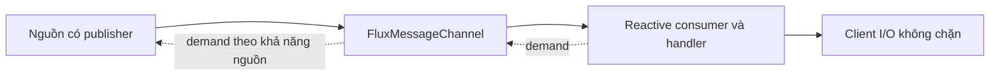

# Khi dùng reactive thay poller

## 1. Mục tiêu và phạm vi

Trong chương **Reactive support** của module **SPRING_INTEGRATION_CORE**, bài này giúp lựa chọn cách đưa dữ liệu vào luồng thông điệp và cách tiêu thụ dữ liệu ở các endpoint. Trọng tâm là mối quan hệ giữa `Message`, `MessageChannel`, poller, reactive consumer và Java DSL.

Nên ưu tiên reactive khi nguồn hoặc giao thức đã có API reactive phù hợp, luồng phải phục vụ nhiều thao tác I/O đang chờ, và ứng dụng có thể quản lý nhu cầu tiêu thụ xuyên suốt các ranh giới quan trọng. Nên giữ poller khi nghiệp vụ cần lịch quét, nguồn chỉ cho phép chủ động lấy dữ liệu, hoặc chi phí chuyển đổi lớn hơn lợi ích đo được.

Một luồng cũng có thể giữ polling ở đầu vào và dùng reactive ở phần xử lý tiếp theo. Quyết định cần dựa trên khả năng của từng đoạn trong luồng, thay vì gắn một nhãn cho toàn bộ ứng dụng.

Các ví dụ dùng Java 17 và API của Spring Integration 6.5, với `handleReactive(...)` đã có từ 6.1. Cần có `spring-integration-core`, Reactor Core và một Spring application context bật Spring Integration; phiên bản dependency nên do bộ quản lý dependency của dự án điều phối. Các interface nguồn và dịch vụ trong ví dụ là hợp đồng ứng dụng, cần được cung cấp bằng bean thực tế. [Tài liệu Reactive Streams của Spring Integration](https://docs.spring.io/spring-integration/reference/6.5/reactive-streams.html#reactive-message-handler)

## 2. Poller và reactive điều khiển hai việc khác nhau

### 2.1. Poller quyết định lúc nào chủ động lấy dữ liệu

Trong Spring Integration có hai trường hợp cần phân biệt:

| Thành phần | Đối tượng được lấy dữ liệu | Ví dụ |
|---|---|---|
| `SourcePollingChannelAdapter` | Một `MessageSource<?>` | Đọc bản ghi chờ xử lý, kiểm tra thư mục từ xa |
| `PollingConsumer` | Một `PollableChannel` | Lấy thông điệp từ `QueueChannel` để gọi service activator |

Vì vậy, bỏ poller ở một consumer không có nghĩa đã loại bỏ thao tác polling ở nguồn bên ngoài. [Spring Integration: Poller](https://docs.spring.io/spring-integration/reference/polling-consumer.html)

Ví dụ, endpoint đọc SFTP theo lịch vẫn phải kiểm tra máy chủ. Dù bước gửi kết quả sau đó dùng reactive HTTP client, thao tác phát hiện tệp mới vẫn dựa vào lịch quét nếu adapter được chọn hoạt động theo cách đó.

### 2.2. Reactive điều phối dữ liệu theo nhu cầu tiêu thụ

Reactive Streams sử dụng các vai trò `Publisher`, `Subscriber` và `Subscription`. Subscriber truyền nhu cầu qua `request(n)`; publisher tuân thủ giao thức không được phát vượt nhu cầu còn lại. Subscriber cũng có thể hủy subscription.

Nhu cầu này giúp phối hợp nguồn nhanh và đích chậm qua ranh giới bất đồng bộ. Nó không tự bổ sung cơ chế lưu bền, xác nhận nghiệp vụ hay mở rộng năng lực của dịch vụ đích. [Đặc tả và mục tiêu của Reactive Streams](https://www.reactive-streams.org/)

Một poller có thể hỏi “đã đến lượt quét tiếp theo chưa”, trong khi một reactive pipeline hỏi “phía nhận còn cho phép nhận thêm bao nhiêu phần tử”. Ứng dụng có thể cần cả hai câu trả lời.

### 2.3. Event-driven chưa đủ để gọi là reactive

| Cách nối luồng | Khi handler được gọi | Có giao thức `request(n)` tại ranh giới này? |
|---|---|---|
| `DirectChannel` | Khi sender gửi thông điệp, trong luồng gọi thông thường | Không |
| `ExecutorChannel` | Qua executor được cấu hình | Không |
| `QueueChannel` với consumer thông thường | Khi poller lấy thông điệp khỏi hàng đợi | Không |
| `FluxMessageChannel` với reactive consumer | Qua subscription và cơ chế demand | Có |

`DirectChannel` đã hỗ trợ xử lý theo sự kiện mà không cần poller. `ExecutorChannel` bổ sung ranh giới thực thi bất đồng bộ. Việc thêm thread pool không đồng thời tạo giao thức Reactive Streams. [Các kiểu MessageChannel](https://docs.spring.io/spring-integration/reference/channel/implementations.html)

Nếu vấn đề chỉ là muốn gọi handler ngay khi có message, `DirectChannel` có thể đã đáp ứng. Hãy xác định nhu cầu về I/O, điều tiết tải hoặc kết hợp reactive API trước khi thay đổi kiến trúc.

## 3. Những tình huống nên cân nhắc reactive

### 3.1. Nguồn đã cung cấp một stream reactive có ý nghĩa

Giả sử hệ thống nhận sự kiện trạng thái đơn hàng qua một client cung cấp `Flux<OrderEvent>`. Client cho phép hủy việc nhận và có cơ chế kiểm soát dữ liệu đang chờ phù hợp với nhu cầu của ứng dụng. Đưa publisher này vào `IntegrationFlow` giúp giữ mô hình tiêu thụ đó khi chuyển sự kiện thành `Message`.

Nếu thay bằng một tác vụ chạy mỗi giây chỉ để kiểm tra một hàng đợi tự tạo từ chính stream đó, ứng dụng bổ sung lịch chạy và một vùng đệm mới cần quản lý. Trong trường hợp này, kết nối trực tiếp publisher với flow thường là phương án đáng thử nghiệm.

Tuy nhiên, cần kiểm tra ý nghĩa của API nguồn. Một `Flux` bọc callback vẫn có thể phải giữ dữ liệu trong bộ nhớ nếu nguồn vật lý không thể chậm lại. Kiểu trả về reactive chỉ là điểm bắt đầu của việc đánh giá.

### 3.2. Nhiều tác vụ I/O chờ đồng thời

Ví dụ, mỗi sự kiện cần gọi một API ngoài và phần lớn thời gian xử lý là chờ phản hồi. Khi client ngoài hỗ trợ I/O không chặn và ứng dụng kiểm soát số tác vụ đang thực hiện, reactive có thể giúp dùng tài nguyên hiệu quả hơn mô hình giữ một platform thread cho từng lần chờ.

Một ước lượng phục vụ thiết kế: nếu mục tiêu là 300 sự kiện/giây và mỗi lần gọi mất trung bình 80 ms, số thao tác đang chờ trung bình xấp xỉ:

```text
300 × 0,08 = 24 thao tác
```

Đây là phép tính từ giả định của ví dụ, không phải kết quả benchmark hay cấu hình concurrency bắt buộc. Độ trễ đuôi, connection pool, quota và hành vi khi timeout vẫn quyết định giới hạn thực tế.

### 3.3. Tải biến động và downstream có năng lực hữu hạn

Giả sử đầu vào đạt 800 sự kiện/giây nhưng đích chỉ xử lý được 500 sự kiện/giây trong 20 giây. Nếu chấp nhận mọi sự kiện vào hàng đợi, lượng tồn tăng khoảng:

```text
(800 - 500) × 20 = 6.000 sự kiện
```

Đây là bài toán cần một chính sách tiếp nhận rõ ràng: làm chậm nguồn nếu có thể, chuyển sang nơi lưu bền, từ chối, hoặc bỏ dữ liệu theo quy tắc nghiệp vụ. Reactive là lựa chọn hữu ích khi đường truyền demand có thể phối hợp các thành phần; một vùng đệm không giới hạn chỉ trì hoãn thời điểm lộ ra vấn đề.

Với sự kiện đo nhiệt độ, chấp nhận giá trị mới nhất có thể phù hợp. Với lệnh trừ tiền, mất một phần tử vì đầy bộ đệm thường không chấp nhận được. Cùng một đặc điểm tải có thể dẫn đến hai thiết kế khác nhau.

## 4. Khi nào giữ poller là hợp lý?

| Tình huống | Hướng lựa chọn | Lý do cần xem xét |
|---|---|---|
| Quét thư mục đối tác mỗi 5 phút | Poller | Lịch quét là yêu cầu trực tiếp |
| API ngoài chỉ cho phép truy vấn trạng thái | Poller hoặc cơ chế chủ động truy vấn tương đương | Bọc lời gọi thành `Mono` không tạo thêm API sự kiện |
| Nguồn có publisher, đích có client không chặn, nhiều I/O đồng thời | Reactive | Có cơ sở giữ mô hình demand và kết hợp bất đồng bộ |
| Luồng ngắn, ít tải, xử lý đồng bộ | Giữ thiết kế đơn giản đang đáp ứng mục tiêu | Cần có lợi ích cụ thể để bù chi phí chuyển đổi |
| Luồng JDBC hiện có dựa vào transaction của một lần poll | Đánh giá giữ poller trước | Chuyển ranh giới thực thi có thể làm thay đổi phạm vi transaction |
| Nguồn legacy phải quét, bước sau gọi reactive API | Kết hợp polling và reactive | Mỗi đoạn dùng cơ chế phù hợp |
| Đối tác gửi webhook | Event-driven adapter phù hợp | Không cần tạo poller chỉ để nhận request; reactive còn phụ thuộc client, server và downstream |
| Tính toán CPU nặng | Đo và tối ưu xử lý CPU trước | Reactive không làm phép tính tự chạy nhanh hơn |

Không nên dùng “có nhiều message” làm tiêu chí duy nhất. Một luồng truyền thống có concurrency, batch size và hàng đợi được cấu hình phù hợp vẫn có thể đáp ứng tốt. Ngược lại, một luồng ít message vẫn có thể cần reactive để kết hợp với một giao thức hiện hữu.

## 5. Hiểu đúng các thành phần reactive của Spring Integration

### 5.1. `FluxMessageChannel`

`FluxMessageChannel` vừa là `MessageChannel`, vừa là `Publisher<Message<?>>`, đồng thời hỗ trợ nhận dữ liệu từ publisher qua `subscribeTo(...)`. Nó đóng vai trò cầu nối giữa mô hình message của Spring Integration và một reactive stream. [Javadoc FluxMessageChannel 6.5](https://docs.spring.io/spring-integration/docs/6.5.0/api/org/springframework/integration/channel/FluxMessageChannel.html)

Kênh này không phải một kho lưu trữ nghiệp vụ. Khi cần phục hồi sau khi ứng dụng dừng đột ngột, thiết kế phải xác định dữ liệu sẽ được giữ ở broker, cơ sở dữ liệu hoặc cơ chế lưu bền nào.

### 5.2. `ReactiveStreamsConsumer`

`ReactiveStreamsConsumer` quản lý việc subscription vào input channel và tiêu thụ message theo mô hình reactive. Nó vẫn nối channel với handler, tương tự vai trò điều phối endpoint trong những kiểu flow khác. [Javadoc ReactiveStreamsConsumer 6.5](https://docs.spring.io/spring-integration/docs/6.5.0/api/org/springframework/integration/endpoint/ReactiveStreamsConsumer.html)

Tạo reactive consumer không thay đổi bản chất nghiệp vụ bên trong handler. Một handler gọi JDBC đồng bộ vẫn phải chờ JDBC, dù endpoint đã dùng subscription.

### 5.3. Tùy chọn `reactive()` của endpoint

Java DSL có tùy chọn `reactive()` trên consumer endpoint để dùng `ReactiveStreamsConsumer`, kể cả khi input channel có kiểu khác. Có thể truyền hàm tùy biến reactive stream vào tùy chọn này. [Javadoc ConsumerEndpointSpec.reactive](https://docs.spring.io/spring-integration/docs/6.5.0/api/org/springframework/integration/dsl/ConsumerEndpointSpec.html)

Đây là một cách thích nghi ở ranh giới endpoint. Nó không bảo đảm bên gửi của một `DirectChannel` hoặc một hệ thống ngoài đã biết phản ứng với demand. Trước khi dùng, cần chỉ ra chính xác đoạn nào đang thực hiện điều tiết tải và đoạn nào còn phải tự quản lý vùng đệm.

## 6. Ví dụ gốc: polling một nguồn chủ động truy vấn

Giả sử một nguồn lưu các sự kiện đơn hàng đang chờ gửi. Phương thức `nextPending()` lấy tối đa một sự kiện và trả `null` khi chưa có dữ liệu.

```java
import java.time.Duration;

import org.springframework.context.annotation.Bean;
import org.springframework.context.annotation.Configuration;
import org.springframework.integration.config.EnableIntegration;
import org.springframework.integration.dsl.IntegrationFlow;
import org.springframework.integration.dsl.Pollers;

@Configuration
@EnableIntegration
public class PollingOrderConfiguration {

    public record OrderEvent(String eventId, String orderId) {
    }

    public interface PendingOrderSource {
        OrderEvent nextPending();
    }

    public interface BlockingOrderNotifier {
        void deliver(OrderEvent event);
    }

    @Bean
    IntegrationFlow pollingOrders(
            PendingOrderSource source,
            BlockingOrderNotifier notifier) {

        return IntegrationFlow
                .fromSupplier(
                        source::nextPending,
                        endpoint -> endpoint.poller(
                                Pollers.fixedDelay(Duration.ofSeconds(2))
                                        .maxMessagesPerPoll(10)))
                .handle(OrderEvent.class, (event, headers) -> {
                    notifier.deliver(event);
                    return null;
                })
                .get();
    }
}
```

`Pollers.fixedDelay(Duration)` tạo cấu hình poller với khoảng nghỉ cố định. `maxMessagesPerPoll(10)` giới hạn số message lấy trong một lượt; nguồn có thể kết thúc lượt sớm bằng cách trả `null`. [Javadoc Pollers](https://docs.spring.io/spring-integration/docs/6.5.0/api/org/springframework/integration/dsl/Pollers.html), [Inbound Channel Adapter](https://docs.spring.io/spring-integration/reference/channel-adapter.html)

Với cấu hình đồng bộ đơn giản ở trên, thời gian xử lý downstream góp vào thời gian của lượt poll. Không nên suy ra rằng cấu hình này luôn tạo đúng 5 sự kiện/giây. Nguồn có thể rỗng, một lượt có thể mất nhiều thời gian, và lần lấy tiếp theo còn phụ thuộc lịch chạy.

Interface nguồn chưa định nghĩa quyền sở hữu bản ghi. Khi triển khai bằng cơ sở dữ liệu, cần bổ sung cơ chế claim, transaction hoặc khóa phù hợp để nhiều instance không cùng xử lý một bản ghi. Đó là yêu cầu nghiệp vụ riêng, không được giải quyết chỉ bằng `maxMessagesPerPoll`.

## 7. Thay poller khi nguồn thực sự có publisher

Ở một phương án khác, nguồn cung cấp stream sự kiện và notifier trả `Mono<Void>`. Đây là một cấu hình thay thế cho ví dụ polling; không bật cả hai để cùng đọc một tập dữ liệu nếu chưa có thiết kế phân chia quyền tiêu thụ.

```java
import java.time.Duration;

import org.springframework.context.annotation.Bean;
import org.springframework.context.annotation.Configuration;
import org.springframework.integration.config.EnableIntegration;
import org.springframework.integration.dsl.IntegrationFlow;
import org.springframework.messaging.Message;
import org.springframework.messaging.support.MessageBuilder;

import reactor.core.publisher.Flux;
import reactor.core.publisher.Mono;

@Configuration
@EnableIntegration
public class ReactiveOrderConfiguration {

    public record OrderEvent(String eventId, String orderId) {
    }

    public interface OrderEventSource {
        Flux<OrderEvent> events();
    }

    public interface OrderNotifier {
        Mono<Void> deliver(OrderEvent event);
    }

    public interface FailureStore {
        Mono<Void> record(OrderEvent event, Throwable error);
    }

    @Bean
    IntegrationFlow reactiveOrders(
            OrderEventSource source,
            OrderNotifier notifier,
            FailureStore failures) {

        Flux<Message<OrderEvent>> messages = Flux.defer(source::events)
                .map(event -> MessageBuilder.withPayload(event)
                        .setHeader("eventId", event.eventId())
                        .build());

        return IntegrationFlow.from(messages)
                .handleReactive(message -> {
                    OrderEvent event = (OrderEvent) message.getPayload();

                    return Mono.defer(() -> notifier.deliver(event))
                            .timeout(Duration.ofSeconds(3))
                            .onErrorResume(error ->
                                    failures.record(event, error));
                });
    }
}
```

`IntegrationFlow.from(Publisher)` tạo ranh giới `FluxMessageChannel` để nối publisher với flow. Payload nghiệp vụ được bọc thành `Message`, cho phép giữ thêm `eventId` trong header. [Javadoc IntegrationFlow.from](https://docs.spring.io/spring-integration/docs/6.5.0/api/org/springframework/integration/dsl/IntegrationFlow.html)

`handleReactive(...)` là toán tử kết thúc flow và trả trực tiếp `IntegrationFlow`, nên không gọi thêm `.get()`. Spring Integration quản lý subscription vào `Mono<Void>` do handler trả về. [Spring Integration: ReactiveMessageHandler](https://docs.spring.io/spring-integration/reference/6.5/reactive-streams.html#reactive-message-handler)

Các hợp đồng cần được thực thi trong bean thật:

- `events()` phải có hành vi rõ ràng khi subscribe lại, hủy và thiếu demand; bản thân kiểu `Flux` chưa nói dữ liệu có replay hay không.
- `deliver()` phải trả publisher đại diện cho thao tác gửi, với điểm hoàn tất phù hợp với cam kết của dịch vụ.
- `FailureStore.record()` chỉ hoàn tất sau khi đã ghi nhận lỗi theo cơ chế phục hồi được chọn. Nếu chỉ ghi log, không được xem đó là lưu bền một sự kiện thất bại.

Ví dụ tập trung vào việc thay nguồn polling và nối reactive handler. Nó chưa cài đặt acknowledge của broker, phục hồi kết nối hay giới hạn số lời gọi đang chạy. Các phần đó cần được quyết định theo adapter và tải thực tế.

## 8. Giữ poller ở đầu vào và chuyển downstream sang reactive

Khi nguồn chỉ cung cấp `MessageSource<OrderEvent>`, vẫn có thể đặt `FluxMessageChannel` ở đầu ra của nguồn polling. Đoạn cấu hình sau sử dụng các kiểu `OrderEvent` và `OrderNotifier` của ví dụ reactive, với các import bổ sung:

```java
import java.time.Duration;

import org.springframework.context.annotation.Bean;
import org.springframework.integration.channel.FluxMessageChannel;
import org.springframework.integration.core.MessageSource;
import org.springframework.integration.dsl.IntegrationFlow;
import org.springframework.integration.dsl.Pollers;

import reactor.core.publisher.Mono;

// Đặt trong một lớp @Configuration đã có @EnableIntegration.
@Bean
IntegrationFlow hybridOrders(
        MessageSource<OrderEvent> source,
        OrderNotifier notifier) {

    return IntegrationFlow
            .from(source, endpoint -> endpoint.poller(
                    Pollers.fixedDelay(Duration.ofSeconds(2))
                            .maxMessagesPerPoll(10)))
            .channel(new FluxMessageChannel())
            .handleReactive(message ->
                    Mono.defer(() -> notifier.deliver(
                            (OrderEvent) message.getPayload()))
                            .timeout(Duration.ofSeconds(3)));
}
```

Với output channel hỗ trợ `ReactiveStreamsSubscribableChannel`, `SourcePollingChannelAdapter` có nhánh thực thi tạo publisher từ trigger và tiêu thụ theo demand. Trigger và giới hạn lấy message vẫn còn ý nghĩa. [Spring Integration: Source Polling Channel Adapter trong reactive flow](https://docs.spring.io/spring-integration/reference/6.5/reactive-streams.html#source-polling-channel-adapter)

Tác động đến thiết kế:

- Nguồn bên ngoài vẫn được truy vấn chủ động; việc đổi channel không biến nó thành nguồn phát sự kiện.
- Nếu `receive()` của nguồn chặn, thao tác đó vẫn chặn. Cần kiểm tra nơi thực thi và cách cô lập lời gọi này.
- Lỗi trong ví dụ hybrid được để lan tới cơ chế xử lý lỗi của endpoint; triển khai thực tế phải cấu hình và kiểm chứng đường lỗi phù hợp.
- Nếu nguồn có acknowledge, không suy ra thời điểm acknowledge chỉ từ việc một message đã được gửi vào channel.

Một lựa chọn khác là `ReactiveMessageSourceProducer`, thành phần thích nghi `MessageSource` thành `Flux` và cho phép cấu hình khoảng chờ khi lần lấy trước trả rỗng bằng `setDelayWhenEmpty(...)`. Nó phù hợp khi muốn cơ chế lấy theo nhu cầu thay cho một lịch polling nghiệp vụ cụ thể. [Javadoc ReactiveMessageSourceProducer](https://docs.spring.io/spring-integration/docs/6.5.0/api/org/springframework/integration/endpoint/ReactiveMessageSourceProducer.html)

Phải kiểm tra các tính năng đang dùng ở poller trước khi thay bằng producer này: lịch cron, advice, transaction và xử lý nguồn rỗng có thể là một phần của hợp đồng vận hành.

## 9. Xác định đường truyền demand và các giới hạn tài nguyên



Khi xem sơ đồ thật, hãy đánh dấu mọi điểm có vùng đệm, thay đổi thread, chuyển sang callback hoặc gọi API đồng bộ. Đặc biệt, imperative sender gọi `send()` vào một reactive channel không nhờ đó mà tự trở thành publisher biết tuân thủ demand.

Reactor có thể điều chỉnh demand qua các toán tử; ví dụ prefetch và các toán tử xử lý nhiều phần tử làm lượng yêu cầu ở upstream khác với lượng đang quan sát ở subscriber cuối. Vì thế, “consumer yêu cầu một message” không phải lúc nào cũng tương đương “nguồn vật lý chỉ được đọc đúng một bản ghi”. [Reactor: Backpressure và cách điều chỉnh request](https://projectreactor.io/docs/core/release/reference/coreFeatures/simple-ways-to-create-a-flux-or-mono-and-subscribe-to-it.html#_on_backpressure_and_ways_to_reshape_requests)

Phân biệt các giới hạn sau khi thiết kế:

| Giới hạn | Câu hỏi cần trả lời |
|---|---|
| Demand | Còn được phát bao nhiêu phần tử trên subscription này? |
| Concurrency | Có bao nhiêu thao tác I/O đang cùng thực hiện? |
| Prefetch | Toán tử chủ động lấy trước bao nhiêu phần tử? |
| Buffer capacity | Được giữ tối đa bao nhiêu dữ liệu đang chờ? |
| Rate limit | Được gửi bao nhiêu request trong một khoảng thời gian? |
| Connection pool | Client có tối đa bao nhiêu kết nối hoặc yêu cầu chờ kết nối? |

`limitRate(...)` điều chỉnh lượng request upstream theo đợt; không nên diễn giải nó như quota request/giây cho API ngoài. Tương tự, `maxMessagesPerPoll` giới hạn một lượt poll, không phải tổng số tác vụ đang chạy nếu downstream đã tách bất đồng bộ.

Khi chủ động kết hợp Reactor ở một đoạn xử lý, có thể giới hạn concurrency của chính đoạn đó:

```java
// events: Flux<OrderEvent>; notifier: OrderNotifier
Flux<OrderEvent> delivered = events.flatMap(
        event -> Mono.defer(() -> notifier.deliver(event))
                .timeout(Duration.ofSeconds(3))
                .thenReturn(event),
        16,  // tối đa 16 inner publisher đang được subscribe
        1);  // prefetch từ mỗi inner publisher
```

Đây là đoạn pipeline thay thế cho bước gửi, không ghép thêm sau một bước đã gửi cùng sự kiện. Giới hạn `16` thuộc toán tử này; nó không bảo đảm tổng cộng chỉ có 16 phần tử nằm trong toàn ứng dụng. `flatMap` cũng có thể làm kết quả xuất hiện khác thứ tự đầu vào. Nếu cần xử lý tuần tự, cân nhắc `concatMap`; nếu cần giữ thứ tự phát kết quả với xử lý đồng thời, xem xét `flatMapSequential` và chi phí giữ kết quả chờ. [Javadoc Flux](https://projectreactor.io/docs/core/release/api/reactor/core/publisher/Flux.html)

Đối với đơn hàng, việc giữ thứ tự thường áp dụng theo `orderId`, không nhất thiết cho tất cả đơn hàng. Yêu cầu đó cần được ghi thành quy tắc trước khi chọn toán tử hoặc chiến lược phân vùng.

## 10. Cô lập blocking khi chưa thể chuyển toàn bộ luồng

Lời gọi đồng bộ cần được trì hoãn tới lúc subscription và chạy trên scheduler phù hợp. Ví dụ sau chỉ minh họa cách bọc một thao tác legacy:

```java
import reactor.core.publisher.Mono;
import reactor.core.scheduler.Schedulers;

// legacyNotifier.deliver(event) trả void và có thể chặn.
Mono<Void> delivery = Mono.fromRunnable(
        () -> legacyNotifier.deliver(event))
        .subscribeOn(Schedulers.boundedElastic())
        .then();
```

`boundedElastic` thích hợp để cô lập công việc blocking với giới hạn tài nguyên; `subscribeOn` chỉ chỉ định scheduler, không tự subscribe. Việc bọc này giữ API trả về reactive nhưng thao tác bên dưới vẫn chặn một worker trong thời gian thực hiện. [Reactor FAQ: Bọc lời gọi blocking](https://projectreactor.io/docs/core/release/reference/faq.html#faq.wrap-blocking)

Không dùng cách sau nếu muốn trì hoãn lời gọi:

```java
// Sai mục đích: fetch() chạy trước khi Mono được tạo.
Mono<Result> result = Mono.just(legacyClient.fetch());
```

Nếu legacy source hoặc notifier là phần lớn thời gian xử lý, hãy so sánh phương án kết hợp này với flow polling có thread pool được kiểm soát. Chi phí chuyển đổi chỉ hợp lý khi lợi ích về khả năng kết hợp, mức dùng tài nguyên hoặc hành vi khi quá tải được thể hiện rõ.

Trong reactive handler do framework quản lý, hãy trả publisher cho framework. Gọi `subscribe()` lồng bên trong handler làm tách công việc khỏi publisher mà endpoint đang theo dõi, khiến việc xác định hoàn tất, hủy và xử lý lỗi khó hơn.

## 11. Thiết kế lỗi, retry và acknowledge cùng với việc chuyển đổi

### 11.1. Phân biệt lỗi của một sự kiện và lỗi của nguồn

Trong Reactor, lỗi là tín hiệu kết thúc sequence đang phát lỗi. `onErrorResume` chuyển sang một publisher thay thế; nó không làm sequence đã lỗi tiếp tục từ phần tử kế tiếp. Đặt phục hồi trong inner publisher cho từng sự kiện có phạm vi khác với đặt ở ngoài toàn bộ stream. [Reactor: Handling Errors](https://projectreactor.io/docs/core/release/reference/coreFeatures/error-handling.html)

Trong ví dụ `reactiveOrders`, lỗi gửi một sự kiện được chuyển sang `FailureStore.record(event, error)`. Nếu ghi lỗi thành công, thao tác của sự kiện đó hoàn tất theo chính sách đã chọn. Nếu kho lỗi cũng hỏng, lỗi vẫn phải được xử lý ở lớp điều phối phù hợp. Lỗi từ `source.events()` lại cần chính sách reconnect hoặc khởi động lại nguồn.

Không nên đặt retry vô hạn quanh toàn bộ nguồn rồi mặc định mọi thứ an toàn. Nếu nguồn phát lại dữ liệu khi subscribe lại, sự kiện đã gửi có thể xuất hiện lần nữa. Retry cần phạm vi, số lần, khoảng chờ và điều kiện áp dụng rõ ràng; dùng `eventId` làm khóa chống trùng khi nghiệp vụ yêu cầu.

### 11.2. Đường lỗi của Spring Integration

Lỗi đồng bộ có thể lan về caller trong khi caller còn trên cùng call stack. Với ranh giới bất đồng bộ, phải quan sát cơ chế xử lý lỗi của endpoint và error channel được cấu hình. Không suy ra rằng `try/catch` quanh lệnh gửi ban đầu sẽ bắt được lỗi xảy ra sau đó trong một tác vụ khác. [Spring Integration: Error Handling](https://docs.spring.io/spring-integration/reference/error-handling.html)

Khi sửa flow, hãy xác định nơi mỗi lỗi sẽ xuất hiện: publisher của handler, error handler của consumer, error channel hay cơ chế của adapter nguồn. Ghi nhận `eventId`, loại lỗi và quyết định phục hồi để có thể lần theo một sự kiện xuyên suốt luồng.

### 11.3. Acknowledge phải theo điểm hoàn tất nghiệp vụ

Với nguồn có cơ chế xác nhận, cần phân biệt:

1. Message được nhận vào ứng dụng.
2. Message được đưa vào channel hoặc vùng đệm.
3. Dịch vụ đích hoàn tất thao tác theo cam kết.
4. Lỗi đã được lưu bền để xử lý lại, nếu chính sách cho phép kết thúc ở nhánh này.

Chuyển sang reactive có thể làm thời điểm thứ hai và thứ ba cách xa nhau. Vì thế, cần đọc hợp đồng acknowledge của adapter được sử dụng và kiểm chứng bằng tình huống lỗi thực tế.

Một số pollable source có `AcknowledgmentCallback`, nhưng khả năng trì hoãn, từ chối hoặc chuyển thread phụ thuộc triển khai; không áp dụng một quy tắc chung cho mọi broker. [Spring Integration: Deferred Acknowledgment Pollable Message Source](https://docs.spring.io/spring-integration/reference/polling-consumer.html#deferred-acknowledgment-pollable-message-source)

Tương tự, transaction truyền thống gắn với thread của lượt poll không được mặc định bao trùm một thao tác đã tách bất đồng bộ. Nếu cần tính nguyên tử giữa cập nhật dữ liệu và phát sự kiện, phải thiết kế transaction hoặc outbox phù hợp với tài nguyên thật.

## 12. Kiểm chứng quyết định bằng hành vi của luồng

Trước khi thay poller của một hệ thống đang chạy, thu thập số liệu nền: số lần poll rỗng, độ trễ từ khi dữ liệu sẵn sàng tới khi nhận, throughput hoàn tất nghiệp vụ, thread đang chờ, bộ nhớ, số tác vụ đang thực hiện và dữ liệu tồn ở nguồn.

Với nguồn được kiểm tra mỗi `T` giây, nếu sự kiện xuất hiện đều ngẫu nhiên giữa các lần kiểm tra và lượt quét rất ngắn, độ chờ riêng do lịch quét có thể ước lượng trung bình là `T/2`. Đây chỉ là mô hình lý tưởng. Một lượt quét chậm, lịch fixed delay và backlog đều có thể làm độ trễ thực tế khác xa ước lượng đó.

Các tình huống nên kiểm chứng trên flow và adapter thật:

| Tình huống | Điều cần quan sát |
|---|---|
| Nguồn không có dữ liệu | Không lặp lấy dữ liệu liên tục gây tốn CPU; lịch chờ đúng thiết kế |
| Consumer xử lý chậm | Số tác vụ đang chạy và lượng đệm không tăng ngoài giới hạn đã chọn |
| Tải tăng đột ngột | Nguồn chậm lại, từ chối hoặc lưu bền theo đúng chính sách |
| API đích timeout | Có kết quả nghiệp vụ rõ ràng cho sự kiện, không chỉ một dòng log |
| Kho lỗi không hoạt động | Không xác nhận thành công giả; có tín hiệu vận hành phù hợp |
| Nguồn ngắt kết nối | Reconnect hoặc restart đúng chính sách, kiểm soát phát lại |
| Dừng ứng dụng | Subscription và tài nguyên được đóng; xử lý dữ liệu đang thực hiện theo cam kết |
| Hai sự kiện cùng `orderId` | Thứ tự cần bảo đảm vẫn đúng khi bật concurrency |
| Thông điệp được giao lại | Không lặp tác dụng nghiệp vụ ngoài mong muốn |

Với pipeline Reactor, có thể dùng `StepVerifier` và publisher kiểm soát demand để quan sát subscription, lỗi và hủy. Với Spring Integration, cần kiểm tra thêm flow trong application context và hành vi nguồn/đích. Một kiểm tra chỉ chứng minh `Flux.range(...)` tuân thủ demand chưa đủ để kết luận adapter ngoài cũng điều tiết được tải.

Các số liệu trước và sau phải dùng cùng kích thước payload, cùng điều kiện dịch vụ đích và cùng tiêu chí hoàn tất. Throughput của lệnh gửi vào channel không thay thế được throughput hoàn tất nghiệp vụ.

## 13. Cách chốt phương án cho một luồng cụ thể

Hãy viết một quyết định ngắn theo trình tự sau:

1. **Nêu nguồn:** nó phát sự kiện, cung cấp publisher hay bắt buộc ứng dụng truy vấn theo lịch?
2. **Nêu nút thắt:** đang tốn chi phí poll rỗng, chậm phát hiện dữ liệu, chờ I/O hay quá tải CPU?
3. **Nêu phạm vi reactive:** đoạn nào thực sự truyền demand; đoạn nào dùng hàng đợi, callback hoặc lời gọi blocking?
4. **Nêu giới hạn:** concurrency, dung lượng đệm, quota và cách xử lý khi hết chỗ.
5. **Nêu cam kết:** thứ tự, chống trùng, điểm acknowledge và cách phục hồi khi lỗi.
6. **Nêu bằng chứng:** số liệu hoặc tình huống kiểm chứng cho thấy phương án đáp ứng mục tiêu.

Ví dụ quyết định: “Nguồn trạng thái đơn hàng đã có publisher kiểm soát nhu cầu; phần lớn thời gian xử lý là chờ HTTP client không chặn. Chuyển đầu vào sang publisher, giới hạn lời gọi đồng thời theo năng lực đích, lưu bền lỗi theo `eventId` và kiểm chứng giao lại. Nguồn đối soát SFTP vẫn giữ lịch quét 5 phút.”

Một quyết định đủ cụ thể phải giải thích được tại sao bỏ, giữ hoặc kết hợp poller ở từng ranh giới của luồng, đồng thời chỉ ra ứng dụng sẽ làm gì khi nguồn nhanh hơn đích.
