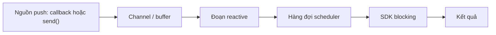

# Giới hạn khi trộn imperative và reactive

## 1. Vấn đề cần giải quyết

Trong Spring Integration Core, một luồng có thể nhận yêu cầu qua gateway trả về `Mono`, đi qua `MessageChannel`, gọi một thư viện JDBC hoặc HTTP đồng bộ, rồi tiếp tục bằng Reactor. Cấu hình như vậy hợp lệ, nhưng các đoạn trong luồng có thể tuân theo những hợp đồng thực thi khác nhau.

Ví dụ, hệ thống tra cứu tồn kho nhận 200 yêu cầu mỗi giây qua WebFlux, trong khi SDK kho hàng chỉ cung cấp phương thức đồng bộ mất khoảng 100 ms. Đổi kiểu trả về thành `Mono<StockResult>` giúp biểu diễn kết quả bất đồng bộ; khả năng phục vụ vẫn phụ thuộc vào số lời gọi SDK được thực thi, số connection và lượng công việc đang chờ.

Bài học thuộc chương **Reactive support** của **SPRING_INTEGRATION_CORE**, tập trung vào cách nhận diện và thiết kế các ranh giới đó bằng Message, channel, endpoint, gateway và Java DSL. Sau bài học, người đọc cần phân biệt được:

- Đoạn nào trì hoãn thực thi đến lúc subscribe, đoạn nào thực thi ngay.
- Đoạn nào hỗ trợ demand của Reactive Streams, đoạn nào chỉ nhận message theo cơ chế push.
- Đoạn nào giữ caller thread, transaction hoặc thứ tự xử lý.
- Ai sở hữu subscription, lỗi, timeout và công việc còn chạy sau cancellation.

## 2. Các thuộc tính thường bị đánh đồng

| Thuộc tính | Ý nghĩa cần kiểm tra | Điều chưa thể suy ra |
|---|---|---|
| Imperative | Luồng điều khiển được mô tả bằng lời gọi và giá trị trả về | Mọi lời gọi đều chậm hoặc blocking |
| Reactive | Công việc được ghép bằng publisher và các tín hiệu subscription, demand, dữ liệu, lỗi, hoàn tất | Mọi thư viện được gọi bên trong đều non-blocking |
| Asynchronous | Kết quả có thể đến sau khi lời gọi ban đầu đã trả về | Có backpressure hoặc không chiếm thread trong lúc chờ |
| Non-blocking I/O | Chờ I/O không giữ một worker thread cho từng lời gọi theo cách blocking truyền thống | Không có giới hạn connection, buffer hay CPU |
| Backpressure | Subscriber điều tiết số phần tử được yêu cầu từ publisher hỗ trợ giao thức đó | Nguồn push bên ngoài tự động giảm tốc |
| Bounded buffering | Có giới hạn dung lượng chờ | Khi đầy sẽ có hành vi phù hợp với nghiệp vụ |
| Transactional | Các thao tác nằm trong ranh giới transaction và tài nguyên tương ứng | Transaction đi xuyên mọi channel hoặc scheduler |

Một transformer chỉ chuẩn hóa chuỗi là imperative nhưng có thể chạy rất nhanh trên thread hiện tại. Ngược lại, một lambda bên trong `map()` gọi JDBC vẫn giữ thread trong lúc chờ database.

Reactor không mặc định tạo thread riêng cho mọi `Mono` hoặc `Flux`. `subscribeOn()` tác động đến việc subscribe lên nguồn; `publishOn()` chuyển ngữ cảnh thực thi cho các tín hiệu phía sau vị trí đặt nó. Các lệnh blocking của Reactor như `block()` có thể bị từ chối trên thread được đánh dấu non-blocking; JDBC blocking không nhất thiết bị phát hiện theo cùng cách. [Reactor: Threading and Schedulers](https://projectreactor.io/docs/core/release/reference/coreFeatures/schedulers.html)

## 3. Đọc đúng hợp đồng của channel và endpoint

### 3.1. Channel quyết định cách bàn giao message

| Thành phần | Hợp đồng thực thi đáng chú ý | Ranh giới cần xem xét |
|---|---|---|
| `DirectChannel` | Gọi handler trên thread gửi trong cách dùng thông thường | Handler chậm giữ caller thread |
| `ExecutorChannel` | Bàn giao xử lý qua executor | Hàng đợi, rejection và transaction qua thread |
| `QueueChannel` | Lưu message để consumer nhận sau | Capacity, send timeout, poller, độ bền lưu trữ |
| `FluxMessageChannel` | Đưa message vào publisher để subscriber tiêu thụ theo Reactive Streams | Nguồn vào push hay publisher, buffering, subscription |
| `ReactiveStreamsConsumer` | Endpoint tiêu thụ qua mô hình reactive | Logic bên trong handler có blocking hay không |

`ExecutorChannel` giúp tách thread; nó không cung cấp giao thức `request(n)`. Với `QueueChannel` hữu hạn, `send()` có thể chờ khi đầy tùy cách gọi và timeout.

`FluxMessageChannel` không phải `PollableChannel` hay `SubscribableChannel` thông thường. Nó còn nhận nguồn publisher qua `subscribeTo(...)`. Gọi imperative `send(message)` vào channel này vẫn là một thao tác push tại đầu vào. [Spring Integration: Message Channel Implementations](https://docs.spring.io/spring-integration/reference/channel/implementations.html)

### 3.2. Phân biệt hỗ trợ reactive ở endpoint và ở toàn luồng

Tùy chọn endpoint `reactive()` tạo `ReactiveStreamsConsumer`, kể cả khi input channel không phải `FluxMessageChannel`. Nó có thể nhận hàm tùy biến source flux, chẳng hạn thêm `publishOn()`. Đây là thay đổi cách tiêu thụ của endpoint, không phải phép biến đổi mã blocking bên trong thành non-blocking. [Spring Integration: The reactive() Endpoint](https://docs.spring.io/spring-integration/reference/dsl/java-reactive.html)

Khi đọc một Java DSL flow, nên đánh dấu ba loại ranh giới:

1. **Bàn giao message:** channel có lưu trữ, đổi thread hoặc chuyển sang publisher không?
2. **Thực thi công việc:** endpoint gọi hàm thuần, blocking driver hay reactive client?
3. **Trả kết quả:** reply là giá trị đã hoàn tất, publisher chứa công việc hay tín hiệu gửi thành công?

Ví dụ, hai `FluxMessageChannel` đặt hai bên một lời gọi JDBC chỉ giúp ghép các đoạn của flow. Bản thân JDBC vẫn cần thread và connection trong thời gian thao tác.

## 4. Backpressure có phạm vi, còn tải có thể đi vòng qua phạm vi đó

Xét luồng:



Trong thiết kế này có ít nhất ba nơi phải kiểm soát riêng:

- Tốc độ nguồn push được chấp nhận vào hệ thống.
- Số tác vụ được subscribe hoặc đưa vào hàng đợi.
- Số lời gọi SDK thực sự đang chạy.

Nếu nguồn publisher tôn trọng demand, downstream có cơ hội yêu cầu dữ liệu phù hợp khả năng xử lý. Nếu nhà cung cấp chỉ đẩy callback, hệ thống phải quyết định làm gì khi không nhận thêm được: từ chối, lưu bền để xử lý sau, bỏ theo chính sách nghiệp vụ hoặc yêu cầu nguồn tạm dừng nếu API hỗ trợ.

Không nên mặc định `FluxMessageChannel` là hàng đợi bền vững hoặc là cấu hình tổng dung lượng chờ cho ứng dụng. Muốn biết khi quá tải sẽ xảy ra điều gì, cần xét cả driver, channel, operator, scheduler và broker nếu có.

### 4.1. Ước lượng năng lực trước khi chọn concurrency

Giả sử SDK giữ một worker trong 100 ms và hệ thống cho phép bốn lời gọi chạy đồng thời. Năng lực lý tưởng của đoạn này xấp xỉ:

```text
4 / 0,1 giây = 40 yêu cầu/giây
```

Nếu đầu vào giữ ở 200 yêu cầu/giây, phần chênh lệch khoảng 160 yêu cầu/giây phải được giảm tải, từ chối hoặc lưu chờ. Đây là ước lượng lý tưởng; latency dao động, connection pool và overhead có thể làm năng lực thực tế thấp hơn.

Tăng buffer chủ yếu kéo dài thời gian trước khi đầy. Nếu message chờ quá lâu, kết quả còn có thể không còn hữu ích khi được trả về.

### 4.2. Concurrency không đồng nghĩa rate limit toàn cục

```java
Flux<StockResult> results = queries.flatMap(
        gateway::lookup,
        4,
        1);
```

Trong ví dụ này:

- `4` giới hạn số inner publisher đang hoạt động trong subscription của chuỗi này.
- `1` là prefetch cho inner publisher; nó không phải tổng giới hạn hàng đợi ứng dụng.
- Nhiều subscription độc lập có thể cùng mở nhiều lời gọi hơn bốn.
- Khi một lời gọi blocking không chịu dừng sau cancellation, số inner publisher đang được theo dõi không còn phản ánh đầy đủ số thao tác bên ngoài còn chạy.

Nếu cần giới hạn chung cho một dịch vụ đích, hãy đặt giới hạn ở tài nguyên dùng chung, kết hợp admission control và hàng đợi hữu hạn. Giới hạn ở từng request HTTP riêng lẻ không tạo thành một quota chung.

## 5. Đặt ranh giới blocking đúng vị trí

### 5.1. Lời gọi thực thi quá sớm

```java
// Sai mục đích: available() chạy trước khi Mono được tạo.
Mono<Integer> available = Mono.just(legacyClient.available("SKU-1"));
```

Java phải tính đối số của `Mono.just(...)` trước. Nếu lệnh này được chạy trên event loop, event loop bị giữ ngay trong lúc tạo publisher.

### 5.2. Trì hoãn chưa đủ để tách blocking

```java
// Có trì hoãn, nhưng vẫn có thể chạy trên thread subscribe.
Mono<Integer> available =
        Mono.fromCallable(() -> legacyClient.available("SKU-1"));
```

Nguồn đã lazy, nhưng vẫn cần chọn nơi thực thi thích hợp.

```java
Mono<Integer> available =
        Mono.fromCallable(() -> legacyClient.available("SKU-1"))
                .subscribeOn(legacyScheduler);
```

Đây là mẫu Reactor khuyến nghị cho nguồn đồng bộ blocking: `fromCallable()` trì hoãn lời gọi và `subscribeOn()` đặt công việc lên scheduler phù hợp. `subscribeOn()` tự nó không subscribe. [Reactor: How Do I Wrap a Synchronous, Blocking Call?](https://projectreactor.io/docs/core/release/reference/faq.html)

### 5.3. Chuyển thread sau lời gọi không bảo vệ được đoạn đã chạy

```java
// available() nằm trước publishOn(), nên vẫn có thể block upstream.
Flux<Integer> available = skus
        .map(legacyClient::available)
        .publishOn(legacyScheduler);
```

Một cách thể hiện ranh giới rõ hơn là:

```java
Flux<Integer> available = skus.flatMap(
        sku -> Mono.fromCallable(() -> legacyClient.available(sku))
                .subscribeOn(legacyScheduler),
        4);
```

Scheduler và concurrency phải được chọn theo tài nguyên thật: connection pool, hạn mức của đối tác, thời gian chờ và ngân sách latency. Chỉ thêm scheduler vào mọi endpoint sẽ làm tăng số lần bàn giao và khiến ranh giới khó theo dõi hơn.

## 6. Ví dụ Java DSL: gateway reactive gọi dịch vụ tồn kho blocking

Ví dụ là luồng request–reply đọc tồn kho. Dịch vụ ngoài chỉ có API đồng bộ. Thiết kế trả trạng thái `FOUND`, `TIMEOUT` hoặc `UNAVAILABLE` để caller không nhầm lỗi hạ tầng với tồn kho bằng không.

Các đoạn mã dùng Java 17+, Spring Integration Core với Java DSL, Reactor Core và cấu hình Spring. Đặt các kiểu trong cùng package; mỗi kiểu public có thể nằm trong file Java tương ứng. Ứng dụng cung cấp bean `LegacyStockClient` bằng SDK thực tế hoặc test double. Ví dụ này không bao gồm một ứng dụng Spring Boot độc lập.

### 6.1. Hợp đồng dữ liệu và API cũ

```java
public record StockQuery(String sku) {
}

public record StockResult(
        String sku,
        String status,
        Integer available) {
}

@FunctionalInterface
public interface LegacyStockClient {

    int available(String sku);
}
```

`available = null` trong kết quả lỗi nghĩa là chưa xác định được số lượng. `FOUND` với `available = 0` là kết quả tra cứu thành công cho biết không còn hàng.

### 6.2. Adapter cô lập lời gọi blocking

```java
import java.time.Duration;
import java.util.concurrent.TimeoutException;
import java.util.logging.Level;
import java.util.logging.Logger;

import reactor.core.publisher.Mono;
import reactor.core.scheduler.Scheduler;

public final class StockBoundary {

    private static final Logger LOG =
            Logger.getLogger(StockBoundary.class.getName());

    private final LegacyStockClient legacy;
    private final Scheduler scheduler;
    private final Duration deadline;

    public StockBoundary(
            LegacyStockClient legacy,
            Scheduler scheduler,
            Duration deadline) {

        this.legacy = legacy;
        this.scheduler = scheduler;
        this.deadline = deadline;
    }

    public Mono<StockResult> lookup(StockQuery query) {
        return Mono.fromCallable(() -> legacy.available(query.sku()))
                .subscribeOn(scheduler)
                .map(quantity -> new StockResult(
                        query.sku(), "FOUND", quantity))
                .timeout(deadline)
                .doOnError(error -> LOG.log(
                        Level.WARNING,
                        "Stock lookup failed: " + query.sku(),
                        error))
                .onErrorResume(
                        TimeoutException.class,
                        error -> Mono.just(new StockResult(
                                query.sku(), "TIMEOUT", null)))
                .onErrorResume(
                        Exception.class,
                        error -> Mono.just(new StockResult(
                                query.sku(), "UNAVAILABLE", null)));
    }
}
```

Các quyết định trong adapter:

- Lời gọi SDK chỉ xuất hiện bên trong `fromCallable()`.
- Scheduler được truyền vào để tài nguyên có chủ sở hữu rõ ràng.
- Timeout nằm ngoài nguồn đã được schedule, nên thời gian chờ tác vụ cũng ảnh hưởng deadline.
- Lỗi được ghi nhận trước khi chuyển thành kết quả nghiệp vụ.
- Không gọi `subscribe()` hoặc `block()` bên trong adapter.

Chính sách chuyển mọi `Exception` thành `UNAVAILABLE` là lựa chọn minh họa cho API đọc này. Trong ứng dụng thật, cần phân loại lỗi xác thực, đầu vào và lỗi kỹ thuật theo hợp đồng API. Không áp dụng nguyên xi cho thao tác trừ tiền hoặc đặt hàng vì một lỗi quan sát được chưa đủ chứng minh side effect chưa xảy ra.

### 6.3. Khai báo scheduler và integration flow

```java
import java.time.Duration;

import org.springframework.context.annotation.Bean;
import org.springframework.context.annotation.Configuration;
import org.springframework.integration.config.EnableIntegration;
import org.springframework.integration.annotation.IntegrationComponentScan;
import org.springframework.integration.dsl.IntegrationFlow;

import reactor.core.scheduler.Scheduler;
import reactor.core.scheduler.Schedulers;

@Configuration
@EnableIntegration
@IntegrationComponentScan(basePackageClasses = StockGateway.class)
public class StockFlowConfiguration {

    @Bean(destroyMethod = "dispose")
    public Scheduler legacyStockScheduler() {
        return Schedulers.newBoundedElastic(4, 32, "legacy-stock");
    }

    @Bean
    public StockBoundary stockBoundary(
            LegacyStockClient legacy,
            Scheduler legacyStockScheduler) {

        return new StockBoundary(
                legacy,
                legacyStockScheduler,
                Duration.ofSeconds(2));
    }

    @Bean
    public IntegrationFlow stockFlow(StockBoundary stockBoundary) {
        return IntegrationFlow.from("stockRequests")
                .handle(
                        StockQuery.class,
                        (query, headers) -> stockBoundary.lookup(query),
                        endpoint -> endpoint.async(true))
                .channel(channels -> channels.flux())
                .handle(
                        StockResult.class,
                        (result, headers) -> result)
                .get();
    }
}
```

Đọc flow theo thứ tự bàn giao:

1. `stockRequests` là điểm nhận yêu cầu; khi được DSL tự tạo theo tên trong cấu hình này, nó là `DirectChannel`.
2. Handler thứ nhất trả `Mono<StockResult>`, chưa gọi SDK ngay.
3. Output là `FluxMessageChannel`, nơi kết quả reactive được ghép và phát xuống khi publisher chạy.
4. Handler cuối trả giá trị qua `replyChannel` của request vì không khai báo output channel riêng. Nó được giữ ở đây để thể hiện rõ bước trở lại hợp đồng request–reply.

Với output reactive, framework hỗ trợ flatten reactive reply; từ Spring Integration 6.1, chế độ async được bật mặc định cho output `ReactiveStreamsSubscribableChannel`. Cấu hình trên vẫn ghi `async(true)` để biểu lộ ý định. Nếu đổi output thành channel imperative, cần xem lại cách publisher được xử lý và thời điểm subscribe. [Spring Integration: Asynchronous Service Activator](https://docs.spring.io/spring-integration/reference/service-activator.html)

Trong `newBoundedElastic(4, 32, ...)`, giới hạn thread là bốn; giới hạn 32 tác vụ chờ được áp dụng theo backing thread, không phải một hàng đợi toàn cục gồm 32 phần tử. Việc gán worker và rejection cần được xét khi thiết kế admission control; không suy ra mọi request luôn được nhận cho đến khi một tổng số đơn giản đạt ngưỡng. Bean riêng được dispose khi context đóng. [Reactor: Schedulers API](https://projectreactor.io/docs/core/release/api/reactor/core/scheduler/Schedulers.html)

### 6.4. Gateway trả Mono và thời điểm bắt đầu

```java
import org.springframework.integration.annotation.MessagingGateway;

import reactor.core.publisher.Mono;

@MessagingGateway(defaultRequestChannel = "stockRequests")
public interface StockGateway {

    Mono<StockResult> lookup(StockQuery query);
}
```

```java
Mono<StockResult> work =
        gateway.lookup(new StockQuery("SKU-1"));

// Trả work cho tầng reactive có trách nhiệm subscribe,
// ví dụ trả trực tiếp từ WebFlux controller.
```

Gateway có kiểu trả về `Mono` trì hoãn việc chạy flow đến khi publisher được subscribe. Điều đó không hứa rằng downstream được chạy trên thread mới hoặc không blocking. Nếu thay handler đầu bằng một lời gọi SDK trực tiếp, subscriber vẫn có thể bị giữ thread. [Spring Integration: Reactor Mono Gateway](https://docs.spring.io/spring-integration/reference/gateway.html#reactor-mono)

Ví dụ này giới hạn worker chạy SDK và thời gian chờ quan sát được. Nó chưa phải chính sách tiếp nhận tải hoàn chỉnh: các request vẫn có thể tích tụ trước scheduler và trong các buffer khác. Muốn sử dụng trong hệ thống chịu tải lớn, phải thêm giới hạn đầu vào và kiểm tra hành vi khi đạt giới hạn.

## 7. Publisher trong payload khác với kết quả đã được xử lý

Hãy phân biệt:

```text
Message<StockResult>
Message<Mono<StockResult>>
Mono<Message<StockResult>>
Flux<Message<StockResult>>
```

- `Message<StockResult>`: message đã chứa giá trị trả lời.
- `Message<Mono<StockResult>>`: payload mô tả một công việc hoặc giá trị sẽ có sau.
- `Mono<Message<StockResult>>`: publisher phát ra một message.
- `Flux<Message<StockResult>>`: stream gồm nhiều message độc lập.

Router muốn đọc `StockResult.status()` sẽ không làm đúng ý định nếu payload thực tế vẫn là `Mono<StockResult>`. Kiểu Java khai báo ở service là một phần của hợp đồng; cách endpoint và output channel giải quyết publisher cũng quan trọng.

Các API như `IntegrationFlow.from(Publisher)`, `toReactivePublisher()`, `fluxTransform()` và terminal `handleReactive()` phục vụ những hướng ghép khác nhau. Đặc biệt, `handleReactive()` thích hợp cho xử lý kết thúc bằng `Mono<Void>`, không tự tạo một reply dữ liệu cho gateway đang chờ kết quả. [Spring Integration: Reactive Streams Support](https://docs.spring.io/spring-integration/reference/reactive-streams.html)

Trong bài toán request–reply, cần thiết kế cả trường hợp không phát giá trị. Chẳng hạn, một phép tra cứu trả `Mono.empty()` cần được chuyển thành kết quả “không tìm thấy” hoặc lỗi phù hợp nếu caller phải luôn nhận một reply.

## 8. Transaction không tự đi theo message

### 8.1. Transaction imperative thường gắn với thread

Một transaction JDBC đang có trên caller thread không tự chuyển sang thread của `ExecutorChannel`, poller hay scheduler. Việc bàn giao thành công có thể kết thúc phạm vi công việc được caller chờ trong khi downstream vẫn tiếp tục. Thời điểm commit cụ thể còn phụ thuộc ranh giới method hoặc transaction interceptor. [Spring Integration: Transaction Boundaries](https://docs.spring.io/spring-integration/reference/transactions.html)

Một lỗi thiết kế điển hình là:

```java
@Transactional
public Mono<OrderResult> place(OrderCommand command) {
    return Mono.fromCallable(() -> jdbcOrders.insert(command))
            .subscribeOn(legacyScheduler);
}
```

Với transaction manager imperative, không nên giả định transaction bao quanh việc subscribe và lời gọi JDBC xảy ra sau đó. Annotation đặt ngoài method trả publisher không làm transaction thread-bound trở thành reactive transaction.

### 8.2. Mở transaction bên trong công việc thực sự chạy

Một cách biểu diễn ranh giới rõ hơn cho JDBC là:

```java
public Mono<OrderResult> place(OrderCommand command) {
    return Mono.fromCallable(() ->
                    transactionTemplate.execute(status -> {
                        OrderResult result = jdbcOrders.insert(command);
                        jdbcAudit.append(result.orderId());
                        return result;
                    }))
            .subscribeOn(legacyScheduler);
}
```

Ví dụ giả định `jdbcOrders` và `jdbcAudit` dùng cùng tài nguyên hoặc tham gia đúng transaction manager của `transactionTemplate`. Callback chạy trên worker, nên transaction được mở tại nơi thao tác JDBC diễn ra. Exception cần rollback phải thoát callback theo chính sách rollback đã cấu hình.

Với driver reactive, dùng `ReactiveTransactionManager` phù hợp và `TransactionalOperator` để bao chuỗi thao tác:

```java
return reactiveOrders.insert(command)
        .flatMap(result ->
                reactiveAudit.append(result.orderId())
                        .thenReturn(result))
        .as(transactionalOperator::transactional);
```

Hai API transaction phục vụ hai mô hình khác nhau; chọn theo tài nguyên tham gia và nơi công việc thực thi. [Spring Framework: Programmatic Transaction Management](https://docs.spring.io/spring-framework/reference/data-access/transaction/programmatic.html)

Nếu luồng vừa ghi database vừa gọi HTTP hoặc gửi sang hệ thống khác, đổi scheduler hay thêm annotation không tạo ra atomicity giữa các hệ thống. Với yêu cầu đảm bảo giao hàng, có thể cần transactional outbox, idempotency hoặc thao tác bù tùy nghiệp vụ.

## 9. Xử lý lỗi ở cả message boundary và publisher boundary

### 9.1. Try/catch quanh việc tạo publisher không bắt được mọi lỗi về sau

```java
try {
    Mono<StockResult> work = gateway.lookup(query);
    return work;
}
catch (RuntimeException error) {
    // Chỉ xử lý lỗi phát sinh trong lời gọi tạo/trả publisher.
}
```

Nếu SDK được gọi sau subscription, lỗi đó cần được xử lý trong chuỗi reactive hoặc bởi hạ tầng tiêu thụ chuỗi.

Ở đoạn synchronous dùng `DirectChannel`, exception thường đi theo call stack về sender. Khi đã bàn giao qua queue hoặc executor, sender không thể nhận exception downstream theo cùng call stack. Spring Integration có cơ chế `ErrorMessage`, với `errorChannel` được xác định theo cấu hình và message header. Cơ chế của endpoint/adaptor phải được kiểm tra, không nên giả định mọi lỗi đều tự đến cùng một nơi. [Spring Integration: Error Handling](https://docs.spring.io/spring-integration/reference/error-handling.html)

### 9.2. Chọn phạm vi phục hồi lỗi theo đơn vị công việc

Giả sử xử lý độc lập nhiều đơn hàng:

```java
Flux<OrderOutcome> outcomes = orders.flatMap(
        order -> place(order)
                .map(OrderOutcome::success)
                .onErrorResume(error ->
                        Mono.just(OrderOutcome.failure(order.id(), error))),
        4);
```

Ở đây, lỗi của một inner publisher được chuyển thành kết quả cho đơn hàng tương ứng. Chuỗi ngoài có thể tiếp tục nhận các đơn khác.

Nếu đặt `onErrorResume()` ở ngoài `flatMap()`, lỗi đi đến đó đã kết thúc upstream của vị trí xử lý lỗi; fallback thay thế phần chuỗi bị lỗi. Nó không tự quay lại xử lý toàn bộ phần tử chưa chạy. `retry()` lại subscribe nguồn; với cold source, điều này có thể chạy lại công việc. [Reactor: Handling Errors](https://projectreactor.io/docs/core/release/reference/coreFeatures/error-handling.html)

`OrderOutcome` trong đoạn này là kiểu kết quả minh họa của ứng dụng, gồm nhánh thành công và thất bại. Nếu dùng cách này, metrics và caller phải nhìn vào outcome để xác định tỷ lệ lỗi; số lượng terminal `onError` thấp không còn chứng minh hệ thống thành công.

### 9.3. Chốt hợp đồng lỗi cho từng luồng

| Loại luồng | Hợp đồng cần thiết kế |
|---|---|
| Request–reply | Caller nhận lỗi qua publisher hoặc nhận reply mô tả lỗi rõ ràng |
| One-way | Có nơi ghi nhận lỗi và quyết định retry, loại bỏ hay lưu để xử lý lại |
| Batch nhiều phần tử | Xác định lỗi một phần tử có kết thúc batch hay trở thành một outcome |
| Luồng có side effect | Phân biệt lỗi quan sát được với trạng thái thực tế ở hệ thống đích |

Gửi một `ErrorMessage` để theo dõi không tự hoàn thành reply cho gateway. Ngược lại, chuyển lỗi thành reply trong adapter có thể khiến framework không còn thấy terminal error. Cả hai lựa chọn đều cần nhất quán với cách caller và vận hành đánh giá thành công.

## 10. Timeout và cancellation không chứng minh side effect đã dừng

Trong ví dụ tồn kho, timeout hai giây có thể trả `TIMEOUT` trong khi SDK vẫn còn chạy nếu nó không hỗ trợ interruption hoặc timeout phù hợp. Vì đây là thao tác đọc, tác hại chủ yếu là tiếp tục tiêu thụ worker và connection.

Với thao tác ghi, hãy xét trình tự:

```text
t0: Bắt đầu gọi hệ thống thanh toán.
t1: Hệ thống thanh toán đã trừ tiền.
t2: Ứng dụng hết thời gian chờ trước khi đọc được kết quả.
t3: Caller thử lại.
```

Tại `t2`, trạng thái hợp lý có thể là “chưa xác định”, thay vì “chưa thanh toán”. Nếu retry không có idempotency key hoặc cách đối soát, lần gọi ở `t3` có thể tạo side effect thứ hai.

Một thiết kế cần phối hợp:

- Timeout trên client/driver: connection, read, query hoặc request timeout phù hợp.
- Deadline của nghiệp vụ: bao gồm cả thời gian nằm chờ.
- Idempotency key ổn định qua retry, gắn với thao tác nghiệp vụ.
- Cách xác minh kết quả sau timeout, chẳng hạn truy vấn trạng thái theo mã yêu cầu.
- Quy tắc retry giới hạn số lần và phân loại lỗi được phép retry.

Khi làm việc với một publisher cold, hai lần subscribe cũng có thể tạo hai lần gọi độc lập dù không dùng operator retry. Gateway hoặc adapter trả `Mono` không tự bảo đảm exactly-once.

Không nên dùng `cache()` như cách giải quyết chung cho việc ghi lặp: phạm vi lưu trong một publisher instance không thay thế kho idempotency dùng chung, phục hồi sau restart hoặc phối hợp giữa nhiều instance ứng dụng.

## 11. Message headers, Reactor Context và ThreadLocal là ba phạm vi khác nhau

| Cơ chế | Phạm vi thường phù hợp | Rủi ro tại ranh giới |
|---|---|---|
| Message headers | Metadata đi cùng một message: mã nghiệp vụ, correlation, reply, error | Mất khi xây message mới mà không giữ header cần thiết |
| Reactor Context | Dữ liệu gắn với subscription reactive | Không tự trở thành header cho từng message |
| ThreadLocal/MDC | Dữ liệu của thread hiện tại | Đổi thread có thể mất dữ liệu hoặc dùng dữ liệu không đúng request |

Một hot channel dùng chung nhiều request không đồng nghĩa mỗi request có một subscription độc lập chứa toàn bộ context của caller. Nếu metadata phải đi cùng message qua nhiều đoạn flow, hãy truyền nó rõ ràng trong header và thiết kế điểm chuyển tiếp.

Ví dụ tạo message mới trong một transformer:

```java
Message<StockResult> reply = MessageBuilder
        .withPayload(result)
        .copyHeaders(request.getHeaders())
        .build();
```

Khi xây reply thủ công, cần giữ các header có ý nghĩa cho luồng, đặc biệt `replyChannel`, `errorChannel` và mã correlation nếu đang dùng. Không phụ thuộc vào việc framework tự khôi phục header trong mọi loại endpoint.

Reactor có hỗ trợ context propagation tích hợp với Micrometer khi được cấu hình phù hợp. Cơ chế này cần các dependency, accessor và chế độ áp dụng tương ứng; không nên mặc định mọi `ThreadLocal` của ứng dụng được chuyển qua mọi scheduler hay message boundary. [Reactor: Context-Propagation Support](https://projectreactor.io/docs/core/release/reference/advanced-contextPropagation.html)

## 12. Các mẫu tích hợp doanh nghiệp vẫn có giới hạn riêng

### 12.1. Transformer

Transformer đồng bộ phù hợp cho phép biến đổi nhỏ, xác định và nhanh. Nếu cần gọi I/O blocking để “biến đổi”, nên tách thành một endpoint dịch vụ có ranh giới tài nguyên rõ hơn để dễ nhận diện thời gian chờ, lỗi và retry.

Khi transformer trả publisher hoặc tạo `Message` mới, kiểm tra cả kiểu payload downstream và việc giữ metadata. Một flow có thể đúng về type khai báo nhưng sai ở thời điểm sử dụng giá trị.

### 12.2. Router

Router định tuyến theo dữ liệu hiện có. Nếu quyết định route phụ thuộc kết quả reactive, cần đặt bước định tuyến sau nơi kết quả đã được giải quyết thành payload phù hợp.

Các nhánh có tốc độ khác nhau còn tạo ra câu hỏi về thứ tự và hoàn tất: một nhánh nhanh xong trước không có nghĩa toàn bộ nghiệp vụ đã hoàn tất. Khi cần phối hợp nhánh, phải nêu rõ correlation và tiêu chí hoàn thành.

### 12.3. Filter

Trong request–reply, filter loại bỏ một message mà không tạo reply có thể khiến caller tiếp tục chờ. Cần chọn một trong các hành vi: trả kết quả từ chối, ném lỗi phù hợp hoặc chuyển sang discard flow chịu trách nhiệm hoàn tất hợp đồng.

`Mono.empty()` cũng cần được hiểu đúng ở nơi sử dụng. “Không có phần tử” không đồng nghĩa “kết quả hợp lệ có giá trị rỗng” trong mọi giao thức request–reply.

### 12.4. Splitter và aggregator

Splitter làm một message thành nhiều đơn vị xử lý, nên budget concurrency và buffering phải tính theo số phần tử sau tách. Một request chứa 10.000 dòng hàng có đặc điểm tài nguyên khác một request chứa một dòng.

Aggregator có state của các group chưa hoàn tất. Những câu hỏi thiết kế cần trả lời gồm:

- Có tối đa bao nhiêu group và bao nhiêu message trong mỗi group?
- Điều gì xảy ra khi một phần tử bị filter, lỗi hoặc không đến?
- Có timeout, expiry, discard và chính sách late message nào?
- State nằm trong memory hay message store có độ bền cần thiết?
- Reply cho request ban đầu được tạo ở đâu nếu không đủ phần tử?

Demand của reactive stream không tự bảo đảm group sẽ hoàn thành. Một batch hữu hạn và một stream không có điểm kết thúc cần release strategy khác nhau.

## 13. Thứ tự, subscription và lifecycle

### 13.1. Thứ tự hoàn tất khác thứ tự nhận vào

Nếu nghiệp vụ cho phép xử lý độc lập, `flatMap()` có concurrency là lựa chọn tự nhiên. Nếu cần xử lý tuần tự từng phần tử, có thể cân nhắc `concatMap()`, chấp nhận giảm mức song song.

`flatMapSequential()` có thể giữ thứ tự phát kết quả nhưng vẫn subscribe nhiều công việc đồng thời. Vì thế nó không bảo đảm thứ tự side effect tại hệ thống ngoài. Với nhiều sự kiện của cùng một tài khoản, cần thiết kế thứ tự theo khóa hoặc xử lý tuần tự trong phạm vi khóa phù hợp.

### 13.2. Tránh tự subscribe bên trong logic request–reply

```java
public void process(OrderCommand command) {
    place(command).subscribe(); // Tạo nhánh thực thi tách khỏi hợp đồng caller.
}
```

Cách viết này làm caller khó biết lúc nào nghiệp vụ xong, lỗi thuộc về ai và cancellation có còn hiệu lực hay không. Khi framework đang sở hữu subscription, nên trả publisher cho framework.

Ở rìa ứng dụng độc lập, có thể phải subscribe thủ công, nhưng khi đó rìa này phải sở hữu cả error callback, cancellation và shutdown. Không áp dụng quy tắc “không bao giờ subscribe” cho mọi hoàn cảnh.

### 13.3. Kế hoạch shutdown cho luồng hỗn hợp

Một trình tự phù hợp có thể là:

1. Ngừng nhận công việc mới.
2. Dừng nguồn tạo message hoặc polling.
3. Chờ các công việc đã nhận trong giới hạn thời gian định trước.
4. Ghi nhận hoặc lưu lại các công việc chưa xác định kết quả theo hợp đồng.
5. Đóng scheduler và client khi những phần dùng chúng đã được xử lý.

Không nên mặc định mọi publisher đều cold hoặc có replay. Đặc biệt, khi lấy `Publisher` từ một integration flow, phải xem lifecycle, thời điểm subscribe và cách thành phần nguồn xử lý giai đoạn chưa có subscriber.

## 14. Kiểm thử ranh giới thực thi

Mục tiêu kiểm thử là quan sát những gì flow hứa với caller: khi nào lời gọi bắt đầu, kết quả nào được phát, tác vụ chạy ở đâu và điều gì xảy ra sau lỗi hoặc cancellation.

### 14.1. Kiểm tra adapter lazy và trả đúng kết quả

Ví dụ JUnit 5 sau dùng chính `StockBoundary` ở trên và dependency test `reactor-test`:

```java
import static org.junit.jupiter.api.Assertions.assertEquals;

import java.time.Duration;
import java.util.concurrent.atomic.AtomicInteger;

import org.junit.jupiter.api.Test;

import reactor.core.publisher.Mono;
import reactor.core.scheduler.Scheduler;
import reactor.core.scheduler.Schedulers;
import reactor.test.StepVerifier;

class StockBoundaryTest {

    @Test
    void invokesLegacyClientOnlyAfterSubscription() {
        AtomicInteger calls = new AtomicInteger();
        Scheduler scheduler =
                Schedulers.newBoundedElastic(1, 4, "test-stock");

        try {
            LegacyStockClient legacy = sku -> {
                calls.incrementAndGet();
                return 7;
            };

            StockBoundary boundary = new StockBoundary(
                    legacy,
                    scheduler,
                    Duration.ofSeconds(2));

            Mono<StockResult> work =
                    boundary.lookup(new StockQuery("SKU-1"));

            assertEquals(0, calls.get());

            StepVerifier.create(work)
                    .expectNext(new StockResult("SKU-1", "FOUND", 7))
                    .expectComplete()
                    .verify(Duration.ofSeconds(3));

            assertEquals(1, calls.get());
        }
        finally {
            scheduler.dispose();
        }
    }
}
```

Kiểm thử này xác minh việc trì hoãn tại adapter và giá trị trả về. Nó chưa chứng minh flow đã nối đúng reply channel, giới hạn tải hiệu quả hoặc SDK thật hỗ trợ cancellation.

`StepVerifier`, `TestPublisher` và `PublisherProbe` giúp kiểm tra tín hiệu, điều khiển nguồn và xác minh nhánh có được subscribe. Virtual time hữu ích cho operator thời gian; không làm một SDK blocking thực tế chạy nhanh lên. [Reactor: Testing](https://projectreactor.io/docs/core/release/reference/testing.html)

### 14.2. Các tình huống cần quan sát ở integration test

| Tình huống | Bằng chứng cần thu được |
|---|---|
| Gọi gateway nhưng chưa subscribe | Chưa gửi yêu cầu đến legacy client |
| Subscribe một request hợp lệ | Nhận `StockResult`, không nhận `Mono` làm payload ngoài ý muốn |
| Legacy client chậm | Không chiếm event loop; deadline trả đúng trạng thái |
| Tải vượt khả năng xử lý | Có giới hạn, hành vi từ chối hoặc lưu chờ đúng chính sách |
| Một phần tử lỗi giữa batch | Các phần tử khác tiếp tục hoặc dừng đúng hợp đồng đã chọn |
| Caller cancel trong lúc gọi SDK | Phân biệt publisher đã cancel và thao tác ngoài còn chạy |
| Đi qua scheduler hoặc channel khác | Metadata và transaction đúng phạm vi mong muốn |
| Filter hoặc nhánh không có kết quả | Caller không chờ vô hạn ngoài ý định |
| Retry sau timeout khi ghi dữ liệu | Không tạo side effect trùng hoặc có cách đối soát rõ ràng |

Nên dùng latch hoặc tín hiệu điều khiển trong fake client để kiểm soát lúc bắt đầu, lúc kết thúc và số lời gọi đang chạy. Tránh dựa vào nhiều `Thread.sleep()` với giả định về lịch thread. Khi kiểm tra backpressure, cần quan sát cả số lượng yêu cầu upstream và lượng công việc đã vào scheduler hoặc driver.

## 15. Chọn cách ghép theo bài toán

| Bối cảnh | Hướng thiết kế phù hợp |
|---|---|
| Chủ yếu là SDK blocking, tải vừa, transaction JDBC rõ | Flow imperative có giới hạn tài nguyên và hành vi lỗi rõ ràng |
| Nguồn và client đều reactive, cần streaming | Giữ publisher và demand liên tục, hạn chế chuyển sang blocking |
| Ứng dụng reactive phải gọi một SDK blocking | Adapter lazy, scheduler hữu hạn, admission control, timeout và metrics |
| Công việc dài cần tiếp tục sau khi caller rời đi | Bàn giao bền vững, mã công việc và cơ chế theo dõi trạng thái |
| Cần giữ thứ tự thao tác ghi theo đối tượng | Điều phối tuần tự hoặc theo partition/key, kiểm tra thứ tự side effect |
| Cần bảo đảm giao hàng giữa nhiều hệ thống | Thiết kế durability và idempotency theo nghiệp vụ |

Flow hỗn hợp có thể là lựa chọn thực tế trong quá trình chuyển đổi từng phần. Giá trị của nó đến từ ranh giới rõ và hợp đồng kiểm chứng được, không phải từ số lượng `Mono` hay `Flux` xuất hiện trong code.

## 16. Những nguyên tắc cần giữ khi thiết kế

- Kiểu trả về reactive biểu diễn công việc; cần kiểm tra thời điểm và nơi công việc thực sự chạy.
- Mỗi nơi chuyển từ publisher sang push, queue, thread hoặc driver là một điểm cần xét lại demand và tài nguyên.
- Tách blocking sang scheduler giúp bảo vệ thread upstream; vẫn phải giới hạn tải và thời gian chờ.
- Transaction, message headers và Reactor Context có phạm vi khác nhau.
- Timeout, cancellation, reply và commit nghiệp vụ là các sự kiện khác nhau; cần chỉ rõ sự kiện nào là bằng chứng thành công.
- Chỉ định chủ sở hữu subscription, error handling, retry và shutdown cho từng ranh giới.

Khi các điều này được ghi rõ, Message, channel và endpoint vẫn tạo được một flow dễ hiểu ngay cả khi một phần hệ thống còn imperative và phần khác đã reactive.
