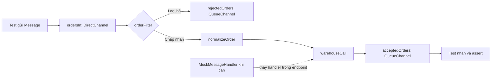

# Spring Integration Test

**Chương:** Testing support  
**Phạm vi:** Spring Integration Core (`SPRING_INTEGRATION_CORE`)

Một luồng thông điệp có thể khởi động thành công nhưng vẫn sai: transformer làm mất header theo dõi, filter loại nhầm dữ liệu, router gửi sai nhánh, aggregator ghép nhầm đơn hàng hoặc lỗi từ worker chỉ xuất hiện trong log. Kiểm thử luồng cần chứng minh được hợp đồng của thông điệp từ điểm vào đến điểm quan sát, đồng thời kiểm soát những thành phần có lịch chạy hoặc kết nối ra ngoài.

Bài học này sử dụng Message, MessageChannel, endpoint và Java DSL để xây dựng các phép kiểm thử có thể giải thích rõ nguyên nhân thành công hay thất bại. Các ví dụ minh họa theo API Spring Integration 6.5.x, Java 17 trở lên và JUnit Jupiter 5. Riêng `substituteTriggerFor(...)` cần Spring Integration từ 6.3. Khi áp dụng cho nhánh phiên bản khác, hãy đối chiếu dependency và API tương ứng.

## 1. Mục tiêu và ranh giới kiểm thử

Sau bài học, bạn có thể:

- Chọn giữa unit test, kiểm thử một đoạn flow và kiểm thử adapter với hệ thống thật.
- Nạp cấu hình Java DSL bằng Spring TestContext và sử dụng `@SpringIntegrationTest`.
- Thay source hoặc handler của một endpoint bằng `MockIntegrationContext`.
- Xác minh payload, header nghiệp vụ, nhánh loại bỏ và số lần xử lý.
- Điều khiển polling bằng `OnlyOnceTrigger` thay vì chờ một khoảng thời gian tùy ý.
- Chọn cách quan sát lỗi theo ranh giới luồng thực thi.
- Thiết kế phép thử cho router, gateway và aggregator có trạng thái.

### 1.1. Ba mức kiểm thử bổ sung cho nhau

| Mức kiểm thử | Thành phần thật trong phép thử | Ví dụ hợp đồng cần chứng minh |
| --- | --- | --- |
| Unit test | Hàm hoặc POJO xử lý nghiệp vụ | Chuẩn hóa mã đơn hàng theo quy tắc đã định |
| Kiểm thử flow trong ApplicationContext | Channel, endpoint, cấu hình DSL; có thể thay biên ngoài bằng mock | Message hợp lệ đi qua filter, được biến đổi và giữ header theo dõi |
| Kiểm thử adapter và hệ thống ngoài | Adapter thật cùng dịch vụ thử nghiệm, broker hoặc database | Mapping header, serialization, xác thực, retry và giao dịch phù hợp giao thức |

Một mock trả về thành công không chứng minh rằng HTTP request được tạo đúng hoặc broker đã nhận bản tin. Ngược lại, dùng broker thật cho mọi ca chuẩn hóa chuỗi khiến phạm vi thất bại rộng hơn điều cần kiểm tra.

Với mỗi phép thử, hãy viết trước một câu như: “Khi nhận mã đơn có khoảng trắng, flow trả về mã đã chuẩn hóa và giữ nguyên `requestId`”. Câu đó quyết định dữ liệu đầu vào, điểm quan sát và assertion.

### 1.2. Phân biệt các công cụ

Spring Integration chia hỗ trợ kiểm thử thành `spring-integration-test-support` cho tiện ích dùng chung và `spring-integration-test` cho cấu hình test context cùng khả năng thay thế thành phần tích hợp. Các công cụ này phối hợp với Spring Test, JUnit, Mockito và thư viện assertion. Xem [Testing support](https://docs.spring.io/spring-integration/reference/6.5/testing.html).

| Công cụ | Vai trò trong bài |
| --- | --- |
| `@SpringJUnitConfig` | Kết nối JUnit Jupiter với Spring TestContext và chọn lớp cấu hình |
| `@SpringIntegrationTest` | Đăng ký hỗ trợ kiểm thử của Spring Integration |
| `MockIntegrationContext` | Thay source, handler hoặc trigger trong endpoint thật |
| `MockIntegration` | Tạo source và handler phục vụ kiểm thử |
| `QueueChannel` | Lưu kết quả để test nhận và xác minh |
| `ArgumentCaptor<Message<?>>` | Ghi nhận message đi vào một handler thay thế |
| `OnlyOnceTrigger` | Lập lịch một lần để điều khiển polling |
| `TestUtils` | Hỗ trợ quan sát cấu hình bên trong khi cần |

`MockIntegrationContext` không phải một ApplicationContext giả. Nó thao tác trên các endpoint trong context đang được Spring quản lý. Vì vậy, test vẫn có thể kiểm tra cách nối channel, thứ tự xử lý và việc truyền header trong phần flow được giữ lại.

## 2. Chuẩn bị dependency và test context

### 2.1. Dependency

Nếu dự án đã sử dụng Spring Boot dependency management tương thích, có thể khai báo các dependency sau mà không tự gắn version:

```xml
<dependencies>
    <dependency>
        <groupId>org.springframework.integration</groupId>
        <artifactId>spring-integration-core</artifactId>
    </dependency>

    <dependency>
        <groupId>org.springframework.integration</groupId>
        <artifactId>spring-integration-test</artifactId>
        <scope>test</scope>
    </dependency>

    <dependency>
        <groupId>org.springframework.boot</groupId>
        <artifactId>spring-boot-starter-test</artifactId>
        <scope>test</scope>
    </dependency>
</dependencies>
```

Đây là đoạn dependency để ghép vào dự án đã có quản lý phiên bản, không phải một `pom.xml` độc lập. `spring-boot-starter-test` cung cấp bộ thư viện kiểm thử được dùng trong ví dụ; các lớp test bên dưới vẫn nạp context bằng `@SpringJUnitConfig`.

Nếu không dùng Spring Boot, chuẩn bị `spring-integration-core`, `spring-integration-test`, Spring Test, JUnit Jupiter, Mockito và AssertJ bằng dependency management của dự án. Giữ các artifact Spring Integration cùng phiên bản và dùng một bộ Spring Framework tương thích. Không ghép ngẫu nhiên phiên bản của core và thư viện test.

### 2.2. Hai annotation giải quyết hai việc

```java
@SpringJUnitConfig(OrderFlowConfiguration.class)
@SpringIntegrationTest
class OrderFlowTest {
}
```

`@SpringJUnitConfig` chọn cấu hình và đăng ký SpringExtension cho JUnit Jupiter. `@SpringIntegrationTest` bổ sung hạ tầng như bean `MockIntegrationContext`; nó không tự thay thế vai trò nạp context của Spring Test. Cơ chế kết hợp annotation được mô tả trong [Spring TestContext support classes](https://docs.spring.io/spring-framework/reference/testing/testcontext-framework/support-classes.html) và [mã nguồn SpringIntegrationTest 6.5.5](https://raw.githubusercontent.com/spring-projects/spring-integration/v6.5.5/spring-integration-test/src/main/java/org/springframework/integration/test/context/SpringIntegrationTest.java).

Nếu cần kiểm tra cả auto-configuration và wiring của ứng dụng Boot, có thể dùng `@SpringBootTest` cùng `@SpringIntegrationTest`. Với một flow có cấu hình rõ ràng, nạp trực tiếp lớp cấu hình giúp xác định phạm vi phép thử dễ hơn.

## 3. Ví dụ hoàn chỉnh: kiểm thử flow tiếp nhận đơn hàng

Flow minh họa có hợp đồng:

1. Message có payload là chuỗi mã đơn hàng.
2. Chuỗi chỉ gồm khoảng trắng đi tới `rejectedOrders`.
3. Chuỗi hợp lệ được cắt khoảng trắng và chuyển sang chữ hoa.
4. Endpoint `warehouseCall` tạo phản hồi.
5. Kết quả được lưu trong `acceptedOrders`; header `requestId` được giữ lại.



### 3.1. Cấu hình flow

Đặt lớp cấu hình sau trong package `example.integration`. Trong dự án thực tế, test nên nạp cấu hình flow mà ứng dụng sử dụng; tránh chép lại một flow gần giống chỉ để phép thử chạy qua.

```java
package example.integration;

import java.util.Locale;

import org.springframework.context.annotation.Bean;
import org.springframework.context.annotation.Configuration;
import org.springframework.integration.channel.DirectChannel;
import org.springframework.integration.channel.QueueChannel;
import org.springframework.integration.config.EnableIntegration;
import org.springframework.integration.dsl.IntegrationFlow;

@Configuration
@EnableIntegration
public class OrderFlowConfiguration {

    @Bean
    public DirectChannel ordersIn() {
        return new DirectChannel();
    }

    @Bean
    public QueueChannel acceptedOrders() {
        return new QueueChannel(20);
    }

    @Bean
    public QueueChannel rejectedOrders() {
        return new QueueChannel(20);
    }

    @Bean
    public IntegrationFlow orderFlow() {
        return IntegrationFlow.from(ordersIn())
                .<String>filter(
                        value -> !value.isBlank(),
                        endpoint -> endpoint
                                .id("orderFilter")
                                .discardChannel(rejectedOrders()))
                .<String, String>transform(
                        value -> value.trim().toUpperCase(Locale.ROOT),
                        endpoint -> endpoint.id("normalizeOrder"))
                .handle(
                        String.class,
                        (payload, headers) -> "ACK:" + payload,
                        endpoint -> endpoint.id("warehouseCall"))
                .channel(acceptedOrders())
                .get();
    }
}
```

Handler tạo `ACK:` là một xử lý tại chỗ để ví dụ tự chứa. Trong ứng dụng, vị trí này có thể là lời gọi service hoặc outbound gateway. Khi thay bằng adapter thật, cần bổ sung kiểm thử riêng cho hợp đồng giao tiếp của adapter.

### 3.2. Lớp kiểm thử

Đặt lớp test trong cùng package. Các test dưới đây không cần broker, database hoặc dịch vụ mạng.

```java
package example.integration;

import org.junit.jupiter.api.AfterEach;
import org.junit.jupiter.api.BeforeEach;
import org.junit.jupiter.api.Test;
import org.mockito.ArgumentCaptor;

import org.springframework.beans.factory.annotation.Autowired;
import org.springframework.beans.factory.annotation.Qualifier;
import org.springframework.integration.channel.QueueChannel;
import org.springframework.integration.test.context.MockIntegrationContext;
import org.springframework.integration.test.context.SpringIntegrationTest;
import org.springframework.integration.test.mock.MockIntegration;
import org.springframework.integration.test.mock.MockMessageHandler;
import org.springframework.messaging.Message;
import org.springframework.messaging.MessageChannel;
import org.springframework.messaging.support.MessageBuilder;
import org.springframework.test.context.junit.jupiter.SpringJUnitConfig;

import static org.assertj.core.api.Assertions.assertThat;

@SpringJUnitConfig(OrderFlowConfiguration.class)
@SpringIntegrationTest
class OrderFlowTest {

    @Autowired
    @Qualifier("ordersIn")
    MessageChannel ordersIn;

    @Autowired
    @Qualifier("acceptedOrders")
    QueueChannel acceptedOrders;

    @Autowired
    @Qualifier("rejectedOrders")
    QueueChannel rejectedOrders;

    @Autowired
    MockIntegrationContext mockIntegrationContext;

    @BeforeEach
    void clearPreviousResults() {
        drain(acceptedOrders);
        drain(rejectedOrders);
    }

    @AfterEach
    void restoreEndpoints() {
        mockIntegrationContext.resetBeans();
        drain(acceptedOrders);
        drain(rejectedOrders);
    }

    @Test
    void shouldNormalizeOrderAndPreserveRequestId() {
        Message<String> request = MessageBuilder
                .withPayload("  po-42  ")
                .setHeader("requestId", "req-100")
                .build();

        assertThat(ordersIn.send(request, 1_000)).isTrue();

        Message<?> reply = acceptedOrders.receive(1_000);

        assertThat(reply).isNotNull();
        assertThat(reply.getPayload()).isEqualTo("ACK:PO-42");
        assertThat(reply.getHeaders().get("requestId"))
                .isEqualTo("req-100");
        assertThat(rejectedOrders.receive(0)).isNull();
        assertThat(acceptedOrders.receive(0)).isNull();
    }

    @Test
    void shouldSendBlankOrderToDiscardChannel() {
        Message<String> request = MessageBuilder
                .withPayload("   ")
                .setHeader("requestId", "req-101")
                .build();

        assertThat(ordersIn.send(request, 1_000)).isTrue();

        Message<?> rejected = rejectedOrders.receive(1_000);

        assertThat(rejected).isNotNull();
        assertThat(rejected.getPayload()).isEqualTo("   ");
        assertThat(rejected.getHeaders().get("requestId"))
                .isEqualTo("req-101");
        assertThat(acceptedOrders.receive(0)).isNull();
    }

    @Test
    void shouldReplaceWarehouseHandlerAndCaptureNormalizedMessage() {
        ArgumentCaptor<Message<?>> captor =
                MockIntegration.messageArgumentCaptor();

        MockMessageHandler warehouseStub =
                MockIntegration.mockMessageHandler(captor)
                        .handleNextAndReply(
                                message -> "RESERVED:" + message.getPayload());

        mockIntegrationContext.substituteMessageHandlerFor(
                "warehouseCall", warehouseStub);

        Message<String> request = MessageBuilder
                .withPayload("  po-77 ")
                .setHeader("requestId", "req-102")
                .build();

        assertThat(ordersIn.send(request, 1_000)).isTrue();

        Message<?> reply = acceptedOrders.receive(1_000);

        assertThat(reply).isNotNull();
        assertThat(reply.getPayload()).isEqualTo("RESERVED:PO-77");
        assertThat(reply.getHeaders().get("requestId"))
                .isEqualTo("req-102");

        assertThat(captor.getAllValues()).hasSize(1);
        assertThat(captor.getValue().getPayload()).isEqualTo("PO-77");
        assertThat(captor.getValue().getHeaders().get("requestId"))
                .isEqualTo("req-102");
    }

    private static void drain(QueueChannel channel) {
        while (channel.receive(0) != null) {
            // Loại dữ liệu của ca kiểm thử trước khỏi queue thử nghiệm.
        }
    }
}
```

### 3.3. Những gì bộ test đã chứng minh

Test thứ nhất kiểm tra kết quả qua flow thật và header nghiệp vụ. Test thứ hai kiểm tra nhánh loại bỏ, tránh tình trạng chỉ biết “không có kết quả” mà không biết message đã đi đâu. Test thứ ba giữ filter, transformer và phần nối channel thật, nhưng thay xử lý tại endpoint kho.

`ordersIn.send(...)` trả về `true` không đủ để kết luận nghiệp vụ thành công: message có thể đã được chấp nhận vào channel nhưng sau đó bị filter loại, được xếp hàng hoặc xử lý trên luồng khác. Assertion phải đặt tại kết quả hoặc tác động mà hợp đồng yêu cầu.

Trong ví dụ, phần xử lý trước queue kết quả chạy đồng bộ qua `DirectChannel`. Vì vậy, sau khi `send()` hoàn tất, phép kiểm tra `receive(0)` trên nhánh không được chọn có ý nghĩa tức thời. Với flow bất đồng bộ, kết luận “sẽ không xuất hiện message” cần thêm điều kiện hoàn tất hoặc cửa sổ quan sát.

## 4. Chọn đúng endpoint khi thay thành phần

Một endpoint tiêu thụ thường bao quanh một `MessageHandler`. Tên của channel đầu vào, tên flow, endpoint và bean nghiệp vụ không nhất thiết giống nhau.

Trong ví dụ:

| Tên | Đại diện |
| --- | --- |
| `ordersIn` | Channel đầu vào |
| `orderFlow` | Bean định nghĩa flow |
| `warehouseCall` | Endpoint được gán ID trong DSL |
| Handler nằm trong `warehouseCall` | Thành phần được thay bằng stub |

Lời gọi đúng là:

```java
mockIntegrationContext.substituteMessageHandlerFor(
        "warehouseCall", warehouseStub);
```

Nếu truyền `"ordersIn"`, bạn đang truyền tên channel cho API yêu cầu endpoint. Nếu truyền tên một service bean, cũng chưa chắc đó là endpoint chứa handler.

`substituteMessageSourceFor(...)` áp dụng cho endpoint kiểu `SourcePollingChannelAdapter`; nó không phải API thay mọi loại inbound adapter. Một inbound adapter nhận sự kiện từ callback mạng có mô hình khác source được poll. Có thể dừng inbound adapter đó và đưa message vào channel thích hợp để kiểm tra phần flow phía sau. Xem [MockIntegrationContext](https://docs.spring.io/spring-integration/api/org/springframework/integration/test/context/MockIntegrationContext.html).

### 4.1. Handler một chiều và handler có phản hồi

```java
MockMessageHandler auditStub = MockIntegration.mockMessageHandler()
        .handleNext(message -> {
            // Quan sát hoặc ghi nhận một thông điệp; không phát phản hồi.
        });

MockMessageHandler replyStub = MockIntegration.mockMessageHandler()
        .handleNextAndReply(message -> "OK:" + message.getPayload());
```

Chọn `handleNext(...)` cho nhánh một chiều, và `handleNextAndReply(...)` khi phần flow phía sau hoặc gateway cần kết quả. Mock một `MessageHandler` có phương thức `void handleMessage(...)` bằng Mockito không tự tạo phản hồi cho bạn.

Có thể nối nhiều hành vi để mô phỏng các request liên tiếp. Hành vi cuối tiếp tục được dùng cho những message đến sau; chuỗi stub không phải một giới hạn số lần gọi. Nếu yêu cầu “chỉ xử lý một lần”, hãy xác minh số message được capture hoặc số tương tác. Tham khảo [MockMessageHandler](https://docs.spring.io/spring-integration/api/org/springframework/integration/test/mock/MockMessageHandler.html).

### 4.2. Đặt biên mock theo điều cần chứng minh

Nếu muốn kiểm tra JSON mapping của outbound HTTP gateway, thay toàn bộ handler bằng stub sẽ bỏ qua chính phần cần kiểm tra. Khi đó, nên giữ gateway thật và dùng server thử nghiệm có thể quan sát request.

Nếu muốn kiểm tra router ở trước outbound gateway, thay handler tại biên ngoài thường phù hợp hơn. Phạm vi của kết luận phải khớp với phần flow còn chạy thật.

## 5. Kiểm soát khởi động bằng noAutoStartup

Một polling adapter có thể đọc file, truy vấn database hoặc nhận dữ liệu trước khi phương thức test bắt đầu. Việc thay source trong `@BeforeEach` không giải quyết được hoạt động đã diễn ra trong lúc context khởi động.

```java
@SpringJUnitConfig(InventoryPollingTest.Config.class)
@SpringIntegrationTest(noAutoStartup = {"inventorySource"})
class InventoryPollingTest {
}
```

`noAutoStartup` chọn endpoint theo tên bean và mẫu khớp đơn giản, chẳng hạn `inventorySource`, `inventory*` hoặc `*Inbound`; đây không phải biểu thức chính quy. Chọn tên cụ thể giúp test thể hiện rõ endpoint nào được giữ dừng. Ý nghĩa của thuộc tính nằm trong [SpringIntegrationTest 6.5.5](https://raw.githubusercontent.com/spring-projects/spring-integration/v6.5.5/spring-integration-test/src/main/java/org/springframework/integration/test/context/SpringIntegrationTest.java).

Việc ngăn tự khởi động endpoint không ngăn mọi hoạt động trong quá trình tạo bean. Một client mở kết nối trong constructor hoặc trong callback khởi tạo vẫn cần cấu hình thử nghiệm riêng. Hãy xác định hoạt động nằm ở lifecycle của endpoint hay ở lifecycle của client.

## 6. Ví dụ hoàn chỉnh: polling đúng một lần

Giả sử production poll nguồn tồn kho theo chu kỳ dài. Test cần chủ động nhận một message mà không phải chờ tới lịch thật.

Quy trình:

1. Giữ `inventorySource` dừng trong lúc nạp context.
2. Thay source và trigger với tham số `false` để chưa khởi động endpoint.
3. Khởi động endpoint sau khi hoàn tất thay thế.
4. Nhận kết quả với timeout hữu hạn và chờ chu kỳ polling kết thúc.
5. Dừng endpoint trước khi khôi phục thành phần.

```java
package example.integration;

import java.time.Duration;
import java.util.Locale;

import org.junit.jupiter.api.AfterEach;
import org.junit.jupiter.api.Test;

import org.springframework.beans.factory.annotation.Autowired;
import org.springframework.beans.factory.annotation.Qualifier;
import org.springframework.context.annotation.Bean;
import org.springframework.context.annotation.Configuration;
import org.springframework.integration.channel.QueueChannel;
import org.springframework.integration.config.EnableIntegration;
import org.springframework.integration.core.MessageSource;
import org.springframework.integration.dsl.IntegrationFlow;
import org.springframework.integration.dsl.Pollers;
import org.springframework.integration.endpoint.SourcePollingChannelAdapter;
import org.springframework.integration.test.context.MockIntegrationContext;
import org.springframework.integration.test.context.SpringIntegrationTest;
import org.springframework.integration.test.mock.MockIntegration;
import org.springframework.integration.test.util.OnlyOnceTrigger;
import org.springframework.messaging.Message;
import org.springframework.messaging.support.GenericMessage;
import org.springframework.test.context.junit.jupiter.SpringJUnitConfig;

import static org.assertj.core.api.Assertions.assertThat;
import static org.mockito.Mockito.times;
import static org.mockito.Mockito.verify;

@SpringJUnitConfig(InventoryPollingTest.Config.class)
@SpringIntegrationTest(noAutoStartup = "inventorySource")
class InventoryPollingTest {

    @Autowired
    MockIntegrationContext mockIntegrationContext;

    @Autowired
    @Qualifier("inventorySource")
    SourcePollingChannelAdapter sourceEndpoint;

    @Autowired
    @Qualifier("inventoryResults")
    QueueChannel results;

    @AfterEach
    void cleanup() {
        sourceEndpoint.stop();
        mockIntegrationContext.resetBeans();
        while (results.receive(0) != null) {
            // Dọn queue sau khi đã dừng producer.
        }
    }

    @Test
    void shouldPollMockSourceOnce() {
        MessageSource<String> source =
                MockIntegration.mockMessageSource("sku-9");

        OnlyOnceTrigger trigger = new OnlyOnceTrigger();

        mockIntegrationContext.substituteMessageSourceFor(
                "inventorySource", source, false);
        mockIntegrationContext.substituteTriggerFor(
                "inventorySource", trigger, false);

        sourceEndpoint.start();

        Message<?> result = results.receive(2_000);

        assertThat(result).isNotNull();
        assertThat(result.getPayload()).isEqualTo("SKU-9");

        trigger.await();
        sourceEndpoint.stop();

        verify(source, times(1)).receive();
        assertThat(results.receive(0)).isNull();
    }

    @Configuration
    @EnableIntegration
    static class Config {

        @Bean
        QueueChannel inventoryResults() {
            return new QueueChannel(10);
        }

        @Bean
        IntegrationFlow inventoryFlow() {
            MessageSource<String> realSource =
                    () -> new GenericMessage<>("production-stock");

            return IntegrationFlow
                    .from(
                            realSource,
                            endpoint -> endpoint
                                    .id("inventorySource")
                                    .poller(Pollers
                                            .fixedDelay(Duration.ofHours(12))
                                            .maxMessagesPerPoll(1)))
                    .<String, String>transform(
                            value -> value.toUpperCase(Locale.ROOT))
                    .channel(inventoryResults())
                    .get();
        }
    }
}
```

Source `realSource` trong cấu hình chỉ là nguồn tại chỗ giúp ví dụ tự chứa. Cơ chế thay thế tương tự khi endpoint poll một nguồn thật.

`OnlyOnceTrigger` quyết định số lần lập lịch; `maxMessagesPerPoll(1)` giới hạn số message trong một lần polling. Hai khái niệm này khác nhau: một lần trigger vẫn có thể làm poller đọc nhiều message nếu cấu hình cho phép. Một instance trigger mới được tạo cho mỗi phép thử; nếu tái sử dụng thì cần hiểu trạng thái và `reset()`. Xem [OnlyOnceTrigger 6.5.5](https://raw.githubusercontent.com/spring-projects/spring-integration/v6.5.5/spring-integration-test-support/src/main/java/org/springframework/integration/test/util/OnlyOnceTrigger.java).

Source tạo bởi `MockIntegration.mockMessageSource("sku-9")` không tự cạn sau lần đọc đầu. Nếu poll tiếp, nó có thể trả lại cùng dữ liệu. Với kịch bản cần kết thúc nguồn, có thể stub rõ message rồi `null` bằng Mockito; với ví dụ này, trigger và giới hạn polling đã kiểm soát số lần đọc. Cách tạo mock source được thể hiện trong [MockIntegration 6.5.5](https://raw.githubusercontent.com/spring-projects/spring-integration/v6.5.5/spring-integration-test/src/main/java/org/springframework/integration/test/mock/MockIntegration.java).

`trigger.await()` tạo một điểm đồng bộ cho chu kỳ trigger; assertion về message đầu ra vẫn phải viết riêng. Nhận được message đầu tiên cũng chưa tự chứng minh rằng producer sẽ không tiếp tục tạo message.

## 7. Quan sát đúng theo loại channel

| Loại channel | Điều cần nhớ khi kiểm thử | Điểm quan sát phù hợp |
| --- | --- | --- |
| `DirectChannel` | Handler được gọi trên luồng gửi | Kết quả đồng bộ, exception hoặc một sink riêng |
| `QueueChannel` | Message được lưu; consumer lấy ra theo kiểu point-to-point | `receive(timeout)` hoặc tác động của consumer |
| `ExecutorChannel` | Việc xử lý có thể diễn ra trên luồng executor | Kết quả có đồng bộ hóa, latch hoặc kênh lỗi |
| `PublishSubscribeChannel` | Phát đến các subscriber; có thể cấu hình executor | Quan sát các subscriber được hợp đồng yêu cầu |

`DirectChannel` không cung cấp `receive()` như một queue. Muốn nhận kết quả trong test, nối tới một `QueueChannel` dành cho đầu ra hoặc sử dụng gateway phù hợp. `QueueChannel` là point-to-point: test gọi `receive()` trên queue mà consumer nghiệp vụ cũng đang đọc sẽ cạnh tranh lấy message. Đặc tính channel được mô tả trong [Message Channel Implementations](https://docs.spring.io/spring-integration/reference/6.5/channel/implementations.html).

### 7.1. Timeout là giới hạn chờ, không phải bằng chứng hoàn tất

```java
Message<?> result = output.receive(2_000);
assertThat(result).isNotNull();
```

Đoạn này chờ tối đa hai giây; nếu có message sớm thì trả về sớm. Nó khác với `Thread.sleep(2_000)`, vốn chỉ trì hoãn assertion.

Với kiểm tra số lần phát hoặc điều kiện phủ định trên flow bất đồng bộ, cần xác định một điểm hoàn tất: producer đã dừng, trigger đã kết thúc, callback đã báo xong hoặc một barrier tương đương. Chỉ gọi `receive(0)` ngay sau `send()` không đủ để kết luận một worker sẽ không phát message sau đó.

Các giá trị timeout trong bài là giới hạn minh họa cho flow nhỏ tại chỗ. Chọn giới hạn phù hợp môi trường CI, và điều tra wiring, lifecycle, polling hoặc thiếu reply trước khi tăng timeout.

## 8. Kiểm thử lỗi đồng bộ

Nếu handler chạy trên cùng luồng với người gửi, exception có thể truyền ngược qua `send()`. Gắn header `errorChannel` không tự chuyển mọi exception đồng bộ thành message lỗi.

Có thể thêm test sau vào `OrderFlowTest`, cùng import `org.springframework.messaging.MessagingException` và static import `org.junit.jupiter.api.Assertions.assertThrows`:

```java
@Test
void shouldPropagateWarehouseFailureToSender() {
    MockMessageHandler failingHandler =
            MockIntegration.mockMessageHandler()
                    .handleNext(message -> {
                        throw new IllegalStateException("warehouse-down");
                    });

    mockIntegrationContext.substituteMessageHandlerFor(
            "warehouseCall", failingHandler);

    Message<String> request = MessageBuilder
            .withPayload("po-88")
            .setHeader("requestId", "req-103")
            .build();

    MessagingException failure = assertThrows(
            MessagingException.class,
            () -> ordersIn.send(request, 1_000));

    assertThat(failure).hasRootCauseInstanceOf(IllegalStateException.class);
    assertThat(failure).hasRootCauseMessage("warehouse-down");
    assertThat(failure.getFailedMessage()).isNotNull();
    assertThat(failure.getFailedMessage().getPayload()).isEqualTo("PO-88");
    assertThat(failure.getFailedMessage().getHeaders().get("requestId"))
            .isEqualTo("req-103");
    assertThat(acceptedOrders.receive(0)).isNull();
}
```

Payload lỗi là `PO-88` vì transformer đã chạy trước khi handler thất bại. Kiểm tra failed message giúp xác định lỗi xảy ra ở giai đoạn nào; chỉ kiểm tra nội dung log không thể hiện hợp đồng này.

Cách exception đi ngược về sender và cách lỗi bất đồng bộ được publish được phân biệt trong [Error Handling](https://docs.spring.io/spring-integration/reference/6.5/error-handling.html).

## 9. Ví dụ hoàn chỉnh: kiểm thử lỗi từ polling consumer

Với `QueueChannel` đầu vào và consumer được poll, lời gọi `send()` chỉ đưa request vào queue. Handler thất bại sau đó trên luồng của poller, nên test cần nhận `ErrorMessage`.

Ví dụ sau dành riêng queue `testErrors` cho lỗi của poller:

```java
package example.integration;

import java.time.Duration;

import org.junit.jupiter.api.Test;

import org.springframework.beans.factory.annotation.Autowired;
import org.springframework.beans.factory.annotation.Qualifier;
import org.springframework.context.annotation.Bean;
import org.springframework.context.annotation.Configuration;
import org.springframework.integration.channel.QueueChannel;
import org.springframework.integration.config.EnableIntegration;
import org.springframework.integration.dsl.IntegrationFlow;
import org.springframework.integration.dsl.Pollers;
import org.springframework.messaging.Message;
import org.springframework.messaging.MessagingException;
import org.springframework.messaging.support.ErrorMessage;
import org.springframework.messaging.support.MessageBuilder;
import org.springframework.test.annotation.DirtiesContext;
import org.springframework.test.context.junit.jupiter.SpringJUnitConfig;

import static org.assertj.core.api.Assertions.assertThat;
import static org.junit.jupiter.api.Assertions.assertInstanceOf;

@SpringJUnitConfig(AsyncFailureTest.Config.class)
@DirtiesContext(classMode = DirtiesContext.ClassMode.AFTER_CLASS)
class AsyncFailureTest {

    @Autowired
    @Qualifier("asyncOrders")
    QueueChannel input;

    @Autowired
    @Qualifier("testErrors")
    QueueChannel errors;

    @Test
    void shouldPublishErrorForFailedPolledMessage() {
        Message<String> request = MessageBuilder
                .withPayload("PO-99")
                .setHeader("requestId", "req-async")
                .build();

        assertThat(input.send(request, 1_000)).isTrue();

        Message<?> received = errors.receive(2_000);
        ErrorMessage error = assertInstanceOf(ErrorMessage.class, received);
        MessagingException failure =
                assertInstanceOf(MessagingException.class, error.getPayload());

        assertThat(failure).hasRootCauseInstanceOf(IllegalStateException.class);
        assertThat(failure).hasRootCauseMessage("inventory-unavailable");
        assertThat(failure.getFailedMessage()).isNotNull();
        assertThat(failure.getFailedMessage().getPayload()).isEqualTo("PO-99");
        assertThat(failure.getFailedMessage().getHeaders().get("requestId"))
                .isEqualTo("req-async");
    }

    @Configuration
    @EnableIntegration
    static class Config {

        @Bean
        QueueChannel asyncOrders() {
            return new QueueChannel(10);
        }

        @Bean
        QueueChannel testErrors() {
            return new QueueChannel(10);
        }

        @Bean
        IntegrationFlow failingFlow() {
            return IntegrationFlow.from(asyncOrders())
                    .handle(
                            String.class,
                            (payload, headers) -> {
                                throw new IllegalStateException(
                                        "inventory-unavailable");
                            },
                            endpoint -> endpoint
                                    .id("failingInventory")
                                    .poller(Pollers
                                            .fixedDelay(Duration.ofMillis(20))
                                            .maxMessagesPerPoll(1)
                                            .errorChannel("testErrors")))
                    .get();
        }
    }
}
```

Lớp này không dùng `MockIntegrationContext` nên không cần `@SpringIntegrationTest`. Nó minh họa rằng kiểm thử flow thông thường có thể dùng trực tiếp Spring Test; chỉ bổ sung công cụ chuyên dụng khi cần khả năng của công cụ đó.

`@DirtiesContext(AFTER_CLASS)` đóng context riêng có polling consumer sau khi lớp test hoàn tất. Không cần biến `@DirtiesContext` thành thao tác mặc định cho mọi phương thức test.

Trong ví dụ, kênh lỗi được cấu hình trực tiếp trên poller, tránh phụ thuộc vào việc đọc log. Ở cấu hình dùng cơ chế định tuyến lỗi chuẩn khác, cần kiểm tra rõ kênh cấu hình riêng, header `errorChannel` của request và kênh lỗi mặc định. Assertion nên kiểm tra exception cùng failed message, thay vì giả định header nghiệp vụ luôn nằm trực tiếp trên lớp bọc `ErrorMessage`.

Nếu ứng dụng có retry hoặc recovery advice, phép thử cũng cần phân biệt lỗi mỗi lần thử với kết quả sau khi hết số lần retry. Một lỗi trung gian không nhất thiết là kết quả cuối cùng của nghiệp vụ.

## 10. Kiểm thử router bằng cả nhánh được chọn và nhánh không được chọn

Router cần được kiểm tra qua message thực sự đi vào các nhánh. Chỉ kiểm tra một hàm trả về tên channel chưa chứng minh rằng cấu hình DSL đã ánh xạ đúng.

Giả sử thêm flow sau vào một lớp `@Configuration` có `@EnableIntegration`. Các loại `DirectChannel`, `QueueChannel`, `Bean` và `IntegrationFlow` dùng cùng import như ví dụ đầu:

```java
@Bean
DirectChannel routeInput() {
    return new DirectChannel();
}

@Bean
QueueChannel domesticOrders() {
    return new QueueChannel(10);
}

@Bean
QueueChannel internationalOrders() {
    return new QueueChannel(10);
}

@Bean
QueueChannel unknownMarkets() {
    return new QueueChannel(10);
}

@Bean
IntegrationFlow marketRoutingFlow() {
    return IntegrationFlow.from(routeInput())
            .<String, String>route(
                    market -> market,
                    router -> router
                            .channelMapping("VN", "domesticOrders")
                            .channelMapping("GLOBAL", "internationalOrders")
                            .defaultOutputChannel("unknownMarkets")
                            .resolutionRequired(false))
            .get();
}
```

Một lớp test nạp cấu hình này có thể inject các channel cùng tên và kiểm tra:

```java
@Test
void shouldRouteVietnameseMarketOnlyToDomesticBranch() {
    Message<String> request = MessageBuilder
            .withPayload("VN")
            .setHeader("requestId", "route-1")
            .build();

    assertThat(routeInput.send(request, 1_000)).isTrue();

    Message<?> domestic = domesticOrders.receive(1_000);
    assertThat(domestic).isNotNull();
    assertThat(domestic.getPayload()).isEqualTo("VN");
    assertThat(domestic.getHeaders().get("requestId")).isEqualTo("route-1");
    assertThat(internationalOrders.receive(0)).isNull();
    assertThat(unknownMarkets.receive(0)).isNull();
}
```

Đây là phần mở rộng, cần khai báo các field inject `routeInput`, `domesticOrders`, `internationalOrders` và `unknownMarkets` trong lớp test. Dọn các queue trước và sau mỗi ca như ví dụ đầu.

Bổ sung ca cho `GLOBAL` và giá trị lạ. Nếu hợp đồng yêu cầu giá trị lạ gây lỗi thay vì đi vào nhánh mặc định, hãy cấu hình router và assertion theo yêu cầu đó. Không dùng cùng một kỳ vọng cho hai chính sách khác nhau.

## 11. Kiểm thử aggregator: correlation, release và trạng thái

Aggregator cần giữ các message trong nhóm trước khi tạo kết quả. Vì vậy, phép thử phải quan tâm đến tương quan giữa các nhóm và dữ liệu còn lại sau test. Các khái niệm correlation, release và message store được mô tả trong [Aggregator](https://docs.spring.io/spring-integration/reference/6.5/aggregator.html).

### 11.1. Một cấu hình đơn giản để thực hành

Thêm các bean sau vào cấu hình thử nghiệm. Bổ sung import `org.springframework.integration.store.SimpleMessageStore`:

```java
@Bean
DirectChannel batchInput() {
    return new DirectChannel();
}

@Bean
QueueChannel completedBatches() {
    return new QueueChannel(10);
}

@Bean
SimpleMessageStore batchStore() {
    return new SimpleMessageStore();
}

@Bean
IntegrationFlow batchFlow() {
    return IntegrationFlow.from(batchInput())
            .aggregate(aggregator -> aggregator
                    .messageStore(batchStore())
                    .correlationStrategy(
                            message -> message.getHeaders().get("batchId"))
                    .releaseStrategy(group -> group.size() == 2)
                    .expireGroupsUponCompletion(true))
            .channel(completedBatches())
            .get();
}
```

Đây là hợp đồng riêng của ví dụ: mỗi batch có đúng hai dòng và dùng header `batchId` để nhóm. Với nhóm được tạo theo sequence mặc định, cần kiểm thử các header correlation và sequence tương ứng; không áp dụng máy móc điều kiện `size() == 2` cho mọi aggregator.

### 11.2. Ca kiểm thử không ghép nhầm nhóm

Trong lớp test nạp cấu hình trên, inject `batchInput`, `completedBatches` và `batchStore`. Bổ sung import `java.util.List`, `java.util.UUID` và static import `assertInstanceOf` từ JUnit Jupiter:

```java
@Test
void shouldKeepInterleavedBatchesSeparate() {
    String batchA = UUID.randomUUID().toString();
    String batchB = UUID.randomUUID().toString();

    try {
        assertThat(batchInput.send(batchLine(batchA, "A-1"), 1_000)).isTrue();
        assertThat(batchInput.send(batchLine(batchB, "B-1"), 1_000)).isTrue();

        assertThat(completedBatches.receive(0)).isNull();

        assertThat(batchInput.send(batchLine(batchA, "A-2"), 1_000)).isTrue();

        Message<?> resultA = completedBatches.receive(1_000);
        assertThat(resultA).isNotNull();

        List<?> linesA = assertInstanceOf(List.class, resultA.getPayload());
        assertThat(linesA.size()).isEqualTo(2);
        assertThat(linesA.containsAll(List.of("A-1", "A-2"))).isTrue();
        assertThat(completedBatches.receive(0)).isNull();

        assertThat(batchInput.send(batchLine(batchB, "B-2"), 1_000)).isTrue();

        Message<?> resultB = completedBatches.receive(1_000);
        assertThat(resultB).isNotNull();

        List<?> linesB = assertInstanceOf(List.class, resultB.getPayload());
        assertThat(linesB.size()).isEqualTo(2);
        assertThat(linesB.containsAll(List.of("B-1", "B-2"))).isTrue();
        assertThat(completedBatches.receive(0)).isNull();
    }
    finally {
        batchStore.removeMessageGroup(batchA);
        batchStore.removeMessageGroup(batchB);
        while (completedBatches.receive(0) != null) {
            // Dọn kết quả kể cả khi assertion trước đó thất bại.
        }
    }
}

private static Message<String> batchLine(String batchId, String payload) {
    return MessageBuilder.withPayload(payload)
            .setHeader("batchId", batchId)
            .build();
}
```

Ca thử gửi dữ liệu xen kẽ để phát hiện lỗi correlation. Gửi hai message liên tiếp cho duy nhất một nhóm có thể không phát hiện được việc mọi message vô tình bị gom vào cùng nhóm.

`expireGroupsUponCompletion(true)` trong ví dụ cho phép loại trạng thái nhóm sau khi hoàn tất. Chính sách giữ nhóm hoàn tất, chấp nhận message đến muộn và xử lý trùng lặp phải được quyết định theo nghiệp vụ; cần kiểm thử riêng nếu thay đổi chính sách.

### 11.3. Những trường hợp cần bổ sung trong ứng dụng thật

| Tình huống | Điều cần xác minh |
| --- | --- |
| Nhóm chưa đủ message | Chưa phát kết quả trước điều kiện release |
| Nhiều nhóm xen kẽ | Không trộn dữ liệu giữa các correlation ID |
| Đủ message | Phát đúng kết quả và đúng số lần |
| Message đến muộn hoặc bị gửi lại | Xử lý đúng chính sách trùng lặp và nhóm đã hoàn tất |
| Nhóm hết hạn | Hành vi partial result, discard hoặc lỗi đúng cấu hình |
| Test kết thúc khi nhóm chưa đủ | Dọn nhóm thử nghiệm khỏi message store |

Draining queue đầu ra không xóa nhóm còn dang dở trong aggregator. Tương tự, `resetBeans()` không thay thế việc dọn message store.

## 12. Kiểm thử gateway qua interface nghiệp vụ

Kiểm thử bằng cách gửi thẳng vào channel không kiểm tra toàn bộ hợp đồng gateway, chẳng hạn mapping tham số sang header và chuyển payload phản hồi thành kiểu trả về. Hãy có một phép thử gọi interface gateway thật.

Ví dụ dưới đây là một lớp test độc lập. `@Import` đăng ký interface có `@MessagingGateway` trong cấu hình Spring Integration 6.x; đây là một lựa chọn thay cho quét bằng `@IntegrationComponentScan`.

```java
package example.integration;

import java.util.Locale;

import org.junit.jupiter.api.Test;

import org.springframework.beans.factory.annotation.Autowired;
import org.springframework.context.annotation.Bean;
import org.springframework.context.annotation.Configuration;
import org.springframework.context.annotation.Import;
import org.springframework.integration.annotation.MessagingGateway;
import org.springframework.integration.config.EnableIntegration;
import org.springframework.integration.dsl.IntegrationFlow;
import org.springframework.messaging.handler.annotation.Header;
import org.springframework.test.context.junit.jupiter.SpringJUnitConfig;

import static org.assertj.core.api.Assertions.assertThat;

@SpringJUnitConfig(GatewayFlowTest.Config.class)
class GatewayFlowTest {

    @Autowired
    OrderGateway gateway;

    @Test
    void shouldMapRequestHeaderAndReturnReplyPayload() {
        String reply = gateway.submit(" po-55 ", "req-gateway");

        assertThat(reply).isEqualTo("req-gateway:PO-55");
    }

    @MessagingGateway(
            defaultRequestChannel = "gatewayOrders",
            defaultRequestTimeout = "1000",
            defaultReplyTimeout = "1000")
    public interface OrderGateway {

        String submit(String orderId, @Header("requestId") String requestId);
    }

    @Configuration
    @EnableIntegration
    @Import(OrderGateway.class)
    static class Config {

        @Bean
        IntegrationFlow gatewayFlow() {
            return IntegrationFlow.from("gatewayOrders")
                    .handle(
                            String.class,
                            (payload, headers) ->
                                    headers.get("requestId") + ":"
                                            + payload.trim()
                                                    .toUpperCase(Locale.ROOT))
                    .get();
        }
    }
}
```

Handler cuối trả về một payload và không gắn channel đầu ra cố định, cho phép phản hồi quay về reply channel của request. Không nối tùy tiện gateway vào `acceptedOrders` của ví dụ đầu rồi đồng thời gọi `receive()` từ test: một queue point-to-point có thể khiến các bên tranh nhau nhận kết quả hoặc làm mất đường trả lời mong muốn.

Timeout của gateway giới hạn việc chờ ở giai đoạn tương ứng; nó không tự ngắt một handler đang chạy lâu trên cùng luồng gọi. Khi kiểm thử timeout, cần thiết kế ranh giới bất đồng bộ và cơ chế hoàn tất tài nguyên rõ ràng. Xem [Messaging Gateways](https://docs.spring.io/spring-integration/reference/6.5/gateway.html).

## 13. Assertion cho Message và cấu hình nội bộ

### 13.1. Kiểm tra payload và header có ý nghĩa

Thông thường nên kiểm tra tường minh:

```java
assertThat(actual.getPayload()).isEqualTo("ACK:PO-42");
assertThat(actual.getHeaders().get("requestId")).isEqualTo("req-100");
```

Không mặc định rằng `id` và `timestamp` của message đầu ra phải bằng message đầu vào. Một bước tạo message mới có thể tạo lại metadata hạ tầng. Chỉ kiểm tra chúng khi hợp đồng của thành phần yêu cầu điều đó.

Tương tự, tránh so sánh toàn bộ `Message` với một message mới dựng chỉ để kiểm tra payload. So sánh chọn lọc làm rõ điều gì quan trọng với nghiệp vụ và giảm phụ thuộc vào metadata được sinh tự động.

Các matcher như `PayloadMatcher`, `HeaderMatcher`, `MockitoMessageMatchers` và `MessagePredicate` có thể hỗ trợ viết assertion khi dự án đã dùng thư viện tương ứng. Không cần đưa mọi kiểu matcher vào cùng một test. Danh mục tiện ích nằm trong [Testing support](https://docs.spring.io/spring-integration/reference/6.5/testing.html).

### 13.2. Khi nào dùng TestUtils

Đôi khi cần kiểm tra một thuộc tính không được public API phơi bày, chẳng hạn source đang nằm trong polling endpoint. API sau có thể dùng trong lớp `InventoryPollingTest` sau khi thay source, với import `org.springframework.integration.test.util.TestUtils`:

```java
MessageSource<?> installedSource = TestUtils.getPropertyValue(
        sourceEndpoint, "source", MessageSource.class);

assertThat(installedSource).isSameAs(source);
```

`TestUtils.getPropertyValue(...)` hỗ trợ đọc thuộc tính nội bộ, kể cả đường dẫn lồng nhau. Assertion kiểu này phụ thuộc vào cấu trúc triển khai và phù hợp cho câu hỏi về wiring; ưu tiên kiểm tra đầu vào và đầu ra khi muốn chứng minh hành vi nghiệp vụ. Tham khảo [TestUtils 6.5.5](https://raw.githubusercontent.com/spring-projects/spring-integration/v6.5.5/spring-integration-test-support/src/main/java/org/springframework/integration/test/util/TestUtils.java).

## 14. Khôi phục trạng thái và giữ các phép thử độc lập

Spring Test có thể tái sử dụng ApplicationContext giữa các phép thử. Thay handler hoặc source trong một test rồi bỏ quên sẽ khiến test tiếp theo chạy trên một flow khác với cấu hình dự kiến.

Với flow có producer bất đồng bộ, trình tự dọn thường là:

1. Chờ công việc đang kiểm tra hoàn tất và dừng producer thuộc phạm vi test.
2. Khôi phục thành phần đã thay bằng `mockIntegrationContext.resetBeans()`.
3. Dọn queue kết quả và queue lỗi của test.
4. Dọn nhóm trong message store, dữ liệu database, file hoặc tài nguyên thử nghiệm nếu đã tạo.

`resetBeans()` khôi phục các thành phần đã bị thay qua `MockIntegrationContext`; hãy quản lý lifecycle và trạng thái dữ liệu riêng. Overload thay source, handler hoặc trigger có tham số boolean cho phép chọn có khởi động endpoint sau thay thế hay không. Điều này hữu ích khi cần thay nhiều thành phần trước một lần khởi động. Chi tiết hành vi có trong [MockIntegrationContext 6.5.5](https://raw.githubusercontent.com/spring-projects/spring-integration/v6.5.5/spring-integration-test/src/main/java/org/springframework/integration/test/context/MockIntegrationContext.java).

Không chạy song song các phép thử cùng thay một endpoint hoặc cùng nhận từ một queue trong context dùng chung. Một `requestId` khác nhau giúp phân biệt dữ liệu nhưng không ngăn được việc các phép thử cạnh tranh sửa endpoint. Khi cần chạy song song, thiết kế context và tài nguyên độc lập.

## 15. Chẩn đoán các lỗi kiểm thử thường gặp

| Biểu hiện | Khả năng cần kiểm tra | Hướng xử lý |
| --- | --- | --- |
| Không inject được `MockIntegrationContext` | Chưa bật hỗ trợ Spring Integration Test hoặc thiếu dependency | Kiểm tra `@SpringIntegrationTest` và test context |
| Không tìm thấy endpoint để thay | Đang truyền tên channel, flow hoặc service bean | Gán ID endpoint rõ ràng trong DSL |
| Test kết nối dịch vụ ngoài trước khi thay mock | Inbound endpoint tự khởi động hoặc client kết nối khi tạo bean | Kiểm soát lifecycle và cấu hình client thử nghiệm |
| Source phát dữ liệu lặp | Stub tiếp tục trả message và poller vẫn chạy | Kiểm soát trigger, số message mỗi poll hoặc trả `null` khi cạn |
| Gateway chờ rồi không có kết quả | Handler không tạo reply hoặc phản hồi đi sai channel | Kiểm tra hợp đồng trả lời và `replyChannel` |
| Test lỗi bất đồng bộ không bắt được exception | Assertion đặt ở thread gửi vào queue | Nhận message từ kênh lỗi của cơ chế xử lý tương ứng |
| Queue thỉnh thoảng thiếu message | Test và consumer khác cùng đọc queue | Dùng điểm quan sát riêng, tránh cạnh tranh consumer |
| Chạy riêng thành công, chạy cả bộ thất bại | Mock hoặc dữ liệu trạng thái chưa được khôi phục | Dọn endpoint, queue và message store |
| Tăng timeout vẫn thất bại | Wiring sai, endpoint dừng, message bị filter hoặc không có reply | Kiểm tra từng điểm trong flow theo hợp đồng |

Có thể thêm log hoặc wire tap để điều tra, nhưng kết quả kiểm thử vẫn cần được thể hiện bằng assertion. Một dòng log xuất hiện không tự chứng minh rằng nhánh nghiệp vụ đã hoàn tất đúng.

## 16. Vận dụng vào một luồng tích hợp doanh nghiệp

Giả sử ứng dụng nhận đơn hàng, chuẩn hóa thông tin, lọc dữ liệu sai, phân tuyến thị trường, gọi kho và tổng hợp phản hồi của nhiều dòng hàng. Có thể chia bộ kiểm thử theo các câu hỏi:

| Phần luồng | Câu hỏi cần trả lời |
| --- | --- |
| Transformer | Dữ liệu được chuyển đổi đúng và header theo dõi còn đủ không? |
| Filter | Message bị loại đi đâu và có vô tình gọi hệ thống kho không? |
| Router | Nhánh được chọn có nhận đúng message, nhánh khác có bị gọi không? |
| Handler tại biên ngoài | Request sau các bước trước có đúng hợp đồng gửi ra ngoài không? |
| Gateway | Tham số phương thức, header và kiểu phản hồi được ánh xạ đúng không? |
| Aggregator | Có ghép đúng nhóm, phát đúng lúc và dọn trạng thái đúng chính sách không? |
| Xử lý lỗi | Có quan sát được exception cùng message thất bại ở đúng ranh giới thực thi không? |

Bắt đầu bằng những phép thử nhỏ có điểm vào và điểm ra rõ ràng. Sau đó bổ sung phép thử dùng adapter thật để chứng minh những điều mock không quan sát được, như định dạng dữ liệu trên đường truyền, tương thích giao thức và hành vi giao dịch. Mỗi kết luận của bộ test cần gắn với phần hệ thống thực sự đã được thực thi.
