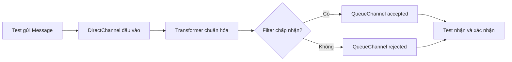
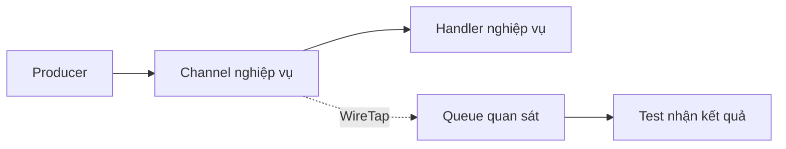

# MessageCollector

## 1. Mục tiêu và phạm vi

Trong chương **Testing support** của module **SPRING_INTEGRATION_CORE**, bài này trình bày cách thu thập `Message<?>` tại một điểm của luồng để kiểm tra payload, header, số lượng và nhánh xử lý. Đây là kỹ năng cần thiết khi kiểm thử transformer, router, filter, aggregator và các endpoint được kết nối bằng Java DSL.

Cần xác định đúng API ngay từ đầu: `org.springframework.cloud.stream.test.binder.MessageCollector` là interface của bộ kiểm thử **Spring Cloud Stream đời cũ**, được dùng cùng `TestSupportBinder`. Không nên tìm hoặc giả định tồn tại một lớp tương đương mang tên đó trong `org.springframework.integration.test`. Chữ ký API có thể đối chiếu tại [mã nguồn Spring Cloud Stream 2.2.1.RELEASE](https://github.com/spring-cloud/spring-cloud-stream/blob/v2.2.1.RELEASE/spring-cloud-stream-test-support/src/main/java/org/springframework/cloud/stream/test/binder/MessageCollector.java).

Trong phạm vi Spring Integration Core, cùng nhu cầu được giải quyết bằng một `QueueChannel` ở đầu ra kiểm thử, hoặc `WireTap` đưa thông điệp sang một queue quan sát. Phần thực hành chính của bài sử dụng các thành phần Core này; phần API cũ giúp đọc và bảo trì các test đã dùng `MessageCollector`.

Sau bài học, người học có thể:

- Giải thích quan hệ giữa channel được quan sát, collector và queue chứa kết quả.
- Đọc đúng `forChannel(...)` và sử dụng các thao tác của `BlockingQueue`.
- Viết test Java DSL thu thập cả thông điệp hợp lệ lẫn thông điệp bị filter loại.
- Chọn vị trí quan sát phù hợp mà không tạo consumer cạnh tranh ngoài ý muốn.
- Phân biệt bằng chứng “đã thấy thông điệp tại channel” với “nghiệp vụ cuối cùng đã hoàn tất”.

## 2. Thu thập thông điệp giải quyết vấn đề gì?

Giả sử hệ thống tiếp nhận mã đơn hàng, chuẩn hóa khoảng trắng và chữ hoa, rồi chỉ chấp nhận mã không rỗng. Nếu test chỉ kiểm tra `input.send(message)` trả về `true`, ta chưa kiểm tra được giá trị sau biến đổi hoặc nơi thông điệp bị loại được chuyển đến.

Một điểm thu thập cho phép test quan sát kết quả cụ thể:



Thông điệp thu được gồm hai phần cần đánh giá độc lập:

| Thành phần | Ví dụ | Điều test cần làm rõ |
|---|---|---|
| Payload | `ORDER-42` | Transformer tạo đúng dữ liệu và đúng kiểu chưa? |
| Header nghiệp vụ | `orderId=42` | Metadata cần cho các bước sau có được giữ lại không? |
| Header tương quan | `correlationId` | Kết quả có thuộc đúng yêu cầu hoặc nhóm cần kiểm tra không? |
| Số thông điệp | Một kết quả cho một đầu vào hợp lệ | Có thiếu hoặc phát sinh kết quả dư không? |
| Channel nhận | `accepted` hoặc `rejected` | Filter/router có chọn đúng nhánh không? |

Collector phục vụ quan sát trong test. Nó không thay thế logic transformer, cơ chế tương quan của aggregator hay chính sách xử lý lỗi của ứng dụng.

## 3. API MessageCollector trong Spring Cloud Stream đời cũ

### 3.1. Chữ ký và ý nghĩa

API trọng tâm là:

```java
BlockingQueue<Message<?>> forChannel(MessageChannel channel);
```

`channel` là đối tượng channel đầu ra đã được test binder đăng ký. Kết quả là queue giữ những thông điệp thu được từ channel ấy. `Message<?>` cho phép payload có nhiều kiểu; test phải xác nhận kiểu hoặc nội dung trước khi ép kiểu.

Trong `TestSupportBinder` của phiên bản 2.2.1.RELEASE, quá trình bind producer tạo queue và đăng ký subscriber đưa thông điệp vào queue đó. `forChannel(...)` chỉ tra queue đã đăng ký; việc gọi phương thức này không tự gắn bộ thu vào một channel tùy ý. Channel chưa được binder đăng ký sẽ dẫn đến lỗi thay vì tự có queue mới. Đây là hành vi của [implementation TestSupportBinder ở phiên bản được nêu](https://github.com/spring-cloud/spring-cloud-stream/blob/v2.2.1.RELEASE/spring-cloud-stream-test-support/src/main/java/org/springframework/cloud/stream/test/binder/TestSupportBinder.java).

```text
Ứng dụng gửi vào output channel
                |
                v
Subscriber do TestSupportBinder đăng ký
                |
                v
BlockingQueue<Message<?>> tương ứng
                |
                v
Test gọi forChannel(output).poll(timeout, unit)
```

Do đó, gọi `forChannel(inputChannel)` không có nghĩa là quan sát mọi đầu vào. API này được thiết kế quanh các output channel đã bind trong mô hình kiểm thử nói trên.

### 3.2. Các thao tác cần hiểu

Sau khi có queue, các phương thức dưới đây thuộc `BlockingQueue` hoặc các interface cha của nó, không phải các phương thức riêng của `MessageCollector`:

| Thao tác | Khi queue có phần tử | Khi queue rỗng | Lấy phần tử khỏi queue? |
|---|---|---|---|
| `poll()` | Trả phần tử đầu | Trả `null` ngay | Có |
| `poll(1, TimeUnit.SECONDS)` | Trả phần tử đầu | Chờ tối đa thời hạn rồi trả `null` | Có |
| `take()` | Trả phần tử đầu | Chờ không giới hạn | Có |
| `peek()` | Xem phần tử đầu | Trả `null` ngay | Không |
| `drainTo(list)` | Chuyển các phần tử đang có sang `list` | Không có gì để chuyển | Có |
| `clear()` | Xóa các phần tử đang có | Không thay đổi | Có |

Các đặc tính chờ và giá trị trả về này được quy định trong [Javadoc Java BlockingQueue](https://docs.oracle.com/en/java/javase/17/docs/api/java.base/java/util/concurrent/BlockingQueue.html).

Ví dụ đọc có thời hạn trong một test đã khởi tạo binder:

```java
BlockingQueue<Message<?>> results =
        messageCollector.forChannel(processor.output());

Message<?> received = results.poll(1, TimeUnit.SECONDS);
assertNotNull("Không nhận được kết quả trong thời hạn", received);
assertEquals("ORDER-42", received.getPayload());
```

Các assertion ở đoạn trên là cú pháp JUnit 4. `poll(timeout, unit)` có thể ném `InterruptedException`; phương thức test có thể khai báo `throws InterruptedException`. Phải kiểm tra khác `null` trước khi đọc payload để lỗi test cho biết đúng nguyên nhân.

### 3.3. Một test minh họa cho dự án cũ

Ví dụ sau dành cho dự án đang có bộ phiên bản Spring Boot/Spring Cloud tương thích với **Spring Cloud Stream 2.2.x**, mô hình `@EnableBinding` và JUnit 4. Nó không phải cấu hình cho Spring Integration Core 6.x hoặc dự án Cloud Stream dùng functional binding.

Trong dự án cũ đã quản lý dependency bằng bộ BOM tương thích, dependency kiểm thử liên quan là:

```xml
<dependency>
    <groupId>org.springframework.cloud</groupId>
    <artifactId>spring-cloud-stream-test-support</artifactId>
    <scope>test</scope>
</dependency>
```

Đoạn dependency giả định ứng dụng đã có Spring Cloud Stream và bộ kiểm thử Spring Boot/JUnit 4 phù hợp. Dùng phạm vi `test` vì test binder có thể thay thế binder thật khi tự cấu hình. Cơ chế này được mô tả trong [tài liệu kiểm thử Spring Cloud Stream Ditmars.SR1](https://docs.spring.io/spring-cloud-stream/docs/Ditmars.SR1/reference/html/_testing.html).

```java
import java.util.Locale;
import java.util.concurrent.BlockingQueue;
import java.util.concurrent.TimeUnit;

import org.junit.Test;
import org.junit.runner.RunWith;
import org.springframework.beans.factory.annotation.Autowired;
import org.springframework.boot.SpringBootConfiguration;
import org.springframework.boot.autoconfigure.EnableAutoConfiguration;
import org.springframework.boot.test.context.SpringBootTest;
import org.springframework.cloud.stream.annotation.EnableBinding;
import org.springframework.cloud.stream.messaging.Processor;
import org.springframework.cloud.stream.test.binder.MessageCollector;
import org.springframework.integration.annotation.Transformer;
import org.springframework.messaging.Message;
import org.springframework.messaging.support.MessageBuilder;
import org.springframework.test.context.junit4.SpringRunner;

import static org.junit.Assert.assertEquals;
import static org.junit.Assert.assertNotNull;
import static org.junit.Assert.assertNull;
import static org.junit.Assert.assertTrue;

@RunWith(SpringRunner.class)
@SpringBootTest(
        classes = LegacyCollectorTest.App.class,
        webEnvironment = SpringBootTest.WebEnvironment.NONE)
public class LegacyCollectorTest {

    @Autowired
    private Processor processor;

    @Autowired
    private MessageCollector messageCollector;

    @Test
    public void collectsNormalizedOrder() throws InterruptedException {
        BlockingQueue<Message<?>> results =
                messageCollector.forChannel(processor.output());

        // Fixture của test này phải có quyền sử dụng riêng output queue.
        results.clear();

        Message<String> request = MessageBuilder
                .withPayload("  order-42  ")
                .setHeader("orderId", "42")
                .setHeader("contentType", "text/plain")
                .build();

        assertTrue(processor.input().send(request));

        Message<?> result = results.poll(1, TimeUnit.SECONDS);
        assertNotNull("Không thu được thông điệp đầu ra", result);
        assertEquals("ORDER-42", result.getPayload());
        assertEquals("42", result.getHeaders().get("orderId"));
        assertNull(results.poll());
    }

    @SpringBootConfiguration
    @EnableAutoConfiguration
    @EnableBinding(Processor.class)
    public static class App {

        @Transformer(
                inputChannel = Processor.INPUT,
                outputChannel = Processor.OUTPUT)
        public String normalize(String value) {
            return value.trim().toUpperCase(Locale.ROOT);
        }
    }
}
```

Trong fixture này transformer và các channel mặc định xử lý đồng bộ, nên kiểm tra queue không còn phần tử ngay sau khi `send()` hoàn tất có ý nghĩa với những đầu vào test vừa gửi. Khi ứng dụng thêm executor hoặc nguồn phát nền, phải thay cách xác định thời điểm hoàn tất.

Kiểu payload quan sát được còn phụ thuộc cấu hình chuyển đổi nội dung của bộ phiên bản cũ. Nếu một dự án thu được `byte[]`, test cần giải mã bằng charset xác định hoặc kiểm tra byte theo hợp đồng thực tế; không ép kiểu thành `String` chỉ vì phương thức nghiệp vụ nhận `String`.

## 4. Áp dụng trong Spring Integration Core bằng QueueChannel

### 4.1. Chọn queue làm đầu ra kiểm thử

Một `QueueChannel` ở cuối flow giữ lại kết quả để test chủ động nhận. Không cần thêm consumer endpoint chỉ để đọc queue: chính test là bên gọi `receive(...)`.

Với cấu hình queue mặc định trong bộ nhớ, `receive(1000)` chờ tối đa 1.000 mili giây, `receive(0)` đọc tức thời, còn `receive()` có thể chờ vô hạn. Mỗi lần nhận thành công lấy thông điệp ra khỏi queue. Các ngữ nghĩa này được mô tả trong [tài liệu Message Channel Implementations](https://docs.spring.io/spring-integration/reference/channel/implementations.html).

Ví dụ tiếp theo dùng Java 17+, Spring Integration 6.x và JUnit Jupiter. Các phiên bản dependency cần được quản lý thống nhất bởi BOM của dự án, chẳng hạn bộ Spring Boot 3.x tương thích; không ghép artifact Cloud Stream cũ ở phần trước vào fixture này.

```xml
<dependency>
    <groupId>org.springframework.integration</groupId>
    <artifactId>spring-integration-core</artifactId>
</dependency>
<dependency>
    <groupId>org.junit.jupiter</groupId>
    <artifactId>junit-jupiter</artifactId>
    <scope>test</scope>
</dependency>
```

Đây là các dependency trực tiếp cho ví dụ khi dependency management và công cụ chạy JUnit Jupiter đã được dự án cấu hình. `AnnotationConfigApplicationContext` được cung cấp qua Spring Context. Không cần `@SpringBootTest` vì test tự khởi tạo và đóng context nhỏ của mình.

Spring Integration có các module `spring-integration-test-support` và `spring-integration-test` cho tiện ích, mock và cấu hình kiểm thử nâng cao. Tuy nhiên, đọc kết quả từ `QueueChannel` chỉ cần Core; thêm các module đó không tạo ra bean `MessageCollector` của Cloud Stream. Xem [Testing support của Spring Integration](https://docs.spring.io/spring-integration/reference/testing.html).

### 4.2. Ví dụ đầy đủ: transformer, filter và hai queue thu thập

Mỗi phương thức test tạo context riêng, tránh việc kết quả của test này còn nằm trong queue của test khác.

```java
import java.util.Locale;

import org.junit.jupiter.api.AfterEach;
import org.junit.jupiter.api.BeforeEach;
import org.junit.jupiter.api.Test;
import org.springframework.context.annotation.AnnotationConfigApplicationContext;
import org.springframework.context.annotation.Bean;
import org.springframework.context.annotation.Configuration;
import org.springframework.integration.channel.DirectChannel;
import org.springframework.integration.channel.QueueChannel;
import org.springframework.integration.config.EnableIntegration;
import org.springframework.integration.dsl.IntegrationFlow;
import org.springframework.messaging.Message;
import org.springframework.messaging.support.MessageBuilder;

import static org.junit.jupiter.api.Assertions.assertEquals;
import static org.junit.jupiter.api.Assertions.assertNotNull;
import static org.junit.jupiter.api.Assertions.assertNull;
import static org.junit.jupiter.api.Assertions.assertTrue;

class MessageCollectionTest {

    private AnnotationConfigApplicationContext context;
    private DirectChannel input;
    private QueueChannel accepted;
    private QueueChannel rejected;

    @BeforeEach
    void setUp() {
        context = new AnnotationConfigApplicationContext(FlowConfig.class);
        input = context.getBean("input", DirectChannel.class);
        accepted = context.getBean("accepted", QueueChannel.class);
        rejected = context.getBean("rejected", QueueChannel.class);
    }

    @AfterEach
    void tearDown() {
        if (context != null) {
            context.close();
        }
    }

    @Test
    void collectsNormalizedPayloadAndBusinessHeader() {
        Message<String> request = MessageBuilder
                .withPayload("  order-42  ")
                .setHeader("orderId", "42")
                .build();

        assertTrue(input.send(request));

        Message<?> result = accepted.receive(1000);
        assertNotNull(result, "Không có kết quả tại accepted");
        assertEquals("ORDER-42", result.getPayload());
        assertEquals("42", result.getHeaders().get("orderId"));
        assertNull(accepted.receive(0), "Có kết quả dư tại accepted");
        assertNull(rejected.receive(0), "Thông điệp hợp lệ bị đưa sang rejected");
    }

    @Test
    void collectsBlankPayloadOnDiscardChannel() {
        Message<String> request = MessageBuilder
                .withPayload("   ")
                .setHeader("orderId", "blank-case")
                .build();

        assertTrue(input.send(request));

        Message<?> result = rejected.receive(1000);
        assertNotNull(result, "Không thu được thông điệp bị loại");
        assertEquals("", result.getPayload());
        assertEquals("blank-case", result.getHeaders().get("orderId"));
        assertNull(accepted.receive(0));
        assertNull(rejected.receive(0));
    }

    @Test
    void collectsTwoResultsInOrderWithoutExtras() {
        assertTrue(input.send(MessageBuilder.withPayload(" first ").build()));
        assertTrue(input.send(MessageBuilder.withPayload(" second ").build()));

        Message<?> first = accepted.receive(1000);
        Message<?> second = accepted.receive(1000);
        assertNotNull(first);
        assertNotNull(second);
        assertEquals("FIRST", first.getPayload());
        assertEquals("SECOND", second.getPayload());
        assertNull(accepted.receive(0));
        assertNull(rejected.receive(0));
    }

    @Configuration
    @EnableIntegration
    static class FlowConfig {

        @Bean
        DirectChannel input() {
            return new DirectChannel();
        }

        @Bean
        QueueChannel accepted() {
            return new QueueChannel(20);
        }

        @Bean
        QueueChannel rejected() {
            return new QueueChannel(20);
        }

        @Bean
        IntegrationFlow orderFlow() {
            return IntegrationFlow.from(input())
                    .<String, String>transform(
                            value -> value.trim().toUpperCase(Locale.ROOT))
                    .<String>filter(
                            value -> !value.isEmpty(),
                            spec -> spec.discardChannel(rejected()))
                    .channel(accepted())
                    .get();
        }
    }
}
```

`IntegrationFlow.from(...)` tạo điểm bắt đầu và các bước DSL được đăng ký khi flow là bean trong context. Có thể đối chiếu cách xây dựng này trong [Javadoc IntegrationFlow 6.5.0](https://docs.spring.io/spring-integration/docs/6.5.0/api/org/springframework/integration/dsl/IntegrationFlow.html).

### 4.3. Đọc kết quả của ví dụ

Test đầu tiên xác nhận cả dữ liệu đã chuẩn hóa và header nghiệp vụ còn tồn tại. Không so sánh toàn bộ `Message` đầu vào với đầu ra vì transformer có thể tạo message mới, với `id` và `timestamp` khác.

Test thứ hai nhận payload rỗng ở `rejected`: đây là giá trị **sau** bước chuẩn hóa. Nếu muốn biết dữ liệu nguyên bản trước transformer, cần thu thập tại một điểm trước bước đó hoặc chủ động lưu giá trị gốc theo thiết kế của flow.

Test thứ ba kiểm tra thứ tự trong một fixture có hai lần gửi tuần tự, xử lý đồng bộ và queue FIFO. Kết luận về thứ tự này chỉ áp dụng cho cấu hình đang kiểm tra; khi thêm xử lý song song, thứ tự hoàn thành có thể thay đổi.

`input.send(...)` vẫn trả về `true` trong trường hợp filter chuyển dữ liệu sang discard channel. Giá trị trả về không có nghĩa là payload đã vượt qua mọi điều kiện nghiệp vụ.

## 5. Thu thập tại một channel đang có consumer bằng WireTap

### 5.1. Vì sao không gắn thêm subscriber vào DirectChannel?

Một `DirectChannel` có ngữ nghĩa point-to-point. Nếu nó đã có consumer nghiệp vụ và test đăng ký thêm một handler để thu thập, hai handler có thể trở thành các consumer cạnh tranh. Test khi đó làm thay đổi đối tượng đang được kiểm tra.

Tương tự, nếu test gọi `receive()` trên một `QueueChannel` đang được poller nghiệp vụ tiêu thụ, thông điệp mà test nhận đã bị lấy khỏi đường xử lý của poller. Cách này phù hợp khi queue là đầu ra dành riêng cho test, nhưng không phù hợp để nghe lén một đường truyền đang hoạt động.

`WireTap` là interceptor chuyển thông điệp sang channel phụ và tiếp tục đường chính. Cơ chế này được mô tả trong [Javadoc WireTap](https://docs.spring.io/spring-integration/docs/6.5.0/api/org/springframework/integration/channel/interceptor/WireTap.html).



### 5.2. Ví dụ quan sát và dọn interceptor

Đây là một phương thức JUnit Jupiter độc lập có thể thêm vào lớp test ở phần trước. Bổ sung import:

```java
import org.springframework.integration.channel.interceptor.WireTap;
```

```java
@Test
void wireTapKeepsBusinessDeliveryAndCapturesObservation() {
    DirectChannel businessChannel = new DirectChannel();
    QueueChannel businessResults = new QueueChannel(10);
    QueueChannel observed = new QueueChannel(10);

    businessChannel.subscribe(message -> {
        if (!businessResults.send(message, 0)) {
            throw new IllegalStateException("Queue nghiệp vụ của test đã đầy");
        }
    });

    WireTap tap = new WireTap(observed);
    tap.setTimeout(0);
    businessChannel.addInterceptor(tap);

    try {
        Message<String> request = MessageBuilder
                .withPayload("ORDER-42")
                .setHeader("orderId", "42")
                .build();

        assertTrue(businessChannel.send(request));

        Message<?> delivered = businessResults.receive(1000);
        Message<?> captured = observed.receive(1000);
        assertNotNull(delivered);
        assertNotNull(captured);
        assertEquals("ORDER-42", delivered.getPayload());
        assertEquals("ORDER-42", captured.getPayload());
        assertEquals("42", captured.getHeaders().get("orderId"));
        assertNull(observed.receive(0));
    }
    finally {
        businessChannel.removeInterceptor(tap);
    }
}
```

Ví dụ truyền trực tiếp đối tượng channel vào `WireTap`. Nếu dùng constructor nhận tên channel, interceptor cần được Spring quản lý để phân giải tên qua `BeanFactory`.

### 5.3. Vị trí và giới hạn của WireTap

`WireTap` hoạt động ở `preSend`. Thông điệp xuất hiện trong queue quan sát cho thấy nó đã đi tới điểm interceptor đó; handler phía sau vẫn có thể thất bại. Nếu cần xác nhận kết quả sau biến đổi hoặc sau một thao tác nghiệp vụ, hãy đặt điểm quan sát tại output tương ứng.

Không coi thông điệp quan sát là bản sao sâu của payload. Với payload mutable, thay đổi object sau đó có thể làm test đọc trạng thái khác thời điểm gửi. Dùng payload bất biến hoặc tạo bản chụp dữ liệu rõ ràng nếu test cần trạng thái tại một thời điểm.

Trong implementation WireTap 6.5.0, nếu gửi sang queue phụ trả về `false`, interceptor ghi cảnh báo và tiếp tục đường chính. Vì vậy queue quan sát đầy có thể làm thiếu dữ liệu thu thập mà luồng nghiệp vụ vẫn chạy. `setTimeout(0)` tránh chờ chỗ trống, nhưng test phải dự trù capacity và kiểm tra đủ kết quả. Xem [mã nguồn WireTap 6.5.0](https://github.com/spring-projects/spring-integration/blob/v6.5.0/spring-integration-core/src/main/java/org/springframework/integration/channel/interceptor/WireTap.java).

Bản thân wire tap không tự tạo thread. Thời điểm xử lý ở nhánh quan sát còn phụ thuộc channel đích; `QueueChannel` chỉ đệm để test nhận sau. Cấu hình và đặc tính luồng được giải thích trong [tài liệu Wire Tap](https://docs.spring.io/spring-integration/reference/7.0/channel/configuration.html).

## 6. Chờ kết quả đúng cách trong luồng bất đồng bộ

### 6.1. Chờ điều kiện thay vì ngủ cố định

Đoạn dưới đây dễ tạo test chập chờn:

```java
Thread.sleep(200);
Message<?> result = results.poll();
```

Nếu worker chạy chậm hơn 200 mili giây, test thất bại dù luồng đúng. Nếu worker hoàn tất sớm, test vẫn chờ hết khoảng ngủ.

Với `MessageCollector`, dùng `results.poll(timeout, unit)`. Với `QueueChannel`, dùng `receive(timeoutMillis)`. Hai cách đều cho phép quay lại ngay khi có thông điệp và có giới hạn khi luồng không tạo kết quả.

### 6.2. Một ngân sách thời gian cho nhiều thông điệp

Khi cần lấy nhiều kết quả bất đồng bộ từ queue của `MessageCollector`, nếu chờ một giây cho từng phần tử thì tổng thời gian xấu nhất tăng theo số phần tử. Có thể dùng một deadline chung.

Helper dưới đây dùng JUnit Jupiter; `results` là `BlockingQueue<Message<?>>` đã có. Nếu đưa vào test JUnit 4 ở phần trước, phải đổi thứ tự tham số thông báo của các assertion tương ứng.

```java
import java.time.Duration;
import java.util.ArrayList;
import java.util.List;
import java.util.concurrent.BlockingQueue;
import java.util.concurrent.TimeUnit;

static List<Message<?>> collectExactly(
        BlockingQueue<Message<?>> results,
        int expected,
        Duration budget) throws InterruptedException {

    if (expected < 0 || budget.isNegative() || budget.isZero()) {
        throw new IllegalArgumentException("Số lượng hoặc thời hạn không hợp lệ");
    }

    long deadline = System.nanoTime() + budget.toNanos();
    List<Message<?>> collected = new ArrayList<>(expected);

    while (collected.size() < expected) {
        long remaining = deadline - System.nanoTime();
        assertTrue(remaining > 0,
                "Hết thời gian; đã nhận " + collected.size() + "/" + expected);

        Message<?> next = results.poll(remaining, TimeUnit.NANOSECONDS);
        assertNotNull(next,
                "Thiếu kết quả; đã nhận " + collected.size() + "/" + expected);
        collected.add(next);
    }

    return collected;
}
```

Tên `collectExactly` ở đây có nghĩa là helper thu đủ số phần tử yêu cầu trước deadline; nó không tự chứng minh rằng producer sẽ không phát thêm kết quả. Cần kiểm tra thông điệp dư sau khi có tín hiệu hoàn tất, hoặc trong một khoảng quan sát được chọn rõ ràng.

### 6.3. Kết luận về sự vắng mặt phải có mốc thời gian

`poll()` hoặc `receive(0)` trả về `null` chỉ cho biết queue rỗng tại thời điểm gọi. Trong luồng bất đồng bộ, producer có thể đưa thêm dữ liệu vào ngay sau đó.

Để kiểm tra filter không phát ra đầu ra hợp lệ, có thể:

- Dùng tín hiệu hoàn tất gắn với đúng yêu cầu, sau đó xác nhận các queue liên quan.
- Thu thông điệp tại discard channel để chứng minh đầu vào đã đi đến filter và bị loại.
- Khi hợp đồng dựa trên thời gian, xác nhận không có kết quả trong một khoảng quan sát đã định và ghi rõ giới hạn này trong test.

Nếu filter mặc định loại im lặng, queue đầu ra rỗng còn có thể do flow chưa chạy, lỗi xảy ra trước filter hoặc test gửi nhầm channel. Bởi vậy, bằng chứng ở nhánh discard thường rõ hơn chỉ kiểm tra sự vắng mặt.

## 7. Header, thứ tự và tương quan kết quả

### 7.1. Kiểm tra header phục vụ hợp đồng

Nên xác nhận những header có ý nghĩa nghiệp vụ như `orderId`, tenant hoặc mã yêu cầu. Không mặc định yêu cầu toàn bộ header map phải bằng nhau, vì các bước xử lý có thể thêm metadata hoặc tạo message mới.

Với `byte[]`, kiểm tra nội dung mảng bằng assertion dành cho mảng hoặc giải mã charset xác định. Với JSON, nếu hợp đồng cho phép thay đổi thứ tự field, nên kiểm tra cấu trúc và giá trị thay vì so sánh chuỗi có định dạng cố định.

### 7.2. FIFO không có nghĩa là luôn giữ thứ tự đầu vào toàn hệ thống

Queue của collector lưu thứ tự thông điệp đến nó. Nếu hai tác vụ chạy song song, tác vụ nhận đầu vào sau có thể hoàn tất trước. Lúc đó queue có thể nhận `B` rồi `A` dù test gửi `A` trước.

Nếu hợp đồng không yêu cầu thứ tự, kiểm tra tập kết quả kèm số lượng xuất hiện, hoặc lập chỉ mục theo một header duy nhất. Chỉ chuyển thành `Set` có thể che mất lỗi trùng thông điệp; chẳng hạn `[A, A, B]` và `[A, B]` cho cùng một tập giá trị.

Nếu hợp đồng yêu cầu thứ tự, cần kiểm tra thiết kế thực sự bảo toàn thứ tự qua executor, splitter và các consumer. Collector ghi nhận hiện tượng; nó không tự khôi phục thứ tự.

### 7.3. Không dùng một queue chung cho các test song song

`BlockingQueue` hỗ trợ truy cập đa luồng không có nghĩa là các test dùng chung queue được cách ly. Một test có thể lấy mất kết quả của test khác; `clear()` còn có thể xóa thông điệp vừa được tác vụ khác phát ra.

Ưu tiên fixture riêng cho mỗi test. Khi buộc phải dùng context chung, cần quản lý nguồn phát nền, thời điểm hoàn tất và quyền đọc queue. Gắn `correlationId` giúp nhận diện dữ liệu, nhưng tự nó không ngăn consumer khác lấy mất thông điệp.

## 8. Áp dụng cho các mẫu tích hợp và gateway

| Thành phần cần kiểm thử | Điểm thu thập phù hợp | Điều cần xác nhận |
|---|---|---|
| Transformer | Queue sau transformer | Giá trị, kiểu payload và header được bảo toàn theo hợp đồng |
| Router | Queue riêng tại từng nhánh | Kết quả tới đúng nhánh; không có phát sinh ngoài hợp đồng |
| Filter | Queue đầu ra hợp lệ và discard channel | Đầu vào được chấp nhận hoặc loại đúng; dữ liệu ở discard phản ánh đúng vị trí filter |
| Splitter | Queue sau splitter | Số phần tử và metadata cần cho việc gom nhóm về sau |
| Aggregator | Queue sau aggregator | Nhóm chỉ phát kết quả khi đủ điều kiện; các nhóm không lẫn dữ liệu |
| Endpoint gọi dịch vụ | Queue tại output hoặc tap sau endpoint | Kết quả của lời gọi đã được chuyển tiếp đúng |
| Gateway request-reply | Giá trị trả về gateway, kết hợp điểm quan sát khi cần | Yêu cầu và phản hồi thuộc cùng lần gọi; timeout phản hồi được xử lý đúng |

Với router có ngữ nghĩa gửi nhiều nhánh, việc có nhiều kết quả có thể là đúng hợp đồng. Không áp dụng điều kiện “chỉ một queue có dữ liệu” cho mọi router.

Với aggregator, hãy gửi xen kẽ các thông điệp của ít nhất hai nhóm và kiểm tra định danh của kết quả. Nếu kiểm tra thời điểm chưa đủ nhóm trong luồng bất đồng bộ, cần biết các đầu vào tương ứng đã được xử lý trước khi kết luận “chưa có kết quả”.

Với gateway, nếu đưa queue thu thập vào chỗ luồng phải trả lời, phản hồi có thể không về được gateway và lời gọi sẽ hết thời gian chờ. Khi cần vừa quan sát vừa giữ đường phản hồi, đặt tap tại vị trí thích hợp và vẫn bảo toàn cơ chế reply của flow.

## 9. Thu thập và kiểm tra lỗi

### 9.1. Lỗi đồng bộ và lỗi qua error channel

Khi gửi trực tiếp vào `DirectChannel` và handler chạy trên cùng thread, exception thường truyền ngược về bên gọi. Đối với fixture đó, test cần assertion về exception; không mặc định chờ một `ErrorMessage` xuất hiện ở `errorChannel`.

Với xử lý qua executor hoặc poller có cơ chế công bố lỗi của Spring Integration, lỗi có thể được đóng gói thành `ErrorMessage` và gửi tới error channel. Nếu request có header `errorChannel`, cơ chế công bố lỗi dùng channel ấy; nếu không, nó dùng channel lỗi toàn cục theo cấu hình. Cần giữ đúng cơ chế xử lý lỗi của endpoint đang kiểm thử. Các trường hợp này được phân biệt trong [tài liệu Error Handling](https://docs.spring.io/spring-integration/reference/error-handling.html).

### 9.2. Xác nhận ErrorMessage đã thu được

Giả sử fixture bất đồng bộ đã có một `QueueChannel errors` làm đích lỗi cho request, và handler cố ý ném lỗi. Test có thể kiểm tra phần thu thập như sau bằng JUnit Jupiter:

```java
import org.springframework.messaging.MessagingException;
import org.springframework.messaging.support.ErrorMessage;

import static org.junit.jupiter.api.Assertions.assertInstanceOf;

Message<?> captured = errors.receive(1000);
assertNotNull(captured, "Không nhận được thông điệp lỗi");

ErrorMessage error = assertInstanceOf(ErrorMessage.class, captured);
MessagingException failure = assertInstanceOf(
        MessagingException.class, error.getPayload());

Message<?> failedMessage = failure.getFailedMessage();
assertNotNull(failedMessage);
assertEquals("42", failedMessage.getHeaders().get("orderId"));
```

Đoạn trên kiểm tra hợp đồng của fixture có lỗi được bọc trong `MessagingException`, không khẳng định mọi `ErrorMessage` đều chứa kiểu exception này. Với lỗi do mã ứng dụng tự công bố, phải kiểm tra kiểu payload thực tế mà ứng dụng đã quy định.

Sau khi xác nhận kiểu và thông điệp thất bại, có thể kiểm tra nguyên nhân gốc hoặc dữ liệu cần cho xử lý bù. Tránh phụ thuộc vào toàn bộ chuỗi thông báo lỗi của framework nếu hợp đồng ứng dụng chỉ yêu cầu loại lỗi và mã yêu cầu.

## 10. Lỗi thường gặp khi sử dụng collector

| Hiện tượng | Nguyên nhân cần xem xét | Cách xử lý |
|---|---|---|
| Không autowire được `MessageCollector` trong dự án Core | Đang dùng API thuộc Cloud Stream đời cũ | Dùng queue đầu ra hoặc WireTap phù hợp với Core |
| `forChannel(...)` báo channel chưa bind | Truyền một channel không do TestSupportBinder đăng ký | Kiểm tra đúng output binding và đối tượng channel trong context cũ |
| Test thỉnh thoảng nhận `null` | Dùng đọc tức thời trong khi producer chưa xong | Nhận có thời hạn và xác định đúng điều kiện hoàn tất |
| Test bị treo | Dùng `take()` hoặc `receive()` không có timeout | Đặt thời hạn cho thao tác chờ |
| Payload sai kiểu | Giả định sai về chuyển đổi nội dung hoặc vị trí quan sát | Xác nhận kiểu thực tế, content type và hợp đồng dữ liệu |
| Handler nghiệp vụ không nhận đủ dữ liệu | Test thêm consumer cạnh tranh hoặc đọc queue đang được poller tiêu thụ | Dùng điểm tap hoặc queue dành riêng cho test |
| Test độc lập chạy đúng, chạy cả bộ lại sai | Queue/context dùng chung, thông điệp nền hoặc interceptor chưa dọn | Cách ly fixture và gỡ observer sau test |
| Quan sát thấy thông điệp nhưng nghiệp vụ vẫn lỗi | Tap đặt trước handler | Xác nhận đầu ra sau handler hoặc trạng thái hoàn tất liên quan |
| Thiếu dữ liệu quan sát khi tải tăng | Queue tap đầy hoặc observer làm rơi dữ liệu | Chọn capacity theo fixture và kiểm tra số lượng nhận |
| Test bỏ sót thông điệp trùng | Chỉ kiểm tra phần tử đầu hoặc chuyển toàn bộ sang `Set` | Kiểm tra tổng số và số lần xuất hiện theo hợp đồng |

## 11. Mức độ bằng chứng mà test cung cấp

Một test thu thập thông điệp tốt nêu rõ ba điều: **quan sát ở đâu, chờ đến khi nào và xác nhận hợp đồng nào**.

Trong ví dụ Core của bài, bằng chứng là transformer và filter đã xử lý đầu vào đúng, header được chuyển tiếp đúng và hai queue dành riêng cho test nhận đúng kết quả. Ví dụ không đi qua broker, mạng hay cơ sở dữ liệu.

Với Cloud Stream, test binder giúp quan sát ứng dụng trong JVM, nhưng không thay thế kiểm thử bằng binder/broker thật khi cần xác nhận serialization trên đường truyền, partition, acknowledgment, redelivery hoặc dead-letter queue.

Trong các dự án Cloud Stream sử dụng cơ chế kiểm thử hiện hành, tài liệu mô tả `InputDestination`, `OutputDestination` và artifact `spring-cloud-stream-test-binder`. Đó là hướng kiểm thử binding của Cloud Stream; không cần thêm lớp này chỉ để kiểm tra một flow Core. Tham khảo [Spring Cloud Stream — Spring Integration Test Binder](https://docs.spring.io/spring-cloud-stream/reference/spring-cloud-stream/spring_integration_test_binder.html).

Khi lựa chọn công cụ, hãy bắt đầu từ ranh giới cần xác nhận: queue cuối flow cho dữ liệu đầu ra, tap cho quan sát một điểm đang có consumer, giá trị trả về cho gateway, hoặc error channel cho lỗi được công bố bất đồng bộ. Cách đặt ranh giới đúng giúp test phản ánh hành vi của hệ thống và đưa ra lỗi dễ chẩn đoán.
