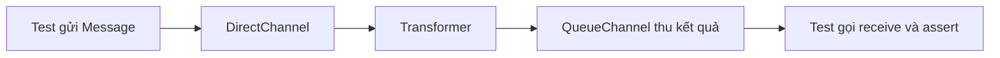
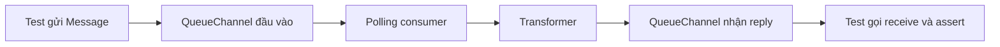
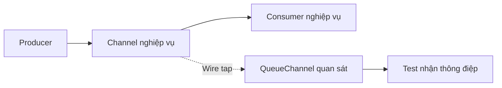

# QueueChannel trong test

## 1. Mục tiêu và tình huống sử dụng

Trong chương **Testing support** của module **SPRING_INTEGRATION_CORE**, `QueueChannel` là một công cụ đơn giản để thu thông điệp tại ranh giới của luồng tích hợp. Thay vì chỉ xác minh rằng một phương thức Java đã được gọi, test có thể gửi một `Message` vào flow, nhận thông điệp đầu ra, rồi kiểm tra payload, header và số lượng kết quả.

Ví dụ, một flow chuẩn hóa mã đơn hàng nhận `"  order-42  "` và trả về `"ORDER-42"`. Ta cần xác minh cả giá trị mới và việc header `requestId` vẫn theo thông điệp. Đặt một `QueueChannel` ở đầu ra giúp test quan sát đúng hợp đồng đó.

Sau bài học, bạn có thể:

- Dùng `send(message, timeout)` và `receive(timeout)` mà không làm test chờ vô hạn.
- Phân biệt hàng đợi thu kết quả với hàng đợi đầu vào cần polling consumer.
- Viết test cho transformer bằng Java DSL, kể cả luồng chạy qua poller.
- Nhận reply hoặc `ErrorMessage` bằng các hàng đợi riêng cho từng request.
- Tránh việc test tranh thông điệp với consumer thật, dùng nhầm dữ liệu còn sót hoặc kết luận quá mức từ một lần timeout.

Các ví dụ dùng JUnit Jupiter, Spring Test và Java DSL với `IntegrationFlow.from(...)`. Có thể dùng nền Java 17 và Spring Integration 6.x phù hợp; nếu dự án dùng dòng khác, chọn JDK theo yêu cầu của dòng đó. Hãy lấy phiên bản dependency từ BOM đang dùng trong dự án, tránh ghép thủ công các phiên bản Spring không tương thích.

## 2. QueueChannel đóng vai trò gì trong kiểm thử?

`QueueChannel` triển khai `PollableChannel`: bên gửi đặt thông điệp vào hàng đợi, bên nhận chủ động gọi `receive(...)`. Mỗi lần nhận thành công lấy một thông điệp ra; nhiều consumer cùng nhận sẽ chia nhau các thông điệp, không được mỗi người một bản sao. Theo mô tả chính thức, đây là kênh point-to-point. [Spring Integration — Message Channel Implementations](https://docs.spring.io/spring-integration/reference/channel/implementations.html)

Trong test, có hai cách bố trí thường gặp:





Ở sơ đồ thứ nhất, flow có thể xử lý hoàn toàn trên luồng gọi test. Hàng đợi đầu ra chỉ giữ kết quả để test lấy sau đó. Ở sơ đồ thứ hai, polling consumer lấy request trên luồng do scheduler quản lý. Sự khác biệt này quyết định cách chờ kết quả và kiểm tra lỗi; bản thân `QueueChannel` không tự tạo worker thread.

Một test tốt xác minh điều xảy ra ở ranh giới cần quan sát. Nhận được thông điệp tại đầu ra chứng minh flow đã đưa ra thông điệp ấy; nếu phía sau còn thao tác ghi cơ sở dữ liệu hoặc gọi dịch vụ khác, cần kiểm tra riêng các tác động đó.

## 3. Timeout và capacity: nền tảng để test kết thúc được

### 3.1. Chọn đúng lời gọi

Timeout trong các overload dưới đây có đơn vị **mili giây**:

| Lời gọi | Khi chưa thể thực hiện ngay | Cách dùng trong test |
|---|---|---|
| `send(message, 0)` | Trả về `false` nếu hàng đợi đã đầy | Kiểm tra gửi tức thời hoặc capacity |
| `send(message, 100)` | Chờ chỗ trống tối đa theo timeout | Gửi request với giới hạn chờ |
| `receive(0)` | Trả về `null` nếu hàng đợi đang rỗng | Kiểm tra trạng thái hiện tại |
| `receive(2_000)` | Chờ thông điệp tối đa theo timeout | Đợi kết quả của flow bất đồng bộ |
| `send(message)` | Có thể chặn khi hàng đợi đầy | Tránh dùng nếu chưa kiểm soát khả năng đầy |
| `receive()` | Có thể chặn khi hàng đợi rỗng | Tránh dùng trong assertion của test |

Overload không truyền timeout có thể chờ vô hạn. `receive(0)` chỉ quan sát thời điểm gọi, không phải một phép đợi. [Spring Integration — QueueChannel API](https://docs.spring.io/spring-integration/docs/current/api/org/springframework/integration/channel/QueueChannel.html)

Luôn kiểm tra kết quả nhận trước khi đọc payload:

```java
Message<?> actual = results.receive(2_000);
assertNotNull(actual, "Không nhận được kết quả trong thời gian chờ");
assertEquals("ORDER-42", actual.getPayload());
```

`send()` trả về `true` đối với hàng đợi cho biết thông điệp đã được chấp nhận vào kênh. Nó chưa chứng minh consumer đã chạy, nghiệp vụ thành công hoặc reply đã có. Vì thế, assertion về `send()` và assertion về đầu ra phục vụ hai mục đích khác nhau.

Timeout của channel cũng không phải thời hạn cho toàn bộ nghiệp vụ. Chẳng hạn, với `DirectChannel`, handler chạy trên luồng gọi `send()`; đối số `100` không tự ngắt một handler đang chạy mất năm giây. Nếu cần giới hạn toàn test, dùng thêm timeout của JUnit và kiểm soát tài nguyên mà test tạo ra.

### 3.2. Đặt capacity phù hợp với điều cần kiểm tra

Ưu tiên khai báo capacity rõ ràng:

```java
QueueChannel oneReply = new QueueChannel(1);
QueueChannel batchResults = new QueueChannel(20);
```

Một phép thử chỉ mong đợi một reply có thể dùng capacity `1`; phép thử splitter sinh mười phần tử cần đủ chỗ cho các phần tử trước khi test bắt đầu nhận. Cấu hình hàng đợi mặc định dùng bộ nhớ và có capacity rất lớn; đặt giới hạn giúp bộc lộ sai lệch về lưu lượng sớm hơn. [Spring Integration — Configuring Message Channels](https://docs.spring.io/spring-integration/reference/channel/configuration.html)

Capacity nhỏ cần được chọn cùng với cách gửi kết quả. Nếu handler đồng bộ gửi hai output vào một hàng đợi capacity `1` bằng lời gọi có thể chờ vô hạn, còn test chỉ nhận sau khi `send()` đầu vào trả về, hai phía có thể chờ nhau. Khi kiểm tra nhiều output, tăng capacity theo kịch bản, cấu hình thời gian gửi của endpoint khi cần, hoặc tổ chức bên nhận chạy đồng thời có kiểm soát.

## 4. Ví dụ độc lập: kiểm tra hợp đồng của hàng đợi

Ví dụ sau không khởi tạo Spring context. Các dependency cần có là `spring-integration-core` và `junit-jupiter` trong môi trường test. Đây là ví dụ để học hành vi kênh, không phải yêu cầu mọi dự án phải kiểm thử lại thư viện.

```java
import org.junit.jupiter.api.Test;
import org.springframework.integration.channel.QueueChannel;
import org.springframework.messaging.Message;
import org.springframework.messaging.support.MessageBuilder;

import static org.junit.jupiter.api.Assertions.*;

class QueueChannelContractTest {

    @Test
    void receivesMessagesInInsertionOrder() {
        QueueChannel channel = new QueueChannel(2);
        Message<String> first = MessageBuilder.withPayload("first").build();
        Message<String> second = MessageBuilder.withPayload("second").build();

        assertTrue(channel.send(first, 0));
        assertTrue(channel.send(second, 0));

        Message<?> actualFirst = channel.receive(0);
        Message<?> actualSecond = channel.receive(0);

        assertNotNull(actualFirst);
        assertNotNull(actualSecond);
        assertEquals("first", actualFirst.getPayload());
        assertEquals("second", actualSecond.getPayload());
        assertNull(channel.receive(0));
    }

    @Test
    void rejectsImmediateSendWhenFullThenAcceptsAfterReceive() {
        QueueChannel channel = new QueueChannel(1);
        Message<String> first = MessageBuilder.withPayload("first").build();
        Message<String> second = MessageBuilder.withPayload("second").build();

        assertTrue(channel.send(first, 0));
        assertFalse(channel.send(second, 0));

        Message<?> removed = channel.receive(0);
        assertNotNull(removed);
        assertEquals("first", removed.getPayload());

        assertTrue(channel.send(second, 0));
        Message<?> remaining = channel.receive(0);
        assertNotNull(remaining);
        assertEquals("second", remaining.getPayload());
    }

    @Test
    void returnsNullWhenNoMessageIsAvailable() {
        QueueChannel channel = new QueueChannel(1);

        assertNull(channel.receive(0));
    }
}
```

Trong các test này, dữ liệu được gửi xong trước khi nhận, không có scheduler hoặc consumer khác, nên `receive(0)` phù hợp. Với một flow có worker chạy đồng thời, cách chờ ở phần tiếp theo sẽ khác.

FIFO ở ví dụ là thứ tự lấy ra của hàng đợi mặc định. Nó không đảm bảo thứ tự hoàn thành của nhiều worker xử lý đồng thời; một request lấy ra trước vẫn có thể xử lý xong sau request tiếp theo.

## 5. Kiểm thử flow Java DSL với QueueChannel ở đầu ra

### 5.1. Thiết lập môi trường test

Các ví dụ Spring context dùng những dependency sau:

| Dependency | Phạm vi sử dụng |
|---|---|
| `org.springframework.integration:spring-integration-core` | Channel, endpoint và Java DSL |
| `org.springframework:spring-test` | Spring TestContext và `@SpringJUnitConfig` |
| `org.junit.jupiter:junit-jupiter` | Test và assertion JUnit Jupiter |

`spring-integration-test` cung cấp thêm `@SpringIntegrationTest`, `MockIntegrationContext` và các khả năng thay thế thành phần để test. Các ví dụ chỉ gửi/nhận qua channel bên dưới chưa cần những tiện ích đó; `QueueChannel` là thành phần core. [Spring Integration — Testing support](https://docs.spring.io/spring-integration/reference/testing.html)

Nếu dùng Spring Boot, có thể để bộ dependency kiểm thử của Boot cung cấp JUnit và Spring Test. Ví dụ dưới đây chủ động dùng một context nhỏ, không phụ thuộc vào việc quét toàn bộ ứng dụng.

### 5.2. Test transformer và header

Đây là một lớp test hoàn chỉnh. Flow nhận chuỗi qua `DirectChannel`, chuẩn hóa payload và đặt kết quả vào `testResults`.

```java
import java.util.Locale;

import org.junit.jupiter.api.AfterEach;
import org.junit.jupiter.api.BeforeEach;
import org.junit.jupiter.api.Test;
import org.junit.jupiter.api.Timeout;
import org.springframework.beans.factory.annotation.Autowired;
import org.springframework.beans.factory.annotation.Qualifier;
import org.springframework.context.annotation.Bean;
import org.springframework.context.annotation.Configuration;
import org.springframework.integration.channel.DirectChannel;
import org.springframework.integration.channel.QueueChannel;
import org.springframework.integration.config.EnableIntegration;
import org.springframework.integration.dsl.IntegrationFlow;
import org.springframework.messaging.Message;
import org.springframework.messaging.support.MessageBuilder;
import org.springframework.test.context.junit.jupiter.SpringJUnitConfig;

import static org.junit.jupiter.api.Assertions.*;

@SpringJUnitConfig(QueueChannelFlowTest.Config.class)
@Timeout(10)
class QueueChannelFlowTest {

    @Autowired
    @Qualifier("normalizeInput")
    DirectChannel input;

    @Autowired
    @Qualifier("testResults")
    QueueChannel results;

    @BeforeEach
    void verifiesNoLeftoverResult() {
        assertNull(results.receive(0), "Có kết quả còn sót trước test");
    }

    @AfterEach
    void verifiesNoAdditionalResult() {
        assertNull(results.receive(0), "Flow tạo thêm kết quả ngoài dự kiến");
    }

    @Test
    void normalizesPayloadAndPreservesBusinessHeader() {
        Message<String> request = MessageBuilder
                .withPayload("  order-42  ")
                .setHeader("requestId", "req-42")
                .build();

        assertTrue(input.send(request, 100));

        Message<?> actual = results.receive(1_000);
        assertNotNull(actual, "Thiếu kết quả chuẩn hóa");
        assertInstanceOf(String.class, actual.getPayload());
        assertEquals("ORDER-42", actual.getPayload());
        assertEquals("req-42", actual.getHeaders().get("requestId"));
    }

    @Configuration
    @EnableIntegration
    static class Config {

        @Bean
        DirectChannel normalizeInput() {
            return new DirectChannel();
        }

        @Bean
        QueueChannel testResults() {
            return new QueueChannel(10);
        }

        @Bean
        IntegrationFlow normalizationFlow(
                @Qualifier("normalizeInput") DirectChannel input,
                @Qualifier("testResults") QueueChannel results) {

            return IntegrationFlow.from(input)
                    .transform(String.class,
                            text -> text.strip().toUpperCase(Locale.ROOT))
                    .channel(results)
                    .get();
        }
    }
}
```

Java DSL nối endpoint và channel trong một flow; channel có thể được khai báo thành bean rồi truyền vào flow như trên. [Spring Integration — Message Channels trong Java DSL](https://docs.spring.io/spring-integration/reference/dsl/java-channels.html)

### 5.3. Đọc đúng ý nghĩa của kết quả

Vì đầu vào là `DirectChannel` và không có ranh giới bất đồng bộ trước transformer, xử lý hoàn tất trước khi `input.send(...)` trả về. `results.receive(1_000)` vẫn là một lời nhận có giới hạn, nhưng trong flow cụ thể này kết quả đã sẵn sàng; có thể dùng `receive(0)` sau lần gửi thành công.

Hai assertion về payload và `requestId` là hợp đồng nghiệp vụ của ví dụ. Không nên so sánh toàn bộ `MessageHeaders` với request đầu vào chỉ để suy ra transformer hoạt động đúng: header kỹ thuật như ID hoặc timestamp không phải hợp đồng cần bảo toàn trong tình huống này.

Phép kiểm tra ở `@AfterEach` có ý nghĩa ở đây vì phần xử lý đồng bộ đã hoàn tất. Nó giúp phát hiện output dư đang nằm trong queue. Không được chuyển nguyên kết luận đó sang flow bất đồng bộ mà chưa biết các producer đã dừng phát kết quả hay chưa.

## 6. Nhận reply bằng QueueChannel riêng cho từng request

### 6.1. Khi nào dùng replyChannel?

Flow ở phần 5 có đầu ra cố định là `testResults`. Một lựa chọn khác là để endpoint cuối dùng header `replyChannel` của request. Với các endpoint có khả năng trả lời, đầu ra được cấu hình tường minh được ưu tiên; khi chưa có đầu ra đó, endpoint có thể sử dụng `replyChannel`. [Spring Integration — Service Activator](https://docs.spring.io/spring-integration/reference/service-activator.html)

Đoạn cấu hình sau minh họa một flow dùng reply động:

```java
@Bean
IntegrationFlow replyFlow(
        @Qualifier("replyInput") DirectChannel replyInput) {

    return IntegrationFlow.from(replyInput)
            .transform(String.class,
                    text -> text.strip().toUpperCase(Locale.ROOT))
            .get();
}
```

Đoạn này giả định đã có bean `replyInput`. Không đặt thêm `.channel(testResults)` ở cuối flow nếu test muốn nhận bằng hàng đợi reply riêng.

Ở phía gửi, tạo địa chỉ trả lời cho request:

```java
QueueChannel replies = new QueueChannel(1);

Message<String> request = MessageBuilder.withPayload("  order-43  ")
        .setHeader("requestId", "req-43")
        .setReplyChannel(replies)
        .build();

assertTrue(replyInput.send(request, 100));
Message<?> actual = replies.receive(1_000);
assertNotNull(actual);
assertEquals("ORDER-43", actual.getPayload());
```

Hàng đợi cục bộ được đặt trực tiếp vào header dưới dạng đối tượng channel nên không cần là bean. Cách này phù hợp với request-reply trong cùng JVM; không nên coi một tham chiếu channel Java là địa chỉ có thể tự tuần tự hóa để gửi qua Kafka, JMS hay HTTP.

Mỗi request có hàng đợi reply riêng giúp các phép thử ít tranh nhau kết quả hơn. Tuy nhiên, việc này không tự cô lập các tài nguyên khác như database, message group của aggregator hoặc trạng thái của service.

Nếu đi qua một messaging gateway, gateway thường quản lý việc gửi request và chờ reply cho bên gọi. Test gateway nên kiểm tra hợp đồng phương thức của gateway; việc gắn `replyChannel` thủ công như trên thích hợp khi đang kiểm tra trực tiếp ranh giới messaging của flow.

## 7. QueueChannel ở đầu vào: cần poller để xử lý

Một hàng đợi giữ request không tự gọi transformer. Endpoint tiêu thụ `PollableChannel` cần cơ chế polling. Java DSL cho phép cấu hình poller tại endpoint nhận từ hàng đợi; dùng `receive(...)` trực tiếp từ test chỉ lấy request ra khỏi hàng đợi, không kích hoạt endpoint. [Spring Integration — Message Endpoints](https://docs.spring.io/spring-integration/reference/endpoint.html)

Ví dụ sau dùng một queue đầu vào và tạo hai queue cục bộ cho mỗi request: `replies` chứa kết quả thành công, `errors` chứa lỗi do poller xuất bản.

```java
import java.util.Locale;

import org.junit.jupiter.api.Test;
import org.junit.jupiter.api.Timeout;
import org.springframework.beans.factory.annotation.Autowired;
import org.springframework.beans.factory.annotation.Qualifier;
import org.springframework.context.annotation.Bean;
import org.springframework.context.annotation.Configuration;
import org.springframework.integration.channel.QueueChannel;
import org.springframework.integration.config.EnableIntegration;
import org.springframework.integration.dsl.IntegrationFlow;
import org.springframework.integration.dsl.Pollers;
import org.springframework.messaging.Message;
import org.springframework.messaging.MessagingException;
import org.springframework.messaging.support.ErrorMessage;
import org.springframework.messaging.support.MessageBuilder;
import org.springframework.test.context.junit.jupiter.SpringJUnitConfig;

import static org.junit.jupiter.api.Assertions.*;

@SpringJUnitConfig(PolledQueueChannelTest.Config.class)
@Timeout(10)
class PolledQueueChannelTest {

    @Autowired
    @Qualifier("asyncInput")
    QueueChannel input;

    @Test
    void receivesReplyFromPollingConsumer() {
        QueueChannel replies = new QueueChannel(1);
        QueueChannel errors = new QueueChannel(1);

        Message<String> request = MessageBuilder
                .withPayload("  order-44  ")
                .setHeader("requestId", "req-44")
                .setReplyChannel(replies)
                .setErrorChannel(errors)
                .build();

        assertTrue(input.send(request, 100), "Không đưa được request vào queue");

        Message<?> actual = replies.receive(2_000);
        assertNotNull(actual, "Poller chưa tạo reply trong thời gian chờ");
        assertEquals("ORDER-44", actual.getPayload());
        assertEquals("req-44", actual.getHeaders().get("requestId"));
        assertNull(errors.receive(0), "Có lỗi đã được ghi nhận ngoài dự kiến");
    }

    @Test
    void receivesErrorMessageWhenTransformationFails() {
        QueueChannel replies = new QueueChannel(1);
        QueueChannel errors = new QueueChannel(1);

        Message<String> request = MessageBuilder
                .withPayload("   ")
                .setHeader("requestId", "req-invalid")
                .setReplyChannel(replies)
                .setErrorChannel(errors)
                .build();

        assertTrue(input.send(request, 100));

        Message<?> received = errors.receive(2_000);
        assertNotNull(received, "Thiếu thông điệp lỗi từ poller");
        ErrorMessage error = assertInstanceOf(ErrorMessage.class, received);

        MessagingException failure = assertInstanceOf(
                MessagingException.class, error.getPayload());
        Message<?> failedMessage = failure.getFailedMessage();
        assertNotNull(failedMessage);
        assertEquals("   ", failedMessage.getPayload());
        assertEquals("req-invalid", failedMessage.getHeaders().get("requestId"));

        Throwable root = failure;
        while (root.getCause() != null) {
            root = root.getCause();
        }
        assertInstanceOf(IllegalArgumentException.class, root);
        assertEquals("Mã đơn hàng không được rỗng", root.getMessage());
        assertNull(replies.receive(0), "Đã có reply thành công ngoài dự kiến");
    }

    @Configuration
    @EnableIntegration
    static class Config {

        @Bean
        QueueChannel asyncInput() {
            return new QueueChannel(10);
        }

        @Bean
        IntegrationFlow polledNormalizationFlow(
                @Qualifier("asyncInput") QueueChannel input) {

            return IntegrationFlow.from(input)
                    .transform(String.class, text -> {
                        if (text.isBlank()) {
                            throw new IllegalArgumentException(
                                    "Mã đơn hàng không được rỗng");
                        }
                        return text.strip().toUpperCase(Locale.ROOT);
                    }, endpoint -> endpoint.poller(
                            Pollers.fixedDelay(10)
                                    .receiveTimeout(0)
                                    .maxMessagesPerPoll(1)))
                    .get();
        }
    }
}
```

### 7.1. Có ba thời gian chờ khác nhau

| Tham số | Ai sử dụng? | Mục đích trong ví dụ |
|---|---|---|
| `fixedDelay(10)` | Scheduler của poller | Đặt khoảng nghỉ giữa các lượt polling |
| `receiveTimeout(0)` | Poller khi nhận từ `asyncInput` | Không giữ luồng poller chờ trên queue rỗng |
| `replies.receive(2_000)` hoặc `errors.receive(2_000)` | Luồng test | Đợi kết quả cần xác minh |

`fixedDelay` tính khoảng cách từ khi lượt polling trước kết thúc; nó không đảm bảo request hoàn thành trong đúng 10 ms. `maxMessagesPerPoll(1)` giới hạn số thông điệp một lượt nhận, không giới hạn tổng số request của flow. [Spring Integration — Pollers API](https://docs.spring.io/spring-integration/api/org/springframework/integration/dsl/Pollers.html), [Spring Integration — Message Endpoints](https://docs.spring.io/spring-integration/reference/endpoint.html)

Các con số trong ví dụ là cấu hình minh họa cho một phép biến đổi trong bộ nhớ. Chọn timeout theo môi trường CI và thời gian xử lý dự kiến, thay vì coi 2.000 ms là tiêu chuẩn cho mọi bài test. Một timeout lớn không sửa được poller chưa chạy, channel nối sai hoặc endpoint đang dừng.

### 7.2. Vì sao không nhận từ input để xác minh flow?

Trong lớp test trên, không gọi `input.receive(...)` sau khi gửi request. Polling consumer mới là bên phải lấy request để thực thi transformer. Nếu test nhận từ cùng queue, nó có thể lấy mất dữ liệu mà flow đang chờ và tạo lỗi lúc xuất hiện lúc không.

Nếu mục tiêu chỉ là xác minh một producer đã đặt request vào queue, có thể để test là consumer duy nhất và chưa khởi động consumer nghiệp vụ. Khi mục tiêu là xác minh toàn flow, hãy quan sát ở đầu ra hoặc ở một điểm tap riêng.

## 8. Phân biệt lỗi đồng bộ và ErrorMessage bất đồng bộ

Trong flow chạy trên luồng gọi qua `DirectChannel`, lỗi handler thường truyền về lời gọi `send()` dưới dạng exception messaging. Kiểu test tương ứng là dùng `assertThrows(...)` quanh lời gọi gửi. Chỉ thêm header `errorChannel` không khiến mọi exception trên luồng gọi tự chuyển thành `ErrorMessage`.

Trong ví dụ polling ở phần 7, lỗi xảy ra trong tác vụ do Spring Integration quản lý. Cơ chế xử lý lỗi của tác vụ có thể xuất bản `ErrorMessage` vào channel từ header `errorChannel`; khi không có địa chỉ đó, cơ chế mặc định dùng kênh lỗi chung. Hành vi này dựa trên error handler của scheduler/poller; nếu thay scheduler hoặc error handler, cần kiểm tra lại cấu hình. [Spring Integration — Error Handling](https://docs.spring.io/spring-integration/reference/error-handling.html)

Vì vậy, đoạn sau không xác minh được lỗi biến đổi trong ví dụ polling:

```java
// Sai với mục tiêu bắt lỗi xử lý ở worker: send chỉ đưa request vào queue.
assertThrows(MessagingException.class, () -> input.send(request, 100));
```

Phép thử đúng phải nhận ở `errors` rồi kiểm tra lỗi. Ví dụ đầy đủ ở phần 7 kiểm tra cả nguyên nhân nghiệp vụ lẫn `requestId` của failed message. Điều đó giúp phân biệt lỗi của request đang test với một lỗi không liên quan.

Không nên bắt buộc mọi lỗi ở mọi endpoint đều có cùng lớp wrapper hoặc `failedMessage` khác `null`. Assertion đó phù hợp với lỗi transformer được tạo có chủ đích trong ví dụ; nếu đang thử lỗi lập lịch, lỗi hạ tầng hay error strategy tùy biến, cần xác định lại cấu trúc lỗi mong đợi.

Các assertion `errors.receive(0)` và `replies.receive(0)` trong flow bất đồng bộ chỉ nói rằng chưa thấy thông điệp ở thời điểm kiểm tra. Hai flow minh họa không có retry hoặc nhánh phát kết quả trễ. Nếu bổ sung những cơ chế đó, hãy đợi dấu hiệu hoàn tất hoặc quan sát trong một khoảng thời gian đã xác định trước khi kết luận không có thông điệp ngoài dự kiến.

## 9. Dùng QueueChannel để quan sát các mẫu tích hợp

Mục đích của bảng sau là chọn điểm quan sát, không thay thế bài học riêng về từng endpoint.

| Thành phần đang test | Chỗ đặt hàng đợi quan sát | Assertion có ích |
|---|---|---|
| Transformer | Đầu ra hoặc `replyChannel` | Payload mới, kiểu dữ liệu và header nghiệp vụ |
| Router | Từng nhánh đầu ra cần kiểm tra | Request đi vào nhánh đúng, giữ đúng khóa định danh |
| Filter | Nhánh chấp nhận và discard channel | Thông điệp hợp lệ đi tiếp, thông điệp bị loại xuất hiện đúng chỗ |
| Splitter | Đầu ra của splitter | Đủ số phần tử và nội dung của từng phần |
| Aggregator | Đầu ra của aggregator | Chỉ xuất kết quả khi nhóm đủ điều kiện, đúng nội dung nhóm |
| Endpoint gây lỗi trong poller | `errorChannel` của request | Có lỗi đúng nguyên nhân và liên hệ được với request |

### 9.1. Kiểm tra filter bằng đầu ra rõ ràng

Chỉ đợi một khoảng thời gian rồi thấy queue rỗng chưa đủ chứng minh filter đã loại request. Có thể flow chưa nhận request hoặc đang lỗi ở bước trước. Nếu hợp đồng cho phép, dùng discard channel để quan sát trực tiếp thông điệp bị loại. Filter hỗ trợ cấu hình một kênh như vậy. [Spring Integration — Filter](https://docs.spring.io/spring-integration/reference/filter.html)

Đây là đoạn thân một bean cấu hình; `input`, `accepted` và `rejected` là các channel đã khai báo trong context:

```java
return IntegrationFlow.from(input)
        .filter(String.class, text -> !text.isBlank(),
                filter -> filter.discardChannel(rejected))
        .channel(accepted)
        .get();
```

Với request rỗng, test nhận từ `rejected`, kiểm tra payload hoặc `requestId`, rồi xác minh `accepted` theo mô hình thực thi của flow. Một thông điệp xuất hiện ở discard channel là bằng chứng trực tiếp hơn một lần chờ hết hạn ở nhánh chấp nhận.

### 9.2. Quan sát router, splitter và aggregator

Với router, đặt queue ở các nhánh test cần kiểm soát và xác minh khóa định danh trên nhánh mong đợi. Nếu flow đồng bộ đã chạy xong, có thể kiểm tra ngay các nhánh còn lại. Nếu flow có nhiều tác vụ bất đồng bộ, cần biết khi nào toàn bộ việc định tuyến đã hoàn tất.

Với splitter sinh nhiều thông điệp, đặt capacity đủ cho đầu ra và xác định cần so sánh theo thứ tự hay theo tập phần tử. Đừng suy ra thứ tự kết thúc của nhiều worker từ FIFO của một queue trung gian.

Với aggregator, queue đầu ra chỉ là nơi thu kết quả. Test vẫn cần kiểm soát correlation key, điều kiện release và trạng thái message group. Dùng khóa nhóm riêng cho từng test, gửi đủ các phần tử của nhóm và kiểm tra payload tổng hợp. Queue rỗng không tự cho biết nhóm chưa đủ dữ liệu, flow chưa chạy hay có lỗi; cần điểm quan sát bổ sung nếu đang kiểm tra trường hợp không release.

Nếu thu nhiều output bất đồng bộ, nên dùng một deadline chung cho cả đợt. Gọi `receive(2_000)` lặp lại cho từng phần tử có thể làm tổng thời gian chờ tăng theo số lượng; điều này dễ khiến một test lỗi kéo dài ngoài dự kiến.

## 10. Quan sát flow đang có consumer bằng wire tap

Không thêm test như một consumer thứ hai trên queue nghiệp vụ chỉ để đọc dữ liệu. Vì kênh point-to-point phân chia thông điệp, test có thể làm thay đổi hành vi đang muốn kiểm tra.

Một lựa chọn là wire tap sang queue quan sát. Spring Integration cho phép cấu hình wire tap trên channel, kể cả cấu hình phục vụ test. [Spring Integration — Wire Tap](https://docs.spring.io/spring-integration/reference/channel/configuration.html)



Điểm tap phải phù hợp với điều muốn chứng minh. Tap trước transformer chỉ thấy dữ liệu trước biến đổi; tap trước khi ghi database chưa chứng minh giao dịch đã commit.

Queue của tap cũng có capacity và có thể gây chờ cho bên gửi nếu cấu hình không phù hợp. Hãy chọn dung lượng và thời gian gửi theo số thông điệp của test. Wire tap hỗ trợ quan sát, nhưng cấu hình quan sát vẫn có thể tác động tới thời gian thực thi.

## 11. Cô lập dữ liệu giữa các test

Queue cục bộ trong từng test tự nhiên tách kết quả của các request. Với queue là bean, Spring Test có thể tái sử dụng context, nên dữ liệu còn lại phải được kiểm soát.

Một quy trình thực tế cho queue dùng chung là:

1. Bảo đảm không có producer của test trước còn chạy.
2. Phát hiện dữ liệu còn sót trước khi gửi request mới.
3. Gửi request có khóa định danh riêng và kiểm tra kết quả nhận được.
4. Nhận đủ output mà kịch bản yêu cầu; kiểm tra output dư khi đã biết việc phát kết quả hoàn tất.

`QueueChannel.clear()` có thể dùng để dọn các thông điệp còn trong queue. Tuy nhiên, dọn queue không hủy tác vụ đang chạy và cũng không ngăn kết quả trễ xuất hiện sau đó. Không dùng việc dọn dữ liệu như cách che giấu một flow thường xuyên phát output ngoài dự kiến.

Đối với test chạy song song, các phương thức cùng dùng một queue kết quả có thể nhận kết quả của nhau. Có thể tuần tự hóa nhóm test cùng tài nguyên, cấp queue reply riêng, hoặc dùng cơ chế thu kết quả theo correlation key. Việc mỗi request có header riêng chỉ giúp nhận diện; nó chưa ngăn một lời gọi `receive()` lấy nhầm thông điệp của request khác.

Nếu test tự tạo executor hoặc đăng ký consumer thủ công, cần dừng/đóng tài nguyên đó sau test. Trong các ví dụ dùng context, poller được Spring quản lý; không cần tự tạo thêm một executor chỉ để đợi queue.

## 12. Các lỗi thường gặp và cách đọc triệu chứng

| Triệu chứng hoặc cách viết | Nguyên nhân cần xem xét | Điều chỉnh |
|---|---|---|
| Test đứng ở `receive()` | Không có thông điệp và lời nhận không có timeout | Dùng `receive(timeout)` rồi kiểm tra `null` |
| Test đứng ngay khi gửi | Queue đầy hoặc handler đồng bộ chưa kết thúc | Xem capacity, cách gửi của endpoint và handler đang chạy |
| `send()` thành công nhưng không thấy reply | Request mới vào queue, poller chưa chạy hoặc flow nối sai | Kiểm tra lifecycle endpoint, poller, đầu ra và kênh lỗi |
| Gắn `replyChannel` nhưng queue riêng luôn rỗng | Endpoint cuối đang có đầu ra cố định | Chọn đúng mô hình trả lời và nhận ở channel thực tế |
| `assertThrows` không bắt lỗi trong worker | Lỗi xuất hiện sau khi request đã được enqueue | Nhận `ErrorMessage` ở kênh lỗi |
| Kết quả biến mất lúc có lúc không | Test và consumer nghiệp vụ cùng nhận một queue | Quan sát ở output hoặc dùng tap riêng |
| Test vượt qua với payload từ lần chạy trước | Context dùng lại queue còn dữ liệu | Dùng queue riêng hoặc kiểm soát dữ liệu còn sót |
| `getQueueSize()` bằng 0 nhưng worker vẫn chạy | Queue đã được lấy ra, xử lý chưa hoàn tất | Đợi reply, tín hiệu hoàn tất hoặc tác động nghiệp vụ |
| Dùng `Thread.sleep(...)` rồi kiểm tra | Thời gian ngủ không gắn với việc kết quả thực sự sẵn sàng | Đợi thông điệp bằng `receive(timeout)` |
| Kết luận không có output sau `receive(0)` | Chỉ quan sát được trạng thái tức thời | Xác định hoàn tất hoặc dùng khoảng quan sát phù hợp |

Tránh đổi tất cả timeout lên rất lớn ngay khi test chập chờn. Trước hết xác định test đang chờ ở đầu vào, đầu ra, kênh lỗi hay một điểm không có consumer. Đặt thông báo assertion có tên giai đoạn và khóa request giúp lần chạy lỗi cung cấp thông tin có ích.

## 13. Bài thực hành áp dụng

Từ lớp `QueueChannelFlowTest`, thực hiện lần lượt:

1. Thêm một header nghiệp vụ `tenantId` và kiểm tra nó ở output.
2. Gửi hai request với `requestId` khác nhau, nhận đủ hai kết quả và kiểm tra từng cặp ID/payload.
3. Chuyển đầu vào sang `QueueChannel`, cấu hình poller ở endpoint đầu tiên và dùng lời nhận có timeout cho kết quả.
4. Cho request chỉ chứa khoảng trắng gây lỗi; nhận lỗi bằng queue đặt trong `errorChannel` và xác minh failed message.
5. Thay việc gây lỗi bằng filter có discard channel để đối chiếu hai hợp đồng: request bị từ chối có chủ đích và request xử lý thất bại.

Khi hoàn thành, test phải nói rõ thông điệp nào được gửi, đang quan sát ở đâu và bằng chứng nào xác nhận hành vi mong đợi. Đó là giá trị chính của `QueueChannel` trong kiểm thử Spring Integration: làm cho kết quả của luồng thông điệp trở thành dữ liệu có thể nhận và xác minh một cách có kiểm soát.
