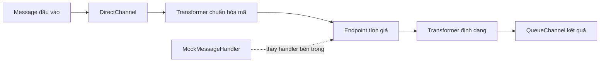

# MockIntegration

## 1. Mục tiêu của bài học

Trong chương **Testing support** của module **SPRING_INTEGRATION_CORE**, `MockIntegration` giúp tạo nguồn thông điệp và handler giả lập để kiểm tra một đoạn luồng tích hợp. Người học vẫn quan sát được `Message`, header, channel và endpoint, đồng thời chủ động quyết định dữ liệu hay lỗi tại ranh giới cần cô lập.

Sau bài học, bạn có thể:

- Tạo `MessageSource` với payload hoặc message có sẵn.
- Giả lập handler nhận một chiều hoặc trả lời request bằng `MockMessageHandler`.
- Thu thập thông điệp bằng `ArgumentCaptor<Message<?>>`.
- Thay handler trong luồng Java DSL bằng `MockIntegrationContext`.
- Viết assertion cho payload, header, số lần xử lý và lỗi đồng bộ.
- Nhận biết giới hạn của phép thử khi đã thay một thành phần bằng mock.

Ví dụ xuyên suốt là luồng chuẩn hóa mã sản phẩm, gọi bước tính giá rồi định dạng kết quả. Ta giả lập bước tính giá và giữ các bước xử lý thông điệp còn lại để đánh giá cách chúng phối hợp.

## 2. MockIntegration đứng ở đâu trong một phép thử?

`MockIntegration` nằm trong package `org.springframework.integration.test.mock`, thuộc artifact `spring-integration-test`. Đây là lớp factory có các phương thức tĩnh, không phải annotation bật kiểm thử và cũng không tự tải `ApplicationContext`. Các API sử dụng trong bài được đối chiếu theo Spring Integration 6.5.x. [Javadoc MockIntegration](https://www.springframework.org/spring-integration/docs/6.5.0/api/org/springframework/integration/test/mock/MockIntegration.html).

Ba tên gần giống nhau có trách nhiệm khác nhau:

| Thành phần | Trách nhiệm | Cách dùng trong bài |
| --- | --- | --- |
| `MockIntegration` | Tạo đối tượng nguồn và handler giả lập | Gọi `mockMessageSource(...)`, `mockMessageHandler(...)` |
| `MockMessageHandler` | Khai báo hành vi xử lý từng message | Dùng `handleNext(...)` hoặc `handleNextAndReply(...)` |
| `MockIntegrationContext` | Thay thành phần được endpoint sử dụng và khôi phục sau test | Dùng `substituteMessageHandlerFor(...)`, `resetBeans()` |

`@SpringIntegrationTest` đăng ký `MockIntegrationContext` trong Spring Test context. Việc nạp cấu hình test được thực hiện bằng `@SpringJUnitConfig` trong ví dụ ở phần sau. [Testing support](https://docs.spring.io/spring-integration/reference/6.5/testing.html).

### 2.1. Đặt ranh giới của phép thử

Giả sử ứng dụng có luồng:



Một test cho dữ liệu `"  sku-01  "` có thể cần chứng minh ba điều:

1. Handler tính giá nhận `"SKU-01"` cùng header truy vết ban đầu.
2. Câu trả lời giả lập đi tiếp qua transformer định dạng.
3. Kết quả cuối cùng chứa đúng mã và giá do test cung cấp.

Nếu chỉ gọi trực tiếp lambda giả lập rồi so sánh kết quả, test chưa đi qua luồng này. Nếu thay cả hai transformer bằng mock, test không còn quan sát được việc chuẩn hóa và định dạng mà mình muốn kiểm tra.

Ranh giới nên xuất phát từ câu hỏi của test. Khi cần kiểm tra router, hãy giữ router thật và ghi nhận các nhánh nhận message. Khi cần kiểm tra aggregator, hãy giữ cơ chế gom nhóm thật rồi thay nguồn hoặc dịch vụ nằm ngoài nhóm. Khi kiểm tra gateway, gửi request qua gateway đã cấu hình để quan sát cả hợp đồng request–reply.

## 3. Chuẩn bị dependency và môi trường ví dụ

Các đoạn Java dùng JUnit Jupiter và API Spring Integration 6.5.x, trên Java 17 trở lên. Đây là mốc minh họa API, không phải yêu cầu nâng hoặc hạ phiên bản dự án hiện có. Dùng các artifact Spring Integration tương thích với nhau theo BOM hoặc dependency management của dự án.

Trong một dự án Spring Boot đã quản lý phiên bản, phần dependency liên quan có dạng:

```groovy
dependencies {
    implementation 'org.springframework.boot:spring-boot-starter-integration'
    testImplementation 'org.springframework.boot:spring-boot-starter-test'
    testImplementation 'org.springframework.integration:spring-integration-test'
}

tasks.named('test') {
    useJUnitPlatform()
}
```

Đây là cấu hình minh họa để đưa vào build của một dự án thực hành; nó không phải toàn bộ build script. Nếu không dùng Boot, cần khai báo và quản lý tương thích cho Spring Test, JUnit Jupiter, Mockito, `spring-integration-core` và `spring-integration-test`.

`spring-integration-test-support` cung cấp các tiện ích kiểm thử cơ sở. Các thành phần mock và cấu hình test context sử dụng ở đây thuộc `spring-integration-test`; đừng chỉ thêm artifact có hậu tố `test-support` rồi mong tìm được toàn bộ API trong bài. [Phân chia module kiểm thử](https://docs.spring.io/spring-integration/reference/6.5/testing.html).

## 4. Tạo MessageSource bằng mockMessageSource

`MessageSource<T>` cung cấp phương thức `receive()`. Khác với `QueueChannel`, nó không có hợp đồng `receive(timeout)` của một kênh có thể poll. `MockIntegration.mockMessageSource(...)` tạo Mockito mock của nguồn này.

### 4.1. Cấp một chuỗi payload

Lớp test dưới đây có thể đặt độc lập trong source set kiểm thử:

```java
import org.junit.jupiter.api.Test;

import org.springframework.integration.core.MessageSource;

import static org.junit.jupiter.api.Assertions.assertEquals;
import static org.mockito.Mockito.times;
import static org.mockito.Mockito.verify;
import static org.springframework.integration.test.mock.MockIntegration.mockMessageSource;

class ProductSourceTest {

    @Test
    void returnsConfiguredPayloadsInOrder() {
        MessageSource<String> source =
                mockMessageSource("sku-01", "sku-02");

        assertEquals("sku-01", source.receive().getPayload());
        assertEquals("sku-02", source.receive().getPayload());
        assertEquals("sku-02", source.receive().getPayload());

        verify(source, times(3)).receive();
    }
}
```

Trong phiên bản đối chiếu, factory thiết lập chuỗi giá trị trả về bằng Mockito. Khi đã dùng hết chuỗi, lần gọi tiếp theo tiếp tục nhận giá trị cuối. Vì thế hai payload không tạo thành một nguồn hữu hạn có đúng hai phần tử. [Cài đặt MockIntegration 6.5.0](https://raw.githubusercontent.com/spring-projects/spring-integration/v6.5.0/spring-integration-test/src/main/java/org/springframework/integration/test/mock/MockIntegration.java).

Điều này đặc biệt đáng chú ý khi nối mock source vào poller: nếu không giới hạn quá trình phát, dữ liệu cuối có thể được phát nhiều lần và làm sai số lượng message kỳ vọng.

### 4.2. Cấp Message khi cần kiểm soát header

Đoạn sau dùng trong một phương thức test với các import bổ sung được ghi đầy đủ:

```java
import org.springframework.integration.core.MessageSource;
import org.springframework.messaging.Message;
import org.springframework.messaging.support.MessageBuilder;

import static org.junit.jupiter.api.Assertions.assertEquals;
import static org.junit.jupiter.api.Assertions.assertSame;
import static org.springframework.integration.test.mock.MockIntegration.mockMessageSource;

// Bên trong một phương thức @Test:
Message<String> expected = MessageBuilder.withPayload("sku-01")
        .setHeader("traceId", "trace-source-01")
        .setHeader("tenantId", "shop-a")
        .build();

MessageSource<?> source = mockMessageSource(expected);
Message<?> actual = source.receive();

assertSame(expected, actual);
assertEquals("trace-source-01", actual.getHeaders().get("traceId"));
assertEquals("shop-a", actual.getHeaders().get("tenantId"));
```

Overload nhận `Message<?>` cấu hình nguồn trả chính message đó, nên không cần ép kiểu thành `MessageSource<String>`. Overload nhận payload thì factory tạo `GenericMessage` bao quanh payload. [Các overload của factory](https://www.springframework.org/spring-integration/docs/6.5.0/api/org/springframework/integration/test/mock/MockIntegration.html).

Assertion về cùng instance ở đây chỉ kiểm tra nguồn đã cấp message. Sau một transformer trong flow, nên kiểm tra nội dung và header cần thiết thay vì mặc định message đầu ra vẫn là cùng đối tượng.

### 4.3. Khi cần nguồn hữu hạn

Có thể điều chỉnh Mockito mock vừa tạo để `receive()` trả `null` sau hai message:

```java
import org.springframework.integration.core.MessageSource;
import org.springframework.messaging.support.GenericMessage;

import static org.mockito.Mockito.when;
import static org.springframework.integration.test.mock.MockIntegration.mockMessageSource;

// Bên trong một phương thức test hoặc phần chuẩn bị test:
MessageSource<String> source = mockMessageSource("unused");

when(source.receive()).thenReturn(
        new GenericMessage<>("sku-01"),
        new GenericMessage<>("sku-02"),
        null);
```

Giá trị cuối đã trở thành `null`, biểu diễn không có dữ liệu ở lần poll hiện tại. Nó không tự dừng endpoint hoặc scheduler. Test dùng poller vẫn cần chủ động quản lý vòng đời và giới hạn thời gian chờ.

Nếu bài toán chỉ yêu cầu xử lý một message, gửi trực tiếp message vào kênh đầu vào thường giúp phép thử tập trung hơn. Chỉ đưa poller vào test khi lịch poll, nguồn dữ liệu hoặc quá trình nhận dữ liệu là phần cần kiểm tra.

## 5. Giả lập handler: một chiều và request–reply

### 5.1. handleNext cho hành vi một chiều

`handleNext(Consumer<Message<?>>)` mô tả hành động với message mà không tạo reply. Ví dụ ghi nhận yêu cầu gửi email hoặc xuất sự kiện:

```java
import java.util.concurrent.atomic.AtomicInteger;

import org.springframework.integration.test.mock.MockMessageHandler;

import static org.springframework.integration.test.mock.MockIntegration.mockMessageHandler;

// Hành vi sẽ được endpoint gọi sau khi thay handler:
AtomicInteger notificationCount = new AtomicInteger();

MockMessageHandler notificationStub = mockMessageHandler()
        .handleNext(message -> notificationCount.incrementAndGet());
```

Sau khi luồng đã xử lý xong, test kiểm tra `notificationCount.get()` cùng dữ liệu message đã thu thập. Với xử lý bất đồng bộ, cần một tín hiệu hoàn tất trước khi đọc kết quả; chỉ dùng biến nguyên tử không chứng minh toàn bộ tác vụ đã xong.

### 5.2. handleNextAndReply cho hành vi trả lời

`handleNextAndReply(Function<Message<?>, ?>)` nhận cả message. Lambda có thể đọc payload, header rồi trả kết quả:

```java
MockMessageHandler priceStub = mockMessageHandler()
        .handleNextAndReply(message ->
                "PRICE:" + message.getPayload() + ":120000");
```

`MockMessageHandler` kế thừa `AbstractMessageProducingHandler`, nên câu trả lời còn đi qua cơ chế xuất message của handler. Nếu dùng độc lập ngoài context, cần chuẩn bị đích nhận reply và các yêu cầu khởi tạo thích hợp; chỉ tạo handler rồi gọi `handleMessage()` không tự tạo nơi nhận kết quả. [Javadoc MockMessageHandler](https://docs.spring.io/spring-integration/docs/6.5.0/api/org/springframework/integration/test/mock/MockMessageHandler.html).

Chọn `handleNext` khi endpoint được mô phỏng chỉ nhận một chiều. Chọn `handleNextAndReply` khi đoạn flow phía sau cần sử dụng kết quả trả về. Nếu dùng hành vi một chiều cho bước tính giá, flow có thể dừng tại đó và test chờ kết quả cuối sẽ hết timeout.

### 5.3. Chuỗi hành vi được tiêu thụ theo lần gọi

Ví dụ hai hành vi:

```java
MockMessageHandler priceStub = mockMessageHandler()
        .handleNextAndReply(message -> "PRICE:FIRST:120000")
        .handleNextAndReply(message -> "PRICE:LATER:125000");
```

| Message tới handler | Hành vi được dùng | Payload trả lời |
| --- | --- | --- |
| Thứ nhất | Hành vi thứ nhất | `PRICE:FIRST:120000` |
| Thứ hai | Hành vi thứ hai | `PRICE:LATER:125000` |
| Thứ ba và tiếp theo | Tiếp tục dùng hành vi cuối | `PRICE:LATER:125000` |

Đây là chuỗi theo lần gọi, không phải bộ quy tắc chọn hành vi theo payload. Muốn phản hồi dựa trên mã sản phẩm, hãy đọc payload trong một lambda và quyết định kết quả từ dữ liệu đó. [Cơ chế tiêu thụ hành vi của MockMessageHandler](https://raw.githubusercontent.com/spring-projects/spring-integration/v6.5.0/spring-integration-test/src/main/java/org/springframework/integration/test/mock/MockMessageHandler.java).

Trong test có nhiều luồng xử lý, đừng đồng nhất thứ tự gửi từ test với thứ tự tới handler nếu kiến trúc chưa bảo đảm thứ tự ấy. Phản hồi dựa trên mã nghiệp vụ giúp test dễ hiểu hơn khi thứ tự không phải mục tiêu kiểm chứng.

## 6. Kiểm thử một flow Java DSL với handler được thay thế

### 6.1. Hợp đồng cần chứng minh

Flow thực hành gồm:

```text
"  sku-01  " + traceId
    -> chuẩn hóa thành "SKU-01"
    -> handler tính giá giả lập trả "PRICE:SKU-01:120000"
    -> định dạng thành "KET_QUA:PRICE:SKU-01:120000"
    -> QueueChannel kết quả
```

Lớp `PriceClient` trong ví dụ là vị trí mô hình hóa dịch vụ tính giá bên ngoài. Phương thức của nó chủ động ném lỗi để một test quên thay handler thất bại rõ ràng. Trong dự án thực, đây sẽ là bean gọi dịch vụ hoặc adapter tương ứng.

### 6.2. Cấu hình và test hoàn chỉnh

```java
import java.util.Locale;

import org.junit.jupiter.api.AfterEach;
import org.junit.jupiter.api.Test;
import org.mockito.ArgumentCaptor;

import org.springframework.beans.factory.annotation.Autowired;
import org.springframework.beans.factory.annotation.Qualifier;
import org.springframework.context.annotation.Bean;
import org.springframework.context.annotation.Configuration;
import org.springframework.integration.channel.DirectChannel;
import org.springframework.integration.channel.QueueChannel;
import org.springframework.integration.config.EnableIntegration;
import org.springframework.integration.dsl.IntegrationFlow;
import org.springframework.integration.test.context.MockIntegrationContext;
import org.springframework.integration.test.context.SpringIntegrationTest;
import org.springframework.integration.test.mock.MockMessageHandler;
import org.springframework.messaging.Message;
import org.springframework.messaging.MessageChannel;
import org.springframework.messaging.MessageHandlingException;
import org.springframework.messaging.support.MessageBuilder;
import org.springframework.test.context.junit.jupiter.SpringJUnitConfig;

import static org.junit.jupiter.api.Assertions.assertEquals;
import static org.junit.jupiter.api.Assertions.assertNotNull;
import static org.junit.jupiter.api.Assertions.assertNull;
import static org.junit.jupiter.api.Assertions.assertSame;
import static org.junit.jupiter.api.Assertions.assertThrows;
import static org.junit.jupiter.api.Assertions.assertTrue;
import static org.springframework.integration.test.mock.MockIntegration.messageArgumentCaptor;
import static org.springframework.integration.test.mock.MockIntegration.mockMessageHandler;

@SpringJUnitConfig(PriceFlowTest.Config.class)
@SpringIntegrationTest(noAutoStartup = "priceEndpoint")
class PriceFlowTest {

    @Autowired
    MockIntegrationContext mockContext;

    @Autowired
    @Qualifier("priceInput")
    MessageChannel input;

    @Autowired
    @Qualifier("priceResults")
    QueueChannel results;

    @AfterEach
    void cleanUp() {
        mockContext.resetBeans();
        while (results.receive(0) != null) {
            // Dọn message còn lại của test hiện tại.
        }
    }

    @Test
    void preservesTraceAndRunsTransformersAroundTheStub() {
        ArgumentCaptor<Message<?>> captured = messageArgumentCaptor();
        MockMessageHandler priceStub = mockMessageHandler(captured)
                .handleNextAndReply(message ->
                        "PRICE:" + message.getPayload() + ":120000");

        mockContext.substituteMessageHandlerFor("priceEndpoint", priceStub);

        Message<String> request = MessageBuilder.withPayload("  sku-01  ")
                .setHeader("traceId", "trace-price-01")
                .build();

        assertTrue(input.send(request));

        Message<?> reply = results.receive(1000);
        assertNotNull(reply);
        assertEquals("KET_QUA:PRICE:SKU-01:120000", reply.getPayload());
        assertEquals("trace-price-01", reply.getHeaders().get("traceId"));

        assertEquals(1, captured.getAllValues().size());
        Message<?> sentToPriceClient = captured.getValue();
        assertEquals("SKU-01", sentToPriceClient.getPayload());
        assertEquals("trace-price-01",
                sentToPriceClient.getHeaders().get("traceId"));
        assertNull(results.receive(0));
    }

    @Test
    void propagatesFailureOnTheDirectChannelPath() {
        IllegalStateException failure =
                new IllegalStateException("pricing-unavailable");

        MockMessageHandler failingStub = mockMessageHandler()
                .handleNextAndReply(message -> {
                    throw failure;
                });

        mockContext.substituteMessageHandlerFor("priceEndpoint", failingStub);

        Message<String> request = MessageBuilder.withPayload("sku-02")
                .setHeader("traceId", "trace-price-02")
                .build();

        MessageHandlingException thrown = assertThrows(
                MessageHandlingException.class,
                () -> input.send(request));

        assertSame(failure, thrown.getCause());
        assertNotNull(thrown.getFailedMessage());
        assertEquals("SKU-02", thrown.getFailedMessage().getPayload());
        assertNull(results.receive(0));
    }

    @Configuration
    @EnableIntegration
    static class Config {

        @Bean
        DirectChannel priceInput() {
            return new DirectChannel();
        }

        @Bean
        QueueChannel priceResults() {
            return new QueueChannel();
        }

        @Bean
        PriceClient priceClient() {
            return new PriceClient();
        }

        @Bean
        IntegrationFlow priceFlow(PriceClient priceClient) {
            return IntegrationFlow.from("priceInput")
                    .transform(String.class,
                            value -> value.trim().toUpperCase(Locale.ROOT))
                    .handle(priceClient, "quote",
                            endpoint -> endpoint.id("priceEndpoint"))
                    .transform(String.class, value -> "KET_QUA:" + value)
                    .channel("priceResults")
                    .get();
        }
    }

    public static class PriceClient {

        public String quote(String productCode) {
            throw new IllegalStateException(
                    "Cần thay handler tính giá trong test: " + productCode);
        }
    }
}
```

### 6.3. Vì sao phải dùng đúng endpoint ID?

Trong DSL, `endpoint.id("priceEndpoint")` đặt tên endpoint bao quanh handler gọi `PriceClient.quote`. `substituteMessageHandlerFor(...)` nhận ID của consumer endpoint, không nhận tên bean `priceClient` hay tên toàn bộ flow `priceFlow`. [Hợp đồng thay handler](https://docs.spring.io/spring-integration/docs/6.5.0/api/org/springframework/integration/test/context/MockIntegrationContext.html).

Trong test trên:

- `priceInput` xác định kênh đưa message vào flow.
- `priceEndpoint` xác định nơi thay handler.
- `priceResults` xác định kênh quan sát kết quả.

Đặt tên tường minh cho điểm cần thay giúp người đọc tìm được ranh giới của test khi flow phát triển thêm nhiều bước.

### 6.4. Vai trò của noAutoStartup và đường reply

`noAutoStartup = "priceEndpoint"` giữ endpoint mục tiêu chưa chạy khi context khởi động. Lời gọi `substituteMessageHandlerFor(...)` hai đối số trong ví dụ thay handler rồi khởi động endpoint. Vì vậy cần thay trước khi gửi message.

Khi cả handler cũ và mới đều là `MessageProducer`, cơ chế thay handler chuyển cấu hình output channel của handler cũ sang handler thay thế. Nhờ đó reply của mock đi tới transformer định dạng đã khai báo trong flow. Cơ chế này không chuyển toàn bộ cấu hình như advice chain sang mock; ví dụ trên không có advice. [Cài đặt thay handler 6.5.0](https://raw.githubusercontent.com/spring-projects/spring-integration/v6.5.0/spring-integration-test/src/main/java/org/springframework/integration/test/context/MockIntegrationContext.java).

Nếu tự dùng `MockMessageHandler` ngoài flow, bạn phải xác định đường nhận reply của phép thử. Nếu thay một handler chỉ nhận một chiều, cũng cần giữ đúng hợp đồng một chiều thay vì gắn hành vi trả lời rồi kỳ vọng tự xuất hiện một nhánh downstream.

### 6.5. Các assertion đang chứng minh điều gì?

| Assertion | Ý nghĩa trong flow này |
| --- | --- |
| Payload thu bằng captor là `SKU-01` | Transformer trước handler đã chuẩn hóa dữ liệu |
| Captor có đúng một message | Handler giả lập nhận đúng một yêu cầu trong lần chạy đồng bộ này |
| Header `traceId` còn tại điểm gọi tính giá | Thông tin truy vết đi tới ranh giới cần gọi |
| Kết quả bắt đầu bằng `KET_QUA:` | Transformer sau handler được thực thi |
| Kết quả chứa `120000` | Flow sử dụng câu trả lời do test kiểm soát |
| Queue không còn message sau khi lấy kết quả | Không có thêm kết quả ngay khi flow đồng bộ đã hoàn tất |

Header nghiệp vụ thường là đối tượng assertion phù hợp hơn việc so toàn bộ `MessageHeaders`. Các header kỹ thuật như `id` có thể đổi khi framework tạo message mới.

Trong test này, `DirectChannel` chạy handler trên luồng gửi. `QueueChannel` cuối cùng chỉ giữ kết quả để test lấy ra; nó không tạo thêm một tác vụ xử lý downstream vì không có consumer nào phía sau trong cấu hình này. `receive(1000)` giới hạn thời gian chờ; `receive(0)` kiểm tra ngay trạng thái queue. [Ngữ nghĩa DirectChannel và QueueChannel](https://docs.spring.io/spring-integration/reference/6.5/channel/implementations.html).

## 7. Thu thập message bằng ArgumentCaptor

`messageArgumentCaptor()` tạo `ArgumentCaptor<Message<?>>` phù hợp để truyền cho `mockMessageHandler(captor)`. Với nhiều request, `getValue()` chỉ trả message được thu gần nhất; dùng `getAllValues()` để kiểm tra cả chuỗi. [API tạo captor](https://www.springframework.org/spring-integration/docs/6.5.0/api/org/springframework/integration/test/mock/MockIntegration.html).

Có thể thêm test sau vào `PriceFlowTest` ở trên; nó dùng lại các field và cấu hình đã khai báo:

```java
@Test
void capturesBothNormalizedRequests() {
    ArgumentCaptor<Message<?>> captured = messageArgumentCaptor();
    MockMessageHandler stub = mockMessageHandler(captured)
            .handleNextAndReply(message -> "PRICE:FIRST:120000")
            .handleNextAndReply(message -> "PRICE:SECOND:125000");

    mockContext.substituteMessageHandlerFor("priceEndpoint", stub);

    assertTrue(input.send(MessageBuilder.withPayload(" sku-01 ").build()));
    assertTrue(input.send(MessageBuilder.withPayload(" sku-02 ").build()));

    Message<?> first = results.receive(1000);
    Message<?> second = results.receive(1000);
    assertNotNull(first);
    assertNotNull(second);
    assertEquals("KET_QUA:PRICE:FIRST:120000", first.getPayload());
    assertEquals("KET_QUA:PRICE:SECOND:125000", second.getPayload());

    assertEquals(2, captured.getAllValues().size());
    assertEquals("SKU-01", captured.getAllValues().get(0).getPayload());
    assertEquals("SKU-02", captured.getAllValues().get(1).getPayload());
    assertNull(results.receive(0));
}
```

Hai lần gửi trong cùng luồng đồng bộ tạo ra thứ tự rõ ràng cho phép thử này. Nếu sau này chuyển bước tính giá sang executor, cần xác định lại hợp đồng thứ tự và điều kiện hoàn tất trước khi giữ nguyên các assertion theo vị trí.

Capturing message có giá trị khi assertion nêu được dữ liệu bắt buộc tại ranh giới. Ví dụ, với hệ thống đa tenant, cần kiểm tra `tenantId` đến đúng handler, không chỉ kiểm tra một chuỗi kết quả chung.

