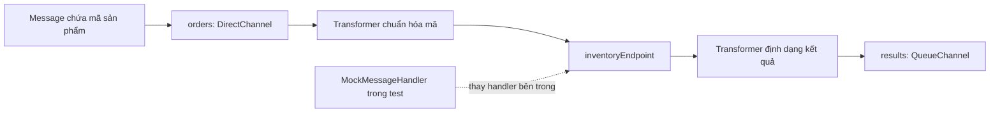

# MockMessageHandler

## 1. Mục tiêu và tình huống sử dụng

Trong chương **Testing support** của **SPRING_INTEGRATION_CORE**, `MockMessageHandler` giúp kiểm thử luồng thông điệp khi cần điều khiển hành vi của một bước xử lý. Bạn vẫn gửi `Message` qua `MessageChannel` và quan sát kết quả của luồng, nhưng có thể thay bước gọi hệ thống ngoài bằng một handler có kịch bản xác định.

Sau bài này, bạn có thể:

- Chọn `handleNext` cho xử lý một chiều và `handleNextAndReply` cho xử lý có phản hồi.
- Thiết lập chuỗi hành vi và kiểm soát số thông điệp thực sự đi qua handler.
- Bắt payload, header và số lần xử lý bằng `ArgumentCaptor`.
- Thay handler tại một endpoint trong Java DSL bằng `MockIntegrationContext`.
- Kiểm tra phản hồi, trường hợp không có phản hồi và lỗi trong luồng đồng bộ.
- Khôi phục cấu hình sau mỗi test và xác định phạm vi mà test đã kiểm chứng.

Ví dụ xuyên suốt là luồng kiểm tra tồn kho: chuẩn hóa mã sản phẩm, gọi bước tra tồn kho, rồi định dạng kết quả. Ta cần chứng minh các bước trước và sau lời gọi vẫn hoạt động đúng với dữ liệu phản hồi do test quyết định.



Trong thiết kế này, endpoint là nơi gắn việc nhận thông điệp với handler. Thay handler không có nghĩa là thay toàn bộ luồng hoặc gọi trực tiếp lambda nghiệp vụ từ test.

## 2. Bản chất và các thành phần liên quan

`MockMessageHandler` nằm trong package `org.springframework.integration.test.mock` và kế thừa `AbstractMessageProducingHandler`. Nó có logic nhận thông điệp và phát phản hồi của một handler Spring Integration. Ta tạo đối tượng qua `MockIntegration.mockMessageHandler()`, thay vì gọi constructor trực tiếp. Hai overload của factory cho phép tạo handler có hoặc không kèm captor. [Javadoc MockIntegration](https://docs.spring.io/spring-integration/api/org/springframework/integration/test/mock/MockIntegration.html)

Các thành phần có vai trò khác nhau:

| Thành phần | Vai trò trong bài |
| --- | --- |
| `Message<?>` | Chứa payload đầu vào và các header như `traceId` |
| `MessageChannel` | Đưa thông điệp vào luồng thật |
| `MockMessageHandler` | Thực hiện hành vi do test khai báo tại một bước xử lý |
| `MockIntegration` | Factory tạo handler và captor |
| `MockIntegrationContext` | Thay và khôi phục handler trong endpoint đã được cấu hình |
| `ArgumentCaptor<Message<?>>` | Lưu thông điệp mà handler thực sự nhận |
| `QueueChannel` | Giữ kết quả để test nhận và kiểm tra |

Đối với bản 6.5.0 được đối chiếu trong bài, factory bọc `MockMessageHandler` bằng Mockito spy. Vì vậy, mô tả nó là một handler có hành vi thật vẫn đúng, đồng thời đối tượng do factory trả về còn hỗ trợ kiểm chứng tương tác bằng Mockito. Không nên suy luận rằng chữ “mock” có nghĩa mọi phương thức mặc định đều không làm gì. [Mã nguồn MockIntegration 6.5.0](https://github.com/spring-projects/spring-integration/blob/v6.5.0/spring-integration-test/src/main/java/org/springframework/integration/test/mock/MockIntegration.java)

## 3. Chuẩn bị dependency và môi trường

Các ví dụ dùng Java 17+, JUnit Jupiter và API Spring Integration 6.x; những chi tiết triển khai có nêu phiên bản được đối chiếu với mã nguồn 6.5.0. Đây là lựa chọn cho ví dụ, không phải thông tin về phiên bản đang dùng trong một dự án cụ thể.

Nếu dự án Maven đã có parent hoặc BOM Spring Boot tương thích để quản lý phiên bản, có thể bổ sung các dependency sau:

```xml
<dependencies>
    <dependency>
        <groupId>org.springframework.integration</groupId>
        <artifactId>spring-integration-core</artifactId>
    </dependency>

    <dependency>
        <groupId>org.springframework.integration</groupId>
        <artifactId>spring-integration-test</artifactId>
        <scope>test</scope>
    </dependency>

    <dependency>
        <groupId>org.springframework.boot</groupId>
        <artifactId>spring-boot-starter-test</artifactId>
        <scope>test</scope>
    </dependency>
</dependencies>
```

Đây là phần dependency, không phải một `pom.xml` hoàn chỉnh. Ngoài Spring Boot, cần tự quản lý các phiên bản tương thích của Spring Integration, Spring Framework, JUnit Jupiter và Mockito, đồng thời cấu hình công cụ build chạy JUnit Jupiter.

`MockMessageHandler`, `MockIntegrationContext` và `@SpringIntegrationTest` thuộc nhóm công cụ integration testing của `spring-integration-test`. Chỉ thêm `spring-integration-test-support` chưa đủ cho các ví dụ thay handler dưới đây. [Testing support — các module kiểm thử](https://docs.spring.io/spring-integration/reference/testing.html)

## 4. Khai báo hành vi xử lý

### 4.1. `handleNext`: nhận thông điệp, không tạo phản hồi

`handleNext(Consumer<Message<?>>)` dùng khi bước được mô phỏng chỉ tiêu thụ thông điệp, chẳng hạn ghi nhật ký nghiệp vụ hoặc gửi một thông báo một chiều.

Ví dụ JUnit độc lập sau kiểm tra một thông điệp đi tới handler:

```java
import org.junit.jupiter.api.Test;
import org.mockito.ArgumentCaptor;
import org.springframework.integration.test.mock.MockIntegration;
import org.springframework.integration.test.mock.MockMessageHandler;
import org.springframework.messaging.Message;
import org.springframework.messaging.support.MessageBuilder;

import static org.junit.jupiter.api.Assertions.*;

class OneWayMockMessageHandlerTest {

    @Test
    void capturesAnInventoryAuditEvent() {
        ArgumentCaptor<Message<?>> captor =
                MockIntegration.messageArgumentCaptor();

        MockMessageHandler handler = MockIntegration.mockMessageHandler(captor)
                .handleNext(message -> {
                    assertEquals("SKU-42", message.getPayload());
                    assertEquals("audit-42", message.getHeaders().get("traceId"));
                });

        Message<String> request = MessageBuilder.withPayload("SKU-42")
                .setHeader("traceId", "audit-42")
                .build();

        handler.handleMessage(request);

        assertEquals(1, captor.getAllValues().size());
        assertSame(request, captor.getValue());
    }
}
```

Test này minh họa cách dùng handler và captor; nó chưa kiểm tra cấu hình channel hoặc endpoint. Muốn kiểm tra các thành phần đó, phải gửi thông điệp qua luồng được Spring quản lý như ví dụ ở phần 5.

### 4.2. `handleNextAndReply`: tính giá trị phản hồi

`handleNextAndReply(Function<Message<?>, ?>)` cho phép đọc toàn bộ request rồi trả về một payload hoặc một `Message` phản hồi. Nếu hàm trả về `null`, handler không phát phản hồi cho lượt xử lý đó. Handler phải được khai báo ít nhất một hành vi trước khi nhận thông điệp. [Javadoc MockMessageHandler](https://docs.spring.io/spring-integration/docs/current/api/org/springframework/integration/test/mock/MockMessageHandler.html)

Ví dụ khai báo stub cho bước tra tồn kho:

```java
MockMessageHandler handler = MockIntegration.mockMessageHandler()
        .handleNextAndReply(message -> {
            String sku = (String) message.getPayload();
            return "AVAILABLE:" + sku;
        });
```

Đoạn khai báo này chưa tự kết nối handler với luồng. Bạn phải đưa nó vào cấu hình test hoặc thay handler tại endpoint đích. Ngoài ra, phải có đường nhận phản hồi, chẳng hạn output channel của luồng.

### 4.3. Chuỗi hành vi gắn với lượt gọi

Khi nối nhiều lời gọi, mỗi thông điệp tiêu thụ một hành vi theo thứ tự khai báo. Sau khi đã dùng hết chuỗi, hành vi cuối tiếp tục được áp dụng cho các thông điệp sau. Đây là điểm cần nhớ khi viết test nhiều request. [Cơ chế chuỗi trong MockMessageHandler](https://github.com/spring-projects/spring-integration/blob/main/spring-integration-test/src/main/java/org/springframework/integration/test/mock/MockMessageHandler.java)

```java
MockMessageHandler handler = MockIntegration.mockMessageHandler()
        .handleNextAndReply(message -> "BUSY")
        .handleNextAndReply(message -> "AVAILABLE");
```

| Lượt nhận thông điệp | Phản hồi tại handler |
| --- | --- |
| 1 | `BUSY` |
| 2 | `AVAILABLE` |
| 3 | `AVAILABLE` |
| 4 và các lượt sau | `AVAILABLE` |

Đây không phải cơ chế chọn hành vi theo nội dung. Nếu request đầu chứa `SKU-99`, nó vẫn nhận hành vi đầu. Để trả kết quả theo sản phẩm, hãy phân nhánh bên trong một lambda:

```java
MockMessageHandler handler = MockIntegration.mockMessageHandler()
        .handleNextAndReply(message -> {
            String sku = (String) message.getPayload();
            return switch (sku) {
                case "SKU-42" -> "AVAILABLE";
                case "SKU-99" -> "OUT_OF_STOCK";
                default -> "UNKNOWN_SKU";
            };
        });
```

Lựa chọn giữa hai cách phụ thuộc ý định test: chuỗi hành vi phù hợp cho diễn biến qua các lượt gọi, còn phân nhánh theo payload phù hợp cho một bảng dữ liệu đầu vào.

## 5. Ví dụ hoàn chỉnh: thay handler trong luồng Java DSL

Luồng ví dụ có ba bước xử lý:

1. Bỏ khoảng trắng đầu cuối và chuyển mã sản phẩm sang chữ hoa.
2. Xử lý tại endpoint có ID tường minh `inventoryEndpoint`.
3. Thêm tiền tố `RESULT:` và đưa kết quả vào `results`.

Handler gốc chỉ trả chuỗi `REAL:` để ví dụ tự chứa, không cần kết nối mạng. Trong ứng dụng thực, vị trí đó có thể là service activator gọi một client tra tồn kho.

```java
import java.util.Locale;

import org.junit.jupiter.api.AfterEach;
import org.junit.jupiter.api.Test;
import org.mockito.ArgumentCaptor;
import org.springframework.beans.factory.annotation.Autowired;
import org.springframework.beans.factory.annotation.Qualifier;
import org.springframework.context.annotation.Bean;
import org.springframework.context.annotation.Configuration;
import org.springframework.integration.channel.DirectChannel;
import org.springframework.integration.channel.QueueChannel;
import org.springframework.integration.config.EnableIntegration;
import org.springframework.integration.dsl.IntegrationFlow;
import org.springframework.integration.test.context.MockIntegrationContext;
import org.springframework.integration.test.context.SpringIntegrationTest;
import org.springframework.integration.test.mock.MockIntegration;
import org.springframework.integration.test.mock.MockMessageHandler;
import org.springframework.messaging.Message;
import org.springframework.messaging.MessageChannel;
import org.springframework.messaging.support.MessageBuilder;
import org.springframework.test.context.junit.jupiter.SpringJUnitConfig;

import static org.junit.jupiter.api.Assertions.*;

@SpringJUnitConfig(MockMessageHandlerFlowTest.Config.class)
@SpringIntegrationTest
class MockMessageHandlerFlowTest {

    @Autowired
    private MockIntegrationContext mockIntegrationContext;

    @Autowired
    @Qualifier("orders")
    private MessageChannel orders;

    @Autowired
    @Qualifier("results")
    private QueueChannel results;

    @AfterEach
    void restoreFlow() {
        mockIntegrationContext.resetBeans("inventoryEndpoint");
        results.purge(null);
    }

    @Test
    void preservesTransformationsAndTraceHeaderAroundTheStub() {
        ArgumentCaptor<Message<?>> captor =
                MockIntegration.messageArgumentCaptor();

        MockMessageHandler inventoryStub =
                MockIntegration.mockMessageHandler(captor)
                        .handleNextAndReply(message ->
                                "AVAILABLE:" + message.getPayload());

        mockIntegrationContext.substituteMessageHandlerFor(
                "inventoryEndpoint", inventoryStub);

        Message<String> request = MessageBuilder.withPayload("  sku-42  ")
                .setHeader("traceId", "trace-42")
                .build();

        assertTrue(orders.send(request));

        Message<?> response = results.receive(1_000);
        assertNotNull(response);
        assertEquals("RESULT:AVAILABLE:SKU-42", response.getPayload());
        assertEquals("trace-42", response.getHeaders().get("traceId"));

        assertEquals(1, captor.getAllValues().size());
        Message<?> receivedByInventory = captor.getValue();
        assertEquals("SKU-42", receivedByInventory.getPayload());
        assertEquals("trace-42", receivedByInventory.getHeaders().get("traceId"));

        assertNull(results.receive(0));
    }

    @Configuration
    @EnableIntegration
    static class Config {

        @Bean
        DirectChannel orders() {
            return new DirectChannel();
        }

        @Bean
        QueueChannel results() {
            return new QueueChannel();
        }

        @Bean
        IntegrationFlow inventoryFlow(
                @Qualifier("orders") MessageChannel orders,
                @Qualifier("results") QueueChannel results) {

            return IntegrationFlow.from(orders)
                    .<String, String>transform(value ->
                            value.strip().toUpperCase(Locale.ROOT))
                    .handle(String.class,
                            (payload, headers) -> "REAL:" + payload,
                            endpoint -> endpoint.id("inventoryEndpoint"))
                    .<String, String>transform(value -> "RESULT:" + value)
                    .channel(results)
                    .get();
        }
    }
}
```

### 5.1. Ý nghĩa các annotation và ID

`@SpringJUnitConfig` nạp cấu hình và tích hợp Spring Test với JUnit Jupiter. `@SpringIntegrationTest` bổ sung môi trường kiểm thử Spring Integration, trong đó có bean `MockIntegrationContext` để autowire. `substituteMessageHandlerFor` nhận tên bean của **consumer endpoint** bọc handler; ở đây là ID được gán bằng `endpoint.id("inventoryEndpoint")`. [Testing support — Test Context và tên endpoint](https://docs.spring.io/spring-integration/reference/6.5/testing.html)

Không truyền `inventoryFlow`, `orders` hoặc tên một service nghiệp vụ vào API thay thế này. Chúng có thể là tên bean hợp lệ nhưng không định danh consumer endpoint đang cần thay handler.

### 5.2. Vì sao phản hồi vẫn đi tới transformer phía sau?

Trong cách thay thế này, với handler gốc là `MessageProducer`, `MockIntegrationContext` chuyển output channel của handler gốc sang handler thay thế. Vì vậy, phản hồi `AVAILABLE:SKU-42` tiếp tục đi qua bước thêm `RESULT:`. Đây là hành vi của API thay thế; việc tự tạo một handler độc lập không tự có đường nối đó. [Mã nguồn substituteMessageHandlerFor 6.5.0](https://github.com/spring-projects/spring-integration/blob/v6.5.0/spring-integration-test/src/main/java/org/springframework/integration/test/context/MockIntegrationContext.java#L192)

### 5.3. Những điều test đã chứng minh

Các assertion có mục đích riêng:

| Assertion | Điều được kiểm chứng |
| --- | --- |
| Captor có đúng một phần tử | Có đúng một thông điệp tới stub trong lần gửi này |
| Payload tại stub là `SKU-42` | Transformer phía trước vẫn chạy |
| `traceId` tại stub là `trace-42` | Header nghiệp vụ tới được ranh giới kiểm thử |
| Output là `RESULT:AVAILABLE:SKU-42` | Phản hồi từ stub đi qua transformer phía sau |
| `traceId` ở output còn đúng | Header được giữ trong cấu hình của ví dụ |
| Không còn phần tử trong `results` | Không có kết quả thứ hai sau khi luồng đồng bộ hoàn tất |

Test chưa chứng minh kết nối tới hệ thống tồn kho, giao thức HTTP, xác thực hoặc khả năng chuyển đổi dữ liệu của một adapter đã bị thay thế. Những phần đó cần một test có ranh giới khác.

## 6. Bắt thông điệp và thiết kế assertion có ý nghĩa

Một lần `send()` trả `true` chưa mô tả đủ kết quả nghiệp vụ. Ví dụ, channel đầu vào có thể nhận được thông điệp nhưng một filter sau đó loại nó bỏ, khiến stub không nhận gì. Do đó nên kiểm tra cả thông điệp ở ranh giới và kết quả cuối.

Captor cung cấp hai góc nhìn:

```java
Message<?> mostRecent = captor.getValue();
java.util.List<Message<?>> allRequests = captor.getAllValues();
```

`getValue()` cho biết thông điệp gần nhất; nó không thay thế assertion về tổng số lần xử lý. Với nhiều request, hãy kiểm tra `getAllValues().size()` và những trường dữ liệu có ý nghĩa trong từng phần tử.

Các trường thường hữu ích gồm mã nghiệp vụ trong payload, `traceId`, tenant hoặc header phân loại mà router sử dụng. Chỉ nên kiểm tra `correlationId`, `sequenceNumber` và `sequenceSize` khi hợp đồng của phần luồng đang xét thực sự cần chúng, chẳng hạn thông điệp đi qua splitter rồi aggregator.

Không cần yêu cầu toàn bộ `Message` đầu ra bằng toàn bộ `Message` đầu vào. Luồng có transformer có thể tạo message mới và ID mới; assertion nên phản ánh hợp đồng nghiệp vụ thay vì vô tình khóa cách framework tạo message.

Nếu muốn kiểm tra một nhánh router không gọi handler, hãy xác minh captor rỗng sau khi đã chắc chắn nhánh đó xử lý xong. Trong luồng bất đồng bộ, việc đọc captor ngay sau `send()` có thể quá sớm. Một kết quả ở nhánh thay thế hoặc tín hiệu hoàn tất giúp kết luận chắc chắn hơn.

## 7. Kiểm tra nhiều lượt, không phản hồi và phản hồi có header

Các phương thức trong phần này có thể đặt vào lớp `MockMessageHandlerFlowTest` ở phần 5, sử dụng cùng cấu hình và phương thức dọn dẹp.

### 7.1. Quan sát hành vi cuối được lặp lại

```java
@Test
void repeatsTheLastConfiguredReply() {
    ArgumentCaptor<Message<?>> captor =
            MockIntegration.messageArgumentCaptor();

    MockMessageHandler stub = MockIntegration.mockMessageHandler(captor)
            .handleNextAndReply(message -> "BUSY")
            .handleNextAndReply(message -> "AVAILABLE");

    mockIntegrationContext.substituteMessageHandlerFor("inventoryEndpoint", stub);

    String[] expected = {
            "RESULT:BUSY",
            "RESULT:AVAILABLE",
            "RESULT:AVAILABLE"
    };

    for (String expectedPayload : expected) {
        assertTrue(orders.send(MessageBuilder.withPayload("sku-42").build()));
        Message<?> reply = results.receive(1_000);
        assertNotNull(reply);
        assertEquals(expectedPayload, reply.getPayload());
    }

    assertEquals(3, captor.getAllValues().size());
    assertNull(results.receive(0));
}
```

Nếu kịch bản chỉ cho phép đúng hai lượt, một phản hồi cuối lặp lại có thể làm test bỏ sót lời gọi thừa. Có thể thêm hành vi chặn ở cuối:

```java
MockMessageHandler exactlyTwoRequests = MockIntegration.mockMessageHandler()
        .handleNextAndReply(message -> "BUSY")
        .handleNextAndReply(message -> "AVAILABLE")
        .handleNext(message -> {
            throw new AssertionError("Không được có request thứ ba");
        });
```

Vẫn cần assertion rằng đã có đúng hai request, vì hành vi chặn chỉ phát hiện trường hợp thừa, không phát hiện trường hợp thiếu. Cũng phải bảo đảm lỗi của worker được test quan sát nếu luồng chạy bất đồng bộ.

### 7.2. Không tạo phản hồi

```java
@Test
void stopsProducingOutputWhenTheStubDoesNotReply() {
    ArgumentCaptor<Message<?>> captor =
            MockIntegration.messageArgumentCaptor();

    MockMessageHandler stub = MockIntegration.mockMessageHandler(captor)
            .handleNext(message ->
                    assertEquals("SKU-42", message.getPayload()));

    mockIntegrationContext.substituteMessageHandlerFor("inventoryEndpoint", stub);

    assertTrue(orders.send(MessageBuilder.withPayload("sku-42").build()));

    assertEquals(1, captor.getAllValues().size());
    assertNull(results.receive(0));
}
```

Kết luận “không có output” ở đây có cơ sở vì các bước trước `results` chạy đồng bộ. Việc không có phản hồi cũng làm bước thêm `RESULT:` không có thông điệp để xử lý.

Nếu phía gọi là gateway chờ request–reply, không có phản hồi có thể dẫn tới chờ hết timeout. Bài test gateway cần đặt timeout hữu hạn và kiểm tra hợp đồng của gateway. Chỉ chọn `handleNext` vì lambda dễ viết có thể vô tình biến test phản hồi thành test timeout.

### 7.3. Tạo `Message` phản hồi có header riêng

Để mô phỏng header do hệ thống ngoài trả về, có thể dùng khai báo sau thay cho stub ở phần 5:

```java
MockMessageHandler stub = MockIntegration.mockMessageHandler()
        .handleNextAndReply(request ->
                MessageBuilder.withPayload("AVAILABLE:" + request.getPayload())
                        .setHeader("inventoryNode", "warehouse-a")
                        .build());
```

Sau khi gửi request và nhận kết quả, kiểm tra thêm:

```java
assertEquals("warehouse-a", response.getHeaders().get("inventoryNode"));
```

Khi trả về payload, đường tạo message của handler chịu trách nhiệm đóng gói phản hồi. Khi trả về `Message`, test có thể chủ động đặt header phản hồi. Dù dùng cách nào, vẫn nên assert những header ứng dụng phụ thuộc vào; cấu hình propagation hoặc các bước biến đổi khác có thể ảnh hưởng kết quả.

## 8. Mô phỏng lỗi và xác định nơi quan sát lỗi

### 8.1. Lỗi trong luồng đồng bộ

Trong ví dụ chính, xử lý trước `results` chạy trên thread gửi. Một exception tại stub được quan sát từ lời gọi `orders.send(...)`; đặt header `errorChannel` không tự biến lời gửi trực tiếp qua `DirectChannel` thành cơ chế chuyển lỗi bất đồng bộ. [Error Handling — luồng đồng bộ và bất đồng bộ](https://docs.spring.io/spring-integration/reference/error-handling.html)

Phương thức sau có thể bổ sung vào lớp test ở phần 5. Tên đầy đủ của exception được giữ trong code để không cần thêm import:

```java
@Test
void exposesInventoryFailureToTheSynchronousSender() {
    ArgumentCaptor<Message<?>> captor =
            MockIntegration.messageArgumentCaptor();

    MockMessageHandler failingStub = MockIntegration.mockMessageHandler(captor)
            .handleNext(message -> {
                throw new IllegalStateException("inventory unavailable");
            });

    mockIntegrationContext.substituteMessageHandlerFor(
            "inventoryEndpoint", failingStub);

    org.springframework.messaging.MessageHandlingException failure =
            assertThrows(
                    org.springframework.messaging.MessageHandlingException.class,
                    () -> orders.send(
                            MessageBuilder.withPayload("sku-42").build()));

    Throwable rootCause = failure;
    while (rootCause.getCause() != null) {
        rootCause = rootCause.getCause();
    }

    assertInstanceOf(IllegalStateException.class, rootCause);
    assertEquals("inventory unavailable", rootCause.getMessage());
    assertEquals(1, captor.getAllValues().size());
    assertNull(results.receive(0));
}
```

Test kiểm tra cả lỗi lẫn việc request đã tới stub. Cách tìm nguyên nhân gốc giúp tránh phụ thuộc không cần thiết vào số lớp exception bao ngoài trong một luồng dài hơn.

### 8.2. Khi có ranh giới bất đồng bộ

Nếu thay cấu hình bằng `ExecutorChannel` hoặc dùng consumer có poller nhận từ `QueueChannel`, thời điểm xử lý không còn trùng với thời điểm gửi. Lúc đó cần xác định cơ chế báo lỗi thực tế của executor hoặc poller và nhận lỗi từ channel được cấu hình, thường dưới dạng `ErrorMessage`.

Một test như vậy nên chờ một kết quả hoặc tín hiệu lỗi với thời hạn hữu hạn, rồi kiểm tra payload lỗi và thông điệp liên quan. Không thể chỉ dùng `assertThrows` bao quanh thao tác đưa request vào hàng đợi để kết luận handler không lỗi.

Chuỗi “lượt đầu ném lỗi, lượt sau thành công” chỉ mô tả các lần handler được gọi. Nó không tự kích hoạt retry. Nếu đang kiểm thử retry advice, phải bảo đảm stub được đặt ở vị trí mà cơ chế retry thực sự gọi lại và kiểm tra số lần xử lý tương ứng. Không suy luận rằng mọi advice của handler gốc đều được giữ nguyên chỉ vì đã thay handler trong endpoint.

## 9. Output channel, giới hạn thay thế và lifecycle

### 9.1. Dùng handler phù hợp với dạng endpoint

Trong Spring Integration 6.5.0, khi handler gốc chỉ là `MessageHandler` một chiều và không phải `MessageProducer`, API thay thế từ chối `MockMessageHandler` đã khai báo phản hồi qua `handleNextAndReply`. Với một sink một chiều, hãy dùng `handleNext` và assert dữ liệu đã nhận. Trường hợp giới hạn này được kiểm tra trực tiếp trong bộ test của framework. [MockMessageHandlerTests — thay handler một chiều](https://github.com/spring-projects/spring-integration/blob/v6.5.0/spring-integration-test/src/test/java/org/springframework/integration/test/mock/MockMessageHandlerTests.java#L173)

Vì vậy, khi gặp lỗi thay thế, cần xem hợp đồng của handler gốc trước khi đổi stub. Một lời gọi dịch vụ có phản hồi và một outbound adapter một chiều có mục đích khác nhau dù cùng xuất hiện trong DSL dưới dạng bước xử lý thông điệp.

### 9.2. Thay handler trước khi đưa dữ liệu vào

Trình tự nên là: tạo stub, thay tại endpoint, gửi request, nhận kết quả, kiểm chứng, rồi khôi phục. Nếu gửi request trước khi thay, lần đó có thể đã đi qua handler thật.

Với ứng dụng có nguồn tự chạy, `@SpringIntegrationTest(noAutoStartup = "someInboundEndpoint")` có thể ngăn endpoint được chỉ định tự khởi động trong test. Cần chọn đúng endpoint nguồn và tự điều khiển lúc bắt đầu xử lý; việc chặn một endpoint không có nghĩa mọi hoạt động tạo kết nối của toàn bộ ứng dụng đã bị vô hiệu hóa.

### 9.3. Dọn dẹp trạng thái sau mỗi test

`resetBeans("inventoryEndpoint")` đưa thành phần bị thay tại endpoint đó về cấu hình gốc. Gọi `resetBeans()` không tham số để khôi phục tất cả thành phần đã được context này thay thế. Đây là thao tác khôi phục cấu hình, không phải API làm mới chuỗi lambda của một stub. [Javadoc MockIntegrationContext — resetBeans](https://docs.spring.io/spring-integration/api/org/springframework/integration/test/context/MockIntegrationContext.html)

Các test nên tạo stub và captor mới cho mỗi kịch bản. Một stub dùng lại có thể đã tiêu thụ các hành vi đầu; captor dùng lại có thể chứa thông điệp từ test trước. Hàng đợi kết quả cũng cần được dọn để tránh nhận nhầm dữ liệu cũ.

Không chạy song song các test cùng thay handler trên một application context được chia sẻ. Chúng có thể thay hoặc khôi phục cấu hình trong lúc test khác đang gửi thông điệp. Với luồng bất đồng bộ, phải chờ công việc đang chạy hoàn tất trước khi khôi phục handler.

## 10. Thời gian chờ và thứ tự thông điệp

`QueueChannel` cho phép nhận thông điệp với timeout; `receive(0)` trả về ngay, còn `receive()` không tham số có thể chặn vô thời hạn. Dùng `receive(1_000)` trong ví dụ để một lỗi cấu hình không khiến bài test treo mãi. Thời hạn phù hợp cho môi trường CI cần được chọn theo đặc điểm của hệ thống. [Message Channel Implementations — QueueChannel](https://docs.spring.io/spring-integration/reference/channel/implementations.html)

`receive(0) == null` chỉ cho biết hàng đợi đang trống tại thời điểm quan sát. Với luồng đồng bộ của bài, lời gửi đã hoàn tất các bước phía trước nên assertion đó hữu ích. Với luồng bất đồng bộ, cần tín hiệu hoàn tất hoặc một điều kiện chờ thích hợp trước khi khẳng định không có output.

Chuỗi hành vi còn có quan hệ với concurrency: nếu nhiều thread đưa thông điệp tới handler, thứ tự request đến không nhất thiết trùng với thứ tự của danh sách dữ liệu mà test chuẩn bị. Đừng dùng “lượt đầu trả A, lượt sau trả B” để đại diện cho “sản phẩm X trả A, sản phẩm Y trả B” trong một luồng xử lý song song. Khi hợp đồng gắn với dữ liệu, hãy tính phản hồi từ payload hoặc header khóa nghiệp vụ.

## 11. Chọn ranh giới kiểm thử và xử lý lỗi thường gặp

| Mục tiêu | Cách tiếp cận phù hợp |
| --- | --- |
| Kiểm tra transformer, router hoặc filter quanh một lời gọi ngoài | Thay handler ở lời gọi ngoài bằng `MockMessageHandler` |
| Kiểm tra dữ liệu gửi tới một sink một chiều | Dùng `handleNext`, captor và assertion số lần nhận |
| Kiểm tra phần xử lý sau một phản hồi | Dùng `handleNextAndReply` và nhận kết quả cuối luồng |
| Kiểm tra thuật toán thuần Java của một service | Gọi trực tiếp service trong unit test |
| Kiểm tra HTTP request, mapping hoặc xác thực của adapter | Giữ adapter trong test và mô phỏng ở ranh giới HTTP |
| Kiểm tra gom nhóm bằng aggregator | Giữ aggregator, tạo dữ liệu và header nhóm đúng hợp đồng |

Khi dùng mock cho một đoạn luồng, các bước cần kiểm chứng phải nằm ngoài phần bị thay thế. Ví dụ, nếu mục tiêu là kiểm tra router chọn kho nào, router cần tiếp tục chạy thật; stub nên ở endpoint của từng nhánh cần quan sát.

| Hiện tượng | Nguyên nhân cần kiểm tra | Hướng xử lý |
| --- | --- | --- |
| Không tìm thấy bean hoặc sai kiểu bean khi thay handler | Truyền flow ID, channel ID hoặc service bean thay cho endpoint ID | Gán ID tường minh bằng `endpoint.id(...)` và dùng ID đó |
| Lỗi khi thông điệp đầu tiên tới stub | Chưa có `handleNext` hoặc `handleNextAndReply` | Khai báo ít nhất một hành vi trước khi gửi |
| Không có kết quả trong hàng đợi | Stub không reply, trả `null`, request bị loại trước stub hoặc endpoint chưa chạy | Xem captor trước, sau đó kiểm tra hợp đồng phản hồi và lifecycle |
| Lời gọi thứ ba vẫn thành công dù chỉ khai báo hai phản hồi | Hành vi cuối được lặp lại | Assert tổng số lượt hoặc thêm hành vi chặn lời gọi thừa |
| Lỗi khi thay sink một chiều bằng stub có phản hồi | Hợp đồng handler gốc không hỗ trợ kiểu thay thế đó | Dùng `handleNext` cho sink một chiều |
| Test chỉ sai khi chạy cả bộ | Handler, captor hoặc hàng đợi giữ trạng thái từ test trước | Khôi phục endpoint, tạo stub mới và dọn kết quả |
| Test lúc đúng lúc sai trên CI | Quan sát quá sớm, chạy song song hoặc phụ thuộc thứ tự xử lý | Chờ theo điều kiện và tách context bị thay đổi |
| Test xanh nhưng gọi thật vẫn sai | Phần tích hợp gây lỗi đã bị thay thế | Bổ sung test giữ phần adapter hoặc client đó trong ranh giới kiểm thử |

## 12. Thực hành củng cố

Thực hành trực tiếp trên ví dụ ở phần 5:

1. Đổi input thành `"  sku-99  "`, cho stub trả `OUT_OF_STOCK` theo payload và kiểm tra output cuối.
2. Thêm một filter loại mã rỗng trước endpoint tồn kho. Gửi input chỉ có khoảng trắng và chứng minh captor không nhận request.
3. Thêm router phân loại sản phẩm theo header nghiệp vụ. Đặt stub ở nhánh cần kiểm tra và quan sát cả nhánh được chọn lẫn nhánh không được chọn.
4. Dùng chuỗi hai phản hồi và một hành vi chặn để phát hiện request thứ ba; bổ sung assertion số request để phát hiện trường hợp chỉ gửi một request.
5. Cho stub trả `Message` có header `inventoryNode`, rồi kiểm tra header đó ở kết quả cuối.
6. Giữ nguyên kịch bản lỗi nhưng chuyển một đoạn sang bất đồng bộ. Xác định cơ chế nhận lỗi và cách đợi hoàn tất trước khi thay đổi assertion.

Điểm cốt lõi khi áp dụng `MockMessageHandler` là xác định rõ bước nào được điều khiển bằng stub, phần luồng nào vẫn chạy thật, và bằng chứng nào cho thấy thông điệp đã đi đúng đường. Từ đó, test có thể kiểm chứng cấu trúc tích hợp bằng `Message`, channel và endpoint mà vẫn có đầu vào, phản hồi và lỗi tái lập được.
