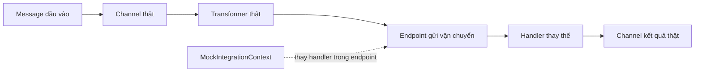

# MockIntegrationContext

## 1. Vai trò trong kiểm thử luồng Spring Integration

Trong chương **Testing support** của module `SPRING_INTEGRATION_CORE`, `MockIntegrationContext` giúp kiểm thử một luồng thông điệp trong Spring ApplicationContext bằng cách thay một số thành phần của endpoint bằng đối tượng do bài test kiểm soát. Phần luồng còn lại vẫn xử lý `Message`, truyền qua `MessageChannel` và thực hiện các phép biến đổi đã cấu hình.

Giả sử luồng tiếp nhận đơn hàng gồm chuẩn hóa dữ liệu, lọc đơn hợp lệ, chọn đơn vị vận chuyển và gửi yêu cầu đặt lịch. Để kiểm tra thông điệp đi đến bước đặt lịch có đúng payload và header hay không, ta có thể thay handler gọi dịch vụ vận chuyển bằng một handler thử nghiệm. Bài test đưa dữ liệu vào đầu luồng và quan sát kết quả ở cuối đoạn cần kiểm tra.

Đây là kiểm thử tích hợp ở mức wiring và hành vi của đoạn luồng được giữ lại. Nó bổ sung cho unit test của từng transformer, router hoặc filter, đồng thời giúp xây dựng tình huống thành công và thất bại có thể lặp lại.

`MockIntegrationContext` được đăng ký thông qua `@SpringIntegrationTest`. `MockIntegration` là nhóm factory tạo đối tượng thử nghiệm, còn `MockMessageHandler` là một handler có thể nhận thông điệp và tạo reply theo kịch bản. Ba tên này chỉ những vai trò khác nhau. [Tài liệu Testing support](https://docs.spring.io/spring-integration/reference/testing.html).



Trong bài này, các ví dụ dùng Java DSL, JUnit Jupiter và Spring TestContext. Mã được trình bày theo API Spring Integration 6.5.x; phần thay trigger yêu cầu Spring Integration từ 6.3. Khi áp dụng, dùng các thư viện cùng dòng phiên bản do dự án quản lý.

## 2. Hiểu đúng đối tượng được thay thế

### 2.1. Endpoint, handler và channel

Một consumer endpoint thường gắn một `MessageHandler` với kênh đầu vào và quản lý vòng đời nhận thông điệp. Khi dùng:

```java
mockIntegrationContext.substituteMessageHandlerFor(
        "shippingGateway", replacementHandler);
```

`shippingGateway` phải là **tên bean của consumer endpoint**. Nó không phải tên channel, tên interface gateway, tên service được gọi hay tên bean handler bên trong. Với nguồn polling, `substituteMessageSourceFor()` nhận tên bean `SourcePollingChannelAdapter`. [Quy ước endpoint trong Testing support](https://docs.spring.io/spring-integration/reference/testing.html).

Cách thuận tiện để tạo tên endpoint ổn định trong Java DSL:

```java
.handle(shippingClient, "book",
        endpoint -> endpoint.id("shippingGateway"))
```

Ở đây, từ `Gateway` trong tên endpoint chỉ mô tả bước gọi hệ thống ngoài. API nhận `IntegrationConsumer` bao quanh handler, không nhận một proxy `@MessagingGateway` tùy ý.

### 2.2. Các thao tác chính

| API | Thành phần đích | Mục đích |
| --- | --- | --- |
| `substituteMessageHandlerFor(id, handler)` | Consumer endpoint chứa `MessageHandler` | Thay xử lý tại một bước trong luồng |
| `substituteMessageSourceFor(id, source)` | `SourcePollingChannelAdapter` | Thay đối tượng cung cấp dữ liệu cho poller |
| `substituteTriggerFor(id, trigger)` | `AbstractPollingEndpoint` | Thay lịch gọi tác vụ polling; có từ 6.3 |
| `resetBeans()` | Các endpoint đã được thay qua context này | Khôi phục thành phần đã lưu |
| `resetBeans("endpointA", "endpointB")` | Các endpoint được chỉ định | Khôi phục có chọn lọc |

Các nhóm `substitute...` có overload nhận thêm `boolean autoStartup`. Giá trị này điều khiển việc khởi động endpoint trong thao tác thay thế. [Javadoc MockIntegrationContext](https://docs.spring.io/spring-integration/api/org/springframework/integration/test/context/MockIntegrationContext.html).

Nếu phải thay cả source và trigger, ta thường truyền `false` cho cả hai, hoàn tất chuẩn bị rồi gọi `start()` một lần. Cách này giúp tránh poller chạy giữa lúc bài test mới thay được một phần cấu hình.

## 3. Chuẩn bị môi trường kiểm thử

### 3.1. Dependency

Dự án cần `spring-integration-core` cho luồng và `spring-integration-test` trong test scope cho `MockIntegrationContext`. Ví dụ Maven dưới đây giả định BOM hoặc dependency management của dự án đã quản lý phiên bản tương thích:

```xml
<dependencies>
    <dependency>
        <groupId>org.springframework.integration</groupId>
        <artifactId>spring-integration-core</artifactId>
    </dependency>

    <dependency>
        <groupId>org.springframework.integration</groupId>
        <artifactId>spring-integration-test</artifactId>
        <scope>test</scope>
    </dependency>

    <dependency>
        <groupId>org.springframework</groupId>
        <artifactId>spring-test</artifactId>
        <scope>test</scope>
    </dependency>

    <dependency>
        <groupId>org.junit.jupiter</groupId>
        <artifactId>junit-jupiter</artifactId>
        <scope>test</scope>
    </dependency>
</dependencies>
```

Đây là đoạn dependency để ghép vào build hiện có, không phải một `pom.xml` độc lập. Với Spring Boot, có thể dùng bộ dependency test sẵn có của ứng dụng và bổ sung `spring-integration-test`; tránh khai báo chồng chéo phiên bản Spring Framework và Spring Integration.

Module `spring-integration-test-support` cung cấp các tiện ích nền tảng. Để dùng cơ chế can thiệp ApplicationContext của bài này, cần module `spring-integration-test`. [Phân chia module kiểm thử](https://docs.spring.io/spring-integration/reference/testing.html).

### 3.2. Annotation và khởi động endpoint

```java
@SpringJUnitConfig(FlowConfig.class)
@SpringIntegrationTest(noAutoStartup = "shippingGateway")
class ShippingFlowTest {

    @Autowired
    MockIntegrationContext mockIntegrationContext;
}
```

`@SpringJUnitConfig` thiết lập JUnit Jupiter cùng Spring TestContext và nạp cấu hình. `@SpringIntegrationTest` bổ sung hỗ trợ kiểm thử Spring Integration. Vì vậy, không nên coi annotation thứ hai là annotation tự nạp đầy đủ cấu hình ứng dụng.

`noAutoStartup` nhận các mẫu tên endpoint như tên chính xác, `orders*` hoặc `*Inbound`. Endpoint khớp mẫu bị ngăn tự khởi động trong quá trình chuẩn bị context. Nó vẫn tồn tại để bài test thay thành phần bên trong và khởi động sau đó. [Javadoc SpringIntegrationTest](https://docs.spring.io/spring-integration/api/org/springframework/integration/test/context/SpringIntegrationTest.html).

Hãy liệt kê đúng các endpoint cần kiểm soát. Nếu dùng `noAutoStartup = "*"`, những transformer hoặc consumer cần thiết để truyền thông điệp cũng có thể chưa chạy. Ngoài ra, trì hoãn lifecycle endpoint không loại bỏ việc tạo các bean phụ thuộc; nếu constructor hoặc phương thức khởi tạo của client đã mở kết nối, cần cấu hình test riêng cho client đó.

## 4. Ví dụ đầy đủ: thay handler và giữ luồng chuẩn hóa

### 4.1. Hợp đồng cần kiểm tra

Ví dụ tiếp nhận chuỗi `" ord-007 "`, loại bỏ khoảng trắng rồi gọi bước đặt vận chuyển. Bài test cần chứng minh:

- Handler thay thế nhận payload `"ord-007"` sau transformer.
- Header nghiệp vụ `orderId` vẫn đến được bước xử lý.
- Reply của handler thay thế đi đến `shippingReplies`.

`ShippingClient` trong cấu hình dưới đây chỉ là đối tượng minh họa chạy cục bộ, trả về tiền tố `LIVE:`. Trong ứng dụng, vị trí này thường là client gọi API của đơn vị vận chuyển.

### 4.2. Cấu hình và hai ca kiểm thử

Đặt toàn bộ đoạn dưới vào cùng một tệp Java test. Không cần bật Spring Boot để chạy ví dụ này trong một dự án đã có dependency phù hợp.

```java
import java.util.concurrent.atomic.AtomicReference;

import org.junit.jupiter.api.AfterEach;
import org.junit.jupiter.api.Test;

import org.springframework.beans.factory.annotation.Autowired;
import org.springframework.beans.factory.annotation.Qualifier;
import org.springframework.context.annotation.Bean;
import org.springframework.context.annotation.Configuration;
import org.springframework.integration.channel.DirectChannel;
import org.springframework.integration.channel.QueueChannel;
import org.springframework.integration.config.EnableIntegration;
import org.springframework.integration.dsl.IntegrationFlow;
import org.springframework.integration.test.context.MockIntegrationContext;
import org.springframework.integration.test.context.SpringIntegrationTest;
import org.springframework.messaging.Message;
import org.springframework.messaging.MessagingException;
import org.springframework.messaging.support.MessageBuilder;
import org.springframework.test.context.junit.jupiter.SpringJUnitConfig;

import static org.junit.jupiter.api.Assertions.*;
import static org.springframework.integration.test.mock.MockIntegration
        .mockMessageHandler;

@SpringJUnitConfig(ShippingFlowTest.Config.class)
@SpringIntegrationTest(noAutoStartup = "shippingGateway")
class ShippingFlowTest {

    @Autowired
    MockIntegrationContext mocks;

    @Autowired
    @Qualifier("shippingInput")
    DirectChannel input;

    @Autowired
    @Qualifier("shippingReplies")
    QueueChannel replies;

    @AfterEach
    void cleanup() {
        mocks.resetBeans();
        replies.clear();
    }

    @Test
    void normalizesPayloadAndPreservesBusinessHeader() {
        AtomicReference<Message<?>> observed = new AtomicReference<>();

        var replacement = mockMessageHandler()
                .handleNextAndReply(message -> {
                    observed.set(message);
                    return "ACCEPTED:" + message.getPayload();
                });

        mocks.substituteMessageHandlerFor(
                "shippingGateway", replacement);

        Message<String> request = MessageBuilder
                .withPayload(" ord-007 ")
                .setHeader("orderId", "ORD-007")
                .build();

        assertTrue(input.send(request));

        Message<?> reply = replies.receive(1_000);
        assertNotNull(reply);
        assertEquals("ACCEPTED:ord-007", reply.getPayload());
        assertNotNull(observed.get());
        assertEquals("ord-007", observed.get().getPayload());
        assertEquals("ORD-007",
                observed.get().getHeaders().get("orderId"));
        assertEquals("ORD-007", reply.getHeaders().get("orderId"));
        assertNull(replies.receive(0));
    }

    @Test
    void propagatesFailureOnTheSynchronousPath() {
        var replacement = mockMessageHandler()
                .handleNext(message -> {
                    throw new IllegalStateException("carrier unavailable");
                });

        mocks.substituteMessageHandlerFor(
                "shippingGateway", replacement);

        MessagingException failure = assertThrows(
                MessagingException.class,
                () -> input.send(MessageBuilder
                        .withPayload(" ord-009 ")
                        .build()));

        assertInstanceOf(IllegalStateException.class, failure.getCause());
        assertEquals("carrier unavailable", failure.getCause().getMessage());
        assertNull(replies.receive(0));
    }

    @Configuration
    @EnableIntegration
    static class Config {

        @Bean
        DirectChannel shippingInput() {
            return new DirectChannel();
        }

        @Bean
        QueueChannel shippingReplies() {
            return new QueueChannel();
        }

        @Bean
        ShippingClient shippingClient() {
            return new ShippingClient();
        }

        @Bean
        IntegrationFlow shippingFlow(ShippingClient shippingClient) {
            return IntegrationFlow.from(shippingInput())
                    .<String, String>transform(String::trim)
                    .handle(shippingClient, "book",
                            endpoint -> endpoint.id("shippingGateway"))
                    .channel(shippingReplies())
                    .get();
        }
    }

    public static class ShippingClient {

        public String book(String order) {
            return "LIVE:" + order;
        }
    }
}
```

### 4.3. Đọc kết quả kiểm thử

Trong ca thành công, thông điệp vẫn đi qua transformer thực tế. Nếu bỏ bước `trim()`, assertion về payload tại `observed` sẽ thất bại. Nếu cấu hình mất đường ra, assertion về `reply` sẽ thất bại. Nếu chỉ gọi trực tiếp hàm của mock rồi kiểm tra chuỗi trả về, hai sai sót wiring này sẽ không được phát hiện.

`AtomicReference` giữ thông điệp ở ranh giới cần quan sát. Không kiểm tra cùng instance với request, vì transformer tạo ra thông điệp có payload mới; hợp đồng quan trọng ở đây là payload và header nghiệp vụ. `MessageHeaders.ID` và timestamp cũng không nên được coi là định danh nghiệp vụ bất biến qua mọi bước biến đổi.

`assertNull(replies.receive(0))` chỉ xác nhận queue không còn phần tử ở thời điểm kiểm tra. Trong ví dụ đồng bộ này, đường xử lý chính đã hoàn tất trước khi `send()` trả về. Với hệ thống bất đồng bộ, assertion tức thời đó không đủ để kết luận sẽ không có thông điệp đến muộn.

Ca lỗi dùng `MockMessageHandler`, một handler dựa trên hạ tầng xử lý message của Spring Integration. Nó tạo lỗi tại đúng bước đặt vận chuyển, giúp quan sát việc lan truyền lỗi qua đường đồng bộ. Bài test này không gọi `ShippingClient.book()` nên không kiểm tra cách client thật xử lý lỗi giao thức.

## 5. Handler chỉ nhận message và handler có reply

### 5.1. Lựa chọn theo hợp đồng của bước xử lý

Một `MessageHandler` thông thường có phương thức `void handleMessage(Message<?> message)`. Lambda dưới đây có thể ghi nhận message ở một endpoint kết thúc luồng:

```java
AtomicReference<Message<?>> received = new AtomicReference<>();

MessageHandler sink = message -> received.set(message);

mockIntegrationContext.substituteMessageHandlerFor(
        "auditSink", sink);
```

Đoạn minh họa này cần import `AtomicReference` và `org.springframework.messaging.MessageHandler`; `auditSink` giả định là endpoint chỉ tiêu thụ thông điệp. Lambda không tự phát sinh reply. Nếu dùng nó thay một bước request/reply rồi chờ kết quả downstream, bài test có thể hết thời gian chờ dù handler đã nhận message.

Khi bước bị thay cần tạo reply, dùng `mockMessageHandler().handleNextAndReply(...)`. `handleNext(...)` chỉ thực thi hành động nhận message. Các hành động trong chuỗi được dùng lần lượt và hành động cuối tiếp tục áp dụng cho những message sau. Không nên suy ra rằng mock sẽ dừng nhận sau khi hết các hành động đã khai báo. [Javadoc MockMessageHandler](https://docs.spring.io/spring-integration/api/org/springframework/integration/test/mock/MockMessageHandler.html).

### 5.2. Một kịch bản nhiều lần gọi

```java
var replacement = mockMessageHandler()
        .handleNextAndReply(message -> "REJECTED")
        .handleNextAndReply(message -> "ACCEPTED");
```

Nếu ba message lần lượt đến mock, chúng nhận `REJECTED`, `ACCEPTED`, `ACCEPTED`. Đây là cách tạo dữ liệu phản hồi theo kịch bản; bản thân chuỗi trên không bật retry. Muốn kiểm tra retry thực, lời gọi lặp phải được thực hiện bởi thành phần chứa chính sách retry còn nằm trong phạm vi kiểm thử.

Không dùng mock có reply để thay một sink thuần túy rồi giả định endpoint cũ sẽ tự có hợp đồng request/reply. Cần giữ tương thích giữa loại handler đích và hành vi của đối tượng thay thế. Cơ chế thay handler có xử lý nối output cho các handler sản sinh thông điệp, nhưng không biến một endpoint kết thúc luồng thành một nghiệp vụ trả lời mới. [Mã nguồn MockIntegrationContext 6.5.1](https://github.com/spring-projects/spring-integration/blob/v6.5.1/spring-integration-test/src/main/java/org/springframework/integration/test/context/MockIntegrationContext.java).

## 6. Ví dụ đầy đủ: thay nguồn polling và kiểm soát trigger

### 6.1. Vì sao phải thay trước khi khởi động?

Nguồn production có thể lấy đơn hàng từ cơ sở dữ liệu hoặc thư mục từ xa. Nếu endpoint đã chạy trước lúc bài test gắn source thử nghiệm, nó có thể đọc dữ liệu thật hoặc tạo message ngoài dự kiến.

Ví dụ sau trì hoãn `ordersInbound`, thay cả source và trigger khi endpoint chưa chạy, rồi khởi động rõ ràng. Cấu hình production minh họa dùng chu kỳ 30 giây; trigger test lên lịch ngay một tác vụ. Source test trả về đúng một message rồi trả `null` nếu bị gọi tiếp.

`OnlyOnceTrigger` giới hạn số lần lên lịch tác vụ. `maxMessagesPerPoll(1)` giới hạn lượng message trong mỗi lượt polling. Hai cơ chế kiểm soát những đơn vị khác nhau; một lượt polling không mặc nhiên tương đương một message. [Javadoc OnlyOnceTrigger](https://docs.spring.io/spring-integration/api/org/springframework/integration/test/util/OnlyOnceTrigger.html).

### 6.2. Cấu hình và kiểm thử

Đây là lớp test độc lập với ví dụ vận chuyển:

```java
import java.util.Locale;
import java.util.concurrent.atomic.AtomicBoolean;

import org.junit.jupiter.api.AfterEach;
import org.junit.jupiter.api.Test;

import org.springframework.beans.factory.annotation.Autowired;
import org.springframework.beans.factory.annotation.Qualifier;
import org.springframework.context.annotation.Bean;
import org.springframework.context.annotation.Configuration;
import org.springframework.integration.channel.QueueChannel;
import org.springframework.integration.config.EnableIntegration;
import org.springframework.integration.core.MessageSource;
import org.springframework.integration.dsl.IntegrationFlow;
import org.springframework.integration.dsl.Pollers;
import org.springframework.integration.endpoint.SourcePollingChannelAdapter;
import org.springframework.integration.test.context.MockIntegrationContext;
import org.springframework.integration.test.context.SpringIntegrationTest;
import org.springframework.integration.test.util.OnlyOnceTrigger;
import org.springframework.messaging.Message;
import org.springframework.messaging.support.GenericMessage;
import org.springframework.messaging.support.MessageBuilder;
import org.springframework.test.context.junit.jupiter.SpringJUnitConfig;

import static org.junit.jupiter.api.Assertions.*;

@SpringJUnitConfig(PollingFlowTest.Config.class)
@SpringIntegrationTest(noAutoStartup = "ordersInbound")
class PollingFlowTest {

    @Autowired
    MockIntegrationContext mocks;

    @Autowired
    @Qualifier("ordersInbound")
    SourcePollingChannelAdapter inbound;

    @Autowired
    @Qualifier("polledResults")
    QueueChannel results;

    @AfterEach
    void cleanup() {
        inbound.stop();
        mocks.resetBeans();
        results.clear();
    }

    @Test
    void processesOneControlledOrder() {
        AtomicBoolean firstRead = new AtomicBoolean(true);

        MessageSource<String> source = () -> {
            if (!firstRead.getAndSet(false)) {
                return null;
            }
            return MessageBuilder.withPayload(" ord-008 ")
                    .setHeader("batchId", "batch-A")
                    .build();
        };

        mocks.substituteMessageSourceFor(
                "ordersInbound", source, false);
        mocks.substituteTriggerFor(
                "ordersInbound", new OnlyOnceTrigger(), false);

        assertFalse(inbound.isRunning());
        inbound.start();

        Message<?> result = results.receive(2_000);
        assertNotNull(result);
        assertEquals("ORD-008", result.getPayload());
        assertEquals("batch-A", result.getHeaders().get("batchId"));
    }

    @Configuration
    @EnableIntegration
    static class Config {

        @Bean
        QueueChannel polledResults() {
            return new QueueChannel();
        }

        @Bean
        MessageSource<String> liveOrdersSource() {
            return () -> new GenericMessage<>("LIVE");
        }

        @Bean
        IntegrationFlow ordersInboundFlow(
                MessageSource<String> liveOrdersSource) {
            return IntegrationFlow.from(liveOrdersSource,
                            endpoint -> endpoint.id("ordersInbound")
                                    .poller(Pollers.fixedDelay(30_000)
                                            .maxMessagesPerPoll(1)))
                    .<String, String>transform(value ->
                            value.trim().toUpperCase(Locale.ROOT))
                    .channel(polledResults())
                    .get();
        }
    }
}
```

`liveOrdersSource` là tên bean nguồn dữ liệu, còn `ordersInbound` là tên endpoint bao quanh nguồn. Lời gọi thay source phải dùng tên thứ hai. Nếu dùng tên thứ nhất, API sẽ tìm bean có kiểu endpoint tương ứng và không nhận được đối tượng đúng loại.

Ở đây `receive(2_000)` chờ kết quả tối đa hai giây, cho phép scheduler thực hiện công việc sớm hơn khi sẵn sàng. Không dùng `Thread.sleep(2_000)` rồi mới kiểm tra, vì cách đó luôn tiêu tốn toàn bộ khoảng nghỉ và vẫn không chứng minh được công việc đã hoàn tất.

Mỗi ca kiểm thử tạo một `OnlyOnceTrigger` mới và một `AtomicBoolean` mới. Nếu chủ động dùng lại trigger giữa các ca, cần gọi `reset()` trước lượt mới. Việc sử dụng trigger một lần trong test không chứng minh hệ thống production có bảo đảm xử lý nghiệp vụ exactly-once.

### 6.3. Phạm vi áp dụng của việc thay nguồn

`substituteMessageSourceFor()` dành cho mô hình polling sử dụng `SourcePollingChannelAdapter`. Không áp dụng trực tiếp cách này cho mọi inbound adapter hoặc inbound gateway. Một listener nhận dữ liệu do broker đẩy đến không trở thành polling source chỉ vì tên của nó có chữ `Inbound`.

Khi adapter thuộc kiểu khác, có thể kiểm thử đoạn sau adapter bằng cách gửi message vào channel ranh giới, cấu hình một thành phần test riêng hoặc dùng môi trường giao thức phù hợp. Lựa chọn phụ thuộc vào hợp đồng cần chứng minh: hành vi của luồng nội bộ, hay khả năng thực sự nhận dữ liệu từ hệ thống ngoài.

## 7. Kiểm thử lỗi theo mô hình thực thi

### 7.1. Luồng đồng bộ

Trong ví dụ vận chuyển, `DirectChannel` và các bước đồng bộ chạy trên thread của người gửi. Vì vậy, lỗi từ handler có thể được quan sát bằng `assertThrows()` quanh `send()`.

Một header `errorChannel` trên message không tự chuyển mọi exception đồng bộ sang một queue lỗi. Gateway, advice hoặc cơ chế recovery được cấu hình có thể làm thay đổi đường đi của lỗi; bài test cần bám đúng cách ứng dụng gọi luồng. [Error Handling của Spring Integration](https://docs.spring.io/spring-integration/reference/error-handling.html).

Với handler thay thế là lambda thuần, exception có thể thoát ra khác với handler được framework bao bọc. Khi kiểm tra kiểu exception, hãy phân biệt đối tượng mock đang dùng và đối tượng production thực sự cần kiểm tra; không ép mọi trường hợp vào cùng một kiểu wrapper.

### 7.2. Luồng bất đồng bộ hoặc poller

Khi xử lý diễn ra ở thread khác, lỗi không quay lại thread đã gửi request theo cách của lời gọi Java đồng bộ. Với hạ tầng xử lý lỗi phù hợp, lỗi được đóng gói thành `ErrorMessage` và gửi tới channel lỗi. Đối với tác vụ polling, cần quan sát đường báo lỗi của scheduler/poller thay vì chờ `inbound.start()` ném lỗi nghiệp vụ. [Cơ chế gửi ErrorMessage](https://docs.spring.io/spring-integration/reference/error-handling.html).

Một bài test lỗi bất đồng bộ nên xác định:

1. Channel lỗi nào được dùng trong cấu hình test.
2. Exception nghiệp vụ nào phải xuất hiện, có wrapper hay không.
3. Có giữ được `failedMessage` hoặc dữ liệu truy vết cần thiết không.
4. Message thất bại có bị chuyển nhầm sang đường thành công không.
5. Có tác vụ nào còn chạy khi bắt đầu cleanup không.

Nếu quy tắc nghiệp vụ yêu cầu đưa lỗi sang dead-letter channel hoặc tạo phản hồi dự phòng, hãy giữ nguyên router hoặc recovery flow chịu trách nhiệm đó. Chỉ thay bước gây lỗi bằng handler thử nghiệm. Tuy nhiên, nếu advice hoặc proxy chứa retry, transaction hay recovery gắn với handler cũ, việc thay toàn bộ handler có thể bỏ qua chính thành phần cần kiểm tra. Khi đó nên thay dependency của handler thay vì thay handler, hoặc thiết kế một kiểm thử riêng giữ nguyên cơ chế đó.

## 8. Khôi phục trạng thái và tránh ảnh hưởng giữa các test

### 8.1. Dùng cleanup sau mỗi ca

Spring TestContext có thể tái sử dụng ApplicationContext giữa nhiều ca. Nếu một test để lại handler thử nghiệm, ca sau có thể tiếp tục dùng handler đó dù dữ liệu đầu vào hoàn toàn khác.

```java
@AfterEach
void cleanup() {
    mockIntegrationContext.resetBeans();
}
```

`resetBeans()` khôi phục những thành phần đã được thay qua chính `MockIntegrationContext`. Có thể truyền ID endpoint để chỉ khôi phục một phần. Đây không phải lệnh `Mockito.reset()` và cũng không phải thao tác xóa toàn bộ trạng thái ứng dụng. [API khôi phục bean](https://docs.spring.io/spring-integration/api/org/springframework/integration/test/context/MockIntegrationContext.html).

Các trạng thái phải cân nhắc riêng gồm nội dung `QueueChannel`, nhóm message trong aggregator/message store, dữ liệu cơ sở dữ liệu, bộ đếm của source giả và tác vụ bất đồng bộ còn chạy. Chẳng hạn, `resetBeans()` không làm một nhóm aggregator đã hoàn thành biến mất khỏi message store do ứng dụng quản lý.

### 8.2. Vòng đời endpoint cần được quản lý riêng

Một trình tự hợp lý cho endpoint polling là:

```text
Endpoint chưa chạy
    -> gắn source/handler/trigger cần thiết
    -> khởi động endpoint
    -> gửi hoặc nhận dữ liệu kiểm thử
    -> chờ kết quả hoặc lỗi trong giới hạn
    -> dừng nguồn phát và chờ phần việc đang chạy khi cần
    -> resetBeans()
    -> dọn queue và trạng thái do test sở hữu
```

Không xem `resetBeans()` là thao tác đưa mọi endpoint về trạng thái đang chạy. Việc khôi phục có liên quan đến lifecycle và cờ auto-startup của endpoint. Với endpoint đã bị chặn tự khởi động trong test, lần kiểm thử kế tiếp nên chủ động thay thành phần và khởi động lại như ví dụ. [Cài đặt resetBean trong Spring Integration 6.5.1](https://github.com/spring-projects/spring-integration/blob/v6.5.1/spring-integration-test/src/main/java/org/springframework/integration/test/context/MockIntegrationContext.java).

Truyền `false` cho overload thay thế cũng không nên được dùng như lệnh dừng một endpoint bất kỳ đang hoạt động. Hãy chuẩn bị endpoint ở trạng thái dừng trước khi thực hiện nhiều thay đổi và khởi động lại sau khi hoàn tất.

### 8.3. Chạy song song và tài nguyên chia sẻ

Hai test cùng sửa một endpoint trong ApplicationContext dùng chung có thể ghi đè kịch bản của nhau hoặc reset thành phần khi ca kia vẫn xử lý message. Tránh chạy song song những ca cùng can thiệp vào endpoint đó; nếu cần song song, tách context hoặc tách tài nguyên kiểm thử một cách rõ ràng.

`@DirtiesContext` có thể buộc xây dựng lại context khi không thể khôi phục đầy đủ trạng thái, nhưng chi phí cao hơn. Với các thay thế mà `resetBeans()` xử lý được và tài nguyên test đã được dọn, tái tạo toàn bộ context thường không cần thiết.

## 9. Chọn ranh giới mock cho các mẫu tích hợp

| Điều muốn chứng minh | Thành phần giữ nguyên | Điểm có thể thay | Assertion có giá trị |
| --- | --- | --- | --- |
| Chuẩn hóa đơn hàng | Transformer và channel nối luồng | Handler gửi ra ngoài | Payload sau chuẩn hóa và header nghiệp vụ |
| Chọn đơn vị vận chuyển | Router và các nhánh channel | Handler ở từng hệ thống đích | Chỉ nhánh đúng nhận message |
| Loại đơn không hợp lệ | Filter và discard channel | Handler sau filter hoặc sink cuối | Đơn bị loại đi đúng discard channel |
| Gom các dòng đơn | Splitter, aggregator, cấu hình correlation và store | Nguồn cung cấp dữ liệu hoặc handler ở sau nhóm | Nội dung nhóm, điều kiện release, số kết quả |
| Báo lỗi tích hợp | Đường error/recovery cần kiểm tra | Bước tương tác bên ngoài gây lỗi | Loại lỗi, thông điệp gốc và đích nhận lỗi |

Chỉ thay tại ranh giới phục vụ mục tiêu cụ thể. Nếu mục tiêu là xác minh điều kiện release của aggregator thì giữ aggregator thật và gửi những message có correlation/sequence phù hợp. Thay aggregator bằng mock trả về danh sách cố định sẽ khiến bài test không còn kiểm tra quy tắc gom nhóm.

Tương tự, nếu muốn kiểm tra mapping của router, hãy giữ router và quan sát các nhánh. Việc chỉ kiểm tra một mock đã được gọi sẽ chưa đủ nếu những nhánh không mong muốn cũng nhận message.

Đối với gateway, nên gọi qua interface gateway thật nếu mục tiêu là kiểm tra request mapping, reply hoặc chuyển lỗi của gateway. Thay một handler downstream vẫn cho phép kiểm soát phản hồi, trong khi lời gọi qua gateway giữ lại ranh giới mà ứng dụng sử dụng.

## 10. Các lỗi thường gặp và cách khoanh vùng

| Dấu hiệu | Nguyên nhân cần kiểm tra | Hướng xử lý |
| --- | --- | --- |
| Không tìm thấy bean hoặc bean không đúng kiểu | Truyền tên service, source hay channel thay vì endpoint | Dùng ID endpoint đã đặt trong DSL |
| Gửi vào `DirectChannel` nhưng không có subscriber | Endpoint chưa chạy hoặc bị mẫu `noAutoStartup` chặn | Kiểm tra ID và khởi động đúng consumer |
| Mock nhận message nhưng không có reply | Dùng handler `void` hoặc `handleNext()` cho bước request/reply | Dùng hành vi tạo reply tương thích |
| Vẫn thấy nguồn thật được đọc | Endpoint đã chạy trước lúc thay source | Chặn auto-startup từ cấu hình test |
| Polling tạo dữ liệu lặp | Source luôn trả message và poller chưa bị giới hạn | Dùng source hữu hạn, giới hạn lượt poll và trigger phù hợp |
| Bài test này chạy riêng thì đúng, chạy cả lớp thì sai | Handler, queue hoặc store còn trạng thái cũ | Reset thành phần và dọn đúng trạng thái test |
| Chờ reply bị timeout sau khi đổi trigger | Trigger dùng lại chưa reset hoặc endpoint chưa được start | Tạo trigger mới, kiểm tra lifecycle |
| Không bắt được lỗi bằng `assertThrows()` | Lỗi xảy ra trên scheduler/executor | Quan sát error flow và chờ có giới hạn |
| Test retry luôn xanh nhưng client thật lỗi | Mock đã thay mất handler/advice chứa retry | Giữ đường retry cần kiểm tra và thay dependency phía ngoài |

Khi gặp timeout, kiểm tra từ đầu vào đến đầu ra: message có được chấp nhận không, endpoint có chạy không, mock có nhận đúng payload không, mock có tạo reply không và reply được gửi đến channel nào. Tăng timeout trước khi xác định điểm đứt thường chỉ làm bài test chậm hơn.

## 11. Giới hạn của kết luận từ bài test

Một test dùng `MockIntegrationContext` có thể chứng minh hành vi của phần luồng thực sự được giữ lại dưới dữ liệu và phản hồi đã lựa chọn. Test thành công chưa chứng minh việc xác thực HTTP, mapping JDBC, xác nhận message trên broker, hay kết nối SFTP của thành phần đã bị thay.

Một bộ kiểm thử có thể phối hợp ba mức: unit test cho thuật toán chuyển đổi, flow test với ranh giới được thay có kiểm soát, và adapter/contract test với hệ thống giao tiếp phù hợp. Mỗi mức nên nêu rõ hợp đồng cần kiểm tra để tránh tạo nhiều bài test cùng xác nhận một mock trả về hằng số.

Các ví dụ trong bài tập trung vào luồng nội bộ và vòng đời endpoint. Khi áp dụng vào dự án, cần chạy kiểm thử trong build thực tế với đúng BOM, cấu hình gateway, scheduler, advice và tài nguyên mà ứng dụng sử dụng.
