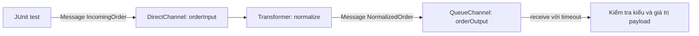

# Kiểm thử message payload

Trong Spring Integration, một luồng có thể gửi và nhận message thành công nhưng vẫn tạo ra dữ liệu sai: trường bị mất, số lượng bị đổi, kiểu dữ liệu không đúng hoặc danh sách kết quả thiếu phần tử. Kiểm thử payload giúp xác nhận **dữ liệu tại một ranh giới của luồng đáp ứng hợp đồng mà thành phần tiếp theo cần**.

Bài học thuộc chương **Testing support** của module `SPRING_INTEGRATION_CORE`. Trọng tâm là kiểm tra payload của `Message`, kết hợp kiểm thử logic biến đổi với kiểm thử một luồng Java DSL thật. Cách làm này cũng áp dụng tại đầu ra của gateway, filter, router và aggregator khi xây dựng các mẫu tích hợp doanh nghiệp.

Sau bài học, bạn có thể:

- Xác định cần kiểm tra kiểu, giá trị, cấu trúc và số lượng payload nào.
- Viết assertion trực tiếp và dùng `PayloadMatcher` đúng mục đích.
- Gửi message qua một luồng có transformer và quan sát kết quả bằng `QueueChannel`.
- Phân biệt dữ liệu nghiệp vụ không hợp lệ, lỗi chuyển đổi và trường hợp không có message đầu ra.
- Giữ kiểm thử ổn định khi payload có collection, mảng byte, số thập phân hoặc dữ liệu có thể thay đổi.

## 1. Phân biệt payload và message

`Message<T>` chứa payload và headers. Khi kiểm thử dữ liệu nghiệp vụ, đối tượng cần quan sát thường là `message.getPayload()`. Headers phục vụ các yêu cầu khác như định tuyến, tương quan và theo dõi. Xem [mô hình Message của Spring Integration](https://docs.spring.io/spring-integration/reference/6.5/message.html).

```java
import org.springframework.messaging.Message;
import org.springframework.messaging.support.MessageBuilder;

Message<String> message = MessageBuilder
        .withPayload("  cà phê  ")
        .setHeader("sourceSystem", "web")
        .build();

String payload = message.getPayload();
```

Ở đây, hợp đồng payload có thể yêu cầu chuỗi sau chuẩn hóa bằng `"cà phê"`. Giá trị `sourceSystem` chỉ cần được kiểm tra nếu việc giữ hoặc thay đổi header đó thuộc yêu cầu của luồng.

Không nên so sánh toàn bộ hai message được tạo riêng chỉ để kiểm tra dữ liệu nghiệp vụ. Các header được sinh khi tạo message, chẳng hạn ID và timestamp, có thể làm phép so sánh thất bại dù payload đúng.

### Payload không null nhưng dữ liệu bên trong vẫn có thể thiếu

`GenericMessage` và `MessageBuilder.withPayload(...)` yêu cầu payload khác `null`. Vì vậy, tạo `new GenericMessage<>(null)` không mô phỏng được một message hợp lệ đang thiếu trường nghiệp vụ; nó thất bại ngay khi tạo message. Xem [hợp đồng constructor của GenericMessage](https://docs.spring.io/spring-framework/docs/6.2.x/javadoc-api/org/springframework/messaging/support/GenericMessage.html).

Các trường hợp cần phân biệt:

| Trường hợp | Ví dụ | Vị trí nên kiểm thử |
| --- | --- | --- |
| Payload null | Tạo message từ `null` | Ranh giới tạo message hoặc lời gọi Java trực tiếp |
| Payload chuỗi rỗng | `""`, `"   "` | Validator, transformer hoặc filter theo hợp đồng |
| DTO thiếu trường | `new IncomingOrder(null, "SKU-1", 1)` | Logic kiểm tra dữ liệu nghiệp vụ |
| Payload sai kiểu | Gửi `Integer` vào luồng nhận DTO | Ranh giới chuyển đổi hoặc nhận dữ liệu của endpoint |
| Collection rỗng | `List.of()` | Quy tắc xử lý tập dữ liệu rỗng |
| Không có đầu ra | `output.receive(timeout)` trả về `null` | Hành vi phát message, cấu hình luồng và thời gian chờ |

`receive(...) == null` nghĩa là **không nhận được message trong điều kiện chờ đã chọn**, không có nghĩa là đã nhận một message có payload null.

## 2. Viết hợp đồng payload trước khi viết assertion

Giả sử hệ thống nhận đơn hàng từ một kênh nội bộ. Trước khi chuyển tiếp cho bước xử lý tiếp theo, luồng phải bỏ khoảng trắng ở mã đơn, chuẩn hóa SKU thành chữ hoa và giữ nguyên số lượng hợp lệ.

Hợp đồng của ví dụ trong bài:

| Thành phần | Quy tắc |
| --- | --- |
| Kiểu đầu vào | `IncomingOrder` |
| `orderId` | Không null, không trắng; loại khoảng trắng ở hai đầu |
| `sku` | Không null, không trắng; loại khoảng trắng ở hai đầu và chuyển chữ hoa bằng `Locale.ROOT` |
| `quantity` | Số nguyên lớn hơn 0; giữ nguyên sau biến đổi |
| Kiểu đầu ra | `NormalizedOrder` |
| Số message đầu ra | Một message cho mỗi đầu vào hợp lệ |
| Đầu vào vi phạm quy tắc | Phát sinh lỗi; không tạo `NormalizedOrder` |
| Dữ liệu đầu vào | Không bị sửa trong quá trình chuẩn hóa |

Trong dự án thực tế, bổ sung quy tắc giới hạn độ dài, giới hạn số lượng hoặc tập ký tự SKU nếu nghiệp vụ yêu cầu. Không tự thêm giới hạn vào test khi hợp đồng chưa có.

Một assertion như `assertNotNull(result)` chỉ kiểm tra sự hiện diện. Assertion như `assertEquals("SKU-1", actual.sku())` chỉ kiểm tra một trường. Test cần kiểm tra những chiều dữ liệu có thể làm hành vi phía sau sai: kiểu payload, nội dung đầy đủ, trường phải được giữ nguyên và số kết quả.

## 3. Chọn tầng kiểm thử phù hợp

| Tầng | Cách kiểm thử | Điều xác nhận được |
| --- | --- | --- |
| Logic nghiệp vụ | Gọi trực tiếp hàm chuẩn hóa | Quy tắc biến đổi, dữ liệu biên và thông báo lỗi nghiệp vụ |
| Endpoint hoặc đoạn luồng | Gửi `Message` qua channel đầu vào, đọc channel đầu ra | Wiring, endpoint thực sự được gọi và payload thực tế được phát |
| Gateway hoặc adapter | Gọi qua ranh giới ứng dụng | Mapping request/reply, chuyển đổi dữ liệu và tương tác với hệ thống bên ngoài |

Hai tầng đầu bổ sung cho nhau. Unit test giúp xác định lỗi quy tắc nhanh; kiểm thử luồng phát hiện cấu hình nhầm channel, thiếu transformer hoặc nối sai đầu ra.

Khi kiểm thử phép chuẩn hóa, dùng logic chuẩn hóa thật. Nếu mock chính transformer để nó trả về dữ liệu mong đợi, assertion chỉ xác nhận giá trị đã cài vào mock. Với một luồng lớn, có thể thay thành phần truy cập mạng hoặc cơ sở dữ liệu, rồi giữ nguyên đoạn biến đổi payload cần kiểm chứng.

## 4. Chuẩn bị môi trường cho ví dụ

Ví dụ dùng Java 17, API Spring Integration 6.5.x, Spring Framework 6.2.x, JUnit Jupiter 5 và AssertJ 3.x. Đây là mốc API của bài; dùng bộ phiên bản tương thích do dự án quản lý khi áp dụng. Các đoạn mã thuộc package `example.payload` và giả định bộ chạy test đã hỗ trợ JUnit Platform.

Các dependency cần cho ví dụ chính:

| Dependency | Phạm vi | Vai trò |
| --- | --- | --- |
| `org.springframework.integration:spring-integration-core` | Compile | Message channel, Java DSL và transformer endpoint |
| `org.springframework:spring-test` | Test | Spring TestContext và `@SpringJUnitConfig` |
| `org.junit.jupiter:junit-jupiter` | Test | Chạy test và kiểm thử tham số hóa |
| `org.assertj:assertj-core` | Test | Assertion trên kiểu và dữ liệu |

Phần minh họa `PayloadMatcher` cần thêm `org.springframework.integration:spring-integration-test-support` và `org.hamcrest:hamcrest` ở phạm vi test. Module `spring-integration-test` cung cấp hỗ trợ mock và cấu hình test context chuyên biệt; ví dụ luồng nhỏ bên dưới không cần các khả năng đó. Hai module kiểm thử có vai trò khác nhau theo [tài liệu Testing support](https://docs.spring.io/spring-integration/reference/6.5/testing.html).

Nếu dự án dùng Spring Boot, có thể dùng dependency kiểm thử do Boot quản lý khi chúng đã cung cấp các thư viện tương ứng. Giữ các artifact Spring Integration cùng dòng phiên bản; không ghép phiên bản test-support tùy ý với core.

## 5. Tạo mô hình dữ liệu và logic chuẩn hóa

Ví dụ `OrderPayloads.java`:

```java
package example.payload;

import java.util.Locale;

public final class OrderPayloads {

    private OrderPayloads() {
    }

    public record IncomingOrder(String orderId, String sku, int quantity) {
    }

    public record NormalizedOrder(String orderId, String sku, int quantity) {
    }

    public static NormalizedOrder normalize(IncomingOrder order) {
        if (order == null) {
            throw new IllegalArgumentException("order is required");
        }
        if (order.orderId() == null || order.orderId().isBlank()) {
            throw new IllegalArgumentException("orderId is required");
        }
        if (order.sku() == null || order.sku().isBlank()) {
            throw new IllegalArgumentException("sku is required");
        }
        if (order.quantity() <= 0) {
            throw new IllegalArgumentException("quantity must be positive");
        }

        return new NormalizedOrder(
                order.orderId().strip(),
                order.sku().strip().toUpperCase(Locale.ROOT),
                order.quantity());
    }
}
```

Hai record có các component là `String` và `int`, phù hợp với phép so sánh theo giá trị trong ví dụ này. Hàm trả về một đối tượng mới và không sửa đầu vào. `Locale.ROOT` làm quy tắc chuẩn hóa không phụ thuộc locale mặc định của máy chạy test.

Kiểm tra `order == null` ở hàm phục vụ các lời gọi Java trực tiếp. Nó không biến payload null thành dữ liệu được chấp nhận trong message.

## 6. Kiểm thử quy tắc bằng unit test

Ví dụ `OrderPayloadsTest.java` không khởi động Spring context:

```java
package example.payload;

import example.payload.OrderPayloads.IncomingOrder;
import example.payload.OrderPayloads.NormalizedOrder;
import org.junit.jupiter.api.Test;
import org.junit.jupiter.params.ParameterizedTest;
import org.junit.jupiter.params.provider.NullAndEmptySource;
import org.junit.jupiter.params.provider.ValueSource;

import static example.payload.OrderPayloads.normalize;
import static org.assertj.core.api.Assertions.assertThat;
import static org.assertj.core.api.Assertions.assertThatIllegalArgumentException;

class OrderPayloadsTest {

    @Test
    void normalizesTextAndPreservesQuantity() {
        IncomingOrder input = new IncomingOrder(" ORD-42 ", " café-01 ", 3);

        NormalizedOrder actual = normalize(input);

        assertThat(actual).isEqualTo(
                new NormalizedOrder("ORD-42", "CAFÉ-01", 3));
        assertThat(input).isEqualTo(
                new IncomingOrder(" ORD-42 ", " café-01 ", 3));
    }

    @ParameterizedTest
    @ValueSource(ints = {0, -1, Integer.MIN_VALUE})
    void rejectsNonPositiveQuantity(int quantity) {
        IncomingOrder input = new IncomingOrder("ORD-42", "SKU-1", quantity);

        assertThatIllegalArgumentException()
                .isThrownBy(() -> normalize(input))
                .withMessage("quantity must be positive");
    }

    @ParameterizedTest
    @NullAndEmptySource
    @ValueSource(strings = {" ", "\t"})
    void rejectsMissingSku(String sku) {
        IncomingOrder input = new IncomingOrder("ORD-42", sku, 1);

        assertThatIllegalArgumentException()
                .isThrownBy(() -> normalize(input))
                .withMessage("sku is required");
    }
}
```

Expected payload được viết từ hợp đồng nghiệp vụ. Không dùng `normalize(input)` thêm lần nữa để tạo expected; khi đó một lỗi trong chính hàm có thể xuất hiện ở cả actual lẫn expected.

Ví dụ minh họa các nhóm ca chính. Để bao phủ đầy đủ hợp đồng đã nêu, bổ sung ca `orderId` null/trắng, số lượng nhỏ nhất hợp lệ là `1`, số lượng dương lớn và trường hợp chuỗi đã chuẩn hóa. Ca null của toàn bộ `IncomingOrder` thuộc unit test gọi hàm trực tiếp.

## 7. Kiểm thử payload qua luồng Java DSL thật

Đường đi cần kiểm thử:



`DirectChannel` mặc định gọi handler trên luồng gửi. `QueueChannel` ở cuối giữ kết quả để test lấy ra; chỉ đặt queue ở đầu ra không làm transformer phía trước trở thành bất đồng bộ. Các đặc tính channel và timeout được mô tả trong [Message Channel Implementations](https://docs.spring.io/spring-integration/reference/6.5/channel/implementations.html).

Ví dụ `OrderPayloadFlowTest.java`:

```java
package example.payload;

import example.payload.OrderPayloads.IncomingOrder;
import example.payload.OrderPayloads.NormalizedOrder;
import org.junit.jupiter.api.AfterEach;
import org.junit.jupiter.api.Test;
import org.junit.jupiter.api.parallel.Execution;
import org.junit.jupiter.api.parallel.ExecutionMode;
import org.springframework.beans.factory.annotation.Autowired;
import org.springframework.beans.factory.annotation.Qualifier;
import org.springframework.context.annotation.Bean;
import org.springframework.context.annotation.Configuration;
import org.springframework.integration.channel.DirectChannel;
import org.springframework.integration.channel.QueueChannel;
import org.springframework.integration.config.EnableIntegration;
import org.springframework.integration.dsl.IntegrationFlow;
import org.springframework.messaging.Message;
import org.springframework.messaging.MessagingException;
import org.springframework.messaging.support.MessageBuilder;
import org.springframework.test.context.junit.jupiter.SpringJUnitConfig;

import static org.assertj.core.api.Assertions.assertThat;
import static org.junit.jupiter.api.Assertions.assertThrows;

@SpringJUnitConfig(OrderPayloadFlowTest.FlowConfig.class)
@Execution(ExecutionMode.SAME_THREAD)
class OrderPayloadFlowTest {

    @Autowired
    @Qualifier("orderInput")
    private DirectChannel input;

    @Autowired
    @Qualifier("orderOutput")
    private QueueChannel output;

    @AfterEach
    void leavesNoExtraOutputMessage() {
        assertThat(output.receive(0))
                .as("không phát thêm message trong luồng đồng bộ này")
                .isNull();
    }

    @Test
    void normalizesPayloadThroughFlow() {
        IncomingOrder incoming = new IncomingOrder(" ORD-42 ", " café-01 ", 3);
        Message<IncomingOrder> request = MessageBuilder
                .withPayload(incoming)
                .setHeader("sourceSystem", "web")
                .build();

        assertThat(input.send(request, 1_000)).isTrue();

        Message<?> result = output.receive(1_000);
        assertThat(result).as("message đầu ra của transformer").isNotNull();
        assertThat(result.getPayload()).isInstanceOf(NormalizedOrder.class);

        NormalizedOrder actual = (NormalizedOrder) result.getPayload();
        assertThat(actual).isEqualTo(
                new NormalizedOrder("ORD-42", "CAFÉ-01", 3));
        assertThat(incoming).isEqualTo(
                new IncomingOrder(" ORD-42 ", " café-01 ", 3));
    }

    @Test
    void rejectsInvalidPayloadWithoutProducingOutput() {
        IncomingOrder incoming = new IncomingOrder("ORD-42", "SKU-1", 0);
        Message<IncomingOrder> request = MessageBuilder
                .withPayload(incoming)
                .build();

        MessagingException failure = assertThrows(
                MessagingException.class,
                () -> input.send(request, 1_000));

        assertThat(failure)
                .hasRootCauseInstanceOf(IllegalArgumentException.class)
                .hasRootCauseMessage("quantity must be positive");
        assertThat(failure.getFailedMessage()).isNotNull();
        assertThat(failure.getFailedMessage().getPayload()).isEqualTo(incoming);
    }

    @Configuration
    @EnableIntegration
    static class FlowConfig {

        @Bean
        DirectChannel orderInput() {
            return new DirectChannel();
        }

        @Bean
        QueueChannel orderOutput() {
            return new QueueChannel();
        }

        @Bean
        IntegrationFlow normalizeOrderFlow(
                @Qualifier("orderInput") DirectChannel input,
                @Qualifier("orderOutput") QueueChannel output) {
            return IntegrationFlow.from(input)
                    .transform(IncomingOrder.class, OrderPayloads::normalize)
                    .channel(output)
                    .get();
        }
    }
}
```

`@SpringJUnitConfig` kết hợp JUnit Jupiter với Spring TestContext để nạp cấu hình thử nghiệm. Xem [Javadoc SpringJUnitConfig](https://docs.spring.io/spring-framework/docs/6.2.x/javadoc-api/org/springframework/test/context/junit/jupiter/SpringJUnitConfig.html). `@EnableIntegration` đăng ký hạ tầng Spring Integration trong context Spring thuần này.

Toán tử `.transform(IncomingOrder.class, OrderPayloads::normalize)` tạo endpoint biến đổi payload. Tham số kiểu cho biết kiểu đầu vào mà phép biến đổi cần; framework có thể thử chuyển đổi dữ liệu sang kiểu đó khi cần, vì vậy không nên xem đây là cơ chế luôn từ chối tuyệt đối mọi kiểu đầu vào khác. Xem [API transform với expectedType](https://docs.spring.io/spring-integration/docs/6.5.0/api/org/springframework/integration/dsl/BaseIntegrationFlowDefinition.html).

Ví dụ quan sát đúng ranh giới đầu ra, dùng transformer thật và nhận từng message một lần. Không có consumer khác cùng đọc `orderOutput`. `@Execution(SAME_THREAD)` giữ các phương thức của lớp test này chạy tuần tự; khi áp dụng vào bộ test lớn, cũng cần tránh chia sẻ cùng queue cho những lớp đang chạy song song.

### Ý nghĩa của từng bước kiểm tra

1. `send(...)` xác nhận thao tác gửi được chấp nhận; bản thân giá trị `true` chưa chứng minh payload đúng.
2. `receive(...)` lấy message đầu ra. Kiểm tra khác null trước khi truy cập payload giúp thông báo thất bại rõ hơn.
3. `isInstanceOf(...)` kiểm tra kiểu runtime trước khi ép kiểu.
4. `isEqualTo(...)` kiểm tra đầy đủ giá trị của record đầu ra.
5. Assertion trên đầu vào xác nhận dữ liệu nguồn còn nguyên theo hợp đồng.
6. `@AfterEach` kiểm tra không còn message thừa sau mỗi ca của luồng đồng bộ này, kể cả ca đầu vào lỗi.

Timeout của `send(message, timeout)` không phải thời hạn tối đa cho toàn bộ xử lý nghiệp vụ trong `DirectChannel`. Handler đồng bộ vẫn chạy trên luồng gọi. Cũng không dùng `Thread.sleep(...)` trước khi đọc queue; `receive(timeout)` đã cung cấp cơ chế chờ kết quả với giới hạn.

## 8. Dùng PayloadMatcher để diễn đạt assertion theo message

`PayloadMatcher` thuộc package `org.springframework.integration.test.matcher`. Hai dạng sử dụng là so sánh payload với một giá trị mong đợi, hoặc ủy quyền cho một Hamcrest matcher để kiểm tra payload. Xem [Javadoc PayloadMatcher](https://docs.spring.io/spring-integration/api/org/springframework/integration/test/matcher/PayloadMatcher.html).

Trong phương thức `normalizesPayloadThroughFlow()`, sau khi nhận `result`, có thể dùng các assertion sau thay cho phần assertion payload bằng AssertJ:

```java
// Thêm các static import ở đầu file:
import static org.hamcrest.MatcherAssert.assertThat;
import static org.hamcrest.Matchers.instanceOf;
import static org.springframework.integration.test.matcher.PayloadMatcher.hasPayload;

// Đoạn này nằm trong phương thức test, sau khi đã kiểm tra result khác null:
assertThat(result, hasPayload(instanceOf(NormalizedOrder.class)));
assertThat(result, hasPayload(
        new NormalizedOrder("ORD-42", "CAFÉ-01", 3)));
```

Nếu giữ cả AssertJ và Hamcrest trong cùng file, có thể gọi bằng tên lớp để tránh nhầm hai API `assertThat`:

```java
org.hamcrest.MatcherAssert.assertThat(
        result,
        hasPayload(new NormalizedOrder("ORD-42", "CAFÉ-01", 3)));
```

`hasPayload(expected)` dùng phép so sánh bằng của payload; nó không tự biến một POJO chỉ có các trường giống nhau thành hai đối tượng bằng nhau nếu lớp đó chưa định nghĩa `equals()`. Với DTO lồng nhau hoặc yêu cầu chỉ kiểm tra một số trường, assertion trực tiếp bằng AssertJ thường dễ diễn đạt hơn.

Không cần dùng matcher chỉ vì dự án có `spring-integration-test-support`. Chọn cú pháp làm hợp đồng dữ liệu dễ đọc và thông báo lỗi dễ hiểu. Không dùng matcher so sánh toàn message khi chỉ cần xác nhận payload.

## 9. Chọn phép so sánh theo bản chất dữ liệu

### Record và POJO

Record trong ví dụ chỉ có các trường giá trị đơn giản nên `isEqualTo(expected)` diễn đạt trọn hợp đồng. Với POJO không có `equals()`, có thể so sánh từng trường hoặc so sánh đệ quy:

```java
// actualPayload và expectedPayload là hai DTO nghiệp vụ cùng cấu trúc.
assertThat(actualPayload)
        .usingRecursiveComparison()
        .isEqualTo(expectedPayload);
```

Chỉ bỏ qua một trường khi hợp đồng cho phép. Nếu đầu ra có thời gian tạo hoặc mã sinh tự động, có thể truyền `Clock` hoặc bộ sinh ID vào logic để tạo dữ liệu xác định được. Đừng bỏ qua cả nhóm trường chỉ để test xanh.

### Danh sách và tập hợp

```java
// actualOrders có kiểu List<NormalizedOrder>.
assertThat(actualOrders).containsExactly(firstExpected, secondExpected);

// Dùng phép so sánh này khi hợp đồng cho phép thứ tự bất kỳ.
assertThat(actualOrders)
        .containsExactlyInAnyOrder(firstExpected, secondExpected);
```

`containsExactly` kiểm tra cả thứ tự và số phần tử; `containsExactlyInAnyOrder` vẫn kiểm tra số lượng phần tử tương ứng nhưng bỏ yêu cầu về thứ tự. Dùng `contains(...)` đơn thuần có thể bỏ sót lỗi phát thêm dữ liệu. Không chuyển `List` thành `Set` trước khi so sánh nếu phần tử trùng lặp là thông tin cần kiểm tra.

### Mảng byte và charset

Với payload nhị phân, so sánh nội dung mảng thay vì dùng `byte[].equals(...)`, vốn so sánh danh tính đối tượng theo cách thông thường của mảng Java:

```java
import java.nio.charset.StandardCharsets;

// result đã được nhận và kiểm tra khác null.
assertThat(result.getPayload()).isInstanceOf(byte[].class);
byte[] actualBytes = (byte[]) result.getPayload();
byte[] expectedBytes = "Đơn hàng hợp lệ".getBytes(StandardCharsets.UTF_8);

assertThat(actualBytes).containsExactly(expectedBytes);
```

Nếu hợp đồng là nội dung văn bản, có thể giải mã bằng charset được quy định rồi so sánh chuỗi. Nếu hợp đồng là dữ liệu byte trên đường truyền, kiểm tra byte trực tiếp. Không dựa vào charset mặc định của máy.

### BigDecimal và dữ liệu tiền tệ

`BigDecimal.equals()` xét cả scale: `10.0` và `10.00` không bằng nhau theo phép so sánh này. Nếu hợp đồng chỉ yêu cầu cùng giá trị số, dùng phép so sánh tương ứng:

```java
import java.math.BigDecimal;

assertThat(actualAmount).isEqualByComparingTo(new BigDecimal("10.00"));
```

Nếu hợp đồng quy định chính xác hai chữ số thập phân, kiểm tra thêm `actualAmount.scale()` bằng `2`, cùng quy tắc làm tròn. Việc đổi sang so sánh số không được che mất lỗi định dạng tiền tệ. Hai khái niệm equality và ordering được phân biệt trong [Javadoc BigDecimal](https://docs.oracle.com/en/java/javase/17/docs/api/java.base/java/math/BigDecimal.html).

### JSON

Nếu thứ tự thuộc tính và khoảng trắng không thuộc hợp đồng, phân tích JSON thành cây dữ liệu hoặc DTO rồi kiểm tra cấu trúc, kiểu và giá trị. Giữ kiểm tra thứ tự phần tử mảng nếu nó có ý nghĩa. So sánh chuỗi JSON nguyên vẹn phù hợp khi chính biểu diễn văn bản là yêu cầu.

Khi kiểm thử chuyển đổi JSON, tạo expected DTO hoặc cây dữ liệu từ yêu cầu nghiệp vụ. Không lấy output của cùng serializer/deserializer đang được kiểm thử làm expected, vì hai phía có thể lặp lại cùng một lỗi mapping.

## 10. Kiểm thử payload lỗi và trường hợp không có đầu ra

### Luồng đồng bộ

Trong ví dụ Java DSL, lỗi được quan sát tại lời gọi `input.send(...)`. Ngoại lệ nghiệp vụ có thể được bọc trong ngoại lệ messaging. Vì vậy, test kiểm tra `MessagingException`, nguyên nhân gốc và payload của failed message thay vì phụ thuộc toàn bộ thông báo lỗi do framework tạo.

`MessagingException.getFailedMessage()` cung cấp message liên quan nếu ngoại lệ có giữ thông tin đó; API cho phép giá trị null nên cần kiểm tra trước khi truy cập. Xem [Javadoc MessagingException](https://docs.spring.io/spring-framework/docs/6.2.x/javadoc-api/org/springframework/messaging/MessagingException.html).

Đặt header `errorChannel` trên một request gửi trực tiếp qua `DirectChannel` không tự làm mọi exception đồng bộ chuyển thành message lỗi. Cơ chế quan sát lỗi phụ thuộc ranh giới thực thi và cấu hình xử lý lỗi của thành phần gọi.

### Luồng bất đồng bộ

Khi handler chạy ở luồng khác, assertion bao quanh `send(...)` thường không quan sát được lỗi nghiệp vụ phát sinh sau đó. Cần quan sát kênh lỗi mà thành phần bất đồng bộ được cấu hình để sử dụng. Với cơ chế phát lỗi chuẩn của Spring Integration, đó là `ErrorMessage` có payload là ngoại lệ; payload nghiệp vụ ban đầu thường được tìm qua failed message của ngoại lệ messaging.

Xác nhận loại lỗi, nguyên nhân và dữ liệu nguồn liên quan. Không ép payload của `ErrorMessage` thành DTO nghiệp vụ. Xem [Error Handling](https://docs.spring.io/spring-integration/reference/6.5/error-handling.html) để xác định cơ chế gửi lỗi tương ứng với channel, poller hoặc gateway được dùng.

### Không có đầu ra chưa đủ để kết luận payload bị từ chối đúng

`output.receive(1_000) == null` có thể do filter loại bỏ message đúng quy tắc, nhưng cũng có thể do endpoint chưa khởi động, sai channel, lỗi xử lý hoặc hệ thống chưa tạo kết quả trong thời gian chờ.

Với quy tắc cố ý không phát đầu ra, kiểm tra thêm một dấu hiệu có ý nghĩa: message vào discard channel, lỗi được quan sát ở ranh giới dự kiến hoặc một ca hợp lệ chứng minh luồng đang hoạt động. Nếu có discard channel, assertion vào payload ở đó giúp xác nhận chính dữ liệu cần loại đã đi đúng nhánh.

Transformer phải tạo kết quả hợp lệ; trả về null không phải cách loại bỏ message hợp lệ trong transformer của Spring Integration. Muốn lọc dữ liệu theo điều kiện, dùng filter với hành vi discard hoặc exception rõ ràng. Xem [quy tắc giá trị trả về của Transformer](https://docs.spring.io/spring-integration/reference/6.5/transformer.html).

## 11. Áp dụng tại các endpoint khác

| Thành phần | Hợp đồng payload nên kiểm tra | Điểm cần chú ý |
| --- | --- | --- |
| Transformer | Kiểu đích, giá trị biến đổi và trường giữ nguyên | Xác nhận một đầu vào hợp lệ tạo đúng số output |
| Filter | Payload được chấp nhận hoặc chuyển sang discard | Không kết luận chỉ từ một lần không nhận được message |
| Router | Payload xuất hiện tại nhánh được chọn | Kiểm tra cả nhánh không được chọn khi có yêu cầu chỉ chọn một nhánh |
| Splitter | Các payload con, tổng số và nội dung tương ứng | Phân biệt nhiều message với một message chứa collection |
| Aggregator | Payload tổng hợp đầy đủ theo nhóm | Phải thiết lập điều kiện gom nhóm và giải phóng nhóm phù hợp trước khi chờ output |
| Gateway | Kiểu và giá trị reply mà bên gọi nhận | Kiểu khai báo trên phương thức chưa chứng minh toàn bộ nội dung reply đúng |

Ví dụ, aggregator trả về một `List<NormalizedOrder>` không đồng nghĩa test sẽ nhận một message cho mỗi đơn. Test cần lấy một message tổng hợp rồi kiểm tra danh sách bên trong. Với splitter, có thể phải nhận nhiều message riêng; phải xác định rõ hình dạng đầu ra từ hợp đồng.

Đối với thành phần có trạng thái như aggregator, mỗi ca kiểm thử cần dữ liệu tương quan riêng hoặc có cơ chế cô lập trạng thái. Nếu message của hai ca bị gom chung, phép so sánh payload có thể thất bại không ổn định dù từng dữ liệu đầu vào đều hợp lệ.

## 12. Giữ kiểm thử ổn định và dễ chẩn đoán

Message wrapper không làm đối tượng payload tự trở nên bất biến sâu. Một payload là `ArrayList` hoặc POJO có setter vẫn có thể bị thay đổi sau khi message được tạo. Đặc tính này được nêu trong [mô hình Message và khả năng thay đổi của payload](https://docs.spring.io/spring-integration/reference/6.5/message.html).

Khi tạo dữ liệu test:

- Dùng fixture mới cho mỗi ca, đặc biệt với collection và DTO có thể thay đổi.
- Không dùng chung đối tượng có thể bị sửa cho actual và expected.
- Nếu cần chụp trạng thái trước xử lý, sao chép đến độ sâu mà hợp đồng cần; `List.copyOf(...)` không sao chép sâu từng phần tử.
- Dùng thời gian, ID và locale xác định được khi chúng ảnh hưởng payload.
- Chọn timeout dựa trên cách thực thi thực tế, đồng thời giới hạn tổng thời gian chờ khi nhận nhiều message.

Với đoạn luồng đồng bộ trong ví dụ, kiểm tra queue rỗng ngay sau xử lý có thể phát hiện message thừa vì quá trình xử lý đã kết thúc. Với luồng bất đồng bộ, `receive(0)` chỉ cho biết queue rỗng tại thời điểm đó; không chứng minh sẽ không có message đến muộn. Khi yêu cầu không phát thêm dữ liệu là quan trọng, dùng cửa sổ quan sát hữu hạn hoặc tín hiệu hoàn tất đáng tin cậy.

Các lỗi thường gặp và cách sửa:

| Biểu hiện | Vấn đề có thể xảy ra | Cách cải thiện |
| --- | --- | --- |
| Chỉ kiểm tra `send()` trả về true | Chưa kiểm tra dữ liệu đầu ra | Nhận message và so sánh payload |
| Hai DTO có cùng trường nhưng assertion equality thất bại | DTO chưa có equality theo giá trị | So sánh trường hoặc dùng recursive comparison phù hợp |
| Test luôn xanh dù đổi thuật toán biến đổi | Expected được tạo bằng cùng logic hoặc mock trả sẵn kết quả | Viết expected độc lập từ hợp đồng; chạy logic thật |
| Thỉnh thoảng nhận nhầm message | Queue hoặc dữ liệu đầu vào bị dùng chung | Cô lập queue, fixture và trạng thái giữa các ca |
| Có output đúng nhưng vẫn bỏ sót lỗi | Không phát hiện message thừa hoặc thiếu phần tử | Kiểm tra cardinality theo hợp đồng |
| Test lỗi phụ thuộc hệ điều hành | Charset hoặc locale mặc định ảnh hưởng dữ liệu | Chỉ định UTF-8 và locale phù hợp |
| Tăng sleep vẫn còn lỗi | Chưa có cơ chế đồng bộ với output thực tế | Chờ trên channel hoặc tín hiệu hoàn tất có timeout |
| Test không có output nhưng chưa biết lý do | Không quan sát ranh giới lỗi hoặc discard | Kiểm tra nhánh xử lý tương ứng và xác nhận luồng đã hoạt động |

## 13. Bài tập thực hành

Mở rộng ví dụ mà vẫn giữ hợp đồng payload rõ ràng:

1. Bổ sung các ca `orderId` null, rỗng và trắng. Xác nhận lỗi đúng quy tắc và không có output nghiệp vụ.
2. Gửi hai request hợp lệ khác mã đơn. Nhận hai message, so sánh từng payload và xác nhận không thiếu hoặc thừa kết quả.
3. Thêm một lỗi cố ý vào hàm chuẩn hóa, chẳng hạn tăng `quantity` lên một đơn vị. Xác nhận test dữ liệu đầu ra phát hiện được sai lệch, rồi khôi phục logic.
4. Thêm filter trước transformer để chuyển đơn có `quantity <= 0` sang discard channel. Cập nhật hợp đồng lỗi và kiểm tra payload tại discard channel.
5. Đổi một ranh giới sang xử lý bất đồng bộ có cấu hình kênh lỗi. Điều chỉnh test để chờ đầu ra hoặc `ErrorMessage` tại đúng channel.

Hoàn thành bài tập khi mỗi ca cho thấy rõ dữ liệu đã vào đâu, payload cần có hình dạng và giá trị nào, và tín hiệu nào xác nhận việc xử lý đã kết thúc. Một test payload tốt cần đủ thông tin để phân biệt lỗi dữ liệu với lỗi cấu hình hoặc lỗi chờ kết quả.
