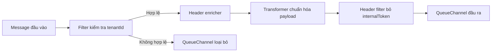

# Kiểm thử message headers

## 1. Mục tiêu và tình huống thực tế

Trong chương **Testing support** của module **SPRING_INTEGRATION_CORE**, kiểm thử message headers giúp xác nhận rằng luồng thông điệp vẫn giữ đúng ngữ cảnh nghiệp vụ khi đi qua channel, endpoint, transformer, router, filter và gateway.

Giả sử hệ thống nhận một đơn hàng với payload `" order-42 "` và những header sau:

| Header | Giá trị đầu vào | Ý nghĩa trong ví dụ |
|---|---|---|
| `tenantId` | `"tenant-01"` | Đơn vị sở hữu yêu cầu |
| `requestId` | `"req-0042"` | Mã truy vết nghiệp vụ |
| `region` | `"eu"` | Khu vực xử lý đã được bên gửi xác định |
| `stage` | `"received"` | Trạng thái trước khi chuẩn hóa |
| `internalToken` | `"demo-token"` | Dữ liệu nội bộ cần bỏ trước đầu ra bên ngoài |

Luồng chuẩn hóa payload thành `"ORDER-42"`. Tuy nhiên, chỉ kiểm tra payload chưa đủ: mất `tenantId` có thể khiến bước sau không xác định được đơn vị; ghi đè `region` có thể làm router chọn sai nhánh; giữ lại `internalToken` có thể vi phạm hợp đồng đầu ra.

Sau bài này, người học có thể:

- Xác định header cần giữ, thêm, ghi đè, loại bỏ và kiểm tra kiểu dữ liệu tương ứng.
- Viết assertion cho một `Message<?>` bằng JUnit, AssertJ và matcher của Spring Integration.
- Kiểm thử quy tắc header trên một luồng Java DSL có nhánh chấp nhận và nhánh loại bỏ.
- Chọn cách kiểm chứng phù hợp cho header tự sinh, request–reply, lỗi và nhóm thông điệp.
- Thiết kế ca âm tính khi header thiếu, rỗng hoặc sai kiểu.

Các tên `tenantId`, `requestId`, `region`, `stage` và `internalToken` trong bài là hợp đồng tự định nghĩa của ứng dụng, không phải tên header chuẩn mà Spring tự xử lý.

## 2. Phân biệt các nhóm header

`Message<T>` gồm payload và `MessageHeaders`. Các giá trị header là đối tượng Java, vì vậy `"3"`, `3` và `3L` thể hiện ba kiểu khác nhau. Tên giống nhau không bảo đảm bên nhận sử dụng được giá trị đó. Có thể tra cấu trúc và cách đọc header tại [API MessageHeaders](https://docs.spring.io/spring-framework/docs/current/javadoc-api/org/springframework/messaging/MessageHeaders.html).

### 2.1. Header do ứng dụng quy định

Với các header nghiệp vụ, phải mô tả rõ cả tên, kiểu và quy tắc:

| Header ví dụ | Kiểu theo hợp đồng | Điều cần kiểm tra |
|---|---|---|
| `tenantId` | `String` không trắng | Không bị mất; thiếu hoặc sai kiểu phải vào nhánh loại bỏ |
| `requestId` | `String` | Giá trị sau xử lý bằng giá trị từ yêu cầu |
| `region` | `String` | Giữ giá trị hiện có; chỉ bổ sung `"apac"` khi thiếu |
| `stage` | `String` | Chủ động đổi thành `"normalized"` |
| `retryCount` | `Integer` | Giá trị số nguyên, không dùng chuỗi số thay thế |
| `internalToken` | `String` | Không còn ở thông điệp đầu ra của nhánh chấp nhận |

Không nên dùng `toString()` trong assertion chỉ để khiến các kiểu khác nhau trông giống nhau. Nếu bước nhận cần `Integer`, test nên chứng minh giá trị thực sự có kiểu `Integer`.

### 2.2. Header của framework

Một số header thường gặp:

| Hằng số | Kiểu hoặc dạng giá trị | Cách kiểm tra phù hợp |
|---|---|---|
| `MessageHeaders.ID` | `UUID` trong cấu hình thông thường | Có giá trị, đúng kiểu; kiểm tra quan hệ với message khác khi hợp đồng yêu cầu |
| `MessageHeaders.TIMESTAMP` | `Long` trong cấu hình thông thường | Có giá trị hoặc nằm trong khoảng thời gian hợp lý |
| `MessageHeaders.REPLY_CHANNEL` | Đối tượng channel hoặc tên có thể phân giải | Phản hồi thực sự tới đúng nơi |
| `MessageHeaders.ERROR_CHANNEL` | Đối tượng channel hoặc tên có thể phân giải | Lỗi tới đúng nơi trong cơ chế xử lý lỗi được cấu hình |
| `IntegrationMessageHeaderAccessor.CORRELATION_ID` | `Object` | Các message thuộc cùng nhóm có cùng mã tương quan |
| `IntegrationMessageHeaderAccessor.SEQUENCE_NUMBER` | `Integer` | Số thứ tự của phần tử trong nhóm |
| `IntegrationMessageHeaderAccessor.SEQUENCE_SIZE` | `Integer` | Kích thước nhóm theo quy tắc của thành phần tạo nhóm |

Các hằng số đặc thù tích hợp nằm trong [IntegrationMessageHeaderAccessor](https://docs.spring.io/spring-integration/api/org/springframework/integration/IntegrationMessageHeaderAccessor.html). Dùng hằng số thay cho chuỗi gõ tay giúp tránh nhầm tên, đặc biệt giữa `requestId` tự định nghĩa và `correlationId` của framework.

Đừng giả định mọi message đều có timestamp hoặc ID theo cấu hình mặc định: ứng dụng có thể tùy biến cách tạo message. Test về sự hiện diện của hai header này cần gắn với cấu hình thực tế đang kiểm thử.

## 3. Xác định hợp đồng trước khi viết assertion

Với mỗi bước xử lý, hãy diễn đạt yêu cầu theo quan hệ **đầu vào → đầu ra**:

| Nhóm quy tắc | Câu hỏi cần trả lời | Assertion điển hình |
|---|---|---|
| Giữ nguyên | Header nào phải đi xuyên suốt? | `out.tenantId == in.tenantId` |
| Bổ sung mặc định | Khi thiếu header thì điền gì? | Thiếu `region` → `"apac"` |
| Không ghi đè | Giá trị hợp lệ từ bên gửi có được giữ không? | `"eu"` → `"eu"` |
| Ghi đè có chủ đích | Header nào do bước hiện tại quản lý? | `stage` → `"normalized"` |
| Loại bỏ | Header nào không được xuất hiện ở ranh giới đầu ra? | Không có khóa `internalToken` |
| Kiểm tra đầu vào | Header thiếu hoặc sai kiểu đi đâu? | Có message ở nhánh loại bỏ và không có ở nhánh chấp nhận |
| Điều khiển luồng | Header có tạo ra hành vi mong muốn không? | Router chọn đúng nhánh; phản hồi về đúng channel |

Ví dụ một yêu cầu có `tenantId = 42` không được coi là hợp lệ chỉ vì giá trị đó tồn tại. Trong hợp đồng của bài, `tenantId` phải là chuỗi không trắng.

Sơ đồ kiểm thử:



Có hai loại filter trong sơ đồ: message filter quyết định cả message có đi tiếp hay không; header filter chỉ loại bỏ những header được chỉ định. Nhầm hai loại này sẽ dẫn đến assertion sai đối tượng.

## 4. Chuẩn bị thư viện kiểm thử

Các ví dụ dùng Java 17 trở lên, JUnit Jupiter và AssertJ. Chúng dùng API cốt lõi có trong dòng Spring Integration 6.x; khi sử dụng dòng khác, chọn JDK và phiên bản Spring tương thích với dự án.

Trong một ứng dụng Spring Boot đã có parent hoặc BOM quản lý phiên bản, có thể khai báo:

```xml
<dependencies>
    <dependency>
        <groupId>org.springframework.integration</groupId>
        <artifactId>spring-integration-core</artifactId>
    </dependency>

    <dependency>
        <groupId>org.springframework.boot</groupId>
        <artifactId>spring-boot-starter-test</artifactId>
        <scope>test</scope>
    </dependency>

    <dependency>
        <groupId>org.springframework.integration</groupId>
        <artifactId>spring-integration-test-support</artifactId>
        <scope>test</scope>
    </dependency>
</dependencies>
```

Đây là đoạn dependency để ghép vào dự án đã quản lý phiên bản, không phải một `pom.xml` độc lập. Với dự án không dùng Spring Boot, khai báo riêng JUnit Jupiter, AssertJ, Spring Test và các thư viện matcher cần dùng; quản lý phiên bản Spring nhất quán.

`spring-integration-test-support` cung cấp tiện ích và matcher độc lập. Khi cần thay thế endpoint hoặc điều chỉnh Spring test context bằng `MockIntegrationContext` và `@SpringIntegrationTest`, dùng thêm `spring-integration-test`. Ví dụ Java DSL bên dưới chỉ cần Spring Test khởi tạo context, chưa cần tính năng thay thế endpoint. Xem [Testing support](https://docs.spring.io/spring-integration/reference/testing.html).

Trong các đoạn Java, `MessageBuilder` được import từ `org.springframework.messaging.support`. Không trộn hai lớp builder có tên giống nhau trong cùng ví dụ.

## 5. Unit test: kiểm tra header của hàm xử lý message

Khi một transformer tự tạo message mới, unit test có thể chứng minh rằng mã của ứng dụng sao chép đúng ngữ cảnh và loại bỏ đúng dữ liệu.

Ví dụ sau là một lớp test đầy đủ. Hàm `normalize` được đặt ngay trong lớp để thấy rõ đối tượng đang được kiểm thử; trong ứng dụng, chuyển hàm này vào transformer hoặc service tương ứng.

```java
import java.util.Locale;

import org.junit.jupiter.api.Test;
import org.springframework.messaging.Message;
import org.springframework.messaging.support.MessageBuilder;

import static org.assertj.core.api.Assertions.assertThat;

class NormalizeMessageHeadersTest {

    static Message<String> normalize(Message<String> input) {
        return MessageBuilder
                .withPayload(input.getPayload().trim()
                        .toUpperCase(Locale.ROOT))
                .copyHeaders(input.getHeaders())
                .setHeader("stage", "normalized")
                .removeHeader("internalToken")
                .build();
    }

    @Test
    void preservesContextChangesStageAndRemovesInternalToken() {
        Message<String> input = MessageBuilder
                .withPayload(" order-42 ")
                .setHeader("tenantId", "tenant-01")
                .setHeader("requestId", "req-0042")
                .setHeader("stage", "received")
                .setHeader("retryCount", 3)
                .setHeader("internalToken", "demo-token")
                .build();

        Message<String> output = normalize(input);

        assertThat(output.getPayload()).isEqualTo("ORDER-42");

        assertThat(output.getHeaders().get("tenantId", String.class))
                .isEqualTo("tenant-01");
        assertThat(output.getHeaders().get("requestId", String.class))
                .isEqualTo("req-0042");
        assertThat(output.getHeaders().get("retryCount"))
                .isInstanceOf(Integer.class)
                .isEqualTo(3);
        assertThat(output.getHeaders().get("stage", String.class))
                .isEqualTo("normalized");
        assertThat(output.getHeaders())
                .doesNotContainKey("internalToken");

        // Thông điệp đầu vào vẫn thể hiện trạng thái ban đầu.
        assertThat(input.getPayload()).isEqualTo(" order-42 ");
        assertThat(input.getHeaders().get("stage"))
                .isEqualTo("received");
        assertThat(input.getHeaders())
                .containsEntry("internalToken", "demo-token");
    }
}
```

Test này kiểm tra mã `normalize` của ứng dụng. Nếu xóa `copyHeaders`, những assertion về `tenantId` và `requestId` sẽ không còn đạt. Nếu quên `removeHeader`, assertion về sự vắng mặt của `internalToken` sẽ phát hiện lỗi.

### 5.1. Hiểu đúng việc sao chép và thay đổi header

`MessageBuilder.fromMessage(input)` thuận tiện khi giữ payload; `withPayload(newPayload).copyHeaders(input.getHeaders())` phù hợp khi đổi payload. `copyHeadersIfAbsent` giữ các giá trị đã đặt trên builder. `setHeader(name, null)` loại bỏ header đó, vì thế không thể dùng cách này để tạo fixture “khóa tồn tại nhưng có giá trị null”. Xem [API MessageBuilder](https://docs.spring.io/spring-framework/docs/current/javadoc-api/org/springframework/messaging/support/MessageBuilder.html).

`MessageHeaders` thông thường không cho sửa trực tiếp qua `put` hoặc `remove`. Tuy nhiên, điều đó không có nghĩa đối tượng chứa bên trong header được sao chép sâu. Nếu một header giữ `List` có thể thay đổi, hai message có thể cùng tham chiếu danh sách đó. Với header nghiệp vụ trong các ví dụ, dùng `String` và `Integer` giúp test không phụ thuộc trạng thái chia sẻ.

### 5.2. Chọn đúng mức kiểm thử transformer

Có sự khác biệt giữa hai trường hợp:

- Hàm biến đổi trả về **payload**: framework thường chuyển tiếp header từ message đầu vào.
- Transformer trả về **toàn bộ Message**: mã transformer chịu trách nhiệm xây dựng header của message trả về.

Vì thế, test riêng một hàm `String -> String` chưa kiểm tra được header propagation do endpoint thực hiện. Cần thêm test qua luồng hoặc handler thật. Quy tắc này được mô tả trong [Header propagation](https://docs.spring.io/spring-integration/reference/message.html#message-header-propagation).

## 6. Kiểm thử luồng Java DSL trong Spring context

Ví dụ dưới đây hiện thực hợp đồng ở phần 3:

1. Chỉ nhận `tenantId` là chuỗi không trắng.
2. Giữ `region` đã có, điền `"apac"` khi thiếu.
3. Luôn đặt `stage = "normalized"`.
4. Chuẩn hóa payload, giữ `tenantId` và `requestId`.
5. Bỏ `internalToken` trước khi gửi đến đầu ra.

`header(name, value, false)` thể hiện không ghi đè và `header(name, value, true)` cho phép ghi đè. Viết rõ lựa chọn giúp hợp đồng dễ đọc; tham khảo [HeaderEnricherSpec](https://docs.spring.io/spring-integration/api/org/springframework/integration/dsl/HeaderEnricherSpec.html).

```java
import java.util.Locale;
import java.util.stream.Stream;

import org.junit.jupiter.api.Test;
import org.junit.jupiter.params.ParameterizedTest;
import org.junit.jupiter.params.provider.MethodSource;

import org.springframework.beans.factory.annotation.Autowired;
import org.springframework.beans.factory.annotation.Qualifier;
import org.springframework.context.annotation.Bean;
import org.springframework.context.annotation.Configuration;
import org.springframework.integration.channel.DirectChannel;
import org.springframework.integration.channel.QueueChannel;
import org.springframework.integration.config.EnableIntegration;
import org.springframework.integration.dsl.IntegrationFlow;
import org.springframework.messaging.Message;
import org.springframework.messaging.support.MessageBuilder;
import org.springframework.test.context.junit.jupiter.SpringJUnitConfig;

import static org.assertj.core.api.Assertions.assertThat;

@SpringJUnitConfig(HeaderFlowTest.Config.class)
class HeaderFlowTest {

    @Autowired
    @Qualifier("headerInput")
    DirectChannel input;

    @Autowired
    @Qualifier("accepted")
    QueueChannel accepted;

    @Autowired
    @Qualifier("rejected")
    QueueChannel rejected;

    static boolean hasValidTenant(Message<?> message) {
        Object tenant = message.getHeaders().get("tenantId");
        return tenant instanceof String text && !text.isBlank();
    }

    @Test
    void keepsContextPreservesRegionAndOverwritesStage() {
        Message<String> request = MessageBuilder
                .withPayload(" order-42 ")
                .setHeader("tenantId", "tenant-01")
                .setHeader("requestId", "req-0042")
                .setHeader("region", "eu")
                .setHeader("stage", "received")
                .setHeader("internalToken", "demo-token")
                .build();

        assertThat(input.send(request)).isTrue();

        Message<?> result = accepted.receive(1_000);
        assertThat(result).isNotNull();
        assertThat(result.getPayload()).isEqualTo("ORDER-42");
        assertThat(result.getHeaders())
                .containsEntry("tenantId", "tenant-01")
                .containsEntry("requestId", "req-0042")
                .containsEntry("region", "eu")
                .containsEntry("stage", "normalized")
                .doesNotContainKey("internalToken");

        assertThat(result.getHeaders().get("region", String.class))
                .isEqualTo("eu");
        assertThat(rejected.receive(0)).isNull();

        assertThat(request.getHeaders())
                .containsEntry("stage", "received")
                .containsEntry("internalToken", "demo-token");
    }

    @Test
    void addsDefaultRegionWhenHeaderIsMissing() {
        Message<String> request = MessageBuilder
                .withPayload("order-43")
                .setHeader("tenantId", "tenant-01")
                .setHeader("requestId", "req-0043")
                .build();

        assertThat(input.send(request)).isTrue();

        Message<?> result = accepted.receive(1_000);
        assertThat(result).isNotNull();
        assertThat(result.getHeaders())
                .containsEntry("region", "apac")
                .containsEntry("stage", "normalized")
                .containsEntry("requestId", "req-0043");
        assertThat(request.getHeaders()).doesNotContainKey("region");
        assertThat(rejected.receive(0)).isNull();
    }

    static Stream<Object> invalidTenants() {
        return Stream.of(null, "", "   ", 42);
    }

    @ParameterizedTest
    @MethodSource("invalidTenants")
    void rejectsMissingBlankOrWronglyTypedTenant(Object tenant) {
        Message<String> request = MessageBuilder
                .withPayload("order-invalid")
                .setHeader("tenantId", tenant)
                .setHeader("requestId", "req-invalid")
                .build();

        assertThat(input.send(request)).isTrue();

        Message<?> discarded = rejected.receive(1_000);
        assertThat(discarded).isNotNull();
        assertThat(discarded.getHeaders())
                .containsEntry("requestId", "req-invalid");
        assertThat(discarded.getHeaders().get("tenantId"))
                .isEqualTo(tenant);
        assertThat(accepted.receive(0)).isNull();
    }

    @Configuration
    @EnableIntegration
    static class Config {

        @Bean
        DirectChannel headerInput() {
            return new DirectChannel();
        }

        @Bean
        QueueChannel accepted() {
            return new QueueChannel();
        }

        @Bean
        QueueChannel rejected() {
            return new QueueChannel();
        }

        @Bean
        IntegrationFlow headerFlow() {
            return IntegrationFlow.from(headerInput())
                    .filter(Message.class, HeaderFlowTest::hasValidTenant,
                            endpoint ->
                                    endpoint.discardChannel(rejected()))
                    .enrichHeaders(headers -> headers
                            .header("region", "apac", false)
                            .header("stage", "normalized", true))
                    .<String, String>transform(payload ->
                            payload.trim().toUpperCase(Locale.ROOT))
                    .headerFilter("internalToken")
                    .channel(accepted())
                    .get();
        }
    }
}
```

Ở selector, đọc `Object` trước rồi dùng `instanceof` để xử lý header sai kiểu như một đầu vào không hợp lệ. Nếu đọc thẳng `get("tenantId", String.class)`, giá trị `Integer` có thể gây ngoại lệ trước khi selector kịp quyết định loại bỏ.

`Message.class` trong overload `filter` cho phép selector nhận toàn bộ message để xem header. `headerFilter` loại các header được chỉ định. Các overload tương ứng có trong [API Java DSL](https://docs.spring.io/spring-integration/api/org/springframework/integration/dsl/BaseIntegrationFlowDefinition.html).

### 6.1. Diễn giải kết quả kiểm thử

Các ca kiểm thử phát hiện được những lỗi khác nhau:

| Thay đổi sai trong luồng | Ca phát hiện |
|---|---|
| `region` luôn bị ghi đè | Ca có `region = "eu"` |
| Không bổ sung `region` mặc định | Ca thiếu `region` |
| Không đổi `stage` khi đã tồn tại | Ca có `stage = "received"` |
| Transformer làm mất header nghiệp vụ | Ca giữ `tenantId` và `requestId` |
| Bỏ sót bước xóa token | Assertion không có `internalToken` |
| Selector chỉ kiểm tra khác null | Ca chuỗi trắng và `Integer` |
| Message không hợp lệ vẫn đi tiếp | Assertion đầu ra `accepted` rỗng |

`input.send(...) == true` chỉ cho biết thao tác gửi thành công theo cơ chế channel; không chứng minh message đã được chấp nhận về nghiệp vụ. Trong ca loại bỏ, gửi vẫn có thể thành công và message xuất hiện ở `rejected`.

Nhánh loại bỏ nằm trước bước xóa header, vì vậy hợp đồng “bỏ `internalToken`” trong ví dụ chỉ áp dụng cho đầu ra `accepted`. Nếu hệ thống cũng xuất nhánh loại bỏ ra ngoài, cần định nghĩa và kiểm thử hợp đồng riêng tại ranh giới đó.

### 6.2. Đọc channel và tránh test phụ thuộc thời gian

Luồng trên nhận qua `DirectChannel` và xử lý đồng bộ đến lúc đưa kết quả vào `QueueChannel`. Vì vậy sau khi `send` trả về, có thể dùng `receive(0)` để xác nhận nhánh còn lại không chứa message của lần xử lý này.

Với luồng có executor hoặc poller, `receive(0)` ngay sau khi gửi chưa đủ chứng minh message sẽ không tới sau đó. Hãy chờ một dấu mốc hoàn tất, dùng timeout hữu hạn và xác định cửa sổ quan sát theo hợp đồng. Tránh `Thread.sleep` cố định chỉ để đoán thời điểm hoàn tất.

Các test trên giả định thực thi tuần tự theo cấu hình JUnit thông thường. Nếu bật chạy song song, cần tách channel/context hoặc phân biệt yêu cầu để một test không nhận kết quả của test khác. Mỗi lần kiểm thử phải tiêu thụ các message mà mình tạo ra.

## 7. Dùng HeaderMatcher của Spring Integration

Khi muốn diễn đạt assertion trực tiếp trên `Message`, có thể dùng `HeaderMatcher` từ `spring-integration-test-support`. Ví dụ dưới đây là một lớp test độc lập:

```java
import java.util.Map;

import org.junit.jupiter.api.Test;
import org.springframework.messaging.Message;
import org.springframework.messaging.support.MessageBuilder;

import static org.hamcrest.MatcherAssert.assertThat;
import static org.hamcrest.Matchers.instanceOf;
import static org.hamcrest.Matchers.not;
import static org.springframework.integration.test.matcher.HeaderMatcher
        .hasAllHeaders;
import static org.springframework.integration.test.matcher.HeaderMatcher
        .hasHeader;
import static org.springframework.integration.test.matcher.HeaderMatcher
        .hasHeaderKey;

class MessageHeaderMatcherTest {

    @Test
    void checksRequiredHeadersAndTheirTypes() {
        Message<String> actual = MessageBuilder
                .withPayload("ORDER-42")
                .setHeader("tenantId", "tenant-01")
                .setHeader("stage", "normalized")
                .setHeader("retryCount", 3)
                .build();

        assertThat(actual, hasHeader("tenantId", "tenant-01"));
        assertThat(actual,
                hasHeader("retryCount", instanceOf(Integer.class)));
        assertThat(actual, not(hasHeaderKey("internalToken")));
        assertThat(actual, hasAllHeaders(Map.of(
                "tenantId", "tenant-01",
                "stage", "normalized")));
    }
}
```

`hasAllHeaders` kiểm tra các header kỳ vọng trong map được cung cấp; không yêu cầu message chỉ có đúng những header đó. Muốn cấm một header, phải có assertion âm tính riêng. Xem các chữ ký chính xác tại [API HeaderMatcher](https://docs.spring.io/spring-integration/api/org/springframework/integration/test/matcher/HeaderMatcher.html).

Phần mô tả ví dụ trong một số tài liệu có thể dùng tên cũ như `hasEntry`. Khi viết mã, dùng phương thức thực tế của thư viện đang khai báo, chẳng hạn `hasHeader` và `hasHeaderKey`.

Đừng static-import đồng thời hai phương thức `assertThat` nếu gây nhầm lẫn. Có thể dùng tên đầy đủ `org.hamcrest.MatcherAssert.assertThat` trong đoạn Hamcrest và giữ AssertJ cho phần còn lại.

Đoạn test này minh họa cách dùng matcher. Trong test ứng dụng, áp dụng các assertion đó vào message do transformer hoặc flow tạo ra, thay vì chỉ khẳng định fixture vừa tự dựng.

## 8. Xử lý ID, timestamp và so sánh message

### 8.1. Tránh so sánh toàn bộ map header khi chỉ cần hợp đồng nghiệp vụ

Hai message được tạo độc lập có thể khác ID và timestamp dù dữ liệu nghiệp vụ giống nhau. Một test như sau dễ ràng buộc quá mức:

```java
// Dễ sai mục tiêu nếu expected được tạo độc lập:
assertThat(actual.getHeaders()).isEqualTo(expected.getHeaders());
```

Nên kiểm tra tập header mà bước xử lý chịu trách nhiệm:

```java
assertThat(actual.getHeaders())
        .containsEntry("tenantId", "tenant-01")
        .containsEntry("requestId", "req-0042")
        .containsEntry("stage", "normalized")
        .doesNotContainKey("internalToken");
```

Khi hợp đồng yêu cầu tập khóa chính xác, chẳng hạn allowlist tại ranh giới giao thức, hãy kiểm tra tập khóa đó riêng và nêu rõ cách xử lý header kỹ thuật.

### 8.2. Không ép ID và timestamp vào giá trị cố định

Với message mặc định, có thể kiểm tra `getId()` khác null và `getTimestamp()` là giá trị thời gian hợp lý. Không tự gán hằng số cho header kỹ thuật để làm phép so sánh toàn message dễ hơn.

Khi một endpoint tạo message mới, ID có thể thay đổi; khi chỉ chuyển tiếp message, ID có thể được giữ. Hai timestamp cũng có thể bằng nhau do độ phân giải mili giây. Chỉ viết assertion “ID thay đổi” hoặc “timestamp tăng” nếu chính hành vi đó là yêu cầu của thành phần đang kiểm thử.

Nếu cần truy vết xuyên suốt nhiều lần biến đổi, `requestId` do ứng dụng quy định giúp biểu đạt quan hệ nghiệp vụ rõ hơn việc yêu cầu mọi message giữ cùng một ID.

Với kiểm thử hạn sử dụng, nên điều khiển nguồn thời gian của logic ứng dụng bằng `Clock` nếu có thể. Đừng kiểm tra thời điểm hết hạn bằng cách ngủ vài giây trong mỗi test.

## 9. Kiểm tra correlation và sequence headers

Trong luồng splitter → transformer → aggregator, payload đúng nhưng mất header nhóm vẫn có thể khiến việc gom kết quả không hoàn tất.

Với splitter mặc định và payload là một `List` có kích thước biết trước, các message con có header tương quan và thứ tự. Ví dụ sau kiểm tra ngay đầu ra splitter, trước aggregator:

```java
import java.util.List;

import org.junit.jupiter.api.Test;
import org.springframework.integration.IntegrationMessageHeaderAccessor;
import org.springframework.integration.channel.QueueChannel;
import org.springframework.integration.splitter.DefaultMessageSplitter;
import org.springframework.messaging.Message;
import org.springframework.messaging.support.MessageBuilder;

import static org.assertj.core.api.Assertions.assertThat;

class SplitterHeadersTest {

    @Test
    void givesChildrenTheSameGroupAndConsecutiveSequenceNumbers() {
        QueueChannel parts = new QueueChannel();

        DefaultMessageSplitter splitter = new DefaultMessageSplitter();
        splitter.setOutputChannel(parts);
        splitter.afterPropertiesSet();

        Message<List<String>> batch = MessageBuilder
                .withPayload(List.of("sku-a", "sku-b"))
                .setHeader("tenantId", "tenant-01")
                .build();

        splitter.handleMessage(batch);

        for (int index = 0; index < batch.getPayload().size(); index++) {
            Message<?> part = parts.receive(1_000);
            assertThat(part).isNotNull();
            assertThat(part.getPayload())
                    .isEqualTo(batch.getPayload().get(index));
            assertThat(part.getHeaders())
                    .containsEntry("tenantId", "tenant-01");
            assertThat(part.getHeaders().get(
                    IntegrationMessageHeaderAccessor.CORRELATION_ID))
                    .isEqualTo(batch.getHeaders().getId());
            assertThat(part.getHeaders().get(
                    IntegrationMessageHeaderAccessor.SEQUENCE_NUMBER,
                    Integer.class))
                    .isEqualTo(index + 1);
            assertThat(part.getHeaders().get(
                    IntegrationMessageHeaderAccessor.SEQUENCE_SIZE,
                    Integer.class))
                    .isEqualTo(2);
        }

        assertThat(parts.receive(0)).isNull();
    }
}
```

Ví dụ cố ý dùng `List` với hai phần tử. Với iterator không biết trước kích thước, sequence size có thể là `0`; không áp dụng cứng kỳ vọng `2` cho mọi kiểu nguồn. Tham khảo [Splitter](https://docs.spring.io/spring-integration/reference/splitter.html).

Để kiểm thử việc bảo toàn ngữ cảnh qua nhiều endpoint, đặt thêm điểm quan sát sau transformer và kiểm tra lại những header nhóm cần dùng. Với luồng bất đồng bộ, đừng giả định thứ tự nhận bằng thứ tự gửi; có thể đối chiếu theo sequence number hoặc kiểm tra tập số thứ tự.

Khi đi tới aggregator, kiểm tra hai nhóm có mã tương quan khác nhau không bị trộn và chỉ phát kết quả khi đạt điều kiện release. Không yêu cầu đầu ra aggregator giữ nguyên toàn bộ sequence headers của message con: hành vi này phụ thuộc cấu hình gom nhóm và việc xử lý sequence của aggregator. Xem [Aggregator](https://docs.spring.io/spring-integration/reference/aggregator.html).

## 10. Kiểm tra replyChannel và gateway bằng hành vi

Header `replyChannel` có thể là đối tượng channel, nên so sánh chuỗi từ `toString()` thường không diễn đạt được yêu cầu. Khi muốn kiểm tra phản hồi, hãy gửi yêu cầu có reply channel rồi nhận kết quả tại channel đó.

Đây là cấu hình bổ sung độc lập cho một test context:

```java
@Bean
DirectChannel replyInput() {
    return new DirectChannel();
}

@Bean
IntegrationFlow replyFlow() {
    return IntegrationFlow.from(replyInput())
            .<String, String>transform(value ->
                    value.toUpperCase(Locale.ROOT))
            .get();
}
```

Luồng không đặt output channel tường minh, để phản hồi được giải quyết qua header. Trong test, inject `replyInput` và thực hiện:

```java
QueueChannel replies = new QueueChannel();

Message<String> request = MessageBuilder
        .withPayload("order-42")
        .setHeader("requestId", "req-0042")
        .setReplyChannel(replies)
        .build();

assertThat(replyInput.send(request)).isTrue();

Message<?> reply = replies.receive(1_000);
assertThat(reply).isNotNull();
assertThat(reply.getPayload()).isEqualTo("ORDER-42");
assertThat(reply.getHeaders())
        .containsEntry("requestId", "req-0042");
```

Với messaging gateway, nên kiểm thử từ phương thức gateway để bao phủ cả ánh xạ tham số thành header và nhận phản hồi. Gateway có thể tạo reply channel tạm thời; không cần buộc nó có một tên bean hoặc lớp triển khai cụ thể. Xem [Messaging Gateways](https://docs.spring.io/spring-integration/reference/gateway.html).

Chẳng hạn, nếu phương thức gateway nhận tham số `@Header("tenantId") String tenantId`, test nên gọi phương thức với `"tenant-01"` và kiểm tra message tại điểm tiếp nhận của flow có đúng header. Nếu chỉ tự dựng `MessageBuilder` rồi gửi thẳng vào channel, test sẽ bỏ qua lỗi cấu hình ánh xạ của gateway.

## 11. Kiểm tra errorChannel trong đúng cơ chế xử lý lỗi

Sự tồn tại của header `errorChannel` không tự bảo đảm rằng mọi ngoại lệ được chuyển thành error message.

- Với `DirectChannel` đồng bộ và lời gọi trực tiếp `send`, ngoại lệ xử lý thường quay về bên gọi.
- Với xử lý bất đồng bộ được framework cấu hình error handler thích hợp, lỗi có thể được đóng gói thành `ErrorMessage` và gửi tới error channel từ header, hoặc tới channel mặc định.
- Với gateway, hành vi lỗi còn phụ thuộc cấu hình của gateway.

Các quy tắc này được trình bày tại [Error Handling](https://docs.spring.io/spring-integration/reference/error-handling.html). Chọn fixture khớp với đường xử lý lỗi thực tế.

Trong test bất đồng bộ, có thể gắn một `QueueChannel` làm error channel của yêu cầu, gửi message gây lỗi, rồi nhận với timeout hữu hạn. Sau khi nhận, kiểm tra cả lỗi và ngữ cảnh của message thất bại. Đoạn sau là phần assertion, giả định `errors` đã được cấu hình làm nơi nhận lỗi của flow:

```java
Message<?> received = errors.receive(2_000);
assertThat(received)
        .isInstanceOf(org.springframework.messaging.support.ErrorMessage.class);

Throwable failure = ((org.springframework.messaging.support.ErrorMessage)
        received).getPayload();

assertThat(failure)
        .isInstanceOf(org.springframework.messaging.MessagingException.class);

Message<?> failedMessage =
        ((org.springframework.messaging.MessagingException) failure)
                .getFailedMessage();

assertThat(failedMessage).isNotNull();
assertThat(failedMessage.getHeaders())
        .containsEntry("tenantId", "tenant-01")
        .containsEntry("requestId", "req-failure");
```

Assertion trên áp dụng khi đường lỗi đang kiểm thử tạo `MessagingException` có `failedMessage`. Nếu ứng dụng dùng một `ErrorMessageStrategy` hoặc handler lỗi khác, điều chỉnh kỳ vọng theo cấu trúc thực tế.

Không giả định header nghiệp vụ của yêu cầu được sao chép lên header ngoài của `ErrorMessage`. Thường cần lấy ngữ cảnh từ message thất bại hoặc original message theo chiến lược lỗi đang dùng. Đồng thời xác nhận không có kết quả thành công ngoài ý muốn cho yêu cầu lỗi.

## 12. Chọn điểm quan sát và xử lý ca âm tính

### 12.1. Router, filter và ranh giới giao thức

Đối với router dựa trên header, kiểm tra cả dữ liệu và quyết định tuyến:

| Đầu vào theo hợp đồng | Kỳ vọng cần quan sát |
|---|---|
| `region = "eu"` | Nhận tại nhánh EU, không vào nhánh mặc định |
| `region = "apac"` | Nhận tại nhánh APAC |
| Thiếu `region` | Bổ sung mặc định hoặc vào fallback theo thiết kế |
| `region` sai kiểu hoặc ngoài tập cho phép | Bị loại hoặc báo lỗi theo hợp đồng |

Giá trị header đúng tại một điểm trung gian chưa chứng minh router đã đọc đúng tên header. Cần có assertion ở channel đích.

Tương tự, test chỉ nhận message nội bộ chưa bao phủ header mapper của adapter HTTP, JMS hoặc AMQP. Nếu hợp đồng liên quan dữ liệu thực sự đi qua giao thức, quan sát cả phía giao thức. Bài này tập trung vào core nên không giả định mọi header Java đều được adapter chuyển ra ngoài với cùng tên và kiểu.

### 12.2. Ma trận ca kiểm thử tối thiểu

| Ca | Fixture | Kết quả cần chứng minh |
|---|---|---|
| Đầu vào bình thường | Các header nghiệp vụ hợp lệ | Đúng payload, đúng header bắt buộc |
| Header mặc định bị thiếu | Không đặt `region` | Có giá trị mặc định ở đầu ra |
| Giá trị có sẵn | `region = "eu"` | Không bị ghi đè ngoài ý muốn |
| Header do endpoint quản lý có sẵn | `stage = "received"` | Đổi sang trạng thái mới |
| Header nhạy cảm có mặt | Có `internalToken` | Vắng mặt tại đầu ra đã quy định |
| Header bắt buộc thiếu | Không đặt `tenantId` | Vào nhánh loại bỏ |
| Header bắt buộc trắng | `tenantId = "   "` | Vào nhánh loại bỏ |
| Header bắt buộc sai kiểu | `tenantId = 42` | Vào nhánh loại bỏ, không tự đổi sang chuỗi |
| Nhiều yêu cầu | Khác `requestId` | Không dùng nhầm ngữ cảnh giữa các kết quả |
| Nhóm thông điệp | Hai batch khác nhau | Không trộn correlation giữa các batch |
| Lỗi xử lý | Message có mã truy vết riêng | Tìm được ngữ cảnh của đúng yêu cầu thất bại |

Không phải mọi endpoint cần tất cả các ca. Chọn theo trách nhiệm của endpoint và các ranh giới có thể làm thay đổi header.

## 13. Lỗi kiểm thử thường gặp và cách sửa

| Biểu hiện | Nguyên nhân thường gặp | Cách sửa |
|---|---|---|
| Payload đạt nhưng luồng sau chọn sai nhánh | Chưa assertion header điều khiển tuyến | Kiểm tra header và channel đích |
| Test chập chờn vì map headers khác nhau | So sánh cả ID hoặc timestamp tự sinh | Chỉ đối chiếu các header thuộc hợp đồng |
| Header số nhìn đúng nhưng bước nhận lỗi | Fixture dùng chuỗi thay vì kiểu số | Assertion kiểu và giá trị riêng |
| Không tạo được fixture “header null” | Builder loại header khi giá trị null | Dùng ca thiếu header và ca chuỗi rỗng riêng |
| Test tưởng message đã được chấp nhận | Chỉ kiểm tra `send` trả về true | Nhận message ở nhánh chấp nhận hoặc loại bỏ |
| Error channel không có message | Flow đồng bộ trả lỗi trực tiếp cho bên gọi | Kiểm tra cơ chế lỗi của channel hoặc gateway |
| Test chạy riêng đạt nhưng chạy cả bộ lỗi | Queue còn dữ liệu hoặc test chạy song song dùng chung channel | Quản lý vòng đời dữ liệu và cô lập ngữ cảnh |
| Header mất sau custom transformer | Transformer tạo toàn bộ message nhưng không sao chép ngữ cảnh cần thiết | Sửa phần dựng message và test tại đầu ra endpoint |
| Xóa header quá rộng làm request–reply treo | Loại nhầm header cần cho phản hồi | Định nghĩa danh sách header được giữ/xóa theo ranh giới |

Một bộ kiểm thử headers có giá trị khi chứng minh được ngữ cảnh nghiệp vụ đi đúng nơi và tạo đúng hành vi. Hãy gắn mỗi assertion với một quy tắc cụ thể của message hoặc endpoint; khi quy tắc thay đổi, có thể xác định rõ test nào cần cập nhật.
