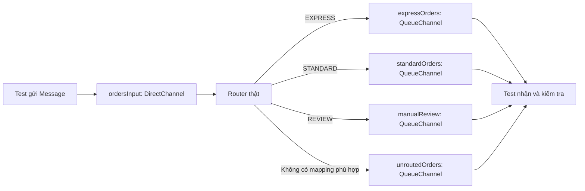

# Kiểm thử routing

## 1. Mục tiêu của kiểm thử routing

Trong module `SPRING_INTEGRATION_CORE`, router là endpoint quyết định một `Message` phải đi đến `MessageChannel` nào. Quyết định đó có thể dựa trên payload, header, kiểu dữ liệu hoặc kết quả của một quy tắc nghiệp vụ. Khi luồng được xây dựng bằng Java DSL, một dòng `.route(...)` ngắn vẫn có thể chứa nhiều hành vi cần kiểm thử.

Giả sử hệ thống nhận đơn hàng, phân loại đơn giao nhanh, đơn thông thường và đơn cần duyệt thủ công. Một lỗi mapping có thể khiến đơn cần duyệt được chuyển thẳng sang xử lý giao hàng. Lỗi này vẫn xảy ra dù hàm phân loại trả về đúng kết quả.

Một bài kiểm thử routing cần trả lời được các câu hỏi sau:

- Thông điệp đến đúng channel hay đúng subflow theo quy tắc không?
- Các nhánh không được chọn có thực sự không nhận thông điệp không?
- Payload và những header cần cho bước tiếp theo có được giữ đúng không?
- Thông điệp không có nhánh phù hợp đi vào fallback, bị loại bỏ có chủ đích hay phát sinh lỗi?
- Test có quan sát kết quả sau khi công việc cần kiểm tra đã hoàn thành không?

Mục tiêu của bài là xây dựng các kiểm thử trả lời được những câu hỏi này, từ quy tắc phân loại thuần Java đến flow có router thật trong Spring context, rồi mở rộng sang mock endpoint và xử lý bất đồng bộ.

## 2. Chọn đúng phạm vi kiểm thử

### 2.1. Ba lớp kiểm thử bổ sung cho nhau

| Phạm vi | Thành phần chạy thật | Điều cần chứng minh | Lỗi thường tìm được |
| --- | --- | --- | --- |
| Unit test quy tắc | Hàm tính route key | Dữ liệu đầu vào cho ra đúng quyết định nghiệp vụ | Sai điều kiện biên, sai thứ tự ưu tiên |
| Kiểm thử flow routing | Input channel, router, mapping, output channel | Quyết định được chuyển thành đường đi đúng | Mapping nhầm channel, thiếu fallback, đọc sai header |
| Kiểm thử flow có hệ thống ngoài | Router cùng một phần hoặc toàn bộ downstream | Hợp đồng tích hợp thực tế được đáp ứng | Sai serialization, sai request, lỗi giao tiếp hoặc cấu hình adapter |

Nếu chỉ mock router để trả về một nhánh định trước, test không còn chứng minh router thật được cấu hình đúng. Với bài kiểm thử routing, nên giữ router và các mapping thật; chọn ranh giới quan sát ngay sau router hoặc thay các handler có tác động bên ngoài bằng test double.

Spring Integration cung cấp `spring-integration-test` để hỗ trợ thay thế thành phần trong application context; các kiểm thử flow đơn giản vẫn có thể dùng Spring Test và channel thật. Xem [Testing support](https://docs.spring.io/spring-integration/reference/testing.html).

### 2.2. Xác định điểm quan sát trước khi viết assertion

Với một router chọn duy nhất một nhánh, có thể dừng mỗi nhánh ở một `QueueChannel`:



Trong fixture này, router chạy trên thread của người gửi vì input là `DirectChannel`. Mỗi output queue chỉ lưu thông điệp để test đọc; không có poller hay consumer cạnh tranh. Vì thế, sau khi `send()` trả về thành công, các thao tác định tuyến đồng bộ đã xong. Có queue ở đầu ra không tự tạo ra một worker xử lý thông điệp. Đây là hệ quả của cách hoạt động của [DirectChannel và QueueChannel](https://docs.spring.io/spring-integration/reference/channel/implementations.html).

Nếu output channel trong ứng dụng thật đã có consumer, gọi `receive()` trên chính queue đó có thể lấy mất thông điệp của consumer. Khi ấy nên quan sát bằng handler được thay thế hoặc bằng điểm thu thập riêng trong test.

## 3. Viết hợp đồng routing bằng ma trận dữ liệu

Ví dụ sử dụng payload `Order(id, totalVnd)` và header `shippingMode`. Số tiền dùng `long` theo đơn vị đồng để tránh đưa sai số số thực vào bài toán điều kiện biên.

Quy tắc nghiệp vụ được chọn cho bài:

1. Header bằng chuỗi `EXPRESS`: chuyển sang nhánh giao nhanh, bất kể giá trị đơn.
2. Header bằng chuỗi `STANDARD`: đơn từ 5.000.000 đồng trở lên phải duyệt thủ công; thấp hơn ngưỡng đi nhánh thông thường.
3. Thiếu header, header sai kiểu hoặc giá trị khác hai chuỗi trên: chuyển sang nhánh chưa phân loại.

Trong ví dụ, so sánh phân biệt chữ hoa, chữ thường; không tự trim hay chuẩn hóa header. Nếu ứng dụng yêu cầu chuẩn hóa, cần thể hiện bước đó và kỳ vọng tương ứng trong test.

| Header `shippingMode` | `totalVnd` | Route key | Channel mong đợi | Ý nghĩa |
| --- | ---: | --- | --- | --- |
| `EXPRESS` | 100.000 | `EXPRESS` | `expressOrders` | Nhánh giao nhanh cơ bản |
| `EXPRESS` | 5.000.000 | `EXPRESS` | `expressOrders` | Ưu tiên giao nhanh thắng điều kiện giá trị cao |
| `STANDARD` | 4.999.999 | `STANDARD` | `standardOrders` | Ngay dưới ngưỡng |
| `STANDARD` | 5.000.000 | `REVIEW` | `manualReview` | Đúng ngưỡng |
| `STANDARD` | 5.000.001 | `REVIEW` | `manualReview` | Ngay trên ngưỡng |
| `ECONOMY` | 100.000 | `UNKNOWN` | `unroutedOrders` | Giá trị chưa hỗ trợ |
| Không có header | 100.000 | `UNKNOWN` | `unroutedOrders` | Thiếu dữ liệu quyết định |
| Chuỗi rỗng | 100.000 | `UNKNOWN` | `unroutedOrders` | Có header nhưng không hợp lệ |
| Số nguyên `99` | 100.000 | `UNKNOWN` | `unroutedOrders` | Sai kiểu header |
| `express` | 100.000 | `UNKNOWN` | `unroutedOrders` | Sai chữ hoa, chữ thường |

Kiểm thử quy tắc cần có expected value do người viết test xác định từ yêu cầu. Không gọi chính hàm phân loại để tính channel mong đợi: cách đó có thể lặp lại lỗi của implementation trong assertion.

Các điều kiện như số tiền âm, payload thiếu thuộc tính hay payload sai kiểu cần một hợp đồng riêng. Ví dụ này giả định payload đã là `Order` hợp lệ; header không hợp lệ được xử lý ngay tại quyết định routing.

## 4. Fixture hoàn chỉnh: kiểm thử router bằng Java DSL

### 4.1. Nền tảng và dependency

Mã minh họa chọn Java 17+, Spring Integration 6.x, Spring Test và JUnit Jupiter 5. Dự án Spring Boot 3.x đã quản lý dependency bằng parent hoặc BOM tương thích có thể dùng các dependency sau. Đây là đoạn bổ sung trong `pom.xml`, không phải một POM độc lập.

```xml
<dependencies>
    <dependency>
        <groupId>org.springframework.boot</groupId>
        <artifactId>spring-boot-starter-integration</artifactId>
    </dependency>

    <dependency>
        <groupId>org.springframework.boot</groupId>
        <artifactId>spring-boot-starter-test</artifactId>
        <scope>test</scope>
    </dependency>

    <dependency>
        <groupId>org.springframework.integration</groupId>
        <artifactId>spring-integration-test</artifactId>
        <scope>test</scope>
    </dependency>
</dependencies>
```

Giữ `spring-integration-core` và `spring-integration-test` theo cùng phiên bản do BOM của dự án quản lý. Ví dụ đầu dùng `@SpringJUnitConfig` để nạp một context nhỏ, không cần khởi động toàn bộ ứng dụng bằng `@SpringBootTest`. Phần `MockIntegrationContext` phía sau mới sử dụng trực tiếp tiện ích trong `spring-integration-test`.

### 4.2. Một lớp test chứa đủ policy, cấu hình flow và assertion

Đặt lớp dưới đây trong source set kiểm thử của một dự án có nền tảng trên. Các record và cấu hình được lồng trong lớp để ví dụ tự chứa; trong ứng dụng thực tế, policy và flow thường nằm ở mã production.

```java
import java.util.LinkedHashMap;
import java.util.Map;
import java.util.stream.Stream;

import org.junit.jupiter.api.AfterEach;
import org.junit.jupiter.api.BeforeEach;
import org.junit.jupiter.api.Test;
import org.junit.jupiter.api.parallel.Execution;
import org.junit.jupiter.api.parallel.ExecutionMode;
import org.junit.jupiter.params.ParameterizedTest;
import org.junit.jupiter.params.provider.MethodSource;

import org.springframework.beans.factory.annotation.Autowired;
import org.springframework.beans.factory.annotation.Qualifier;
import org.springframework.context.ApplicationContext;
import org.springframework.context.annotation.Bean;
import org.springframework.context.annotation.Configuration;
import org.springframework.integration.channel.DirectChannel;
import org.springframework.integration.channel.QueueChannel;
import org.springframework.integration.config.EnableIntegration;
import org.springframework.integration.dsl.IntegrationFlow;
import org.springframework.integration.router.HeaderValueRouter;
import org.springframework.messaging.Message;
import org.springframework.messaging.MessageChannel;
import org.springframework.messaging.MessagingException;
import org.springframework.messaging.support.MessageBuilder;
import org.springframework.test.context.junit.jupiter.SpringJUnitConfig;

import static org.junit.jupiter.api.Assertions.*;

@SpringJUnitConfig(RoutingFlowTest.Config.class)
@Execution(ExecutionMode.SAME_THREAD)
class RoutingFlowTest {

    record Order(String id, long totalVnd) {}

    record RoutingCase(
            String id, long totalVnd, Object mode, String expectedChannel) {}

    static class RoutePolicy {

        static String key(Order order, Object shippingMode) {
            if ("EXPRESS".equals(shippingMode)) {
                return "EXPRESS";
            }
            if ("STANDARD".equals(shippingMode)) {
                return order.totalVnd() >= 5_000_000L
                        ? "REVIEW" : "STANDARD";
            }
            return "UNKNOWN";
        }
    }

    @Configuration(proxyBeanMethods = false)
    @EnableIntegration
    static class Config {

        @Bean
        DirectChannel ordersInput() {
            return new DirectChannel();
        }

        @Bean
        QueueChannel expressOrders() {
            return new QueueChannel(20);
        }

        @Bean
        QueueChannel standardOrders() {
            return new QueueChannel(20);
        }

        @Bean
        QueueChannel manualReview() {
            return new QueueChannel(20);
        }

        @Bean
        QueueChannel unroutedOrders() {
            return new QueueChannel(20);
        }

        @Bean
        IntegrationFlow orderRoutingFlow(
                @Qualifier("ordersInput") MessageChannel input) {

            return IntegrationFlow.from(input)
                    .route(Message.class,
                            message -> RoutePolicy.key(
                                    (Order) message.getPayload(),
                                    message.getHeaders().get("shippingMode")),
                            router -> router
                                    .id("orderRouter")
                                    .channelMapping("EXPRESS", "expressOrders")
                                    .channelMapping("STANDARD", "standardOrders")
                                    .channelMapping("REVIEW", "manualReview")
                                    .defaultOutputChannel("unroutedOrders")
                                    .channelKeyFallback(false)
                                    .resolutionRequired(false))
                    .get();
        }
    }

    @Autowired
    @Qualifier("ordersInput")
    MessageChannel input;

    @Autowired
    ApplicationContext context;

    final Map<String, QueueChannel> outputs = new LinkedHashMap<>();

    @BeforeEach
    void checkCleanQueues() {
        outputs.clear();
        for (String name : new String[] {
                "expressOrders", "standardOrders",
                "manualReview", "unroutedOrders"}) {
            QueueChannel queue = context.getBean(name, QueueChannel.class);
            outputs.put(name, queue);
            assertNull(queue.receive(0), "Queue còn dữ liệu trước test: " + name);
        }
    }

    @AfterEach
    void drainQueuesAfterTest() {
        for (QueueChannel queue : outputs.values()) {
            while (queue.receive(0) != null) {
                // Dọn dữ liệu kể cả khi assertion trước đó thất bại.
            }
        }
    }

    static Stream<RoutingCase> routingCases() {
        return Stream.of(
                new RoutingCase("express-low", 100_000L,
                        "EXPRESS", "expressOrders"),
                new RoutingCase("express-at-limit", 5_000_000L,
                        "EXPRESS", "expressOrders"),
                new RoutingCase("below-limit", 4_999_999L,
                        "STANDARD", "standardOrders"),
                new RoutingCase("at-limit", 5_000_000L,
                        "STANDARD", "manualReview"),
                new RoutingCase("above-limit", 5_000_001L,
                        "STANDARD", "manualReview"),
                new RoutingCase("unknown-mode", 100_000L,
                        "ECONOMY", "unroutedOrders"),
                new RoutingCase("missing-mode", 100_000L,
                        null, "unroutedOrders"),
                new RoutingCase("empty-mode", 100_000L,
                        "", "unroutedOrders"),
                new RoutingCase("wrong-type", 100_000L,
                        99, "unroutedOrders"),
                new RoutingCase("lower-case", 100_000L,
                        "express", "unroutedOrders"));
    }

    @ParameterizedTest(name = "{index}: {0}")
    @MethodSource("routingCases")
    void routesToExactlyOneExpectedChannel(RoutingCase testCase) {
        Order order = new Order(testCase.id(), testCase.totalVnd());
        MessageBuilder<Order> builder = MessageBuilder.withPayload(order)
                .setHeader("traceId", "trace-" + testCase.id())
                .setHeader("businessCorrelationId", testCase.id());

        if (testCase.mode() != null) {
            builder.setHeader("shippingMode", testCase.mode());
        }
        Message<Order> sent = builder.build();

        assertTrue(input.send(sent, 1_000), "Không gửi được thông điệp");

        QueueChannel selected = outputs.get(testCase.expectedChannel());
        assertNotNull(selected, "Tên channel mong đợi không có trong fixture");

        Message<?> received = selected.receive(1_000);
        assertNotNull(received,
                "Không nhận được tại " + testCase.expectedChannel());
        assertEquals(order, received.getPayload());
        assertEquals("trace-" + testCase.id(),
                received.getHeaders().get("traceId"));
        assertEquals(testCase.id(),
                received.getHeaders().get("businessCorrelationId"));
        assertEquals(testCase.mode(),
                received.getHeaders().get("shippingMode"));

        for (Map.Entry<String, QueueChannel> output : outputs.entrySet()) {
            assertNull(output.getValue().receive(0),
                    "Có thông điệp ngoài dự kiến tại " + output.getKey());
        }
    }

    @Test
    void policyTreatsTheExactLimitAsReview() {
        assertEquals("STANDARD", RoutePolicy.key(
                new Order("below", 4_999_999L), "STANDARD"));
        assertEquals("REVIEW", RoutePolicy.key(
                new Order("equal", 5_000_000L), "STANDARD"));
        assertEquals("REVIEW", RoutePolicy.key(
                new Order("above", 5_000_001L), "STANDARD"));
        assertEquals("EXPRESS", RoutePolicy.key(
                new Order("priority", 5_000_000L), "EXPRESS"));
    }

    @Test
    void strictRouterReportsAnExplicitMappingToAMissingChannel()
            throws Exception {

        HeaderValueRouter router = new HeaderValueRouter("route");
        router.setBeanFactory(context);
        router.setChannelMapping("BROKEN", "missingOrdersChannel");
        router.setChannelKeyFallback(false);
        router.setResolutionRequired(true);
        router.afterPropertiesSet();

        Message<Order> sent = MessageBuilder
                .withPayload(new Order("broken", 100_000L))
                .setHeader("route", "BROKEN")
                .build();

        MessagingException failure = assertThrows(
                MessagingException.class, () -> router.handleMessage(sent));

        assertNotNull(failure.getFailedMessage());
        assertEquals(sent.getPayload(), failure.getFailedMessage().getPayload());
    }
}
```

Java DSL hỗ trợ router nhận toàn bộ `Message` bằng overload có `Message.class`, cùng các mapping từ route key sang channel. Cách này cho phép quyết định dựa đồng thời vào payload và header. Xem [Message Routers trong Java DSL](https://docs.spring.io/spring-integration/reference/dsl/java-routers.html).

### 4.3. Đọc đúng những gì ví dụ đã kiểm tra

Mỗi dòng dữ liệu trong `routingCases()` được gửi qua input channel thật. Router thật gọi policy, tra mapping và gửi sang output queue. Sau đó test kiểm tra ba nhóm điều kiện:

1. Queue mong đợi có đúng payload và các header cần giữ.
2. Queue mong đợi không có thêm thông điệp thứ hai.
3. Tất cả queue còn lại đều rỗng.

Vòng lặp cuối kiểm tra cả queue đã chọn vì thông điệp đầu tiên đã được lấy ra trước đó. Như vậy, test bắt được cả lỗi gửi sang nhánh khác và lỗi gửi thừa vào chính nhánh đúng.

`policyTreatsTheExactLimitAsReview()` minh họa kiểm thử quyết định nghiệp vụ mà không gửi message qua flow. Trong một codebase thực, có thể chuyển nó sang lớp unit test riêng để không phải nạp Spring context. Các kiểm thử mapping vẫn cần context để kiểm tra bean channel và cấu hình DSL.

`strictRouterReportsAnExplicitMappingToAMissingChannel()` tạo một router riêng với mapping hỏng có chủ đích. Nó kiểm tra lỗi phân giải channel của router strict, không làm thay đổi flow đơn hàng đang dùng fallback.

## 5. Kiểm thử fallback và lỗi phân giải channel

### 5.1. Phân biệt route key với tên channel

Trong flow trên, `REVIEW` là route key nghiệp vụ, còn `manualReview` là tên channel. Hai giá trị có thể khác nhau hoàn toàn. Vì thế cần test cả quyết định nghiệp vụ lẫn mapping.

Ba tình huống sau cũng khác nhau:

| Tình huống | Ví dụ | Hành vi cần xác định |
| --- | --- | --- |
| Không có key trong bảng mapping | Policy trả `UNKNOWN` | Đi fallback hoặc báo không có đích theo hợp đồng |
| Mapping tồn tại nhưng channel đích không tồn tại | `REVIEW -> missingOrdersChannel` | Lỗi cấu hình, hoặc fallback nếu cấu hình cho phép |
| Channel tồn tại nhưng gửi thất bại | Queue đầy, hoặc handler đồng bộ ném lỗi | Hành vi giao thông điệp và xử lý lỗi |

Một test với header lạ chỉ bao phủ tình huống thứ nhất. Nó không tự chứng minh hai tình huống còn lại được xử lý đúng.

### 5.2. Cấu hình fallback có chủ đích

Fixture khai báo rõ:

```java
.defaultOutputChannel("unroutedOrders")
.channelKeyFallback(false)
.resolutionRequired(false)
```

`channelKeyFallback(false)` ngăn router thử dùng key chưa có mapping như tên channel. `resolutionRequired(false)` cho phép bỏ qua đích không phân giải được; `defaultOutputChannel` cung cấp nơi nhận khi không xác định được đích. Riêng `resolutionRequired(false)` không phải yêu cầu tự động bỏ thông điệp.

Từ Spring Integration 6.0, đặt default output cũng làm `channelKeyFallback` chuyển về `false`. Ví dụ vẫn ghi rõ lựa chọn để người đọc thấy hợp đồng. Nếu bật lại key fallback, cần kiểm tra kết hợp với `resolutionRequired`; xem [Common Router Parameters](https://docs.spring.io/spring-integration/reference/router/common-parameters.html).

Nếu yêu cầu là bỏ các thông điệp chưa phân loại, có thể chọn `nullChannel` làm default output. Khi đó cần quan sát việc loại bỏ tại ranh giới thích hợp, chẳng hạn bằng một handler ghi nhận trong fixture thay thế hoặc bằng metric của luồng thật. Chỉ thấy không có message tại các nhánh nghiệp vụ chưa đủ để biết thông điệp đã được loại bỏ đúng chủ đích hay chưa từng đến router.

### 5.3. Kiểm thử lỗi mà không phụ thuộc chuỗi thông báo

Ví dụ strict dùng `MessagingException` làm hợp đồng tổng quát. Các lỗi có thể được bọc qua nhiều endpoint; toàn bộ thông báo lỗi thường chứa chi tiết phụ thuộc cấu hình và phiên bản.

Nếu yêu cầu cần phân biệt lỗi phân giải channel với lỗi downstream, nên kiểm tra kiểu exception cụ thể hoặc duyệt chuỗi nguyên nhân để tìm kiểu mong đợi. Đồng thời kiểm tra `failedMessage` hoặc dữ liệu nhận diện nghiệp vụ để biết lỗi thuộc thông điệp nào. Tránh chỉ kiểm tra `exception != null` hoặc so sánh toàn bộ chuỗi stack trace.

## 6. Giữ router thật và thay handler downstream

### 6.1. Khi nào nên dùng `MockIntegrationContext`?

Output queue là lựa chọn đơn giản cho flow nhỏ. Với cấu hình production có sẵn, nhánh sau router có thể gọi dịch vụ vận chuyển, ghi dữ liệu hoặc gửi message ra broker. Để kiểm tra router trong cấu hình đó, có thể giữ nguyên input và mapping, rồi thay các handler downstream bằng mock.

`@SpringIntegrationTest` đăng ký `MockIntegrationContext`; `substituteMessageHandlerFor(...)` nhận **ID endpoint consumer**, không phải tên input channel. `resetBeans()` khôi phục các thành phần đã thay thế. Các API này được mô tả trong [MockIntegrationContext Javadoc](https://docs.spring.io/spring-integration/api/org/springframework/integration/test/context/MockIntegrationContext.html).

Giả sử một cấu hình ứng dụng khác, `ShippingConfiguration`, dùng các channel đồng bộ sau router và đặt ID endpoint rõ ràng:

| Route key | Channel | Endpoint xử lý |
| --- | --- | --- |
| `EXPRESS` | `expressDispatch` | `carrierEndpoint` |
| `STANDARD` | `standardDispatch` | `standardEndpoint` |
| `REVIEW` | `reviewDispatch` | `reviewEndpoint` |

Ví dụ một nhánh có thể khai báo endpoint như sau:

```java
@Bean
IntegrationFlow carrierFlow(CarrierClient carrierClient) {
    return IntegrationFlow.from("expressDispatch")
            .handle(Order.class, (order, headers) -> {
                carrierClient.send(order);
                return null;
            }, endpoint -> endpoint.id("carrierEndpoint"))
            .get();
}
```

Đoạn trên minh họa cấu hình production với kiểu `Order` và `CarrierClient` của ứng dụng. `return null` thể hiện một handler một chiều. Đây là phương án downstream khác với fixture queue ở phần 4; không gắn thêm consumer này vào các queue đang được test trực tiếp đọc.

### 6.2. Thay endpoint và xác minh nhánh được gọi

Khung kiểm thử dưới đây giả định `ShippingConfiguration` có các endpoint trong bảng, input `ordersInput` và inbound adapter tên `orderInboundAdapter`. Cần dùng tên và kiểu payload thật của ứng dụng khi áp dụng.

```java
import org.junit.jupiter.api.AfterEach;
import org.junit.jupiter.api.BeforeEach;
import org.junit.jupiter.api.Test;
import org.springframework.beans.factory.annotation.Autowired;
import org.springframework.beans.factory.annotation.Qualifier;
import org.springframework.integration.test.context.MockIntegrationContext;
import org.springframework.integration.test.context.SpringIntegrationTest;
import org.springframework.messaging.MessageChannel;
import org.springframework.messaging.MessageHandler;
import org.springframework.messaging.support.MessageBuilder;
import org.springframework.test.context.junit.jupiter.SpringJUnitConfig;

import static org.junit.jupiter.api.Assertions.assertTrue;
import static org.mockito.ArgumentMatchers.argThat;
import static org.mockito.Mockito.*;

@SpringJUnitConfig(ShippingConfiguration.class)
@SpringIntegrationTest(noAutoStartup = "orderInboundAdapter")
class ShippingRoutingTest {

    @Autowired
    MockIntegrationContext mocks;

    @Autowired
    @Qualifier("ordersInput")
    MessageChannel input;

    MessageHandler express;
    MessageHandler standard;
    MessageHandler review;

    @BeforeEach
    void substituteDownstreamHandlers() {
        express = mock(MessageHandler.class);
        standard = mock(MessageHandler.class);
        review = mock(MessageHandler.class);

        mocks.substituteMessageHandlerFor("carrierEndpoint", express);
        mocks.substituteMessageHandlerFor("standardEndpoint", standard);
        mocks.substituteMessageHandlerFor("reviewEndpoint", review);
    }

    @AfterEach
    void restoreEndpoints() {
        mocks.resetBeans();
    }

    @Test
    void expressOrderInvokesOnlyCarrierEndpoint() {
        Order order = new Order("order-42", 5_000_000L);
        assertTrue(input.send(MessageBuilder.withPayload(order)
                .setHeader("shippingMode", "EXPRESS")
                .setHeader("traceId", "trace-42")
                .build(), 1_000));

        verify(express, times(1)).handleMessage(argThat(message ->
                order.equals(message.getPayload())
                        && "trace-42".equals(
                                message.getHeaders().get("traceId"))));
        verifyNoInteractions(standard, review);
        verifyNoMoreInteractions(express);
    }
}
```

`noAutoStartup` ngăn inbound adapter được chỉ định tự sinh traffic trong test. Nó không có nghĩa mọi bean và mọi kết nối trong context đều bị vô hiệu hóa; cấu hình test vẫn cần phù hợp với ranh giới muốn kiểm tra. Cơ chế này và cách đặt tên endpoint được giải thích trong [Spring Integration and the Test Context](https://docs.spring.io/spring-integration/reference/6.5/testing.html).

Vì ví dụ giả định toàn bộ đường đi đến ba handler là đồng bộ, các lệnh `verify` có thể chạy ngay sau `send()`. Khi ứng dụng dùng executor hay poller ở giữa, cần thay cách chờ như phần tiếp theo.

Nếu downstream thuộc hợp đồng request–reply, mock phải tạo reply tương ứng để gateway nhận kết quả. Một mock `MessageHandler` chỉ ghi nhận lời gọi phù hợp với nhánh một chiều ở đây; dùng nó cho gateway đang đợi reply có thể làm test chờ hết timeout.

## 7. Kiểm thử routing bất đồng bộ và error flow

### 7.1. `send()` thành công chưa nói downstream đã xong

Trong flow có `ExecutorChannel`, poller hoặc adapter bất đồng bộ, `send()` có thể chỉ xác nhận công việc đã được chấp nhận. Assertion ngay lập tức rằng nhánh sai đang rỗng có thể chạy trước cả router.

Thiết kế kiểm thử cần có tín hiệu hoàn tất phù hợp:

- Dùng `receive(timeout)` trên queue kết quả để chờ một kết quả mong đợi.
- Dùng latch hoặc số lượng kết quả kỳ vọng để biết các nhánh liên quan đã tới điểm quan sát.
- Khi cần chứng minh không có kết quả thừa, đợi công việc của ca test hoàn tất rồi kiểm tra, hoặc dùng một khoảng quan sát có giới hạn được quy định trong hợp đồng.
- Quản lý executor trong Spring context hoặc đóng nó sau test; tránh để task của ca trước chạy sang ca tiếp theo.

Một positive assertion có cơ chế chờ chỉ chứng minh đã có kết quả tại điểm đó. Với fan-out chạy nhiều task, nó không tự chứng minh các task khác đều xong. Tương tự, `verify(..., timeout(...))` chờ được một lời gọi mong đợi nhưng không tự bảo đảm sẽ không có lời gọi trễ thêm.

Không dùng `Thread.sleep(1000)` làm tín hiệu hoàn tất. Tốc độ máy chạy CI, tải executor và lịch poller đều có thể thay đổi.

### 7.2. Lỗi đồng bộ và lỗi bất đồng bộ được quan sát khác nhau

Với đường đi đồng bộ từ `DirectChannel`, lỗi thường truyền về người gọi `send()`. Việc thêm header `errorChannel` không tự biến mọi exception đồng bộ thành `ErrorMessage`.

Với thành phần bất đồng bộ dùng cơ chế báo lỗi của Spring Integration, lỗi có thể được gửi dưới dạng `ErrorMessage`; header `errorChannel` của request chỉ định nơi nhận, hoặc cơ chế dùng global error channel. Cần kiểm thử đúng cấu hình của executor, poller hay adapter đang chạy. Xem [Error Handling](https://docs.spring.io/spring-integration/reference/error-handling.html).

Ví dụ sau minh họa phần thân test khi `asyncInput` là `ExecutorChannel` được Spring quản lý, router strict chạy sau channel đó, key `BROKEN` được map đến channel không tồn tại và cơ chế báo lỗi mặc định vẫn được dùng:

```java
QueueChannel errors = new QueueChannel(1);
Order order = new Order("async-broken", 100_000L);

Message<Order> sent = MessageBuilder.withPayload(order)
        .setHeader("route", "BROKEN")
        .setHeader("traceId", "trace-async-broken")
        .setHeader("errorChannel", errors)
        .build();

assertTrue(asyncInput.send(sent, 1_000));

Message<?> reported = errors.receive(2_000);
assertNotNull(reported, "Không nhận được lỗi trong thời gian chờ");

org.springframework.messaging.support.ErrorMessage error =
        assertInstanceOf(
                org.springframework.messaging.support.ErrorMessage.class,
                reported);

MessagingException failure = assertInstanceOf(
        MessagingException.class, error.getPayload());
assertNotNull(failure.getFailedMessage());
assertEquals(order, failure.getFailedMessage().getPayload());
assertEquals("trace-async-broken",
        failure.getFailedMessage().getHeaders().get("traceId"));
```

Các timeout trong ví dụ là giới hạn chờ của test, có thể điều chỉnh theo môi trường. `receive(timeout)` không giới hạn thời gian xử lý toàn flow; `send(timeout)` cũng không phải thời hạn hoàn tất của mọi thành phần downstream. Trong một test lỗi bất đồng bộ cần tránh dùng `assertThrows(() -> asyncInput.send(...))` làm bằng chứng duy nhất cho exception xảy ra trong worker.

## 8. Mở rộng sang nhiều recipient và subflow

### 8.1. Một router có thể gửi đến nhiều nhánh

Hợp đồng “đúng một channel nhận message” chỉ áp dụng cho flow phần 4. Với recipient list, nhiều selector có thể cùng đúng và một thông điệp cần đến nhiều đích. Java DSL có `routeToRecipients(...)` để khai báo kiểu routing này; xem [Message Routers](https://docs.spring.io/spring-integration/reference/dsl/java-routers.html).

Ví dụ yêu cầu mọi đơn đều được audit, còn đơn từ 5.000.000 đồng trở lên được gửi thêm sang nhánh kiểm soát rủi ro:

| Giá trị đơn | Số message tại audit | Số message tại risk | Kỳ vọng bổ sung |
| --- | ---: | ---: | --- |
| 4.999.999 | 1 | 0 | Không có bản gửi thừa |
| 5.000.000 | 1 | 1 | Hai nhánh nhận cùng đơn |
| 5.000.001 | 1 | 1 | Vẫn fan-out đúng tập đích |

Test nên xác định **tập recipient mong đợi** và số lượng message tại từng đích. Không tái sử dụng assertion rằng mọi nhánh khác phải rỗng từ flow một đích.

Nếu bật `applySequence(true)` để downstream aggregate, cần kiểm tra `correlationId`, `sequenceNumber` và `sequenceSize` theo hợp đồng của nhóm. Không giả định `Message` ở các nhánh là cùng một object, vì sequence header có thể khiến framework tạo message mới. Tùy chọn `applySequence` được mô tả trong [Common Router Parameters](https://docs.spring.io/spring-integration/reference/router/common-parameters.html).

Nếu các nhánh chạy song song, không suy ra thứ tự hoàn tất giữa audit và risk từ thứ tự khai báo recipient. Đồng thời, việc router gửi tới nhiều channel không tự tạo giao dịch nguyên tử giữa các đích; muốn kiểm tra rollback hoặc tính nhất quán phải có cấu hình và assertion giao dịch riêng.

### 8.2. `subFlowMapping` cần quan sát đầu ra phù hợp

Với `subFlowMapping(...)`, nhánh có thể tiếp tục chạy transformer, service activator hoặc gateway trước khi trả kết quả. Điểm quan sát phải khớp điều muốn kiểm tra:

- Muốn biết chọn đúng nhánh: ghi nhận ngay tại đầu nhánh hoặc thay handler đầu nhánh bằng mock phù hợp.
- Muốn kiểm tra kết quả của cả nhánh: assert payload và header sau transformer, đồng thời kiểm tra tác động cần thiết.
- Muốn kiểm tra luồng request–reply: gửi qua gateway hoặc cơ chế gửi–nhận tương ứng, rồi kiểm tra reply trong thời gian chờ.

Không mặc định message sẽ tự tiếp tục qua mọi bước sau `.route(...)`. Cách kết nối subflow, default output và reply quyết định đường đi tiếp theo. `subFlowMapping` và `defaultOutputToParentFlow` là những lựa chọn cần được thể hiện rõ trong fixture; xem [RouterSpec Javadoc](https://docs.spring.io/spring-integration/api/org/springframework/integration/dsl/RouterSpec.html).

## 9. Kiểm tra payload và header theo hợp đồng

Đối với router không biến đổi dữ liệu, nên kiểm tra payload và các header có giá trị nghiệp vụ đối với downstream:

| Thuộc tính | Cách kiểm tra | Lý do |
| --- | --- | --- |
| Payload | So sánh object hoặc các trường cần thiết | Bắt lỗi gửi nhầm message |
| Header dùng để route | So sánh giá trị sau routing | Bắt lỗi mất hoặc sửa dữ liệu quyết định |
| Trace ID | So sánh định danh đã gửi | Hỗ trợ lần theo thông điệp qua các nhánh |
| Định danh tương quan nghiệp vụ | So sánh khóa đơn hàng hoặc request | Tránh nhầm kết quả giữa nhiều ca |
| Sequence header | Kiểm tra khi flow có sequence/aggregation | Chứng minh điều kiện gom nhóm phù hợp |

Ví dụ dùng header tự đặt `businessCorrelationId` để tách định danh nghiệp vụ khỏi `correlationId` có thể được các EIP sử dụng. Với flow có splitter hoặc aggregator, cần nói rõ thành phần nào thiết lập mỗi header và thành phần nào được phép thay đổi nó.

Tránh so sánh toàn bộ `MessageHeaders` theo thói quen. Header hạ tầng như message ID và timestamp có thể khác khi tạo message mới. Tương tự, `assertSame(sent, received)` là hợp đồng về identity mạnh hơn yêu cầu “cùng dữ liệu”; chỉ dùng khi chính identity là điều cần bảo đảm.

Khi gửi nhiều message trong một test, mỗi message nên có ID nghiệp vụ hoặc trace ID riêng. Test phải ghép kết quả theo ID đó nếu thứ tự nhận không thuộc hợp đồng. Một queue có đúng số phần tử vẫn có thể chứa message sai hoặc lặp message của đơn khác.

## 10. Những lỗi thiết kế test thường gặp

| Cách viết dễ gây hiểu nhầm | Vì sao test có thể lọt lỗi | Cách sửa |
| --- | --- | --- |
| Chỉ assert `input.send(...)` trả `true` | Chưa chứng minh đúng đích hay đúng kết quả | Nhận message tại điểm quan sát và kiểm tra dữ liệu |
| Chỉ kiểm tra nhánh đúng | Không thấy message bị gửi thêm sang nhánh sai | Kiểm tra số lượng ở tất cả đầu ra liên quan |
| Mock chính router | Bỏ qua mapping và cấu hình thật | Giữ router thật, thay downstream cần cô lập |
| Tính expected bằng policy đang kiểm tra | Assertion có thể lặp đúng lỗi implementation | Viết ma trận kỳ vọng từ yêu cầu nghiệp vụ |
| Chỉ dùng dữ liệu xa ngưỡng | Không phân biệt `>` với `>=` | Có bộ ba ngay dưới, đúng và ngay trên ngưỡng |
| Kiểm tra queue rỗng ngay sau gửi bất đồng bộ | Worker có thể chưa chạy | Chờ tín hiệu hoàn tất hoặc cửa sổ quan sát đã định |
| Để consumer thật cùng đọc queue quan sát | Test cạnh tranh lấy message với consumer | Dùng ranh giới riêng hoặc mock endpoint |
| Dùng gateway đợi reply cho nhánh một chiều | Test timeout dù router chọn đúng | Dùng gửi một chiều hoặc tạo reply đúng hợp đồng |
| Không khôi phục handler đã thay thế | Test sau sử dụng mock của test trước | Gọi `resetBeans()` trong cleanup |
| Dùng queue/context chia sẻ khi chạy song song | Kết quả của các ca bị trộn | Cô lập fixture hoặc kiểm soát chế độ chạy |

Trong ví dụ phần 4, `@Execution(SAME_THREAD)` giữ các phương thức của lớp chạy tuần tự. Những lớp khác dùng chung context và cùng queue cũng cần được tổ chức phù hợp nếu bộ test bật chạy song song. Dọn queue không thay thế được việc chờ hoàn tất task khi flow thực sự bất đồng bộ.

## 11. Quy trình áp dụng vào một flow thực tế

1. Vẽ đường đi từ điểm gửi tới các nhánh có thể được chọn; đánh dấu channel nào làm thay đổi thread.
2. Ghi quy tắc bằng bảng đầu vào, tập đích, số lượng và chính sách fallback/lỗi. Đưa dữ liệu biên và dữ liệu thiếu vào bảng.
3. Tách hàm quyết định thuần Java nếu quy tắc nghiệp vụ đủ phức tạp để cần unit test riêng.
4. Nạp cấu hình chứa router và mapping thật. Chọn output queue không có consumer hoặc thay handler downstream theo ID endpoint.
5. Gửi message có payload hợp lệ và header đại diện; dùng ID riêng để ghép kết quả.
6. Kiểm tra nhánh nhận, nhánh không nhận, số lượng và các trường dữ liệu quan trọng.
7. Viết ca riêng cho lỗi phân giải channel, lỗi gửi và lỗi handler nếu chúng nằm trong trách nhiệm của flow.
8. Với flow bất đồng bộ, đặt giới hạn chờ và tín hiệu hoàn tất; khôi phục endpoint và kết thúc tài nguyên sau test.

Với một flow production đã tồn tại, nên import cấu hình production phù hợp vào test thay vì chép lại toàn bộ flow sang cấu hình test. Nếu test tạo ra một bản flow khác, nó có thể vẫn xanh trong khi mapping của ứng dụng đã bị sửa sai. Fixture tự chứa trong bài giúp học cơ chế; khi áp dụng cần giữ mối liên hệ với cấu hình thực đang được bảo vệ.

## 12. Bài tập thực hành

### Bài tập 1: Thay đổi thứ tự ưu tiên

Sửa yêu cầu để mọi đơn từ 5.000.000 đồng trở lên, kể cả `EXPRESS`, đều phải qua `manualReview`. Cập nhật ma trận trước, chạy kiểm thử để thấy ca `express-at-limit` thất bại, rồi sửa policy. Kết quả cần chứng minh được cả nhánh ưu tiên mới và các nhánh không còn được nhận message.

### Bài tập 2: Kiểm tra mapping bị tráo

Cố ý đổi mapping `STANDARD` sang `expressOrders`. Kiểm tra rằng flow test bắt được lỗi dù unit test của `RoutePolicy` vẫn đúng. Sau đó khôi phục mapping và giải thích sự khác nhau giữa hai phạm vi kiểm thử.

### Bài tập 3: Đổi fallback thành lỗi

Tạo một cấu hình test riêng không dùng fallback, không cho key fallback và yêu cầu routing phải có đích. Gửi message với `shippingMode = ECONOMY`; kiểm tra exception phù hợp khi không có channel được xác định. Không dùng ca này thay cho ca mapping tường minh trỏ tới channel không tồn tại, vì hai nguyên nhân khác nhau.

### Bài tập 4: Thêm ranh giới bất đồng bộ

Thêm `ExecutorChannel` trước router. Điều chỉnh test để chờ kết quả và chỉ kiểm tra message thừa sau khi công việc của ca đã kết thúc. Tạo một lỗi mapping có chủ đích rồi quan sát qua error channel riêng, kiểm tra ID của message thất bại.

### Bài tập 5: Chuyển sang recipient list

Cho mọi đơn đi audit và cho đơn giá trị cao đi thêm nhánh risk. Viết bảng tập recipient mong đợi, kiểm tra số lượng tại từng nhánh và không áp đặt thứ tự hoàn tất nếu hai nhánh chạy song song.

## 13. Tài liệu tham khảo

- [Spring Integration — Testing support](https://docs.spring.io/spring-integration/reference/testing.html): các thành phần hỗ trợ kiểm thử và cách làm việc với test context.
- [Spring Integration 6.5 — Testing support](https://docs.spring.io/spring-integration/reference/6.5/testing.html): tài liệu cho dòng phiên bản được dùng làm nền của ví dụ.
- [Spring Integration — Message Routers trong Java DSL](https://docs.spring.io/spring-integration/reference/dsl/java-routers.html): `route`, channel mapping và recipient list.
- [Spring Integration — Common Router Parameters](https://docs.spring.io/spring-integration/reference/router/common-parameters.html): default output, phân giải channel, sequence và lỗi gửi.
- [Spring Integration — Message Channel Implementations](https://docs.spring.io/spring-integration/reference/channel/implementations.html): ngữ nghĩa của direct channel và queue channel.
- [Spring Integration — Error Handling](https://docs.spring.io/spring-integration/reference/error-handling.html): quan sát lỗi qua exception và error message.
- [MockIntegrationContext Javadoc](https://docs.spring.io/spring-integration/api/org/springframework/integration/test/context/MockIntegrationContext.html): thay handler và khôi phục endpoint trong test.
- [RouterSpec Javadoc](https://docs.spring.io/spring-integration/api/org/springframework/integration/dsl/RouterSpec.html): mapping, subflow và các tùy chọn DSL của router.
