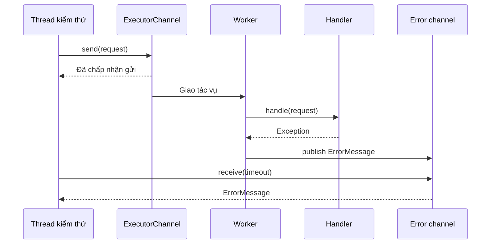

# Kiểm thử error channel

## 1. Mục tiêu và phạm vi

Trong module **SPRING_INTEGRATION_CORE**, kiểm thử luồng thông điệp cần bao phủ cả kết quả thành công lẫn hành vi khi endpoint thất bại. Bài này thuộc chương **Testing support**, tập trung vào cách chứng minh lỗi được phát hiện, đóng gói, chuyển đến đúng channel và liên kết được với thông điệp gây lỗi.

Sau bài học, bạn có thể:

- Chọn đúng giữa kiểm tra exception trả về caller và nhận `ErrorMessage`.
- Kiểm tra error channel toàn cục, channel được chỉ định bằng header và channel của poller.
- Xác nhận nguyên nhân lỗi, `failedMessage` và thông tin tương quan.
- Viết kiểm thử bất đồng bộ có timeout và có điểm xác nhận xử lý đã đi đến đâu.
- Phân biệt kiểm thử hạ tầng phát sinh lỗi, kiểm thử error handler và kiểm thử hợp đồng gateway.
- Nhận ra tác động của retry, recovery và channel dùng chung đến kết quả kiểm thử.

Ví dụ chính dùng **Java 17+, Spring Integration 6.5.x, Spring Test và JUnit Jupiter 5**. Đây là mốc API cho ví dụ, không phải yêu cầu nâng cấp dự án. Dùng bộ phiên bản tương thích được quản lý bởi BOM hoặc Spring Boot của ứng dụng.

## 2. Trước hết phải xác định lỗi xảy ra trên thread nào

Một header tên `errorChannel` không tự biến mọi exception thành thông điệp lỗi. Cần có thành phần bắt exception và thực hiện việc publish, chẳng hạn cơ chế xử lý lỗi của executor, poller hoặc gateway có cấu hình tương ứng.

| Đường đi của thông điệp | Nơi xử lý trong cấu hình thông thường | Cách quan sát lỗi trong test |
|---|---|---|
| Gọi trực tiếp `DirectChannel.send(...)` | Thread của caller | `assertThrows` quanh lời gọi gửi |
| `ExecutorChannel` dùng thread pool | Worker thread | Nhận `ErrorMessage` từ channel đích |
| `QueueChannel` được endpoint lấy bằng poller | Thread chạy tác vụ polling | Nhận `ErrorMessage` của tác vụ poller |
| Messaging gateway không cấu hình error channel | Phụ thuộc flow và hợp đồng gateway | Kiểm tra exception được trả về caller |
| Messaging gateway có cấu hình error channel | Gateway chuyển lỗi vào error flow | Kiểm tra error flow và giá trị trả về nếu có |

Các dòng trong bảng giả định không có advice khác bắt và xử lý exception trước đó. Lỗi khi gửi, chẳng hạn executor từ chối nhận tác vụ, cũng cần phân biệt với lỗi nghiệp vụ xảy ra sau khi worker đã nhận thông điệp. Cơ chế đồng bộ và bất đồng bộ được mô tả trong [Error Handling của Spring Integration](https://docs.spring.io/spring-integration/reference/6.5/error-handling.html).

### 2.1. Gọi trực tiếp DirectChannel

```text
thread kiểm thử
    -> DirectChannel
    -> handler ném exception
    <- exception quay về lời gọi send()
```

Với đường đi này, test cần bao quanh `send()` bằng `assertThrows`. Chỉ thêm header `errorChannel` rồi chờ trong queue sẽ không chứng minh được cơ chế xử lý lỗi, vì không có publisher bắt exception trên đường gọi trực tiếp đó.

### 2.2. ExecutorChannel và poller



Trong cấu hình Spring Integration được khởi tạo đầy đủ, `ExecutorChannel` tích hợp cơ chế xử lý lỗi cho tác vụ dispatch. Vì vậy, ví dụ sử dụng bean trong Spring context và thread pool thật; không thay executor bằng cơ chế chạy ngay trên thread kiểm thử. Xem [mã nguồn ExecutorChannel nhánh 6.5.x](https://github.com/spring-projects/spring-integration/blob/6.5.x/spring-integration-core/src/main/java/org/springframework/integration/channel/ExecutorChannel.java).

Điều cần kiểm tra là lỗi xuất hiện ở đâu sau khi tác vụ chạy. Giá trị `true` từ `send()` chỉ xác nhận việc gửi được chấp nhận theo cơ chế của channel; nó chưa xác nhận nghiệp vụ hoàn thành.

## 3. ErrorMessage mang những gì?

`ErrorMessage` là `Message<Throwable>`. Khi một handler thất bại, payload thường là một `MessagingException` bao ngoài exception nghiệp vụ.

```text
ErrorMessage
├── payload: MessagingException
│   ├── cause: exception nghiệp vụ
│   └── failedMessage: thông điệp tại nơi thất bại
└── originalMessage: thông điệp gốc nếu publisher/strategy cung cấp
```

`originalMessage` là tùy chọn. Nó không đồng nghĩa với `failedMessage`; sau một transformer, thông điệp ở nơi thất bại có thể khác thông điệp ban đầu. Test nên kiểm tra dữ liệu theo hợp đồng của publisher đang dùng, thay vì mặc định cả hai thuộc tính luôn tồn tại. Xem [ErrorMessage Javadoc](https://docs.spring.io/spring-framework/docs/6.2.x/javadoc-api/org/springframework/messaging/support/ErrorMessage.html).

Một test có ý nghĩa thường xác nhận:

| Thuộc tính | Lý do kiểm tra |
|---|---|
| Message nhận được là `ErrorMessage` | Không nhầm với thông điệp nghiệp vụ được đưa vào cùng queue |
| Kiểu exception hoặc nguyên nhân nghiệp vụ | Chứng minh lỗi mong đợi đã xảy ra |
| `failedMessage.payload` | Xác định dữ liệu nào gây lỗi |
| Mã đơn hàng, `traceId`, correlation header | Liên kết lỗi với yêu cầu đã gửi |
| Channel đích | Phát hiện sai routing hoặc cấu hình |
| Đầu ra nghiệp vụ | Phát hiện trường hợp vừa phát lỗi vừa tạo kết quả thành công ngoài ý muốn |

`MessagingException.getFailedMessage()` có thể trả về `null` trong trường hợp tổng quát. Trong ví dụ handler bên dưới, đây là phần hợp đồng được kiểm tra nên test yêu cầu nó phải tồn tại. Không áp dụng assertion này một cách máy móc cho lỗi khởi tạo, lỗi scheduler hoặc lỗi nguồn xảy ra trước khi có message. Tham khảo [MessagingException Javadoc](https://docs.spring.io/spring-framework/docs/6.2.x/javadoc-api/org/springframework/messaging/MessagingException.html).

Không nên so sánh toàn bộ `Throwable.toString()`, stack trace hoặc chuỗi mô tả endpoint. Những chi tiết đó dễ thay đổi khi đổi cấu hình. Trong ví dụ, chỉ thông báo nghiệp vụ cố định do chính ứng dụng khai báo được so sánh chính xác.

## 4. Chọn channel đích và chuẩn bị phép thử

Với `MessagePublishingErrorHandler` chuẩn, header `MessageHeaders.ERROR_CHANNEL` của thông điệp thất bại được ưu tiên hơn channel mặc định của error handler. Giá trị header có thể là đối tượng `MessageChannel` hoặc tên bean được resolver tìm trong context. Nếu không có header, cấu hình mặc định của error handler quyết định đích đến; với cơ chế toàn cục thông thường, đó là bean `errorChannel`.

Một header trỏ sai tên bean là lỗi cấu hình cần kiểm tra riêng. Không xem việc resolve thất bại như cam kết tự chuyển sang error channel toàn cục. Quy tắc này có thể đối chiếu trong [mã nguồn MessagePublishingErrorHandler](https://github.com/spring-projects/spring-integration/blob/6.5.x/spring-integration-core/src/main/java/org/springframework/integration/channel/MessagePublishingErrorHandler.java).

Trong ví dụ, ba queue phục vụ ba phép quan sát khác nhau:

- `errorChannel`: đích toàn cục khi request bất đồng bộ không chỉ định header.
- `localErrors`: đích riêng của request có header.
- `pollerErrors`: đích mặc định được cấu hình cho poller.

`receipts` thu kết quả nghiệp vụ thành công.

Đây là context kiểm thử độc lập, không import cấu hình ứng dụng. Việc khai báo `QueueChannel` mang tên `errorChannel` giúp test đọc lỗi trực tiếp. Cấu hình này không kiểm tra các subscriber, logging hay topology của error channel trong production.

## 5. Ví dụ hoàn chỉnh: kiểm thử luồng phát sinh lỗi

### 5.1. Phụ thuộc cần có

Ví dụ cần các artifact sau trên classpath, với version tương thích do dự án quản lý:

| Artifact | Mục đích |
|---|---|
| `org.springframework.integration:spring-integration-core` | Channel, endpoint và Java DSL |
| `org.springframework:spring-test` | Spring TestContext và `@SpringJUnitConfig` |
| `org.junit.jupiter:junit-jupiter` | JUnit Jupiter API và test engine |

Ví dụ chưa dùng API mock riêng của Spring Integration nên không bắt buộc thêm `spring-integration-test`. Phần 9 giải thích khi nào cần module đó.

### 5.2. Mô hình nghiệp vụ

Một đơn hàng có `quantity <= 0` phải thất bại với `IllegalArgumentException`. Đơn hợp lệ tạo một `Receipt`.

Cùng logic được nối vào ba đầu vào:

```text
syncInput   (DirectChannel)   -> accept(order) -> receipts
asyncInput  (ExecutorChannel) -> accept(order) -> receipts
polledInput (QueueChannel)    -> poller -> accept(order) -> receipts
```

Test cố ý có một worker cho `asyncInput`, một handler ở mỗi đường và không cấu hình retry. Những điều kiện này làm rõ thứ tự xử lý và số lỗi dự kiến.

### 5.3. Mã kiểm thử

Đặt lớp sau trong source set kiểm thử của một dự án đã có các phụ thuộc trên. Lớp không cần component scan hay ứng dụng Spring Boot.

```java
import org.junit.jupiter.api.Test;
import org.junit.jupiter.api.parallel.Execution;
import org.junit.jupiter.api.parallel.ExecutionMode;
import org.springframework.beans.factory.annotation.Autowired;
import org.springframework.beans.factory.annotation.Qualifier;
import org.springframework.context.annotation.Bean;
import org.springframework.context.annotation.Configuration;
import org.springframework.integration.channel.DirectChannel;
import org.springframework.integration.channel.ExecutorChannel;
import org.springframework.integration.channel.QueueChannel;
import org.springframework.integration.config.EnableIntegration;
import org.springframework.integration.dsl.IntegrationFlow;
import org.springframework.integration.dsl.Pollers;
import org.springframework.messaging.Message;
import org.springframework.messaging.MessageHeaders;
import org.springframework.messaging.MessagingException;
import org.springframework.messaging.support.ErrorMessage;
import org.springframework.messaging.support.MessageBuilder;
import org.springframework.scheduling.concurrent.ThreadPoolTaskExecutor;
import org.springframework.test.annotation.DirtiesContext;
import org.springframework.test.context.junit.jupiter.SpringJUnitConfig;

import static org.junit.jupiter.api.Assertions.*;

@SpringJUnitConfig(ErrorChannelTest.Config.class)
@DirtiesContext(classMode = DirtiesContext.ClassMode.AFTER_EACH_TEST_METHOD)
@Execution(ExecutionMode.SAME_THREAD)
class ErrorChannelTest {

    private static final long WAIT_MS = 2_000;

    record Order(String orderId, int quantity) {}
    record Receipt(String orderId, int amount) {}

    @Autowired
    @Qualifier("syncInput")
    DirectChannel syncInput;

    @Autowired
    @Qualifier("asyncInput")
    ExecutorChannel asyncInput;

    @Autowired
    @Qualifier("polledInput")
    QueueChannel polledInput;

    @Autowired
    @Qualifier("errorChannel")
    QueueChannel globalErrors;

    @Autowired
    @Qualifier("localErrors")
    QueueChannel localErrors;

    @Autowired
    @Qualifier("pollerErrors")
    QueueChannel pollerErrors;

    @Autowired
    @Qualifier("receipts")
    QueueChannel receipts;

    @Test
    void directFailureIsThrownToCallerDespiteErrorHeader() {
        Message<Order> request = MessageBuilder
                .fromMessage(request("O-SYNC", 0))
                .setHeader(MessageHeaders.ERROR_CHANNEL, localErrors)
                .build();

        MessagingException failure = assertThrows(
                MessagingException.class,
                () -> syncInput.send(request, WAIT_MS));

        assertFailure(failure, request);
        assertNull(receipts.receive(0));
        assertErrorQueuesEmpty();
    }

    @Test
    void asyncFailureWithoutHeaderUsesGlobalErrorChannel() {
        Message<Order> request = request("O-GLOBAL", 0);

        assertTrue(asyncInput.send(request, WAIT_MS));
        assertError(globalErrors, request);

        awaitAsyncMarker();
        assertErrorQueuesEmpty();
    }

    @Test
    void channelObjectHeaderOverridesGlobalErrorChannel() {
        Message<Order> request = MessageBuilder
                .fromMessage(request("O-LOCAL-OBJECT", 0))
                .setHeader(MessageHeaders.ERROR_CHANNEL, localErrors)
                .build();

        assertTrue(asyncInput.send(request, WAIT_MS));
        assertError(localErrors, request);

        awaitAsyncMarker();
        assertErrorQueuesEmpty();
    }

    @Test
    void channelBeanNameHeaderIsResolved() {
        Message<Order> request = MessageBuilder
                .fromMessage(request("O-LOCAL-NAME", 0))
                .setHeader(MessageHeaders.ERROR_CHANNEL, "localErrors")
                .build();

        assertTrue(asyncInput.send(request, WAIT_MS));
        assertError(localErrors, request);

        awaitAsyncMarker();
        assertErrorQueuesEmpty();
    }

    @Test
    void successfulAsyncOrderProducesReceiptWithoutError() {
        Message<Order> request = request("O-OK", 2);

        assertTrue(asyncInput.send(request, WAIT_MS));

        Message<?> reply = receipts.receive(WAIT_MS);
        assertNotNull(reply, "Không nhận được Receipt");
        assertEquals(new Receipt("O-OK", 200), reply.getPayload());

        awaitAsyncMarker();
        assertErrorQueuesEmpty();
    }

    @Test
    void pollingFailureUsesConfiguredDefaultErrorChannel() {
        Message<Order> request = request("O-POLLER", 0);

        assertTrue(polledInput.send(request, WAIT_MS));
        assertError(pollerErrors, request);

        assertNull(receipts.receive(0));
        assertErrorQueuesEmpty();
    }

    @Test
    void requestHeaderOverridesPollerDefaultErrorChannel() {
        Message<Order> request = MessageBuilder
                .fromMessage(request("O-POLLER-LOCAL", 0))
                .setHeader(MessageHeaders.ERROR_CHANNEL, "localErrors")
                .build();

        assertTrue(polledInput.send(request, WAIT_MS));
        assertError(localErrors, request);

        assertNull(receipts.receive(0));
        assertErrorQueuesEmpty();
    }

    private static Message<Order> request(String orderId, int quantity) {
        return MessageBuilder.withPayload(new Order(orderId, quantity))
                .setHeader("traceId", "trace-" + orderId)
                .build();
    }

    private static void assertError(
            QueueChannel channel, Message<Order> request) {

        Message<?> received = channel.receive(WAIT_MS);
        assertNotNull(received, "Không nhận được thông điệp lỗi");

        ErrorMessage error = assertInstanceOf(ErrorMessage.class, received);
        MessagingException failure = assertInstanceOf(
                MessagingException.class, error.getPayload());

        assertFailure(failure, request);
    }

    private static void assertFailure(
            MessagingException failure, Message<Order> request) {

        Throwable cause = failure.getMostSpecificCause();
        assertInstanceOf(IllegalArgumentException.class, cause);
        assertEquals("quantity must be positive", cause.getMessage());

        Message<?> failed = failure.getFailedMessage();
        assertNotNull(failed, "Handler failure phải giữ failedMessage");
        assertEquals(request.getPayload(), failed.getPayload());
        assertEquals(
                request.getHeaders().get("traceId"),
                failed.getHeaders().get("traceId"));

        // Flow này không biến đổi message trước handler.
        assertEquals(
                request.getHeaders().getId(),
                failed.getHeaders().getId());
    }

    private void awaitAsyncMarker() {
        // Cùng một executor chỉ có một worker, nên marker được xử lý
        // sau tác vụ đã gửi trước đó.
        assertTrue(asyncInput.send(request("MARKER", 1), WAIT_MS));

        Message<?> markerReply = receipts.receive(WAIT_MS);
        assertNotNull(markerReply, "Worker chưa xử lý đến marker");
        assertEquals(new Receipt("MARKER", 100), markerReply.getPayload());

        // Nếu tác vụ lỗi tạo Receipt ngoài ý muốn, phép nhận phía trên
        // hoặc assertion này sẽ phát hiện kết quả thừa.
        assertNull(receipts.receive(0));
    }

    private void assertErrorQueuesEmpty() {
        assertNull(globalErrors.receive(0), "Còn lỗi trong global channel");
        assertNull(localErrors.receive(0), "Còn lỗi trong local channel");
        assertNull(pollerErrors.receive(0), "Còn lỗi trong poller channel");
    }

    private static Receipt accept(Order order) {
        if (order.quantity() <= 0) {
            throw new IllegalArgumentException("quantity must be positive");
        }
        return new Receipt(order.orderId(), order.quantity() * 100);
    }

    @Configuration
    @EnableIntegration
    static class Config {

        @Bean
        DirectChannel syncInput() {
            return new DirectChannel();
        }

        @Bean
        ThreadPoolTaskExecutor testExecutor() {
            ThreadPoolTaskExecutor executor = new ThreadPoolTaskExecutor();
            executor.setCorePoolSize(1);
            executor.setMaxPoolSize(1);
            executor.setQueueCapacity(20);
            executor.setThreadNamePrefix("error-channel-test-");
            executor.setWaitForTasksToCompleteOnShutdown(true);
            executor.setAwaitTerminationSeconds(2);
            return executor;
        }

        @Bean
        ExecutorChannel asyncInput(
                @Qualifier("testExecutor")
                ThreadPoolTaskExecutor executor) {
            return new ExecutorChannel(executor);
        }

        @Bean
        QueueChannel polledInput() {
            return new QueueChannel(20);
        }

        @Bean
        QueueChannel errorChannel() {
            return new QueueChannel(20);
        }

        @Bean
        QueueChannel localErrors() {
            return new QueueChannel(20);
        }

        @Bean
        QueueChannel pollerErrors() {
            return new QueueChannel(20);
        }

        @Bean
        QueueChannel receipts() {
            return new QueueChannel(20);
        }

        @Bean
        IntegrationFlow syncFlow() {
            return IntegrationFlow.from("syncInput")
                    .handle(Order.class, (order, headers) -> accept(order))
                    .channel("receipts")
                    .get();
        }

        @Bean
        IntegrationFlow asyncFlow() {
            return IntegrationFlow.from("asyncInput")
                    .handle(Order.class, (order, headers) -> accept(order))
                    .channel("receipts")
                    .get();
        }

        @Bean
        IntegrationFlow polledFlow() {
            return IntegrationFlow.from("polledInput")
                    .handle(
                            Order.class,
                            (order, headers) -> accept(order),
                            endpoint -> endpoint
                                    .id("polledOrderHandler")
                                    .poller(Pollers.fixedDelay(20)
                                            .receiveTimeout(0)
                                            .maxMessagesPerPoll(1)
                                            .errorChannel("pollerErrors")))
                    .channel("receipts")
                    .get();
        }
    }
}
```

### 5.4. Đọc kết quả của từng test

| Test | Điều được chứng minh |
|---|---|
| `directFailureIsThrownToCallerDespiteErrorHeader` | Gọi trực tiếp qua channel đồng bộ trả exception về caller; header không tự publish lỗi |
| `asyncFailureWithoutHeaderUsesGlobalErrorChannel` | Lỗi của worker đi vào channel toàn cục |
| `channelObjectHeaderOverridesGlobalErrorChannel` | Header chứa đối tượng channel điều hướng lỗi riêng cho request |
| `channelBeanNameHeaderIsResolved` | Tên bean trong header được resolve đúng |
| `successfulAsyncOrderProducesReceiptWithoutError` | Đường thành công tạo kết quả và không tạo lỗi trong phạm vi flow đang xét |
| `pollingFailureUsesConfiguredDefaultErrorChannel` | Lỗi khi poller gọi handler đến channel mặc định đã cấu hình |
| `requestHeaderOverridesPollerDefaultErrorChannel` | Header vẫn được ưu tiên hơn mặc định của error handler mà poller sử dụng |

Trong Java DSL ở trên, `.errorChannel("pollerErrors")` cấu hình channel mặc định của một `MessagePublishingErrorHandler` cho poller. Nó không phải lệnh loại bỏ header `errorChannel` của request. Có thể kiểm tra cách thiết lập này trong [mã nguồn PollerSpec](https://github.com/spring-projects/spring-integration/blob/6.5.x/spring-integration-core/src/main/java/org/springframework/integration/dsl/PollerSpec.java).

`QueueChannel` chỉ giữ message để poller lấy. Việc đưa request vào `polledInput` chưa trực tiếp gọi `accept()`. Test nhận `ErrorMessage` mới quan sát được tác vụ polling đã chạy đến handler và thất bại.

## 6. Vì sao ví dụ không dùng Thread.sleep()?

### 6.1. Chờ sự kiện với giới hạn thời gian

```java
Message<?> error = errors.receive(2_000);
assertNotNull(error);
```

Lệnh nhận trả về ngay khi có message, hoặc trả `null` khi hết timeout. Cách này tránh việc luôn chờ một khoảng cố định trước khi kiểm tra.

`receive(0)` chỉ thăm dò tại thời điểm gọi. Nó phù hợp khi đã có căn cứ về tiến độ xử lý, không phải cách chờ tác vụ bất đồng bộ bắt đầu. `receive()` không truyền timeout có thể làm test treo vô hạn khi flow hỏng.

Trong ví dụ, `WAIT_MS` là giới hạn cho từng phép gửi/nhận, không phải tổng thời gian tối đa của toàn bộ test. Khi điều chỉnh cho môi trường CI, cần tính đến thời gian khởi tạo context, polling và số lần chờ.

### 6.2. Dùng marker để giới hạn những tác vụ cần quan sát

Sau khi nhận lỗi của request, các test bất đồng bộ gửi một đơn hợp lệ mang mã `MARKER`. Với đúng một worker và hàng đợi tác vụ FIFO trong cấu hình này, Receipt của marker cho biết tác vụ trước đã đi qua quá trình xử lý trên worker.

Nhờ vậy, việc thăm dò các error queue có ngữ cảnh rõ ràng hơn. Nếu flow có nhiều worker, có bước xử lý bất đồng bộ tiếp theo, retry được lên lịch hoặc callback ngoài executor, marker ở đầu vào không còn chứng minh tất cả nhánh đã kết thúc. Khi đó cần latch, completion event, future hoặc điểm quan sát tại bước cuối thích hợp.

Marker không chứng minh rằng hệ thống sẽ không bao giờ phát thêm lỗi. Assertion âm tính luôn cần phạm vi: các tác vụ nào đã hoàn tất, có nhánh nào đang chạy và có retry/redelivery nào còn có thể xảy ra.

### 6.3. Cô lập trạng thái giữa các test

Ví dụ tạo lại context sau mỗi test bằng `@DirtiesContext`, đồng thời yêu cầu các phương thức trong lớp chạy cùng thread. Cách này giúp mỗi test có queue rỗng, executor và endpoint riêng; đổi lại thời gian chạy tăng lên.

Spring Test có thể tái sử dụng context giữa các test cùng cấu hình. Nếu muốn giữ context để chạy nhanh hơn, cần chủ động chờ tác vụ cũ kết thúc, dọn queue và reset mock/subscription theo đúng vòng đời. Chỉ xóa queue lúc bắt đầu không ngăn được tác vụ cũ publish lỗi sau đó. Xem [Context Caching của Spring Test](https://docs.spring.io/spring-framework/reference/6.2/testing/testcontext-framework/ctx-management/caching.html).

## 7. Kiểm thử error handler là một lớp kiểm thử khác

Các test ở phần 5 đi từ request thật đến lỗi được framework publish. Chúng kiểm tra ranh giới xử lý lỗi và cách chọn channel.

Nếu mục tiêu là router, transformer hoặc bộ ghi nhận lỗi phía sau error channel, có thể tự tạo `ErrorMessage` để kiểm tra consumer độc lập:

```java
import org.junit.jupiter.api.Test;
import org.springframework.integration.channel.DirectChannel;
import org.springframework.integration.channel.QueueChannel;
import org.springframework.messaging.Message;
import org.springframework.messaging.MessageHandlingException;
import org.springframework.messaging.MessagingException;
import org.springframework.messaging.support.ErrorMessage;
import org.springframework.messaging.support.MessageBuilder;

import static org.junit.jupiter.api.Assertions.*;

class ErrorConsumerTest {

    @Test
    void mapsFailureToBusinessRejection() {
        DirectChannel errors = new DirectChannel();
        QueueChannel rejections = new QueueChannel(10);

        errors.subscribe(message -> {
            ErrorMessage error = (ErrorMessage) message;
            MessagingException failure =
                    (MessagingException) error.getPayload();
            Message<?> failed = failure.getFailedMessage();

            if (failed == null) {
                throw new IllegalStateException("Missing failedMessage");
            }

            rejections.send(MessageBuilder
                    .withPayload("REJECTED:" + failed.getPayload())
                    .setHeader("traceId", failed.getHeaders().get("traceId"))
                    .build());
        });

        Message<String> failedRequest = MessageBuilder
                .withPayload("O-100")
                .setHeader("traceId", "T-100")
                .build();

        MessagingException failure = new MessageHandlingException(
                failedRequest,
                new IllegalArgumentException("quantity must be positive"));

        assertTrue(errors.send(new ErrorMessage(failure)));

        Message<?> rejection = rejections.receive(0);
        assertNotNull(rejection);
        assertEquals("REJECTED:O-100", rejection.getPayload());
        assertEquals("T-100", rejection.getHeaders().get("traceId"));
    }
}
```

Đây là consumer minh họa với hợp đồng đầu vào hẹp: payload lỗi phải là `MessagingException` có `failedMessage`. Một consumer dùng chung cho nhiều nguồn cần xử lý thêm các kiểu `Throwable` khác và trường hợp thiếu thông điệp.

Phép thử trên chứng minh phép ánh xạ lỗi thành rejection. Nó không chứng minh framework đã bắt exception từ một endpoint nghiệp vụ. Trong ứng dụng thực tế, hãy gọi cùng consumer hoặc import cùng error flow đang dùng trong production để tránh kiểm tra một bản sao logic chỉ tồn tại trong test.

Nếu bộ xử lý lỗi có router, tạo các lỗi thuộc từng loại rồi kiểm tra channel được chọn và thông tin tương quan. Nếu có filter, phân biệt rõ thông điệp bị loại theo chủ đích với thông điệp bị mất vì channel không có consumer.

## 8. Gateway: phải kiểm tra cả hợp đồng trả về caller

Gateway có khả năng bắt lỗi của flow rồi chuyển sang error flow theo cấu hình. Do đó, một gateway gọi `DirectChannel` vẫn có thể đưa lỗi đến channel đã cấu hình cho gateway; điều này không mâu thuẫn với test gọi trực tiếp `syncInput.send()`.

Ví dụ cấu hình sau minh họa một gateway trả chuỗi fallback khi backend thất bại. Có thể thêm các khai báo này vào một `@Configuration @EnableIntegration` riêng cho test gateway:

```java
public interface TextGateway {
    String process(String request);
}

@Bean
org.springframework.integration.gateway.GatewayProxyFactoryBean textGateway() {
    var factory =
            new org.springframework.integration.gateway.GatewayProxyFactoryBean(
                    TextGateway.class);
    factory.setDefaultRequestChannelName("gatewayInput");
    factory.setErrorChannelName("gatewayErrors");
    factory.setDefaultRequestTimeout(1_000L);
    factory.setDefaultReplyTimeout(1_000L);
    return factory;
}

@Bean
org.springframework.integration.dsl.IntegrationFlow backendFlow() {
    return org.springframework.integration.dsl.IntegrationFlow
            .from("gatewayInput")
            .<String, String>transform(request -> {
                throw new IllegalStateException("backend unavailable");
            })
            .get();
}

@Bean
org.springframework.integration.dsl.IntegrationFlow gatewayErrorFlow() {
    return org.springframework.integration.dsl.IntegrationFlow
            .from("gatewayErrors")
            .transform(Throwable.class, failure -> "FALLBACK")
            .get();
}
```

Các channel đầu vào có tên trong hai flow được DSL tạo khi chưa có bean tương ứng. Error transformer trả reply về gateway bằng cơ chế reply của message. Gateway proxy có thể được inject theo kiểu `TextGateway`, rồi kiểm tra:

```java
assertEquals("FALLBACK", textGateway.process("hello"));
```

Test gateway đầy đủ nên bao phủ lỗi được trả về caller khi không có error flow, và fallback hoặc exception theo chính sách khi có error flow. Kiểu exception mà gateway trả về có thể khác wrapper nhận được khi gọi channel trực tiếp, do gateway có quy tắc unwrap exception.

Với phương thức có giá trị trả về, một error flow chỉ ghi log hoặc chỉ đưa lỗi vào queue chưa tạo reply cho caller. Cần kiểm tra hành vi khi không có reply bằng timeout đã cấu hình. Không mặc định mọi lỗi đều tạo fallback. Xem [Messaging Gateways — Error Handling](https://docs.spring.io/spring-integration/reference/6.5/gateway.html#error-handling).

## 9. Dùng Spring Integration Test khi cần thay endpoint

Trong flow lớn, lỗi thường đến từ một HTTP client, repository hoặc outbound adapter. Để kiểm tra error channel ổn định, tạo lỗi có kiểm soát ở đúng ranh giới đó, chẳng hạn stub service client ném exception mong đợi.

Khi cần thay handler bên trong context thật, có thể dùng `spring-integration-test`, `@SpringIntegrationTest` và `MockIntegrationContext`:

```java
// Các thành viên đặt trong test đã có @SpringJUnitConfig
// và @SpringIntegrationTest.
@Autowired
org.springframework.integration.test.context.MockIntegrationContext
        mockIntegrationContext;

@org.junit.jupiter.api.AfterEach
void restoreEndpoints() {
    mockIntegrationContext.resetBeans();
}

@Test
void downstreamFailureCanBeInjected() {
    mockIntegrationContext.substituteMessageHandlerFor(
            "billingEndpoint",
            message -> {
                throw new org.springframework.messaging.MessageHandlingException(
                        message,
                        new IllegalStateException("billing unavailable"));
            });

    // Gửi request qua đầu vào thực của flow.
    // Nhận lỗi ở error channel thực và kiểm tra cause/failedMessage.
}
```

Đây là đoạn minh họa thao tác thay endpoint; cần bổ sung cấu hình flow và assertion cụ thể của ứng dụng. `billingEndpoint` phải là **bean name của endpoint consumer**, không phải tên channel hay tên bean service tùy ý. Endpoint có thể được đặt tên chủ động bằng `.handle(..., e -> e.id("billingEndpoint"))`.

Giữ lại channel bất đồng bộ hoặc poller cần kiểm tra. Thay toàn bộ phần đó bằng mock sẽ bỏ qua chính cơ chế publish lỗi. `resetBeans()` phục hồi thành phần được thay; việc chờ tác vụ và dọn queue vẫn là trách nhiệm riêng của test. Các API này được mô tả trong [Testing support — Spring Integration and the Test Context](https://docs.spring.io/spring-integration/reference/6.5/testing.html#spring-integration-and-the-test-context).

## 10. Retry và recovery làm thay đổi điều gì?

Error channel không phải chính sách retry. Nếu thêm retry advice, cần nói rõ test đang quan sát lỗi sau lần thử nào và recovery có xử lý exception hay không.

| Chính sách được cấu hình | Assertion cần bổ sung |
|---|---|
| Không retry, handler thất bại | Lỗi đến đúng channel, không có Receipt của request lỗi |
| Stateless retry rồi thành công | Đúng số lần gọi dependency; có kết quả thành công |
| Stateless retry hết lượt, exception tiếp tục được ném | Số lần gọi đúng; lỗi cuối cùng đến cơ chế xử lý lỗi bao ngoài |
| Recovery publish lỗi và không ném tiếp | Kiểm tra channel recovery; không mặc định có thêm một lỗi toàn cục |
| Recovery trả fallback | Kiểm tra fallback và các đầu ra lỗi đúng theo hợp đồng |
| Stateful retry hoặc nguồn có redelivery | Kiểm tra trạng thái qua nhiều lần giao lại theo cấu hình nguồn |

Ví dụ `maxAttempts = 3` thường biểu thị tối đa ba lần gọi tổng cộng trong chính sách Spring Retry tương ứng, bao gồm lần đầu. Test cần dùng giá trị cấu hình rõ ràng và đếm số lần gọi; không suy số lần thử chỉ từ số `ErrorMessage` nhận được.

Với stateless retry bao quanh handler, exception có thể được thử lại bên trong advice trước khi thoát ra error publisher bên ngoài. Vì vậy không mặc định mỗi attempt đều tạo một `ErrorMessage`. Hành vi recovery phụ thuộc callback. Tham khảo [Provided Advice Classes — Retry Advice](https://docs.spring.io/spring-integration/reference/6.5/handler-advice/classes.html#retry-advice).

Nhận một `ErrorMessage` trong bộ nhớ cũng chưa chứng minh transaction đã rollback, broker đã NACK hay message đã vào dead-letter queue. Các hợp đồng đó cần test với transaction manager hoặc adapter/broker tương ứng.

## 11. Quan sát topology thật và tránh làm sai hành vi

### 11.1. QueueChannel và PublishSubscribeChannel có cách quan sát khác nhau

`QueueChannel.receive()` lấy message ra khỏi queue. Nếu production consumer và test cùng đọc một queue, hai bên cạnh tranh message.

`DirectChannel` phân phối một message cho một subscriber theo cơ chế dispatch của nó. Thêm một subscriber để “nghe lén” không bảo đảm cả subscriber nghiệp vụ và test đều nhận message.

Với `PublishSubscribeChannel`, có thể thêm subscriber ghi nhận sự kiện hoặc thiết kế wire tap đến queue quan sát. Khi dùng subscriber chỉ phục vụ test, phải quản lý vòng đời và gỡ đăng ký sau khi test kết thúc. Các khác biệt cấu hình channel được mô tả trong [Configuring Message Channels](https://docs.spring.io/spring-integration/reference/6.5/channel/configuration.html).

Ví dụ thu lỗi trên một pub-sub channel đồng bộ đã được inject:

```java
var observed = new java.util.concurrent.LinkedBlockingQueue<
        org.springframework.messaging.Message<?>>();

org.springframework.messaging.MessageHandler probe =
        message -> observed.add(message);

pubSubErrors.subscribe(probe);
try {
    // Gửi request khiến flow thất bại ở đây.
    var error = observed.poll(2, java.util.concurrent.TimeUnit.SECONDS);
    assertNotNull(error);
} finally {
    pubSubErrors.unsubscribe(probe);
}
```

Đây là đoạn gắn probe; cần cung cấp `pubSubErrors`, request và assertion của test thực tế. Một subscriber khác ném lỗi có thể ảnh hưởng dispatch tùy cấu hình, nên việc chỉ thêm probe chưa bảo đảm quan sát độc lập.

### 11.2. Error channel không có consumer

Một test thay error channel thật bằng queue chỉ chứng minh việc đưa lỗi vào queue. Nó không phát hiện mọi lỗi của consumer phía sau trong production.

Nếu hợp đồng yêu cầu lỗi phải được xử lý đến bước ghi nhận hoặc gửi thông báo, cần thêm phép quan sát tại bước cuối của error flow. Đừng chỉ dựa vào log hoặc sự tồn tại của bean `errorChannel`.

## 12. Các lỗi kiểm thử thường gặp

| Hiện tượng | Nguyên nhân có thể có | Hướng sửa |
|---|---|---|
| Chờ error queue nhưng test nhận exception ngay | Gọi trực tiếp flow đồng bộ | Kiểm tra bằng `assertThrows`, hoặc gọi qua ranh giới xử lý lỗi phù hợp |
| `assertThrows` không bắt được lỗi worker | Handler chạy sau khi `send()` đã trả về | Chờ `ErrorMessage` |
| Test pass dù không có message | Chỉ kiểm tra `send() == true` | Kiểm tra message nhận được và nội dung lỗi |
| Lúc pass, lúc fail trên CI | Dùng sleep ngắn hoặc thăm dò queue quá sớm | Chờ sự kiện với timeout và điểm hoàn tất rõ ràng |
| Trace ID bị thiếu | Đọc nhầm header của `ErrorMessage` | Kiểm tra header trên `failedMessage` hoặc hợp đồng strategy riêng |
| Kết quả bị lẫn giữa các test | Context, queue hoặc tác vụ được dùng chung | Cô lập context hoặc quản lý completion/cleanup đầy đủ |
| Sai kỳ vọng số lỗi | Có retry, recovery hoặc redelivery | Kiểm tra chính sách và số lần gọi dependency |
| Test treo | Gọi receive không giới hạn hoặc gateway thiếu reply | Đặt timeout và kiểm tra hợp đồng reply |
| Lỗi vẫn thiếu trong queue riêng | Sai tên bean, header bị thay đổi hoặc lỗi xảy ra trước message | Kiểm tra header tại điểm thất bại và ranh giới publish |
| Test error handler pass nhưng luồng thực vẫn mất lỗi | Test chỉ tự gửi `ErrorMessage` | Bổ sung test đi từ request qua endpoint thất bại |
| Test quan sát làm mất message nghiệp vụ | Test cạnh tranh consumer trên queue/direct channel | Dùng topology quan sát phù hợp hoặc context riêng |

## 13. Thực hành mở rộng

Thực hiện lần lượt trên ví dụ chính:

1. Thêm transformer trước handler để đổi payload, rồi kiểm tra `failedMessage` phản ánh dữ liệu tại điểm thất bại. Giữ một business ID hoặc trace ID ổn định thay vì mặc định message ID luôn giữ nguyên.
2. Thay logic inline bằng service client có thể stub. Làm client ném lỗi và kiểm tra message vẫn đi qua channel, endpoint cùng error publisher thực.
3. Tạo error flow phân loại lỗi dữ liệu và lỗi tạm thời. Kiểm tra từng channel đích bằng dữ liệu lỗi riêng.
4. Cấu hình stateless retry với số lượt cụ thể. Kiểm tra số lần gọi, kết quả cuối và channel nhận lỗi khi hết lượt.
5. Viết test riêng cho lỗi của chính error consumer. Xác định cơ chế quan sát khi việc ghi nhận lỗi thất bại.
6. Với một gateway trả kết quả, kiểm tra cả fallback lẫn trường hợp error flow không tạo reply trong thời hạn.

Mỗi phép thử nên gắn với một hợp đồng quan sát được: request nào gây lỗi, lỗi nào được phát ra, đích nào nhận nó, đầu ra nghiệp vụ nào được phép tồn tại và khi nào có thể kết luận việc xử lý trong phạm vi đó đã hoàn tất.
