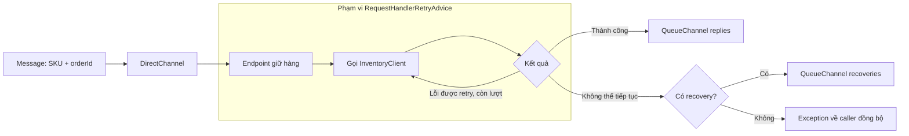

# Kiểm thử retry advice

## 1. Mục tiêu và phạm vi

Trong Spring Integration Core, một endpoint có thể gọi dịch vụ kho, thanh toán hoặc API đối tác và gặp lỗi tạm thời. Retry advice cho phép gọi lại phần xử lý được bọc bởi advice. Một bài kiểm thử tốt phải chứng minh cả **khi nào gọi lại**, **gọi bao nhiêu lần**, **kết thúc bằng đường nào** và **message nào đi tiếp**.

Sau bài này, bạn có thể:

- Gắn `RequestHandlerRetryAdvice` vào endpoint bằng Java DSL và kiểm thử qua `MessageChannel`.
- Phân biệt tổng số lần thực hiện với số lần thử lại sau lần đầu.
- Kiểm tra lỗi được retry, lỗi bị loại khỏi retry và nguyên nhân lồng trong exception.
- Xác minh reply, recovery message, exception truyền về caller và header nghiệp vụ.
- Kiểm thử backoff mà không thực sự cho thread ngủ.
- Nhận diện giới hạn của test đồng bộ, stateful retry và tác dụng phụ khi gọi lại.

**Mốc phiên bản của ví dụ chính:** Java 17 trở lên, Spring Integration **6.5.x**, Spring Retry **2.x**, JUnit Jupiter và Mockito. Đây là mốc API minh họa, không phải yêu cầu đổi phiên bản dự án. Từ Spring Integration 7.0, retry chuyển sang API của Spring Framework; mục 11 trình bày cách đối chiếu. Không trộn các import của hai thế hệ trong cùng một ví dụ. Xem [thay đổi retry từ 6.5 sang 7.0](https://docs.spring.io/spring-integration/reference/changes-6.5-7.0.html).

## 2. Xác định chính xác đối tượng được retry

Xét một luồng xử lý yêu cầu giữ hàng:



Với reply-producing handler thông thường, advice bọc phần `handleRequestMessage()`. Việc gửi reply sang bước tiếp theo diễn ra sau phần này. Vì vậy, không được mặc định rằng retry trên endpoint A cũng gọi lại transformer đứng trước A hoặc xử lý lỗi phát sinh ở endpoint B phía sau. Vị trí đặt advice là một phần của hợp đồng cần kiểm thử. Cơ chế này được thể hiện trong [AbstractReplyProducingMessageHandler](https://github.com/spring-projects/spring-integration/blob/v6.5.0/spring-integration-core/src/main/java/org/springframework/integration/handler/AbstractReplyProducingMessageHandler.java).

### 2.1. Số lần thực hiện trong Spring Retry 2.x

Với `SimpleRetryPolicy(3, ...)`:

```text
Lần thực hiện 1: gọi ban đầu
Lần thực hiện 2: retry thứ nhất
Lần thực hiện 3: retry thứ hai

Tối đa: 3 lần gọi handler, không phải 4.
```

`maxAttempts` bao gồm lần gọi đầu tiên. Nếu thành công sớm hoặc gặp lỗi không được retry, số lần gọi thực tế thấp hơn giới hạn. Đây là ngữ nghĩa của [SimpleRetryPolicy trong Spring Retry](https://github.com/spring-projects/spring-retry/blob/v2.0.12/src/main/java/org/springframework/retry/policy/SimpleRetryPolicy.java).

Không dùng giá trị mặc định làm điều kiện ngầm của test. Khai báo giới hạn rõ ràng để khi đổi phiên bản, bài kiểm thử vẫn thể hiện đúng chủ ý.

### 2.2. Stateless và stateful

**Stateless retry:** một lần đi vào advice có thể gọi handler nhiều lần trước khi trả kết quả hoặc thất bại. Đây là chế độ dùng trong ví dụ chính.

**Stateful retry:** trạng thái được giữ theo khóa; lỗi có thể được ném về phía nguồn để nguồn giao lại message. Một lần `send()` không đồng nghĩa với chạy hết ngân sách retry. Trong dòng 6.5, chế độ này dùng `RetryStateGenerator`. Xem [Retry Advice của Spring Integration 6.5](https://docs.spring.io/spring-integration/reference/6.5/handler-advice/classes.html).

## 3. Lập ma trận hành vi trước khi viết test

Giả sử hợp đồng của dịch vụ giữ hàng là:

- Chỉ `TemporaryInventoryException` và các lớp con được retry.
- Tối đa ba lần thực hiện cho mỗi lượt xử lý stateless.
- Khi dùng recovery, lỗi cuối được chuyển sang kênh `recoveries`.
- Một yêu cầu thành công tạo đúng một reply, giữ nguyên `orderId`.
- Endpoint không bắt buộc tạo reply khi recovery kết thúc bằng `null`.

| Kịch bản | Chuỗi kết quả của dịch vụ | Số lần gọi | Reply | Recovery hoặc exception |
|---|---|---:|---:|---|
| Thành công ngay | Thành công | 1 | 1 | Không |
| Lỗi tạm thời rồi thành công | Lỗi, lỗi, thành công | 3 | 1 | Không |
| Hết lượt, có recovery | Lỗi tạm thời liên tiếp | 3 | 0 | Một recovery message |
| Lỗi nghiệp vụ, có recovery | Lỗi không được retry | 1 | 0 | Một recovery message theo cấu hình bài |
| Hết lượt, không recovery | Lỗi tạm thời liên tiếp | 3 | 0 | Exception về caller |
| Lỗi nghiệp vụ, không recovery | Lỗi không được retry | 1 | 0 | Exception về caller |
| Hai yêu cầu độc lập | Mỗi yêu cầu lỗi hai lần rồi thành công | 3 mỗi yêu cầu | 2 | Không |

**Không retry** và **không recovery** là hai quyết định khác nhau. Trong policy của bài, lỗi nghiệp vụ không được gọi lại nhưng vẫn được đưa vào recovery khi endpoint có callback. Nếu ứng dụng yêu cầu lỗi ấy truyền thẳng ra ngoài, cần cấu hình thêm chính sách recovery phù hợp với phiên bản và có test riêng.

## 4. Dựng bài kiểm thử tại đúng ranh giới

Để kiểm tra wiring của advice, hãy gửi một `Message` vào luồng thật. Mock đối tượng `InventoryClient` mà handler gọi ra ngoài. Nếu gọi trực tiếp `client.reserve()`, test chỉ kiểm tra mock; nó không chứng minh endpoint đã được gắn advice.

Ví dụ dùng:

- `DirectChannel` ở đầu vào để mọi lần gọi handler hoàn thành trên thread gửi.
- `QueueChannel` ở đầu ra để test chủ động lấy reply và lỗi.
- Hai endpoint có cùng nghiệp vụ nhưng khác cách kết thúc: có recovery và không có recovery.
- Context do `@SpringJUnitConfig` quản lý; `@EnableIntegration` khởi tạo hạ tầng Integration.

Các dependency cần có trong môi trường test:

| Artifact | Vai trò |
|---|---|
| `org.springframework.integration:spring-integration-core` | Channel, endpoint, advice và Java DSL |
| `org.springframework.retry:spring-retry` | RetryTemplate, retry policy và backoff của dòng 6.5 |
| `org.springframework:spring-test` | SpringJUnitConfig |
| `org.junit.jupiter:junit-jupiter` | Test và assertion |
| `org.mockito:mockito-core` | Mock dịch vụ ngoài |
| `org.springframework.integration:spring-integration-test` | Chỉ cần thêm nếu dùng các tiện ích Integration test ở mục 9 |

Quản lý phiên bản bằng BOM tương thích của ứng dụng. Class bên dưới dùng JUnit Jupiter, không cần `MockitoExtension` vì mock được tạo trực tiếp trong cấu hình test. Build cần bật JUnit Platform.

Spring Integration phân chia tiện ích kiểm thử thành `spring-integration-test-support` và `spring-integration-test`; với luồng đơn giản này, JUnit, Mockito và Spring Test đã đủ. Xem [Testing support](https://docs.spring.io/spring-integration/reference/6.5/testing.html).

## 5. Ví dụ đầy đủ: kiểm thử endpoint bằng Java DSL

Toàn bộ đoạn sau là một class test. Các test chia sẻ context nên reset mock và vét sạch queue trước mỗi test. Chạy các phương thức trong class này tuần tự; không bật thực thi song song cho fixture dùng chung.

```java
import java.util.Map;

import org.junit.jupiter.api.BeforeEach;
import org.junit.jupiter.api.Test;
import org.junit.jupiter.api.parallel.Execution;
import org.junit.jupiter.api.parallel.ExecutionMode;

import org.springframework.beans.factory.annotation.Autowired;
import org.springframework.beans.factory.annotation.Qualifier;
import org.springframework.context.annotation.Bean;
import org.springframework.context.annotation.Configuration;
import org.springframework.integration.channel.DirectChannel;
import org.springframework.integration.channel.QueueChannel;
import org.springframework.integration.config.EnableIntegration;
import org.springframework.integration.dsl.IntegrationFlow;
import org.springframework.integration.handler.advice.ErrorMessageSendingRecoverer;
import org.springframework.integration.handler.advice.RequestHandlerRetryAdvice;
import org.springframework.messaging.Message;
import org.springframework.messaging.MessageChannel;
import org.springframework.messaging.MessagingException;
import org.springframework.messaging.support.ErrorMessage;
import org.springframework.messaging.support.MessageBuilder;
import org.springframework.retry.backoff.NoBackOffPolicy;
import org.springframework.retry.policy.SimpleRetryPolicy;
import org.springframework.retry.support.RetryTemplate;
import org.springframework.test.context.junit.jupiter.SpringJUnitConfig;

import static org.junit.jupiter.api.Assertions.*;
import static org.mockito.Mockito.*;

@SpringJUnitConfig(RetryAdviceFlowTest.Config.class)
@Execution(ExecutionMode.SAME_THREAD)
class RetryAdviceFlowTest {

    @Autowired
    InventoryClient client;

    @Autowired
    @Qualifier("recoveringInput")
    MessageChannel recoveringInput;

    @Autowired
    @Qualifier("propagatingInput")
    MessageChannel propagatingInput;

    @Autowired
    @Qualifier("replies")
    QueueChannel replies;

    @Autowired
    @Qualifier("recoveries")
    QueueChannel recoveries;

    @BeforeEach
    void cleanFixture() {
        reset(client);
        drain(replies);
        drain(recoveries);
    }

    @Test
    void succeedsOnFirstAttempt() {
        when(client.reserve("SKU-1", "ORD-1"))
                .thenReturn("RESERVED");

        assertTrue(recoveringInput.send(request("SKU-1", "ORD-1")));

        assertReply("ORD-1");
        assertNull(recoveries.receive(0));
        verify(client, times(1)).reserve("SKU-1", "ORD-1");
        verifyNoMoreInteractions(client);
    }

    @Test
    void retriesTwiceThenProducesOneReply() {
        when(client.reserve("SKU-1", "ORD-2"))
                .thenThrow(new TemporaryInventoryException("timeout-1"))
                .thenThrow(new TemporaryInventoryException("timeout-2"))
                .thenReturn("RESERVED");

        assertTrue(recoveringInput.send(request("SKU-1", "ORD-2")));

        assertReply("ORD-2");
        assertNull(recoveries.receive(0));
        verify(client, times(3)).reserve("SKU-1", "ORD-2");
        verifyNoMoreInteractions(client);
    }

    @Test
    void publishesOneErrorAfterRetryExhaustion() {
        var first = new TemporaryInventoryException("timeout-1");
        var second = new TemporaryInventoryException("timeout-2");
        var last = new TemporaryInventoryException("timeout-3");
        when(client.reserve("SKU-1", "ORD-3"))
                .thenThrow(first, second, last);
        Message<String> sent = request("SKU-1", "ORD-3");

        assertTrue(recoveringInput.send(sent));

        assertRecovery(sent, last);
        assertNull(replies.receive(0));
        verify(client, times(3)).reserve("SKU-1", "ORD-3");
        verifyNoMoreInteractions(client);
    }

    @Test
    void doesNotRetryPermanentFailureButStillRecoversIt() {
        var invalid = new PermanentInventoryException("unknown SKU");
        when(client.reserve("INVALID", "ORD-4")).thenThrow(invalid);
        Message<String> sent = request("INVALID", "ORD-4");

        assertTrue(recoveringInput.send(sent));

        assertRecovery(sent, invalid);
        assertNull(replies.receive(0));
        verify(client, times(1)).reserve("INVALID", "ORD-4");
        verifyNoMoreInteractions(client);
    }

    @Test
    void propagatesFinalFailureWhenRecoveryIsAbsent() {
        var last = new TemporaryInventoryException("still unavailable");
        when(client.reserve("SKU-1", "ORD-5")).thenThrow(last);

        MessagingException failure = assertThrows(
                MessagingException.class,
                () -> propagatingInput.send(request("SKU-1", "ORD-5")));

        assertSame(last, rootCause(failure));
        assertNull(replies.receive(0));
        assertNull(recoveries.receive(0));
        verify(client, times(3)).reserve("SKU-1", "ORD-5");
        verifyNoMoreInteractions(client);
    }

    @Test
    void propagatesPermanentFailureAfterOneAttempt() {
        var invalid = new PermanentInventoryException("bad request");
        when(client.reserve("INVALID", "ORD-6")).thenThrow(invalid);

        MessagingException failure = assertThrows(
                MessagingException.class,
                () -> propagatingInput.send(request("INVALID", "ORD-6")));

        assertSame(invalid, rootCause(failure));
        assertNull(replies.receive(0));
        assertNull(recoveries.receive(0));
        verify(client, times(1)).reserve("INVALID", "ORD-6");
        verifyNoMoreInteractions(client);
    }

    @Test
    void givesIndependentRequestsIndependentRetryBudgets() {
        when(client.reserve("SKU-A", "ORD-A"))
                .thenThrow(new TemporaryInventoryException("A-1"))
                .thenThrow(new TemporaryInventoryException("A-2"))
                .thenReturn("RESERVED");
        when(client.reserve("SKU-B", "ORD-B"))
                .thenThrow(new TemporaryInventoryException("B-1"))
                .thenThrow(new TemporaryInventoryException("B-2"))
                .thenReturn("RESERVED");

        assertTrue(recoveringInput.send(request("SKU-A", "ORD-A")));
        assertReply("ORD-A");
        assertTrue(recoveringInput.send(request("SKU-B", "ORD-B")));
        assertReply("ORD-B");

        assertNull(recoveries.receive(0));
        verify(client, times(3)).reserve("SKU-A", "ORD-A");
        verify(client, times(3)).reserve("SKU-B", "ORD-B");
        verifyNoMoreInteractions(client);
    }

    private void assertReply(String orderId) {
        Message<?> reply = replies.receive(0);
        assertNotNull(reply);
        assertEquals("RESERVED", reply.getPayload());
        assertEquals(orderId, reply.getHeaders().get("orderId"));
        assertNull(replies.receive(0), "Only one reply is expected");
    }

    private void assertRecovery(Message<?> sent, Throwable expectedCause) {
        ErrorMessage error =
                assertInstanceOf(ErrorMessage.class, recoveries.receive(0));
        MessagingException failure =
                assertInstanceOf(MessagingException.class, error.getPayload());

        assertSame(expectedCause, rootCause(failure));
        Message<?> failedMessage = failure.getFailedMessage();
        assertNotNull(failedMessage);
        assertEquals(sent.getPayload(), failedMessage.getPayload());
        assertEquals(sent.getHeaders().getId(),
                failedMessage.getHeaders().getId());
        assertEquals(sent.getHeaders().get("orderId"),
                failedMessage.getHeaders().get("orderId"));
        assertNull(recoveries.receive(0), "Only one recovery is expected");
    }

    static Message<String> request(String sku, String orderId) {
        return MessageBuilder.withPayload(sku)
                .setHeader("orderId", orderId)
                .build();
    }

    static Throwable rootCause(Throwable failure) {
        Throwable current = failure;
        while (current.getCause() != null && current.getCause() != current) {
            current = current.getCause();
        }
        return current;
    }

    static void drain(QueueChannel channel) {
        while (channel.receive(0) != null) {
            // Remove leftovers from the previous synchronous test.
        }
    }

    static RetryTemplate newTemplate(int maxAttempts) {
        Map<Class<? extends Throwable>, Boolean> retryable =
                Map.of(TemporaryInventoryException.class, true);
        RetryTemplate template = new RetryTemplate();
        template.setRetryPolicy(new SimpleRetryPolicy(
                maxAttempts, retryable, true, false));
        template.setBackOffPolicy(new NoBackOffPolicy());
        return template;
    }

    interface InventoryClient {
        String reserve(String sku, String orderId);
    }

    static class TemporaryInventoryException extends RuntimeException {
        TemporaryInventoryException(String message) {
            super(message);
        }
    }

    static class PermanentInventoryException extends RuntimeException {
        PermanentInventoryException(String message) {
            super(message);
        }
    }

    @Configuration
    @EnableIntegration
    static class Config {

        @Bean
        InventoryClient client() {
            return mock(InventoryClient.class);
        }

        @Bean
        DirectChannel recoveringInput() {
            return new DirectChannel();
        }

        @Bean
        DirectChannel propagatingInput() {
            return new DirectChannel();
        }

        @Bean
        QueueChannel replies() {
            return new QueueChannel();
        }

        @Bean
        QueueChannel recoveries() {
            return new QueueChannel();
        }

        @Bean
        RequestHandlerRetryAdvice recoveringAdvice() {
            RequestHandlerRetryAdvice advice = new RequestHandlerRetryAdvice();
            advice.setRetryTemplate(newTemplate(3));
            advice.setRecoveryCallback(
                    new ErrorMessageSendingRecoverer(recoveries()));
            return advice;
        }

        @Bean
        RequestHandlerRetryAdvice propagatingAdvice() {
            RequestHandlerRetryAdvice advice = new RequestHandlerRetryAdvice();
            advice.setRetryTemplate(newTemplate(3));
            return advice;
        }

        @Bean
        IntegrationFlow recoveringFlow() {
            return IntegrationFlow.from(recoveringInput())
                    .handle(String.class,
                            (sku, headers) -> client().reserve(
                                    sku, headers.get("orderId", String.class)),
                            endpoint -> endpoint.id("reserveWithRecovery")
                                    .advice(recoveringAdvice()))
                    .channel(replies())
                    .get();
        }

        @Bean
        IntegrationFlow propagatingFlow() {
            return IntegrationFlow.from(propagatingInput())
                    .handle(String.class,
                            (sku, headers) -> client().reserve(
                                    sku, headers.get("orderId", String.class)),
                            endpoint -> endpoint.id("reserveWithoutRecovery")
                                    .advice(propagatingAdvice()))
                    .channel(replies())
                    .get();
        }
    }
}
```

Các lời gọi giữa phương thức `@Bean` trong `Config` dựa vào cơ chế proxy mặc định của `@Configuration`. Nếu chuyển sang `proxyBeanMethods = false`, hãy đổi sang inject bean qua tham số phương thức, tránh vô tình tạo thêm mock, channel hoặc advice khác.

### 5.1. Những assertion quan trọng

`verify(..., times(3))` xác nhận số lần gọi dịch vụ. Assertion reply xác nhận chỉ kết quả cuối đi tiếp và header nghiệp vụ còn nguyên. Assertion recovery xác nhận đúng message thất bại, đúng nguyên nhân cuối và chỉ một lần chuyển lỗi.

`send()` trả `true` ở nhánh recovery chỉ cho biết việc gửi và xử lý theo cấu hình đã hoàn thành. Nó không có nghĩa là giữ hàng thành công. Thành công nghiệp vụ phải được xác định qua reply hoặc trạng thái kết quả.

Khi stub bằng `thenThrow(first, second, last)`, các lần gọi vượt quá chuỗi sẽ tiếp tục ném lỗi cuối. Vì vậy, `verify(times(3))` là điều kiện phát hiện retry quá số lượt; chỉ kiểm tra có recovery là chưa đủ.

### 5.2. Vì sao bật traverseCauses?

Tham số thứ ba của `SimpleRetryPolicy` là `traverseCauses = true`; tham số thứ tư là giá trị mặc định `false` cho loại lỗi không được liệt kê. Nhờ đó, policy có thể tìm lỗi tạm thời bên trong chuỗi nguyên nhân của một exception bao ngoài.

Để kiểm tra rõ hành vi này, thêm phương thức sau vào class test ở trên. Test chủ động tạo lớp bọc, tránh phụ thuộc vào việc một handler cụ thể có bọc exception hay không:

```java
@Test
void retriesWhenTransientFailureIsNestedInsideMessagingException() {
    var wrapped = new MessagingException(
            request("SKU-1", "ORD-W"),
            "adapter failed",
            new TemporaryInventoryException("connection reset"));
    when(client.reserve("SKU-1", "ORD-W"))
            .thenThrow(wrapped)
            .thenReturn("RESERVED");

    assertTrue(recoveringInput.send(request("SKU-1", "ORD-W")));

    assertReply("ORD-W");
    assertNull(recoveries.receive(0));
    verify(client, times(2)).reserve("SKU-1", "ORD-W");
    verifyNoMoreInteractions(client);
}
```

`RequestHandlerRetryAdvice` của dòng 6.5 cũng lưu ý cần bật dò chuỗi nguyên nhân khi exception nghiệp vụ bị bọc. Xem [API và triển khai advice](https://github.com/spring-projects/spring-integration/blob/v6.5.0/spring-integration-core/src/main/java/org/springframework/integration/handler/advice/RequestHandlerRetryAdvice.java).

## 6. Kiểm thử backoff mà không chờ thời gian thực

Các test hành vi ở trên dùng `NoBackOffPolicy` để chạy nhanh. Điều đó chưa chứng minh cấu hình backoff của ứng dụng đúng. Tách một test cho policy và thay `Sleeper` bằng đối tượng ghi nhận khoảng nghỉ được yêu cầu.

Class sau độc lập với context Integration. Nó kiểm tra policy và số lần thực hiện của `RetryTemplate`, không thay thế các test wiring endpoint ở mục 5.

```java
import java.util.ArrayList;
import java.util.List;
import java.util.concurrent.atomic.AtomicInteger;

import org.junit.jupiter.api.Test;
import org.springframework.retry.backoff.ExponentialBackOffPolicy;
import org.springframework.retry.policy.SimpleRetryPolicy;
import org.springframework.retry.support.RetryTemplate;

import static org.junit.jupiter.api.Assertions.*;

class RetryBackoffTest {

    @Test
    void requestsExponentialDelaysWithAnUpperBound() {
        List<Long> requestedSleeps = new ArrayList<>();
        ExponentialBackOffPolicy backoff = new ExponentialBackOffPolicy();
        backoff.setInitialInterval(10L);
        backoff.setMultiplier(2.0);
        backoff.setMaxInterval(25L);
        backoff.setSleeper(period -> {
            requestedSleeps.add(period);
        });

        RetryTemplate template = new RetryTemplate();
        template.setRetryPolicy(new SimpleRetryPolicy(5));
        template.setBackOffPolicy(backoff);
        AtomicInteger attempts = new AtomicInteger();
        IllegalStateException last =
                new IllegalStateException("service unavailable");

        IllegalStateException thrown = assertThrows(
                IllegalStateException.class,
                () -> template.execute(context -> {
                    attempts.incrementAndGet();
                    throw last;
                }));

        assertSame(last, thrown);
        assertEquals(5, attempts.get());
        assertEquals(List.of(10L, 20L, 25L, 25L), requestedSleeps);
    }
}
```

Năm lần thực hiện thất bại tạo bốn khoảng nghỉ trước các lần gọi tiếp theo. Dãy mong đợi xác minh cả hệ số tăng và mức trần. Không đo `System.currentTimeMillis()`, không gọi `Thread.sleep()` và không yêu cầu CI hoàn thành trong một khoảng thời gian quá chặt.

`ExponentialBackOffPolicy` hỗ trợ `setSleeper()` và giới hạn thời gian nghỉ bằng `maxInterval`. Xem [Javadoc của ExponentialBackOffPolicy](https://docs.spring.io/spring-retry/docs/2.0.12/apidocs/org/springframework/retry/backoff/ExponentialBackOffPolicy.html).

Trong dự án thực tế, dùng cùng factory cấu hình backoff cho production và test, rồi chỉ thay `Sleeper` trong test. Nếu test tự tạo một policy khác với production, nó chứng minh công thức của fixture nhưng chưa bảo vệ cấu hình đang triển khai.

## 7. Kiểm thử recovery theo hợp đồng message

### 7.1. Chuyển lỗi sang kênh riêng

`ErrorMessageSendingRecoverer` phát `ErrorMessage` và trả `null`. Khi gửi lỗi thành công và handler cho phép không có reply, nhánh bình thường kết thúc mà không phát reply. Nếu endpoint yêu cầu reply, kết quả `null` có thể dẫn tới `ReplyRequiredException`; nếu chính việc gửi recovery thất bại thì caller vẫn có thể nhận exception. Xem [triển khai recoverer](https://github.com/spring-projects/spring-integration/blob/v6.5.0/spring-integration-core/src/main/java/org/springframework/integration/handler/advice/ErrorMessageSendingRecoverer.java).

Nên kiểm tra:

1. Error payload chứa đúng nguyên nhân cuối.
2. `failedMessage` mang payload và khóa nghiệp vụ của yêu cầu thất bại.
3. Kênh lỗi có đúng một message.
4. Kênh thành công không có reply.

Không mặc định header `orderId` xuất hiện ở lớp header ngoài của `ErrorMessage`. Trong ví dụ, hãy đọc nó từ `MessagingException.getFailedMessage()`. Tương tự, `ErrorMessage.getOriginalMessage()` phụ thuộc ngữ cảnh và `ErrorMessageStrategy`; không đồng nhất thuộc tính này với `failedMessage`. Xem [DefaultErrorMessageStrategy](https://github.com/spring-projects/spring-integration/blob/v6.5.0/spring-integration-core/src/main/java/org/springframework/integration/support/DefaultErrorMessageStrategy.java).

### 7.2. Trả fallback cho luồng request-reply

Một gateway yêu cầu trả lời có thể cần kết quả thay thế thay vì nhánh recovery chỉ phát lỗi. Với API 6.5, cấu hình minh họa:

```java
RequestHandlerRetryAdvice advice = new RequestHandlerRetryAdvice();
advice.setRetryTemplate(RetryAdviceFlowTest.newTemplate(3));
advice.setRecoveryCallback(context -> "PENDING_MANUAL_REVIEW");
```

Đây là phương án thay cho `ErrorMessageSendingRecoverer` của fixture, cần gắn advice mới vào endpoint thật. Test của phương án này phải đòi hỏi đúng một reply fallback, ba lần gọi khi hết lượt do lỗi tạm thời, và không có recovery message nếu callback không phát lỗi.

Không trả fallback giống giá trị thành công nghiệp vụ. Kết quả `PENDING_MANUAL_REVIEW` giúp caller phân biệt đã giữ hàng với cần xử lý bổ sung. Nếu cần đồng thời phát lỗi và trả fallback, viết callback có cả hai hành vi và xác minh từng đầu ra.

## 8. Kiểm thử phạm vi retry và tác dụng phụ

### 8.1. Bước nào được thực hiện lại?

Mở rộng fixture bằng một bộ đếm ở transformer trước endpoint giữ hàng và một bộ đếm ở endpoint sau nó. Khi dịch vụ lỗi hai lần rồi thành công, kỳ vọng với cấu trúc thông thường ở bài:

| Điểm quan sát | Số lần mong đợi |
|---|---:|
| Transformer trước endpoint được advice | 1 |
| `InventoryClient.reserve()` bên trong handler | 3 |
| Endpoint sau khi giữ hàng thành công | 1 |
| Recovery | 0 |

Một test khác cho endpoint phía sau ném exception sau khi giữ hàng thành công. Kỳ vọng lời gọi giữ hàng vẫn là một lần trong phạm vi advice này. Test đó giúp phát hiện việc vô tình bọc một vùng xử lý rộng hơn dự định.

Các con số trên là hợp đồng cho topology minh họa; gateway lồng nhau, advice bọc toàn bộ `handleMessage()` hoặc cơ chế giao lại của nguồn có thể làm thay đổi phạm vi thực thi. Khi đổi topology, hãy cập nhật điểm quan sát theo ranh giới thật.

### 8.2. Retry không tự bảo đảm tác dụng phụ đúng một lần

Giả sử dịch vụ ngoài đã ghi nhận giữ hàng nhưng phản hồi bị mất. Handler thấy timeout và gọi lại. Test chỉ kiểm tra `times(3)` chưa chứng minh kho không bị trừ ba lần.

Một test nghiệp vụ bổ sung nên dùng fake lưu yêu cầu theo khóa `orderId`:

1. Lần đầu fake ghi kết quả theo `orderId`, sau đó ném lỗi mô phỏng mất phản hồi.
2. Lần sau fake nhận cùng khóa và trả lại kết quả đã ghi.
3. Test xác nhận có nhiều lần gọi nhưng chỉ một bản ghi giữ hàng.
4. Một yêu cầu với khóa khác tạo bản ghi khác.

Khóa nghiệp vụ phải ổn định qua retry và giao lại. `MessageHeaders.ID` phù hợp để đối chiếu cùng message trong fixture đồng bộ, nhưng có thể đổi nếu adapter tạo message mới lúc nhận lại từ broker. Không dùng kết quả test giữ nguyên message ID để kết luận hệ thống đã có idempotency.

## 9. Dùng tiện ích kiểm thử Spring Integration đúng chỗ

`@SpringIntegrationTest` và `MockIntegrationContext` hữu ích khi cần vô hiệu hóa inbound adapter, thay nguồn message hoặc thay một phần endpoint trong context lớn. API `substituteMessageHandlerFor()` nhận **tên bean endpoint tiêu thụ message**, không phải tùy tiện tên service nghiệp vụ. Sau test thay thế bean, dùng `resetBeans()` để phục hồi. Xem [MockIntegrationContext trong Testing support](https://docs.spring.io/spring-integration/reference/6.5/testing.html).

Riêng khi kiểm thử retry advice, hãy xác định việc thay handler có giữ đúng ranh giới advice đang cần chứng minh hay không. Nếu thay cả handler bằng mock ở sai vị trí, bạn có thể bỏ qua đường đi được advice.

Lựa chọn dễ quan sát trong bài này là:

- Giữ channel, endpoint, DSL và advice thật.
- Mock dependency mà handler gọi.
- Gửi message qua channel của luồng.
- Xác minh kết quả ở các channel đầu ra và số lần gọi dependency.

Chỉ gọi `RetryTemplate.execute()` phù hợp cho test policy/backoff. Nó không chứng minh Java DSL đã gắn advice vào đúng endpoint. Ngược lại, test cả ứng dụng với broker thật cho mọi trường hợp phân loại exception thường làm fixture khó kiểm soát; hãy dành test với broker cho hợp đồng giao lại, giao dịch và kết nối.

## 10. Khi luồng bất đồng bộ hoặc dùng stateful retry

### 10.1. DirectChannel khác ExecutorChannel và polling endpoint

Ở fixture đồng bộ, sau khi `send()` hoàn thành, handler và recovery đã chạy xong nên có thể dùng `receive(0)`. Nếu chuyển sang `ExecutorChannel` hoặc đưa `QueueChannel` trước một polling consumer, thao tác gửi có thể kết thúc trước phần xử lý.

Khi đó:

- Dùng `receive(timeout)`, latch hoặc điều kiện chờ có giới hạn để quan sát đầu ra.
- Không dùng `assertThrows(() -> input.send(...))` để bắt lỗi phát sinh trên thread xử lý khác.
- Cấu hình đường lỗi phù hợp cho executor hoặc poller và kiểm tra `ErrorMessage` tại đó.
- Chỉ vét queue hoặc reset mock sau khi chắc chắn tác vụ của test trước đã kết thúc.
- Tách test timeout của gateway khỏi test số lượt retry của handler.

Đây là khác biệt về ranh giới thread được mô tả trong [Error Handling](https://docs.spring.io/spring-integration/reference/error-handling.html). Recovery callback do advice gọi và cơ chế xuất bản lỗi của executor/poller là hai đường xử lý riêng; cấu hình test phải chỉ rõ đường nào được mong đợi.

Nếu handler trả `CompletableFuture` hoặc publisher và lỗi xảy ra sau khi handler đã trả về, không mặc định rằng advice đồng bộ sẽ quan sát và retry lỗi ấy. Cần test theo hợp đồng bất đồng bộ/reactive cụ thể của endpoint và cách retry tương ứng.

### 10.2. Stateful retry cần mô phỏng việc giao lại

Với Spring Integration 6.5, một cấu hình khóa trạng thái minh họa là:

```java
import org.springframework.retry.support.DefaultRetryState;

// advice là bean RequestHandlerRetryAdvice đã có RetryTemplate phù hợp.
advice.setRetryStateGenerator(message ->
        new DefaultRetryState(message.getHeaders().get("orderId")));
```

Ví dụ giả định `orderId` luôn tồn tại và xác định duy nhất một công việc; production cần xác thực điều kiện đó trước khi dùng khóa.

Một bộ test stateful phải kiểm tra chuỗi **nhiều lần giao message**, thay vì chờ một lần `send()` chạy hết lượt:

| Tình huống | Điều cần chứng minh |
|---|---|
| Message được giao lại với cùng khóa | Tiếp tục trạng thái retry của công việc cũ |
| Message mới với khóa khác | Có ngân sách riêng |
| Tạo message mới nhưng cùng khóa nghiệp vụ | Vẫn được nhận diện là giao lại |
| Thành công hoặc recovery hoàn tất | Trạng thái cũ được dọn theo cấu hình |
| Hết ngân sách | Không gọi dịch vụ vượt giới hạn; kết thúc đúng hợp đồng |
| Broker và transaction thật | Rollback, requeue hoặc dead-letter đúng như thiết kế |

Tùy policy và cơ chế rollback, lần giao message chỉ để kết thúc recovery có thể khác với lần gọi handler cuối. Hãy đếm riêng số lần **giao lại** và số lần **gọi dịch vụ**. Một test dùng channel trong bộ nhớ không chứng minh broker thực sự redeliver.

Khi có cả retry cục bộ và retry/giao lại phía nguồn, số lời gọi có thể tăng theo nhiều tầng. Ví dụ, ba lần thực hiện cục bộ cho mỗi lượt giao và bốn lượt giao có thể tạo tới mười hai lời gọi nếu mỗi lượt đều dùng hết ngân sách và mọi tầng cho phép tiếp tục. Kiểm thử giới hạn tổng theo chính cấu hình hệ thống.

## 11. Đối chiếu khi dùng Spring Integration 7.x

Từ dòng 7.0, Spring Integration thay Spring Retry bằng retry trong Spring Framework Core. `RequestHandlerRetryAdvice` vẫn là thành phần được gắn vào endpoint nhưng API cấu hình đã thay đổi. Xem [hướng dẫn thay đổi 6.5 → 7.0](https://docs.spring.io/spring-integration/reference/changes-6.5-7.0.html).

| Nội dung | Ví dụ chính: Integration 6.5 | Integration 7.x |
|---|---|---|
| Retry policy | `org.springframework.retry.RetryPolicy` | `org.springframework.core.retry.RetryPolicy` |
| Cấu hình advice | `setRetryTemplate(...)` | `setRetryPolicy(...)` |
| Giới hạn | `maxAttempts = 3` gồm lần đầu | `maxRetries = 2` sau lần đầu, tổng tối đa 3 |
| Recovery callback | API `org.springframework.retry` | API `org.springframework.integration.core` |
| Khóa stateful | `RetryStateGenerator` | `setStateKeyFunction(...)` |
| Backoff | `BackOffPolicy`, có thể thay `Sleeper` | `org.springframework.util.backoff.BackOff` và cấu hình policy tương ứng |

Ví dụ cấu hình stateless cho 7.x, với ba lần thực hiện tối đa và không chờ:

```java
import java.time.Duration;

import org.springframework.core.retry.RetryPolicy;
import org.springframework.integration.handler.advice.RequestHandlerRetryAdvice;

// TemporaryInventoryException là exception nghiệp vụ của ví dụ.
RetryPolicy policy = RetryPolicy.builder()
        .maxRetries(2)
        .delay(Duration.ZERO)
        .includes(TemporaryInventoryException.class)
        .build();

RequestHandlerRetryAdvice advice = new RequestHandlerRetryAdvice();
advice.setRetryPolicy(policy);
```

Đoạn này minh họa phần policy/advice, chưa khai báo recovery và flow. Khi chuyển toàn bộ fixture, cần cập nhật callback, assertion về exception bao ngoài và test stateful theo API mới. Đừng sao chép test `Sleeper` của Spring Retry sang 7.x nguyên trạng.

`maxRetries` của API mới không tính lần đầu; cấu hình `2` tương đương giới hạn ba lần thực hiện đang dùng trong bài. Builder cũng cho phép cấu hình loại exception và thời gian chờ. Xem [RetryPolicy.Builder](https://docs.spring.io/spring-framework/docs/7.0.x/javadoc-api/org/springframework/core/retry/RetryPolicy.Builder.html).

## 12. Các lỗi thường gặp khi viết test retry

| Biểu hiện | Nguyên nhân cần kiểm tra | Cách điều chỉnh |
|---|---|---|
| Chỉ gọi một lần dù stub hai lỗi rồi thành công | Gọi trực tiếp service, gắn sai advice hoặc phân loại sai exception | Gửi qua flow thật; kiểm tra loại lỗi và cause |
| Có recovery nhưng không biết retry bao nhiêu lần | Chỉ assert message lỗi | Thêm `verify(times(n))` và đối chiếu nguyên nhân cuối |
| Lỗi nghiệp vụ bị gọi lại | Policy quá rộng hoặc giá trị mặc định cho lỗi chưa biết là retry | Liệt kê lỗi tạm thời; test lỗi ngoài danh sách |
| Hết retry nhưng test vẫn thấy thành công | Chỉ kiểm tra `send() == true` | Assert đầu ra nghiệp vụ và recovery riêng |
| Test lúc đúng lúc sai | Ngủ cố định, tác vụ async chưa kết thúc hoặc fixture dùng chung bị chạy song song | Chờ điều kiện có giới hạn; cô lập trạng thái |
| Test mất hàng chục giây | Backoff thực chạy trong test hành vi | Dùng no-backoff cho luồng; test policy bằng sleeper ghi nhận |
| Message lỗi không có header mong đợi | Đọc header ngoài của ErrorMessage thay vì failedMessage | Đối chiếu message thất bại theo hợp đồng strategy |
| Gateway timeout sau khi recovery | Callback chỉ phát lỗi và trả null | Xác định có cần fallback reply; kiểm thử timeout riêng |
| Số lần gọi tăng bất ngờ | Có retry ở client, advice và broker | Đếm theo từng tầng và kiểm tra ngân sách tổng |
| Test pass nhưng dữ liệu bị tạo trùng | Chỉ đo số lần gọi, chưa kiểm tra idempotency | Fake hoặc test tích hợp xác nhận một tác dụng phụ theo khóa |

## 13. Bài tập thực hành

1. Thêm lỗi tạm thời ở lần đầu rồi thành công ở lần thứ hai. Xác nhận đúng hai lần gọi, một reply và không có recovery.
2. Đổi giới hạn của policy 6.5 từ ba lên bốn lần thực hiện. Cập nhật các test phụ thuộc giới hạn; test thành công ngay và lỗi không retry vẫn phải gọi một lần.
3. Thay recovery phát lỗi bằng fallback `PENDING_MANUAL_REVIEW`. Xác minh caller nhận fallback và không nhận giá trị `RESERVED`.
4. Thêm transformer trước handler và endpoint sau handler. Dùng bộ đếm để chứng minh phạm vi retry khi dịch vụ lỗi hai lần.
5. Dùng fake có idempotency theo `orderId`, mô phỏng ghi dữ liệu xong mới timeout. Xác nhận nhiều lời gọi chỉ tạo một bản ghi.
6. Chuyển một fixture sang xử lý bất đồng bộ. Thay assertion dựa vào `send()` bằng quan sát reply hoặc error channel có thời hạn.

Tiêu chí hoàn thành: test nêu được chính sách retry, phân biệt hai đường kết thúc, xác nhận số lần thực hiện và giữ liên hệ giữa lỗi với yêu cầu ban đầu. Phần backoff có phép quan sát riêng; tác dụng phụ và việc giao lại từ broker được kiểm tra ở đúng ranh giới mà ứng dụng sử dụng.
