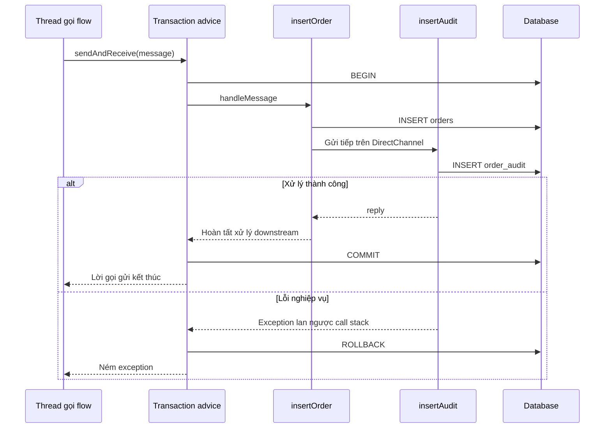

# Kiểm thử transaction flow

## Mục tiêu và phạm vi

Trong chương **Testing support** của module **SPRING_INTEGRATION_CORE**, kiểm thử transaction flow là kiểm tra mối quan hệ giữa đường đi của `Message`, phạm vi thực thi endpoint và trạng thái dữ liệu sau khi xử lý hoàn tất. Một test nhận được reply đúng chưa đủ chứng minh dữ liệu đã commit; một test bắt được exception cũng chưa đủ chứng minh mọi thay đổi đã rollback.

Bài học sử dụng `MessageChannel`, service activator, `MessagingTemplate` và Java DSL để kiểm tra một flow ghi đơn hàng. Sau đó mở rộng cách thiết kế test cho gateway, poller, kênh bất đồng bộ, xử lý lỗi và các mẫu tích hợp có lưu trạng thái.

Sau bài học, bạn có thể:

- Xác định nơi bắt đầu transaction, tài nguyên tham gia và điểm kết thúc phạm vi đồng bộ.
- Viết test phân biệt commit thật, rollback thật và rollback do chính test tạo ra.
- Chọn vị trí đặt transaction advice phù hợp với phạm vi muốn bảo vệ.
- Kiểm tra riêng trạng thái database, lỗi, message và hành vi phát lại.
- Nhận diện những kết luận vượt quá bằng chứng mà một test cung cấp.

Các ví dụ chính dành cho Java 17+, Spring Integration 6.5.x, Spring Framework 6.2.x và JUnit Jupiter. Đây là mốc API minh họa, không phải yêu cầu nâng phiên bản dự án. Bài tập trung vào transaction JDBC imperative gắn với thread; flow reactive cần cách quản lý transaction và công cụ kiểm thử tương ứng.

## 1. Xác định điều cần chứng minh

Giả sử flow nhận một yêu cầu tạo đơn hàng:

```text
ordersInput
    -> insertOrder
    -> insertAudit
    -> reply "ACCEPTED:<orderId>"
```

Hai thao tác SQL phải cùng thành công hoặc cùng bị hủy. `insertAudit` có thể cố ý ném lỗi sau khi đã thực hiện câu lệnh SQL, giúp test xác định cả hai thay đổi có nằm trong cùng transaction hay không.

Hợp đồng cần kiểm tra gồm ba phần:

| Khía cạnh | Khi thành công | Khi lỗi sau thao tác SQL thứ hai |
| --- | --- | --- |
| Kết quả xử lý đồng bộ | Nhận reply đúng mã đơn | Caller nhận exception |
| Bảng đơn hàng | Có một bản ghi đã commit | Không có bản ghi của yêu cầu lỗi |
| Bảng audit | Có một bản ghi đã commit | Không có bản ghi của yêu cầu lỗi |
| Dữ liệu đã tồn tại | Giữ nguyên | Giữ nguyên |

Đếm số lần gọi repository chỉ chứng minh code đã gọi repository. Muốn kết luận về commit hoặc rollback, cần quan sát tài nguyên thật sau khi ranh giới transaction đã kết thúc.

## 2. Vẽ ranh giới transaction trước khi viết test

### 2.1. Cùng thread là điều kiện cần cho transaction imperative lan truyền

`DirectChannel` gọi handler ngay trên thread gửi message. Nếu caller đã có transaction, code JDBC phía nhận có thể tham gia transaction đó. `ExecutorChannel` với executor bất đồng bộ không truyền transaction của thread gửi sang thread xử lý; hàng đợi được consumer poll cũng tạo một giai đoạn xử lý tách khỏi lời gọi gửi ban đầu. Xem [Message Channel Implementations](https://docs.spring.io/spring-integration/reference/6.5/channel/implementations.html).



Sơ đồ thể hiện phạm vi logic. Trong request/reply, reply có thể đã được đưa vào reply channel trước commit; với ví dụ đồng bộ ở bài này, `sendAndReceive()` chỉ trả về sau khi lời gọi gửi đã đi qua transaction advice.

### 2.2. Cùng thread chưa đủ để mọi thao tác cùng transaction

Phải biết chính xác advice bao quanh lời gọi nào. `TransactionInterceptor` thông thường đặt trong request handler advice chain bảo vệ phần xử lý request nội bộ của handler, không tự bao trùm việc gửi reply xuống toàn bộ flow. `TransactionHandleMessageAdvice` bao quanh `handleMessage()` nên có thể bảo vệ cả phần downstream còn thực thi đồng bộ. Có thể tạo loại advice này bằng `new TransactionInterceptorBuilder(true)`. Xem [Transaction Support cho message handler](https://docs.spring.io/spring-integration/reference/6.5/handler-advice/tx-handle-message.html).

Một service được đánh dấu `@Transactional` cũng chỉ tạo phạm vi quanh lời gọi service qua proxy. Nếu service trả về rồi endpoint mới gửi kết quả sang bước tiếp theo, transaction của service có thể đã kết thúc. Vì vậy, test cần đặt lỗi ở endpoint sau để kiểm tra phạm vi thật sự.

### 2.3. Tài nguyên phải tham gia đúng transaction manager

Trong ví dụ, `DataSourceTransactionManager` và `JdbcTemplate` dùng cùng một `DataSource`. `JdbcTemplate` lấy connection theo cơ chế tham gia transaction của Spring. Tự mở connection bằng `DataSource.getConnection()` trong code nghiệp vụ có thể tạo một connection độc lập nếu không dùng cơ chế nhận biết transaction. Xem [DataSourceTransactionManager](https://docs.spring.io/spring-framework/docs/6.2.x/javadoc-api/org/springframework/jdbc/datasource/DataSourceTransactionManager.html).

Một HTTP request, email đã gửi hoặc thay đổi trên hệ thống ngoài không tự trở thành tài nguyên JDBC có thể rollback. Test database và test tác dụng bên ngoài cần có kỳ vọng riêng.

## 3. Chuẩn bị ví dụ tối thiểu

Ví dụ dùng database H2 thật chạy trong bộ nhớ, thay vì mock transaction manager hoặc repository. Chỉ đặt các lớp minh họa vào source test của một dự án thử nghiệm riêng khi thực hành; tên file trong bài là gợi ý, không phải các file được tạo kèm tài liệu.

Trong một dự án đã quản lý phiên bản bằng Spring Boot BOM tương thích với mốc API trên, cần các dependency sau:

```xml
<dependencies>
    <dependency>
        <groupId>org.springframework.boot</groupId>
        <artifactId>spring-boot-starter-integration</artifactId>
    </dependency>
    <dependency>
        <groupId>org.springframework.boot</groupId>
        <artifactId>spring-boot-starter-jdbc</artifactId>
    </dependency>
    <dependency>
        <groupId>com.h2database</groupId>
        <artifactId>h2</artifactId>
        <scope>test</scope>
    </dependency>
    <dependency>
        <groupId>org.springframework.boot</groupId>
        <artifactId>spring-boot-starter-test</artifactId>
        <scope>test</scope>
    </dependency>
</dependencies>
```

Đây là đoạn dependency để ghép vào build có sẵn, không phải một `pom.xml` hoàn chỉnh. Nếu không dùng Spring Boot, cần quản lý bộ phiên bản tương thích cho `spring-integration-core`, `spring-jdbc`, `spring-tx`, `spring-test`, JUnit Jupiter và H2.

`spring-integration-test` chỉ cần bổ sung khi dùng `@SpringIntegrationTest`, `MockIntegrationContext` hoặc các tiện ích kiểm thử chuyên biệt. Ví dụ đồng bộ bên dưới dùng Spring TestContext và các thành phần thật nên không cần mock framework của Spring Integration. Xem [Testing support](https://docs.spring.io/spring-integration/reference/6.5/testing.html).

## 4. Cấu hình flow có transaction bao trùm downstream

Lớp cấu hình minh họa `TxFlowConfig.java`:

```java
package example.integration;

import javax.sql.DataSource;

import org.springframework.context.annotation.Bean;
import org.springframework.context.annotation.Configuration;
import org.springframework.integration.channel.DirectChannel;
import org.springframework.integration.config.EnableIntegration;
import org.springframework.integration.dsl.IntegrationFlow;
import org.springframework.integration.transaction.TransactionInterceptorBuilder;
import org.springframework.jdbc.core.JdbcTemplate;
import org.springframework.jdbc.datasource.DataSourceTransactionManager;
import org.springframework.jdbc.datasource.embedded.EmbeddedDatabase;
import org.springframework.jdbc.datasource.embedded.EmbeddedDatabaseBuilder;
import org.springframework.jdbc.datasource.embedded.EmbeddedDatabaseType;
import org.springframework.messaging.MessageChannel;
import org.springframework.transaction.PlatformTransactionManager;
import org.springframework.transaction.annotation.Propagation;
import org.springframework.transaction.interceptor.TransactionInterceptor;
import org.springframework.transaction.support.TransactionSynchronizationManager;

@Configuration(proxyBeanMethods = false)
@EnableIntegration
public class TxFlowConfig {

    public record Order(String id, boolean failAfterAudit) {
    }

    @Bean(destroyMethod = "shutdown")
    EmbeddedDatabase dataSource() {
        return new EmbeddedDatabaseBuilder()
                .generateUniqueName(true)
                .setType(EmbeddedDatabaseType.H2)
                .build();
    }

    @Bean
    JdbcTemplate jdbcTemplate(DataSource dataSource) {
        JdbcTemplate jdbc = new JdbcTemplate(dataSource);
        jdbc.execute("""
                create table orders (
                    order_id varchar(64) primary key
                )
                """);
        jdbc.execute("""
                create table order_audit (
                    order_id varchar(64) primary key,
                    event_name varchar(32) not null
                )
                """);
        return jdbc;
    }

    @Bean
    PlatformTransactionManager transactionManager(DataSource dataSource) {
        return new DataSourceTransactionManager(dataSource);
    }

    @Bean
    TransactionInterceptor flowTxAdvice(
            PlatformTransactionManager transactionManager) {
        return new TransactionInterceptorBuilder(true)
                .transactionManager(transactionManager)
                .propagation(Propagation.REQUIRED)
                .build();
    }

    @Bean
    MessageChannel ordersInput() {
        return new DirectChannel();
    }

    @Bean
    OrderWriter orderWriter(JdbcTemplate jdbcTemplate) {
        return new OrderWriter(jdbcTemplate);
    }

    @Bean
    IntegrationFlow orderFlow(OrderWriter writer,
                              TransactionInterceptor flowTxAdvice) {
        return IntegrationFlow.from("ordersInput")
                .handle(writer, "insertOrder",
                        endpoint -> endpoint
                                .id("insertOrderEndpoint")
                                .advice(flowTxAdvice))
                .handle(writer, "insertAudit",
                        endpoint -> endpoint.id("insertAuditEndpoint"))
                .get();
    }

    public static class OrderWriter {

        private final JdbcTemplate jdbc;

        public OrderWriter(JdbcTemplate jdbc) {
            this.jdbc = jdbc;
        }

        public Order insertOrder(Order order) {
            requireTransaction();
            jdbc.update("insert into orders(order_id) values (?)",
                    order.id());
            return order;
        }

        public String insertAudit(Order order) {
            requireTransaction();
            jdbc.update("""
                    insert into order_audit(order_id, event_name)
                    values (?, ?)
                    """, order.id(), "CREATED");

            if (order.failAfterAudit()) {
                throw new IllegalStateException("Rejected after audit");
            }
            return "ACCEPTED:" + order.id();
        }

        private static void requireTransaction() {
            if (!TransactionSynchronizationManager
                    .isActualTransactionActive()) {
                throw new IllegalStateException("Missing transaction");
            }
        }
    }
}
```

Đặc điểm quan trọng của cấu hình:

- `true` trong `TransactionInterceptorBuilder(true)` chọn advice bao quanh `handleMessage()`. Kiểu trả về vẫn là `TransactionInterceptor`, nhưng đối tượng được tạo là `TransactionHandleMessageAdvice`.
- Advice đặt tại endpoint đầu tiên có thay đổi dữ liệu. Hai endpoint nối bằng channel đồng bộ mặc định của DSL.
- `OrderWriter` không tự mở transaction. Vì vậy, thành công của test phụ thuộc vào transaction advice của flow.
- `requireTransaction()` là điểm quan sát trong ví dụ học tập. Nó chứng minh có transaction đang hoạt động tại từng bước, còn các assertion SQL bên ngoài mới chứng minh kết quả lưu trữ.
- Không cần `@EnableTransactionManagement` cho advice được gắn trực tiếp bằng DSL. Annotation đó cần khi chọn cách cấu hình transaction bằng `@Transactional` trên bean.

API builder cho phép chỉ định transaction manager tường minh và cấu hình propagation; xem [TransactionInterceptorBuilder](https://docs.spring.io/spring-integration/docs/6.5.0/api/org/springframework/integration/transaction/TransactionInterceptorBuilder.html). Cách kích hoạt transaction bằng annotation được mô tả trong [Using `@Transactional`](https://docs.spring.io/spring-framework/reference/data-access/transaction/declarative/annotations.html).

Schema được khởi tạo trực tiếp trong bean để ví dụ tự chứa và không cần tệp SQL. Với ứng dụng thật, nên dùng cơ chế migration của dự án. Tên database riêng giúp tách các application context, nhưng các test dùng chung context vẫn phải quản lý dữ liệu của mình.

## 5. Kiểm thử commit và rollback bằng trạng thái database

Lớp kiểm thử minh họa `TransactionFlowTest.java`, cùng package với cấu hình:

```java
package example.integration;

import org.junit.jupiter.api.BeforeEach;
import org.junit.jupiter.api.Test;
import org.springframework.beans.factory.annotation.Autowired;
import org.springframework.beans.factory.annotation.Qualifier;
import org.springframework.integration.core.MessagingTemplate;
import org.springframework.jdbc.core.JdbcTemplate;
import org.springframework.messaging.Message;
import org.springframework.messaging.MessageChannel;
import org.springframework.messaging.MessagingException;
import org.springframework.messaging.support.GenericMessage;
import org.springframework.test.context.junit.jupiter.SpringJUnitConfig;
import org.springframework.transaction.support.TransactionSynchronizationManager;

import static org.junit.jupiter.api.Assertions.*;

@SpringJUnitConfig(TxFlowConfig.class)
class TransactionFlowTest {

    @Autowired
    @Qualifier("ordersInput")
    MessageChannel input;

    @Autowired
    JdbcTemplate jdbc;

    private MessagingTemplate template;

    @BeforeEach
    void prepare() {
        // Test không được tạo transaction bao ngoài flow.
        assertNoTransactionOnTestThread();

        jdbc.update("delete from order_audit");
        jdbc.update("delete from orders");

        template = new MessagingTemplate();
        template.setSendTimeout(1_000);
        template.setReceiveTimeout(1_000);
    }

    @Test
    void commitsBothWritesWhenFlowSucceeds() {
        Message<?> reply = template.sendAndReceive(input,
                new GenericMessage<>(
                        new TxFlowConfig.Order("ORD-100", false)));

        assertNotNull(reply);
        assertEquals("ACCEPTED:ORD-100", reply.getPayload());
        assertNoTransactionOnTestThread();

        assertEquals(1, orderCount("ORD-100"));
        assertEquals(1, auditCount("ORD-100"));
        assertEquals("CREATED", jdbc.queryForObject("""
                select event_name from order_audit where order_id = ?
                """, String.class, "ORD-100"));
    }

    @Test
    void rollsBackBothWritesWhenDownstreamFailsAfterSql() {
        MessagingException failure = assertThrows(MessagingException.class,
                () -> template.sendAndReceive(input,
                        new GenericMessage<>(
                                new TxFlowConfig.Order("ORD-200", true))));

        Throwable cause = rootCause(failure);
        assertInstanceOf(IllegalStateException.class, cause);
        assertEquals("Rejected after audit", cause.getMessage());
        assertNoTransactionOnTestThread();

        assertEquals(0, orderCount("ORD-200"));
        assertEquals(0, auditCount("ORD-200"));
    }

    @Test
    void rollsBackNewOrderButKeepsExistingAuditOnConstraintFailure() {
        jdbc.update("""
                insert into order_audit(order_id, event_name)
                values (?, ?)
                """, "ORD-300", "SEEDED");

        assertThrows(MessagingException.class,
                () -> template.sendAndReceive(input,
                        new GenericMessage<>(
                                new TxFlowConfig.Order("ORD-300", false))));

        assertNoTransactionOnTestThread();
        assertEquals(0, orderCount("ORD-300"));
        assertEquals(1, auditCount("ORD-300"));
        assertEquals("SEEDED", jdbc.queryForObject("""
                select event_name from order_audit where order_id = ?
                """, String.class, "ORD-300"));
    }

    private int orderCount(String id) {
        return jdbc.queryForObject(
                "select count(*) from orders where order_id = ?",
                Integer.class, id);
    }

    private int auditCount(String id) {
        return jdbc.queryForObject(
                "select count(*) from order_audit where order_id = ?",
                Integer.class, id);
    }

    private static void assertNoTransactionOnTestThread() {
        assertFalse(TransactionSynchronizationManager
                .isActualTransactionActive());
    }

    private static Throwable rootCause(Throwable error) {
        Throwable result = error;
        while (result.getCause() != null) {
            result = result.getCause();
        }
        return result;
    }
}
```

Lớp test không có `@Transactional`. Khi lời gọi đồng bộ trả về hoặc ném exception, transaction do flow tạo đã hoàn tất. Những truy vấn tiếp theo bằng `JdbcTemplate` không còn dùng transaction vừa kết thúc; với cấu hình H2 này, chúng lấy connection phục vụ lượt đọc riêng.

Ba test cung cấp các bằng chứng khác nhau:

1. Test thành công kiểm tra reply và hai bản ghi còn tồn tại sau commit.
2. Test lỗi nghiệp vụ đặt lỗi sau hai câu lệnh SQL, kiểm tra đúng nguyên nhân và xác nhận cả hai bản ghi bị hủy.
3. Test lỗi ràng buộc database chứng minh insert đầu tiên bị rollback nhưng dữ liệu được seed trước transaction vẫn còn nguyên.

`MessagingException` có thể bọc exception của handler. Việc kiểm tra nguyên nhân trong test thứ hai giúp tránh test xanh chỉ vì một lỗi cấu hình khác. Với test lỗi SQL cần chẩn đoán sâu hơn, có thể tìm `DataIntegrityViolationException` trong cause chain thay vì phụ thuộc tên exception riêng của H2.

Đoạn xóa dữ liệu trong `@BeforeEach` phù hợp với lớp test chạy tuần tự và sở hữu riêng database của context này. Nếu bật chạy song song hoặc chia sẻ context với lớp khác, dùng database/schema riêng hoặc cơ chế dọn theo mã test để tránh test xóa dữ liệu của nhau.

## 6. Vì sao `@Transactional` trên test có thể che khuất lỗi?

Spring TestContext mặc định rollback transaction của test sau khi test kết thúc. Đây là tiện ích dọn dữ liệu, nhưng dễ gây nhầm khi mục tiêu là kiểm tra transaction do ứng dụng tạo. Phải phân biệt **transaction của test** với **transaction của flow**. Xem [Transaction Management trong Spring TestContext](https://docs.spring.io/spring-framework/reference/testing/testcontext-framework/tx.html).

Ví dụ test có cấu trúc:

```java
@Test
@Transactional
void insufficientEvidenceOfCommit() {
    template.sendAndReceive(input,
            new GenericMessage<>(new TxFlowConfig.Order("ORD-400", false)));
    assertEquals(1, orderCount("ORD-400"));
}
```

Với propagation `REQUIRED`, flow có thể tham gia transaction bao ngoài. Assertion thấy dữ liệu chưa commit của chính transaction đó. Nếu bỏ mất advice của flow, test vẫn có thể chạy thành công nhờ transaction do test cung cấp.

Đối với mục tiêu kiểm tra ranh giới commit/rollback, ưu tiên chạy test không có transaction bao ngoài như ví dụ chính. Nếu hạ tầng test bắt buộc dùng transaction, có thể chủ động kết thúc nó bằng `TestTransaction.end()` rồi mới gọi flow và quan sát dữ liệu. Việc đó phải được thiết kế cùng quy tắc dọn dữ liệu của lớp test.

Khi đã ở trong test-managed transaction và muốn chủ động commit dữ liệu chuẩn bị:

```java
// Chỉ sử dụng khi Spring TestContext đã mở transaction cho test.
TestTransaction.flagForCommit();
TestTransaction.end();

assertFalse(TestTransaction.isActive());
// Từ đây mới gọi flow để kiểm tra transaction do ứng dụng tạo.
```

Đoạn này cần import `org.springframework.test.context.transaction.TestTransaction` và phải chạy trước thao tác cần kiểm tra. Không dùng nó như bằng chứng rằng flow tự mở transaction.

## 7. Kiểm thử flow khởi đầu bằng poller

### 7.1. Đặt transaction quanh thao tác poll

Nếu flow bắt đầu bằng poller, transaction thường cần bao quanh cả việc nhận message và xử lý đồng bộ phía sau. Đây là khác biệt quan trọng so với chỉ đặt advice quanh một service sau khi đã lấy message khỏi nguồn. Spring Integration cung cấp transaction support cho poller; xem [Transaction Support](https://docs.spring.io/spring-integration/reference/6.5/transactions.html).

Đoạn cấu hình sau là **biến thể thay thế** cho `orderFlow` của ví dụ chính, không đăng ký đồng thời hai flow cho cùng bài thực hành. Nó tái sử dụng `OrderWriter`, database và transaction manager:

```java
@Bean
QueueChannel queuedOrders() {
    return new QueueChannel(10);
}

@Bean
QueueChannel pollReplies() {
    return new QueueChannel(10);
}

@Bean
QueueChannel pollErrors() {
    return new QueueChannel(10);
}

@Bean
OnlyOnceTrigger orderPollTrigger() {
    return new OnlyOnceTrigger();
}

@Bean
IntegrationFlow polledOrderFlow(OrderWriter writer,
        PlatformTransactionManager transactionManager,
        OnlyOnceTrigger orderPollTrigger) {
    return IntegrationFlow.from("queuedOrders")
            .handle(writer, "insertOrder", endpoint -> endpoint
                    .id("polledOrderEndpoint")
                    .autoStartup(false)
                    .poller(Pollers.trigger(orderPollTrigger)
                            .maxMessagesPerPoll(1)
                            .receiveTimeout(0)
                            .transactional(transactionManager)
                            .errorChannel("pollErrors")))
            .handle(writer, "insertAudit")
            .channel("pollReplies")
            .get();
}
```

Biến thể cần bổ sung `spring-integration-test` ở scope test, cùng các import `QueueChannel`, `Pollers` và `org.springframework.integration.test.util.OnlyOnceTrigger`. `OnlyOnceTrigger` chỉ phục vụ điều khiển test. API `.transactional(...)` của poller cấu hình transaction cho polling task; xem [PollerSpec](https://docs.spring.io/spring-integration/docs/6.5.0/api/org/springframework/integration/dsl/PollerSpec.html).

Không gắn lại `flowTxAdvice` vào handler ở biến thể này: điều cần chứng minh là transaction do poller tạo. Với một message và một poll, kết quả cũng dễ gắn với yêu cầu cụ thể hơn. Không suy luận rằng mọi cấu hình lấy nhiều message trong một lịch poll luôn tương đương một batch transaction; cần kiểm tra phạm vi polling task và advice của cấu hình thực tế.

### 7.2. Trình tự test poller có thể lặp lại ổn định

Một test cho biến thể poller nên thực hiện các bước sau:

1. Giữ endpoint `polledOrderEndpoint` dừng trong lúc dọn database, hàng đợi reply và hàng đợi lỗi.
2. Đưa đúng một message có mã đơn riêng vào `queuedOrders` trước khi start endpoint.
3. Reset `OnlyOnceTrigger`, rồi start bean endpoint bằng `Lifecycle.start()`.
4. Nhận reply hoặc `ErrorMessage` bằng `receive(timeout)` có giới hạn.
5. Chờ tín hiệu kết thúc transaction hoặc quan sát trạng thái dữ liệu đã commit/rollback bằng cơ chế chờ có điều kiện.
6. Dừng endpoint trong `finally` và bảo đảm tác vụ đang chạy đã hoàn tất trước khi dọn dữ liệu cho test tiếp theo.

`OnlyOnceTrigger` giảm số lần poll ngoài ý muốn. Nếu thay message source hoặc trigger qua `MockIntegrationContext`, cần phục hồi các bean đã thay khi kết thúc test. Những công cụ này hỗ trợ kiểm soát flow; chúng không thay thế assertion trên database.

Reply đưa vào một `QueueChannel` trong bộ nhớ có thể được test nhận trước khi poller commit xong. Tương tự, latch đặt ngay trước `return` của handler chỉ chứng minh handler đã chạy đến dòng đó. Khi kiểm tra commit, cần tín hiệu sau khi transaction hoàn tất hoặc phép quan sát database từ transaction độc lập.

## 8. Rollback dữ liệu khác với phát lại message

`QueueChannel` mặc định lưu message trong bộ nhớ. Bọc poller bằng JDBC transaction không làm thao tác lấy message khỏi hàng đợi đó trở thành một thao tác JDBC có thể rollback. Vì vậy, có thể xảy ra đồng thời hai kết quả: dữ liệu đã rollback, nhưng message đã bị lấy khỏi queue. Đặc tính queue và đặc tính transaction phải được kiểm tra riêng.

Nếu cần kiểm tra khả năng khôi phục message, dùng nguồn có cơ chế giao dịch hoặc xác nhận phù hợp với ứng dụng. Một lựa chọn trong hệ sinh thái Spring Integration là queue dựa trên `JdbcChannelMessageStore`, được thiết lập schema và query provider đúng database. Xem [JDBC Message Store](https://docs.spring.io/spring-integration/reference/6.5/jdbc/message-store.html).

Với một queue JDBC và nghiệp vụ dùng chung tài nguyên transaction, thiết kế test theo hợp đồng:

```text
Sắp đặt:
    Commit message vào store bằng transaction chuẩn bị riêng.

Lần xử lý gây lỗi:
    Poll message và ghi dữ liệu trong transaction cần kiểm tra.
    Làm downstream ném lỗi, chờ transaction rollback hoàn tất.

Quan sát:
    Không có bản ghi nghiệp vụ của lần lỗi.
    Message vẫn có thể được nhận lại theo cơ chế của store.

Lần xử lý thành công:
    Xử lý lại và chờ commit.
    Có đúng một kết quả nghiệp vụ, message đã được tiêu thụ.
```

Phải giới hạn hoặc dừng consumer tự động trước khi kiểm tra message còn trong queue; nếu không, consumer có thể lấy lại ngay trước assertion. Trong test này, “message có thể nhận lại” là hợp đồng lưu trữ cần xác minh, không phải giả định chung cho mọi adapter.

Đối với broker, cần thêm test trên broker và cơ chế acknowledgment/transaction thực tế. Việc nhận lại message và việc khôi phục dữ liệu là hai kết quả độc lập cho đến khi cấu hình tài nguyên chứng minh chúng phối hợp đúng.

## 9. Kiểm thử khi flow chuyển sang thread khác

Giả sử chèn một `ExecutorChannel` bất đồng bộ giữa hai thao tác:

```text
Thread A: BEGIN -> insertOrder -> gửi vào ExecutorChannel -> COMMIT
Thread B:                                    insertAudit -> lỗi
```

Đây là mô hình khái niệm; thứ tự chạy chính xác giữa hai thread phụ thuộc executor. Điều chắc chắn là không thể dựa vào transaction gắn với thread A để bảo vệ công việc của thread B.

Đối với biến thể này, bộ test cần ghi nhận riêng:

- `insertOrder` có commit theo phạm vi transaction trên thread A hay không.
- Thread B có transaction riêng tại thời điểm ghi audit hay không.
- Lỗi ở thread B được quan sát qua đâu và tương ứng với mã yêu cầu nào.
- Bất biến nghiệp vụ nào vẫn phải được giữ khi hai giai đoạn thất bại độc lập.

Không chỉ đổi `DirectChannel` thành `ExecutorChannel` trong ví dụ chính rồi giữ kỳ vọng rollback cả hai bảng. Hàm `requireTransaction()` ở endpoint thứ hai sẽ giúp phát hiện transaction không còn hiện diện. Nếu endpoint thứ hai mở transaction riêng, một lỗi tại đó vẫn không tự hủy bản ghi đã commit ở giai đoạn trước.

Nếu yêu cầu nghiệp vụ cần phối hợp hai giai đoạn, có thể thiết kế outbox, xử lý bù hoặc cơ chế giao dịch phân tán phù hợp. Test sau đó phải bám vào bất biến của thiết kế đã chọn, chẳng hạn bản ghi outbox được commit cùng đơn hàng và việc gửi lại không tạo hiệu ứng trùng. Một test H2 cho flow đồng bộ không chứng minh được hợp đồng phân tán đó.

## 10. Kiểm thử error flow cùng với transaction

Lỗi đồng bộ khi gửi qua `MessageChannel` hoặc `MessagingTemplate` được ném về caller. Chỉ đặt header `errorChannel` không tự biến mọi lỗi của `DirectChannel` thành message lỗi. Với tác vụ bất đồng bộ và scheduled poller được cấu hình error handler của Spring Integration, lỗi có thể được phát dưới dạng `ErrorMessage`. Xem [Error Handling](https://docs.spring.io/spring-integration/reference/6.5/error-handling.html).

Vì thế, chọn cách quan sát theo entry point:

| Entry point hoặc cơ chế xử lý | Quan sát lỗi trong test | Kiểm tra thêm |
| --- | --- | --- |
| Gửi đồng bộ vào `DirectChannel` | `assertThrows` và cause chain | Dữ liệu sau khi lời gọi kết thúc |
| Messaging gateway có error flow riêng | Exception hoặc kết quả recovery theo cấu hình gateway | Recovery có che mất lỗi đối với phạm vi transaction không |
| Scheduled poller | Nhận `ErrorMessage` trên kênh lỗi được cấu hình | Trạng thái transaction và message ở nguồn |
| Executor bất đồng bộ | Kênh lỗi hoặc tín hiệu hoàn tất của cơ chế executor | Transaction riêng của worker và dữ liệu đã commit trước đó |

Test error flow nên đối chiếu mã nghiệp vụ trong failed message hoặc ngữ cảnh lỗi, thay vì chỉ kiểm tra “có một lỗi trong queue”. Nếu một thành phần recovery bắt exception bên trong phạm vi transaction rồi trả kết quả bình thường, transaction có thể không còn thấy exception để quyết định rollback. Nếu transaction đã bị đánh dấu rollback-only, kết quả lại có thể là rollback hoặc `UnexpectedRollbackException` khi kết thúc.

Do đó, hãy kiểm tra đồng thời **kết quả recovery**, **trạng thái database** và **ranh giới nơi lỗi bị bắt**. Sự tồn tại của `ErrorMessage` không phải bằng chứng độc lập rằng rollback đã xảy ra.

## 11. Propagation và quy tắc rollback cần test riêng

### 11.1. Propagation thay đổi hợp đồng atomicity

| Propagation | Câu hỏi cần trả lời bằng test |
| --- | --- |
| `REQUIRED` | Khi có transaction bao ngoài, endpoint có tham gia cùng transaction không? |
| `REQUIRES_NEW` | Phần ghi độc lập có còn sau khi transaction bao ngoài rollback không? |
| `NESTED` | Rollback về savepoint có cho phép phần còn lại của transaction ngoài tiếp tục không? |

`REQUIRES_NEW` tạo transaction vật lý độc lập. `NESTED` thường dựa vào savepoint và phụ thuộc khả năng của transaction manager/JDBC driver. Trường hợp `REQUIRED` đánh dấu rollback-only ở phạm vi bên trong có thể dẫn đến `UnexpectedRollbackException` khi phạm vi ngoài định commit. Xem [Transaction Propagation](https://docs.spring.io/spring-framework/reference/data-access/transaction/declarative/tx-propagation.html).

Đừng dùng kỳ vọng “mọi bảng đều rỗng khi có lỗi” cho một thiết kế cố ý ghi lịch sử bằng `REQUIRES_NEW`. Hãy định nghĩa rõ bản ghi nào thuộc transaction nào, rồi đối chiếu riêng sau khi mỗi transaction kết thúc.

### 11.2. Exception tại ranh giới mới quyết định rollback

Với cấu hình mặc định, `RuntimeException` và `Error` gây rollback; checked exception cần quy tắc phù hợp nếu muốn rollback. Tuy nhiên, trong flow messaging, exception nghiệp vụ có thể được bọc thành runtime `MessagingException` trước khi đi qua transaction advice. Phải xét exception mà **ranh giới transaction thực sự nhìn thấy**, không chỉ kiểu exception được khai báo tại phương thức nghiệp vụ. Xem [Rolling Back a Declarative Transaction](https://docs.spring.io/spring-framework/reference/data-access/transaction/declarative/rolling-back.html).

Ví dụ chính dùng `IllegalStateException` để kỳ vọng rollback rõ ràng. Nếu hệ thống có checked exception, `rollbackFor` hoặc `noRollbackFor`, hãy viết test theo vị trí advice và đường lan truyền lỗi cụ thể. Không mặc định rằng một quy tắc đặt trên service bean tự áp dụng cho transaction advice khác của flow.

### 11.3. Retry phải đi cùng phạm vi transaction đã xác định

Hai cấu trúc sau có mục đích khác nhau:

```text
Retry bao ngoài transaction:
    attempt 1 -> transaction 1 -> rollback
    attempt 2 -> transaction 2 -> commit

Transaction bao ngoài retry:
    transaction 1 -> attempt 1 -> attempt 2 -> kết thúc transaction 1
```

Nếu muốn mỗi lần thử có transaction mới, cần cấu hình đúng thứ tự bao quanh và propagation, rồi chứng minh bằng test. `RequestHandlerRetryAdvice` là công cụ retry cho handler, không phải một cam kết mặc định rằng toàn bộ downstream được chạy lại. Xem [Provided Advice Classes](https://docs.spring.io/spring-integration/reference/6.5/handler-advice/classes.html).

Một test retry hữu ích có lỗi được điều khiển theo lần gọi, ví dụ lần đầu thất bại sau thao tác ghi và lần sau thành công. Assertion cần kiểm tra số lần thử, dữ liệu cuối cùng và việc không còn thay đổi từ lần thất bại. Đếm invocation đơn thuần không đủ chứng minh transaction mới đã được tạo.

## 12. Quan sát thời điểm hoàn tất bằng synchronization

Đối với xử lý trên worker thread, có thể đăng ký một `TransactionSynchronization` để phát tín hiệu sau commit/rollback. Ví dụ hàm sau được gọi **bên trong handler đang có transaction**, với một `CompletableFuture` thuộc riêng yêu cầu kiểm thử:

```java
static void observeCompletion(
        java.util.concurrent.CompletableFuture<Integer> completion) {
    if (!TransactionSynchronizationManager.isSynchronizationActive()) {
        throw new IllegalStateException("No active synchronization");
    }

    TransactionSynchronizationManager.registerSynchronization(
            new org.springframework.transaction.support.TransactionSynchronization() {
                @Override
                public void afterCompletion(int status) {
                    completion.complete(status);
                }
            });
}
```

Test chờ với giới hạn, rồi kiểm tra dữ liệu:

```java
int status = completion.get(3, java.util.concurrent.TimeUnit.SECONDS);
assertEquals(
        org.springframework.transaction.support.TransactionSynchronization
                .STATUS_COMMITTED,
        status);
// Tiếp tục đọc database từ thread test không có transaction bao ngoài.
```

Đây là mảnh ghép quan sát, không phải một test hoàn chỉnh: `completion` phải được truyền hoặc tra cứu theo mã yêu cầu, không dùng một future dùng chung cho mọi message. Đối với nhánh lỗi, kỳ vọng `STATUS_ROLLED_BACK`. `afterCompletion` báo kết quả transaction, nhưng không thay thế phép kiểm tra dữ liệu nghiệp vụ.

`afterCommit()` chạy sau commit nên exception tại callback đó không thể hủy commit đã diễn ra. Nếu callback cần ghi dữ liệu với commit riêng, phải mở phạm vi transaction phù hợp. Xem [TransactionSynchronization](https://docs.spring.io/spring-framework/docs/6.2.x/javadoc-api/org/springframework/transaction/support/TransactionSynchronization.html).

Lưu ý callback hoàn tất có thể chạy trước khi toàn bộ cleanup tài nguyên của transaction kết thúc. Tín hiệu này phù hợp để biết kết quả commit/rollback; nếu cần dừng context hoặc dọn hạ tầng, vẫn phải phối hợp lifecycle của worker.

## 13. Transformer, router, filter và aggregator ảnh hưởng test thế nào?

Không phải mọi endpoint đều tạo một thao tác ghi dữ liệu, nhưng chúng thay đổi đường đi tới thao tác ghi:

| Thành phần | Kịch bản transaction cần quan tâm |
| --- | --- |
| Transformer | Lỗi chuyển đổi xảy ra trước hay sau lần ghi đầu tiên; dữ liệu có được hủy đúng phạm vi không |
| Router | Mỗi nhánh dùng channel nào và transaction manager nào; nhánh được chọn có cùng bất biến nghiệp vụ không |
| Filter | Loại bỏ message bình thường có được xem là xử lý thành công hay phải ném lỗi để hủy thay đổi trước đó |
| Aggregator | Trạng thái nhóm lưu ở đâu; completion, timeout và phần ghi kết quả có chạy trong cùng transaction hay không |

Ví dụ, nếu đã ghi đơn hàng rồi filter loại message theo cơ chế discard bình thường, việc flow không có reply không tự động có nghĩa transaction phải rollback. Test phải kiểm tra hợp đồng nghiệp vụ: chấp nhận commit với trạng thái bị loại, hay cấu hình loại bỏ bằng lỗi để hủy thao tác trước.

Với aggregator, không thể chỉ gửi đủ message rồi kiểm tra output. Cần tách trạng thái nhóm, dữ liệu kết quả và tác vụ timeout; đặt điểm lỗi tại từng giai đoạn cần bảo vệ. Một transaction của message cuối cùng cũng không tự bao trùm toàn bộ các lần nhận message đã commit trước đó.

## 14. Tránh test xanh giả và test phụ thuộc thời gian

| Cách kiểm tra chưa đủ | Vì sao kết luận dễ sai | Cách bổ sung bằng chứng |
| --- | --- | --- |
| Chỉ `verify(repository).save(...)` | Chưa biết thay đổi có được commit không | Đọc tài nguyên thật sau khi transaction kết thúc |
| Chỉ kiểm tra reply | Reply có thể được gửi trước commit ở flow bất đồng bộ | Chờ kết quả transaction và đọc dữ liệu độc lập |
| Chỉ `assertThrows` | Có thể lỗi trước câu lệnh SQL hoặc sai cấu hình | Kiểm tra nguyên nhân và dữ liệu của từng bước |
| Test có `@Transactional` rồi đọc lại | Có thể đọc dữ liệu chưa commit của test | Loại transaction bao ngoài khỏi test về ranh giới |
| `Thread.sleep(500)` | Không chứng minh tác vụ hay transaction đã hoàn tất | Chờ sự kiện hoặc trạng thái với deadline |
| Queue rỗng sau lỗi | Message có thể đã bị lấy mất dù dữ liệu rollback | Kiểm tra hợp đồng redelivery của nguồn |
| Dọn dữ liệu khi worker còn chạy | Worker có thể ghi lại dữ liệu sau cleanup | Phối hợp dừng và chờ tác vụ hoàn tất |
| Thay endpoint đang mang advice bằng mock | Có thể vô tình bỏ chính ranh giới cần kiểm tra | Giữ phần cấu hình transaction thật trong test |

Không dùng `assertTimeoutPreemptively()` để bọc thao tác đang dựa vào transaction gắn với thread test: cơ chế chạy trên thread khác làm thay đổi ngữ cảnh cần kiểm tra. Timeout của `MessagingTemplate` cũng không phải cơ chế cưỡng chế dừng một handler đồng bộ đang chạy; hãy phân biệt thời gian chờ channel/reply với timeout transaction và thời hạn toàn bộ test.

Với JPA, thêm `flush` ở điểm cần phát hiện lỗi SQL và tránh dùng persistence context cũ để suy ra trạng thái sau commit. Với H2, test chính kiểm tra tính atomic của hai câu lệnh JDBC trong cấu hình minh họa; các hành vi đặc thù như isolation, lock, deadlock hoặc redelivery cần kiểm tra thêm trên database/broker tương ứng của ứng dụng.

## 15. Bộ bằng chứng tối thiểu để đọc kết quả test

Trước khi kết luận một transaction flow hoạt động đúng, hãy đối chiếu các câu hỏi sau với assertion cụ thể:

1. **Ai mở transaction?** Test, gateway/service, handler advice hay poller?
2. **Nó bảo vệ đến đâu?** Phương thức nội bộ, toàn bộ `handleMessage()` hay polling task?
3. **Những tài nguyên nào tham gia?** Có dùng đúng transaction manager và connection không?
4. **Lỗi được đặt ở đâu?** Đã có ít nhất một thay đổi cần rollback trước khi lỗi xuất hiện chưa?
5. **Thời điểm quan sát là khi nào?** Transaction đã kết thúc hay mới chỉ nhận được reply?
6. **Kết quả nào đã được chứng minh?** Commit, rollback, recovery, phát lại message hay chống xử lý trùng?

Trong ví dụ chính, ba test chứng minh atomicity của hai thao tác ghi trong một flow đồng bộ, trên cùng `DataSource`, với transaction advice đặt ở endpoint đầu tiên. Khi thay đổi channel, propagation, nguồn message hoặc cơ chế xử lý lỗi, cần cập nhật hợp đồng kiểm thử theo ranh giới mới.
