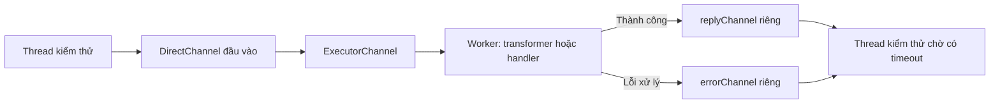

# Kiểm thử asynchronous flow

Trong chương **Testing support** của module **SPRING_INTEGRATION_CORE**, kiểm thử luồng bất đồng bộ là cách xác minh một thông điệp được xử lý đúng khi bên gửi và endpoint nghiệp vụ có thể chạy trên các thread khác nhau. Bài học sử dụng `Message`, `MessageChannel`, endpoint và Java DSL để nối điều kiện đầu vào với kết quả quan sát được.

Điểm cần nhớ ngay từ đầu: **gửi message thành công và xử lý nghiệp vụ hoàn tất là hai sự kiện khác nhau**. Một test đáng tin cậy phải chờ đúng sự kiện hoàn tất, có giới hạn thời gian và xác định được message thuộc lần kiểm thử nào.

Sau bài này, bạn có thể:

- Nhận diện ranh giới bất đồng bộ trong một integration flow.
- Viết test cho nhánh thành công và nhánh lỗi bằng kênh quan sát riêng.
- Chọn giữa `QueueChannel.receive(timeout)`, Awaitility và cơ chế đồng bộ của Java.
- Kiểm tra nhiều message mà không phụ thuộc vào thứ tự hoàn tất.
- Thiết kế test cho router, filter, aggregator và gateway có xử lý bất đồng bộ.
- Nhận biết nguyên nhân gây test lúc đạt lúc lỗi, đặc biệt khi chạy trên CI hoặc chạy song song.

## 1. Xác định điều gì thực sự bất đồng bộ

### 1.1. Lần theo đường đi của message

Đừng suy ra một flow là bất đồng bộ chỉ vì phương thức có tên `send`, có gateway hoặc có nhiều endpoint. Hãy xác định thành phần nào chuyển công việc sang thread khác.

| Thành phần | Ý nghĩa khi thiết kế test |
| --- | --- |
| `DirectChannel` | Subscriber được gọi trên thread gửi. Nếu chưa gặp ranh giới bất đồng bộ phía sau, việc gọi handler nằm trong lời gọi `send`. |
| `ExecutorChannel` | Giao công việc cho executor. Cần quan sát kết quả xử lý độc lập với kết quả gửi. |
| `QueueChannel` | Lưu message để một bên khác lấy ra. Queue không tự tạo consumer; cần test gọi `receive` hoặc có polling endpoint. |

Cơ chế thực thi của các channel được mô tả trong [Message Channel Implementations](https://docs.spring.io/spring-integration/reference/7.0/channel/implementations.html). Với `ExecutorChannel`, executor thực tế quyết định cách chạy công việc; chẳng hạn executor đồng bộ vẫn chạy trên thread gọi. Xem thêm [ExecutorChannel API](https://docs.spring.io/spring-integration/api/org/springframework/integration/channel/ExecutorChannel.html).

Ví dụ đường đi của một yêu cầu:



Sau khi công việc được giao cho executor, thread kiểm thử và worker có thể tiến triển độc lập. Worker cũng có thể chạy rất nhanh và hoàn tất trước lúc `send` trả về; test không được phụ thuộc vào một thứ tự tương đối không được hợp đồng bảo đảm.

### 1.2. Viết hợp đồng kiểm thử trước khi chọn công cụ

Với một flow chuẩn hóa tên sản phẩm, hợp đồng có thể là:

1. Đầu vào nhận chuỗi và mã nhận diện lần kiểm thử.
2. Chuỗi hợp lệ được bỏ khoảng trắng hai đầu và chuyển thành chữ hoa.
3. Kết quả giữ mã nhận diện đầu vào.
4. Chuỗi chỉ chứa khoảng trắng tạo lỗi nghiệp vụ.
5. Lỗi có thể truy ngược về message gây lỗi.
6. Mỗi phép chờ kết thúc trong thời gian hữu hạn.

Nếu nghiệp vụ yêu cầu ghi cơ sở dữ liệu, sự kiện hoàn tất phải được định nghĩa rõ hơn: handler bắt đầu chạy, thực hiện lệnh ghi, commit giao dịch hay bản ghi đã đọc được từ một giao dịch khác. Chọn điểm quan sát tương ứng với cam kết của flow.

Một message phản hồi gửi trước khi giao dịch commit không đủ để khẳng định dữ liệu đã bền vững.

## 2. Chọn cách chờ theo loại kết quả

| Điều cần quan sát | Công cụ phù hợp | Điều cần tránh |
| --- | --- | --- |
| Message đầu ra hoặc message lỗi | `QueueChannel.receive(timeout)` | Gọi `receive()` không timeout trong test |
| Trạng thái repository hoặc test double | Awaitility đọc lại trạng thái | Chạy lại thao tác gửi trong điều kiện chờ |
| Worker đã tới một điểm kiểm soát | `CountDownLatch` có timeout | Dùng thời gian ngủ làm tín hiệu worker đã tới |
| Kết quả của API trả `Future` | `get(timeout, unit)` | Chờ vô hạn hoặc chỉ kiểm tra `isDone()` |
| Không được có đầu ra trong một khoảng | Cửa sổ quan sát hữu hạn và tín hiệu đã xử lý đầu vào | Kết luận từ một lần đọc tức thời |

### 2.1. Vì sao `Thread.sleep` làm test thiếu ổn định?

Mẫu sau gắn tính đúng đắn của test vào tốc độ máy:

```java
input.send(request);
Thread.sleep(100);
assertEquals("DONE", observedStatus);
```

Nếu worker chưa được cấp CPU trong 100 ms, test thất bại dù logic đúng. Nếu hệ thống xử lý xong sau 2 ms, test vẫn chờ hết 100 ms. Việc ngủ cũng không thay thế cơ chế công bố dữ liệu giữa các thread; một field thông thường không tự trở thành nơi trao đổi trạng thái an toàn.

Hãy chờ một điều kiện có ý nghĩa và giới hạn thời gian chờ. Ví dụ, `receive(2_000)` kết thúc ngay khi có message, hoặc trả về `null` khi hết thời gian. Với `QueueChannel`, timeout bằng `0` là thao tác thăm dò tức thời; phương thức không nhận timeout có thể chờ vô hạn. Xem [ngữ nghĩa send và receive](https://docs.spring.io/spring-integration/reference/7.0/channel/implementations.html).

### 2.2. Tách các loại timeout

Ba giới hạn sau phục vụ ba mục đích:

- **Send timeout:** giới hạn việc giao message cho channel khi channel hỗ trợ chờ; không phải thời hạn hoàn thành nghiệp vụ.
- **Result timeout:** giới hạn việc test chờ một kết quả hoặc một điều kiện.
- **Giới hạn toàn test:** chặn test bị treo vì lỗi cấu hình hoặc một phép chờ bị bỏ sót.

Một timeout 2 giây trong ví dụ dưới đây là ngân sách kiểm thử minh họa. Khi đưa vào dự án, chọn ngân sách theo độ trễ dự kiến của flow và tài nguyên CI. Việc test trả kết quả trong ngân sách đó chưa phải phép đo hiệu năng hoặc bằng chứng về phân vị độ trễ.

Không giả định mọi `MessageChannel` đều thực thi tham số timeout giống nhau. Đặc biệt, timeout truyền vào `send` không thể biến một handler đồng bộ chạy lâu thành thao tác bị ngắt đúng hạn.

## 3. Ví dụ đầy đủ: kiểm thử transformer chạy qua executor

### 3.1. Phạm vi và dependency

Ví dụ sử dụng JUnit Jupiter, Spring Test và Spring Integration Java DSL. Đặt lớp sau trong test source set của dự án có các dependency tương ứng:

```text
org.springframework.integration:spring-integration-core
org.springframework:spring-test                 (test)
org.junit.jupiter:junit-jupiter                 (test)
```

Dùng các phiên bản tương thích do BOM hoặc dependency management của dự án quản lý. Java DSL nằm trong `spring-integration-core`; ví dụ này không yêu cầu thêm artifact DSL riêng.

Lớp test không cần Spring Boot, broker hay cơ sở dữ liệu. Nó giữ executor thật để kiểm tra chính ranh giới bất đồng bộ. Phần cấu hình là flow tối thiểu phục vụ bài học; khi áp dụng vào ứng dụng, nên import cấu hình flow thực để tránh duy trì một bản sao bị lệch với production.

### 3.2. Cấu hình và hai test cơ bản

```java
package example.integration.testing;

import java.util.Locale;
import java.util.UUID;

import org.junit.jupiter.api.Test;

import org.springframework.beans.factory.annotation.Autowired;
import org.springframework.beans.factory.annotation.Qualifier;
import org.springframework.context.annotation.Bean;
import org.springframework.context.annotation.Configuration;
import org.springframework.integration.channel.DirectChannel;
import org.springframework.integration.channel.QueueChannel;
import org.springframework.integration.config.EnableIntegration;
import org.springframework.integration.dsl.IntegrationFlow;
import org.springframework.messaging.Message;
import org.springframework.messaging.MessageChannel;
import org.springframework.messaging.MessagingException;
import org.springframework.messaging.support.ErrorMessage;
import org.springframework.messaging.support.MessageBuilder;
import org.springframework.scheduling.concurrent.ThreadPoolTaskExecutor;
import org.springframework.test.context.junit.jupiter.SpringJUnitConfig;

import static org.junit.jupiter.api.Assertions.*;

@SpringJUnitConfig(AsyncFlowTest.FlowConfig.class)
class AsyncFlowTest {

    private static final long RESULT_TIMEOUT_MS = 2_000;

    @Autowired
    @Qualifier("asyncInput")
    private MessageChannel input;

    @Test
    void shouldReplyWithNormalizedPayloadOnWorkerThread() {
        QueueChannel replies = new QueueChannel(10);
        QueueChannel errors = new QueueChannel(10);
        String testCaseId = UUID.randomUUID().toString();
        String callerThread = Thread.currentThread().getName();

        Message<String> request = request(
                "  spring integration  ", testCaseId, replies, errors);

        assertTrue(input.send(request, 500), "Không giao được message đầu vào");

        Message<?> reply = replies.receive(RESULT_TIMEOUT_MS);

        assertNotNull(reply, "Không nhận được phản hồi cho " + testCaseId);
        assertEquals("SPRING INTEGRATION", reply.getPayload());
        assertEquals(testCaseId, reply.getHeaders().get("testCaseId"));

        String handledBy = reply.getHeaders().get("handledBy", String.class);
        assertNotNull(handledBy);
        assertTrue(handledBy.startsWith("si-test-"));
        assertNotEquals(callerThread, handledBy);

        // Chỉ kiểm tra trạng thái tại thời điểm đã nhận phản hồi.
        assertNull(errors.receive(0), "Có lỗi đã được phát trong nhánh thành công");
    }

    @Test
    void shouldPublishFailureForBlankPayload() {
        QueueChannel replies = new QueueChannel(10);
        QueueChannel errors = new QueueChannel(10);
        String testCaseId = UUID.randomUUID().toString();

        Message<String> request = request("   ", testCaseId, replies, errors);

        assertTrue(input.send(request, 500), "Không giao được message đầu vào");

        Message<?> observed = errors.receive(RESULT_TIMEOUT_MS);
        assertNotNull(observed, "Không nhận được lỗi cho " + testCaseId);

        ErrorMessage errorMessage = assertInstanceOf(ErrorMessage.class, observed);
        MessagingException failure = assertInstanceOf(
                MessagingException.class, errorMessage.getPayload());

        Message<?> failedMessage = failure.getFailedMessage();
        assertNotNull(failedMessage);
        assertEquals(testCaseId, failedMessage.getHeaders().get("testCaseId"));
        assertEquals("   ", failedMessage.getPayload());

        Throwable root = rootCause(failure);
        assertInstanceOf(IllegalArgumentException.class, root);
        assertEquals("payload must not be blank", root.getMessage());

        // Không khẳng định về mọi thời điểm trong tương lai.
        assertNull(replies.receive(0));
    }

    private static Message<String> request(
            String payload,
            String testCaseId,
            MessageChannel replies,
            MessageChannel errors) {

        return MessageBuilder.withPayload(payload)
                .setHeader("testCaseId", testCaseId)
                .setReplyChannel(replies)
                .setErrorChannel(errors)
                .build();
    }

    private static Throwable rootCause(Throwable failure) {
        Throwable current = failure;
        while (current.getCause() != null
                && current.getCause() != current) {
            current = current.getCause();
        }
        return current;
    }

    @Configuration
    @EnableIntegration
    static class FlowConfig {

        @Bean
        MessageChannel asyncInput() {
            return new DirectChannel();
        }

        @Bean
        ThreadPoolTaskExecutor flowExecutor() {
            ThreadPoolTaskExecutor executor = new ThreadPoolTaskExecutor();
            executor.setCorePoolSize(2);
            executor.setMaxPoolSize(2);
            executor.setQueueCapacity(20);
            executor.setThreadNamePrefix("si-test-");
            executor.setWaitForTasksToCompleteOnShutdown(true);
            executor.setAwaitTerminationSeconds(5);
            return executor;
        }

        @Bean
        IntegrationFlow normalizeFlow(
                @Qualifier("flowExecutor") ThreadPoolTaskExecutor executor) {

            return IntegrationFlow.from("asyncInput")
                    .channel(channels -> channels.executor(executor))
                    .enrichHeaders(headers -> headers.headerFunction(
                            "handledBy",
                            message -> Thread.currentThread().getName()))
                    .transform(String.class, text -> {
                        String normalized = text.trim();
                        if (normalized.isEmpty()) {
                            throw new IllegalArgumentException(
                                    "payload must not be blank");
                        }
                        return normalized.toUpperCase(Locale.ROOT);
                    })
                    .get();
        }
    }
}
```

### 3.3. Tại sao ví dụ dùng kênh riêng cho từng test?

Mỗi test tạo hai `QueueChannel` cục bộ và gắn chúng vào các header `replyChannel`, `errorChannel`. Test khác không giữ tham chiếu tới các queue này nên không thể vô tình lấy nhầm phản hồi. `MessageBuilder` cung cấp trực tiếp `setReplyChannel` và `setErrorChannel`; xem [MessageBuilder API](https://docs.spring.io/spring-framework/docs/current/javadoc-api/org/springframework/messaging/support/MessageBuilder.html).

Flow không cấu hình output channel cố định ở cuối. Kết quả transformer được trả theo `replyChannel` của yêu cầu. Nếu flow thực đã có output channel rõ ràng, cần quan sát kênh đó hoặc dùng một nhánh quan sát thích hợp; việc thêm header không tự thay thế output channel đã cấu hình.

Header `testCaseId` là header phục vụ đối chiếu trong ví dụ, không tự thay thế các header correlation/sequence của aggregator.

### 3.4. Tại sao đặt header tên worker sau `ExecutorChannel`?

Nếu ghi tên thread trước ranh giới executor, header chỉ cho biết thread gửi. Trong cấu hình trên, header được tính trong endpoint phía sau executor và trước transformer. Kiểm tra tên thread vì vậy xác nhận đoạn flow này đã chạy bằng worker của cấu hình minh họa.

`headerFunction` tính giá trị từ callback lúc xử lý message; xem [HeaderEnricherSpec API](https://docs.spring.io/spring-integration/api/org/springframework/integration/dsl/HeaderEnricherSpec.html). Không nên biến tên thread thành dữ liệu nghiệp vụ hoặc bắt mọi test production phụ thuộc vào tiền tố thread cụ thể.

`ThreadPoolTaskExecutor` là bean do Spring quản lý nên Spring khởi tạo và hủy executor theo vòng đời context. Không gọi `initialize()` thêm trong phương thức `@Bean`, và không gọi `shutdown()` trong từng test khi các test đang dùng chung context.

Các queue trong ví dụ là nơi quan sát trong bộ nhớ. Chúng không mô phỏng độ bền dữ liệu, xác nhận từ broker hoặc khả năng phục hồi sau khi tiến trình dừng.

## 4. Kiểm thử lỗi sau ranh giới bất đồng bộ

### 4.1. Vì sao `assertThrows` quanh `send` thường sai mục tiêu?

Mẫu sau không quan sát đúng lỗi nghiệp vụ phát sinh trong worker:

```java
// Không dùng để kiểm tra lỗi handler xảy ra sau khi giao cho executor.
assertThrows(IllegalArgumentException.class, () -> input.send(request));
```

Với cơ chế xử lý lỗi mặc định của các thành phần bất đồng bộ phù hợp, Spring Integration phát `ErrorMessage`. Header `errorChannel` của yêu cầu được dùng trước; nếu không có thì dùng kênh lỗi toàn cục `errorChannel`. Đây là lý do ví dụ truyền kênh lỗi riêng ngay từ đầu. Xem [Error Handling](https://docs.spring.io/spring-integration/reference/7.0/error-handling.html).

Test nhánh lỗi cần kiểm tra riêng:

- Đã nhận message lỗi trong thời hạn.
- Payload của message lỗi có loại mong đợi.
- Nguyên nhân nghiệp vụ phù hợp.
- `failedMessage` chứa payload và mã nhận diện của đầu vào cần kiểm tra.

Không mặc định mã nhận diện đầu vào sẽ nằm trực tiếp trên header của `ErrorMessage`. Ví dụ truy ngược qua `MessagingException.getFailedMessage()`.

### 4.2. Phân biệt lỗi xử lý với lỗi giao việc

Một lỗi xảy ra trước khi giao được công việc, chẳng hạn executor từ chối task, vẫn có thể xuất hiện ngay trên thread gửi. Test cho tình huống quá tải phải quan sát lỗi giao việc theo cấu hình executor và channel cụ thể.

Tương tự, không áp dụng máy móc quy tắc của worker cho handler chạy hoàn toàn trên `DirectChannel`. Cơ chế truyền lỗi phụ thuộc vị trí xảy ra lỗi.

Nếu ứng dụng dùng retry, recovery callback hoặc error handler tùy chỉnh, cần xác định kết quả cuối cùng mà cấu hình đó cam kết: trả bù, phát lỗi, ghi dead-letter hay kết thúc không có phản hồi. Test phải theo cam kết cuối cùng này.

## 5. Kiểm thử nhiều message khi thứ tự hoàn tất thay đổi

Thread pool có nhiều worker không bảo đảm message gửi trước sẽ được xử lý xong trước. Vì vậy, kiểm tra tuần tự `reply1 == request1`, `reply2 == request2` có thể thất bại do lịch chạy hợp lệ.

Với flow chuẩn hóa ở trên, hãy so sánh theo mã nhận diện. Đoạn sau có thể thêm làm phương thức test trong `AsyncFlowTest`. Bổ sung các import:

```java
import java.util.HashMap;
import java.util.Map;
import java.util.concurrent.TimeUnit;
```

```java
@Test
void shouldReturnAllResultsRegardlessOfCompletionOrder() {
    QueueChannel replies = new QueueChannel(20);
    QueueChannel errors = new QueueChannel(20);

    String runId = UUID.randomUUID().toString();
    Map<String, String> expected = Map.of(
            runId + "-1", "ALPHA",
            runId + "-2", "BETA",
            runId + "-3", "GAMMA");

    for (Map.Entry<String, String> entry : expected.entrySet()) {
        String payload = " " + entry.getValue().toLowerCase(Locale.ROOT) + " ";
        assertTrue(input.send(
                request(payload, entry.getKey(), replies, errors), 500));
    }

    // Một deadline cho toàn bộ pha nhận, không phải 2 giây cho mỗi message.
    long deadline = System.nanoTime() + TimeUnit.SECONDS.toNanos(2);
    Map<String, String> actual = new HashMap<>();

    while (actual.size() < expected.size()) {
        long remainingNanos = deadline - System.nanoTime();
        assertTrue(remainingNanos > 0, "Thiếu kết quả: " + actual);

        long remainingMillis = Math.max(
                1, TimeUnit.NANOSECONDS.toMillis(remainingNanos));
        Message<?> reply = replies.receive(remainingMillis);
        assertNotNull(reply, "Hết hạn chờ, đã nhận: " + actual);

        String id = reply.getHeaders().get("testCaseId", String.class);
        assertNotNull(id);
        assertTrue(expected.containsKey(id), "Nhận mã ngoài tập đầu vào: " + id);
        assertFalse(actual.containsKey(id), "Nhận lặp mã: " + id);
        actual.put(id, assertInstanceOf(String.class, reply.getPayload()));
    }

    assertEquals(expected, actual);
    assertNull(errors.receive(0));
    assertNull(replies.receive(0));
}
```

`HashMap` trong ví dụ chỉ do thread kiểm thử cập nhật sau khi lấy message khỏi queue, nên không phải cấu trúc chia sẻ giữa worker và test.

Deadline dùng `System.nanoTime()` để tính khoảng thời gian trôi qua. Nếu mỗi lần nhận đều chờ trọn 2 giây, một test chờ 100 message có thể tiêu tốn gần 200 giây trước khi kết thúc.

Test này kiểm tra tập kết quả, phát hiện mã lạ và message lặp đã nhận trong vòng thu thập. Phép đọc cuối `receive(0)` chỉ phát hiện message dư đã sẵn có. Nó chưa chứng minh hệ thống không thể phát thêm message lặp muộn hơn.

Nếu nghiệp vụ yêu cầu bảo đảm không phát lặp trong một khoảng, hãy thêm cửa sổ quan sát được định nghĩa trước hoặc quan sát trạng thái idempotency phù hợp.

## 6. Chờ tác dụng phụ bằng Awaitility

Không phải flow nào cũng trả về message. Một endpoint cuối có thể cập nhật trạng thái rồi kết thúc.

Ví dụ test double lưu trạng thái bằng `ConcurrentHashMap<String, String>`. Worker thực hiện `statuses.put(testCaseId, "DONE")` sau thao tác cần kiểm tra, còn test chỉ đọc trạng thái. Đoạn chờ có thể viết:

```java
import java.time.Duration;
import java.util.concurrent.ConcurrentHashMap;

import static org.awaitility.Awaitility.await;
import static org.junit.jupiter.api.Assertions.assertEquals;

// statuses là cùng đối tượng đã được inject vào handler của flow.
ConcurrentHashMap<String, String> statuses = new ConcurrentHashMap<>();

// Sau khi cấu hình handler dùng statuses và gửi một request mang testCaseId:
await()
        .alias("Trạng thái hoàn tất của " + testCaseId)
        .pollDelay(Duration.ZERO)
        .pollInterval(Duration.ofMillis(25))
        .atMost(Duration.ofSeconds(2))
        .untilAsserted(() ->
                assertEquals("DONE", statuses.get(testCaseId)));
```

Đây là đoạn minh họa cách chờ, không phải lớp test hoàn chỉnh thay thế cho ví dụ ở mục 3. Cần dependency `org.awaitility:awaitility` trong test scope. `untilAsserted` thử lại assertion cho tới khi đạt hoặc hết thời gian; xem [Awaitility Usage](https://github.com/awaitility/awaitility/wiki/Usage).

Điều kiện chờ nên chỉ đọc dữ liệu. Nếu đặt `input.send(request)` vào lambda được thử lại, mỗi lần polling sẽ tạo thêm một yêu cầu. Nếu đặt `receive(0)` rồi kiểm tra nhiều điều kiện trong cùng lambda, lần thử thất bại có thể đã lấy mất message khỏi queue.

Các lựa chọn thực tế:

- Dùng `receive(timeout)` khi kết quả chính là message.
- Dùng Awaitility khi cần quan sát trạng thái có thể đọc lại.
- Dùng cấu trúc thread-safe hoặc cơ chế đồng bộ rõ ràng cho test double.
- Giữ đường quan sát lỗi riêng khi thành công có thể không xuất hiện do worker thất bại.

Lỗi được Spring Integration xử lý và đưa vào kênh lỗi không nhất thiết trở thành uncaught exception cho công cụ chờ phát hiện. Vì vậy, timeout ở điều kiện thành công cần được chẩn đoán cùng thông tin từ nhánh lỗi.

Với repository thật, mỗi lần đọc phải có cơ hội thấy dữ liệu đã commit. Một persistence context giữ entity cũ hoặc một giao dịch đọc có snapshot cố định có thể làm test liên tục đọc trạng thái cũ.

## 7. Chứng minh việc giao xử lý mà không dựa vào tốc độ máy

Kiểm tra tên thread ở mục 3 xác nhận vị trí thực thi. Nếu cần chứng minh bên gọi có thể tiếp tục trong lúc handler chưa hoàn tất, dùng một handler kiểm soát được trong test.

Một thiết kế thường dùng hai `CountDownLatch`:

1. `entered` ban đầu bằng 1; handler gọi `countDown()` khi bắt đầu.
2. `release` ban đầu bằng 1; handler chờ latch này với timeout trước khi hoàn tất.
3. Test gọi `send`, chờ `entered`, rồi kiểm tra kết quả chưa xuất hiện.
4. Test mở `release` và chờ kết quả cuối.

Mẫu điều phối trên thread kiểm thử:

```java
try {
    assertTrue(input.send(request, 500));

    assertTrue(entered.await(1, TimeUnit.SECONDS),
            "Handler chưa tới điểm kiểm soát");

    // Hợp lệ vì handler được chủ động giữ trước bước tạo phản hồi.
    assertNull(replies.receive(0));

    release.countDown();
    assertNotNull(replies.receive(2_000));
}
finally {
    // Luôn giải phóng worker kể cả khi assertion phía trên thất bại.
    release.countDown();
}
```

Đoạn này giả định test đã inject handler kiểm soát được, dùng chung hai latch với test và đặt điểm chờ trước lúc tạo reply. Bản thân handler phải chờ `release` bằng `await(timeout, unit)`, báo lỗi khi hết hạn và khôi phục cờ interrupt khi bắt `InterruptedException`.

`CountDownLatch` cung cấp quan hệ đồng bộ giữa `countDown()` và lần `await()` hoàn tất tương ứng. Latch không tự chạy lại được; tạo mới cho từng lần kiểm thử. Xem [CountDownLatch, Java API](https://docs.oracle.com/en/java/javase/21/docs/api/java.base/java/util/concurrent/CountDownLatch.html).

Khi kiểm tra nguy cơ vô tình biến flow thành đồng bộ, lời gọi `send` cũng cần có giới hạn toàn test hoặc được gọi từ một task có `Future.get(timeout, unit)`. Tham số `send(request, 500)` không ngắt handler đang bị chặn trên thread gọi. Timeout của handler giúp giải phóng tài nguyên, nhưng không thay thế giới hạn của toàn kịch bản.

## 8. Kiểm thử “không có message” và filter

### 8.1. Đọc tức thời chỉ trả lời về hiện tại

Đoạn sau có thể đạt ngay cả khi handler chưa chạy:

```java
input.send(request);
assertNull(replies.receive(0));
```

Nó chỉ cho biết queue đang rỗng tại thời điểm đọc.

Ngay cả `assertNull(replies.receive(300))` cũng chỉ xác nhận không có message trong khoảng chờ 300 ms. Nó không chứng minh rằng message sẽ không xuất hiện ở giây thứ 2.

Muốn kiểm tra filter loại bỏ đầu vào, nên có một dấu hiệu tích cực rằng đầu vào đã được xét, ví dụ message đi tới discard channel.

### 8.2. Dùng discard channel làm điểm quan sát

Một đoạn DSL minh họa:

```java
.filter(String.class,
        text -> !text.isBlank(),
        endpoint -> endpoint.discardChannel("rejected"))
```

Test cho đầu vào không hợp lệ có thể:

1. Gắn mã nhận diện duy nhất vào yêu cầu.
2. Chờ message tương ứng ở kênh `rejected`.
3. Kiểm tra payload hoặc nguyên nhân từ chối theo hợp đồng.
4. Quan sát kênh thành công trong cửa sổ đã quy định nếu cần kiểm tra không có đầu ra muộn.

Nếu flow cố ý bỏ message mà không phản hồi, gateway kiểu request-reply cần timeout phù hợp. Đừng để một test chờ phản hồi vô hạn từ nhánh nghiệp vụ chủ động không tạo phản hồi.

Cần phân biệt “đã bị loại bỏ” với “chưa được xử lý”. Một tín hiệu discard hoặc completion rõ ràng giúp test phân biệt hai trường hợp này.

## 9. Mở rộng sang router, aggregator và gateway

### 9.1. Router: kiểm tra đúng nhánh và đúng message

Với router phân loại đơn hàng, tạo các kênh quan sát riêng cho những nhánh cần kiểm tra. Gửi đầu vào có mã nhận diện, nhận kết quả trên nhánh dự kiến rồi đối chiếu payload và header.

Nếu kiểm tra nhánh không được chọn, vẫn phải nêu rõ cửa sổ quan sát. Nếu một flow khác cũng dùng chung kênh đầu ra, cần tách theo correlation hoặc dùng queue riêng để tránh lấy nhầm message.

Một bộ test tối thiểu nên có đầu vào đi tới mỗi nhánh hợp lệ và đầu vào không ánh xạ được nhánh nào theo cấu hình router.

### 9.2. Aggregator: kiểm tra hợp đồng nhóm

Aggregator giữ trạng thái nhóm, nên cần kiểm tra cả correlation và điều kiện release. Cơ chế mặc định sử dụng correlation header để nhóm và thông tin sequence để xét nhóm đầy đủ; xem [Aggregator](https://docs.spring.io/spring-integration/reference/aggregator.html).

Với nhóm ba phần tử, một kịch bản có ý nghĩa là:

- Gửi phần tử theo thứ tự 3, 1, 2.
- Xác nhận đầu ra sau khi điều kiện release được thỏa mãn.
- Đối chiếu thành viên trong kết quả theo hợp đồng của ứng dụng.
- Gửi hai nhóm xen kẽ để kiểm tra không trộn dữ liệu.
- Thử nhóm thiếu phần tử và quan sát hành vi timeout/discard đã cấu hình.

Mỗi test cần correlation key riêng. Nếu flow dùng chung message store, việc xóa queue đầu ra không xóa trạng thái nhóm còn lại.

Không mặc định payload kết quả có thứ tự giống thứ tự gọi `send`. Nếu thứ tự là yêu cầu nghiệp vụ, phải cấu hình cơ chế bảo đảm thứ tự và kiểm tra đúng cơ chế đó.

### 9.3. Gateway: tách API của bên gọi với cách flow thực thi

Một gateway trả về kiểu dữ liệu thông thường có thể chờ phản hồi trong khi phần xử lý phía sau chạy trên worker. “Flow bất đồng bộ” không đồng nghĩa “phương thức gateway luôn trả về ngay”.

Khi test gateway, xác định:

- API là one-way, request-reply hay trả `Future`.
- Giới hạn giao yêu cầu và giới hạn chờ phản hồi.
- Hành vi khi hết hạn: giá trị trả về hoặc exception theo cấu hình.
- Cách lỗi từ worker được chuyển về bên gọi hay sang error flow.

`replyTimeout` của gateway có ý nghĩa tại pha chờ reply; nó không phải cơ chế hủy tùy ý một handler đồng bộ đang chạy trước khi bên gọi tới pha đó. Xem [Messaging Gateways — timeouts](https://docs.spring.io/spring-integration/reference/gateway.html).

Nếu API trả `Future`, dùng `get(timeout, unit)` và kiểm tra cả kết quả lẫn nguyên nhân lỗi. Việc hết timeout ở bên chờ cũng chưa tự chứng minh tác vụ phía sau đã bị hủy.

## 10. Giữ ranh giới bất đồng bộ khi cô lập hệ thống ngoài

Có thể thay dịch vụ HTTP, repository hoặc client bên ngoài bằng test double để test chạy nhanh và có dữ liệu chủ động. Nhưng nếu mục tiêu là kiểm thử flow bất đồng bộ, hãy giữ channel, executor và cách nối endpoint đang cần xác minh.

Thay `ExecutorChannel` bằng `DirectChannel` có thể hữu ích cho một unit test riêng của logic chuyển đổi, nhưng test đó không còn xác minh việc chuyển thread, truyền lỗi bất đồng bộ hay sự phụ thuộc vào trạng thái chia sẻ.

Khi cần thay một endpoint trong context thật, `spring-integration-test` hỗ trợ `@SpringIntegrationTest` và `MockIntegrationContext`. `noAutoStartup` có thể ngăn inbound endpoint tự chạy; các API substitution nhận tên endpoint tương ứng. Sau test, `resetBeans()` khôi phục các bean đã thay. Xem [Testing support — Spring Integration and the Test Context](https://docs.spring.io/spring-integration/reference/testing.html).

Ví dụ định hướng cấu hình cho một ứng dụng có inbound endpoint tên `ordersInbound`:

```java
@SpringJUnitConfig(ProductionFlowConfig.class)
@SpringIntegrationTest(noAutoStartup = "ordersInbound")
class OrderFlowTest {
    // Inject channel đầu vào để gửi dữ liệu kiểm thử chủ động.
    // Nếu thay endpoint bằng MockIntegrationContext,
    // khôi phục bằng resetBeans() sau test.
}
```

Đây là khung áp dụng cho cấu hình production, không phải phần bổ sung trực tiếp vào `AsyncFlowTest`; `ProductionFlowConfig` và `ordersInbound` phải tồn tại trong ứng dụng.

Với polling endpoint, test cần chủ động về lịch polling và thời điểm start/stop. Không để một lịch chạy dài của production quyết định thời lượng test. Chỉ dừng nguồn phát dữ liệu khi mục tiêu kiểm tra vẫn cần các consumer phía sau hoạt động.

## 11. Cô lập trạng thái và vòng đời

### 11.1. Context dùng chung không có nghĩa dữ liệu được tự làm mới

Spring Test có thể dùng lại application context giữa các test tương thích. Những thành phần sau vì vậy có thể giữ trạng thái:

| Thành phần | Dữ liệu có thể còn lại | Cách cô lập phù hợp |
| --- | --- | --- |
| Kênh đầu ra dùng chung | Message chưa được nhận | Queue riêng hoặc cơ chế đối chiếu không tranh chấp |
| Aggregator/message store | Nhóm chưa release hoặc nhóm hoàn tất còn được giữ | Correlation key riêng, store được quản lý theo kịch bản |
| Test double/repository | Bản ghi và số lần gọi | Dữ liệu theo test ID và reset sau khi worker đã xong |
| Executor | Task đã submit còn đang chạy | Chờ tác vụ liên quan hoàn tất trước khi dọn trạng thái |
| Endpoint được thay thế | Handler/source của test trước | Khôi phục sau test |

Xóa queue trong `@BeforeEach` chỉ xử lý message đang có tại lúc xóa. Worker của test trước vẫn có thể gửi kết quả vào queue sau đó.

Nếu các test chạy song song và dùng một queue chung, một test có thể lấy mất message của test khác trước khi kiểm tra correlation. Việc “đọc rồi bỏ qua ID không khớp” không giải quyết tranh chấp này. Queue riêng hoặc một bộ phân phối quan sát tập trung theo ID thường rõ ràng hơn.

Chỉ dùng `@DirtiesContext` khi việc thay đổi context hoặc trạng thái khó cô lập thực sự cần nó; tạo lại context cho mọi test có thể làm bộ kiểm thử chậm mà vẫn không sửa được hợp đồng chờ sai.

### 11.2. Giao dịch và dữ liệu chia sẻ không tự đi theo message

Ranh giới executor không tự truyền giao dịch đang gắn với thread gửi sang worker. Vì vậy, dữ liệu test được tạo trong một giao dịch `@Transactional` chưa commit có thể chưa đọc được từ giao dịch của handler.

Hãy tạo dữ liệu đã commit hoặc thiết lập vòng đời giao dịch phù hợp với kịch bản. Dữ liệu worker ghi trong giao dịch riêng cũng cần cơ chế dọn riêng; đừng mặc định rollback của thread kiểm thử sẽ xóa nó.

Không sửa payload mutable ngay sau `send` trong khi worker còn có thể sử dụng cùng đối tượng. Ưu tiên payload bất biến hoặc bản sao rõ ràng khi kiểm tra hành vi bất đồng bộ.

## 12. Chẩn đoán test thất bại

| Hiện tượng | Điều cần kiểm tra đầu tiên |
| --- | --- |
| Hết hạn nhưng không có reply | Sai output/reply channel, nhánh filter/router, lỗi đã đi vào error channel |
| `send` trả thành công nhưng không có tác dụng phụ | Worker chưa chạy, task bị kẹt hoặc test quan sát sai mốc hoàn tất |
| Máy cá nhân đạt, CI lỗi | Sleep cố định, timeout thiếu ngân sách, tranh chấp trạng thái hoặc tài nguyên executor |
| Thỉnh thoảng nhận payload của test khác | Queue dùng chung hoặc correlation không được cô lập |
| Sai thứ tự kết quả | Test đang áp đặt thứ tự mà flow không bảo đảm |
| `assertThrows` không bắt được lỗi handler | Lỗi phát sinh sau ranh giới executor |
| Test không kết thúc | Phép chờ vô hạn, handler bị giữ, queue đầy hoặc thiếu bước giải phóng tài nguyên |
| Repository liên tục trả dữ liệu cũ | Giao dịch chưa commit, snapshot đọc hoặc persistence context giữ trạng thái |
| Nhóm aggregator không release | Correlation/sequence sai hoặc release strategy chưa thỏa mãn |

Khi timeout, thông tin hữu ích gồm test ID, payload mong đợi, kết quả đã nhận, endpoint được quan sát và lỗi tương ứng. Nếu cần đọc error queue để chẩn đoán, nhớ rằng `receive` sẽ lấy message khỏi queue; lưu lại message lỗi trước khi tạo thông báo thất bại.

Không tăng timeout ngay để che mọi lỗi. Trước hết xác định message đã tới đâu và sự kiện nào test đang chờ. Chỉ điều chỉnh ngân sách khi đó là độ trễ hợp lệ của kịch bản.

## 13. Bài tập thực hành

1. Thêm router phân loại chuỗi theo tiền tố, giữ executor thật và viết test cho hai nhánh với mã nhận diện riêng. Nêu rõ cách quan sát nhánh không được chọn.
2. Thêm filter từ chối chuỗi trống vào flow, nối discard channel và kiểm tra tín hiệu từ chối bằng phép chờ hữu hạn.
3. Xây dựng aggregator gom ba message cho mỗi đơn hàng, gửi hai đơn hàng xen kẽ và xác minh không trộn nhóm. Bổ sung tình huống thiếu một phần tử theo chính sách timeout đã chọn.
4. Thay endpoint cuối bằng một test double ghi trạng thái thread-safe, dùng Awaitility chỉ đọc trạng thái và giữ kênh lỗi riêng để hỗ trợ chẩn đoán.
5. Dùng handler có latch để giữ worker tại một điểm kiểm soát, xác nhận bên gửi có thể tiếp tục, rồi giải phóng worker trong `finally`.

Với mỗi bài tập, ghi rõ đầu vào, sự kiện được xem là hoàn tất, cách đối chiếu message, giới hạn chờ và cách dọn trạng thái. Đây là phần thiết kế giúp kết quả kiểm thử vẫn có ý nghĩa khi lịch chạy giữa các thread thay đổi.
