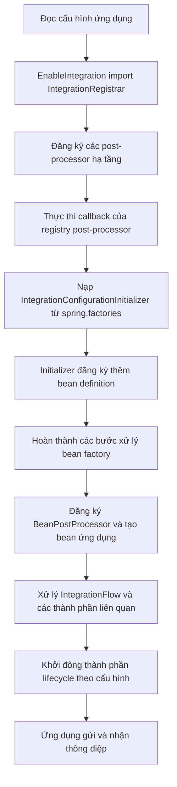

# IntegrationConfigurationBeanFactoryPostProcessor

## 1. Mục tiêu và phạm vi bài học

Trong module **SPRING_INTEGRATION_CORE**, các luồng thông điệp được mô tả bằng `Message`, `MessageChannel`, endpoint, gateway và Java DSL. Để những thành phần này phối hợp đúng, Spring phải chuẩn bị hạ tầng trong lúc khởi tạo `ApplicationContext`. Bài thuộc chương **Cấu hình và lifecycle**, tập trung vào lớp `IntegrationConfigurationBeanFactoryPostProcessor` và cơ chế mở rộng hạ tầng mà lớp này điều phối.

Sau bài học, người học có thể:

- Xác định lớp này chạy ở giai đoạn nào của quá trình khởi tạo context.
- Phân biệt đăng ký `BeanDefinition`, xử lý bean instance và khởi động endpoint.
- Giải thích quan hệ giữa `@EnableIntegration`, `IntegrationConfigurationInitializer` và `META-INF/spring.factories`.
- Quan sát một luồng Java DSL sau khi context hoàn tất khởi tạo.
- Viết một initializer tối thiểu cho thư viện tích hợp dùng chung và chẩn đoán lỗi phát hiện initializer.

Kiến thức nền cần có: `@Configuration`, `@Bean`, dependency injection, khái niệm bean definition và một luồng Java DSL đơn giản.

**Mốc phiên bản:** phần phân tích chi tiết triển khai được đối chiếu với mã nguồn Spring Integration **6.5.0**; các ví dụ dùng Java 17 trở lên và API của dòng này. Đây là mốc cố định để đọc mã nguồn, không phải khẳng định về phiên bản mới nhất. Khi thực hành trong dự án khác, sử dụng bộ dependency Spring tương thích do BOM hoặc Spring Boot quản lý, rồi đối chiếu lại các chi tiết nội bộ với phiên bản thực tế.

## 2. Vai trò của lớp trong kiến trúc cấu hình

Tên đầy đủ của lớp là:

```text
org.springframework.integration.config.IntegrationConfigurationBeanFactoryPostProcessor
```

Lớp triển khai `BeanDefinitionRegistryPostProcessor`, một giao diện mở rộng `BeanFactoryPostProcessor`. Nó nạp các implementation của `IntegrationConfigurationInitializer` để bổ sung cấu hình hạ tầng Integration. API này có từ Spring Integration 4.0. [Javadoc của lớp](https://docs.spring.io/spring-integration/docs/6.0.x/api/org/springframework/integration/config/IntegrationConfigurationBeanFactoryPostProcessor.html).

Có thể hiểu bean definition là bản mô tả cách tạo bean: lớp triển khai, tham số constructor, tham chiếu đến bean khác và các thuộc tính liên quan. Bean instance là đối tượng đã được tạo từ bản mô tả đó.

Một initializer có thể đăng ký bản mô tả của một post-processor khác. Spring sẽ phát hiện và sử dụng post-processor đó ở giai đoạn thích hợp tiếp theo. Vì vậy, hệ thống có thể bổ sung khả năng xử lý Java DSL hoặc converter trước khi tạo các bean ứng dụng thông thường. Hợp đồng của `BeanDefinitionRegistryPostProcessor` cho phép đăng ký thêm bean definition trước khi phát hiện các `BeanFactoryPostProcessor` thông thường. [Javadoc về giai đoạn registry](https://docs.spring.io/spring-framework/docs/6.2.x/javadoc-api/org/springframework/beans/factory/support/BeanDefinitionRegistryPostProcessor.html).

### 2.1. Các thành phần cần phân biệt

| Thành phần | Đối tượng hoặc thời điểm tác động | Trách nhiệm chính |
| --- | --- | --- |
| `BeanDefinitionRegistryPostProcessor` | Registry trong quá trình bootstrap | Bổ sung hoặc điều chỉnh bean definition, có thể đăng ký thêm post-processor |
| `BeanFactoryPostProcessor` | Metadata trong bean factory | Điều chỉnh cấu hình trước khi tạo bean ứng dụng thông thường |
| `BeanPostProcessor` | Bean instance đang được tạo | Can thiệp trước/sau callback khởi tạo, có thể bọc bean bằng proxy |
| `IntegrationConfigurationInitializer` | Bean factory được bộ điều phối truyền vào | Cài đặt phần hạ tầng Integration của một tính năng hoặc module |
| `SmartLifecycle` | Thành phần đã được tạo, cần vận hành | Điều phối `start()`, `stop()` và thứ tự phase |

`BeanPostProcessor` làm việc trên instance; `BeanFactoryPostProcessor` làm việc với metadata. Việc nhầm hai tầng này dễ dẫn đến gọi `getBean()` quá sớm hoặc đặt logic xử lý thông điệp vào giai đoạn cấu hình. [Tài liệu về các điểm mở rộng container](https://docs.spring.io/spring-framework/reference/core/beans/factory-extension.html).

`SmartLifecycle` điều khiển quá trình chạy/dừng của các thành phần vận hành. Chỉnh `phase` của endpoint không thay đổi thứ tự nạp initializer trong giai đoạn registry. [Javadoc SmartLifecycle](https://docs.spring.io/spring-framework/docs/6.2.x/javadoc-api/org/springframework/context/SmartLifecycle.html).

## 3. Lớp được đăng ký như thế nào?

### 3.1. Cấu hình Java với @EnableIntegration

Trong ứng dụng Spring thuần, điểm bắt đầu thường là:

```java
@Configuration
@EnableIntegration
public class MessagingConfiguration {
}
```

`@EnableIntegration` import `IntegrationRegistrar`. Registrar đăng ký definition của `IntegrationConfigurationBeanFactoryPostProcessor` với vai trò hạ tầng, đồng thời kiểm tra tên bean hạ tầng tương ứng đã tồn tại chưa. Đây là lý do ứng dụng thông thường không cần tự tạo thêm một bean của lớp này. [Mã nguồn EnableIntegration](https://github.com/spring-projects/spring-integration/blob/v6.5.0/spring-integration-core/src/main/java/org/springframework/integration/config/EnableIntegration.java), [mã nguồn IntegrationRegistrar](https://github.com/spring-projects/spring-integration/blob/v6.5.0/spring-integration-core/src/main/java/org/springframework/integration/config/IntegrationRegistrar.java).

Registrar cũng tham gia đường khởi tạo từ XML namespace Integration. Không cần vừa dùng cơ chế kích hoạt chuẩn, vừa khai báo thủ công lớp post-processor để “chắc chắn nó chạy”. Việc khai báo thêm dưới tên khác có thể khiến logic khởi tạo hạ tầng được thực hiện nhiều lần.

Với Spring Boot, auto-configuration Integration có thể kích hoạt hạ tầng thông qua `@EnableIntegration` khi các điều kiện phù hợp được đáp ứng. Ví dụ trong bài dùng Spring thuần để thể hiện rõ điểm kích hoạt. Khi chẩn đoán ứng dụng Boot, cần xem cả điều kiện auto-configuration và các cấu hình bị loại trừ. [Tài liệu Spring Boot về Integration](https://docs.spring.io/spring-boot/reference/messaging/spring-integration.html).

### 3.2. Trình tự khởi tạo ở mức khái niệm



Sơ đồ thể hiện các giai đoạn chính, không cam kết thứ tự tuyệt đối giữa mọi post-processor. Trong giai đoạn này, Spring đã phải tạo một số đối tượng hạ tầng để thực thi callback; phát biểu “chưa có bất kỳ object nào” là không chính xác. Điều cần giữ là không ép tạo sớm các bean ứng dụng khi hệ thống còn đang xử lý metadata.

## 4. Hai callback và cơ chế nạp initializer

### 4.1. Callback thực hiện công việc chính

Ở mốc 6.5.0, `postProcessBeanDefinitionRegistry(...)` thực hiện chuỗi công việc:

1. Xem registry nhận được như một `ConfigurableListableBeanFactory`.
2. Lấy class loader của bean factory.
3. Dùng `SpringFactoriesLoader` để nạp các implementation của `IntegrationConfigurationInitializer`.
4. Gọi `initialize(beanFactory)` trên từng implementation.

Cùng phiên bản đó, `postProcessBeanFactory(...)` có thân hàm rỗng. Đặt breakpoint chỉ trong callback này sẽ bỏ lỡ phần khởi tạo quan trọng. [Mã nguồn hai callback](https://github.com/spring-projects/spring-integration/blob/v6.5.0/spring-integration-core/src/main/java/org/springframework/integration/config/IntegrationConfigurationBeanFactoryPostProcessor.java).

Phép ép kiểu ở bước đầu cũng cho thấy không thể truyền tùy tiện một đối tượng chỉ triển khai `BeanDefinitionRegistry` rồi kỳ vọng lớp hoạt động. `DefaultListableBeanFactory`, được dùng trong các context thông dụng, đáp ứng cả vai trò registry và bean factory. Khi viết kiểm thử mức thấp, cần chọn hạ tầng phù hợp thay vì chỉ mock một giao diện.

### 4.2. spring.factories là danh mục implementation

Tài nguyên được tìm trên classpath có đường dẫn:

```text
META-INF/spring.factories
```

Định dạng của nó là Java properties. Khóa là tên đầy đủ của giao diện; giá trị là danh sách tên implementation, phân cách bằng dấu phẩy. Ví dụ cho một thư viện tự viết:

```properties
org.springframework.integration.config.IntegrationConfigurationInitializer=com.example.integration.TrainingIntegrationInitializer
```

`SpringFactoriesLoader` có thể đọc tài nguyên này từ nhiều JAR. Đối với cùng một loại factory, tên implementation trùng được loại bỏ và danh sách được sắp theo `AnnotationAwareOrderComparator`. Vì vậy, không nên thiết kế phụ thuộc dựa vào thứ tự JAR xuất hiện trên classpath. [Javadoc SpringFactoriesLoader](https://docs.spring.io/spring-framework/docs/6.2.x/javadoc-api/org/springframework/core/io/support/SpringFactoriesLoader.html).

Cơ chế này khác với `java.util.ServiceLoader` và tài nguyên `META-INF/services/...`. Tài nguyên `AutoConfiguration.imports` của Spring Boot cũng phục vụ một cơ chế khác. Trong mốc đang phân tích, cần giữ đúng khóa `IntegrationConfigurationInitializer` trong `spring.factories`.

### 4.3. Initializer không tự trở thành bean ứng dụng

Hợp đồng của initializer nhận một `ConfigurableListableBeanFactory` và cho phép thực hiện việc chuẩn bị hạ tầng. [Mã nguồn IntegrationConfigurationInitializer](https://github.com/spring-projects/spring-integration/blob/v6.5.0/spring-integration-core/src/main/java/org/springframework/integration/config/IntegrationConfigurationInitializer.java).

Ở đường nạp đang xét, loader tự tạo đối tượng initializer. Vì vậy, đừng giả định `@Autowired`, `@Value` hoặc `@PostConstruct` trên đối tượng đó được Spring xử lý như trên bean thông thường. Một constructor không tham số truy cập được là lựa chọn phù hợp cho initializer minh họa trong bài.

Khai báo một `@Bean` trả về `IntegrationConfigurationInitializer` không làm bean đó tự được bộ điều phối này phát hiện: nguồn phát hiện ở đây là danh mục factories. Tương tự, việc thêm `@Component` vào lớp không thay thế bản ghi factories.

Nếu cần các dependency có vòng đời do container quản lý, initializer nên đăng ký bean definition với constructor reference hoặc property reference. Việc tạo và nối các dependency sẽ diễn ra ở giai đoạn tạo bean.

### 4.4. Hai loại thứ tự khác nhau

Thứ tự của initializer do loader sắp xếp khác với thứ tự của `BeanFactoryPostProcessor` trong container. Với initializer, có thể dùng `Ordered` hoặc `@Order` theo hợp đồng của loader. Với bean factory post-processor tự phát hiện, Spring dùng `PriorityOrdered`/`Ordered`; `@Order` không được dùng để sắp xếp loại post-processor này. [Javadoc về thứ tự post-processor](https://docs.spring.io/spring-framework/docs/6.2.x/javadoc-api/org/springframework/beans/factory/config/BeanFactoryPostProcessor.html).

Nếu hai initializer có quan hệ phụ thuộc, hãy mô tả rõ điều kiện đầu vào và quy tắc đăng ký. Một initializer không có thứ tự rõ ràng không nên phụ thuộc vào bean definition do một initializer không có thứ tự khác vừa tạo.

## 5. Những hạ tầng nào được bổ sung?

Trong `spring-integration-core` 6.5.0, tài nguyên factories liệt kê bốn initializer sau. Danh sách này thuộc mốc phiên bản cụ thể; các module khác có thể bổ sung implementation riêng. [Danh mục factories của core](https://github.com/spring-projects/spring-integration/blob/v6.5.0/spring-integration-core/src/main/resources/META-INF/spring.factories).

| Initializer | Phần hạ tầng liên quan |
| --- | --- |
| `GlobalChannelInterceptorInitializer` | Metadata và wrapper cho interceptor được đánh dấu toàn cục |
| `IntegrationConverterInitializer` | Đăng ký converter và conversion service của Integration |
| `IdempotentReceiverAutoProxyCreatorInitializer` | Hỗ trợ áp dụng idempotent receiver advice khi có cấu hình tương ứng |
| `DslIntegrationConfigurationInitializer` | Hạ tầng xử lý và đăng ký luồng Java DSL |

### 5.1. Global channel interceptor

`GlobalChannelInterceptorInitializer` nhận diện metadata `@GlobalChannelInterceptor` trên bean definition và phương thức `@Bean`, rồi đăng ký definition của wrapper chứa tham chiếu interceptor, pattern và order. Nó không duyệt từng message ở thời điểm bootstrap. [Mã nguồn initializer của interceptor](https://github.com/spring-projects/spring-integration/blob/v6.5.0/spring-integration-core/src/main/java/org/springframework/integration/config/GlobalChannelInterceptorInitializer.java).

`GlobalChannelInterceptorProcessor` tham gia gắn các interceptor phù hợp vào channel ở các giai đoạn xử lý bean/singleton tiếp theo. Khi một message đi qua channel, logic của interceptor mới tham gia xử lý message đó. Đây là ba thời điểm riêng: chuẩn bị metadata, nối interceptor với channel, rồi thực thi interceptor. [Mã nguồn processor của interceptor](https://github.com/spring-projects/spring-integration/blob/v6.5.0/spring-integration-core/src/main/java/org/springframework/integration/config/GlobalChannelInterceptorProcessor.java).

### 5.2. Integration converter

`IntegrationConverterInitializer` tìm metadata `@IntegrationConverter`, tạo definition hỗ trợ đăng ký converter và bổ sung `ConverterRegistrar` cùng conversion service Integration khi chưa có definition tương ứng. Nó tạo tham chiếu đến converter, thay vì phải gọi converter để thử chuyển dữ liệu ngay trong bootstrap. [Mã nguồn initializer của converter](https://github.com/spring-projects/spring-integration/blob/v6.5.0/spring-integration-core/src/main/java/org/springframework/integration/config/IntegrationConverterInitializer.java).

Khi cần chuyển payload, ứng dụng vẫn khai báo converter hoặc transformer phù hợp. Bộ điều phối đang học cung cấp đường khởi tạo hạ tầng; logic biến đổi dữ liệu nằm trong thành phần được cấu hình cho luồng.

### 5.3. Idempotent receiver

`IdempotentReceiverAutoProxyCreatorInitializer` đọc thông tin ánh xạ interceptor với endpoint. Khi có ánh xạ phù hợp, nó đăng ký definition của auto-proxy creator phục vụ idempotent receiver. [Mã nguồn initializer của idempotent receiver](https://github.com/spring-projects/spring-integration/blob/v6.5.0/spring-integration-core/src/main/java/org/springframework/integration/config/IdempotentReceiverAutoProxyCreatorInitializer.java).

Sự hiện diện của initializer không tự cung cấp khóa chống trùng, kho lưu metadata hay quy tắc nghiệp vụ cho mọi endpoint. Người thiết kế luồng vẫn phải cấu hình chiến lược chống xử lý lặp phù hợp.

### 5.4. Java DSL

`DslIntegrationConfigurationInitializer` bổ sung các definition liên quan đến `IntegrationFlowBeanPostProcessor`, context quản lý flow và thành phần hỗ trợ dọn tham chiếu reply producer khi chưa có hạ tầng tương ứng. [Mã nguồn initializer Java DSL](https://github.com/spring-projects/spring-integration/blob/v6.5.0/spring-integration-core/src/main/java/org/springframework/integration/dsl/context/DslIntegrationConfigurationInitializer.java).

Sau đó, `IntegrationFlowBeanPostProcessor` mới xử lý các bean `IntegrationFlow` để đăng ký thành phần cụ thể. Vì builder DSL chủ yếu thu thập cấu hình, tạo một flow bằng lời gọi Java rồi giữ trong biến cục bộ chưa tương đương với việc đưa flow vào context. [Tài liệu Java DSL](https://docs.spring.io/spring-integration/reference/dsl.html).

### 5.5. Phân biệt với cấu hình mặc định

`DefaultConfiguringBeanFactoryPostProcessor` là một thành phần khác, cũng được registrar đăng ký. Nó phụ trách nhiều bean mặc định như `errorChannel`, `nullChannel`, scheduler và các thành phần hỗ trợ khác, với điều kiện đăng ký riêng. [Mã nguồn bộ cấu hình mặc định](https://github.com/spring-projects/spring-integration/blob/v6.5.0/spring-integration-core/src/main/java/org/springframework/integration/config/DefaultConfiguringBeanFactoryPostProcessor.java).

Không nên quy mọi bean hạ tầng cho `IntegrationConfigurationBeanFactoryPostProcessor`. Khi thấy lỗi thiếu scheduler hoặc lỗi mặc định của `errorChannel`, cần lần theo đúng thành phần đăng ký, rồi mới kết luận nguyên nhân.

## 6. Ví dụ quan sát bootstrap bằng một luồng Java DSL

Ví dụ sau chỉ cần dependency `org.springframework.integration:spring-integration-core` cùng bộ dependency Spring tương thích. Đặt mã trong `BootstrapObservation.java` với đúng package. Ví dụ dùng context độc lập, không cần Spring Boot.

```java
package com.example.integration;

import java.util.Locale;

import org.springframework.context.annotation.AnnotationConfigApplicationContext;
import org.springframework.context.annotation.Bean;
import org.springframework.context.annotation.Configuration;
import org.springframework.integration.channel.DirectChannel;
import org.springframework.integration.channel.QueueChannel;
import org.springframework.integration.config.EnableIntegration;
import org.springframework.integration.config.IntegrationConfigurationBeanFactoryPostProcessor;
import org.springframework.integration.dsl.IntegrationFlow;
import org.springframework.messaging.Message;
import org.springframework.messaging.MessageChannel;
import org.springframework.messaging.support.MessageBuilder;

public class BootstrapObservation {

    @Configuration(proxyBeanMethods = false)
    @EnableIntegration
    static class OrdersConfiguration {

        @Bean
        DirectChannel orderInput() {
            return new DirectChannel();
        }

        @Bean
        QueueChannel orderOutput() {
            return new QueueChannel();
        }

        @Bean
        IntegrationFlow normalizeOrderFlow() {
            return IntegrationFlow.from("orderInput")
                    .transform(String.class,
                            value -> value.trim().toUpperCase(Locale.ROOT))
                    .channel("orderOutput")
                    .get();
        }
    }

    public static void main(String[] args) {
        try (var context = new AnnotationConfigApplicationContext(
                OrdersConfiguration.class)) {

            String[] processors = context.getBeanNamesForType(
                    IntegrationConfigurationBeanFactoryPostProcessor.class);
            System.out.println("Infrastructure processor count: "
                    + processors.length);

            MessageChannel input = context.getBean(
                    "orderInput", MessageChannel.class);
            QueueChannel output = context.getBean(
                    "orderOutput", QueueChannel.class);

            boolean accepted = input.send(
                    MessageBuilder.withPayload("  dh-001  ").build());
            if (!accepted) {
                throw new IllegalStateException("Message was not accepted");
            }

            Message<?> result = output.receive(1_000);
            if (result == null) {
                throw new IllegalStateException("No result received");
            }
            System.out.println(result.getPayload());
        }
    }
}
```

Kết quả mong đợi của phần in do chương trình thực hiện:

```text
Infrastructure processor count: 1
DH-001
```

Có hai luồng cần theo dõi:

- **Luồng bootstrap:** `@EnableIntegration` kích hoạt registrar, bộ điều phối nạp initializer, hạ tầng DSL được chuẩn bị và flow được xử lý trong context.
- **Luồng dữ liệu:** message đi vào `orderInput`, transformer chuẩn hóa payload, message kết quả được đưa vào `orderOutput`.

`IntegrationConfigurationBeanFactoryPostProcessor` tham gia luồng bootstrap. Việc mỗi đơn hàng đi qua transformer không làm bộ điều phối này chạy lại.

Điểm gửi message nằm sau khi constructor của `AnnotationConfigApplicationContext` hoàn tất refresh. Không chuyển lời gọi `send()` vào initializer hoặc `@PostConstruct` của một bean tùy ý, vì các thành phần cần thiết của luồng có thể chưa sẵn sàng.

Ví dụ có đầu vào `DirectChannel`; việc gọi `send()` thực thi nhánh xử lý đồng bộ trên luồng gọi. `QueueChannel` ở cuối giữ kết quả cho lời gọi `receive(...)`, nên không cần poller cho cách đọc thủ công này. Thời hạn nhận hữu hạn giúp chương trình phát hiện trường hợp không có kết quả.

Việc nhìn thấy một processor và nhận đúng payload là bằng chứng quan sát của ví dụ; nó chưa chứng minh mọi initializer của mọi module đều đã được phát hiện.

## 7. Viết initializer cho một thư viện dùng chung

Ứng dụng nghiệp vụ thông thường nên dùng `@Configuration` và `@Bean`. SPI initializer hữu ích hơn khi một thư viện cần đóng góp hạ tầng Integration cho các ứng dụng sử dụng nó.

Giả sử thư viện cung cấp chính sách gắn header `trainingSource`. Ví dụ dưới đây cố ý giữ chính sách đơn giản để tập trung vào vòng đời đăng ký. Toàn bộ cấu trúc được trình bày trong bài; đây không phải yêu cầu sửa thêm file của module kiến thức.

### 7.1. Bean chính sách

Đặt lớp sau trong `src/main/java/com/example/integration/TrainingMessagePolicy.java` của dự án thực hành:

```java
package com.example.integration;

public record TrainingMessagePolicy(String source) {
}
```

### 7.2. Initializer chỉ đăng ký definition

Đặt lớp sau trong `TrainingIntegrationInitializer.java` ở cùng package:

```java
package com.example.integration;

import org.springframework.beans.factory.BeanDefinitionStoreException;
import org.springframework.beans.factory.config.BeanDefinition;
import org.springframework.beans.factory.config.ConfigurableListableBeanFactory;
import org.springframework.beans.factory.support.BeanDefinitionRegistry;
import org.springframework.beans.factory.support.RootBeanDefinition;
import org.springframework.integration.config.IntegrationConfigurationInitializer;

public final class TrainingIntegrationInitializer
        implements IntegrationConfigurationInitializer {

    public static final String POLICY_BEAN_NAME = "trainingMessagePolicy";

    public TrainingIntegrationInitializer() {
    }

    @Override
    public void initialize(ConfigurableListableBeanFactory beanFactory) {
        if (!(beanFactory instanceof BeanDefinitionRegistry registry)) {
            throw new BeanDefinitionStoreException(
                    "Training integration requires BeanDefinitionRegistry");
        }

        // Cho phép dùng chính sách đã được ứng dụng hoặc context cha cung cấp.
        if (beanFactory.containsBean(POLICY_BEAN_NAME)) {
            return;
        }

        RootBeanDefinition definition =
                new RootBeanDefinition(TrainingMessagePolicy.class);
        definition.setRole(BeanDefinition.ROLE_INFRASTRUCTURE);
        definition.getConstructorArgumentValues()
                .addIndexedArgumentValue(0, "spring-integration-training");

        registry.registerBeanDefinition(POLICY_BEAN_NAME, definition);
    }
}
```

Trong callback, việc tạo `RootBeanDefinition` chỉ tạo metadata. Container sẽ tạo `TrainingMessagePolicy` khi cần ở giai đoạn tiếp theo. Không có lời gọi `getBean()` để ép policy hoặc flow khởi tạo sớm.

Quy ước của ví dụ là tên `trainingMessagePolicy` được thư viện và ứng dụng thống nhất sử dụng. Nếu ứng dụng cung cấp bean thay thế, bean đó phải đúng kiểu. `containsBean(...)` còn nhìn thấy bean ở context cha; ở ví dụ này, điều đó chủ ý cho phép dùng chung policy từ cha.

Điều kiện kiểm tra giúp tránh đăng ký lại cùng tên khi initializer được gọi lại trên cùng bean factory. Đây là thuộc tính của initializer minh họa; không nên suy rộng rằng mọi initializer của framework đều an toàn khi bị gọi thủ công nhiều lần.

### 7.3. Khai báo tài nguyên factories

Đặt tài nguyên ở `src/main/resources/META-INF/spring.factories` của thư viện hoặc dự án thực hành:

```properties
org.springframework.integration.config.IntegrationConfigurationInitializer=com.example.integration.TrainingIntegrationInitializer
```

Tên package phải khớp hoàn toàn với lớp Java. Lớp và tài nguyên cần cùng có mặt trên runtime classpath. Không cần thêm `@Component` hoặc khai báo `@Bean` cho initializer này.

Nếu cùng file đã có khóa trên, bổ sung tên lớp vào danh sách giá trị của chính khóa đó. Không viết hai dòng property có cùng khóa trong cùng một file rồi kỳ vọng cả hai giá trị đều được giữ.

### 7.4. Sử dụng policy trong cấu hình flow

Trong `OrdersConfiguration` ở phần 6, thay phương thức `normalizeOrderFlow()` bằng phương thức sau; thêm import `Qualifier` tương ứng:

```java
@Bean
IntegrationFlow normalizeOrderFlow(
        @org.springframework.beans.factory.annotation.Qualifier(
                TrainingIntegrationInitializer.POLICY_BEAN_NAME)
        TrainingMessagePolicy policy) {

    return IntegrationFlow.from("orderInput")
            .enrichHeaders(headers ->
                    headers.header("trainingSource", policy.source()))
            .transform(String.class,
                    value -> value.trim().toUpperCase(Locale.ROOT))
            .channel("orderOutput")
            .get();
}
```

Initializer đăng ký definition của policy trong bootstrap. Khi Spring tạo bean flow, dependency injection mới cung cấp policy cho phương thức `@Bean`. Sau đó, header enricher dùng giá trị policy để bổ sung header cho message.

Ở phần nhận kết quả, có thể quan sát thêm:

```java
System.out.println(result.getHeaders().get("trainingSource"));
```

Giá trị mong đợi là `spring-integration-training`. Nếu không có tài nguyên factories và cũng không có bean policy do ứng dụng cung cấp, việc tạo flow sẽ thiếu dependency `TrainingMessagePolicy`. Tình huống này giúp phân biệt lỗi bootstrap với lỗi xử lý payload.

Với một ứng dụng riêng lẻ chỉ cần policy này, một phương thức `@Bean` thông thường thường đủ. Ví dụ SPI nhằm minh họa cách thư viện đóng góp hạ tầng mà không buộc từng ứng dụng gọi trực tiếp initializer.

## 8. Kiểm chứng cơ chế mà không trộn với logic nghiệp vụ

Có thể thiết kế kiểm chứng theo ba lớp, mỗi lớp trả lời một câu hỏi khác nhau:

| Lớp kiểm chứng | Cách quan sát | Điều kết quả thể hiện |
| --- | --- | --- |
| Phát hiện tài nguyên | Liệt kê URL `META-INF/spring.factories`, xem danh mục lớp | Tài nguyên có trên classpath và khai báo đúng implementation |
| Đăng ký metadata | Dùng một bean factory riêng và gọi initializer thử | Definition được đăng ký với đúng kiểu và tham số |
| Tích hợp context | Refresh context, gửi message, kiểm tra payload/header | Hạ tầng cùng cấu hình flow phối hợp trong ứng dụng |

### 8.1. Kiểm tra initializer trên bean factory riêng

Đoạn minh họa sau là phương thức kiểm thử JUnit Jupiter. Các lớp của phần 7 phải có trong dự án thực hành:

```java
package com.example.integration;

import org.junit.jupiter.api.Test;
import org.springframework.beans.factory.support.DefaultListableBeanFactory;

import static org.junit.jupiter.api.Assertions.assertEquals;
import static org.junit.jupiter.api.Assertions.assertFalse;
import static org.junit.jupiter.api.Assertions.assertTrue;

class TrainingIntegrationInitializerTest {

    @Test
    void registersPolicyWithoutCreatingItDuringInitialization() {
        var beanFactory = new DefaultListableBeanFactory();
        var initializer = new TrainingIntegrationInitializer();
        String name = TrainingIntegrationInitializer.POLICY_BEAN_NAME;

        initializer.initialize(beanFactory);

        assertTrue(beanFactory.containsBeanDefinition(name));
        assertFalse(beanFactory.containsSingleton(name));

        int definitionCount = beanFactory.getBeanDefinitionCount();
        initializer.initialize(beanFactory);
        assertEquals(definitionCount, beanFactory.getBeanDefinitionCount());
        assertFalse(beanFactory.containsSingleton(name));

        TrainingMessagePolicy policy = beanFactory.getBean(
                name, TrainingMessagePolicy.class);
        assertEquals("spring-integration-training", policy.source());
    }
}
```

Kiểm thử này xác nhận việc đăng ký chưa tạo instance và quy tắc tránh đăng ký trùng của initializer tự viết. Nó không đi qua `SpringFactoriesLoader`, nên không thể phát hiện lỗi sai đường dẫn tài nguyên. Ví dụ context ở phần 6, kết hợp thay đổi ở phần 7, bổ sung góc quan sát đó.

Khi kiểm thử thư viện tái sử dụng, nên có thêm trường hợp ứng dụng cung cấp policy thay thế: xác nhận cấu hình của ứng dụng được giữ và message có header theo policy thay thế. Đây là kiểm chứng hành vi mà người dùng thư viện quan tâm, không chỉ kiểm tra số bean.

Các đoạn mã là ví dụ học tập để đưa vào dự án thực hành phù hợp; kết quả mong đợi không phải báo cáo đã chạy build hay chạy test trong module tài liệu.

### 8.2. Quan sát tài nguyên mà không khởi tạo factory

Đoạn sau dành cho công cụ chẩn đoán độc lập hoặc mã chạy sau khi context sẵn sàng:

```java
ClassLoader loader = context.getBeanFactory().getBeanClassLoader();
if (loader == null) {
    throw new IllegalStateException("No application bean class loader");
}

var resources = loader.getResources("META-INF/spring.factories");
while (resources.hasMoreElements()) {
    System.out.println(resources.nextElement());
}
```

Danh sách URL giúp xác định JAR nào cung cấp tài nguyên. Không dùng việc gọi lại toàn bộ post-processor trong context đang chạy làm cách “in thử” initializer, vì thao tác đó có thể đăng ký lại hạ tầng.

## 9. Lỗi thường gặp và cách lần theo nguyên nhân

### 9.1. Breakpoint không dừng ở nơi dự kiến

Nếu breakpoint đặt trong `postProcessBeanFactory(...)`, hãy chuyển sang `postProcessBeanDefinitionRegistry(...)` theo triển khai 6.5.0. Nếu vẫn không dừng, kiểm tra cấu hình có thực sự được nạp và Integration có được kích hoạt trong đúng context hay không.

Các điểm quan sát hữu ích khi debug lần khởi động đầu tiên:

1. `IntegrationRegistrar.registerBeanDefinitions(...)`.
2. Callback registry của `IntegrationConfigurationBeanFactoryPostProcessor`.
3. Danh sách initializer sau bước nạp factories.
4. `initialize(...)` của initializer cần theo dõi.
5. Definition và bean được tạo từ kết quả đăng ký.

### 9.2. Initializer tự viết không được gọi

Kiểm tra lần lượt:

- Tài nguyên có đúng tên và đúng vị trí `META-INF/spring.factories` không.
- Khóa có đúng tên đầy đủ của `IntegrationConfigurationInitializer` không.
- Giá trị có đúng package, tên lớp và dấu phân cách không.
- Lớp implementation có trên runtime classpath, triển khai đúng giao diện và có thể được tạo không.
- Integration có được kích hoạt trước giai đoạn tạo bean ứng dụng không.

Lỗi nạp hoặc tạo factory có thể làm refresh context thất bại. Khi đó cần đọc chuỗi nguyên nhân sâu nhất, chẳng hạn tên lớp không tìm thấy hoặc constructor gây lỗi, thay vì chỉ xem dòng thông báo cấp trên.

### 9.3. Chạy trong IDE được nhưng JAR đóng gói bị lỗi

Với JAR được gộp phẳng bằng công cụ shading, nhiều dependency có thể cùng chứa `META-INF/spring.factories`. Nếu công cụ chỉ giữ một tài nguyên, các initializer của JAR khác sẽ biến mất khỏi danh mục phát hiện. Cần cấu hình merge theo định dạng properties, giữ và hợp nhất danh sách implementation của cùng khóa.

Spring Boot executable JAR mặc định giữ dependency dưới dạng các JAR lồng nhau, nên cách bảo toàn tài nguyên khác với việc gộp phẳng. Đừng áp dụng suy luận về một dạng đóng gói cho mọi dạng JAR. [Tài liệu chính thức về packaged/shaded JAR](https://docs.spring.io/spring-integration/reference/overview.html#programming-considerations).

Sau khi đổi cấu hình đóng gói, kiểm tra cả tài nguyên trong sản phẩm cuối và hành vi context của chính sản phẩm đó. Kết quả chạy trên classpath của IDE không thay thế được kiểm chứng runtime classpath sau đóng gói.

### 9.4. Gọi getBean quá sớm trong initializer

Một initializer gọi `getBean("orderInput")`, rồi gửi message để “kiểm tra kết nối” có thể ép channel, handler hoặc dependency nghiệp vụ được tạo trước khi đủ post-processor. Hậu quả có thể là thiếu proxy hoặc luồng chưa được nối đầy đủ.

Cách xử lý là giữ initializer ở nhiệm vụ đăng ký metadata; chuyển việc gửi message sang thời điểm ứng dụng đã sẵn sàng. Spring Integration khuyến nghị không gửi message từ callback khởi tạo như `@PostConstruct`; có thể dùng sự kiện context đã refresh hoặc `SmartLifecycle` với phase phù hợp cho nhu cầu khởi động có chủ đích. [Khuyến nghị về thời điểm gửi message](https://docs.spring.io/spring-integration/reference/overview.html#programming-considerations).

### 9.5. Nhầm lỗi bootstrap với lỗi xử lý message

Lỗi initializer thường xuất hiện trong refresh context. Khi refresh thất bại, không nên kỳ vọng global `errorChannel` sẽ nhận một message mô tả mọi lỗi cấu hình.

Sau khi ứng dụng hoạt động, lỗi transformer, router, filter hoặc aggregator thuộc luồng xử lý message và cần phân tích theo cấu hình channel, executor, gateway và cơ chế xử lý lỗi tương ứng. Tách hai thời điểm giúp chọn đúng log, stack trace và kiểm thử cần xem.

### 9.6. Context cha và context con

Khi ứng dụng có nhiều context, xác định context sở hữu flow, bean definition và post-processor trước khi debug. Một `BeanPostProcessor` ở context cha không tự post-process mọi bean do context con tạo; phạm vi xử lý bean của nó gắn với container đăng ký nó. [Tài liệu về phạm vi post-processor](https://docs.spring.io/spring-framework/reference/core/beans/factory-extension.html).

Việc nhìn thấy một bean ở context cha chưa đủ chứng minh hạ tầng xử lý flow trong context con đã được chuẩn bị đúng. Thư viện cũng cần quy định rõ một bean mặc định có được kế thừa từ cha hay phải được tạo cục bộ; initializer policy ở phần 7 chủ ý chọn phương án kế thừa nếu đã có tên bean tương ứng.

## 10. Chọn đúng điểm mở rộng

| Nhu cầu cụ thể | Điểm bắt đầu phù hợp |
| --- | --- |
| Khai báo channel, transformer, router, filter, aggregator cho ứng dụng | `@Configuration`, `@Bean`, annotation messaging hoặc Java DSL |
| Cung cấp converter cho Integration | Converter bean và `@IntegrationConverter` |
| Áp dụng interceptor cho nhóm channel theo pattern | `ChannelInterceptor` và `@GlobalChannelInterceptor` |
| Bổ sung hạ tầng Integration khi một thư viện xuất hiện trên classpath | Cân nhắc `IntegrationConfigurationInitializer` và factories |
| Thay đổi metadata bean trong ứng dụng | Một `BeanFactoryPostProcessor` hoặc registry post-processor phù hợp |
| Bọc hoặc điều chỉnh instance đang được tạo | `BeanPostProcessor` |
| Điều phối chạy/dừng endpoint | API lifecycle, `SmartLifecycle`, `autoStartup` và phase phù hợp |

Không cần kế thừa `IntegrationConfigurationBeanFactoryPostProcessor` để viết transformer hay xử lý nghiệp vụ. Các nhu cầu đó đã có điểm cấu hình gần với luồng thông điệp hơn.

Khi thiết kế initializer cho thư viện, cần xác định tên bean đóng góp, điều kiện đăng ký, quy tắc ứng dụng ghi đè và cách kiểm chứng trên classpath sau đóng gói. Initializer nên nhỏ, tránh I/O nghiệp vụ trong bootstrap và ưu tiên đăng ký definition để container quản lý vòng đời các thành phần được tạo.

## 11. Ghi nhớ khi đọc mã nguồn và vận hành

`IntegrationConfigurationBeanFactoryPostProcessor` kết nối quá trình bootstrap của Spring với các initializer hạ tầng Integration trên classpath. Khi đọc triển khai, bắt đầu từ callback registry, theo đường nạp factories, rồi theo từng initializer đến definition mà nó đăng ký.

Khi kiểm tra một luồng Java DSL, theo dõi tiếp quá trình tạo bean và `IntegrationFlowBeanPostProcessor`. Khi kiểm tra một message, theo channel và endpoint của luồng. Ba hướng quan sát này giúp xác định chính xác lỗi nằm ở việc phát hiện cấu hình, dựng hạ tầng hay thực thi luồng thông điệp.
