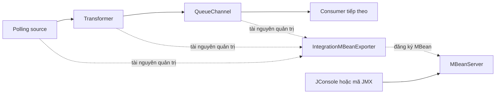

# IntegrationMBeanExporter

## 1. Mục tiêu và phạm vi bài học

Trong chương **Cấu hình và lifecycle** của module `SPRING_INTEGRATION_CORE`, bài này giải thích cách đưa các thành phần của luồng thông điệp ra giao diện quản trị JMX bằng `IntegrationMBeanExporter`.

Sau bài học, bạn có thể:

- Phân biệt `Message`, channel, handler, endpoint và MBean trong một ứng dụng Spring Integration.
- Cấu hình exporter bằng annotation hoặc bean Java, chọn `MBeanServer` và giới hạn thành phần được export.
- Tìm đúng MBean để xem trạng thái hàng đợi hoặc thao tác lifecycle.
- Phân biệt dừng một thành phần, shutdown có trật tự và đóng `ApplicationContext`.
- Viết kiểm thử xác nhận MBean được đăng ký, truy cập được và được gỡ khi context đóng.

Ví dụ sử dụng API Spring Integration **6.5**, Java 17 trở lên và cấu hình Spring thuần. Đây là mốc API cho bài học, không phải khẳng định phiên bản của dự án đang dùng. Khi áp dụng, giữ các thư viện Spring đồng bộ theo BOM của ứng dụng. Tên thuộc tính và operation thực tế phải được xác nhận bằng `MBeanInfo` của phiên bản đang chạy.

## 2. Từ luồng nghiệp vụ đến giao diện quản trị

Giả sử một luồng nhận mã đơn hàng, chuẩn hóa chuỗi rồi đưa thông điệp vào hàng đợi chờ bước xử lý tiếp theo. Đội vận hành cần biết hàng đợi còn bao nhiêu phần tử và nguồn phát thông điệp đã chạy chưa.

Các câu hỏi này khác với việc payload của một đơn hàng có hợp lệ hay không. Chúng thuộc lớp quản trị của ứng dụng:

| Thành phần | Vai trò trong bài toán |
| --- | --- |
| `Message<?>` | Mang payload đơn hàng và các header liên quan |
| `MessageChannel` | Chuyển hoặc lưu thông điệp giữa các bước |
| `MessageHandler` | Thực hiện transformer, filter, router, service activator hoặc logic tích hợp khác |
| Endpoint | Gắn xử lý với cơ chế nhận thông điệp, đăng ký subscriber hoặc chạy poller |
| MBean | Biểu diễn một tài nguyên có thuộc tính và operation quản trị |
| `MBeanServer` | Nơi đăng ký và tra cứu các MBean trong JVM |
| `IntegrationMBeanExporter` | Đăng ký giao diện quản trị của các thành phần Spring Integration đủ điều kiện |

Exporter không tạo một MBean cho từng `Message`. Nó làm việc với các thành phần của ứng dụng. Một hàng đợi chứa hàng nghìn thông điệp vẫn được quan sát thông qua MBean của channel tương ứng.



Quan hệ nét đứt biểu diễn việc đăng ký quản trị, không phải đường đi của thông điệp. Gửi một đơn hàng không yêu cầu thông điệp phải đi qua exporter.

`IntegrationMBeanExporter` kế thừa `MBeanExporter` của Spring và bổ sung cách phát hiện, đặt tên, đăng ký các thành phần tích hợp. Đặt exporter trong context chứa những thành phần cần quản trị. Xem [API IntegrationMBeanExporter](https://docs.spring.io/spring-integration/docs/6.5.0/api/org/springframework/integration/monitor/IntegrationMBeanExporter.html).

## 3. Những cơ chế dễ bị nhầm với exporter

| Cơ chế | Mục đích | Ví dụ sử dụng |
| --- | --- | --- |
| `@EnableIntegrationMBeanExport` | Tạo exporter cho các thành phần tích hợp | Quan sát channel của luồng đơn hàng qua JMX |
| `@EnableMBeanExport` hoặc `AnnotationMBeanExporter` | Export bean theo metadata JMX của Spring | Export một bean có `@ManagedResource` |
| `@EnableIntegrationManagement` | Cấu hình các khả năng management của Spring Integration | Chọn thành phần tham gia observation |
| Micrometer | Thu thập meter phục vụ giám sát | Theo dõi thời gian xử lý và tốc độ gửi |
| Control Bus | Thực thi lệnh quản trị thông qua một luồng thông điệp | Gửi lệnh start/stop từ kênh quản trị nội bộ |
| JMX adapter/gateway | Đọc thuộc tính hoặc gọi operation JMX từ luồng | Poll một thuộc tính của hệ thống bên ngoài |

Sự hiện diện của exporter không tự tạo dashboard hoặc hệ thống lưu lịch sử số liệu. Với Spring Integration hiện đại, metrics và observation cần cấu hình hạ tầng tương ứng. Bài này dùng `QueueSize` để quan sát backlog vì có thể kiểm chứng trực tiếp bằng hành vi của hàng đợi; không giả định mọi MBean đều có các bộ đếm, rate hoặc timer từng xuất hiện trong ví dụ phiên bản cũ. Xem [Metrics and Management](https://docs.spring.io/spring-integration/reference/6.5/metrics.html).

## 4. Chuẩn bị dependency và cách cấu hình

Để sử dụng các lớp JMX trong ví dụ, thêm module sau vào ứng dụng Maven đã quản lý phiên bản Spring Integration bằng BOM:

```xml
<dependency>
    <groupId>org.springframework.integration</groupId>
    <artifactId>spring-integration-jmx</artifactId>
</dependency>
```

Nếu không có BOM hoặc dependency management, cần khai báo phiên bản tương thích với các dependency Spring hiện có. Phần kiểm thử ở cuối bài sử dụng thêm JUnit Jupiter trong test scope.

Với annotation, những lựa chọn chính là:

```java
@EnableIntegrationMBeanExport(
    server = "mbeanServer",
    defaultDomain = "com.example.orders",
    managedComponents = {"!ordersInternal*", "orders*"},
    registration = RegistrationPolicy.FAIL_ON_EXISTING
)
```

| Thuộc tính | Ý nghĩa khi áp dụng |
| --- | --- |
| `server` | Tên bean `MBeanServer` đích; cần khớp chính xác với bean cấu hình |
| `defaultDomain` | Domain của ObjectName, giúp nhóm tài nguyên theo ứng dụng |
| `managedComponents` | Danh sách pattern chọn tên thành phần được đăng ký |
| `registration` | Chính sách nếu ObjectName đã tồn tại |

Annotation tạo bean tên **`integrationMbeanExporter`**, lưu ý chữ `b` thường trong `Mbean`. Pattern mặc định là `*`; chính sách mặc định là `FAIL_ON_EXISTING`. Pattern được xét từ trái sang phải, kết quả khớp đầu tiên quyết định; `!` biểu diễn loại trừ. Xem [API EnableIntegrationMBeanExport](https://docs.spring.io/spring-integration/docs/6.5.0/api/org/springframework/integration/jmx/config/EnableIntegrationMBeanExport.html).

Với cấu hình trên:

| Tên xét pattern | Kết quả mong đợi | Giải thích |
| --- | --- | --- |
| `ordersReady` | Được export | Khớp `orders*` |
| `ordersSource` | Được export | Khớp `orders*` |
| `ordersInternalScratch` | Bị loại | Khớp `!ordersInternal*` trước |
| `billingReady` | Không được chọn | Không khớp pattern cho phép |

Nếu đảo thành `{"orders*", "!ordersInternal*"}`, tên nội bộ đã được pattern đầu cho phép. Đặt quy tắc cụ thể trước quy tắc rộng là cách làm dễ đọc và dễ kiểm thử.

Pattern chỉ điều khiển việc đăng ký quản trị. Loại một channel khỏi JMX không làm channel đó biến mất, không dừng luồng và không lọc thông điệp nghiệp vụ.

## 5. Ví dụ Java DSL: nguồn đơn hàng và hàng đợi kết quả

Ví dụ sau tự tạo mã đơn hàng để việc thực hành không phụ thuộc broker, cơ sở dữ liệu hoặc dịch vụ bên ngoài. Nguồn chưa tự chạy sau khi context khởi tạo; người học sẽ khởi động nó qua JMX.

```java
package example.integration;

import java.lang.management.ManagementFactory;
import java.util.Locale;
import java.util.concurrent.atomic.AtomicLong;

import javax.management.MBeanServer;

import org.springframework.context.annotation.Bean;
import org.springframework.context.annotation.Configuration;
import org.springframework.integration.channel.QueueChannel;
import org.springframework.integration.config.EnableIntegration;
import org.springframework.integration.dsl.IntegrationFlow;
import org.springframework.integration.dsl.Pollers;
import org.springframework.integration.jmx.config.EnableIntegrationMBeanExport;
import org.springframework.jmx.support.RegistrationPolicy;

@Configuration(proxyBeanMethods = false)
@EnableIntegration
@EnableIntegrationMBeanExport(
    server = "mbeanServer",
    defaultDomain = "com.example.orders",
    managedComponents = {"!ordersInternal*", "orders*"},
    registration = RegistrationPolicy.FAIL_ON_EXISTING
)
public class OrdersJmxConfiguration {

    @Bean
    public MBeanServer mbeanServer() {
        return ManagementFactory.getPlatformMBeanServer();
    }

    @Bean
    public QueueChannel ordersReady() {
        return new QueueChannel(100);
    }

    @Bean
    public QueueChannel ordersInternalScratch() {
        return new QueueChannel(10);
    }

    @Bean
    public IntegrationFlow ordersFlow() {
        AtomicLong sequence = new AtomicLong();

        return IntegrationFlow
            .fromSupplier(
                () -> " po-" + sequence.incrementAndGet() + " ",
                endpoint -> endpoint
                    .id("ordersSource")
                    .autoStartup(false)
                    .poller(Pollers.fixedDelay(1000)
                        .maxMessagesPerPoll(1)))
            .transform(
                String.class,
                value -> value.trim().toUpperCase(Locale.ROOT),
                endpoint -> endpoint.id("ordersNormalize"))
            .channel("ordersReady")
            .get();
    }
}
```

Luồng có ba điểm đáng quan sát:

1. `ordersSource` là endpoint polling. `autoStartup(false)` cho phép kiểm tra việc MBean đã tồn tại trong khi nguồn chưa chạy.
2. `ordersNormalize` đặt tên tường minh cho endpoint transformer, giúp liên hệ giao diện quản trị với cấu hình nghiệp vụ.
3. `ordersReady` là hàng đợi giới hạn 100 phần tử. Vì ví dụ chưa nối consumer ở cuối, backlog sẽ tăng khi nguồn hoạt động.

`ordersInternalScratch` được khai báo riêng để minh họa loại trừ khỏi JMX, không tham gia đường đi của đơn hàng.

Sau khi nguồn chạy, các payload dự kiến ở `ordersReady` là `PO-1`, `PO-2`, ... Khi thực hành, nhận thông điệp khỏi hàng đợi hoặc dừng nguồn sau vài lần poll. Nếu để nguồn chạy mãi mà không có consumer, hàng đợi sẽ đầy; giới hạn dung lượng không tự tạo cơ chế xử lý backlog.

`QueueChannel` cung cấp `getQueueSize()` và `getRemainingCapacity()` để quan sát dung lượng. Đọc kích thước không lấy thông điệp ra; `receive()` mới thay đổi hàng đợi. Xem [API QueueChannel](https://docs.spring.io/spring-integration/docs/6.5.0/api/org/springframework/integration/channel/QueueChannel.html).

Trong ứng dụng thực tế, supplier được thay bằng inbound adapter hoặc nguồn thích hợp. Transformer, router, filter và aggregator vẫn là các bước nghiệp vụ; exporter giúp quan sát những thành phần đủ điều kiện của luồng đó.

## 6. ObjectName: tìm đúng tài nguyên trước khi thao tác

Mỗi MBean có một `ObjectName`. Với cấu hình mặc định của ví dụ, channel kết quả có tên:

```text
com.example.orders:type=MessageChannel,name=ordersReady
```

Cấu trúc gồm domain trước dấu `:` và các cặp khóa/giá trị sau đó. `name` là tên quản trị của thành phần, không phải ID của một thông điệp. Khóa `bean=endpoint` trong một số ObjectName mô tả nguồn gốc cách đặt tên; nó không có nghĩa MBean đó luôn là chính đối tượng endpoint.

Trong dòng API minh họa, các dạng tên cần phân biệt là:

| Loại tài nguyên | Dạng tên thường gặp |
| --- | --- |
| Channel | `domain:type=MessageChannel,name=...` |
| Handler | `domain:type=MessageHandler,name=...,bean=...` |
| Source | `domain:type=MessageSource,name=...,bean=...` |
| Endpoint được đăng ký riêng | `domain:type=ManagedEndpoint,name=...,bean=...` |

Với nguồn polling của ví dụ, endpoint điều khiển poller được đăng ký dưới tên `ordersSource.adapter`. Chi tiết đặt tên handler/source và hậu tố adapter có thể đối chiếu trong [mã nguồn IntegrationMBeanExporter 6.5.0](https://github.com/spring-projects/spring-integration/blob/v6.5.0/spring-integration-jmx/src/main/java/org/springframework/integration/monitor/IntegrationMBeanExporter.java).

Không suy luận rằng mọi handler đều có cùng operation lifecycle. Trước khi gọi một lệnh, truy vấn và đọc metadata của chính MBean đích:

```java
import java.util.Arrays;
import java.util.Set;
import javax.management.MBeanInfo;
import javax.management.MBeanServer;
import javax.management.ObjectName;

public final class JmxInspection {

    private JmxInspection() {
    }

    public static void inspect(MBeanServer server) throws Exception {
        Set<ObjectName> names = server.queryNames(
            new ObjectName("com.example.orders:*"), null);

        for (ObjectName name : names) {
            MBeanInfo info = server.getMBeanInfo(name);
            System.out.println(name.getCanonicalName());

            Arrays.stream(info.getAttributes()).forEach(attribute ->
                System.out.println("  attribute: " + attribute.getName()
                    + ", readable=" + attribute.isReadable()
                    + ", writable=" + attribute.isWritable()));

            Arrays.stream(info.getOperations()).forEach(operation ->
                System.out.println("  operation: " + operation.getName()
                    + ", arguments=" + operation.getSignature().length));
        }
    }
}
```

`queryNames`, `getMBeanInfo`, `getAttribute` và `invoke` là các thao tác khác nhau: tìm tài nguyên, xem hợp đồng, đọc trạng thái và gọi hành động. Xem [API MBeanServer của Java](https://docs.oracle.com/en/java/javase/17/docs/api/java.management/javax/management/MBeanServer.html).

Nếu bổ sung các key như `application` hoặc `instance`, query pattern nên có phần `,*` để cho phép các key khác. Tránh ghép ObjectName bằng chuỗi chứa giá trị tùy ý; khi giá trị có ký tự đặc biệt, cần xử lý quoting theo JMX.

## 7. Quan sát hàng đợi và điều khiển nguồn qua JMX

### 7.1. Đọc backlog

Giả sử `server` là bean `mbeanServer` của ví dụ:

```java
ObjectName ready = new ObjectName(
    "com.example.orders:type=MessageChannel,name=ordersReady");

int size = ((Number) server.getAttribute(ready, "QueueSize")).intValue();
System.out.println("Đơn hàng đang chờ: " + size);
```

JMX sử dụng tên thuộc tính `QueueSize`, không phải tên method `getQueueSize`. Giá trị này là ảnh chụp tại thời điểm đọc. Khi producer và consumer chạy đồng thời, hai lần đọc liên tiếp có thể khác nhau.

Với một luồng thực tế, backlog tăng chỉ là tín hiệu cần điều tra. Nguyên nhân có thể là consumer chưa chạy, consumer xử lý chậm, một hệ thống đích lỗi hoặc tốc độ nhận cao hơn khả năng xử lý. Từ một con số queue size chưa thể kết luận hệ thống làm mất dữ liệu.

### 7.2. Tìm MBean của polling endpoint

```java
Set<ObjectName> matches = server.queryNames(
    new ObjectName(
        "com.example.orders:type=ManagedEndpoint,"
            + "name=ordersSource.adapter,*"),
    null);

if (matches.size() != 1) {
    throw new IllegalStateException(
        "Cần đúng một polling endpoint, tìm thấy: " + matches);
}

ObjectName pollingEndpoint = matches.iterator().next();
boolean running = (Boolean) server.getAttribute(
    pollingEndpoint, "Running");
```

Kiểm tra số kết quả giúp tránh thao tác nhầm instance nếu sau này ứng dụng có nhiều context hoặc nhiều ObjectName cùng loại.

### 7.3. Start và stop

Sau khi metadata xác nhận endpoint có operation tương ứng:

```java
server.invoke(pollingEndpoint, "start", new Object[0], new String[0]);

boolean afterStart = (Boolean) server.getAttribute(
    pollingEndpoint, "Running");

server.invoke(pollingEndpoint, "stop", new Object[0], new String[0]);

boolean afterStop = (Boolean) server.getAttribute(
    pollingEndpoint, "Running");
```

`Running` là thuộc tính quản trị; `start` và `stop` là operation. Các phương thức lifecycle được đưa ra JMX thông qua hợp đồng quản trị của thành phần. Xem [API ManageableLifecycle](https://docs.spring.io/spring-integration/docs/6.5.0/api/org/springframework/integration/support/management/ManageableLifecycle.html).

Trong ví dụ, thao tác lên `ordersSource.adapter` điều khiển endpoint polling. Dừng nguồn ngăn các lần poll tiếp theo; các thông điệp đã tới `ordersReady` vẫn nằm ở đó. Thông điệp đang được xử lý và khả năng ngắt tác vụ phải được đánh giá theo loại endpoint cụ thể.

Nếu thao tác vào MBean của handler thay vì polling endpoint, hợp đồng và phạm vi tác động có thể khác. Không dùng việc một MBean có operation `stop` để kết luận toàn bộ consumer hoặc toàn bộ luồng đã dừng.

### 7.4. Thực hành bằng JConsole

Trong một ứng dụng giữ JVM hoạt động, có thể dùng JConsole kết nối local vào tiến trình rồi:

1. Mở tab **MBeans**, tìm domain `com.example.orders`.
2. Xác nhận `ordersReady` có thuộc tính `QueueSize`.
3. Tìm polling endpoint `ordersSource.adapter`, đọc `Running` ban đầu là `false`.
4. Gọi `start`, quan sát backlog tăng, rồi gọi `stop`.
5. Nhận thông điệp khỏi `ordersReady` ở phía ứng dụng để quan sát kích thước giảm.

Việc đăng ký MBean và việc mở connector JMX từ xa là hai cấu hình riêng. Ví dụ chỉ sử dụng platform MBeanServer, không cấu hình cổng remote. Khi triển khai quản trị từ xa, xem quyền gọi operation như quyền thay đổi hoạt động hệ thống và cấu hình kết nối theo chính sách vận hành của môi trường.

## 8. Lifecycle của endpoint và lifecycle của MBean

Hai câu hỏi cần trả lời riêng là: “thành phần có đang chạy không?” và “MBean của thành phần có được đăng ký không?”.

| Tình huống | Thành phần xử lý | Đăng ký MBean |
| --- | --- | --- |
| Context đã khởi tạo, nguồn `autoStartup(false)` | Nguồn chưa chạy | Có thể đã đăng ký |
| Gọi `start` trên nguồn | Nguồn bắt đầu hoạt động | MBean tiếp tục tồn tại |
| Gọi `stop` trên nguồn | Nguồn dừng theo hợp đồng lifecycle | MBean tiếp tục tồn tại |
| Context bị hủy | Bean được dọn dẹp theo lifecycle của context | Exporter gỡ các MBean do nó đăng ký |

`IntegrationMBeanExporter` không còn triển khai `SmartLifecycle` để dùng `start()`/`stop()` đăng ký và gỡ MBean. Việc đăng ký gắn với khởi tạo context, việc gỡ gắn với hủy context. Xem [JMX Support — thay đổi lifecycle của exporter](https://docs.spring.io/spring-integration/reference/6.5/jmx.html).

Vì vậy, tắt endpoint không làm ObjectName biến mất là hành vi có thể hoàn toàn bình thường. Ngược lại, thấy ObjectName tồn tại cũng chưa đủ khẳng định poller đã chạy hoặc kết nối đến hệ thống đích hoạt động.

Endpoint có `autoStartup`, `phase` và các phương thức lifecycle riêng. Khi cần quản lý thứ tự khởi động/dừng, hãy kiểm tra endpoint cụ thể và cơ chế lifecycle của Spring, không suy thứ tự từ danh sách MBean. Xem [API AbstractEndpoint](https://docs.spring.io/spring-integration/docs/6.5.0/api/org/springframework/integration/endpoint/AbstractEndpoint.html).

## 9. Export riêng chính exporter

Có hai tầng tài nguyên:

- MBean của các channel, handler, source và endpoint.
- MBean của chính `IntegrationMBeanExporter`, dùng cho một số thông tin tổng hợp và operation quản trị rộng hơn.

Chỉ thêm `@EnableIntegrationMBeanExport` chưa đồng nghĩa chính exporter đã được đưa ra JMX. Exporter không tự đăng ký bản thân. Nếu cần quản trị nó, cấu hình thêm exporter JMX thông thường với danh sách bean tường minh.

Đây là cấu hình bổ sung cho `OrdersJmxConfiguration`, không thay thế annotation đang có:

```java
package example.integration;

import java.util.Map;
import javax.management.MBeanServer;

import org.springframework.context.annotation.Bean;
import org.springframework.context.annotation.Configuration;
import org.springframework.jmx.export.annotation.AnnotationMBeanExporter;
import org.springframework.jmx.support.RegistrationPolicy;

@Configuration(proxyBeanMethods = false)
public class ExporterManagementConfiguration {

    @Bean
    public static AnnotationMBeanExporter exporterManagement(
            MBeanServer mbeanServer) {

        AnnotationMBeanExporter exporter = new AnnotationMBeanExporter();
        exporter.setServer(mbeanServer);
        exporter.setAutodetect(false);
        exporter.setRegistrationPolicy(RegistrationPolicy.FAIL_ON_EXISTING);
        exporter.setBeans(Map.of(
            "com.example.orders.management:type=IntegrationExporter,name=orders",
            "integrationMbeanExporter"));
        return exporter;
    }
}
```

Trong map, key là ObjectName muốn đăng ký; value là tên bean exporter đã được annotation tạo ra. Cách này giới hạn exporter thứ hai vào tài nguyên cụ thể. `AnnotationMBeanExporter` sử dụng metadata `@ManagedResource`, `@ManagedAttribute` và `@ManagedOperation` của Spring. Xem [API AnnotationMBeanExporter](https://docs.spring.io/spring-framework/docs/6.2.x/javadoc-api/org/springframework/jmx/export/annotation/AnnotationMBeanExporter.html).

Khi khởi tạo context bằng Java thuần, đăng ký cả hai lớp cấu hình để sử dụng phần bổ sung này:

```java
try (var context = new AnnotationConfigApplicationContext(
        OrdersJmxConfiguration.class,
        ExporterManagementConfiguration.class)) {
    // Đọc metadata hoặc thực hiện thao tác quản trị trong context này.
}
```

Đoạn trên cần import `org.springframework.context.annotation.AnnotationConfigApplicationContext`. Nếu ứng dụng đã có exporter JMX do cấu hình khác cung cấp, kiểm tra quyền sở hữu tài nguyên trước khi thêm exporter thứ hai để tránh đăng ký trùng.

## 10. Shutdown có trật tự bằng stopActiveComponents

Exporter cung cấp phương thức:

```java
void stopActiveComponents(long howLong)
```

`howLong` là ngân sách thời gian chờ theo **mili giây** để thông điệp đang xử lý có cơ hội hoàn tất. Trình tự có các bước chuẩn bị qua `OrderlyShutdownCapable`, dừng nguồn nhận mới và các active channel liên quan, chờ phần thời gian còn lại, rồi thực hiện bước hoàn tất shutdown. Các poller phía giữa luồng được giữ cơ hội xử lý thông điệp còn tồn. Xem [Orderly Shutdown](https://docs.spring.io/spring-integration/reference/6.5/shutdown.html).

Có hai cách tiếp cận:

```java
import org.springframework.integration.monitor.IntegrationMBeanExporter;

IntegrationMBeanExporter exporter = context.getBean(
    "integrationMbeanExporter", IntegrationMBeanExporter.class);

exporter.stopActiveComponents(5000L);
```

Hoặc, sau khi đã export chính exporter như phần trước:

```java
ObjectName exporterName = new ObjectName(
    "com.example.orders.management:type=IntegrationExporter,name=orders");

server.invoke(
    exporterName,
    "stopActiveComponents",
    new Object[] {5000L},
    new String[] {"long"});
```

Chữ ký Java là primitive `long`; mảng chữ ký JMX phải tương ứng là `"long"`, dù đối số trong `Object[]` được boxing thành `Long`.

Đây là thao tác chuẩn bị shutdown ứng dụng, không phải lệnh pause/resume một endpoint. Nó cũng không tự gọi `System.exit()` hay thay thế việc đóng context ở bước sau.

Đối với luồng thực tế, quy trình vận hành cần trả lời:

1. Nguồn nào phải ngừng nhận công việc mới và ai điều phối nguồn đó?
2. Thời gian chờ có đủ cho tác vụ thường gặp và các lần retry hợp lệ không?
3. Phần việc chưa hoàn tất nằm trong broker, persistent store hay chỉ trong bộ nhớ JVM?
4. Khi context đóng, phần việc đó có thể được xử lý lại như thế nào?

`managedComponents` là bộ lọc đăng ký JMX, không phải cách khoanh vùng shutdown. Không suy rằng chỉ những tài nguyên nhìn thấy trên JConsole mới có thể bị tác động bởi các operation quản trị tổng thể của exporter.

Với aggregator, “queue đã rỗng” vẫn chưa nói hết tình trạng hệ thống: thông điệp có thể đang chờ trong message group. Với gateway, yêu cầu có thể đang đợi reply. Với xử lý bất đồng bộ, tác vụ có thể đang chạy trong executor. Muốn đánh giá việc hoàn tất công việc, cần kết hợp những trạng thái này với đặc tính lưu trữ và xác nhận nghiệp vụ.

## 11. Khi nào khai báo IntegrationMBeanExporter bằng bean Java

Annotation phù hợp cho cấu hình đơn giản. Khi cần thêm thuộc tính tĩnh vào ObjectName, có thể **thay annotation** bằng bean Java sau trong cấu hình của phần 5:

```java
import java.util.Map;
import javax.management.MBeanServer;

import org.springframework.context.annotation.Bean;
import org.springframework.integration.monitor.IntegrationMBeanExporter;
import org.springframework.jmx.support.RegistrationPolicy;

@Bean
public static IntegrationMBeanExporter integrationMbeanExporter(
        MBeanServer mbeanServer) {

    IntegrationMBeanExporter exporter = new IntegrationMBeanExporter();
    exporter.setServer(mbeanServer);
    exporter.setDefaultDomain("com.example.orders");
    exporter.setComponentNamePatterns(
        new String[] {"!ordersInternal*", "orders*"});
    exporter.setObjectNameStaticProperties(Map.of(
        "application", "orders",
        "instance", "local1"));
    exporter.setRegistrationPolicy(RegistrationPolicy.FAIL_ON_EXISTING);
    return exporter;
}
```

Đây là method đặt bên trong lớp cấu hình; không giữ `@EnableIntegrationMBeanExport` đồng thời cho cùng nhiệm vụ. Sau thay đổi, ObjectName có thêm key, ví dụ:

```text
com.example.orders:type=MessageChannel,name=ordersReady,application=orders,instance=local1
```

Thứ tự key khi hiển thị có thể khác. Query dành cho cả hai cách cấu hình nên là:

```text
com.example.orders:type=MessageChannel,name=ordersReady,*
```

Đặt tên instance giúp phân biệt tài nguyên cùng JVM/MBeanServer. Những tiến trình JVM riêng biệt có MBeanServer riêng không xung đột ObjectName chỉ vì cùng dùng một chuỗi tên.

Khi gặp đăng ký trùng, cần kiểm tra số exporter, số context, domain và key thực tế trước khi đổi chính sách. `IGNORE_EXISTING` có thể khiến người vận hành vẫn nhìn vào MBean cũ; `REPLACE_EXISTING` có thể thay tài nguyên do context khác sở hữu. Giữ lỗi rõ ràng trong ví dụ giúp phát hiện cấu hình sai sớm.

## 12. Kiểm thử hợp đồng quản trị

Kiểm thử JMX có ích vì một luồng vẫn có thể xử lý thông điệp đúng trong khi tên MBean hoặc bộ lọc export bị cấu hình sai. Phần dưới minh họa kiểm thử tích hợp cho cấu hình annotation ở phần 5, chưa thêm static properties và chưa thêm cấu hình export chính exporter.

```java
package example.integration;

import java.util.Set;
import javax.management.MBeanServer;
import javax.management.ObjectName;

import org.junit.jupiter.api.Test;
import org.springframework.context.annotation.AnnotationConfigApplicationContext;
import org.springframework.integration.channel.QueueChannel;
import org.springframework.messaging.Message;
import org.springframework.messaging.support.MessageBuilder;

import static org.junit.jupiter.api.Assertions.*;

class OrdersJmxConfigurationTest {

    @Test
    void exposesQueueStateAndUnregistersOnClose() throws Exception {
        MBeanServer server;
        ObjectName ready = new ObjectName(
            "com.example.orders:type=MessageChannel,name=ordersReady");
        ObjectName internal = new ObjectName(
            "com.example.orders:type=MessageChannel,"
                + "name=ordersInternalScratch");

        try (var context = new AnnotationConfigApplicationContext(
                OrdersJmxConfiguration.class)) {
            server = context.getBean("mbeanServer", MBeanServer.class);
            QueueChannel channel = context.getBean(
                "ordersReady", QueueChannel.class);

            assertTrue(server.isRegistered(ready));
            assertFalse(server.isRegistered(internal));
            assertEquals(0, queueSize(server, ready));

            assertTrue(channel.send(
                MessageBuilder.withPayload("PO-TEST").build(), 0));
            assertEquals(1, queueSize(server, ready));

            Message<?> received = channel.receive(0);
            assertNotNull(received);
            assertEquals("PO-TEST", received.getPayload());
            assertEquals(0, queueSize(server, ready));
        }

        assertFalse(server.isRegistered(ready));
    }

    @Test
    void startsAndStopsPollingEndpointThroughJmx() throws Exception {
        try (var context = new AnnotationConfigApplicationContext(
                OrdersJmxConfiguration.class)) {
            MBeanServer server = context.getBean(
                "mbeanServer", MBeanServer.class);

            Set<ObjectName> matches = server.queryNames(
                new ObjectName(
                    "com.example.orders:type=ManagedEndpoint,"
                        + "name=ordersSource.adapter,*"),
                null);

            assertEquals(1, matches.size());
            ObjectName endpoint = matches.iterator().next();
            assertEquals(Boolean.FALSE,
                server.getAttribute(endpoint, "Running"));

            server.invoke(endpoint, "start",
                new Object[0], new String[0]);
            try {
                assertEquals(Boolean.TRUE,
                    server.getAttribute(endpoint, "Running"));

                QueueChannel ready = context.getBean(
                    "ordersReady", QueueChannel.class);
                Message<?> message = ready.receive(3000);
                assertNotNull(message);
                assertTrue(((String) message.getPayload()).startsWith("PO-"));
            }
            finally {
                server.invoke(endpoint, "stop",
                    new Object[0], new String[0]);
            }

            assertEquals(Boolean.FALSE,
                server.getAttribute(endpoint, "Running"));
            assertTrue(server.isRegistered(endpoint));
        }
    }

    private static int queueSize(MBeanServer server, ObjectName name)
            throws Exception {
        return ((Number) server.getAttribute(name, "QueueSize")).intValue();
    }
}
```

Kiểm thử đầu giữ nguồn chưa chạy để việc kiểm tra kích thước hàng đợi có kết quả xác định. Kiểm thử thứ hai kiểm tra cả operation lifecycle và một thông điệp đi qua transformer; `receive(3000)` chờ kết quả với giới hạn thay vì ngủ một khoảng cố định.

Vì ví dụ dùng platform MBeanServer, chạy các test này tuần tự và tránh context khác cùng đăng ký domain/tên trên. Một bộ kiểm thử có chạy song song nên dùng MBeanServer riêng hoặc tên tài nguyên riêng cho từng test. Đóng context bằng `try-with-resources` để dọn các MBean kể cả khi assertion thất bại.

Các đoạn test là mã thực hành trong bài học; việc đưa chúng vào dự án và chạy với dependency/BOM cụ thể là bước xác minh riêng. Không coi ví dụ trên là bằng chứng đã chạy kiểm thử cho dự án hiện tại.

## 13. Chẩn đoán lỗi thường gặp

| Hiện tượng | Điểm cần kiểm tra | Hướng xử lý |
| --- | --- | --- |
| Không thấy domain mong đợi | Exporter có được tạo, có ở đúng context, có trỏ đúng server không | Xác nhận bean và server trước khi kiểm tra client JMX |
| Thấy channel nhưng thiếu thành phần khác | Pattern, tên bean sinh tự động và khả năng management của thành phần | Liệt kê ObjectName và đối chiếu tên thực tế |
| Thành phần nội bộ vẫn xuất hiện | Thứ tự các pattern | Đặt loại trừ trước pattern rộng |
| Có MBean nhưng nguồn không phát dữ liệu | `Running`, `autoStartup`, cấu hình poller và lỗi nghiệp vụ | Đọc trạng thái endpoint rồi kiểm tra đường đi thông điệp |
| `AttributeNotFoundException` | Tên và khả năng đọc thuộc tính | Dùng `getMBeanInfo`, không đoán tên từ ví dụ cũ |
| Gọi operation thất bại | Đúng MBean, operation và chữ ký tham số chưa | So khớp metadata; kiểm tra `long` với `java.lang.Long` |
| `InstanceAlreadyExistsException` | Exporter/context trùng tên trong cùng server | Tách domain hoặc thêm key phân biệt sau khi xác định chủ sở hữu |
| Không thấy `stopActiveComponents` | Đang xem MBean channel hay MBean exporter | Export riêng chính exporter nếu cần thao tác qua JMX |
| Đã gọi `stop` nhưng MBean còn tồn tại | Đang nhầm lifecycle với đăng ký quản trị | Kiểm tra `Running`; gỡ MBean gắn với hủy context |

Lỗi quản trị JMX cũng cần phân biệt với lỗi xử lý thông điệp. Một operation JMX bị sai chữ ký không tự trở thành `ErrorMessage` của luồng. Ngược lại, transformer hoặc downstream có lỗi cần được xử lý theo ranh giới đồng bộ/bất đồng bộ và error flow của ứng dụng; nhìn thấy MBean không chứng minh đường xử lý lỗi đã đúng.

## 14. Bài thực hành mở rộng

1. Khởi tạo cấu hình phần 5 và liệt kê mọi ObjectName thuộc `com.example.orders`. Ghi lại MBean tương ứng channel, source và polling endpoint.
2. Giữ nguồn dừng, gửi thủ công hai thông điệp vào `ordersReady`. Đọc `QueueSize`, nhận một thông điệp rồi đọc lại. Giải thích vì sao đường gửi thủ công này không đi qua transformer.
3. Start nguồn qua JMX, nhận một kết quả và xác nhận payload được chuẩn hóa. Stop nguồn và kiểm tra MBean vẫn đăng ký.
4. Đảo thứ tự pattern trong một bản cấu hình thực hành. Dự đoán rồi kiểm tra sự hiện diện của `ordersInternalScratch`.
5. Thêm cấu hình export riêng exporter, đọc metadata và tìm operation `stopActiveComponents`. Chỉ gọi trên context dùng cho thực hành shutdown.
6. Thay annotation bằng bean Java có `application` và `instance`. Điều chỉnh query/test để tìm đúng tài nguyên khi có thêm key.

Tiêu chí hoàn thành là giải thích được tác động của mỗi thao tác lên **trạng thái xử lý**, **nội dung hàng đợi** và **đăng ký MBean**. Ba khía cạnh này liên quan nhưng không đồng nhất.
