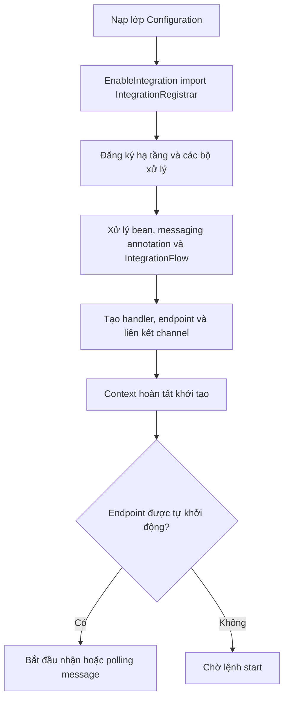

# EnableIntegration

## 1. Mục tiêu và phạm vi

Trong chương **Cấu hình và lifecycle** của module **SPRING_INTEGRATION_CORE**, `@EnableIntegration` là điểm khởi đầu để hiểu cách các khai báo MessageChannel, endpoint và Java DSL trở thành một hệ thống xử lý thông điệp trong Spring.

Sau bài này, bạn có thể:

- Kích hoạt hạ tầng Spring Integration trong ứng dụng Java thuần.
- Phân biệt việc bật hạ tầng, đăng ký bean và tìm gateway interface.
- Ghép một channel với transformer hoặc service activator bằng annotation và Java DSL.
- Giải thích vì sao một endpoint đã tồn tại nhưng chưa xử lý thông điệp.
- Viết kiểm thử kiểm tra cả cấu hình lẫn hành vi truyền thông điệp.

Các ví dụ dùng **Java 17 trở lên và API Spring Integration 6.5.x**; phần Spring Boot tham chiếu nhánh **3.5.x**. Đây là mốc API của bài, không phải khẳng định về phiên bản mới nhất. Khi áp dụng vào dự án, dùng bộ phiên bản tương thích do BOM của dự án quản lý.

Bạn cần biết `@Configuration`, `@Bean`, `@Import`, dependency injection, `ApplicationContext` và sự khác nhau cơ bản giữa `DirectChannel` với `QueueChannel`.

## 2. @EnableIntegration bật điều gì?

### 2.1. Một annotation cấu hình hạ tầng

`@EnableIntegration` thuộc package:

```java
import org.springframework.integration.config.EnableIntegration;
```

Đặt annotation này trên một lớp cấu hình được nạp vào context:

```java
import org.springframework.context.annotation.Configuration;
import org.springframework.integration.config.EnableIntegration;

@Configuration(proxyBeanMethods = false)
@EnableIntegration
public class IntegrationInfrastructureConfig {
}
```

Annotation xuất hiện từ Spring Integration 4.0. Nó import `IntegrationRegistrar` để đăng ký hạ tầng và các bộ xử lý cấu hình. Annotation này không có thuộc tính cấu hình nghiệp vụ như tên channel, khoảng polling hay retry. Những lựa chọn đó nằm ở bean hoặc endpoint tương ứng. Xem [Javadoc EnableIntegration](https://docs.spring.io/spring-integration/docs/6.5.x/api/org/springframework/integration/config/EnableIntegration.html).

Một lớp chỉ nằm trên classpath chưa đủ để có hiệu lực. Bạn phải nạp nó qua component scan, `@Import`, hoặc đăng ký trực tiếp vào `AnnotationConfigApplicationContext`.

### 2.2. Các nhóm hạ tầng được chuẩn bị

| Nhóm | Ví dụ hoặc vai trò |
| --- | --- |
| Bean dùng chung | `errorChannel` cùng logging handler mặc định; scheduler phục vụ các tác vụ polling |
| `BeanFactoryPostProcessor` | Chuẩn bị cấu hình chung của môi trường integration |
| `BeanPostProcessor` | Xử lý hoặc bọc bean để tham gia hạ tầng messaging |
| Bộ xử lý messaging annotation | Diễn giải các khai báo endpoint như `@Transformer`, `@ServiceActivator` |

Một số bean có tên và giá trị mặc định, đồng thời cho phép ứng dụng cung cấp cấu hình thay thế theo cơ chế của từng thành phần. Vì thế, hãy xem đây là bước thiết lập môi trường chạy, không phải lời hứa rằng mọi bean đều bị tạo mới bất kể cấu hình sẵn có. Tài liệu [Configuration and EnableIntegration](https://docs.spring.io/spring-integration/reference/6.5/overview.html#configuration-enabling) mô tả các nhóm hạ tầng này.

Sau khi bật hạ tầng, bạn vẫn cần định nghĩa luồng, đăng ký đối tượng xử lý nghiệp vụ và kết nối đầu vào, đầu ra. Ví dụ, annotation này không tự suy ra rằng phương thức `normalizeOrderCode()` phải nhận thông điệp từ `rawOrders`.

## 3. Từ khai báo đến endpoint hoạt động

Có thể đọc quá trình khởi tạo theo mô hình sau:



`IntegrationRegistrar` triển khai `ImportBeanDefinitionRegistrar`. Khi Spring gặp `@EnableIntegration`, registrar tham gia đăng ký bean definition. Đường cấu hình XML của Spring Integration cũng sử dụng registrar này để chuẩn bị hạ tầng tương ứng. Xem [Javadoc IntegrationRegistrar](https://docs.spring.io/spring-integration/docs/6.5.x/api/org/springframework/integration/config/IntegrationRegistrar.html).

Sơ đồ trên là mô hình để đọc cấu hình, không phải cam kết thứ tự gọi chi tiết của mọi post-processor.

Để chẩn đoán một flow, hãy tách bốn câu kiểm tra:

1. **Cấu hình có được nạp không?** Nếu không, annotation trên lớp đó chưa có tác dụng.
2. **Đối tượng xử lý có là bean không?** Một đối tượng tạo bằng `new` rồi giữ ngoài context không được xử lý như bean.
3. **Endpoint đã được tạo và nối vào channel nào?** Có một bean nghiệp vụ chưa chứng minh rằng đã có consumer endpoint.
4. **Endpoint có đang chạy không?** Bean tồn tại và endpoint đang nhận message là hai trạng thái khác nhau.

Cách kiểm tra này áp dụng cả khi bạn học transformer, router, filter và aggregator: mỗi thành phần cần đi qua cơ chế cấu hình để trở thành một phần của luồng.

## 4. Ví dụ Java thuần: bật hạ tầng và chạy transformer

### 4.1. Chuẩn bị dependency

Ví dụ cần `org.springframework.integration:spring-integration-core`. Đoạn Maven sau giả định dự án đã có BOM hoặc dependency management phù hợp:

```xml
<dependency>
    <groupId>org.springframework.integration</groupId>
    <artifactId>spring-integration-core</artifactId>
</dependency>
```

Nếu dự án chưa quản lý phiên bản, hãy bổ sung phiên bản 6.5.x tương thích vào cấu hình build. Chỉ thêm `spring-messaging` sẽ không cung cấp toàn bộ endpoint và hạ tầng Spring Integration mà ví dụ cần.

### 4.2. Một chương trình hoàn chỉnh

Đặt mã sau trong `EnableIntegrationDemo.java`, thuộc package `vn.example.integration.enable`:

```java
package vn.example.integration.enable;

import java.util.Locale;

import org.springframework.context.annotation.AnnotationConfigApplicationContext;
import org.springframework.context.annotation.Bean;
import org.springframework.context.annotation.Configuration;
import org.springframework.context.annotation.Import;
import org.springframework.integration.annotation.Transformer;
import org.springframework.integration.channel.DirectChannel;
import org.springframework.integration.channel.QueueChannel;
import org.springframework.integration.config.EnableIntegration;
import org.springframework.messaging.Message;
import org.springframework.messaging.MessageChannel;
import org.springframework.messaging.support.GenericMessage;

public class EnableIntegrationDemo {

    @Configuration(proxyBeanMethods = false)
    @EnableIntegration
    @Import(OrderCodeNormalizer.class)
    public static class FlowConfig {

        @Bean
        public DirectChannel rawOrders() {
            return new DirectChannel();
        }

        @Bean
        public QueueChannel normalizedOrders() {
            return new QueueChannel(10);
        }
    }

    public static class OrderCodeNormalizer {

        @Transformer(
                inputChannel = "rawOrders",
                outputChannel = "normalizedOrders")
        public String normalize(String value) {
            String result = value.trim().toUpperCase(Locale.ROOT);
            if (result.isBlank()) {
                throw new IllegalArgumentException(
                        "Mã đơn hàng không được để trống");
            }
            return result;
        }
    }

    public static void main(String[] args) {
        try (var context =
                     new AnnotationConfigApplicationContext(FlowConfig.class)) {

            MessageChannel input =
                    context.getBean("rawOrders", MessageChannel.class);
            QueueChannel output =
                    context.getBean("normalizedOrders", QueueChannel.class);

            boolean accepted = input.send(
                    new GenericMessage<>("  order-2026-001  "), 1000);
            if (!accepted) {
                throw new IllegalStateException("Không gửi được thông điệp");
            }

            Message<?> reply = output.receive(1000);
            if (reply == null) {
                throw new IllegalStateException("Không nhận được kết quả");
            }

            System.out.println(reply.getPayload());
        }
    }
}
```

Kết quả mong đợi:

```text
ORDER-2026-001
```

Luồng của ví dụ:

```text
GenericMessage<String>
    -> rawOrders (DirectChannel)
    -> transformer normalize(...)
    -> normalizedOrders (QueueChannel)
    -> main gọi receive(...)
```

Mỗi khai báo có nhiệm vụ cụ thể:

- `@EnableIntegration` chuẩn bị cơ chế xử lý cấu hình integration.
- `@Import(OrderCodeNormalizer.class)` đăng ký lớp xử lý làm bean, nên ví dụ không cần quét package.
- Hai phương thức `@Bean` đăng ký channel với tên trùng các tham chiếu trong `@Transformer`.
- `@Transformer` xác định đầu vào, đầu ra và phương thức biến đổi payload.
- `try-with-resources` đóng context sau khi chạy xong.

`DirectChannel` gọi consumer trên luồng của bên gửi. `QueueChannel` lưu message để bên nhận lấy ra; queue mặc định nằm trong bộ nhớ. Trong ví dụ, queue đầu ra được `main` nhận trực tiếp nên không cần endpoint polling cho queue đó. Xem [Message Channel Implementations](https://docs.spring.io/spring-integration/reference/6.5/channel/implementations.html).

### 4.3. Gọi phương thức trực tiếp khác với gửi message

Lệnh sau chỉ kiểm tra logic Java:

```java
String result = new EnableIntegrationDemo.OrderCodeNormalizer()
        .normalize("  order-2026-001  ");
```

Nó không chứng minh rằng `rawOrders` có consumer, tên channel đúng hoặc bộ xử lý annotation đã được kích hoạt. Muốn kiểm tra cấu hình integration, cần gửi message qua channel như chương trình trên.

Đây là lý do một unit test của phương thức có thể thành công trong khi ứng dụng thực tế vẫn báo channel không có subscriber.

## 5. Phân biệt bật hạ tầng với quét component

### 5.1. Ba trách nhiệm thường bị nhầm

| Khai báo | Trách nhiệm chính |
| --- | --- |
| `@EnableIntegration` | Đăng ký hạ tầng Spring Integration |
| `@ComponentScan` | Tìm các lớp component thông thường để đăng ký bean |
| `@IntegrationComponentScan` | Tìm các interface `@MessagingGateway` để đăng ký gateway proxy |
| `@Import` | Đăng ký các kiểu được chỉ định trực tiếp |
| `@Bean` | Đăng ký đối tượng do phương thức cấu hình tạo ra |

`@MessageEndpoint` là một stereotype dựa trên `@Component`. Ngược lại, gateway là interface, nên component scan thông thường không tạo implementation cho nó. Cơ chế `@IntegrationComponentScan` giải quyết việc tìm và đăng ký gateway interface. Xem [Annotation Support](https://docs.spring.io/spring-integration/reference/6.5/configuration/annotations.html).

Ví dụ cấu hình khi dùng cách quét:

```java
package vn.example.integration.enable;

import org.springframework.context.annotation.ComponentScan;
import org.springframework.context.annotation.Configuration;
import org.springframework.integration.annotation.IntegrationComponentScan;
import org.springframework.integration.config.EnableIntegration;

@Configuration(proxyBeanMethods = false)
@EnableIntegration
@ComponentScan(basePackages = "vn.example.integration.handlers")
@IntegrationComponentScan(basePackageClasses = OrderCodeGateway.class)
public class ScannedIntegrationConfig {
}
```

Đây là **mẫu cấu hình thay thế**. Package `vn.example.integration.handlers` do ứng dụng lựa chọn để chứa các lớp xử lý có stereotype. Phần tiếp theo dùng một cấu hình riêng và không cần nạp `ScannedIntegrationConfig`.

Chọn `basePackageClasses` giúp tham chiếu package thông qua một kiểu Java. Dù dùng tên package hay marker class, phạm vi quét vẫn phải chứa đúng các thành phần cần đăng ký.

### 5.2. Khi không cần quét gateway

Từ Spring Integration 6.0, một interface có `@MessagingGateway` có thể được đăng ký qua `@Import`. Cách này phù hợp khi muốn liệt kê rõ từng gateway trong một cấu hình nhỏ. Đây là một lựa chọn thay cho quét hoặc tự khai báo factory bean, không thay thế vai trò bật hạ tầng. Xem [Messaging Gateways](https://docs.spring.io/spring-integration/reference/6.5/gateway.html).

Không nên mặc định kết luận “có gateway annotation là Spring sẽ tự tìm thấy”. Cần nhìn vào cách ứng dụng đăng ký interface đó.

## 6. Ví dụ Java DSL kết hợp gateway

Ví dụ này độc lập với `EnableIntegrationDemo`. Nó tiếp nhận lời gọi Java, tạo message, chuẩn hóa mã đơn hàng và trả payload về người gọi.

### 6.1. Gateway interface

Tệp `OrderCodeGateway.java`:

```java
package vn.example.integration.enable;

import org.springframework.integration.annotation.MessagingGateway;

@MessagingGateway(
        defaultRequestChannel = "gatewayOrders",
        defaultReplyTimeout = "1000")
public interface OrderCodeGateway {

    String normalize(String code);
}
```

### 6.2. Cấu hình DSL

Tệp `DslGatewayConfig.java`:

```java
package vn.example.integration.enable;

import java.util.Locale;

import org.springframework.beans.factory.annotation.Qualifier;
import org.springframework.context.annotation.Bean;
import org.springframework.context.annotation.Configuration;
import org.springframework.context.annotation.Import;
import org.springframework.integration.channel.DirectChannel;
import org.springframework.integration.config.EnableIntegration;
import org.springframework.integration.dsl.IntegrationFlow;
import org.springframework.messaging.MessageChannel;

@Configuration(proxyBeanMethods = false)
@EnableIntegration
@Import(OrderCodeGateway.class)
public class DslGatewayConfig {

    @Bean
    public DirectChannel gatewayOrders() {
        return new DirectChannel();
    }

    @Bean
    public IntegrationFlow normalizeOrderFlow(
            @Qualifier("gatewayOrders") MessageChannel input) {

        return IntegrationFlow.from(input)
                .<String, String>transform(
                        value -> value.trim().toUpperCase(Locale.ROOT))
                .get();
    }
}
```

### 6.3. Gọi thử gateway

Tệp `GatewayDemo.java`:

```java
package vn.example.integration.enable;

import org.springframework.context.annotation.AnnotationConfigApplicationContext;

public class GatewayDemo {

    public static void main(String[] args) {
        try (var context =
                     new AnnotationConfigApplicationContext(DslGatewayConfig.class)) {

            OrderCodeGateway gateway =
                    context.getBean(OrderCodeGateway.class);

            System.out.println(gateway.normalize("  order-2026-002  "));
        }
    }
}
```

Kết quả mong đợi là `ORDER-2026-002`.

Trong DSL, `IntegrationFlow` là khai báo để framework đăng ký các thành phần thật vào context. `transform(...)` tạo bước biến đổi; channel và endpoint nối các bước được hạ tầng DSL xử lý. Vì vậy, gọi builder trong một đối tượng nằm ngoài context không tương đương với đăng ký một `IntegrationFlow` bean. Xem [DSL Basics](https://docs.spring.io/spring-integration/reference/6.5/dsl/java-basics.html).

Gateway cung cấp kênh trả lời tạm thời qua header `replyChannel`. Khi flow trên kết thúc ở transformer và không đặt output channel riêng, kết quả có thể quay về gateway theo địa chỉ trả lời đó. Đây là lý do ví dụ không khai báo một `QueueChannel` đầu ra như phần Java thuần. Xem [Setting the Default Reply Channel](https://docs.spring.io/spring-integration/reference/6.5/gateway.html#gateway-default-reply-channel).

Bạn có thể thay `@Import(OrderCodeGateway.class)` bằng `@IntegrationComponentScan(basePackageClasses = OrderCodeGateway.class)` và import annotation tương ứng. Với ví dụ nhỏ này, chọn một cách đăng ký gateway là đủ.

Không nạp đồng thời nhiều bản cấu hình thay thế có cùng tên bean vào một context. Hãy chọn annotation endpoint hoặc DSL cho cùng một kết nối xử lý; việc tạo thêm consumer trên cùng channel có thể làm thay đổi cách phân phối message.

## 7. EnableIntegration, poller và lifecycle

### 7.1. Scheduler và poller có nhiệm vụ khác nhau

`TaskScheduler` cung cấp khả năng lập lịch. Poller xác định công việc polling như trigger, số message mỗi lần và timeout nhận. Một consumer đọc từ `QueueChannel` cần cấu hình poller riêng hoặc poller mặc định phù hợp; chỉ có scheduler chưa mô tả được lịch đọc của consumer.

Ngược lại, consumer nối vào `DirectChannel` nhận message theo cơ chế subscribe, không cần polling. Các tác vụ xử lý lâu trên luồng scheduler có thể làm chậm endpoint polling khác dùng chung scheduler. Xem [Configuring the Task Scheduler](https://docs.spring.io/spring-integration/reference/6.5/configuration/namespace-taskscheduler.html).

### 7.2. Endpoint tồn tại nhưng chưa tự khởi động

Tệp `PollingOrderConfig.java` sau minh họa consumer chủ động để ở trạng thái dừng:

```java
package vn.example.integration.enable;

import java.util.Locale;

import org.springframework.context.annotation.Bean;
import org.springframework.context.annotation.Configuration;
import org.springframework.context.annotation.Import;
import org.springframework.integration.annotation.EndpointId;
import org.springframework.integration.annotation.Poller;
import org.springframework.integration.annotation.ServiceActivator;
import org.springframework.integration.channel.QueueChannel;
import org.springframework.integration.config.EnableIntegration;

@Configuration(proxyBeanMethods = false)
@EnableIntegration
@Import(PollingOrderConfig.PollingHandler.class)
public class PollingOrderConfig {

    @Bean
    public QueueChannel pendingOrders() {
        return new QueueChannel(10);
    }

    @Bean
    public QueueChannel pollingResults() {
        return new QueueChannel(10);
    }

    public static class PollingHandler {

        @EndpointId("orderPollingEndpoint")
        @ServiceActivator(
                inputChannel = "pendingOrders",
                outputChannel = "pollingResults",
                autoStartup = "false",
                poller = @Poller(
                        fixedDelay = "100",
                        maxMessagesPerPoll = "1"))
        public String handle(String code) {
            return code.trim().toUpperCase(Locale.ROOT);
        }
    }
}
```

Ý đồ của ví dụ:

- `pendingOrders` giữ các mã chờ xử lý.
- `@Poller` đặt khoảng chờ 100 ms giữa các lần polling và tối đa một message mỗi lần.
- `autoStartup = "false"` giữ consumer ở trạng thái dừng khi context refresh.
- `@EndpointId` đặt tên rõ ràng cho endpoint để chương trình lấy nó ra và điều khiển.

`@EndpointId` đặt tên cho consumer endpoint; handler nghiệp vụ và consumer bao quanh nó là các thành phần khác nhau. Khi dùng annotation trên phương thức POJO như ví dụ, handler có tên được suy ra từ endpoint ID theo quy ước của framework. Xem [Javadoc EndpointId](https://docs.spring.io/spring-integration/api/org/springframework/integration/annotation/EndpointId.html).

Thông điệp gửi vào `pendingOrders` khi endpoint dừng có thể nằm trong queue nếu queue còn chỗ. Trạng thái gửi thành công lúc này chưa chứng minh nghiệp vụ đã chạy. Phần kiểm thử bên dưới sẽ xác minh sự khác biệt đó.

### 7.3. Điều khiển khởi động và thứ tự lifecycle

Các lựa chọn thường dùng:

| Lựa chọn | Ý nghĩa |
| --- | --- |
| `autoStartup` | Endpoint có tự khởi động khi context refresh hay không |
| `phase` | Tham gia sắp xếp thứ tự lifecycle |
| `start()` | Yêu cầu thành phần bắt đầu hoạt động |
| `stop()` | Yêu cầu thành phần dừng hoạt động |
| `isRunning()` | Kiểm tra trạng thái hoạt động |

Theo `SmartLifecycle`, phase thấp khởi động trước, phase cao khởi động sau; quá trình dừng đi theo chiều ngược lại. Quan hệ phụ thuộc rõ ràng có thể được ưu tiên hơn thứ tự phase. Phase chỉ sắp xếp lifecycle, không chứng minh dịch vụ bên ngoài đã sẵn sàng hoặc message tồn đọng đã được xử lý hết. Xem [Javadoc SmartLifecycle](https://docs.spring.io/spring-framework/docs/6.2.x/javadoc-api/org/springframework/context/SmartLifecycle.html).

`@EnableIntegration` không phải công tắc bật/tắt nghiệp vụ ở runtime. Để dừng một endpoint cụ thể, điều khiển lifecycle của endpoint thay vì cố thay annotation khi chương trình đang chạy.

## 8. Error channel không thay thế mọi exception

Hạ tầng mặc định có `errorChannel`, nhưng cách truyền lỗi còn phụ thuộc đường thực thi:

| Đường xử lý | Cách quan sát lỗi thường gặp |
| --- | --- |
| Handler chạy đồng bộ qua `DirectChannel` | Exception quay lại bên gọi `send()` |
| Handler chạy trong tác vụ polling do framework quản lý | Error handler có thể công bố `ErrorMessage` |
| Luồng nền do ứng dụng tự tạo | Cần cơ chế bắt và công bố lỗi của ứng dụng |

Với error handler mặc định của các tác vụ integration phù hợp, header `errorChannel` trên request được xét trước; nếu không có, lỗi được gửi đến channel toàn cục mang tên `errorChannel`. Channel mặc định là `PublishSubscribeChannel` có logging subscriber. Xem [Error Handling](https://docs.spring.io/spring-integration/reference/6.5/error-handling.html).

Áp dụng vào `EnableIntegrationDemo`: gửi chuỗi chỉ chứa khoảng trắng làm transformer ném `IllegalArgumentException`; do đầu vào là `DirectChannel`, bên gửi sẽ nhận exception xử lý message. Chỉ thêm một subscriber vào `errorChannel` không tự biến lời gọi đó thành đường báo lỗi bất đồng bộ.

Khi thay scheduler hoặc tự đưa công việc ra executor, cần xem lại error handler của đường thực thi đó. Muốn retry, gửi lỗi đến nơi khác hay lưu thông điệp thất bại, bạn phải cấu hình chính sách tương ứng.

## 9. Dùng trong Spring Boot

Spring Boot 3.5.x có starter `spring-boot-starter-integration`. Khi auto-configuration tương ứng hoạt động và Spring Integration có trên classpath, Boot khởi tạo hạ tầng thông qua `@EnableIntegration`, đồng thời hỗ trợ cấu hình default poller qua `spring.integration.poller.*`. Xem [Spring Integration trong Spring Boot](https://docs.spring.io/spring-boot/3.5/reference/messaging/spring-integration.html).

Ví dụ dependency khi dự án đã dùng dependency management của Boot:

```xml
<dependency>
    <groupId>org.springframework.boot</groupId>
    <artifactId>spring-boot-starter-integration</artifactId>
</dependency>
```

Trong một ứng dụng Boot thông thường, bạn có thể khai báo `IntegrationFlow` bean mà không tự thêm `@EnableIntegration` vào lớp ứng dụng. Khi tách cấu hình để nạp bằng `AnnotationConfigApplicationContext` hoặc viết test không có Boot, hãy đảm bảo context đó có đường kích hoạt hạ tầng riêng.

Mã nguồn [IntegrationAutoConfiguration của Boot 3.5.0](https://raw.githubusercontent.com/spring-projects/spring-boot/v3.5.0/spring-boot-project/spring-boot-autoconfigure/src/main/java/org/springframework/boot/autoconfigure/integration/IntegrationAutoConfiguration.java) cho thấy Boot còn có cấu hình quét integration component theo điều kiện. Vì vậy, khi gateway không xuất hiện, cần kiểm tra package được quét và auto-configuration thực tế thay vì kết luận chỉ từ việc có hay không có annotation trên lớp ứng dụng.

Bảng lựa chọn:

| Môi trường | Cách tiếp cận |
| --- | --- |
| Spring Java thuần | Nạp cấu hình có `@EnableIntegration` |
| Boot với integration auto-configuration hoạt động | Dùng hạ tầng Boot cung cấp; khai báo flow nghiệp vụ |
| Test nạp riêng một lớp cấu hình | Tự bảo đảm cấu hình test kích hoạt integration |
| Cấu hình XML integration kết hợp Java | Kiểm tra đường namespace đã đăng ký hạ tầng và cách bật xử lý annotation |
| Auto-configuration bị loại trừ | Cung cấp cấu hình tường minh cho context cần dùng |

Một ví dụ chạy được dưới Boot nhưng hỏng khi nạp bằng context thuần có thể đang phụ thuộc vào cấu hình Boot cung cấp. So sánh hai cách khởi tạo context giúp tìm ra phần bị thiếu.

## 10. Kiểm thử cấu hình bằng hành vi thực tế

Các test dưới đây dùng JUnit Jupiter và các lớp đã trình bày. Chúng là mã minh họa cho người học, không phải báo cáo rằng build của dự án đã được chạy.

### 10.1. Kiểm tra transformer và exception đồng bộ

Tệp `EnableIntegrationConfigTest.java`:

```java
package vn.example.integration.enable;

import org.junit.jupiter.api.Test;

import org.springframework.context.annotation.AnnotationConfigApplicationContext;
import org.springframework.integration.channel.QueueChannel;
import org.springframework.messaging.Message;
import org.springframework.messaging.MessageChannel;
import org.springframework.messaging.MessageHandlingException;
import org.springframework.messaging.support.GenericMessage;

import static org.junit.jupiter.api.Assertions.*;

class EnableIntegrationConfigTest {

    @Test
    void transformsMessageThroughConfiguredChannel() {
        try (var context = new AnnotationConfigApplicationContext(
                EnableIntegrationDemo.FlowConfig.class)) {

            assertTrue(context.containsBean("errorChannel"));

            MessageChannel input =
                    context.getBean("rawOrders", MessageChannel.class);
            QueueChannel output =
                    context.getBean("normalizedOrders", QueueChannel.class);

            assertTrue(input.send(
                    new GenericMessage<>("  order-2026-003  "), 1000));

            Message<?> result = output.receive(1000);
            assertNotNull(result);
            assertEquals("ORDER-2026-003", result.getPayload());
        }
    }

    @Test
    void propagatesSynchronousHandlerFailureToSender() {
        try (var context = new AnnotationConfigApplicationContext(
                EnableIntegrationDemo.FlowConfig.class)) {

            MessageChannel input =
                    context.getBean("rawOrders", MessageChannel.class);

            assertThrows(MessageHandlingException.class,
                    () -> input.send(new GenericMessage<>("   "), 1000));
        }
    }
}
```

Hai mức kiểm tra bổ sung cho nhau:

- Kiểm tra bean giúp phát hiện context thiếu hạ tầng cơ bản.
- Gửi message và kiểm tra kết quả giúp xác minh handler đã được nối đúng.

Chỉ kiểm tra `errorChannel` tồn tại sẽ bỏ sót lỗi tên channel, thiếu bean xử lý hoặc endpoint đang dừng.

### 10.2. Kiểm tra endpoint chỉ polling sau khi start

Tệp `PollingLifecycleTest.java`:

```java
package vn.example.integration.enable;

import org.junit.jupiter.api.Test;

import org.springframework.context.annotation.AnnotationConfigApplicationContext;
import org.springframework.integration.channel.QueueChannel;
import org.springframework.integration.endpoint.AbstractEndpoint;
import org.springframework.messaging.Message;
import org.springframework.messaging.support.GenericMessage;

import static org.junit.jupiter.api.Assertions.*;

class PollingLifecycleTest {

    @Test
    void processesQueuedMessageOnlyAfterEndpointStarts() {
        try (var context =
                     new AnnotationConfigApplicationContext(PollingOrderConfig.class)) {

            QueueChannel input =
                    context.getBean("pendingOrders", QueueChannel.class);
            QueueChannel output =
                    context.getBean("pollingResults", QueueChannel.class);
            AbstractEndpoint endpoint =
                    context.getBean("orderPollingEndpoint", AbstractEndpoint.class);

            assertFalse(endpoint.isRunning());
            assertTrue(input.send(
                    new GenericMessage<>("  order-2026-004  "), 1000));
            assertNull(output.receive(0));

            try {
                endpoint.start();
                assertTrue(endpoint.isRunning());

                Message<?> result = output.receive(2000);
                assertNotNull(result);
                assertEquals("ORDER-2026-004", result.getPayload());
            }
            finally {
                endpoint.stop();
            }

            assertFalse(endpoint.isRunning());
        }
    }
}
```

Test dùng `receive(timeout)` để chờ có giới hạn. Nó kiểm tra được cả trạng thái trước khi start lẫn kết quả sau khi start, đồng thời dọn dẹp context và endpoint. Mốc 2 giây là thời gian chờ trong ví dụ; khi áp dụng, chọn giới hạn phù hợp môi trường CI.

Với gateway ở phần DSL, kiểm tra thêm lời gọi `context.getBean(OrderCodeGateway.class).normalize(...)` để xác minh cả đăng ký proxy lẫn đường trả lời.

## 11. Chẩn đoán các lỗi cấu hình thường gặp

Bảng dưới là các hướng kiểm tra suy ra từ cơ chế và ví dụ của bài; một triệu chứng có thể có nhiều nguyên nhân.

| Triệu chứng | Hướng kiểm tra | Cách xử lý phù hợp |
| --- | --- | --- |
| Không có `errorChannel` trong context thuần | Lớp bật integration chưa được nạp | Đăng ký hoặc import lớp cấu hình |
| Bean xử lý tồn tại nhưng channel không có subscriber | Annotation chưa được xử lý, sai channel hoặc endpoint đang dừng | Kiểm tra hạ tầng, liên kết và `isRunning()` |
| Không inject được gateway interface | Interface chưa được đăng ký hoặc nằm ngoài phạm vi quét | Dùng scan có phạm vi đúng hoặc `@Import` |
| Đổi đầu vào thành `QueueChannel` rồi flow không khởi tạo được | Consumer thiếu poller phù hợp | Khai báo poller trên endpoint hoặc default poller |
| Gửi vào queue thành công nhưng chưa thấy kết quả | Endpoint chưa chạy, lịch polling chưa đến hoặc nghiệp vụ lỗi | Kiểm tra lifecycle, polling và đường lỗi |
| Thêm `errorChannel` nhưng exception vẫn về người gọi | Đang chạy đồng bộ qua `DirectChannel` | Xử lý exception theo đường đồng bộ hoặc thiết kế đường lỗi tường minh |
| Gateway không nhận được reply | Flow không trả kết quả, rẽ nhánh một chiều hoặc mất địa chỉ trả lời | Theo dõi đường request-reply và header liên quan |
| Xung đột bean sau khi ghép cấu hình | Nạp nhiều cấu hình thay thế với cùng tên | Chọn một cấu hình hoặc đặt tên, phạm vi rõ ràng |
| Chạy dưới Boot được nhưng test thuần thất bại | Test không có auto-configuration mà ứng dụng đang dùng | Bổ sung đúng cấu hình integration cho test |

Khi xử lý lỗi, nên giữ nguyên dữ liệu đầu vào nhỏ nhất có thể và xác minh lần lượt: context, bean nghiệp vụ, channel, endpoint, trạng thái chạy, rồi đường trả lời hoặc đường lỗi. Việc thêm nhiều annotation cùng lúc khiến khó biết thay đổi nào giải quyết vấn đề.

## 12. Thực hành có hướng dẫn

Dùng ba cấu hình độc lập trong bài để quan sát các hành vi sau:

1. **Transformer đồng bộ:** gửi `"  order-2026-010  "` qua `rawOrders` và xác minh payload đầu ra đã được chuẩn hóa.
2. **Logic Java và wiring:** gọi trực tiếp `normalize()`, sau đó so sánh với kiểm thử gửi message. Ghi lại những phần cấu hình mà lời gọi trực tiếp không kiểm tra được.
3. **Gateway và DSL:** gọi `OrderCodeGateway.normalize()`, xác minh kết quả quay về mà không khai báo output queue riêng.
4. **Lifecycle:** gửi một message vào `pendingOrders` trước khi start endpoint; xác minh chưa có kết quả, rồi start và nhận kết quả.
5. **Lỗi đồng bộ:** gửi chuỗi trắng vào transformer ở ví dụ đầu, quan sát exception ở bên gửi.
6. **Thử nghiệm thiếu cấu hình:** trong một bản sao học tập dùng context thuần, bỏ đường kích hoạt integration rồi chạy lại phép kiểm tra hành vi. So sánh bean nghiệp vụ tồn tại với endpoint thực sự hoạt động; khôi phục cấu hình sau khi quan sát.

Tiêu chí hoàn thành là giải thích được **thành phần nào đăng ký bean, thành phần nào nối flow, thành phần nào điều khiển thời điểm xử lý**. Từ nền tảng đó, bạn có thể bổ sung filter, router và aggregator mà vẫn xác định được trách nhiệm cấu hình của từng phần.
