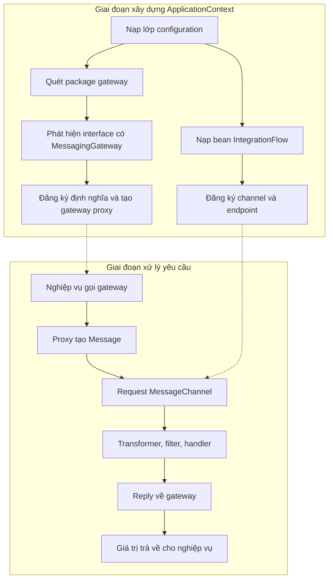

# IntegrationComponentScan

## 1. Mục tiêu và phạm vi

Trong chương **Cấu hình và lifecycle** của module **SPRING_INTEGRATION_CORE**, bài này giải thích cách đưa một interface gateway vào Spring container bằng `@IntegrationComponentScan`. Sau bài học, bạn có thể:

- Phân biệt quét gateway interface với quét bean thông thường và bật hạ tầng Spring Integration.
- Xác định package cần quét, chọn gateway bằng bộ lọc và kiểm soát tên bean.
- Kết nối gateway với `MessageChannel`, transformer, filter và endpoint trong Java DSL.
- Kiểm tra việc đăng ký proxy và tìm nguyên nhân khi gateway không được inject hoặc không trả lời.

Ví dụ dùng Java 17 và API Spring Integration 6.5.x. Các chi tiết triển khai được ghi rõ phiên bản khi cần. Với dự án Spring Boot, dùng bộ phiên bản dependency do BOM của dự án quản lý.

## 2. Vì sao gateway interface cần cơ chế quét riêng?

Giả sử nghiệp vụ muốn gửi mã sản phẩm vào một luồng xử lý bằng lời gọi Java:

```java
String result = orderGateway.submit("  book-42  ", "tenant-a");
```

`orderGateway` có kiểu là một interface. Bạn không viết lớp `implements`; Spring Integration cung cấp proxy để chuyển lời gọi này thành thông điệp.

`@ComponentScan` thông thường không đăng ký gateway interface theo cách đăng ký một lớp `@Service`. `@IntegrationComponentScan` bổ sung cơ chế phát hiện interface mang `@MessagingGateway` để hạ tầng tạo gateway proxy. [Annotation Support](https://docs.spring.io/spring-integration/reference/6.5/configuration/annotations.html)

Ba trách nhiệm cần phân biệt:

| Cấu hình | Trách nhiệm chính | Áp dụng trong ví dụ |
|---|---|---|
| `@ComponentScan` | Phát hiện các lớp bean thông thường | Có thể dùng để tìm lớp service hoặc configuration |
| `@EnableIntegration` | Đăng ký hạ tầng Spring Integration | Cho phép xử lý cấu hình endpoint và flow |
| `@IntegrationComponentScan` | Phát hiện gateway interface | Tìm `OrderGateway` |
| `@Bean IntegrationFlow` | Khai báo cấu trúc luồng thông điệp | Tạo transformer, filter và handler |
| `@MessagingGateway` | Mô tả hợp đồng gateway | Chỉ định tên bean, request channel và timeout |

Trong ứng dụng Spring thuần, bật hạ tầng và đăng ký gateway là hai việc riêng. Khi dùng Boot, auto-configuration có thể thực hiện chúng thay ứng dụng. [Configuration and @EnableIntegration](https://docs.spring.io/spring-integration/reference/6.5/overview.html#configuration-enable-integration)

Một annotation quét package không mô tả đầy đủ luồng thông điệp. Trong ví dụ dưới đây, `@Bean` và Java DSL chịu trách nhiệm tạo luồng; scanner chịu trách nhiệm phát hiện điểm vào dạng interface.

## 3. Từ phát hiện interface đến xử lý thông điệp

Có hai giai đoạn nên quan sát riêng:



Đây là sơ đồ trách nhiệm, không phải thứ tự callback nội bộ bắt buộc giữa mọi bean.

Một gateway proxy được cung cấp qua cơ chế `GatewayProxyFactoryBean`. Nhờ đó phía nghiệp vụ gọi interface, còn thao tác gửi và nhận `Message` nằm trong hạ tầng gateway. [Messaging Gateways](https://docs.spring.io/spring-integration/reference/6.5/gateway.html)

Việc quét diễn ra khi container xử lý configuration. Nó không tự chạy lại mỗi lần gọi gateway. Thêm một interface mới vào source rồi chờ ứng dụng đang chạy tự phát hiện không phải cách hoạt động của annotation này.

Với Spring Integration 6.5.2, registrar chọn các package cấu hình; nếu không có package nào được chỉ định, nó dùng package của lớp mang annotation. Vì vậy hãy chỉ định phạm vi tường minh khi configuration và gateway nằm ở các nhánh khác nhau. [Mã nguồn IntegrationComponentScanRegistrar 6.5.2](https://raw.githubusercontent.com/spring-projects/spring-integration/v6.5.2/spring-integration-core/src/main/java/org/springframework/integration/config/IntegrationComponentScanRegistrar.java)

Đăng ký được proxy mới chứng minh rằng container có điểm vào. Khả năng xử lý còn phụ thuộc request channel, endpoint đang hoạt động và đường trả lời của flow.

## 4. Chọn phạm vi quét

### 4.1. Quét theo tên package

Hai cách viết sau là lựa chọn thay thế cho nhau:

```java
@IntegrationComponentScan("com.acme.orders.gateway")
```

```java
@IntegrationComponentScan(
    basePackages = {
        "com.acme.orders.gateway",
        "com.acme.billing.gateway"
    }
)
```

`value` là alias của `basePackages`; chọn một cách viết thay vì khai báo đồng thời hai thuộc tính đó.

Phạm vi package bao gồm các package con. Chẳng hạn, chọn `com.acme.orders.gateway` sẽ bao phủ gateway đặt trong `com.acme.orders.gateway.internal`.

### 4.2. Quét theo kiểu Java

Có thể dùng một gateway hoặc một marker type làm mốc:

```java
@IntegrationComponentScan(basePackageClasses = OrderGateway.class)
```

Thuộc tính này chọn **package chứa kiểu được tham chiếu**, không giới hạn kết quả ở duy nhất `OrderGateway`. Muốn chỉ chọn một gateway, dùng bộ lọc như phần 6.

Marker type hữu ích khi cấu hình không nên phụ thuộc vào một gateway cụ thể:

```java
package com.acme.orders.gateway;

public interface OrderGatewayPackage {
}
```

```java
@IntegrationComponentScan(
    basePackageClasses = OrderGatewayPackage.class
)
```

Marker trên không mang `@MessagingGateway`, nên với bộ lọc mặc định nó chỉ là mốc package, không trở thành gateway.

### 4.3. Các thuộc tính thường gặp

| Thuộc tính | Ý nghĩa |
|---|---|
| `value` / `basePackages` | Chọn package bằng chuỗi |
| `basePackageClasses` | Chọn package chứa các kiểu Java được truyền vào |
| `useDefaultFilters` | Mặc định `true`, bật nhận diện `@MessagingGateway` |
| `includeFilters` | Thêm điều kiện nhận ứng viên |
| `excludeFilters` | Loại ứng viên khớp điều kiện |
| `nameGenerator` | Chọn chiến lược sinh tên bean; có từ 6.0 |

Các thuộc tính và giá trị mặc định được mô tả trong [Javadoc IntegrationComponentScan 6.5.2](https://docs.spring.io/spring-integration/docs/6.5.2/api/org/springframework/integration/annotation/IntegrationComponentScan.html).

Khi tổ chức code, có thể đặt gateway của từng miền nghiệp vụ trong một package riêng. Điều này giúp cấu hình thể hiện rõ ứng dụng đang cung cấp những điểm vào nào.

## 5. Ví dụ hoàn chỉnh: tiếp nhận mã sản phẩm

Ví dụ dùng Spring thuần để cơ chế đăng ký được thể hiện tường minh. Cần dependency `org.springframework.integration:spring-integration-core` thuộc dòng 6.5.x. Phần kiểm thử cần JUnit Jupiter và cấu hình chạy JUnit 5 trong công cụ build.

Tạo các lớp minh họa theo cấu trúc sau trong một dự án thực hành:

```text
com.acme.orders
├── Demo.java
├── config
│   ├── OrdersConfiguration.java
│   └── OrderFlowConfiguration.java
└── gateway
    └── OrderGateway.java
```

### 5.1. Khai báo gateway interface

`OrderGateway.java`:

```java
package com.acme.orders.gateway;

import org.springframework.integration.annotation.MessagingGateway;
import org.springframework.messaging.handler.annotation.Header;

@MessagingGateway(
    name = "orderGateway",
    defaultRequestChannel = "orders.input",
    defaultReplyTimeout = "2000"
)
public interface OrderGateway {

    String submit(String sku, @Header("tenantId") String tenantId);
}
```

Trong hợp đồng này, `sku` được dùng làm payload, `tenantId` trở thành header. Kiểu trả về `String` thể hiện lời gọi yêu cầu một kết quả trả lời.

Tên `orderGateway` là tên bean; `orders.input` là tên channel. Chúng phục vụ hai mục đích khác nhau. [Javadoc MessagingGateway](https://docs.spring.io/spring-integration/docs/current/api/org/springframework/integration/annotation/MessagingGateway.html)

### 5.2. Khai báo channel và Java DSL flow

`OrderFlowConfiguration.java`:

```java
package com.acme.orders.config;

import java.util.Locale;

import org.springframework.context.annotation.Bean;
import org.springframework.context.annotation.Configuration;
import org.springframework.integration.channel.DirectChannel;
import org.springframework.integration.dsl.IntegrationFlow;
import org.springframework.messaging.MessageChannel;

@Configuration(proxyBeanMethods = false)
public class OrderFlowConfiguration {

    @Bean(name = "orders.input")
    public MessageChannel ordersInput() {
        return new DirectChannel();
    }

    @Bean
    public IntegrationFlow orderFlow(MessageChannel ordersInput) {
        return IntegrationFlow.from(ordersInput)
                .transform(String.class,
                        sku -> sku.strip().toUpperCase(Locale.ROOT))
                .filter(String.class,
                        sku -> !sku.isBlank(),
                        spec -> spec.throwExceptionOnRejection(true))
                .<String>handle((sku, headers) ->
                        "ACCEPTED/" + headers.get("tenantId") + "/" + sku)
                .get();
    }
}
```

Ba bước nghiệp vụ được khai báo trực tiếp trong flow:

1. Transformer bỏ khoảng trắng ở hai đầu và chuẩn hóa chữ hoa.
2. Filter từ chối mã rỗng sau chuẩn hóa.
3. Handler tạo kết quả có tenant và mã đã chuẩn hóa.

`IntegrationFlow` phải được đăng ký làm bean để hạ tầng DSL xử lý các thành phần được khai báo trong builder. [Java DSL](https://docs.spring.io/spring-integration/reference/6.5/dsl.html)

Filter dùng `throwExceptionOnRejection(true)` để trường hợp bị từ chối tạo lỗi rõ ràng. Nếu chỉ bỏ thông điệp khỏi flow, một lời gọi request-reply có thể không nhận được kết quả mong đợi. Đây là quyết định của thiết kế flow, độc lập với bộ lọc quét interface. [Filter](https://docs.spring.io/spring-integration/reference/6.5/filter.html)

### 5.3. Bật hạ tầng và quét gateway

`OrdersConfiguration.java`:

```java
package com.acme.orders.config;

import com.acme.orders.gateway.OrderGateway;

import org.springframework.context.annotation.Configuration;
import org.springframework.context.annotation.Import;
import org.springframework.integration.annotation.IntegrationComponentScan;
import org.springframework.integration.config.EnableIntegration;

@Configuration(proxyBeanMethods = false)
@EnableIntegration
@IntegrationComponentScan(basePackageClasses = OrderGateway.class)
@Import(OrderFlowConfiguration.class)
public class OrdersConfiguration {
}
```

Configuration chủ động import flow nên ví dụ không cần quét toàn bộ cây package. Chỉ gateway package được đưa vào cơ chế `@IntegrationComponentScan`.

Nếu loại bỏ annotation quét gateway trong cấu hình Spring thuần này, không còn bước đăng ký `OrderGateway`; bean flow vẫn được import. Nếu chỉ xóa `@Import`, gateway có thể được phát hiện nhưng phần cấu hình luồng của ví dụ không được nạp.

### 5.4. Gọi gateway

`Demo.java`:

```java
package com.acme.orders;

import com.acme.orders.config.OrdersConfiguration;
import com.acme.orders.gateway.OrderGateway;

import org.springframework.context.annotation.AnnotationConfigApplicationContext;

public class Demo {

    public static void main(String[] args) {
        try (var context =
                new AnnotationConfigApplicationContext(OrdersConfiguration.class)) {

            OrderGateway gateway = context.getBean(OrderGateway.class);
            String result = gateway.submit("  book-42  ", "tenant-a");

            System.out.println(result);
        }
    }
}
```

Kết quả nghiệp vụ dự kiến:

```text
ACCEPTED/tenant-a/BOOK-42
```

Trong ví dụ này, `DirectChannel` gọi handler trên luồng của bên gửi. Dùng thông điệp không tự tạo một ranh giới bất đồng bộ. [DirectChannel](https://docs.spring.io/spring-integration/reference/6.5/channel/implementations.html#channel-implementations-directchannel)

Flow cuối cùng trả kết quả về địa chỉ trả lời do gateway cung cấp. Không cần khai báo một bean reply channel riêng cho ví dụ đơn giản này. [Gateway reply channel](https://docs.spring.io/spring-integration/reference/6.5/gateway.html#gateway-default-reply-channel)

`defaultReplyTimeout = "2000"` quy định thời gian chờ nhận reply của gateway, tính bằng mili giây. Nó không hủy một handler đồng bộ đang chạy lâu: handler trên `DirectChannel` vẫn chạy trong lời gọi gửi. Khi cần giới hạn tổng thời gian của tác vụ, phải thiết kế thêm ranh giới thực thi và timeout tại tài nguyên liên quan. [Gateway timeout](https://docs.spring.io/spring-integration/reference/gateway.html)

## 6. Bộ lọc quét gateway và bộ lọc thông điệp

Tên “filter” xuất hiện ở hai thời điểm:

| Bộ lọc | Đầu vào được xét | Thời điểm | Kết quả |
|---|---|---|---|
| `includeFilters`, `excludeFilters` | Metadata của kiểu Java | Xây dựng context | Quyết định ứng viên được đăng ký |
| `.filter(...)` trong DSL | Payload hoặc header của message | Xử lý yêu cầu | Quyết định message có đi tiếp |

Scanner không nhìn vào `sku` của từng lời gọi. Filter trong flow cũng không quyết định interface nào được quét.

### 6.1. Chỉ nhận một gateway đã chọn

Đây là một **cấu hình thay thế** cho `OrdersConfiguration` trong ví dụ:

```java
package com.acme.orders.config;

import com.acme.orders.gateway.OrderGateway;

import org.springframework.context.annotation.ComponentScan;
import org.springframework.context.annotation.Configuration;
import org.springframework.context.annotation.FilterType;
import org.springframework.context.annotation.Import;
import org.springframework.integration.annotation.IntegrationComponentScan;
import org.springframework.integration.config.EnableIntegration;

@Configuration(proxyBeanMethods = false)
@EnableIntegration
@IntegrationComponentScan(
    basePackageClasses = OrderGateway.class,
    useDefaultFilters = false,
    includeFilters = @ComponentScan.Filter(
        type = FilterType.ASSIGNABLE_TYPE,
        classes = OrderGateway.class
    )
)
@Import(OrderFlowConfiguration.class)
public class SelectedOrdersConfiguration {
}
```

Ở ví dụ này, tắt bộ lọc mặc định rồi chọn interface theo kiểu. Trong package minh họa chỉ có một gateway tương ứng.

Nếu giữ `useDefaultFilters = true`, thêm một include filter không biến điều kiện thành “có `@MessagingGateway` **và** khớp include”. Các include filter bổ sung tập ứng viên; exclude filter loại ứng viên khớp điều kiện. Khi muốn thu hẹp tập mặc định bằng include, cần xem xét tắt default filters. [Javadoc về includeFilters](https://docs.spring.io/spring-integration/api/org/springframework/integration/annotation/IntegrationComponentScan.html)

Nếu tắt default filters mà không thêm include filter nào, scanner không có điều kiện để nhận gateway theo cấu hình đó.

### 6.2. Loại một nhánh package

Một đoạn annotation thay thế khác:

```java
@IntegrationComponentScan(
    basePackageClasses = OrderGateway.class,
    excludeFilters = @ComponentScan.Filter(
        type = FilterType.REGEX,
        pattern = "com\\.acme\\.orders\\.gateway\\.internal\\..*"
    )
)
```

Mẫu regex loại các kiểu có tên đầy đủ nằm dưới `com.acme.orders.gateway.internal`. Cần import `ComponentScan` và `FilterType` như ví dụ trước.

Các đoạn cấu hình thay thế phục vụ các mục tiêu khác nhau. Khi thực hành, chỉ nạp cấu hình bạn đang kiểm tra để kết quả không bị ảnh hưởng bởi một đường đăng ký gateway khác.

## 7. Tên bean, nhiều module và lifecycle

### 7.1. Tên bean và lựa chọn theo kiểu

Ví dụ đặt tên tường minh bằng `@MessagingGateway(name = "orderGateway")`. Nếu ứng dụng có các gateway cùng tên ngắn ở nhiều package, nên thiết kế tên bean rõ ràng hoặc dùng chiến lược sinh tên phù hợp.

Cần phân biệt:

- **Trùng tên bean:** nhiều định nghĩa cùng sử dụng một tên.
- **Nhiều bean cùng kiểu:** inject theo kiểu không xác định được lựa chọn duy nhất.

`@Qualifier` hoặc `@Primary` giúp chọn giữa các bean đã có tên khác nhau; chúng không sửa xung đột đăng ký cùng tên. `nameGenerator` điều khiển cách đặt tên khi scanner cần sinh tên. Từ Spring Integration 6.0, gateway hỗ trợ `@Primary` và cơ chế đặt tên đồng bộ hơn với cấu hình annotation của Spring. [Gateway annotation configuration](https://docs.spring.io/spring-integration/reference/gateway.html#messaging-gateway-annotation)

### 7.2. Tập trung phạm vi quét của nhiều module

Có thể tập hợp marker của các module vào một cấu hình:

```java
@IntegrationComponentScan(
    basePackageClasses = {
        OrdersGatewayPackage.class,
        BillingGatewayPackage.class
    }
)
```

Hai marker trong đoạn này là kiểu do từng module tự khai báo trong package gateway tương ứng.

Với triển khai registrar 6.5.2, khi gặp một registrar đã được đăng ký, cấu hình quét tiếp theo phát cảnh báo và bỏ qua. Vì vậy không nên kỳ vọng nhiều `@IntegrationComponentScan` rải ở các configuration sẽ tự cộng dồn package; hãy gộp phạm vi trong một nơi. Đây là chi tiết cần kiểm tra lại nếu chuyển phiên bản. [Registrar 6.5.2](https://raw.githubusercontent.com/spring-projects/spring-integration/v6.5.2/spring-integration-core/src/main/java/org/springframework/integration/config/IntegrationComponentScanRegistrar.java)

### 7.3. Quét thành công và sẵn sàng xử lý

Một cách quan sát hữu ích là tách ba câu hỏi:

1. Container có bean triển khai hợp đồng `OrderGateway` hay chưa?
2. Channel và endpoint của `orderFlow` đã được nạp và hoạt động chưa?
3. Một request hợp lệ có nhận reply đúng hợp đồng không?

Dừng một endpoint không đồng nghĩa xóa định nghĩa gateway. Ngược lại, tìm thấy gateway trong context chưa chứng minh mọi endpoint phía sau đang sẵn sàng.

Trong ứng dụng, hãy sử dụng gateway sau khi context đã hoàn tất khởi tạo và các consumer cần thiết đã sẵn sàng. Bài thực hành dùng lời gọi sau khi tạo xong `AnnotationConfigApplicationContext`, tránh trộn việc xây dựng bean với việc gửi yêu cầu nghiệp vụ.

## 8. Khi ứng dụng dùng Spring Boot

Với Spring Boot 3.5.3, auto-configuration Integration bật hạ tầng và có cấu hình quét gateway khi chưa có `IntegrationComponentScanRegistrar` do ứng dụng cung cấp. Không nên suy ra rằng một ứng dụng Boot đang chạy được gateway bắt buộc phải có annotation quét viết trực tiếp trong mã ứng dụng. [IntegrationAutoConfiguration 3.5.3](https://raw.githubusercontent.com/spring-projects/spring-boot/v3.5.3/spring-boot-project/spring-boot-autoconfigure/src/main/java/org/springframework/boot/autoconfigure/integration/IntegrationAutoConfiguration.java)

Registrar của Boot lấy phạm vi từ `AutoConfigurationPackages`, thường gắn với package chứa lớp ứng dụng chính và các package con. Gateway ở một nhánh bên ngoài phạm vi này cần được đăng ký có chủ đích. Đây là kết luận rút ra từ cách registrar lấy danh sách package. [IntegrationAutoConfigurationScanRegistrar 3.5.3](https://raw.githubusercontent.com/spring-projects/spring-boot/v3.5.3/spring-boot-project/spring-boot-autoconfigure/src/main/java/org/springframework/boot/autoconfigure/integration/IntegrationAutoConfigurationScanRegistrar.java)

Ví dụ ứng dụng muốn kiểm soát package gateway:

```java
package com.acme;

import com.acme.orders.gateway.OrderGateway;

import org.springframework.boot.SpringApplication;
import org.springframework.boot.autoconfigure.SpringBootApplication;
import org.springframework.integration.annotation.IntegrationComponentScan;

@SpringBootApplication
@IntegrationComponentScan(basePackageClasses = OrderGateway.class)
public class Application {

    public static void main(String[] args) {
        SpringApplication.run(Application.class, args);
    }
}
```

Ví dụ này giả định có starter Integration và `OrderFlowConfiguration` nằm dưới cây package `com.acme`, nên cấu hình thông thường của ứng dụng nạp được flow.

Khi thêm annotation quét tường minh, hãy liệt kê đủ các package gateway ứng dụng cần. Trong cấu hình Boot đã nêu, cơ chế quét mặc định nhường chỗ khi có registrar của ứng dụng; không nên giả định package tường minh sẽ tự được cộng với phạm vi mặc định.

Một bài kiểm thử chỉ nạp vài configuration bằng Spring thuần không tự nhận đầy đủ auto-configuration của Boot. Vì vậy kiểm thử của phần tiếp theo khai báo chính xác cấu hình cần dùng.

## 9. Kiểm thử việc quét và hợp đồng gateway

Ba kiểm thử dưới đây kiểm tra các rủi ro khác nhau: thiếu cơ chế quét, đăng ký và gọi thành công, rồi từ chối dữ liệu không hợp lệ. Không cần broker hay truy cập mạng cho flow này.

`OrderGatewayScanTest.java` trong source test:

```java
package com.acme.orders;

import com.acme.orders.config.OrderFlowConfiguration;
import com.acme.orders.config.OrdersConfiguration;
import com.acme.orders.gateway.OrderGateway;

import org.junit.jupiter.api.Test;
import org.springframework.context.annotation.AnnotationConfigApplicationContext;
import org.springframework.context.annotation.ComponentScan;
import org.springframework.context.annotation.Configuration;
import org.springframework.context.annotation.Import;
import org.springframework.integration.MessageRejectedException;
import org.springframework.integration.config.EnableIntegration;
import org.springframework.integration.gateway.GatewayProxyFactoryBean;

import static org.junit.jupiter.api.Assertions.assertEquals;
import static org.junit.jupiter.api.Assertions.assertInstanceOf;
import static org.junit.jupiter.api.Assertions.assertThrows;
import static org.junit.jupiter.api.Assertions.assertTrue;

class OrderGatewayScanTest {

    @Configuration(proxyBeanMethods = false)
    @EnableIntegration
    @ComponentScan(basePackageClasses = OrderGateway.class)
    @Import(OrderFlowConfiguration.class)
    static class OrdinaryScanOnly {
    }

    @Test
    void ordinaryComponentScanDoesNotRegisterGatewayInterface() {
        try (var context =
                new AnnotationConfigApplicationContext(OrdinaryScanOnly.class)) {

            assertTrue(context.containsBean("orders.input"));
            assertTrue(context.getBeansOfType(OrderGateway.class).isEmpty());
        }
    }

    @Test
    void integrationScanRegistersGatewayAndRequestGetsReply() {
        try (var context =
                new AnnotationConfigApplicationContext(OrdersConfiguration.class)) {

            assertEquals(1, context.getBeansOfType(OrderGateway.class).size());

            OrderGateway gateway =
                    context.getBean("orderGateway", OrderGateway.class);

            assertInstanceOf(GatewayProxyFactoryBean.class,
                    context.getBean("&orderGateway"));

            assertEquals("ACCEPTED/tenant-a/BOOK-42",
                    gateway.submit("  book-42  ", "tenant-a"));
        }
    }

    @Test
    void blankSkuIsRejectedByTheFlow() {
        try (var context =
                new AnnotationConfigApplicationContext(OrdersConfiguration.class)) {

            OrderGateway gateway = context.getBean(OrderGateway.class);

            assertThrows(MessageRejectedException.class,
                    () -> gateway.submit("   ", "tenant-a"));
        }
    }
}
```

Trong Spring, `getBean("orderGateway")` lấy đối tượng do `FactoryBean` cung cấp; tiền tố `&` lấy chính factory. Assertion đó quan sát cách gateway được cung cấp, còn assertion kết quả quan sát hành vi mà nghiệp vụ cần. [FactoryBean và tiền tố &](https://docs.spring.io/spring-framework/reference/core/beans/factory-extension.html#beans-factory-extension-factorybean)

Kiểm thử âm đầu tiên cố ý dùng context không có Boot. Như vậy nó kiểm tra đúng giới hạn của `@ComponentScan`; auto-configuration không âm thầm đăng ký gateway thay bài kiểm thử.

Khi sửa phạm vi package hoặc filter, cần duy trì cả kiểm tra bean được chọn và một lời gọi qua gateway. Chỉ kiểm tra context khởi động sẽ bỏ sót tình huống gateway có mặt nhưng trỏ đến flow không hoàn chỉnh.

## 10. Chẩn đoán lỗi theo điểm quan sát

| Hiện tượng | Cần kiểm tra | Hướng xử lý |
|---|---|---|
| Không inject được `OrderGateway` | Configuration quét có được nạp không; gateway có nằm trong package được chọn không | Import configuration hoặc sửa mốc package |
| Flow tồn tại nhưng không có gateway | Chỉ dùng `@ComponentScan`; hoặc default filters đã tắt | Bổ sung cơ chế đăng ký gateway phù hợp |
| Gateway có mặt nhưng request channel không được tìm thấy | Tên channel trên annotation và bean flow | Đối chiếu `orders.input` và phần cấu hình được nạp |
| Gửi vào `DirectChannel` báo không có subscriber | Endpoint chưa được nạp, chưa khởi động hoặc đã dừng | Kiểm tra flow và trạng thái consumer |
| Gateway không nhận được reply | Filter bỏ message, handler không trả giá trị hoặc đường reply sai | Kiểm tra từng bước của hợp đồng request-reply |
| Thêm include filter nhưng vẫn thấy nhiều gateway | Bộ lọc mặc định vẫn được bật | Xem lại `useDefaultFilters` và tập ứng viên |
| Một module quét được, module khác không | Nhiều configuration quét hoặc thiếu package trong danh sách tập trung | Gộp phạm vi và kiểm tra cảnh báo registrar theo phiên bản |
| Tên bean xung đột hoặc inject theo kiểu bị mơ hồ | Phân biệt trùng tên với nhiều bean cùng kiểu | Điều chỉnh tên hoặc chọn bean rõ ràng |
| Ứng dụng Boot chạy được, test nhỏ thất bại | Test không nạp auto-configuration hoặc configuration cần thiết | Khai báo cấu hình của context kiểm thử |

Bảng này là trình tự điều tra cho ví dụ, không có nghĩa mọi lỗi đều xuất hiện ngay lúc khởi động. Một số thành phần giải quyết tham chiếu channel hoặc thực hiện việc gửi khi gateway được gọi.

Có thể bắt đầu bằng hai phép quan sát trong context:

```java
System.out.println(context.getBeansOfType(OrderGateway.class).keySet());
System.out.println(context.containsBean("orders.input"));
```

Nếu thiếu gateway, tiếp tục điều tra phạm vi quét. Nếu cả gateway và channel đều có mặt, chuyển sang kiểm tra endpoint và kết quả của một request đại diện.

## 11. Thực hành mở rộng

Thực hiện lần lượt trong dự án thực hành:

1. **Di chuyển gateway sang package khác.** So sánh cấu hình bằng chuỗi với `basePackageClasses`. Quan sát tác động khi IDE cập nhật tham chiếu kiểu Java.
2. **Thêm gateway thứ hai trong cùng package.** Cho cả hai một tên bean riêng. Kiểm tra rằng chọn package qua `OrderGateway.class` có thể phát hiện cả hai.
3. **Áp dụng cấu hình chọn lọc.** Dùng `useDefaultFilters = false` và `ASSIGNABLE_TYPE` để chỉ chọn gateway mong muốn. Xác nhận gateway còn lại không được đăng ký.
4. **Tách lỗi cấu hình khỏi lỗi dữ liệu.** Thử bỏ cấu hình quét, sau đó khôi phục và gửi mã trắng. Giải thích vì sao hai trường hợp thất bại ở những giai đoạn khác nhau.
5. **Mở rộng flow bằng router hoặc aggregator.** Giữ gateway làm hợp đồng vào, đồng thời thiết kế đủ đường trả lời cho các nhánh và điều kiện hoàn tất nhóm. Việc quét interface không thay thế các quyết định này.

Khi tự đánh giá lời giải, hãy chỉ ra rõ configuration nào đăng ký gateway, configuration nào tạo luồng, payload/header nào được gửi và điều kiện nào tạo reply. Đó là nền tảng để sử dụng `@IntegrationComponentScan` đúng vai trò trong một ứng dụng Spring Integration.
