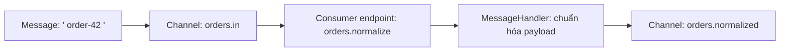

# Bean name của endpoint

Trong chương **Cấu hình và lifecycle** của module **SPRING_INTEGRATION_CORE**, bean name là điểm nối giữa cấu hình luồng thông điệp và đối tượng thực sự được Spring quản lý. Một bước xử lý có thể tạo ra nhiều bean: channel, consumer endpoint, message handler hoặc message source. Biết đúng tên giúp bạn tìm đúng đối tượng, điều khiển lifecycle và thay thế thành phần trong kiểm thử.

Bài học tập trung vào các endpoint xử lý thông điệp trong Spring Integration Core, với ví dụ service activator, transformer và Java DSL. Các quy tắc này cũng giúp đọc cấu hình router, filter và aggregator, nhưng không thay thế cấu hình nghiệp vụ riêng của từng mẫu tích hợp.

## 1. Mục tiêu và kiến thức cần có

Sau bài học, bạn có thể:

- Phân biệt bean name của consumer endpoint với bean name của handler và channel.
- Đọc tên được tạo từ XML, annotation trên POJO và annotation trên phương thức `@Bean`.
- Dùng `@EndpointId` hoặc Java DSL để có tên endpoint ổn định.
- Tra cứu endpoint để gọi `start()`, `stop()` và kiểm tra trạng thái.
- Chẩn đoán nhầm tên bean, trùng tên và thay thế nhầm đối tượng trong kiểm thử.

Bạn nên biết `Message<T>`, `MessageChannel`, `DirectChannel`, `QueueChannel`, `@Configuration` và `@Bean`. Ví dụ Java DSL dùng API `IntegrationFlow.from(...)`, phù hợp với Spring Integration 6.x/7.x; hãy dùng phiên bản Spring Integration và Spring Framework tương thích do BOM hoặc cấu hình dependency của ứng dụng quản lý.

## 2. Một bước xử lý không nhất thiết tương ứng một bean

Giả sử hệ thống nhận mã đơn hàng, chuẩn hóa rồi đưa kết quả sang channel tiếp theo:



Các thành phần có trách nhiệm khác nhau:

| Thành phần | Trách nhiệm | Ví dụ |
| --- | --- | --- |
| `MessageChannel` | Chuyển giao hoặc lưu đệm thông điệp | `orders.in` |
| Consumer endpoint | Kết nối channel đầu vào với handler; quản lý việc subscribe hoặc polling | `orders.normalize` |
| `MessageHandler` | Thực hiện xử lý thông điệp | Handler của bước chuẩn hóa |
| POJO nghiệp vụ, nếu có | Cung cấp phương thức được handler gọi | `orderNormalizer` |

Trong mô hình consuming endpoint thông dụng, endpoint giữ tham chiếu tới handler và gọi handler khi nhận được thông điệp. Vì vậy, thao tác dừng việc tiêu thụ thông điệp phải nhắm vào endpoint. Việc lấy được bean xử lý nghiệp vụ chưa có nghĩa bạn đã lấy được đối tượng điều khiển kết nối với channel. Xem [mô hình endpoint trong tài liệu tổng quan](https://docs.spring.io/spring-integration/reference/overview.html#endpoint-bean-names).

Kiểu consumer phụ thuộc vào channel đầu vào:

- `DirectChannel` là một `SubscribableChannel`; cấu hình consumer thông thường tạo `EventDrivenConsumer`.
- `QueueChannel` là một `PollableChannel`; consumer tương ứng là `PollingConsumer` và cần cấu hình poller thích hợp.

`ConsumerEndpointFactoryBean` là thành phần hỗ trợ tạo consumer phù hợp. Đặt tên khác không làm đổi kiểu channel hoặc biến consumer polling thành consumer nhận thông điệp qua subscription. Xem [API ConsumerEndpointFactoryBean](https://docs.spring.io/spring-integration/api/org/springframework/integration/config/ConsumerEndpointFactoryBean.html).

### Những loại tên dễ bị nhầm

| Giá trị | Ý nghĩa |
| --- | --- |
| `ordersFlow` | Tên bean chứa định nghĩa một `IntegrationFlow` |
| `orders.in` | Tên channel gửi thông điệp vào |
| `orders.normalize` | Tên endpoint thực hiện một bước trong flow |
| `orders.normalize.handler` | Tên hoặc alias truy cập handler, tùy cách cấu hình |
| Header `id` của `Message` | Định danh một thông điệp cụ thể |

Đổi tên endpoint không thay đổi header `id`, `correlationId` hay `sequenceNumber`. Tên bean là định danh thành phần trong container; các header phục vụ nhận diện và điều phối thông điệp.

## 3. Quy tắc tên trong XML

Với service activator khai báo bằng XML, `id` đặt tên consumer endpoint. Handler được tạo cho endpoint có tên theo quy ước thêm `.handler`.

Giả sử bean `orderNormalizer` đã tồn tại và có phương thức `normalize(String)`:

```xml
<int:channel id="orders.in"/>

<int:channel id="orders.normalized">
    <int:queue/>
</int:channel>

<int:service-activator
        id="orders.normalize"
        input-channel="orders.in"
        output-channel="orders.normalized"
        ref="orderNormalizer"
        method="normalize"/>
```

Đoạn trên là phần thân cấu hình XML, với namespace `int` đã được khai báo.

| Tên tra cứu | Đối tượng |
| --- | --- |
| `orders.in` | Channel đầu vào |
| `orders.normalize` | Consumer endpoint |
| `orders.normalize.handler` | Handler gọi phương thức nghiệp vụ |
| `orderNormalizer` | Bean nghiệp vụ được tham chiếu bằng `ref` |
| `orders.normalized` | Channel chứa kết quả |

`ref="orderNormalizer"` không đổi tên endpoint thành `orderNormalizer`. Tương tự, `input-channel` tham chiếu channel chứ không đặt tên consumer. Quy ước XML này được mô tả trong [Endpoint Bean Names](https://docs.spring.io/spring-integration/reference/overview.html#endpoint-bean-names).

Ví dụ trên dùng channel đầu vào dạng direct nên consumer không cần poller. Nếu đầu vào được đổi thành queue, bạn phải bổ sung poller cho consumer; giữ nguyên `id` không tự hoàn thành thay đổi cấu hình đó.

## 4. Annotation trên POJO: tên mặc định phụ thuộc cấu trúc mã

Xét một POJO đã được đăng ký qua component scanning hoặc `@Import`:

```java
import java.util.Locale;

import org.springframework.integration.annotation.ServiceActivator;
import org.springframework.stereotype.Component;

@Component("orderEndpoints")
public class OrderEndpoints {

    @ServiceActivator(
            inputChannel = "orders.in",
            outputChannel = "orders.normalized")
    public String normalizeOrder(String payload) {
        return payload.trim().toUpperCase(Locale.ROOT);
    }
}
```

Giả sử hạ tầng Spring Integration đã được bật và hai channel đã tồn tại, framework tạo tên theo mẫu:

```text
[componentBeanName].[methodName].[annotationNameVớiChữĐầuViếtThường]
```

Trong ví dụ:

```text
POJO:              orderEndpoints
Consumer endpoint: orderEndpoints.normalizeOrder.serviceActivator
Handler:           orderEndpoints.normalizeOrder.serviceActivator.handler
```

`serviceActivator` xuất phát từ annotation `ServiceActivator`. Nếu dùng `@Transformer`, phần cuối tương ứng là `transformer`. Đây là tên được tạo cho thành phần messaging, khác với tên POJO gốc. Xem [Annotation Support](https://docs.spring.io/spring-integration/reference/configuration/annotations.html).

Tên mặc định tiện cho cấu hình nhỏ nhưng làm lộ cấu trúc mã vào các tham chiếu vận hành. Chẳng hạn, đổi phương thức `normalizeOrder` thành `canonicalizeOrder` có thể khiến chuỗi tên trong test hoặc công cụ quản trị không còn khớp, dù phép chuẩn hóa payload giữ nguyên.

### Cố định tên bằng `@EndpointId`

```java
import java.util.Locale;

import org.springframework.integration.annotation.EndpointId;
import org.springframework.integration.annotation.ServiceActivator;
import org.springframework.stereotype.Component;

@Component("orderEndpoints")
public class OrderEndpoints {

    @EndpointId("orders.normalize")
    @ServiceActivator(
            inputChannel = "orders.in",
            outputChannel = "orders.normalized",
            autoStartup = "false")
    public String normalizeOrder(String payload) {
        return payload.trim().toUpperCase(Locale.ROOT);
    }
}
```

Khi đó, consumer có tên `orders.normalize`; handler được tạo cho phương thức POJO có tên `orders.normalize.handler`. Đổi tên phương thức Java không làm đổi endpoint ID đã khai báo.

`@EndpointId` có từ Spring Integration 5.0.4. Annotation này dùng cùng annotation EIP trên phương thức; không dùng nó trên một phương thức mang nhiều annotation EIP để cố định đồng thời nhiều endpoint. Xem [API EndpointId](https://docs.spring.io/spring-integration/api/org/springframework/integration/annotation/EndpointId.html).

`autoStartup = "false"` chỉ cấu hình trạng thái khởi động. Endpoint vẫn tồn tại trong container và có thể được lấy ra để khởi động chủ động.

## 5. Annotation trên `@Bean`: tên handler và endpoint được đặt riêng

Trường hợp sau khác POJO ở phần trước: phương thức `@Bean` trả về chính một `MessageHandler`.

```java
import org.springframework.context.annotation.Bean;
import org.springframework.context.annotation.Configuration;
import org.springframework.integration.annotation.EndpointId;
import org.springframework.integration.annotation.ServiceActivator;
import org.springframework.messaging.MessageHandler;

@Configuration
public class OrderAuditConfiguration {

    @Bean("orders.audit.handler")
    @EndpointId("orders.audit")
    @ServiceActivator(inputChannel = "orders.normalized")
    public MessageHandler auditHandler() {
        return message ->
                System.out.println("Đã xử lý: " + message.getPayload());
    }
}
```

Ở đây:

- `@Bean("orders.audit.handler")` đặt tên handler do phương thức trả về.
- `@EndpointId("orders.audit")` đặt tên consumer kết nối tới channel.
- Tên phương thức `auditHandler` không còn là tên bean vì `@Bean` đã chỉ định tên tường minh.

Nếu bỏ `@EndpointId`, tên consumer mặc định có dạng:

```text
orderAuditConfiguration.auditHandler.serviceActivator
```

Nếu bỏ tên tường minh của `@Bean`, handler lấy tên phương thức là `auditHandler`. Chỉ thêm `@EndpointId("orders.audit")` không tự đổi tên handler đã được `@Bean` khai báo. Vì vậy, dùng đồng thời `orders.audit` và `orders.audit.handler` là một quy ước dễ đọc, không phải phép đổi tên tự động áp dụng cho mọi bean. Xem [quy tắc EndpointId khi đi cùng Bean](https://docs.spring.io/spring-integration/api/org/springframework/integration/annotation/EndpointId.html).

### Vì sao đôi khi xuất hiện bean `.wrapper`?

Một `MessageHandler` tự cung cấp, như lambda ở trên, có thể được framework bọc bằng `ReplyProducingMessageHandlerWrapper` nếu nó không phải `AbstractReplyProducingMessageHandler`. Với cấu hình có `@EndpointId`, tên wrapper theo quy ước là tên handler cộng `.wrapper`, chẳng hạn:

```text
orders.audit
orders.audit.handler
orders.audit.handler.wrapper
```

Đối tượng do phương thức `@Bean` trả về và đối tượng endpoint gọi qua lớp bọc có thể khác nhau. Việc xuất hiện wrapper không có nghĩa tồn tại thêm một consumer độc lập. Các chi tiết này được mô tả tại [Endpoint Bean Names](https://docs.spring.io/spring-integration/reference/overview.html#endpoint-bean-names).

Đoạn audit chỉ minh họa quy tắc tên. Nếu gắn nó vào luồng hoàn chỉnh ở phần tiếp theo, hãy cấu hình channel và poller phù hợp; không ghép nguyên các cấu hình thay thế nhau vào cùng context.

## 6. Java DSL: tên flow khác tên endpoint

Trong Java DSL, tên phương thức `@Bean` thường là tên flow. Muốn đặt tên một bước, cấu hình endpoint của chính bước đó.

```java
@Bean
public IntegrationFlow ordersFlow(
        @Qualifier("orders.in") MessageChannel input,
        @Qualifier("orders.normalized") MessageChannel output) {

    return IntegrationFlow.from(input)
            .<String, String>transform(
                    payload -> payload.trim().toUpperCase(Locale.ROOT),
                    endpoint -> endpoint
                            .id("orders.normalize")
                            .autoStartup(false))
            .channel(output)
            .get();
}
```

Có ba tên được khai báo ở ba vị trí khác nhau:

| Cấu hình | Thành phần được định danh |
| --- | --- |
| `@Bean` trên `ordersFlow(...)` | Flow tên `ordersFlow` |
| `@Qualifier("orders.in")` | Tham chiếu channel đầu vào |
| `endpoint.id("orders.normalize")` | Consumer endpoint của bước transform |

`EndpointSpec.id(...)` cấu hình định danh dùng để đăng ký thành phần vào application context. Trong consumer endpoint spec, tên này được áp dụng cho phần tạo endpoint. Xem [API EndpointSpec](https://docs.spring.io/spring-integration/api/org/springframework/integration/dsl/EndpointSpec.html).

### Tên chính và alias của handler

Với handler được DSL tạo và đăng ký bên trong bước transform ở trên, framework đăng ký thêm alias `orders.normalize.handler` để truy cập handler. Tên chính của handler có thể là tên sinh tự động gắn với flow. Alias và tên chính cùng trỏ tới một bean; không phải hai bản sao handler.

Nếu DSL tham chiếu một handler vốn đã được đăng ký thành bean, không nên mặc định rằng framework luôn tạo lại alias theo cùng cách. Khi cần biết handler thực tế, có thể lấy nó qua consumer như phần thực hành.

Chi tiết đăng ký alias nằm trong [mã nguồn IntegrationFlowBeanPostProcessor](https://raw.githubusercontent.com/spring-projects/spring-integration/main/spring-integration-core/src/main/java/org/springframework/integration/dsl/context/IntegrationFlowBeanPostProcessor.java). Đây cũng là lý do bảng tên nên phân biệt “tên hoặc alias tra cứu” với “tên chính của bean”.

### Không phụ thuộc vào tên tự sinh

DSL có thể sinh tên chứa tên flow, loại thành phần và hậu tố như `#0`. Những tên này hữu ích để đọc log, nhưng không nên trở thành chuỗi cố định trong mã điều khiển endpoint.

Ví dụ, nếu thêm một bước xử lý trước transformer, thứ tự sinh tên có thể thay đổi. Cách bền vững hơn là đặt ID cho những endpoint cần quản lý hoặc kiểm thử theo tên, thay vì đoán hậu tố từ vị trí trong DSL.

## 7. Thực hành: tra cứu đúng endpoint rồi điều khiển lifecycle

Ví dụ sau là một ứng dụng Java configuration độc lập, không cần Spring Boot. Cần dependency `org.springframework.integration:spring-integration-core` và JDK phù hợp với phiên bản framework bạn sử dụng.

Chỉ sử dụng cấu hình này trong context của ví dụ. Các cấu hình ở phần trước là những cách khai báo thay thế để so sánh tên.

```java
import java.util.Locale;

import org.springframework.beans.factory.annotation.Qualifier;
import org.springframework.context.annotation.AnnotationConfigApplicationContext;
import org.springframework.context.annotation.Bean;
import org.springframework.context.annotation.Configuration;
import org.springframework.integration.channel.DirectChannel;
import org.springframework.integration.channel.QueueChannel;
import org.springframework.integration.config.EnableIntegration;
import org.springframework.integration.dsl.IntegrationFlow;
import org.springframework.integration.endpoint.AbstractEndpoint;
import org.springframework.integration.endpoint.EventDrivenConsumer;
import org.springframework.messaging.Message;
import org.springframework.messaging.MessageChannel;
import org.springframework.messaging.MessageHandler;
import org.springframework.messaging.PollableChannel;
import org.springframework.messaging.support.GenericMessage;

public class EndpointBeanNameDemo {

    @Configuration(proxyBeanMethods = false)
    @EnableIntegration
    public static class Config {

        @Bean("orders.in")
        public MessageChannel ordersInput() {
            return new DirectChannel();
        }

        @Bean("orders.normalized")
        public PollableChannel normalizedOrders() {
            return new QueueChannel();
        }

        @Bean
        public IntegrationFlow ordersFlow(
                @Qualifier("orders.in") MessageChannel input,
                @Qualifier("orders.normalized") MessageChannel output) {

            return IntegrationFlow.from(input)
                    .<String, String>transform(
                            value -> value.trim().toUpperCase(Locale.ROOT),
                            endpoint -> endpoint
                                    .id("orders.normalize")
                                    .autoStartup(false))
                    .channel(output)
                    .get();
        }
    }

    public static void main(String[] args) {
        try (var context =
                     new AnnotationConfigApplicationContext(Config.class)) {

            MessageChannel input =
                    context.getBean("orders.in", MessageChannel.class);

            PollableChannel output =
                    context.getBean("orders.normalized", PollableChannel.class);

            AbstractEndpoint endpoint =
                    context.getBean("orders.normalize", AbstractEndpoint.class);

            MessageHandler handler =
                    context.getBean(
                            "orders.normalize.handler", MessageHandler.class);

            EventDrivenConsumer consumer =
                    context.getBean(
                            "orders.normalize", EventDrivenConsumer.class);

            if (consumer.getHandler() != handler) {
                throw new IllegalStateException("Alias không trỏ đúng handler");
            }

            System.out.println("Trước start: " + endpoint.isRunning());

            endpoint.start();

            boolean sent =
                    input.send(new GenericMessage<>("  order-42  "));

            Message<?> reply = output.receive(1000);

            if (!sent || reply == null
                    || !"ORDER-42".equals(reply.getPayload())) {
                throw new IllegalStateException("Không nhận đúng kết quả");
            }

            System.out.println("Kết quả: " + reply.getPayload());

            endpoint.stop();

            System.out.println("Sau stop: " + endpoint.isRunning());
            System.out.println(
                    "Handler còn tồn tại: "
                            + context.containsBean("orders.normalize.handler"));
        }
    }
}
```

Kết quả nghiệp vụ dự kiến, bỏ qua log khởi động của framework:

```text
Trước start: false
Kết quả: ORDER-42
Sau stop: false
Handler còn tồn tại: true
```

Có vài chi tiết cần đọc đúng:

1. `@EnableIntegration` đăng ký hạ tầng cần thiết cho ứng dụng Java configuration này.
2. `ordersFlow` mô tả toàn bộ luồng; `orders.normalize` là endpoint riêng của bước transform.
3. Channel đầu vào là `DirectChannel`, nên kiểu `EventDrivenConsumer` là phù hợp. Queue đầu ra được chương trình chủ động `receive()`, không có consumer polling bổ sung.
4. `start()` kết nối hoạt động tiêu thụ thông điệp; `stop()` dừng hoạt động đó. Dừng endpoint không xóa bean handler khỏi context.
5. So sánh `consumer.getHandler() == handler` xác nhận alias đang trỏ đúng đối tượng được consumer sử dụng trong cấu hình cụ thể này.

`EventDrivenConsumer` công bố `getHandler()` và `getInputChannel()`, hữu ích khi cần xác nhận quan hệ giữa các thành phần. Xem [API EventDrivenConsumer](https://docs.spring.io/spring-integration/api/org/springframework/integration/endpoint/EventDrivenConsumer.html).

### Dừng endpoint ảnh hưởng thế nào đến việc gửi?

Với cấu hình chỉ có một consumer trên `DirectChannel`, gửi thông điệp sau khi consumer đã dừng sẽ gặp tình trạng không có subscriber và thông thường nhận lỗi dispatch. Channel này không tự giữ thông điệp để chờ endpoint khởi động lại.

Với `QueueChannel`, producer có thể tiếp tục đưa thông điệp vào queue khi polling consumer dừng, tùy dung lượng và send timeout. Những thông điệp còn trong queue có thể được xử lý khi consumer hoạt động trở lại. Tính bền vững của dữ liệu còn phụ thuộc cách cấu hình lưu trữ channel.

Ngoài ra, dừng endpoint không đồng nghĩa mọi xử lý bất đồng bộ đã hoàn tất, không bảo đảm hoàn tác tác động nghiệp vụ và không thay thế thiết kế shutdown có kiểm soát. Tên đúng giúp chọn đúng đối tượng điều khiển; semantics xử lý vẫn phụ thuộc channel, executor và handler.

## 8. FactoryBean: phân biệt `name` và `&name`

Trong cấu hình endpoint dựa trên `ConsumerEndpointFactoryBean`, Spring phân biệt sản phẩm được factory tạo ra với chính factory:

```java
AbstractEndpoint endpoint =
        context.getBean("orders.normalize", AbstractEndpoint.class);

ConsumerEndpointFactoryBean factory =
        context.getBean(
                "&orders.normalize", ConsumerEndpointFactoryBean.class);
```

Đoạn này cần import:

```java
import org.springframework.integration.config.ConsumerEndpointFactoryBean;
```

- `orders.normalize` trả về consumer endpoint.
- `&orders.normalize` trả về factory hỗ trợ tạo và quản lý endpoint.
- `orders.normalize.handler` trả về handler nếu tên hoặc alias đó đã được đăng ký.

Tiền tố `&` là quy ước tra cứu `FactoryBean` của Spring, không phải ký tự bạn thêm vào ID khi khai báo. Xem [API BeanFactory và FACTORY_BEAN_PREFIX](https://docs.spring.io/spring-framework/docs/current/javadoc-api/org/springframework/beans/factory/BeanFactory.html).

Với tác vụ vận hành thông thường, lấy endpoint bằng `AbstractEndpoint` hoặc `SmartLifecycle` là đủ. Chỉ dùng factory khi thật sự cần kiểm tra tầng cấu hình; không mặc định mọi thành phần mang tên “endpoint” đều được đăng ký thông qua loại factory này.

Cũng không nên gọi `setBeanName(...)` sau khi ứng dụng đã chạy để “đổi tên bean”. Thuộc tính tên trên đối tượng và khóa đăng ký trong bean registry là hai vấn đề khác nhau. Hãy đổi ID trong cấu hình rồi cập nhật các tham chiếu liên quan.

## 9. Inbound polling adapter: hậu tố `.source`

Không phải endpoint nào cũng tiêu thụ từ `inputChannel`. Inbound polling adapter chủ động gọi `MessageSource` để tạo thông điệp rồi đẩy sang channel đầu ra.

Ví dụ phương thức sau được đặt trong một lớp `@Configuration` có `@EnableIntegration` và có channel `orders.raw`:

```java
@Bean("orders.poll.source")
@EndpointId("orders.poll")
@InboundChannelAdapter(
        channel = "orders.raw",
        poller = @Poller(fixedDelay = "1000"))
public MessageSource<String> orderSource() {
    return () -> null;
}
```

Các import bổ sung:

```java
import org.springframework.integration.annotation.InboundChannelAdapter;
import org.springframework.integration.annotation.Poller;
import org.springframework.integration.core.MessageSource;
```

Lambda trả về `null` có chủ đích: lần poll đó không có dữ liệu để phát thông điệp.

Tên ở đây là:

| Tên | Vai trò |
| --- | --- |
| `orders.poll` | `SourcePollingChannelAdapter`, quản lý việc gọi nguồn theo lịch |
| `orders.poll.source` | `MessageSource` được khai báo bằng `@Bean` |
| `orders.raw` | Channel nhận thông điệp từ adapter |

Muốn dừng việc lấy dữ liệu định kỳ, hãy nhắm vào `orders.poll`. Tương tự handler ở phần trước, tên `.source` trên `@Bean` được chỉ định riêng để tuân theo quy ước. Không tự suy ra rằng mọi inbound adapter, bao gồm các adapter nhận sự kiện qua listener, đều có cùng cấu trúc polling này. Xem [quy tắc tên cho message source](https://docs.spring.io/spring-integration/api/org/springframework/integration/annotation/EndpointId.html).

## 10. Tên endpoint trong kiểm thử và chẩn đoán

### Thay handler qua consumer endpoint

Spring Integration Test cung cấp `MockIntegrationContext` để thay thế thành phần nằm sau endpoint. Giả sử lớp test đã dùng `@SpringIntegrationTest`, autowire `mockIntegrationContext` và dùng cấu hình demo:

```java
MessageHandler replacement = message -> {
    // Thu thập thông điệp hoặc kiểm tra tác động mong muốn.
};

mockIntegrationContext.substituteMessageHandlerFor(
        "orders.normalize", replacement);
```

Tham số đầu là **consumer endpoint ID**, dù thao tác là thay handler. Truyền `orders.normalize.handler` ở đây sẽ nhắm sai loại đối tượng.

Trong phương thức cleanup, khôi phục cấu hình đã thay:

```java
mockIntegrationContext.resetBeans();
```

Ví dụ lambda trên chỉ tiêu thụ thông điệp và không tạo reply. Nếu bài kiểm thử cần tiếp tục kiểm tra đầu ra của transformer, hãy dùng một mock handler có khả năng trả reply, thay vì chờ kết quả từ lambda một chiều.

`@SpringIntegrationTest(noAutoStartup = {"orders.normalize"})` cũng nhắm vào endpoint theo tên hoặc pattern. Các API này cần dependency `spring-integration-test` trong phạm vi test. Xem [Testing support](https://docs.spring.io/spring-integration/reference/testing.html).

### Liệt kê endpoint sau khi context đã khởi tạo

Khi chưa chắc tên thực tế, có thể kiểm tra các endpoint đã được tạo:

```java
context.getBeansOfType(AbstractEndpoint.class)
        .forEach((name, endpoint) ->
                System.out.println(
                        name + " -> "
                                + endpoint.getClass().getSimpleName()
                                + ", running=" + endpoint.isRunning()));

for (String alias : context.getAliases("orders.normalize.handler")) {
    System.out.println("Alias của handler: " + alias);
}
```

Đoạn này dành cho lúc application context đã khởi tạo xong. Không gửi thông điệp trong constructor hoặc `@PostConstruct` chỉ để thử tên bean, vì luồng và lifecycle có thể chưa sẵn sàng. Nếu endpoint được tạo muộn bởi annotation processing, việc inject quá sớm cũng cần được cân nhắc; có thể dùng tham chiếu `@Lazy` khi phù hợp với cấu hình. Xem [lưu ý khởi tạo thành phần bằng annotation](https://docs.spring.io/spring-integration/reference/configuration/annotations.html).

Khi kết hợp log, message history hoặc đồ thị tích hợp, hãy xác định mỗi mục đang biểu diễn channel, handler hay endpoint. Không nên kỳ vọng tên hiển thị của mọi cơ chế quan sát luôn là consumer ID hoặc coi tên bean tự động là tên tag metric cố định.

## 11. Đặt tên để nhiều flow cùng tồn tại

Một quy ước ứng dụng dễ duy trì là:

```text
<miền-nghiệp-vụ>.<bước-xử-lý>
```

Ví dụ:

```text
orders.normalize
orders.validate
orders.route
orders.aggregate
orders.persist
orders.errors.log
```

Các channel có thể dùng tên thể hiện vai trò giao nhận như `orders.in`, `orders.validated`, `orders.rejected`. Handler và source, khi được khai báo riêng, nên dùng hậu tố `.handler` và `.source` tương ứng.

Đây là quy ước thiết kế của ứng dụng, không phải yêu cầu cú pháp bắt buộc của Spring Integration. Dấu chấm giúp nhóm tên; nó không tạo namespace cách ly trong container.

### Hai flow tĩnh không tự cách ly mọi ID tường minh

Nếu `onlineOrdersFlow` và `storeOrdersFlow` đều khai báo endpoint ID `orders.normalize`, chúng đang tranh cùng một tên trong context. Tên flow khác nhau không bảo đảm các endpoint ID tự chọn sẽ được thêm prefix.

Nên chọn tên phân biệt, chẳng hạn:

```text
onlineOrders.normalize
storeOrders.normalize
```

Không bật bean overriding chỉ để làm mất thông báo trùng tên. Nếu hai endpoint cùng tồn tại theo thiết kế, chúng cần hai định danh riêng và các tham chiếu phải thể hiện rõ endpoint mong muốn.

### Nhiều bản sao flow động

Khi đăng ký cùng một cấu trúc nhiều lần bằng `IntegrationFlowContext`, API đăng ký hỗ trợ thêm flow ID làm prefix:

```java
IntegrationFlowContext.IntegrationFlowRegistration registration =
        flowContext.registration(buildFlow())
                .id("tenantA")
                .useFlowIdAsPrefix()
                .register();
```

Đoạn này dùng `org.springframework.integration.dsl.context.IntegrationFlowContext`. Giả sử `buildFlow()` trả về một flow có endpoint ID `normalize`. Endpoint tương ứng được định danh là `tenantA.normalize` khi đăng ký với prefix. Một bản sao đăng ký dưới `tenantB` có thể dùng cùng ID cục bộ `normalize` mà vẫn có tên cuối khác nhau.

`useFlowIdAsPrefix()` yêu cầu flow ID được chỉ định. Khi không còn cần flow động, dùng lifecycle của registration, ví dụ `registration.destroy()`, để gỡ flow cùng các thành phần phụ thuộc do nó đăng ký. Không nhầm `destroy()` với việc chỉ dừng một endpoint. Xem [Dynamic and Runtime Integration Flows](https://docs.spring.io/spring-integration/reference/dsl/java-runtime-flows.html).

## 12. Các lỗi thường gặp và hướng xử lý

| Biểu hiện | Nguyên nhân cần kiểm tra | Cách xử lý |
| --- | --- | --- |
| `NoSuchBeanDefinitionException` khi tìm endpoint | Dùng tên flow, tên phương thức cũ hoặc đoán tên tự sinh | Kiểm tra ID khai báo và liệt kê `AbstractEndpoint` sau khởi tạo |
| `BeanNotOfRequiredTypeException` | Lấy handler bằng kiểu endpoint hoặc nhầm factory với sản phẩm | Xác định vai trò rồi chọn đúng tên và kiểu |
| Nhiều bean cùng kiểu khi autowire | Có nhiều endpoint/handler phù hợp | Dùng `@Qualifier` đúng tên; chú ý thời điểm bean được đăng ký |
| Test thay handler thất bại | Truyền tên `.handler` vào API yêu cầu consumer ID | Dùng tên endpoint cho `substituteMessageHandlerFor(...)` |
| Đổi tên phương thức làm hỏng test | Test tham chiếu tên sinh từ annotation | Cố định bằng `@EndpointId` và cập nhật test |
| Ứng dụng báo trùng bean | Hai flow dùng cùng ID tường minh | Đặt tên phân biệt hoặc dùng prefix khi đăng ký flow động |
| Endpoint dừng nhưng handler vẫn tra cứu được | Dừng lifecycle không xóa bean | Kiểm tra `isRunning()` và hành vi tiêu thụ thay vì chỉ `containsBean()` |
| Gửi vào channel nhưng bước mong muốn không chạy | Endpoint chưa start, đang stop, thiếu poller hoặc nối sai channel | Kiểm tra trạng thái endpoint và quan hệ với channel |
| Log có thêm `.wrapper` | Framework bọc handler do ứng dụng cung cấp | Xác nhận lớp bọc và handler gốc; không tự kết luận có hai consumer |

Khi đổi ID, hãy rà soát đồng thời cấu hình injection, chuỗi lookup, lệnh quản trị, pattern `noAutoStartup`, mock trong test và tài liệu vận hành. Việc đổi tên có thể không đổi nghiệp vụ xử lý, nhưng vẫn làm đứt các tham chiếu tới thành phần.

## 13. Những điểm cần ghi nhớ

Một consumer endpoint và handler của nó đảm nhận hai trách nhiệm khác nhau. Tên channel dùng để định tuyến thông điệp; tên endpoint dùng để nhận diện và điều khiển bước tiêu thụ; tên handler dùng để truy cập đối tượng xử lý.

Với annotation trên POJO, `@EndpointId` giúp tên endpoint độc lập với tên phương thức. Với `@Bean`, tên handler hoặc source vẫn do `@Bean` quyết định. Với Java DSL, đặt ID ở endpoint spec và nhớ rằng tên flow là một định danh khác.

Tên tường minh có giá trị khi chúng trở thành điểm tham chiếu ổn định cho lifecycle, kiểm thử và vận hành. Khi có nghi ngờ, kiểm tra registry và quan hệ endpoint–handler thực tế trong context, thay vì đoán từ tên lớp hoặc vị trí của bước trong flow.
