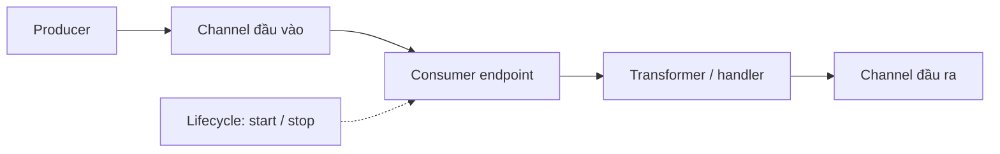

# Endpoint auto startup

Trong chương **Cấu hình và lifecycle** của module **SPRING_INTEGRATION_CORE**, bài này giải thích cách quyết định một endpoint có tự khởi động cùng ứng dụng hay không. Kiến thức này giúp kiểm soát thời điểm một luồng bắt đầu nhận thông điệp, thay vì chỉ kiểm soát thời điểm các bean được tạo.

Ví dụ xuyên suốt là luồng chuẩn hóa mã đơn hàng: nhận một `Message<String>`, bỏ khoảng trắng, chuyển mã sang chữ hoa rồi chuyển thông điệp kết quả sang channel đầu ra. Endpoint xử lý được giữ ở trạng thái chưa chạy cho đến khi có lệnh khởi động.

## 1. Mục tiêu và điều kiện thực hành

Sau bài học, bạn có thể:

- Phân biệt cấu hình `autoStartup` với trạng thái `isRunning()`.
- Cấu hình endpoint bằng Java DSL và annotation.
- Lấy đúng endpoint bean để gọi `start()` hoặc `stop()`.
- Dự đoán hành vi của `DirectChannel` và `QueueChannel` khi consumer chưa chạy.
- Kết hợp `autoStartup` với `phase` và viết kiểm thử cho trạng thái ban đầu.

Ví dụ sử dụng Java 17+, Spring Integration 6.5.x và Spring Framework 6.2.x tương thích. Phần kiểm thử dùng JUnit Jupiter. Dự án cần dependency `org.springframework.integration:spring-integration-core` và `org.junit.jupiter:junit-jupiter` ở phạm vi test; nên quản lý phiên bản bằng BOM phù hợp với dự án.

Các đoạn mã trong bài là những ví dụ độc lập để đưa vào dự án thực hành. Cấu hình Java DSL ở mục 5 và lớp kiểm thử ở mục 9 dùng chung package `example.autostart`.

## 2. Thành phần nào thực sự được khởi động?

Một luồng tích hợp có những vai trò khác nhau:

| Thành phần | Vai trò trong ví dụ |
| --- | --- |
| `Message<String>` | Mang mã đơn hàng và các header |
| `MessageChannel` | Nhận, chuyển tiếp hoặc lưu tạm thông điệp |
| Handler/transformer | Thực hiện phép chuẩn hóa payload |
| Consumer endpoint | Kết nối channel đầu vào với handler và điều khiển việc nhận thông điệp |
| `IntegrationFlow` | Mô tả các thành phần và kết nối trong Java DSL |

Với channel có khả năng subscribe, endpoint thường là `EventDrivenConsumer`. Với channel có khả năng poll, endpoint là `PollingConsumer` và cần cấu hình poller. Hai endpoint này giúp handler nhận thông điệp theo hai cơ chế khác nhau. Xem [Message Endpoints](https://docs.spring.io/spring-integration/reference/6.5/endpoint.html).



Vì vậy, khi viết `.autoStartup(false)` cho endpoint của một transformer, đối tượng được điều khiển là endpoint kết nối transformer với channel đầu vào. Bean transformer và các channel vẫn có thể tồn tại.

Các endpoint dựa trên `AbstractEndpoint` mặc định có `autoStartup=true`. Giá trị `false` yêu cầu khởi động tường minh để endpoint hoạt động. Xem [AbstractEndpoint API](https://docs.spring.io/spring-integration/docs/6.5.0/api/org/springframework/integration/endpoint/AbstractEndpoint.html).

## 3. Phân biệt chính sách khởi động và trạng thái đang chạy

`autoStartup` trả lời câu hỏi: **endpoint có được tự khởi động trong quá trình refresh của ApplicationContext hay không?**

`isRunning()` trả lời câu hỏi: **endpoint hiện có đang ở trạng thái chạy hay không?**

Hai giá trị không đồng nghĩa:

| Tình huống | `isAutoStartup()` | `isRunning()` dự kiến |
| --- | --- | --- |
| Context vừa refresh, endpoint đặt tự khởi động và start thành công | `true` | `true` |
| Context vừa refresh, endpoint không tự khởi động | `false` | `false` |
| Gọi `start()` thành công trên endpoint không tự khởi động | `false` | `true` |
| Gọi `stop()` trên endpoint đã tự khởi động | `true` | `false` |

Bảng giả định không có thành phần khác phát lệnh lifecycle. Ví dụ, mã ứng dụng vẫn có thể gọi `start()` ngay sau khi context refresh.

Gọi `start()` không cần đổi `autoStartup` thành `true`. Tương tự, thay đổi giá trị cấu hình auto startup không phải thao tác bật/tắt tức thời tương đương với `start()` hoặc `stop()`.

### 3.1. Không tự khởi động không có nghĩa là không tạo bean

Trong cơ chế `SmartLifecycle`, container vẫn có thể khởi tạo bean để quản lý lifecycle. Vì thế, `autoStartup=false` không thay thế `@Lazy`, `@Profile` hoặc điều kiện đăng ký bean. Constructor, dependency injection và bước khởi tạo tài nguyên của các bean vẫn cần được xem xét riêng.

Hợp đồng `SmartLifecycle` xác định auto startup tại thời điểm context refresh, còn `start()` là yêu cầu khởi động tường minh. Xem [SmartLifecycle API](https://docs.spring.io/spring-framework/docs/6.2.x/javadoc-api/org/springframework/context/SmartLifecycle.html).

### 3.2. Khi nào nên giữ endpoint chưa chạy?

Một vài tình huống thiết kế:

- Cần nạp xong bảng tham chiếu nghiệp vụ trước khi xử lý đơn hàng.
- Muốn kiểm thử wiring và message mapping trước khi bật consumer.
- Cần bật một tuyến xử lý theo quyết định vận hành.
- Muốn giữ nguồn phát thông điệp chưa chạy cho đến khi các bước phía sau sẵn sàng.

Mỗi tình huống đều cần chỉ rõ **ai khởi động endpoint** và **điều kiện nào cho phép khởi động**. Nếu chỉ đặt `false` rồi không có lệnh start, endpoint sẽ tiếp tục ở trạng thái chưa chạy.

## 4. Hành vi phụ thuộc vào channel đầu vào

Tắt consumer không tự xác định số phận của thông điệp. Cần xem channel có lưu trữ thông điệp hay không và có consumer nào khác còn hoạt động hay không.

| Channel đầu vào | Khi consumer đang xét chưa chạy | Điều cần thiết kế |
| --- | --- | --- |
| `DirectChannel` | Endpoint chưa subscribe handler; nếu không còn subscriber nào, việc gửi thất bại | Trì hoãn producer hoặc chuẩn bị xử lý lỗi gửi |
| `QueueChannel` | Thông điệp có thể vào queue dù consumer chưa chạy, miễn queue còn chỗ | Giới hạn capacity và timeout khi gửi |
| `PublishSubscribeChannel` | Consumer chưa subscribe sẽ không nhận bản tin phát trong thời gian đó | Xem xét yêu cầu subscriber và khả năng mất bản tin đối với nhánh này |

`DirectChannel` chuyển trực tiếp tới handler trong luồng của bên gửi. `QueueChannel` lưu thông điệp và cho phép bên nhận lấy sau. `PublishSubscribeChannel` mặc định có `minSubscribers=0`, nên một lần gửi có thể được coi là thành công dù chưa có subscriber. Những khác biệt này được mô tả trong [Message Channel Implementations](https://docs.spring.io/spring-integration/reference/6.5/channel/implementations.html).

Với `QueueChannel` thông thường, vùng đệm nằm trong bộ nhớ. Giữ thông điệp trong queue khi consumer dừng không đồng nghĩa thông điệp còn tồn tại sau khi tiến trình kết thúc.

Ví dụ nhỏ với `DirectChannel` hoàn toàn chưa có subscriber:

```java
DirectChannel input = new DirectChannel();

// Không có subscriber: lệnh gửi không thể chuyển thông điệp tới handler.
input.send(new GenericMessage<>("order-17"));
```

Đoạn mã cần import `org.springframework.integration.channel.DirectChannel` và `org.springframework.messaging.support.GenericMessage`. Trong trường hợp này, lời gọi gửi ném lỗi delivery/dispatch do không có subscriber; không nên viết logic với giả định rằng nó luôn chỉ trả về `false`.

Nếu nhiều consumer dùng chung một channel, dừng một endpoint chỉ tác động endpoint đó. Consumer khác vẫn có thể nhận thông điệp.

## 5. Ví dụ Java DSL: consumer chỉ chạy khi có lệnh

Luồng thực hành:

```text
orderInput (QueueChannel, capacity 100)
    -> normalizeOrders (PollingConsumer, autoStartup=false)
    -> normalizedOrders (QueueChannel, capacity 100)
```

Cấu hình đầy đủ:

```java
package example.autostart;

import java.time.Duration;
import java.util.Locale;

import org.springframework.beans.factory.annotation.Qualifier;
import org.springframework.context.annotation.Bean;
import org.springframework.context.annotation.Configuration;
import org.springframework.integration.channel.QueueChannel;
import org.springframework.integration.config.EnableIntegration;
import org.springframework.integration.dsl.IntegrationFlow;
import org.springframework.integration.dsl.Pollers;

@Configuration
@EnableIntegration
public class AutoStartupConfig {

    @Bean
    public QueueChannel orderInput() {
        return new QueueChannel(100);
    }

    @Bean
    public QueueChannel normalizedOrders() {
        return new QueueChannel(100);
    }

    @Bean
    public IntegrationFlow orderNormalizationFlow(
            @Qualifier("orderInput") QueueChannel input,
            @Qualifier("normalizedOrders") QueueChannel output) {

        return IntegrationFlow.from(input)
                .transformWith(endpoint -> endpoint
                        .transformer((String payload) ->
                                payload.trim().toUpperCase(Locale.ROOT))
                        .id("normalizeOrders")
                        .autoStartup(false)
                        .phase(100)
                        .poller(Pollers.fixedDelay(Duration.ofMillis(50))
                                .maxMessagesPerPoll(10)
                                .receiveTimeout(0)))
                .channel(output)
                .get();
    }
}
```

Trong ví dụ:

- `orderNormalizationFlow` là tên bean mô tả flow.
- `normalizeOrders` là tên endpoint bean dùng cho thao tác lifecycle.
- `autoStartup(false)` giữ consumer chưa chạy sau khi context refresh.
- `phase(100)` đặt thứ tự lifecycle khi container điều phối nhiều thành phần.
- Poller có chu kỳ fixed delay 50 ms và mỗi lượt nhận tối đa 10 thông điệp.
- `receiveTimeout(0)` làm thao tác nhận từ queue trả về ngay khi chưa có thông điệp.

Java DSL cho phép đặt ID và thuộc tính lifecycle trên endpoint. Ví dụ sử dụng `transformWith` theo API của nhánh 6.5. Xem [DSL and Endpoint Configuration](https://docs.spring.io/spring-integration/reference/6.5/dsl/java-endpoints.html) và [BaseIntegrationFlowDefinition API](https://docs.spring.io/spring-integration/docs/6.5.0/api/org/springframework/integration/dsl/BaseIntegrationFlowDefinition.html).

`maxMessagesPerPoll` và `receiveTimeout` là tùy chọn poller; chúng không quyết định endpoint có tự khởi động hay không. Xem [PollerSpec API](https://docs.spring.io/spring-integration/docs/6.5.0/api/org/springframework/integration/dsl/PollerSpec.html).

Sau refresh, có thể gửi một thông điệp vào `orderInput`. Nó nằm chờ trong queue. Khi endpoint được start, poller mới bắt đầu lấy thông điệp để chuẩn hóa và chuyển kết quả sang `normalizedOrders`.

Ở đây chưa có thread nào tự lấy kết quả khỏi queue đầu ra. Trong ứng dụng thật, cần consumer tiếp theo hoặc một cơ chế nhận kết quả phù hợp.

## 6. Khởi động và dừng đúng endpoint bean

Sau khi context được tạo và refresh xong, lấy endpoint bằng ID đã cấu hình:

```java
AbstractEndpoint endpoint =
        context.getBean("normalizeOrders", AbstractEndpoint.class);

boolean configuredToAutoStart = endpoint.isAutoStartup(); // false
boolean initiallyRunning = endpoint.isRunning();          // false

endpoint.start();
boolean runningAfterStart = endpoint.isRunning();         // true

endpoint.stop();
boolean runningAfterStop = endpoint.isRunning();          // false
```

Đoạn mã cần import `org.springframework.integration.endpoint.AbstractEndpoint`; biến `context` là ApplicationContext đã chứa `AutoStartupConfig`.

Lấy bean `normalizeOrders` vì đây là endpoint. Một bean chứa nghiệp vụ chuẩn hóa không nhất thiết cung cấp API lifecycle. Tên flow, tên endpoint, tên handler và tên channel là các định danh có vai trò riêng.

### 6.1. Tác động của stop

Đối với event-driven consumer, stop gỡ đăng ký handler khỏi channel. Đối với polling consumer, stop dừng hoạt động polling của endpoint.

Không suy ra rằng mọi công việc nghiệp vụ đang thực hiện ở thread khác đã hoàn tất chỉ từ một lời gọi `stop()`. Khi có executor, adapter ngoài hệ thống hoặc tác vụ kéo dài, cần xét thêm cơ chế dừng và xử lý công việc đang diễn ra của thành phần đó.

Một trình tự vận hành có thể áp dụng cho pipeline là:

1. Ngăn nguồn phát nhận hoặc tạo thêm công việc mới.
2. Dừng hoặc tháo nguồn phát theo API của adapter.
3. Theo dõi công việc đang xử lý và backlog theo yêu cầu nghiệp vụ.
4. Dừng các consumer còn lại khi đạt điều kiện mong muốn.

Đây là lựa chọn thiết kế của ứng dụng; riêng `autoStartup` không cung cấp quy trình drain thông điệp.

### 6.2. Cẩn thận với context.start()

`context.start()` phát yêu cầu lifecycle ở phạm vi context. Với `DefaultLifecycleProcessor`, thao tác start tường minh khởi động các bean lifecycle chưa chạy, kể cả bean không tự khởi động tại refresh.

Vì vậy, `autoStartup=false` không phải một lệnh cấm khởi động vĩnh viễn. Nếu muốn bật một endpoint cụ thể, hãy gọi `start()` trên đúng endpoint đó để phạm vi tác động rõ ràng. Xem [DefaultLifecycleProcessor API](https://docs.spring.io/spring-framework/docs/6.2.x/javadoc-api/org/springframework/context/support/DefaultLifecycleProcessor.html).

## 7. Cấu hình bằng annotation và thuộc tính môi trường

Nếu dùng annotation, đặt thuộc tính lifecycle trên annotation tạo endpoint. Ví dụ dưới đây là một cách cấu hình thay thế cho transformer trong Java DSL:

```java
package example.autostart;

import java.util.Locale;

import org.springframework.integration.annotation.EndpointId;
import org.springframework.integration.annotation.MessageEndpoint;
import org.springframework.integration.annotation.Transformer;

@MessageEndpoint
public class AnnotatedOrderNormalizer {

    @Transformer(
            inputChannel = "annotationInput",
            outputChannel = "annotationOutput",
            autoStartup = "${orders.normalize.auto-startup:false}",
            phase = "100")
    @EndpointId("annotatedNormalizeOrders")
    public String normalize(String payload) {
        return payload.trim().toUpperCase(Locale.ROOT);
    }
}
```

Để dùng ví dụ này, ứng dụng phải bật `@EnableIntegration`, đăng ký lớp trên bằng component scan hoặc `@Bean`, đồng thời cung cấp channel `annotationInput` và `annotationOutput`. Chẳng hạn, chọn `DirectChannel` làm đầu vào và `QueueChannel` làm đầu ra; khi đó không cần poller.

Annotation `autoStartup` nhận chuỗi nên có thể dùng property placeholder. `@EndpointId` đặt tên endpoint để lấy bean `annotatedNormalizeOrders` khi cần start/stop. Xem [Annotation Support](https://docs.spring.io/spring-integration/reference/6.5/configuration/annotations.html).

Một cấu hình môi trường tương ứng:

```properties
orders.normalize.auto-startup=false
```

Với Spring Boot, có thể đặt thuộc tính trong `application.properties`. Với ApplicationContext thuần, phải nạp nguồn thuộc tính phù hợp. Nếu chưa khai báo thuộc tính, placeholder trong ví dụ dùng giá trị mặc định `false`.

Việc sửa một file properties bên ngoài khi ứng dụng đang chạy không tự tạo ra lệnh lifecycle. Cần cơ chế nạp lại cấu hình và điều khiển endpoint riêng nếu ứng dụng có yêu cầu thay đổi lúc chạy.

Khi đổi đầu vào annotation thành `QueueChannel`, cần thêm poller, ví dụ `poller = @Poller(fixedDelay = "50", receiveTimeout = "0")`, với import `org.springframework.integration.annotation.Poller`.

## 8. Kết hợp autoStartup với phase và readiness

`autoStartup` xác định việc tham gia khởi động tự động. `phase` xác định thứ tự lifecycle giữa các thành phần được container điều phối.

Trong thứ tự thông thường của `SmartLifecycle`:

- Khởi động theo phase tăng dần.
- Dừng theo phase giảm dần.
- Không dựa vào thứ tự giữa các bean có cùng phase.
- Quan hệ `depends-on` tường minh có thể được ưu tiên so với phase.

Xem hợp đồng thứ tự trong [SmartLifecycle API](https://docs.spring.io/spring-framework/docs/6.2.x/javadoc-api/org/springframework/context/SmartLifecycle.html).

Giả sử ứng dụng có hai endpoint và muốn chuẩn bị consumer trước khi nguồn bắt đầu phát thông điệp:

| Endpoint | Phase do ứng dụng chọn | Chính sách |
| --- | --- | --- |
| Consumer chuẩn hóa đơn hàng | `100` | Khởi động trước nguồn |
| Inbound adapter tạo đơn hàng | `200` | Khởi động sau consumer; dừng trước consumer |

Các con số chỉ biểu diễn thứ tự tương đối, không phải thời gian chờ. Phase 200 không có nghĩa là chờ 200 ms.

Nếu consumer đặt `autoStartup=false` nhưng nguồn vẫn tự chạy, phase thấp hơn của consumer không làm nó tự bật. Khi nguồn bắt đầu gửi, consumer vẫn có thể chưa hoạt động. Với `DirectChannel`, thiết kế này có thể gây lỗi gửi ngay từ lúc khởi động.

Nếu bạn tự gọi nhiều endpoint bằng `endpoint.start()`, thứ tự lời gọi do mã ứng dụng quyết định. Không nên kỳ vọng phase tự sắp xếp lại các lời gọi thủ công đó.

### Readiness là điều kiện nghiệp vụ riêng

Start thành công chỉ thể hiện thành phần đã thực hiện bước khởi động theo hợp đồng lifecycle. Nó không chứng minh dữ liệu tham chiếu đã đủ, dịch vụ đối tác đã sẵn sàng cho nghiệp vụ, hay toàn bộ tuyến xử lý đã thông suốt.

Một cách điều phối rõ ràng:

```text
Context refresh xong
    -> nạp và xác nhận dữ liệu tham chiếu
    -> xác nhận các consumer phía sau đã sẵn sàng
    -> start consumer cần bật
    -> start nguồn phát thông điệp
    -> công bố khả năng nhận công việc của tuyến xử lý
```

Nếu bước chuẩn bị thất bại, ứng dụng cần có quyết định rõ ràng: giữ tuyến chưa chạy để thử lại, hay làm quá trình khởi động thất bại. Tránh công bố tuyến xử lý sẵn sàng chỉ vì tiến trình Java vẫn đang sống.

## 9. Kiểm thử trạng thái ban đầu và xử lý sau start

Kiểm thử dưới đây dùng `AutoStartupConfig` ở mục 5. Không cần Spring Boot, broker hoặc `@SpringIntegrationTest` vì chỉ kiểm tra một luồng trong bộ nhớ.

```java
package example.autostart;

import org.junit.jupiter.api.Test;

import org.springframework.context.annotation.AnnotationConfigApplicationContext;
import org.springframework.integration.channel.QueueChannel;
import org.springframework.integration.endpoint.AbstractEndpoint;
import org.springframework.messaging.Message;
import org.springframework.messaging.support.GenericMessage;

import static org.junit.jupiter.api.Assertions.assertEquals;
import static org.junit.jupiter.api.Assertions.assertFalse;
import static org.junit.jupiter.api.Assertions.assertNotNull;
import static org.junit.jupiter.api.Assertions.assertNull;
import static org.junit.jupiter.api.Assertions.assertTrue;

class AutoStartupTest {

    @Test
    void keepsMessageQueuedUntilEndpointStarts() {
        try (AnnotationConfigApplicationContext context =
                     new AnnotationConfigApplicationContext(AutoStartupConfig.class)) {

            QueueChannel input =
                    context.getBean("orderInput", QueueChannel.class);
            QueueChannel output =
                    context.getBean("normalizedOrders", QueueChannel.class);
            AbstractEndpoint endpoint =
                    context.getBean("normalizeOrders", AbstractEndpoint.class);

            assertFalse(endpoint.isAutoStartup());
            assertFalse(endpoint.isRunning());

            assertTrue(input.send(new GenericMessage<>("  order-17  "), 0));
            assertEquals(1, input.getQueueSize());
            assertNull(output.receive(0));

            endpoint.start();

            assertTrue(endpoint.isRunning());
            assertFalse(endpoint.isAutoStartup());

            Message<?> result = output.receive(2_000);
            assertNotNull(result);
            assertEquals("ORDER-17", result.getPayload());
            assertEquals(0, input.getQueueSize());

            endpoint.stop();
            assertFalse(endpoint.isRunning());
        }
    }
}
```

Ý nghĩa của các nhóm assertion:

1. Endpoint tồn tại nhưng không tự chạy sau refresh.
2. Thông điệp được nhận vào queue đầu vào mà chưa đi qua transformer.
3. Lệnh start cho phép consumer xử lý thông điệp đang chờ.
4. Start không thay đổi chính sách `autoStartup`.
5. Lệnh stop đưa endpoint về trạng thái không chạy.

`output.receive(2_000)` chờ kết quả với giới hạn 2 giây, thay vì dùng `Thread.sleep()` rồi đoán lúc poller đã chạy. Giá trị này là giới hạn chờ của kiểm thử, không phải cam kết độ trễ của ứng dụng.

Ở bước trước start, `receive(0)` chỉ kiểm tra tức thời rằng chưa có kết quả. Bằng chứng chính cho trạng thái chưa xử lý còn gồm `isRunning()==false` và thông điệp vẫn có trong input queue.

Để thực hành thêm, có thể tạo một cấu hình thay thế dùng `DirectChannel`, rồi kiểm tra riêng việc gửi khi consumer chưa start và sau khi start. Không dùng kỳ vọng “thông điệp sẽ nằm chờ” của `QueueChannel` cho channel này.

## 10. Chọn vị trí đặt autoStartup trong pipeline

Một flow có thể gồm nhiều endpoint:

```text
Inbound adapter
    -> transformer
    -> router
    -> filter
    -> aggregator
    -> service activator
```

Đặt `autoStartup(false)` trên một transformer chỉ điều khiển endpoint của transformer đó. Router, filter, aggregator hoặc adapter khác vẫn có lifecycle riêng.

Từ đó có hai cách thiết kế thường gặp:

| Mục đích | Vị trí điều khiển phù hợp |
| --- | --- |
| Chưa cho hệ thống bắt đầu lấy dữ liệu ngoài vào | Inbound adapter hoặc điểm tiếp nhận đầu vào |
| Giữ một bước nghiệp vụ chưa xử lý nhưng cho phép nhận backlog | Consumer sau một channel có cơ chế lưu trữ thích hợp |

Nếu dừng ở giữa pipeline dùng toàn `DirectChannel`, endpoint phía trước có thể gặp lỗi khi gửi vào đoạn không còn subscriber. Nếu đệm bằng queue, phải xác định sức chứa và chính sách khi backlog tăng.

Với flow tạo động bằng `IntegrationFlowContext`, tùy chọn `.registration(flow).autoStartup(false)` thuộc **bước đăng ký flow**. Đây là một phạm vi khác với `.autoStartup(false)` đặt trên một endpoint bên trong DSL. Khi tắt tự khởi động ở registration, bên gọi chịu trách nhiệm khởi động flow hoặc các thành phần của nó. Xem [Dynamic and Runtime Integration Flows](https://docs.spring.io/spring-integration/reference/6.5/dsl/java-runtime-flows.html).

## 11. Quan hệ với gateway và xử lý lỗi

Gateway cung cấp cách gọi luồng bằng API thuận tiện cho bên gửi, nhưng việc gọi gateway không mặc nhiên start các endpoint phía sau.

Nếu request được gửi vào queue trong khi consumer chưa chạy, request có thể đã được nhận nhưng bên gọi vẫn hết thời gian chờ reply. Nếu request đi vào `DirectChannel` không có subscriber, lỗi có thể xuất hiện ngay tại bước gửi.

Đây là hệ quả của cách ghép gateway, channel và endpoint. Khi thiết kế request-reply, cần xem cả thời điểm tuyến bắt đầu nhận request và các timeout của lời gọi.

Tương tự, `errorChannel` không phải cơ chế tự khởi động một endpoint đang tắt. Cần phân biệt lỗi gửi đồng bộ tại thread bên gọi với lỗi xảy ra trong poller hoặc executor bất đồng bộ để chọn nơi bắt và xử lý lỗi.

Việc một consumer dừng cũng không tự tạo ra chính sách retry, lưu trữ bền vững, hoặc hoàn tác công việc đã xử lý. Những yêu cầu đó thuộc thiết kế delivery, transaction và xử lý lỗi của luồng.

## 12. Chẩn đoán các tình huống thường gặp

| Hiện tượng | Kiểm tra trước | Hướng xử lý |
| --- | --- | --- |
| Ứng dụng khởi động nhưng bước xử lý không nhận thông điệp | `isRunning()`, `isAutoStartup()`, ID endpoint | Xác nhận có lệnh start và lệnh nhắm đúng endpoint |
| `DirectChannel` báo không có subscriber | Consumer đã chạy chưa, đúng input channel chưa | Start consumer trước khi cho phép producer gửi |
| Queue tăng liên tục | Consumer có chạy không, tốc độ xử lý và capacity | Bật consumer khi đủ điều kiện; kiểm soát tốc độ nhận vào |
| Endpoint có `autoStartup=false` nhưng vẫn chạy | Mã gọi endpoint/flow/context start; giá trị property thực tế | Tìm lệnh lifecycle hoặc cấu hình đã kích hoạt nó |
| Start consumer nhưng vẫn chưa có output | Poller, payload, handler, đường output và lỗi xử lý | Phân biệt trạng thái chạy với khả năng xử lý thành công |
| Sửa property nhưng endpoint vẫn giữ trạng thái cũ | Cơ chế nạp lại thuộc tính và lệnh lifecycle | Gọi start/stop tường minh theo quy trình của ứng dụng |
| Tắt một endpoint nhưng hệ thống vẫn nhận dữ liệu | Adapter đầu vào và consumer khác | Điều khiển đúng điểm tiếp nhận hoặc toàn nhóm cần dừng |

Một lệnh quan sát đơn giản sau khi context sẵn sàng:

```java
context.getBeansOfType(AbstractEndpoint.class)
        .forEach((name, endpoint) -> System.out.printf(
                "%s autoStartup=%s running=%s phase=%d%n",
                name,
                endpoint.isAutoStartup(),
                endpoint.isRunning(),
                endpoint.getPhase()));
```

Dùng tên endpoint ổn định như `normalizeOrders` giúp liên kết cấu hình, log, kiểm thử và thao tác vận hành. Khi đưa vào hệ thống thực tế, nên quan sát thêm độ dài queue, kết quả xử lý và tình trạng phụ thuộc nghiệp vụ; một cờ running không mô tả hết sức khỏe của tuyến.
