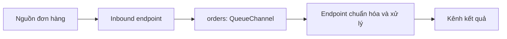

# SmartLifecycle

Trong chương **Cấu hình và lifecycle** của module **SPRING_INTEGRATION_CORE**, `SmartLifecycle` giúp điều phối thời điểm các thành phần của một luồng thông điệp bắt đầu và ngừng hoạt động. Khi thiết kế luồng bằng `Message`, `MessageChannel`, endpoint, gateway và Java DSL, việc nối đúng các bước xử lý mới giải quyết cấu trúc của luồng; ứng dụng còn cần một trình tự vận hành phù hợp.

Ví dụ, một adapter đọc đơn hàng từ đối tác không nên phát message trước khi endpoint xử lý đơn sẵn sàng. Khi bảo trì, ứng dụng cần ngừng nhận đơn mới, cho phép công việc đang xử lý hoàn tất theo chính sách đã chọn, rồi mới đóng các tài nguyên cần thiết. `SmartLifecycle` cung cấp hợp đồng để tham gia quá trình điều phối này.

Sau bài học, bạn có thể:

- Giải thích vai trò của `start()`, `stop()`, `isRunning()`, `isAutoStartup()`, `getPhase()` và `stop(Runnable)`.
- Chọn phase dựa trên quan hệ phụ thuộc khi vận hành.
- Cấu hình và điều khiển lifecycle của endpoint bằng Java DSL hoặc annotation.
- Phân biệt dừng endpoint, chờ công việc đang xử lý và xử lý hết hàng đợi.
- Thiết kế kiểm thử cho trạng thái khởi động và khả năng xử lý message sau khi thay đổi lifecycle.

## 1. Vì sao luồng message cần điều phối lifecycle?

Xét một luồng tiếp nhận đơn hàng:



Có ba câu hỏi vận hành khác nhau:

| Câu hỏi | Ví dụ |
| --- | --- |
| Thành phần đã được tạo và cấu hình chưa? | Bean endpoint đã được đăng ký trong context |
| Thành phần đang hoạt động chưa? | Poller đã bắt đầu thực hiện các lượt lấy message |
| Công việc nghiệp vụ đã hoàn thành chưa? | Đơn hàng đã được ghi nhận và transaction đã commit |

Một bean có thể tồn tại nhưng chưa chạy. Một endpoint có thể đang chạy trong lúc kết nối bên ngoài chưa ổn định. Một hàng đợi có thể đang rỗng dù worker vẫn đang xử lý message đã lấy ra.

Vì vậy, chỉ nhìn vào việc context đã tạo thành công hoặc một cờ `running` không đủ để suy ra toàn bộ trạng thái của luồng. Trong thiết kế dưới đây, lifecycle quyết định khi nào endpoint tham gia luồng; kết quả nghiệp vụ được quan sát riêng qua message và trạng thái xử lý.

## 2. Hợp đồng của SmartLifecycle

`org.springframework.context.SmartLifecycle` mở rộng `Lifecycle` và `Phased`. Nó bổ sung khả năng tự khởi động khi context refresh, điều phối theo phase và báo hoàn tất việc dừng bằng callback. [Javadoc SmartLifecycle](https://docs.spring.io/spring-framework/docs/6.2.x/javadoc-api/org/springframework/context/SmartLifecycle.html)

### 2.1. Các phương thức cần hiểu

| Phương thức | Ý nghĩa trong thiết kế một thành phần |
| --- | --- |
| `start()` | Bắt đầu hoạt động: đăng ký nhận message, khởi động polling hoặc mở bộ nhận của SDK |
| `stop()` | Yêu cầu thành phần ngừng hoạt động qua API không nhận callback |
| `isRunning()` | Phản ánh trạng thái vận hành do thành phần quản lý |
| `isAutoStartup()` | Cho biết thành phần có tham gia đợt tự khởi động lúc context refresh hay không |
| `getPhase()` | Cung cấp thứ tự tương đối khi lifecycle processor điều phối start/stop |
| `stop(Runnable callback)` | Dừng thành phần và gọi callback sau khi việc dừng theo hợp đồng của nó hoàn tất |

Ví dụ cách sử dụng từ phía mã quản trị:

```java
SmartLifecycle endpoint =
        context.getBean("orderIngress", SmartLifecycle.class);

if (!endpoint.isRunning()) {
    endpoint.start();
}
```

Kiểm tra `isRunning()` trong ví dụ giúp thể hiện ý định; implementation vẫn cần xử lý việc gọi start/stop lặp lại và đồng bộ hóa trạng thái phù hợp.

### 2.2. Trạng thái tự khởi động và trạng thái đang chạy độc lập

`isAutoStartup()` là chính sách khởi động; `isRunning()` là trạng thái tại thời điểm quan sát.

| autoStartup | running | Một tình huống có thể xảy ra |
| --- | --- | --- |
| `true` | `true` | Endpoint được tự khởi động và vẫn đang hoạt động |
| `true` | `false` | Endpoint đã bị dừng bằng thao tác quản trị |
| `false` | `false` | Endpoint chờ lệnh start sau khi context refresh |
| `false` | `true` | Endpoint đã được khởi động bằng lệnh rõ ràng |

`autoStartup=false` không xóa bean và không cấm gọi `start()`. Việc gọi `context.start()` cũng cần được phân biệt với đợt auto-start của context refresh: đây là một yêu cầu khởi động rõ ràng đối với các lifecycle bean mà processor quản lý. [DefaultLifecycleProcessor](https://docs.spring.io/spring-framework/docs/6.2.x/javadoc-api/org/springframework/context/support/DefaultLifecycleProcessor.html)

Trong các ví dụ của bài, `autoStartup=false` được dùng để giữ nguồn đầu vào ở trạng thái chưa chạy cho đến khi mã quản trị chủ động mở nguồn.

## 3. Bean initialization, lifecycle stop và bean destruction

Có thể dùng chuỗi khái niệm sau để đọc cấu hình:

```text
Tạo bean và inject dependency
    -> thực hiện callback khởi tạo
    -> context điều phối auto-start các SmartLifecycle phù hợp
    -> ứng dụng vận hành
    -> yêu cầu stop hoặc đóng context
    -> dừng các thành phần lifecycle
    -> hủy bean khi context đóng
```

Đây là mô hình cho đường đi thông thường; khi context khởi tạo thất bại, không nên giả định mọi bước start đều đã chạy. Tài nguyên được cấp phát trong quá trình tạo bean vẫn cần cơ chế giải phóng phù hợp. Spring phân biệt callback khởi tạo/hủy bean với hợp đồng `Lifecycle`; một thành phần có thể được stop rồi start lại trong khi bean vẫn tồn tại. [Lifecycle callbacks của bean](https://docs.spring.io/spring-framework/reference/core/beans/factory-nature.html)

Trong thiết kế một adapter tự viết:

- Constructor và bước khởi tạo kiểm tra cấu hình, chuẩn bị dữ liệu cần thiết.
- `start()` đưa adapter vào trạng thái tiếp nhận hoặc phát message.
- `stop()` ngừng hoạt động theo một hợp đồng rõ ràng.
- Bước hủy bean giải phóng các tài nguyên cuối cùng thuộc quyền sở hữu của bean.

Ví dụ, nếu `stop()` đóng vĩnh viễn một executor mà `start()` sau đó vẫn cố tái sử dụng, thành phần sẽ lỗi khi restart. Hãy quyết định executor được giữ để tái sử dụng, được tạo lại sau mỗi lần start, hay chỉ đóng trong bước hủy bean.

`@Lazy` cũng không phải công cụ đáng tin cậy để trì hoãn hoạt động của một `SmartLifecycle`: lifecycle processor có thể cần khởi tạo bean để quản lý nó. Muốn trì hoãn việc chạy endpoint, hãy cấu hình chính sách auto-start của endpoint. [SmartLifecycle và lazy initialization](https://docs.spring.io/spring-framework/docs/6.2.x/javadoc-api/org/springframework/context/SmartLifecycle.html)

## 4. Phase quyết định thứ tự như thế nào?

### 4.1. Quy tắc nền tảng

Khi lifecycle processor điều phối các thành phần:

- Start theo phase tăng dần.
- Stop theo phase giảm dần.
- Các thành phần cùng phase không có thứ tự nội bộ được bảo đảm.
- Quan hệ `depends-on` rõ ràng được ưu tiên hơn thứ tự phase. [Quy tắc phase của SmartLifecycle](https://docs.spring.io/spring-framework/docs/6.2.x/javadoc-api/org/springframework/context/SmartLifecycle.html)

Áp dụng vào một thiết kế tiếp nhận đơn hàng:

| Thành phần trong thiết kế | Phase minh họa | Lý do chọn |
| --- | --- | --- |
| Endpoint ghi nhận lỗi | `-100` | Cần hoạt động trước các endpoint có thể phát lỗi |
| Endpoint xử lý đơn | `100` | Sẵn sàng trước khi mở nguồn đơn |
| Endpoint lấy đơn từ đối tác | `200` | Mở sau khi phía xử lý đã được khởi động |

Khi cùng tham gia auto-start:

```text
Start: ghi nhận lỗi (-100) -> xử lý đơn (100) -> nguồn đơn (200)
Stop:  nguồn đơn (200) -> xử lý đơn (100) -> ghi nhận lỗi (-100)
```

Các số trên là lựa chọn của ví dụ. Dự án nên dành khoảng giữa các phase để có thể bổ sung thành phần mới mà không phải đổi toàn bộ cấu hình.

### 4.2. Không suy phase từ vị trí trong flow

Một luồng Java DSL thường được đọc từ trái sang phải theo đường đi của message. Điều đó không có nghĩa endpoint xuất hiện trước trong DSL phải start trước.

Khi nguồn upstream chủ động phát message, phía downstream thường cần sẵn sàng trước nguồn. Trong ví dụ trên, endpoint xử lý đứng sau nguồn trên sơ đồ message nhưng được gán phase thấp hơn.

Tương tự, không nên dùng `@Order` như một cách thay thế `getPhase()`. Thứ tự sắp xếp bean, thứ tự handler và thứ tự lifecycle là những vấn đề cấu hình khác nhau.

### 4.3. Phase không tạo hàng rào readiness

Giả sử `start()` của một bộ nhận chỉ khởi tạo tác vụ kết nối nền rồi trả về. Processor có thể tiếp tục sang thành phần kế tiếp dù kết nối vẫn chưa hoàn tất.

Vì vậy, khi thiết kế `start()`, cần xác định rõ:

1. Khi phương thức trả về, điều kiện tối thiểu nào đã được thỏa mãn?
2. Nếu còn quá trình chuẩn bị nền, trạng thái readiness được theo dõi ở đâu?
3. Nguồn đầu vào có được mở trước khi điều kiện đó đạt được không?

Phase không kiểm tra broker, không kiểm tra schema cơ sở dữ liệu, không xác nhận kết quả nghiệp vụ và không quyết định thứ tự message.

### 4.4. Đọc đúng giá trị mặc định

Trong Spring Framework 6.2, implementation mặc định của `SmartLifecycle.getPhase()` trả về `Integer.MAX_VALUE`; một bean chỉ triển khai `Lifecycle` được processor xử lý như phase `0`. Các implementation cụ thể có thể chọn giá trị riêng. [DEFAULT_PHASE](https://docs.spring.io/spring-framework/docs/6.2.x/javadoc-api/org/springframework/context/SmartLifecycle.html)

Endpoint của Spring Integration cũng có cấu hình phase riêng, có thể phụ thuộc loại endpoint và phiên bản. Bài này khai báo phase rõ ràng cho các endpoint cần phối hợp; khi áp dụng vào dự án, hãy xem API của phiên bản đang sử dụng thay vì giả định mọi endpoint đều có phase `0`.

## 5. SmartLifecycle nằm ở đâu trong Spring Integration?

### 5.1. Phân biệt channel, handler và endpoint

| Thành phần | Trách nhiệm chính | Khi thiết kế thao tác lifecycle |
| --- | --- | --- |
| `Message` | Mang payload và headers | Không có thao tác start/stop trên từng message |
| `MessageChannel` | Truyền hoặc lưu message theo loại channel | Không giả định mọi channel đều có lifecycle có thể điều khiển |
| `MessageHandler` | Thực hiện xử lý message | Một POJO xử lý nghiệp vụ không tự trở thành endpoint |
| Endpoint | Kết nối nguồn hoặc channel với hoạt động nhận/xử lý message | Thường là đối tượng cần lấy ra để start/stop |
| Gateway | Cung cấp giao diện gọi vào hoặc ra luồng | Cần xét lifecycle của implementation và các endpoint liên quan |

`AbstractEndpoint` là lớp nền cho message endpoint và triển khai hợp đồng lifecycle có khả năng quản trị. `EventDrivenConsumer` kết nối handler với `SubscribableChannel`; với channel có thể poll, framework sử dụng mô hình polling consumer phù hợp. [AbstractEndpoint](https://docs.spring.io/spring-integration/docs/current/api/org/springframework/integration/endpoint/AbstractEndpoint.html), [EventDrivenConsumer](https://docs.spring.io/spring-integration/api/org/springframework/integration/endpoint/EventDrivenConsumer.html)

Trong thực hành, cần đặt tên cho endpoint cần quản trị. Tên một bean flow hoặc một bean service nghiệp vụ không đủ để xác định đối tượng nào đang điều khiển việc nhận message.

### 5.2. Hệ quả khi consumer ngừng hoạt động

Với `QueueChannel` mặc định trong bộ nhớ, một message có thể được gửi vào queue dù consumer chưa lấy nó ra. Với `DirectChannel`, lời gọi send được chuyển trực tiếp tới một subscriber trên thread của bên gửi; nếu consumer duy nhất đã ngừng đăng ký, việc gửi không có nơi xử lý và có thể phát sinh lỗi dispatch. [Message Channel Implementations](https://docs.spring.io/spring-integration/reference/channel/implementations.html)

Do đó, trước khi dừng một consumer, cần xem producer có tiếp tục gửi không:

| Điểm nối | Tình huống cần tính đến |
| --- | --- |
| `DirectChannel` với một consumer | Dừng consumer trong khi producer vẫn gửi có thể làm lời gọi gửi thất bại |
| `QueueChannel` có giới hạn dung lượng | Backlog có thể tăng đến khi send phải chờ hoặc hết timeout |
| `ExecutorChannel` | Có thể còn task đã được gửi sang executor |
| Kênh hoặc adapter dùng broker | Hành vi còn phụ thuộc listener, acknowledgment, transaction và chính sách broker |

Việc dừng endpoint không tự động đóng mọi channel liên quan hoặc hoàn tất mọi công việc mà nó đã chuyển đi.

## 6. Ví dụ Java DSL: kiểm soát nguồn nhận đơn

Ví dụ dùng Java 17+, Spring Integration theo API `IntegrationFlow.from...` và Spring Context. Dự án cần dependency `spring-integration-core`; dependency kiểm thử ở phần sau là JUnit Jupiter. Hãy để dependency management của dự án chọn các phiên bản Spring tương thích.

Hai endpoint được đặt tên riêng:

- `orderIngress`: lấy dữ liệu từ hàng đợi mô phỏng của đối tác, phase `200`, chưa tự khởi động.
- `orderWorker`: lấy message từ channel `orders` để chuẩn hóa, phase `100`, tự khởi động.

```java
package example.lifecycle;

import java.time.Duration;
import java.util.List;
import java.util.Locale;
import java.util.Queue;
import java.util.concurrent.ConcurrentLinkedQueue;

import org.springframework.beans.factory.annotation.Qualifier;
import org.springframework.context.annotation.Bean;
import org.springframework.context.annotation.Configuration;
import org.springframework.integration.channel.QueueChannel;
import org.springframework.integration.config.EnableIntegration;
import org.springframework.integration.dsl.IntegrationFlow;
import org.springframework.integration.dsl.Pollers;

@Configuration
@EnableIntegration
public class OrderLifecycleConfiguration {

    @Bean
    public Queue<String> partnerInbox() {
        return new ConcurrentLinkedQueue<>(
                List.of(" order-1001 ", " order-1002 "));
    }

    @Bean
    public QueueChannel orders() {
        return new QueueChannel(100);
    }

    @Bean
    public QueueChannel processedOrders() {
        return new QueueChannel(100);
    }

    @Bean
    public IntegrationFlow orderIngressFlow(
            @Qualifier("partnerInbox") Queue<String> partnerInbox) {

        return IntegrationFlow
                .fromSupplier(
                        partnerInbox::poll,
                        endpoint -> endpoint
                                .id("orderIngress")
                                .autoStartup(false)
                                .phase(200)
                                .sendTimeout(1_000)
                                .poller(Pollers
                                        .fixedDelay(Duration.ofMillis(100))
                                        .maxMessagesPerPoll(1)))
                .channel("orders")
                .get();
    }

    @Bean
    public IntegrationFlow orderProcessingFlow() {
        return IntegrationFlow
                .from("orders")
                .handle(
                        String.class,
                        (payload, headers) ->
                                payload.strip().toUpperCase(Locale.ROOT),
                        endpoint -> endpoint
                                .id("orderWorker")
                                .autoStartup(true)
                                .phase(100)
                                .sendTimeout(1_000)
                                .poller(Pollers
                                        .fixedDelay(Duration.ofMillis(50))
                                        .receiveTimeout(0)
                                        .maxMessagesPerPoll(1)))
                .channel("processedOrders")
                .get();
    }
}
```

Java DSL cho phép cấu hình lifecycle trên spec của endpoint. `fromSupplier` cung cấp một message source được gọi qua polling adapter; consumer endpoint spec hỗ trợ `autoStartup`, `phase` và `poller`. [IntegrationFlow](https://docs.spring.io/spring-integration/api/org/springframework/integration/dsl/IntegrationFlow.html), [ConsumerEndpointSpec](https://docs.spring.io/spring-integration/api/org/springframework/integration/dsl/ConsumerEndpointSpec.html)

### 6.1. Luồng hoạt động

Sau khi context refresh:

1. `orderWorker` bắt đầu polling channel `orders`.
2. `orderIngress` vẫn dừng vì `autoStartup(false)`.
3. Sau lệnh start cho `orderIngress`, mỗi lượt poll lấy tối đa một chuỗi từ `partnerInbox`.
4. Worker chuẩn hóa chuỗi rồi gửi kết quả tới `processedOrders`.

Khi `partnerInbox.poll()` trả về `null`, lượt poll không tạo message. Trong cấu hình này, nguồn cạn dữ liệu không có nghĩa endpoint đã tự dừng: nó vẫn có thể tiếp tục được poll để đón dữ liệu bổ sung.

`receiveTimeout(0)` ở worker giúp một lượt nhận trả về ngay khi `orders` đang rỗng. Khoảng cách giữa các lượt poll vẫn do `fixedDelay` quyết định. `sendTimeout` giới hạn thời gian gửi vào các channel có thể chặn; các giá trị trong ví dụ phục vụ minh họa, cần chọn lại theo tải thực tế. [PollerSpec](https://docs.spring.io/spring-integration/api/org/springframework/integration/dsl/PollerSpec.html)

### 6.2. Ý nghĩa của phase trong cấu hình này

Vì nguồn chưa tự chạy, lần refresh hiện tại không thể hiện một chuỗi auto-start gồm cả hai endpoint. Khi người vận hành gọi trực tiếp `orderIngress.start()`, processor không tự đi tìm và khởi động mọi thành phần có phase thấp hơn để phục vụ lời gọi đó.

Worker đã sẵn sàng do chính sách auto-start riêng của nó. Nếu đổi nguồn thành `autoStartup(true)`, hai endpoint cùng tham gia đợt auto-start; phase `100` của worker và `200` của nguồn thể hiện thứ tự mong muốn.

Tương tự, dừng riêng `orderIngress` không đồng nghĩa dừng `orderWorker`. Đây là điểm hữu ích khi cần ngừng tiếp nhận mới nhưng vẫn duy trì xử lý ở phía sau.

### 6.3. Vì sao dùng QueueChannel trong ví dụ?

Hai queue cho phép quan sát đầu vào và đầu ra bằng `send`/`receive` có timeout. Đây là lựa chọn cho bài thực hành, chưa phải thiết kế lưu trữ đơn hàng khi tiến trình gặp sự cố.

Các queue này mặc định lưu trong bộ nhớ. Nếu context bị đóng hoặc tiến trình kết thúc trong lúc còn dữ liệu chưa xử lý, `SmartLifecycle` không tự biến dữ liệu đó thành thông điệp bền vững. [QueueChannel và persistence](https://docs.spring.io/spring-integration/reference/channel/implementations.html)

## 7. Điều khiển đúng endpoint tại runtime

Sau khi context đã refresh, có thể lấy endpoint theo tên rõ ràng:

```java
SmartLifecycle ingress =
        context.getBean("orderIngress", SmartLifecycle.class);

SmartLifecycle worker =
        context.getBean("orderWorker", SmartLifecycle.class);

worker.start();
ingress.start();
```

Ở đây:

- `orderIngressFlow` là tên bean khai báo flow.
- `orderIngress` là id endpoint nhận dữ liệu.
- `orderWorker` là id endpoint xử lý.

Nếu cần dừng nhận đơn, hãy điều khiển `orderIngress`. Nếu cần dừng việc lấy đơn từ channel `orders`, hãy điều khiển `orderWorker`.

Đối với hệ thống có giao diện quản trị, có thể bọc các thao tác này trong một service quản trị nhỏ, hoặc dùng Control Bus/JMX theo khả năng quản trị mà dự án đã cấu hình. Spring Integration hỗ trợ lấy endpoint bean để gọi lifecycle và quản trị qua Control Bus. [Annotation Support và endpoint lifecycle](https://docs.spring.io/spring-integration/reference/configuration/annotations.html)

Thiết kế một thao tác quản trị nên ghi rõ endpoint đích, trạng thái trước/sau và kết quả thành công hoặc lỗi. Tránh đặt các lệnh start/stop phân tán ở nhiều luồng xử lý nghiệp vụ, vì khi đó khó xác định thành phần nào đang sở hữu quyết định vận hành.

## 8. Cấu hình tương đương bằng annotation

Nếu ứng dụng dùng messaging annotation, có thể cấu hình lifecycle ngay tại phương thức xử lý:

```java
package example.lifecycle;

import java.util.Locale;

import org.springframework.integration.annotation.EndpointId;
import org.springframework.integration.annotation.Poller;
import org.springframework.integration.annotation.ServiceActivator;
import org.springframework.stereotype.Component;

@Component
public class AnnotatedOrderHandler {

    @EndpointId("annotatedOrderWorker")
    @ServiceActivator(
            inputChannel = "orders",
            outputChannel = "processedOrders",
            autoStartup = "${orders.worker.auto-startup:true}",
            phase = "100",
            poller = @Poller(
                    fixedDelay = "50",
                    maxMessagesPerPoll = "1"))
    public String normalize(String payload) {
        return payload.strip().toUpperCase(Locale.ROOT);
    }
}
```

Ví dụ này giả định hai channel đã được khai báo và ứng dụng đã bật xử lý annotation bằng cấu hình Spring Integration thích hợp. Nó là phương án thay thế phần worker trong ví dụ Java DSL.

Nếu bật cả worker DSL và worker annotation cùng đọc `orders`, hai consumer sẽ chia nhau lấy message theo ngữ nghĩa point-to-point của queue. Khi đó, dừng một worker không có nghĩa toàn bộ hoạt động xử lý đã dừng.

`@EndpointId` đặt tên endpoint được sinh ra cho phương thức. Bean chứa phương thức nghiệp vụ và endpoint là các đối tượng có vai trò khác nhau; với ví dụ này, đối tượng điều khiển có tên `annotatedOrderWorker`. [EndpointId](https://docs.spring.io/spring-integration/api/org/springframework/integration/annotation/EndpointId.html)

Không suy tên endpoint từ tên phương thức khi dự án đã cấu hình id riêng. Cũng cần chú ý thời điểm inject endpoint do framework sinh ra: nếu truy cập trước khi endpoint được đăng ký, có thể cần trì hoãn việc tra cứu hoặc dùng cơ chế inject lười phù hợp. [Đăng ký bean từ messaging annotations](https://docs.spring.io/spring-integration/reference/configuration/annotations.html)

## 9. stop(Runnable): báo hoàn tất dừng đúng thời điểm

### 9.1. Callback là tín hiệu hoàn tất lifecycle

Trong quá trình shutdown có điều phối, lifecycle processor dùng `stop(Runnable)` đối với `SmartLifecycle`. Callback phải được gọi khi thành phần đã hoàn tất việc dừng theo hợp đồng của nó. Implementation mặc định gọi `stop()` rồi chạy callback, vì vậy một thành phần có quá trình dừng bất đồng bộ cần implementation phù hợp. [Hợp đồng stop(Runnable)](https://docs.spring.io/spring-framework/docs/6.2.x/javadoc-api/org/springframework/context/SmartLifecycle.html)

Cần tách ba thời điểm trong thiết kế một bộ nhận bất đồng bộ:

```text
Nhận yêu cầu stop
    -> đóng cửa nhận công việc mới
    -> chờ phần công việc cần hoàn tất theo chính sách
    -> xác lập trạng thái đã dừng
    -> gọi callback
```

Nếu gọi callback ngay sau khi gửi yêu cầu dừng cho SDK, lifecycle processor có thể chuyển sang dừng tài nguyên mà SDK vẫn đang sử dụng.

Ngược lại, nếu không gọi callback sau khi đã dừng thành công, processor phải chờ hết thời gian cho phép của phase. Điều này có thể làm shutdown kéo dài dù tài nguyên thực tế đã ngừng.

### 9.2. Một đoạn mã khái niệm cho thành phần bất đồng bộ

Đoạn sau chỉ minh họa ý tưởng cho một adapter tự viết, không phải API có sẵn của Spring Integration:

```java
@Override
public void stop(Runnable callback) {
    receiver.stopAccepting();

    receiver.whenDrained(() -> {
        running = false;
        callback.run();
    });
}
```

Trong đoạn này, `receiver` là collaborator giả định với hợp đồng: `stopAccepting()` ngừng nhận công việc mới, `whenDrained(...)` chạy hành động khi số công việc đang xử lý đã về không.

Implementation thực tế còn phải xử lý:

- Thành phần đã dừng trước khi nhận lời gọi: vẫn hoàn tất callback tương ứng.
- Có nhiều lời gọi stop: không bỏ quên callback của bất kỳ yêu cầu hợp lệ nào.
- Callback hoàn tất có thể chạy đồng thời với thread quản trị.
- Thao tác dừng SDK thất bại: cần ghi nhận lỗi và chính sách xử lý, không báo hoàn tất giả.
- Thành phần có thể được start lại sau khi stop nếu hợp đồng vận hành cho phép.

Không giữ một khóa rồi chờ worker hoàn tất nếu worker đó cần cùng khóa để cập nhật trạng thái hoặc gọi callback.

### 9.3. Khi nào cần tự triển khai SmartLifecycle?

Hầu hết endpoint chuẩn đã được Spring Integration quản lý lifecycle. Chỉ cần cấu hình chúng.

Một implementation riêng phù hợp khi tích hợp một SDK có bộ nhận nền mà framework chưa cung cấp adapter. Khi đó, wrapper lifecycle quản lý việc mở/đóng SDK và chuyển message sang flow; các transformer, router, filter hoặc service xử lý nghiệp vụ vẫn giữ trách nhiệm xử lý thông điệp.

Hãy xác định quyền sở hữu tài nguyên: wrapper được đóng executor hoặc client do chính nó tạo; client dùng chung cần chính sách quản lý ở cấp thích hợp. Việc dừng một nguồn riêng không nên vô tình đóng tài nguyên đang phục vụ các flow khác.

## 10. Dừng đúng thứ tự chưa đồng nghĩa xử lý hết message

### 10.1. Ba mức hoàn tất khác nhau

| Mức | Điều kiện cần quan sát | Ví dụ |
| --- | --- | --- |
| Ngừng nhận mới | Cửa nhận của nguồn đã đóng | Inbound adapter không lấy thêm đơn từ đối tác |
| Hoàn tất công việc đang xử lý | Các công việc đã nhận đạt trạng thái kết thúc theo chính sách | Lời gọi thanh toán đã kết thúc hoặc được ghi nhận để thử lại |
| Xử lý hết backlog | Dữ liệu đang chờ đã được xử lý hoặc chuyển sang nơi lưu trữ phù hợp | Queue không còn message và không còn message đang được worker giữ |

Một callback của endpoint chỉ xác nhận hợp đồng dừng của chính endpoint đó. Nó không tự xác nhận kết quả ở database, ở downstream executor, ở broker hoặc ở một dịch vụ bên ngoài.

### 10.2. Vì sao phase không tự tạo khoảng drain?

Xét nguồn phase `200`, worker phase `100`:

```text
Dừng nguồn 200
    -> processor nhận hoàn tất dừng của nguồn
    -> processor chuyển sang dừng worker 100
```

Processor không tự kiểm tra `orders` còn bao nhiêu phần tử trước khi dừng worker. Khoảng thời gian giữa hai bước có thể rất ngắn.

Nếu yêu cầu bảo trì là xử lý hết đơn đang chờ, ứng dụng cần một quy trình chủ động:

1. Ngừng tất cả đường tiếp nhận đơn mới có liên quan.
2. Xác nhận nguồn đã đóng và các lần phát đang diễn ra đã kết thúc theo hợp đồng.
3. Giữ consumer, scheduler, executor, endpoint báo lỗi và tài nguyên nghiệp vụ cần thiết hoạt động.
4. Chờ điều kiện hoàn tất bằng số liệu backlog kết hợp số công việc đang xử lý.
5. Khi đạt điều kiện, dừng phần xử lý còn lại; nếu hết hạn, thực hiện chính sách giữ lại, thử lại hoặc chuyển giao đã định.

Riêng `queueSize == 0` chưa đủ: worker có thể vừa lấy message ra khỏi queue nhưng chưa xử lý xong. Với retry và aggregator, còn cần xem tác vụ hẹn chạy lại, trạng thái nhóm và message đang giữ trong message store.

### 10.3. Cơ chế orderly shutdown của Spring Integration

Spring Integration có quy trình orderly shutdown qua `IntegrationMBeanExporter.stopActiveComponents(...)`. Cơ chế này phối hợp các thành phần hỗ trợ shutdown, đóng các nguồn tiếp nhận thích hợp và dành thời gian cho message đang đi trong luồng hoàn tất. Tài liệu cũng nêu việc giữ poller hoạt động để hỗ trợ xử lý message còn trong `QueueChannel`. [Orderly Shutdown](https://docs.spring.io/spring-integration/reference/shutdown.html)

Đây là một cơ chế cần cấu hình và gọi theo hạ tầng quản trị của ứng dụng. Không coi việc đặt phase hoặc gọi `context.close()` là đã tự động thực hiện toàn bộ quy trình đó.

Ví dụ học tập dùng queue bộ nhớ và hai message hữu hạn. Khi áp dụng cho đơn hàng thật, phải quyết định cách bảo toàn dữ liệu nếu thời gian chờ hết trước khi xử lý xong.

## 11. Timeout khi shutdown

Có nhiều loại timeout với phạm vi khác nhau:

| Loại timeout | Đang giới hạn điều gì? |
| --- | --- |
| Timeout gửi message | Thời gian chờ thao tác gửi, chẳng hạn khi queue đầy |
| Timeout nhận message | Thời gian chờ message trong một thao tác nhận |
| Timeout dừng của SDK hoặc listener | Thời gian thành phần đó chờ công việc hoặc kết nối kết thúc |
| Timeout của lifecycle phase | Thời gian processor chờ các callback dừng thuộc phase |
| Thời hạn kết thúc tiến trình | Tổng thời gian môi trường triển khai cho ứng dụng shutdown |

Có thể cấu hình processor dùng chung một thời gian chờ cho mỗi shutdown phase. Đoạn sau là cấu hình dành cho ứng dụng Spring Context tự quản lý processor; nếu dự án có hạ tầng cấu hình sẵn, hãy tích hợp vào cơ chế đó:

```java
@Bean(name = "lifecycleProcessor")
public DefaultLifecycleProcessor lifecycleProcessor() {
    DefaultLifecycleProcessor processor =
            new DefaultLifecycleProcessor();

    processor.setTimeoutPerShutdownPhase(15_000);
    return processor;
}
```

Hai kiểu cần import là `org.springframework.context.annotation.Bean` và `org.springframework.context.support.DefaultLifecycleProcessor`.

Giá trị `15_000` là mili giây cho mỗi phase, không phải một ngân sách duy nhất cho toàn ứng dụng. Processor còn có các tùy chọn riêng cho từng phase ở những phiên bản hỗ trợ; hãy kiểm tra API tương ứng khi cấu hình. [Cấu hình timeout của DefaultLifecycleProcessor](https://docs.spring.io/spring-framework/docs/6.2.x/javadoc-api/org/springframework/context/support/DefaultLifecycleProcessor.html)

Khi thiết kế shutdown, không nên cho rằng timeout của processor có thể ngắt một implementation `stop(Runnable)` đang tự chặn vô thời hạn trước khi trả về. Thành phần nên tự giới hạn việc chờ hoặc sử dụng cơ chế bất đồng bộ đúng hợp đồng để processor có thể điều phối.

Thời hạn của môi trường triển khai cần đủ cho tổng các bước thực tế, gồm ngừng nhận, drain, các phase shutdown và hủy tài nguyên. Tăng timeout chỉ giải quyết được công việc có khả năng kết thúc; nó không sửa lỗi thiếu callback hoặc deadlock.

## 12. Kiểm thử lifecycle bằng hành vi message

Kiểm tra `isRunning()` giúp xác nhận trạng thái điều khiển. Kiểm tra message đầu ra giúp xác nhận luồng vẫn thực hiện công việc mong muốn.

Bài kiểm thử sau dùng cấu hình `OrderLifecycleConfiguration` ở trên:

```java
package example.lifecycle;

import java.util.concurrent.CountDownLatch;
import java.util.concurrent.TimeUnit;

import org.junit.jupiter.api.Test;

import org.springframework.context.SmartLifecycle;
import org.springframework.context.annotation.AnnotationConfigApplicationContext;
import org.springframework.integration.channel.QueueChannel;
import org.springframework.messaging.Message;
import org.springframework.messaging.support.GenericMessage;

import static org.junit.jupiter.api.Assertions.assertEquals;
import static org.junit.jupiter.api.Assertions.assertFalse;
import static org.junit.jupiter.api.Assertions.assertNotNull;
import static org.junit.jupiter.api.Assertions.assertNull;
import static org.junit.jupiter.api.Assertions.assertTrue;

class OrderLifecycleTest {

    @Test
    void startsIngressOnDemandAndKeepsWorkerIndependent()
            throws InterruptedException {

        try (var context = new AnnotationConfigApplicationContext(
                OrderLifecycleConfiguration.class)) {

            SmartLifecycle ingress =
                    context.getBean("orderIngress", SmartLifecycle.class);

            SmartLifecycle worker =
                    context.getBean("orderWorker", SmartLifecycle.class);

            QueueChannel orders =
                    context.getBean("orders", QueueChannel.class);

            QueueChannel processed =
                    context.getBean("processedOrders", QueueChannel.class);

            assertFalse(ingress.isRunning());
            assertTrue(worker.isRunning());
            assertNull(processed.receive(0));

            ingress.start();

            assertTrue(ingress.isRunning());
            assertEquals("ORDER-1001", receivePayload(processed));
            assertEquals("ORDER-1002", receivePayload(processed));

            CountDownLatch stopped = new CountDownLatch(1);
            ingress.stop(stopped::countDown);

            assertTrue(stopped.await(2, TimeUnit.SECONDS));
            assertFalse(ingress.isRunning());
            assertTrue(worker.isRunning());

            boolean accepted = orders.send(
                    new GenericMessage<>(" order-manual "), 1_000);

            assertTrue(accepted);
            assertEquals("ORDER-MANUAL", receivePayload(processed));
        }
    }

    private static String receivePayload(QueueChannel channel) {
        Message<?> message = channel.receive(2_000);
        assertNotNull(message, "Không nhận được kết quả trong thời hạn");
        return (String) message.getPayload();
    }
}
```

Kiểm thử xác nhận nguồn chưa tự chạy, có thể được start rõ ràng, phát dữ liệu đúng và có thể bị dừng riêng trong khi worker tiếp tục xử lý.

Các thao tác nhận có timeout chờ theo điều kiện cần quan sát. Callback được đồng bộ bằng `CountDownLatch`, không cần chèn thời gian ngủ cố định để đoán lúc dừng hoàn tất.

Kiểm thử này chưa xác nhận thứ tự auto-start của hai endpoint vì nguồn đang để `autoStartup(false)`. Nó cũng chưa chứng minh khả năng drain khi có xử lý lâu hoặc dữ liệu tồn đọng. Muốn kiểm tra các điều đó, cần các kịch bản chuyên biệt:

| Kịch bản bổ sung | Bằng chứng cần thu thập |
| --- | --- |
| Hai thành phần cùng auto-start với phase khác nhau | Danh sách sự kiện start/stop ghi từ các probe lifecycle |
| Thành phần dừng bất đồng bộ | Phase kế tiếp chưa bị dừng trước khi callback phase hiện tại hoàn tất |
| Bảo trì khi có backlog | Không còn nguồn phát, backlog và công việc đang xử lý đạt điều kiện đã định |
| Stop rồi start lại | Message mới tiếp tục được xử lý, không dùng executor đã đóng |
| Nguồn bị dừng nhưng nguồn khác còn hoạt động | Thao tác quản trị chỉ tác động đúng endpoint đích |
| Lỗi khi shutdown | Lỗi được quan sát và chính sách dữ liệu được áp dụng đúng |

Spring Integration cung cấp thêm công cụ kiểm thử, gồm khả năng ngăn một số endpoint tự khởi động qua `@SpringIntegrationTest(noAutoStartup = ...)`. Có thể dùng công cụ này khi cần cô lập luồng khỏi nguồn thật trong integration test. [Testing support](https://docs.spring.io/spring-integration/reference/testing.html)

## 13. Lỗi thường gặp và cách chẩn đoán

| Hiện tượng | Khả năng cần kiểm tra | Hướng xử lý |
| --- | --- | --- |
| Có bean nhưng không nhận message | Endpoint chưa start hoặc channel không phải channel đang được producer sử dụng | Xác nhận endpoint id, `isRunning()` và channel thực tế |
| Dừng service nghiệp vụ nhưng flow vẫn chạy | Đang điều khiển nhầm đối tượng thay vì endpoint | Lấy endpoint bean đã đặt id |
| Nguồn phát trước khi phía xử lý sẵn sàng | Phase chưa phù hợp hoặc `start()` trả về trước readiness thực tế | Điều chỉnh phase và hợp đồng readiness |
| Shutdown chậm gần đúng một thời hạn cố định | Callback của một thành phần chưa được gọi | Theo dõi thời điểm nhận stop, hoàn tất dừng và gọi callback |
| Queue còn dữ liệu sau shutdown | Chỉ điều phối thứ tự dừng, chưa có quy trình drain | Ngừng nguồn trước, giữ worker chạy trong thời gian chờ theo chính sách |
| Dừng một worker nhưng vẫn thấy message được xử lý | Có consumer khác trên cùng queue | Liệt kê toàn bộ endpoint cùng nhận từ channel |
| Start lại báo executor bị shutdown | Tài nguyên đã bị đóng vĩnh viễn ở lần stop trước | Thiết kế lại vòng đời tài nguyên hoặc tạo lại khi start |
| Vẫn có tác vụ chạy sau khi endpoint dừng | Công việc đã được chuyển sang executor hoặc SDK khác | Theo dõi số công việc đang xử lý và hợp đồng dừng ở ranh giới đó |
| Lỗi phát sinh lúc downstream đã dừng | Đường xử lý hoặc ghi nhận lỗi kết thúc quá sớm | Giữ các endpoint và tài nguyên cần cho việc ghi nhận lỗi đủ lâu |

Khi điều tra, hãy ghi ít nhất tên endpoint, phase, trạng thái trước/sau thao tác, thời gian dừng và số công việc đang xử lý nếu thành phần có số liệu đó. Với message nghiệp vụ, dùng thêm mã tương quan hoặc mã đơn hàng để nối sự kiện vận hành với kết quả xử lý.

Đừng suy ra mọi lỗi xảy ra trong `start()` hoặc `stop()` đều được gửi tới `errorChannel`. Đây là lời gọi quản lý lifecycle; cách lỗi được truyền hoặc ghi log phụ thuộc implementation và nơi gọi. Đường xử lý lỗi của message và lỗi điều phối lifecycle cần được quan sát đúng ngữ cảnh.

## 14. Thực hành mở rộng

Dùng ví dụ Java DSL làm điểm bắt đầu:

1. Giữ nguồn ở `autoStartup(false)`, khởi tạo context và xác nhận worker chạy trong khi nguồn chưa chạy.
2. Start nguồn, nhận hai kết quả và xác nhận payload đã được chuẩn hóa.
3. Dừng riêng nguồn, gửi một message thủ công vào `orders` và xác nhận worker vẫn xử lý.
4. Tạo mới một context với cả hai endpoint auto-start; bổ sung probe hoặc log lifecycle để quan sát thứ tự, không suy thứ tự chỉ từ một lần in log nghiệp vụ.
5. Thay worker bằng một xử lý có thể chủ động giữ lại qua latch. Khi queue về không nhưng latch chưa mở, quan sát rằng công việc vẫn chưa hoàn tất.
6. Thiết kế điều kiện bảo trì dựa trên cả backlog và công việc đang xử lý; quy định rõ hành vi khi hết thời hạn.
7. Thử stop/start lại nguồn sau khi bổ sung dữ liệu vào `partnerInbox`; xác nhận không cần tạo lại toàn bộ context.

Điểm cần đạt là giải thích được, với từng endpoint, khi nào nó được tạo, khi nào bắt đầu tham gia luồng, khi nào ngừng tiếp nhận, và bằng chứng nào xác nhận phần công việc cần hoàn tất đã kết thúc. Khi các mốc đó rõ ràng, phase, auto-start và callback trở thành những công cụ có thể cấu hình và kiểm thử cụ thể.
