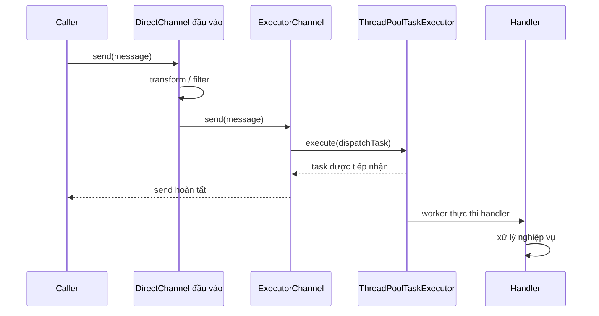

# TaskExecutor

Trong module **SPRING_INTEGRATION_CORE**, `TaskExecutor` là thành phần giúp lựa chọn cách thực thi công việc trong một luồng thông điệp. Nó kết nối phần thiết kế bằng `Message`, `MessageChannel` và endpoint với những vấn đề vận hành cụ thể: thread nào xử lý, có bao nhiêu công việc chạy đồng thời, công việc dư được giữ ở đâu, lỗi đi về đâu và ứng dụng dừng như thế nào.

Bài này thuộc chương **Cấu hình và lifecycle**. Trọng tâm là cấu hình executor cho Spring Integration Core bằng Java DSL, hiểu tác động của ranh giới bất đồng bộ và vận hành luồng có giới hạn tài nguyên.

Các ví dụ sử dụng Java 17+, Spring Integration 6.5 và Spring Framework 6.2 làm mốc API. Chọn các dependency tương thích bằng cơ chế quản lý phiên bản của dự án; không trộn các dòng phiên bản tùy ý. Phần virtual thread được đề cập riêng vì cần Java 21+ và API tương ứng.

## 1. Mục tiêu học tập

Sau bài này, bạn có thể:

- Phân biệt `TaskExecutor`, `TaskScheduler`, channel và endpoint.
- Xác định điểm chuyển thread trong luồng dùng `DirectChannel`, `ExecutorChannel` hoặc poller.
- Cấu hình `ThreadPoolTaskExecutor` với pool và hàng đợi hữu hạn.
- Giải thích vì sao tăng `maxPoolSize` có thể chưa làm tăng số worker.
- Tách lỗi từ chối tiếp nhận công việc khỏi lỗi nghiệp vụ trong worker.
- Thiết kế transaction, truyền ngữ cảnh và shutdown phù hợp với luồng bất đồng bộ.

Kiến thức nên có trước: cấu trúc `Message`, header, channel dạng subscribable/pollable, service activator và cú pháp cơ bản của `IntegrationFlow`.

## 2. TaskExecutor thực sự làm gì?

### 2.1. Hợp đồng thực thi

`org.springframework.core.task.TaskExecutor` mở rộng `java.util.concurrent.Executor`. Thao tác trung tâm là:

```java
void execute(Runnable task);
```

Một thành phần tạo `Runnable` rồi giao nó cho executor. Executor quyết định chạy ngay trên thread hiện tại, chuyển sang thread khác, đưa vào hàng đợi hoặc từ chối theo cấu hình. Vì vậy, tên `TaskExecutor` tự nó không bảo đảm bất đồng bộ. Xem [hợp đồng TaskExecutor](https://docs.spring.io/spring-framework/docs/6.2.x/javadoc-api/org/springframework/core/task/TaskExecutor.html).

Trong Spring Integration, task có thể đại diện cho việc dispatch một message đến handler hoặc thực hiện một lượt polling. Đơn vị task phụ thuộc thành phần sử dụng executor; không phải mọi task đều tương ứng đúng một message.

### 2.2. Phân biệt các trách nhiệm

| Thành phần | Câu hỏi nó giải quyết | Ví dụ |
|---|---|---|
| `Message<?>` | Dữ liệu và metadata được truyền là gì? | Đơn hàng và mã tương quan |
| `MessageChannel` | Message được chuyển đến consumer theo cách nào? | Chuyển trực tiếp, dispatch qua executor, lưu trong queue |
| Endpoint | Handler được nối vào luồng như thế nào? | Event-driven consumer hoặc polling consumer |
| `TaskExecutor` | Công việc được thực thi bằng cơ chế nào? | Thread pool hữu hạn |
| `TaskScheduler` | Khi nào một công việc được kích hoạt? | Poll mỗi 200 ms |
| Gateway | Mã nghiệp vụ gọi vào messaging bằng hợp đồng nào? | `submitOrder(...)` hoặc request-reply |

Một bean executor chỉ có tác dụng với thành phần đã được nối rõ ràng tới nó. Khai báo bean tên `taskExecutor` không tự biến mọi channel, router hoặc transformer thành bất đồng bộ.

`@Async` thuộc một cơ chế khác của Spring. Không cần thêm `@EnableAsync` để một `ExecutorChannel` đã được cấu hình executor hoạt động.

## 3. Đọc luồng theo thread trước khi cấu hình pool

### 3.1. DirectChannel: tiếp tục trên thread gửi

```text
request-thread
  -> DirectChannel
  -> transformer
  -> filter
  -> service activator
  -> trả về caller
```

Các bước trong đoạn đồng bộ thông thường chạy trên thread gửi. Nếu service activator mất hai giây thì caller cũng phải chờ đoạn xử lý đó. Việc có nhiều endpoint trong Java DSL không đồng nghĩa mỗi endpoint có một thread riêng.

### 3.2. ExecutorChannel: giao dispatch cho executor



Sơ đồ minh họa một diễn tiến có thể xảy ra. Worker cũng có thể bắt đầu hoặc kết thúc trước khi caller kịp quan sát việc `send()` trả về.

Với executor bất đồng bộ, việc tiếp nhận task không chứng minh handler đã hoàn tất. `ExecutorChannel` vẫn là channel point-to-point: một message được dispatch đến một subscriber theo cấu hình dispatcher, không broadcast đến tất cả subscriber. Context transaction gắn với thread gửi không tự đi theo dispatch bất đồng bộ. Xem [cấu hình ExecutorChannel](https://docs.spring.io/spring-integration/reference/6.5/channel/configuration.html).

### 3.3. QueueChannel: giữ message cho consumer nhận sau

```text
producer -> QueueChannel -> polling consumer -> handler
                              ^
                              |
                      scheduler / executor
```

`QueueChannel` chứa message. Consumer phải gọi `receive()` trực tiếp hoặc được một polling endpoint quản lý. Channel không tự tạo worker.

Cần phân biệt hai vùng đệm:

- Queue của `QueueChannel` giữ `Message<?>`.
- Queue nội bộ của thread pool giữ `Runnable`.

Nếu poller có executor, task đang xếp hàng có thể chưa nhận message nào. Đếm queue task không đủ để biết tổng backlog nghiệp vụ.

### 3.4. PublishSubscribeChannel với executor

`PublishSubscribeChannel` phát message đến các subscriber. Khi gắn executor, các nhánh có thể chạy đồng thời; không nên suy ra thứ tự hoàn tất từ thứ tự đăng ký subscriber.

Điều kiện thành công khi gửi bất đồng bộ không thể chứng minh từng subscriber đã xử lý xong. Nếu cần đủ số consumer, cấu hình `minSubscribers` theo hợp đồng luồng và vẫn theo dõi kết quả riêng. Xem [các loại message channel](https://docs.spring.io/spring-integration/reference/6.5/channel/implementations.html).

## 4. Chọn implementation phù hợp

| Implementation | Đặc điểm chính | Khi cân nhắc |
|---|---|---|
| `SyncTaskExecutor` | Chạy task trên thread gọi | Ví dụ đồng bộ nhỏ hoặc kiểm tra logic thuần |
| `ThreadPoolTaskExecutor` | Tái sử dụng worker; cấu hình pool, queue, rejection | Luồng cần giới hạn tài nguyên và quan sát tải |
| `SimpleAsyncTaskExecutor` | Thông thường tạo thread cho từng task, không tái sử dụng như pool | Cần mô hình thread-per-task và đã hiểu giới hạn concurrency |
| `ConcurrentTaskExecutor` | Adapter cho một JDK executor có sẵn | Hệ thống đã có executor được quản lý riêng |
| `VirtualThreadTaskExecutor` | Dùng virtual thread trên môi trường hỗ trợ | Công việc chủ yếu chờ I/O, có giới hạn tài nguyên downstream riêng |

Không đồng nhất `SimpleAsyncTaskExecutor` với một thread pool. Các tùy chọn virtual thread và quản lý vòng đời phụ thuộc phiên bản; cần đối chiếu API đang sử dụng. Các implementation được mô tả trong [Task Execution and Scheduling](https://docs.spring.io/spring-framework/reference/integration/scheduling.html).

Trong phần thực hành dưới đây, chọn `ThreadPoolTaskExecutor` để làm rõ cả worker, queue và hành vi khi quá tải.

## 5. ThreadPoolTaskExecutor: hiểu pool và queue cùng nhau

### 5.1. Những tham số cần quyết định

| Tham số | Ý nghĩa thực tế |
|---|---|
| `corePoolSize` | Mức số worker cơ sở dùng khi tạo worker theo nhu cầu |
| `maxPoolSize` | Giới hạn worker tối đa khi queue không nhận thêm được |
| `queueCapacity` | Giới hạn task chờ trong queue của executor |
| `keepAliveSeconds` | Thời gian worker dư có thể nhàn rỗi trước khi bị thu hồi |
| `allowCoreThreadTimeOut` | Cho phép cả core worker hết hạn khi nhàn rỗi |
| `threadNamePrefix` | Dấu nhận diện worker trong log và thread dump |
| `rejectedExecutionHandler` | Chính sách khi executor không tiếp nhận task |
| `taskDecorator` | Bao quanh task để thiết lập/khôi phục ngữ cảnh |

Core worker không nhất thiết được tạo sẵn ngay khi khởi tạo bean. Với cấu hình thông thường, chúng được tạo khi có task.

Mặc định của `ThreadPoolTaskExecutor` gồm core bằng 1, max và queue capacity bằng `Integer.MAX_VALUE`. Đây không phải một cấu hình đã được chọn riêng cho lưu lượng của ứng dụng. `queueCapacity > 0` tạo `LinkedBlockingQueue`; giá trị không dương tạo `SynchronousQueue`, tức cơ chế handoff thay vì chứa backlog. Xem [ThreadPoolTaskExecutor API](https://docs.spring.io/spring-framework/docs/6.2.x/javadoc-api/org/springframework/scheduling/concurrent/ThreadPoolTaskExecutor.html).

### 5.2. Thứ tự tiếp nhận task

Mô hình thông thường của `ThreadPoolExecutor` là:

1. Nếu số worker còn dưới core, tạo worker cho task.
2. Nếu đã đạt core, thử đưa task vào queue.
3. Nếu queue không nhận được và chưa đạt max, tạo thêm worker.
4. Nếu vẫn không tiếp nhận được, áp dụng rejection policy.

Vì vậy, với core = 4, max = 8, queue capacity = 8, pool không tự tăng lên 8 ngay khi xuất hiện task thứ năm. Task có thể chờ trong queue trước khi pool tăng vượt core. Xem [quy tắc pool và queue của JDK](https://docs.oracle.com/en/java/javase/17/docs/api/java.base/java/util/concurrent/ThreadPoolExecutor.html).

### 5.3. Một ví dụ giữ worker bận hoàn toàn

Giả sử mọi task đều đang bị chặn, chưa task nào hoàn thành và các task được gửi tuần tự:

| Nhóm task | Diễn tiến dự kiến với core = 4, max = 8, queue = 8 |
|---|---|
| 1–4 | Tạo 4 core worker |
| 5–12 | Xếp vào queue |
| 13–16 | Queue đầy, tạo thêm 4 worker |
| 17 | Đã có 8 worker và 8 task chờ; áp dụng rejection policy |

Bảng là mô hình để suy luận trong điều kiện đã nêu. Khi worker hoàn tất hoặc lấy task khỏi queue trong lúc gửi, các con số quan sát sẽ thay đổi.

Một hệ quả đáng chú ý: task đến sau có thể chạy ở worker mới trong khi task đến trước vẫn chờ trong queue. Vì vậy, queue FIFO không tạo ra cam kết hoàn tất FIFO cho cả executor.

### 5.4. Vì sao queue rất lớn có thể che vấn đề?

Giả sử một ứng dụng đặt core = 2, max = 64 và queue rất lớn. Khi hai worker bận, công việc mới tiếp tục được xếp hàng. Ứng dụng có thể xuất hiện hàng nghìn task chờ nhưng số worker vẫn gần 2.

Từ tình huống đó, cần đặt câu hỏi về thời gian chờ và khả năng xử lý, thay vì chỉ tăng max. Queue càng lớn càng cho phép giữ nhiều công việc chưa hoàn thành trong bộ nhớ; nó không làm từng công việc xử lý nhanh hơn.

## 6. Ví dụ Java DSL tự chứa: xử lý đơn hàng

Ví dụ xây dựng một context Spring thuần, không yêu cầu Spring Boot và không truy cập hệ thống bên ngoài. Đặt lớp dưới đây trong một source set Java đã có dependency `org.springframework.integration:spring-integration-core` tương thích.

Luồng thực hiện:

1. Nhận `OrderTask` qua `orderInput`.
2. Chuẩn hóa mã đơn hàng bằng transformer.
3. Kiểm tra dữ liệu bằng filter trên thread gửi.
4. Đặt header chỉ định kênh lỗi.
5. Qua `ExecutorChannel` để xử lý bằng worker.
6. Gửi kết quả đến queue quan sát; lỗi worker được gửi đến queue lỗi.

```java
import java.util.Locale;
import java.util.concurrent.ThreadPoolExecutor;

import org.springframework.context.annotation.AnnotationConfigApplicationContext;
import org.springframework.context.annotation.Bean;
import org.springframework.context.annotation.Configuration;
import org.springframework.integration.channel.DirectChannel;
import org.springframework.integration.channel.ExecutorChannel;
import org.springframework.integration.channel.QueueChannel;
import org.springframework.integration.config.EnableIntegration;
import org.springframework.integration.dsl.IntegrationFlow;
import org.springframework.messaging.Message;
import org.springframework.messaging.MessageHeaders;
import org.springframework.messaging.MessagingException;
import org.springframework.messaging.support.ErrorMessage;
import org.springframework.messaging.support.MessageBuilder;
import org.springframework.scheduling.concurrent.ThreadPoolTaskExecutor;

public class TaskExecutorLesson {

    public record OrderTask(String orderId, int quantity) {
    }

    public record OrderResult(String orderId, String workerThread) {
    }

    @Configuration(proxyBeanMethods = false)
    @EnableIntegration
    public static class IntegrationConfig {

        @Bean
        ThreadPoolTaskExecutor orderExecutor() {
            ThreadPoolTaskExecutor executor = new ThreadPoolTaskExecutor();
            executor.setCorePoolSize(4);
            executor.setMaxPoolSize(8);
            executor.setQueueCapacity(8);
            executor.setKeepAliveSeconds(30);
            executor.setThreadNamePrefix("si-order-");
            executor.setRejectedExecutionHandler(
                    new ThreadPoolExecutor.AbortPolicy());
            executor.setWaitForTasksToCompleteOnShutdown(true);
            executor.setAwaitTerminationSeconds(30);
            return executor;
        }

        @Bean
        DirectChannel orderInput() {
            return new DirectChannel();
        }

        @Bean
        ExecutorChannel orderWorkers(
                ThreadPoolTaskExecutor orderExecutor) {
            return new ExecutorChannel(orderExecutor);
        }

        @Bean
        QueueChannel orderResults() {
            return new QueueChannel(100);
        }

        @Bean
        QueueChannel orderErrors() {
            return new QueueChannel(100);
        }

        @Bean
        IntegrationFlow orderFlow(ExecutorChannel orderWorkers) {
            return IntegrationFlow.from("orderInput")
                    .transform(OrderTask.class, order ->
                            new OrderTask(
                                    order.orderId().trim()
                                            .toUpperCase(Locale.ROOT),
                                    order.quantity()))
                    .filter(OrderTask.class,
                            order -> !order.orderId().isBlank()
                                    && order.quantity() > 0,
                            filter -> filter
                                    .throwExceptionOnRejection(true))
                    .enrichHeaders(headers -> headers.header(
                            MessageHeaders.ERROR_CHANNEL,
                            "orderErrors"))
                    .channel(orderWorkers)
                    .handle(OrderTask.class, (order, headers) -> {
                        String thread =
                                Thread.currentThread().getName();

                        System.out.printf("PROCESS order=%s thread=%s%n",
                                order.orderId(), thread);

                        if ("FAIL".equals(order.orderId())) {
                            throw new IllegalStateException(
                                    "Lỗi nghiệp vụ minh họa");
                        }

                        return new OrderResult(
                                order.orderId(), thread);
                    })
                    .channel("orderResults")
                    .get();
        }
    }

    public static void main(String[] args) {
        try (AnnotationConfigApplicationContext context =
                     new AnnotationConfigApplicationContext(
                             IntegrationConfig.class)) {

            DirectChannel input =
                    context.getBean("orderInput", DirectChannel.class);
            QueueChannel results =
                    context.getBean("orderResults", QueueChannel.class);
            QueueChannel errors =
                    context.getBean("orderErrors", QueueChannel.class);

            for (String orderId : new String[]{" a-01 ", "b-02", "fail"}) {
                boolean accepted = input.send(
                        MessageBuilder.withPayload(
                                        new OrderTask(orderId, 2))
                                .setHeader("businessCorrelationId", orderId)
                                .build());

                System.out.printf("SEND order=%s accepted=%s thread=%s%n",
                        orderId, accepted,
                        Thread.currentThread().getName());
            }

            for (int i = 0; i < 2; i++) {
                Message<?> reply = results.receive(5_000);
                if (reply == null) {
                    throw new IllegalStateException(
                            "Không nhận đủ kết quả trong thời gian chờ");
                }
                System.out.println("RESULT " + reply.getPayload());
            }

            Message<?> failure = errors.receive(5_000);
            if (!(failure instanceof ErrorMessage error)) {
                throw new IllegalStateException(
                        "Không nhận được ErrorMessage mong đợi");
            }

            Throwable exception = error.getPayload();
            Message<?> failedMessage =
                    exception instanceof MessagingException messaging
                            ? messaging.getFailedMessage()
                            : null;

            System.out.println("ERROR " + exception);
            if (failedMessage != null) {
                System.out.println("FAILED_PAYLOAD "
                        + failedMessage.getPayload());
                System.out.println("CORRELATION "
                        + failedMessage.getHeaders()
                                .get("businessCorrelationId"));
            }
        }
    }
}
```

### 6.1. Cách đọc kết quả

Bạn nên thấy:

- Mã đơn hàng trong kết quả được chuẩn hóa thành `A-01` và `B-02`.
- Handler chạy trên thread có tiền tố `si-order-`.
- Hai kết quả thành công có thể xuất hiện theo bất kỳ thứ tự nào.
- Đơn `FAIL` tạo một `ErrorMessage`.
- Log `SEND` cho `FAIL` vẫn có thể thể hiện tiếp nhận thành công; đó không phải xác nhận nghiệp vụ thành công.

Không cố định tên hậu tố worker hoặc thứ tự log. Ví dụ dùng queue để chương trình đọc kết quả và lỗi một cách hữu hạn bằng `receive(timeout)`, không dùng `Thread.sleep()` để phỏng đoán khi nào luồng hoàn thành.

`businessCorrelationId` là header nghiệp vụ minh họa. Nó khác header `correlationId` mặc định của các mẫu như splitter/aggregator.

### 6.2. Vì sao cấu hình bean như trên?

`ThreadPoolTaskExecutor` là bean do container quản lý. Spring gọi callback khởi tạo sau khi thiết lập thuộc tính và callback hủy khi đóng context; không cần gọi `initialize()` ngay trong phương thức `@Bean`. Xem [ExecutorConfigurationSupport](https://docs.spring.io/spring-framework/docs/6.2.x/javadoc-api/org/springframework/scheduling/concurrent/ExecutorConfigurationSupport.html).

Các tham số 4/8/8 chỉ giúp quan sát bài học. Chúng chưa phải cấu hình được suy ra từ tải thực tế của một dịch vụ.

`orderResults` và `orderErrors` là queue trong bộ nhớ dành cho ví dụ. Nếu tái sử dụng thiết kế cho luồng chạy liên tục, phải có consumer xử lý kết quả/lỗi và chính sách khi queue đầy. Để queue quan sát đầy mà không có người đọc có thể giữ worker chờ gửi.

## 7. Poller dùng TaskExecutor

### 7.1. Scheduler kích hoạt, executor thực hiện lượt poll

Một service activator nhận từ `QueueChannel` cần poller. Nếu không chỉ định executor riêng, công việc polling và đoạn xử lý đồng bộ phía sau có thể chạy trên thread scheduler. Với nhiều endpoint, handler chậm có thể chiếm scheduler và làm các poller khác trễ nhịp.

Khi cấu hình executor cho poller, scheduler giao công việc sang executor đó. Đây là cách tách tài nguyên kích hoạt lịch khỏi công việc có thể chạy lâu. Xem [cấu hình task scheduler của Spring Integration](https://docs.spring.io/spring-integration/reference/6.5/configuration/namespace-taskscheduler.html).

### 7.2. Cấu hình Java DSL

Đoạn sau là **phương án thay thế** cho `orderFlow` ở ví dụ trước, không đăng ký đồng thời nếu vẫn muốn mỗi đơn chỉ đi qua một luồng xử lý. Giữ bean `orderExecutor` và định nghĩa hai bean dưới đây trong cấu hình:

```java
import java.time.Duration;

import org.springframework.context.annotation.Bean;
import org.springframework.integration.channel.QueueChannel;
import org.springframework.integration.dsl.IntegrationFlow;
import org.springframework.integration.dsl.Pollers;
import org.springframework.scheduling.concurrent.ThreadPoolTaskExecutor;

@Bean
QueueChannel queuedOrders() {
    return new QueueChannel(50);
}

@Bean
IntegrationFlow queuedOrderFlow(
        QueueChannel queuedOrders,
        ThreadPoolTaskExecutor orderExecutor) {

    return IntegrationFlow.from(queuedOrders)
            .handle(TaskExecutorLesson.OrderTask.class,
                    (order, headers) -> {
                        System.out.printf("POLLED order=%s thread=%s%n",
                                order.orderId(),
                                Thread.currentThread().getName());
                        return null;
                    },
                    endpoint -> endpoint.poller(
                            Pollers.fixedDelay(
                                            Duration.ofMillis(200))
                                    .receiveTimeout(0)
                                    .maxMessagesPerPoll(5)
                                    .taskExecutor(orderExecutor)
                                    .errorChannel("orderErrors")))
            .get();
}
```

Producer gửi message vào bean `queuedOrders`. Handler trả `null` vì ví dụ này chỉ tiêu thụ message, không tạo reply.

`taskExecutor(...)`, `receiveTimeout(...)` và `errorChannel(...)` là các tùy chọn của [PollerSpec](https://docs.spring.io/spring-integration/api/org/springframework/integration/dsl/PollerSpec.html).

Ý nghĩa cấu hình:

- `fixedDelay(200 ms)` cung cấp nhịp kích hoạt poll.
- `receiveTimeout(0)` làm lượt nhận trả về ngay khi channel không có message.
- `maxMessagesPerPoll(5)` giới hạn số message trong một lượt poll; không tạo năm worker.
- `taskExecutor(orderExecutor)` giao lượt poll cho pool.
- `errorChannel("orderErrors")` chỉ định điểm nhận lỗi polling của ví dụ.

Với executor bất đồng bộ, không suy ra rằng nhịp 200 ms bắt đầu tính từ lúc mọi handler trong lượt trước đã hoàn tất. Cần quan sát cả thời gian thực thi lượt poll và tốc độ tạo task.

### 7.3. Backlog task có thể tăng ngay cả khi thiếu message

Nếu scheduler tạo task poll nhanh, còn mỗi task đợi nhận message lâu, worker có thể cùng chờ trên queue rỗng. Các task poll tiếp theo lại xếp hàng trong executor.

Ví dụ suy luận: bốn worker đều chờ nhận tối đa một giây, trong khi scheduler tạo một task mỗi 50 ms. Khi nguồn thường xuyên rỗng, tốc độ tạo task có thể vượt tốc độ hoàn thành task dù gần như không có message nghiệp vụ. Cấu hình poller và pool cần được tính cùng nhau; tài liệu [Asynchronous Polling](https://docs.spring.io/spring-integration/reference/6.5/endpoint.html#async-polling) cũng mô tả loại backlog này.

Một queue task hữu hạn giúp giới hạn bộ nhớ, nhưng không tự giải quyết toàn bộ nhịp polling. Cần phối hợp chu kỳ poll, receive timeout, số message mỗi lượt và hành vi rejection.

## 8. Quá tải và rejection policy

### 8.1. Phân biệt hai thời điểm lỗi

```text
Gửi message
  |
  +-> Executor không nhận task
  |     -> lỗi ở thời điểm gửi / dispatch
  |
  +-> Executor nhận task
        -> worker bắt đầu
        -> handler có thể thành công hoặc thất bại
```

Với `AbortPolicy`, quá tải có thể tạo lỗi đồng bộ tại bước submission. Khi đi qua messaging, lỗi có thể được bọc trong một `MessagingException`; không nên chỉ bắt duy nhất một loại ngoại lệ ở tầng API rồi bỏ qua chuỗi nguyên nhân.

Lỗi nghiệp vụ phát sinh sau khi worker đã bắt đầu cần đường xử lý bất đồng bộ. Hai tình huống đòi hỏi hai cách quan sát riêng.

### 8.2. Các chính sách thường gặp

| Chính sách | Hành vi chính | Điều phải quyết định trong thiết kế |
|---|---|---|
| `AbortPolicy` | Báo lỗi khi từ chối | Caller sẽ retry, giảm tốc hay trả lỗi tiếp nhận? |
| `CallerRunsPolicy` | Khi pool còn hoạt động, thread submit chạy task bị từ chối | Thread HTTP/poller có chịu được thời gian xử lý đó? |
| `DiscardPolicy` | Bỏ task bị từ chối mà không ném lỗi theo policy | Việc mất công việc có được phép và có được đo đếm? |
| `DiscardOldestPolicy` | Bỏ task cũ trong queue rồi thử tiếp nhận task mới | Hợp đồng nghiệp vụ có cho phép bỏ công việc cũ? |

Các chính sách chuẩn thuộc [ThreadPoolExecutor](https://docs.oracle.com/en/java/javase/17/docs/api/java.base/java/util/concurrent/ThreadPoolExecutor.html). Không chọn discard chỉ để làm biến mất thông báo lỗi quá tải.

`CallerRunsPolicy` làm thay đổi thread thực thi khi bão hòa và có thể làm caller chậm lại. Khi executor đã shutdown, policy này bỏ task thay vì chạy trên caller. Vì vậy, nó không phải bảo đảm chống mất công việc trong mọi trạng thái. Xem [CallerRunsPolicy API](https://docs.oracle.com/en/java/javase/17/docs/api/java.base/java/util/concurrent/ThreadPoolExecutor.CallerRunsPolicy.html).

### 8.3. Queue hữu hạn và phản hồi ngược áp lực tải

Queue hữu hạn giới hạn lượng công việc chờ. Ứng dụng chỉ có cơ chế điều tiết tải hoàn chỉnh khi producer nhận được tín hiệu phù hợp và phản ứng với nó.

Ví dụ thiết kế cho HTTP:

1. Thử tiếp nhận đơn hàng.
2. Nếu không nhận được vì quá tải, trả phản hồi theo hợp đồng API.
3. Nếu đã tiếp nhận, trả mã công việc để theo dõi.
4. Công bố thành công/thất bại nghiệp vụ qua trạng thái hoặc sự kiện riêng.

Không thể xem `ExecutorChannel.send(message, timeout)` như một timeout tổng quát để chờ pool có chỗ. Cơ chế admission do executor và rejection policy quyết định. Nếu cần producer đợi chỗ trống với timeout, một `QueueChannel` hữu hạn có ngữ nghĩa chờ gửi phù hợp hơn; vẫn cần thiết kế consumer và xử lý hết timeout.

## 9. Lỗi bất đồng bộ, ErrorMessage và đường phục hồi

Với channel được Spring quản lý và cơ chế xử lý lỗi chuẩn, lỗi từ task tích hợp có thể được xuất bản dưới dạng `ErrorMessage`. Header `errorChannel` của message được ưu tiên; nếu không có, cơ chế chuẩn tìm channel toàn cục tên `errorChannel`. Không nên suy ra một `Runnable` tùy ý gửi trực tiếp vào executor cũng tự có toàn bộ hành vi đó. Xem [Error Handling](https://docs.spring.io/spring-integration/reference/6.5/error-handling.html).

Trong ví dụ:

```text
OrderTask
  -> header errorChannel = "orderErrors"
  -> orderWorkers
  -> handler ném lỗi
  -> ErrorMessage vào orderErrors
```

`ErrorMessage` chứa `Throwable` làm payload. Với lỗi được bọc bằng `MessagingException`, `getFailedMessage()` có thể cung cấp message thất bại. Khi đọc lỗi phải chấp nhận trường hợp không có failed message và không ép mọi lỗi thành cùng một lớp ngoại lệ.

Một đường phục hồi thực tế có thể dùng mã tương quan để cập nhật trạng thái công việc, phân loại lỗi và chuyển những trường hợp cần can thiệp sang một kênh xử lý riêng.

Cần trả lời rõ:

- Lỗi nào được retry và tối đa bao nhiêu lần?
- Side effect đã xảy ra trước khi lỗi có được lặp lại an toàn không?
- Nếu không retry được nữa, trạng thái thất bại được lưu ở đâu?
- Nếu chính error flow lỗi hoặc quá tải, ai quan sát được?

Retry nằm trong worker có thể giữ worker lâu hơn, đặc biệt khi backoff chặn thread. Không retry vô hạn trong cùng một pool đang bão hòa.

Đối với request-reply, không đồng nhất timeout phía caller với hủy công việc. Gateway có thể hết thời gian chờ trong khi worker vẫn tiếp tục xử lý. Đồng thời, một gateway đồng bộ qua đoạn `DirectChannel` dài không biến `replyTimeout` thành timeout ngắt phương thức handler. Xem [Messaging Gateways](https://docs.spring.io/spring-integration/reference/6.5/gateway.html#gateway-timeouts).

## 10. Transaction và dữ liệu khi đổi thread

### 10.1. Transaction gắn với thread

Giả sử luồng logic là:

```text
Thread A: mở transaction -> lưu bản ghi -> gửi ExecutorChannel -> commit
Thread B:                                      xử lý -> lỗi
```

Với transaction kiểu imperative dựa trên `PlatformTransactionManager`, context transaction gắn với thread không tự truyền sang thread mới. Lỗi ở B không tự rollback transaction đã commit ở A. Xem [ngữ nghĩa thread-bound của @Transactional](https://docs.spring.io/spring-framework/docs/6.2.x/javadoc-api/org/springframework/transaction/annotation/Transactional.html).

Thiết kế service chạy trên worker có thể mở transaction riêng thông qua một bean được proxy transaction quản lý. Việc này tạo ranh giới transaction mới phù hợp với công việc phía worker; nó không hợp nhất hai thread thành một transaction.

Một hệ quả thực tiễn: worker có thể bắt đầu trước khi transaction producer commit. Nếu worker cần đọc bản ghi vừa được producer ghi, phải phối hợp thời điểm publish và commit. Phát sau commit giải quyết vấn đề thời điểm đọc nhưng vẫn cần cơ chế lưu bền nếu phải bảo đảm công việc không mất khi tiến trình dừng.

### 10.2. Chọn ranh giới theo yêu cầu nghiệp vụ

- Nếu cần cùng call stack và cùng transaction cục bộ xuyên đoạn xử lý, cân nhắc đoạn đồng bộ bằng `DirectChannel`.
- Nếu cần song song hoặc tách thời gian phản hồi, xác định transaction riêng và trạng thái kết quả cho worker.
- Nếu cần bảo đảm công việc đã nhận sống qua restart, dùng cơ chế lưu bền phù hợp như broker hoặc outbox, kết hợp xử lý lặp an toàn.

Executor và queue task của nó chủ yếu quản lý thực thi trong tiến trình. Chúng không tự cung cấp cam kết lưu bền hoặc exactly-once cho side effect.

### 10.3. Message bất biến không làm payload tùy ý trở thành bất biến

Qua ranh giới thread, tránh tiếp tục sửa một payload mutable sau khi gửi. Một `Message` có header và tham chiếu payload được quản lý theo mô hình bất biến không có nghĩa mọi đối tượng bên trong payload đều bất biến sâu.

Trong ví dụ, `OrderTask` là record chứa `String` và `int`, phù hợp cho việc chia sẻ dữ liệu. Nếu record chứa `List` mutable, vẫn cần copy hoặc áp dụng quy ước sở hữu rõ ràng.

## 11. Ngữ cảnh logging, tracing và TaskDecorator

Mã tương quan trong message header vẫn có thể đi qua các bước khi luồng giữ lại header. Trong khi đó, MDC hoặc một giá trị `ThreadLocal` trên thread gửi không tự xuất hiện trên worker.

`TaskDecorator` cho phép bao quanh task để thiết lập và khôi phục ngữ cảnh. Nó có thể nhận một callback đã được framework bọc; không dùng decorator như cơ chế bắt mọi lỗi nghiệp vụ, đặc biệt với task dựa trên `Future`. Xem [TaskDecorator API](https://docs.spring.io/spring-framework/docs/6.2.x/javadoc-api/org/springframework/core/task/TaskDecorator.html).

Ví dụ sau dùng SLF4J MDC; ứng dụng cần SLF4J cùng logging provider hỗ trợ MDC:

```java
import java.util.Map;

import org.slf4j.MDC;
import org.springframework.core.task.TaskDecorator;

public final class MdcTaskDecorator implements TaskDecorator {

    @Override
    public Runnable decorate(Runnable runnable) {
        Map<String, String> captured = MDC.getCopyOfContextMap();

        return () -> {
            Map<String, String> previous = MDC.getCopyOfContextMap();
            try {
                install(captured);
                runnable.run();
            }
            finally {
                install(previous);
            }
        };
    }

    private static void install(Map<String, String> context) {
        if (context == null) {
            MDC.clear();
        }
        else {
            MDC.setContextMap(context);
        }
    }
}
```

Gắn decorator trước khi trả về bean executor:

```java
executor.setTaskDecorator(new MdcTaskDecorator());
```

Khôi phục context cũ trong `finally` ngăn dữ liệu log rò sang task sau trên cùng worker, đồng thời phù hợp khi task chạy trên caller do rejection policy.

Decorator bắt context ở thời điểm task được tạo/gửi sang executor. Với poller, đó thường là context của tác vụ polling, không phải context HTTP từ lúc message được đưa vào queue trước đó. Vì vậy, dữ liệu định danh lâu dài của message nên được giữ trong header và được ánh xạ sang logging context tại điểm xử lý thích hợp.

Không sao chép toàn bộ context transaction như cách sao chép MDC. Tracing và security context cũng cần cơ chế truyền context được thiết kế cho từng hệ thống.

## 12. Đồng thời, thứ tự và các mẫu tích hợp

### 12.1. Handler phải chịu được nhiều lời gọi cùng lúc

Một handler bean singleton có thể được nhiều worker gọi đồng thời. Không giữ trạng thái riêng của một message trong field dùng chung:

```java
// Không an toàn nếu cùng instance được nhiều worker gọi.
private String currentOrderId;
```

Ưu tiên biến cục bộ và dữ liệu bất biến. Với trạng thái chia sẻ bắt buộc, cần đồng bộ hoặc cấu trúc dữ liệu phù hợp với thao tác nghiệp vụ; một collection concurrent không tự làm chuỗi nhiều bước trở thành nguyên tử.

### 12.2. Đặt executor ở điểm có ý nghĩa

Xét thiết kế:

```text
input
  -> transformer chuẩn hóa
  -> filter dữ liệu
  -> router theo loại nghiệp vụ
      -> ExecutorChannel pool thanh toán -> gọi dịch vụ thanh toán
      -> ExecutorChannel pool thông báo  -> gửi thông báo
```

Đây là một lựa chọn kiến trúc: thao tác nhẹ ở trước, đoạn có thể chờ lâu được giao cho tài nguyên riêng. Nếu dịch vụ thông báo chậm, nó ít trực tiếp chiếm worker của thanh toán hơn.

Cách tách này vẫn phải tính tổng số thread, connection và tải downstream. Tạo một pool cho mỗi endpoint có thể làm tăng tài nguyên mà không tạo ra khả năng xử lý tương ứng.

### 12.3. Thứ tự theo khóa nghiệp vụ

Nếu các sự kiện của cùng một tài khoản phải được xử lý tuần tự, không chỉ dựa vào một pool nhiều worker với queue FIFO.

Một phương án là phân vùng theo khóa, đưa cùng khóa vào cùng một nhánh xử lý tuần tự. Khi thiết kế phải giữ ánh xạ khóa ổn định, bảo đảm thứ tự tiếp nhận trong từng nhánh và xử lý tình huống đổi số phân vùng. Nhiều producer đồng thời cũng cần một định nghĩa rõ về “thứ tự”.

Nếu chỉ cần tập hợp đủ kết quả của một nhóm, aggregator giải quyết bài toán khác với bảo toàn thứ tự chạy side effect.

### 12.4. Aggregator không tăng song song vô hạn theo số worker

Aggregator giữ trạng thái theo nhóm và dùng khóa theo correlation ID. Các cập nhật cùng nhóm được tuần tự hóa; ở môi trường chia sẻ message store qua nhiều instance cần cơ chế khóa dùng chung phù hợp. Xem [Aggregator — Lock Registry](https://docs.spring.io/spring-integration/reference/6.5/aggregator.html#aggregator-lock-registry).

Vì vậy, thêm worker có thể giúp các nhóm khác nhau cùng tiến triển, nhưng không làm mọi cập nhật của một nhóm tự chạy song song. Cần quan sát cả độ tranh chấp khóa, thời điểm release và message đến muộn.

### 12.5. Tránh worker chờ công việc con trong cùng pool

Một tình huống có thể gây starvation:

```text
Pool có 4 worker
  -> cả 4 worker đang xử lý task cha
  -> mỗi task cha gửi task con vào chính pool đó
  -> mỗi task cha gọi get() để chờ task con
  -> task con chưa có worker rảnh để chạy
```

Thêm queue lớn không giải quyết việc toàn bộ worker đang chờ. Cân nhắc nối tiếp luồng qua message/reply, loại bỏ chờ chặn không cần thiết hoặc cấp tài nguyên riêng cho công việc con có lý do rõ ràng.

## 13. Ước lượng năng lực và chọn giới hạn

Các con số sau là mô hình tính sơ bộ của bài học, chưa thay thế số đo tải.

Giả sử:

- Lưu lượng mục tiêu là 120 message/giây.
- Mỗi công việc giữ một worker trung bình 0,2 giây.
- Chưa có tranh chấp đáng kể và downstream vẫn đáp ứng được.

Nhu cầu worker bận trung bình xấp xỉ:

```text
120 message/giây × 0,2 giây/message = 24 worker
```

Nếu có 32 worker thực sự được sử dụng, năng lực lý tưởng theo mô hình là:

```text
32 / 0,2 = 160 message/giây
```

Con số 160 bỏ qua thời gian tăng đột biến, giới hạn CPU, khóa và connection. Đồng thời, nếu core nhỏ và queue còn nhận task, cấu hình max = 32 không chứng minh 32 worker đã hoạt động.

### 13.1. Chọn theo giới hạn nhỏ nhất

| Loại giới hạn | Cách nó tác động đến cấu hình |
|---|---|
| CPU | Nhiều worker hơn có thể chỉ tăng tranh chấp và context switch |
| HTTP connection | Worker có thể xếp hàng chờ connection thay vì làm việc hữu ích |
| Database connection | Quá nhiều task chặn chờ pool JDBC |
| Rate limit đối tác | Tăng concurrency có thể làm tăng lỗi hoặc bị giới hạn |
| Bộ nhớ | Task chờ có thể giữ payload và các đối tượng lớn |
| Ngân sách độ trễ | Queue dài làm tăng thời gian chờ trước xử lý |

Chọn queue theo burst và thời gian chờ có thể chấp nhận. Nếu tốc độ đến thường xuyên vượt tốc độ xử lý, queue hữu hạn cuối cùng vẫn đầy; cần giảm đầu vào hoặc tăng năng lực tại đúng nút thắt.

### 13.2. Thước đo cần quan sát cùng nhau

- Số worker hiện có và số worker bận.
- Số task trong queue và số lần rejection.
- Thời gian từ khi tiếp nhận đến khi bắt đầu xử lý.
- Thời gian xử lý và thời gian hoàn thành toàn bộ.
- Backlog tại `QueueChannel`, broker hoặc hệ thống nguồn.
- Lỗi downstream, connection đang dùng và kết quả nghiệp vụ.

Có thể đọc `getPoolSize()`, `getActiveCount()` và `getThreadPoolExecutor().getQueue().size()` sau khi executor đã khởi tạo. Các giá trị tức thời có thể thay đổi ngay sau khi đọc; dùng chúng để quan sát xu hướng, không làm điều kiện nguyên tử cho admission.

Một pool bận 100% không tự chứng minh CPU bận 100%. Worker có thể đang chờ I/O, khóa hoặc connection.

## 14. Lifecycle: khởi tạo, ngừng tiếp nhận và shutdown

### 14.1. Bean có chủ sở hữu rõ ràng

Executor do Spring quản lý nên được cấu hình ở một nơi, được inject vào channel/poller và được đóng cùng context. Nếu tự tạo executor ngoài container, mã tạo phải chịu trách nhiệm khởi tạo và shutdown tương ứng.

Không để handler tự tạo pool mới cho từng message. Cách đó làm mất giới hạn tài nguyên chung và khó quản lý vòng đời.

### 14.2. Hai tùy chọn trong ví dụ có ý nghĩa gì?

`setWaitForTasksToCompleteOnShutdown(true)` yêu cầu cho task đã chạy và task trong queue cơ hội hoàn tất khi executor shutdown, thay vì chủ động ngắt chúng theo đường shutdown nhanh. `setAwaitTerminationSeconds(30)` giới hạn thời gian shutdown chặn để chờ executor kết thúc. Các cờ liên quan context close và lifecycle stop có tương tác theo phiên bản; không xem một cờ riêng lẻ là toàn bộ quy trình. Xem [các tùy chọn shutdown của ExecutorConfigurationSupport](https://docs.spring.io/spring-framework/docs/6.2.x/javadoc-api/org/springframework/scheduling/concurrent/ExecutorConfigurationSupport.html#setWaitForTasksToCompleteOnShutdown(boolean)).

Hết 30 giây chờ không có nghĩa mọi task còn lại bị cưỡng bức dừng đúng giây thứ 30. `shutdownNow()` cũng chỉ cố gắng dừng task đang chạy thông qua cơ chế interruption; task phải phản ứng phù hợp. Xem [ExecutorService shutdown và awaitTermination](https://docs.oracle.com/en/java/javase/17/docs/api/java.base/java/util/concurrent/ExecutorService.html).

### 14.3. Tổ chức trình tự dừng theo luồng

Một trình tự thiết kế hợp lý là:

1. Ngừng nguồn đầu vào hoặc đưa ứng dụng khỏi luồng tiếp nhận mới.
2. Cho công việc đã nhận tiếp tục đi qua các endpoint cần thiết.
3. Nếu dùng `QueueChannel`, giữ consumer cần thiết hoạt động để drain queue theo ngân sách thời gian.
4. Đóng executor khi không còn nhánh cần submit tiếp.
5. Đóng các tài nguyên mà worker phụ thuộc và kết thúc tiến trình.

Đây là trình tự mong muốn cần được thực hiện bằng cấu hình lifecycle hoặc cơ chế điều phối phù hợp; một `setAwaitTerminationSeconds(...)` không tự sắp xếp toàn bộ hệ thống.

Đặc biệt, đóng executor không drain được message còn nằm trong `QueueChannel` nếu poller đã bị dừng. Spring Integration có cơ chế orderly shutdown để ngừng nguồn vào và cho công việc đang đi qua luồng tiếp tục; cần đọc phạm vi endpoint được hỗ trợ. Xem [Orderly Shutdown](https://docs.spring.io/spring-integration/reference/6.5/shutdown.html).

### 14.4. Tính ngân sách drain

Giả sử có 80 task đang chờ, 8 worker đều hữu dụng và mỗi task mất 0,2 giây. Bỏ qua các yếu tố khác, phần queue cần khoảng:

```text
80 / 8 × 0,2 = 2 giây
```

Sau đó phải cộng công việc đang chạy, thời gian retry, tải xuống downstream và các queue khác trong luồng. Với nhiều tầng executor, tổng backlog phân bố ở nhiều nơi.

Graceful shutdown chỉ áp dụng khi tiến trình có cơ hội thực hiện quy trình dừng. Công việc chỉ nằm trong RAM không tự sống qua sự cố mất tiến trình.

## 15. Virtual thread: đổi mô hình thread vẫn cần giới hạn công việc

Virtual thread có thể phù hợp với nhiều công việc chờ I/O trên Java 21+. Tuy nhiên, chi phí thread giảm không làm database có thêm connection hay đối tác chấp nhận nhiều request hơn.

Khi cân nhắc implementation dùng virtual thread, vẫn phải thiết kế:

- Giới hạn request đồng thời tới từng hệ thống đích.
- Timeout ở thao tác I/O thực tế.
- Phản ứng khi không tiếp nhận được công việc.
- Truyền ngữ cảnh và quan sát kết quả.
- Shutdown và lưu bền theo yêu cầu.

Không áp dụng máy móc các tham số core/max/queue của một platform-thread pool cho mọi executor dùng virtual thread. Chọn implementation trước, rồi đọc đúng hợp đồng API và lifecycle của nó.

## 16. Bài thực hành có kết quả quan sát rõ

Các hoạt động dưới đây phục vụ người học chạy trong môi trường của mình. Chúng không giả định đoạn ví dụ đã được chạy trong repository hiện tại.

### 16.1. Quan sát ranh giới đồng bộ

Dùng ví dụ đơn hàng, thêm log thread vào transformer rồi so sánh với log `PROCESS`.

Kết quả cần giải thích được: transformer phía trước `orderWorkers` chạy trên thread gửi; handler phía sau chạy trên worker khi executor tiếp nhận bất đồng bộ.

Đổi `orderWorkers` sang `DirectChannel` trong một biến thể riêng. Quan sát caller phải đi qua handler trước khi hoàn tất đoạn gửi và lỗi nghiệp vụ có đường lan truyền khác.

### 16.2. Tạo quá tải có kiểm soát

Tạo biến thể pool core = max = 1, queue = 1 và `AbortPolicy`. Dùng hai `CountDownLatch`:

1. Handler task đầu báo đã bắt đầu rồi chờ latch cho phép tiếp tục.
2. Sau khi xác nhận task đầu đang chạy, gửi task thứ hai để nằm trong queue.
3. Gửi task thứ ba và quan sát lỗi admission.
4. Mở latch trong `finally` để worker luôn được giải phóng.

Mọi thao tác chờ trong bài thực hành nên có timeout hữu hạn. Không dùng thời gian sleep tùy ý làm điều kiện bảo đảm pool đã bão hòa.

Đổi riêng policy sang `CallerRunsPolicy` trong một lượt thực hành khác. Cho phép task chạy trên caller hoàn tất độc lập với latch của worker, rồi quan sát thread xử lý task thứ ba.

### 16.3. Phân biệt lỗi trước và sau executor

- Gửi `OrderTask(" ", 2)`: filter từ chối trước ranh giới executor.
- Gửi `OrderTask("FAIL", 2)`: worker ném lỗi sau ranh giới executor.
- Gây bão hòa theo bài trên: executor từ chối tiếp nhận task.

Ghi lại thread, đường lỗi và trạng thái tiếp nhận của từng trường hợp. Không gộp cả ba thành “gửi message thất bại”.

### 16.4. Quan sát backlog polling

Dùng biến thể poller và giữ channel rỗng. So sánh hai cấu hình có receive timeout ngắn và dài, đồng thời theo dõi queue task của executor.

Giải thích số task đang chờ có thể tăng thế nào khi không có message. Sau đó điều chỉnh nhịp poll và giới hạn queue, quan sát cả rejection và mức sử dụng worker.

### 16.5. Quan sát shutdown

Giữ một số task đang chạy hoặc chờ, ngừng nguồn gửi rồi đóng context:

- Ghi nhận công việc nào hoàn tất.
- So sánh queue task với queue message.
- Quan sát task vượt ngân sách chờ.
- Đối chiếu thời gian shutdown với thời gian xử lý thực tế.

Mục tiêu là nhìn thấy giới hạn của từng tầng, không suy ra cam kết lưu bền từ một lần chạy thành công.

## 17. Chẩn đoán nhanh các biểu hiện thường gặp

| Biểu hiện | Giả thuyết cần kiểm tra | Hướng xử lý |
|---|---|---|
| Max lớn nhưng rất ít worker | Queue còn nhận task nên chưa mở rộng quá core | Đọc cả core và queue; đo thời gian chờ |
| Gần như không có message nhưng queue task tăng | Poll nhanh, receive timeout dài hoặc lượt poll chậm | Cân chỉnh poller và executor cùng nhau |
| `send()` thành công nhưng thiếu kết quả | Worker còn chờ/chạy, lỗi bất đồng bộ hoặc đường reply sai | Theo mã tương quan qua kết quả và error flow |
| Worker bận nhưng CPU thấp | Đợi HTTP, database, lock hoặc queue downstream | Xem thread dump và giới hạn tài nguyên đích |
| Thread HTTP xử lý nghiệp vụ lúc cao tải | `CallerRunsPolicy` đang có hiệu lực | Đánh giá lại chính sách tiếp nhận |
| Log có context của message trước | Ngữ cảnh worker không được khôi phục | Dùng `finally` và truyền context có chủ đích |
| Đóng context lâu | Backlog lớn hoặc task không kết thúc | Đo drain, đặt timeout I/O và giới hạn retry |
| Restart làm thiếu công việc | Task/message chỉ ở RAM | Thiết kế lưu bền theo cam kết tiếp nhận |
| Thêm worker không tăng throughput aggregator | Nút thắt theo nhóm hoặc downstream | Đo contention và số nhóm hoạt động |
| Task cha chờ mãi | Task con cần chính pool đã hết worker | Loại bỏ phụ thuộc chờ hoặc tách tài nguyên hợp lý |

## 18. Tự kiểm tra kiến thức

1. Tại sao có `TaskExecutor` chưa đủ để kết luận một luồng bất đồng bộ?
2. Với core = 4, max = 8, queue = 8, vì sao task thứ năm có thể vẫn chưa tạo worker thứ năm?
3. Hai queue trong thiết kế `QueueChannel + poller + executor` chứa những đối tượng khác nhau như thế nào?
4. Caller cần quan sát gì ngoài giá trị trả về từ `send()`?
5. Vì sao lỗi worker không tự rollback transaction producer đã commit?
6. Khi nào `CallerRunsPolicy` thay đổi thread xử lý và khi nào nó bỏ task?
7. Vì sao sao chép MDC cần khôi phục context trong `finally`?
8. Tại sao dừng poller trước khi drain queue message có thể bỏ lại công việc?
9. Một pool nhiều worker có bảo đảm thứ tự side effect theo tài khoản không?
10. Cần thay đổi gì nếu cam kết tiếp nhận yêu cầu công việc sống qua restart?

Khi thiết kế một luồng mới, hãy vẽ điểm chuyển thread trước, xác định giới hạn tiếp nhận và đường kết quả/lỗi, rồi mới chọn kích thước pool. Cấu hình executor có ý nghĩa khi được gắn với hợp đồng nghiệp vụ và vòng đời của toàn bộ luồng.
