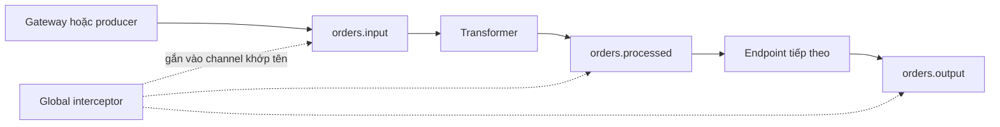

# Global channel interceptor

## 1. Mục tiêu và tình huống sử dụng

Trong module **SPRING_INTEGRATION_CORE**, Message, MessageChannel, endpoint và gateway phối hợp để tạo luồng thông điệp. Khi thiết kế bằng Java DSL, transformer, router, filter và aggregator mô tả từng bước xử lý. Tuy nhiên, nhiều channel còn cần cùng một hành vi kỹ thuật: bổ sung mã theo dõi, kiểm tra một header chung hoặc ghi nhận một lần gửi.

Nếu mỗi channel tự khai báo cùng một interceptor, cấu hình dễ lệch nhau khi luồng được mở rộng. **Global channel interceptor** cho phép đăng ký một bean interceptor rồi tự động gắn nó vào những channel có tên phù hợp.

Sau bài này, bạn có thể:

- Phân biệt interceptor gắn trực tiếp trên channel với interceptor được áp dụng bằng cấu hình global.
- Khai báo `@GlobalChannelInterceptor`, chọn `patterns` và xác định `order`.
- Hiểu callback gửi, nhận, hoàn tất và các trường hợp dừng chuỗi.
- Kết hợp interceptor với Java DSL mà vẫn giữ rõ trách nhiệm của endpoint.
- Kiểm thử phạm vi áp dụng, việc bảo toàn header và channel được đăng ký trong runtime.

Bài thuộc chương **Cấu hình và lifecycle**. Trọng tâm là cách interceptor được gắn vào channel và được gọi khi có thao tác messaging; các chính sách retry, giao dịch hay xử lý nghiệp vụ cần được cấu hình tại thành phần phù hợp trong luồng.

## 2. Global là phạm vi cấu hình, không phải một loại channel

Một `ChannelInterceptor` thực hiện hành vi. Cấu hình global quyết định **những channel nào được nhận hành vi đó**. Sau khi được gắn vào channel, interceptor vẫn chạy thông qua cơ chế callback của channel.

Ví dụ luồng xử lý đơn hàng:



Ba channel có thể cùng dùng **một instance bean** interceptor. Mỗi lần gửi qua một channel trong phạm vi, callback tương ứng có thể chạy lại. Do đó, một yêu cầu nghiệp vụ đi qua ba channel không đồng nghĩa interceptor chỉ chạy một lần.

| Cách cấu hình | Cách chọn nơi áp dụng | Khi phù hợp |
| --- | --- | --- |
| Local interceptor | Gọi `addInterceptor(...)` hoặc khai báo interceptor ngay trên channel | Một channel cần quy tắc riêng |
| Global interceptor | Khớp tên channel bằng pattern | Nhiều channel cần cùng quy tắc kỹ thuật |
| Endpoint trong flow | Đặt transformer, filter, router hoặc service activator tại một vị trí cụ thể | Một bước xử lý cần xuất hiện rõ trong luồng |
| Advice cho handler | Gắn advice vào thao tác xử lý của endpoint | Cần bao quanh lời gọi handler, chẳng hạn retry tại một bước |

Về hạ tầng, bộ xử lý global tìm các bean channel hỗ trợ `InterceptableChannel` rồi thêm interceptor phù hợp. Một object chỉ thực hiện `MessageChannel` chưa chắc hỗ trợ cơ chế đó. Chữ “global” cũng không có nghĩa tự động lan sang mọi ứng dụng, mọi JVM hay mọi đối tượng được tạo bằng `new`. Xem [GlobalChannelInterceptorProcessor](https://raw.githubusercontent.com/spring-projects/spring-integration/v7.1.1/spring-integration-core/src/main/java/org/springframework/integration/config/GlobalChannelInterceptorProcessor.java).

**Ví dụ lựa chọn thiết kế:** thêm `requestId` cho các channel `orders.*` là một quy tắc kỹ thuật dùng chung. Chuyển đơn hàng giá trị lớn sang hàng đợi duyệt thủ công nên được thể hiện bằng router để người đọc flow nhìn thấy nhánh nghiệp vụ.

## 3. Đăng ký bằng annotation

Interface cần triển khai nằm trong Spring Messaging:

```java
import org.springframework.messaging.support.ChannelInterceptor;
```

Annotation global nằm trong Spring Integration:

```java
import org.springframework.integration.config.GlobalChannelInterceptor;
```

Có hai cách khai báo phổ biến:

```java
@Bean
@GlobalChannelInterceptor(
        patterns = {"!orders.internal.*", "orders.*"},
        order = -100)
public ChannelInterceptor requestIdInterceptor() {
    return new RequestIdInterceptor();
}
```

Hoặc đặt annotation trên class bean:

```java
@Component
@GlobalChannelInterceptor(
        patterns = {"!orders.internal.*", "orders.*"},
        order = -100)
public class RequestIdInterceptor implements ChannelInterceptor {
    // Chỉ override những callback cần dùng.
}
```

Chọn một cách đăng ký cho cùng một interceptor. Nếu vừa quét `@Component` vừa tạo thêm bean bằng `@Bean`, bạn có thể vô tình có hai instance cùng thực hiện hành vi.

`@GlobalChannelInterceptor` không tự biến một class chưa được quản lý thành Spring bean. Cấu hình phải thực sự được nạp; class dùng `@Component` phải nằm trong phạm vi component scan. API hỗ trợ annotation trên class và trên phương thức `@Bean`; mặc định `patterns = {"*"}` và `order = 0`. Xem [GlobalChannelInterceptor API](https://docs.spring.io/spring-integration/docs/7.1.x/api/org/springframework/integration/config/GlobalChannelInterceptor.html).

Trong ví dụ hoàn chỉnh phía dưới, `@EnableIntegration` chủ động bật hạ tầng Spring Integration cho một application context Java thông thường. Với ứng dụng Spring Boot, cần xem xét hạ tầng mà auto-configuration của ứng dụng đã cung cấp trước khi thêm cấu hình tương đương.

## 4. Patterns: tên channel và quy tắc khớp đầu tiên

### 4.1. Pattern so khớp với gì?

Pattern dùng để chọn **tên bean channel**, không phải payload, tên phương thức handler hay tên người gửi. Vì vậy, nên đặt tên rõ ràng cho những channel mà bạn muốn đưa vào chính sách chung.

```java
@Bean(name = "orders.input")
public DirectChannel ordersInput() {
    return new DirectChannel();
}
```

Bean này được chọn bằng `orders.input` hoặc `orders.*`. Không nên suy luận rằng pattern `ordersInput` chắc chắn chọn được bean chỉ vì đó là tên phương thức Java; ở đây tên bean đã được khai báo rõ là `orders.input`.

Pattern hỗ trợ ký tự `*` cho một chuỗi ký tự bất kỳ. Đây là kiểu so khớp chuỗi đơn giản, không phải biểu thức chính quy hay đường dẫn thư mục. Dấu chấm trong `orders.*` là dấu chấm thông thường; không cần viết `orders\..*` như regex. Xem [PatternMatchUtils của Spring Framework](https://docs.spring.io/spring-framework/docs/current/javadoc-api/org/springframework/util/PatternMatchUtils.html).

### 4.2. Pattern loại trừ phải được đặt đúng thứ tự

Spring Integration hỗ trợ tiền tố `!` để phủ định. **Pattern khớp đầu tiên quyết định kết quả**, bất kể đó là pattern nhận hay loại trừ.

Cấu hình đúng cho mục tiêu “nhận orders, trừ nhánh nội bộ”:

```java
patterns = {"!orders.internal.*", "orders.*"}
```

| Tên bean channel | Pattern khớp đầu tiên | Được gắn interceptor? |
| --- | --- | --- |
| `orders.input` | `orders.*` | Có |
| `orders.processed` | `orders.*` | Có |
| `orders.output` | `orders.*` | Có |
| `orders.internal.audit` | `!orders.internal.*` | Không |
| `payments.input` | Không có pattern khớp | Không |

Cấu hình dưới đây không tạo ra phạm vi mong muốn:

```java
patterns = {"orders.*", "!orders.internal.*"}
```

Tên `orders.internal.audit` đã khớp `orders.*` trước, nên pattern phủ định phía sau không còn tác dụng với tên đó.

Nếu muốn áp dụng rộng và chỉ loại trừ một số channel, có thể dùng:

```java
patterns = {"!errorChannel", "!observability.*", "*"}
```

Ngược lại, chỉ viết `{"!orders.internal.*"}` không có nghĩa nhận mọi channel còn lại: tên không khớp pattern nào không được chọn. Cách dễ đọc là đặt các ngoại lệ trước, sau đó mới đến pattern bao quát. Quy tắc này được mô tả trực tiếp trong [PatternMatchUtils.smartMatch](https://docs.spring.io/spring-integration/docs/7.1.x/api/org/springframework/integration/support/utils/PatternMatchUtils.html).

Trong Java, nên viết từng pattern thành một phần tử của mảng `String[]`. Khi tạo flow động có tùy chọn thêm tiền tố tên bean, cần kiểm tra tên channel thực tế sau đăng ký để pattern tiếp tục khớp.

## 5. Order: vị trí so với interceptor local

`order` điều khiển vị trí interceptor global khi framework gắn nó vào danh sách interceptor của channel.

| Giá trị | Vị trí khi áp dụng cấu hình global |
| --- | --- |
| Âm, ví dụ `-100` | Trước các interceptor đã được cấu hình trực tiếp trên channel |
| Dương, ví dụ `100` | Sau các interceptor đã được cấu hình trực tiếp trên channel |
| `0` | Giá trị mặc định; trong implementation được tham chiếu, nằm ở nhóm nối sau |
| Nhiều global interceptor cùng khớp | Trong từng nhóm, được xếp theo `order` tăng dần |

Ví dụ có hai global interceptor trước nhóm local và một global interceptor sau nhóm local:

```text
requestIdGlobal(-200)
    -> commonHeaderGlobal(-100)
    -> localWireTap
    -> sendAuditGlobal(100)
```

Nếu wire tap cần nhìn thấy `requestId`, hãy thêm header trước wire tap bằng một `order` âm. Nếu thêm header sau, bản sao mà wire tap nhận có thể chưa chứa header đó.

Ngữ nghĩa trước/sau interceptor local được trình bày trong [Global Channel Interceptor Configuration](https://docs.spring.io/spring-integration/reference/channel/configuration.html#channel-global-interceptor). Việc xếp `0` vào nhóm `order >= 0` có thể đối chiếu tại [mã nguồn processor](https://raw.githubusercontent.com/spring-projects/spring-integration/v7.1.1/spring-integration-core/src/main/java/org/springframework/integration/config/GlobalChannelInterceptorProcessor.java).

Không dùng những giá trị bằng nhau để biểu đạt một phụ thuộc bắt buộc. Nếu hành vi A cần chạy trước B, hãy cấp giá trị khác nhau và kiểm thử thứ tự đó. `order` này cũng không quyết định thứ tự endpoint khởi động, thứ tự các message đồng thời hay thứ tự subscriber xử lý.

Sau khi danh sách được thiết lập, việc thêm hoặc thay interceptor bằng API ở runtime có thể thay đổi danh sách thực tế. Vì vậy, khi chẩn đoán cần quan sát cấu hình cuối cùng của channel thay vì chỉ đọc annotation.

## 6. Lifecycle callback của ChannelInterceptor

### 6.1. Nhóm gửi

| Callback | Vai trò | Điều cần chú ý |
| --- | --- | --- |
| `preSend(message, channel)` | Quan sát, bổ sung hoặc thay thế message trước thao tác gửi thực tế | Trả `null` để chặn gửi |
| `postSend(message, channel, sent)` | Quan sát kết quả khi thao tác gửi thực tế đã trả về bình thường | Không phải điểm đảm bảo luôn chạy khi có exception |
| `afterSendCompletion(message, channel, sent, ex)` | Hoàn tất, dọn tài nguyên của một lần gửi | Chỉ được gọi cho interceptor đã hoàn tất `preSend` và trả message khác `null` |

Khi dùng các channel chuẩn trong ví dụ và không có lỗi, thứ tự đơn giản là:

```text
preSend(A)
preSend(B)
thao tác gửi của channel
postSend(A)
postSend(B)
afterSendCompletion(B)
afterSendCompletion(A)
```

Nếu `preSend(B)` trả `null`, thao tác gửi thực tế bị bỏ qua. Với `send(...)` trực tiếp trên các channel này, kết quả là `false`; `postSend` không chạy. Interceptor A đã đi qua bước chuẩn bị thành công nên được hoàn tất, còn B không được gọi callback hoàn tất của chính nó.

Nếu một interceptor cấp phát tài nguyên rồi tự ném exception hoặc trả `null` trong `preSend`, nó phải tự thu hồi tài nguyên đã cấp phát trước khi thoát. Không thể dựa vào `afterSendCompletion` của chính interceptor đó.

Giới hạn callback được quy định trong [ChannelInterceptor API](https://docs.spring.io/spring-framework/docs/current/javadoc-api/org/springframework/messaging/support/ChannelInterceptor.html); thứ tự chuỗi có thể đối chiếu tại [AbstractMessageChannel](https://raw.githubusercontent.com/spring-projects/spring-integration/v7.1.1/spring-integration-core/src/main/java/org/springframework/integration/channel/AbstractMessageChannel.java).

### 6.2. Nhóm nhận

| Callback | Vai trò |
| --- | --- |
| `preReceive(channel)` | Chạy trước khi lấy message; trả `false` để ngăn thao tác nhận |
| `postReceive(message, channel)` | Chạy sau khi lấy được message; có thể thay message hoặc trả `null` |
| `afterReceiveCompletion(message, channel, ex)` | Hoàn tất lần nhận cho những interceptor đã qua `preReceive` thành công |

Các callback nhận dành cho `PollableChannel`, chẳng hạn `QueueChannel`. `DirectChannel` chuyển tới subscriber và không cung cấp thao tác `receive()`, nên không có callback `preReceive` hay `postReceive` cho kiểu sử dụng đó.

Ở các phiên bản Spring Integration từ 5.1, `postReceive` không được gọi nếu không lấy được message. Một lần `receive(0)` trên queue rỗng vẫn có thể đi qua `preReceive` và `afterReceiveCompletion`; giá trị message ở callback hoàn tất có thể là `null`. Xem [Channel Interceptors](https://docs.spring.io/spring-integration/reference/channel/interceptors.html).

**Cẩn thận với `postReceive` trả `null`:** message đã được lấy ra khỏi queue. Việc trả `null` không tự đưa nó trở lại queue. Nếu cần một nhánh loại bỏ có thể quan sát hoặc lưu trữ, nên thể hiện bằng filter cùng discard flow thích hợp.

### 6.3. Không ghép send và receive thành một chuỗi thời gian cố định

Với queue, sender và receiver có thể chạy trên các thread khác nhau. Lần nhận có thể xảy ra ngay khi sender còn trong thao tác gửi, hoặc rất lâu sau khi gửi đã hoàn tất.

Vì vậy:

- Dùng header trong message để mang dữ liệu cần truyền qua ranh giới thread.
- Không giả định `postSend` luôn xảy ra trước `preReceive`.
- Không dùng một biến instance `startTime` để ghép thời gian gửi và nhận của nhiều message.
- Không đo độ trễ toàn bộ quy trình chỉ bằng thời gian thực hiện một callback channel.

## 7. Ví dụ hoàn chỉnh: requestId qua Java DSL

### 7.1. Phạm vi ví dụ

Luồng nhận chuỗi, loại bỏ khoảng trắng ở hai đầu rồi chuyển thành chữ hoa:

```text
orders.input
    -> trim
    -> orders.processed
    -> uppercase
    -> orders.output (QueueChannel)
```

Yêu cầu kỹ thuật:

1. Những lần gửi tới `orders.*` đi qua interceptor.
2. `orders.internal.*` được loại trừ.
3. Nếu chưa có `requestId`, interceptor thêm một giá trị.
4. Nếu đã có `requestId`, interceptor giữ nguyên.
5. Payload vẫn do transformer xử lý; interceptor chỉ lo header và bộ đếm minh họa.

Ví dụ dùng `spring-integration-core` trong ứng dụng đã có Spring Context; các bài kiểm thử dùng JUnit Jupiter. Hãy quản lý phiên bản Spring bằng bộ dependency tương thích của dự án, chẳng hạn BOM đang dùng, thay vì chọn độc lập từng phiên bản thư viện. Không cần một message broker bên ngoài cho luồng này.

### 7.2. Cấu hình

```java
import java.util.Locale;
import java.util.UUID;
import java.util.concurrent.atomic.LongAdder;

import org.springframework.context.annotation.Bean;
import org.springframework.context.annotation.Configuration;
import org.springframework.integration.channel.DirectChannel;
import org.springframework.integration.channel.QueueChannel;
import org.springframework.integration.config.EnableIntegration;
import org.springframework.integration.config.GlobalChannelInterceptor;
import org.springframework.integration.dsl.IntegrationFlow;
import org.springframework.messaging.Message;
import org.springframework.messaging.MessageChannel;
import org.springframework.messaging.support.ChannelInterceptor;
import org.springframework.messaging.support.MessageBuilder;

@Configuration
@EnableIntegration
public class GlobalInterceptorConfig {

    public static final String REQUEST_ID = "requestId";

    @Bean(name = "orders.input")
    public DirectChannel ordersInput() {
        return new DirectChannel();
    }

    @Bean(name = "orders.processed")
    public DirectChannel ordersProcessed() {
        return new DirectChannel();
    }

    @Bean(name = "orders.output")
    public QueueChannel ordersOutput() {
        return new QueueChannel(10);
    }

    @Bean(name = "orders.internal.audit")
    public QueueChannel ordersInternalAudit() {
        return new QueueChannel(10);
    }

    @Bean
    @GlobalChannelInterceptor(
            patterns = {"!orders.internal.*", "orders.*"},
            order = -100)
    public RequestIdInterceptor requestIdInterceptor() {
        return new RequestIdInterceptor();
    }

    @Bean
    public IntegrationFlow orderFlow() {
        return IntegrationFlow.from("orders.input")
                .<String, String>transform(String::trim)
                .channel("orders.processed")
                .<String, String>transform(
                        value -> value.toUpperCase(Locale.ROOT))
                .channel("orders.output")
                .get();
    }

    public static final class RequestIdInterceptor
            implements ChannelInterceptor {

        private final LongAdder sendAttempts = new LongAdder();

        @Override
        public Message<?> preSend(
                Message<?> message, MessageChannel channel) {

            this.sendAttempts.increment();

            if (message.getHeaders().containsKey(REQUEST_ID)) {
                return message;
            }

            return MessageBuilder.fromMessage(message)
                    .setHeader(REQUEST_ID, UUID.randomUUID().toString())
                    .build();
        }

        public long sendAttempts() {
            return this.sendAttempts.sum();
        }
    }
}
```

Ví dụ chủ động dùng tên channel ổn định để pattern có thể đọc và kiểm thử được. Bộ đếm `sendAttempts` đếm số lần gọi `preSend` tại các channel được chọn; nó không khẳng định số đơn hàng hoàn tất.

Khi chưa có header, `MessageBuilder.fromMessage(...)` tạo message mang thay đổi cần thiết thay vì sửa trực tiếp headers của message đầu vào. Việc giữ các header hiện có giúp bảo toàn các thông tin khác mà flow đang dùng.

`requestId` trong ví dụ là header ứng dụng phục vụ theo dõi. Không tự ý thay `correlationId`, `sequenceNumber` hoặc `sequenceSize` của một flow có splitter/aggregator chỉ để tiện ghi log: các giá trị đó có thể tham gia quy tắc gom nhóm và hoàn tất nhóm.

Trong triển khai thực tế, cần xác định rõ nguồn nào được phép cung cấp `requestId` và cách kiểm tra giá trị. Ví dụ này minh họa việc thêm và giữ header, không dùng header đó làm bằng chứng xác thực hay phân quyền.

### 7.3. Vì sao bộ đếm tăng ba lần?

Với đầu vào `"  order-42  "` và queue đầu ra còn chỗ:

| Lần gửi | Channel | Hành vi |
| --- | --- | --- |
| 1 | `orders.input` | Tạo `requestId` nếu thiếu |
| 2 | `orders.processed` | Giữ `requestId` đã có |
| 3 | `orders.output` | Tiếp tục giữ `requestId` |

Kết quả là payload `ORDER-42`, một `requestId` xuyên suốt và ba lần gọi `preSend`. Việc gọi `receive(...)` trên queue đầu ra không tăng bộ đếm này vì nó chỉ tăng trong callback gửi.

Nếu mục tiêu là sinh mã đúng một lần tại biên tiếp nhận, một header enricher đặt ở đầu flow cũng có thể là lựa chọn dễ nhìn. Global interceptor hữu ích khi cần áp dụng cùng chính sách ở nhiều biên hoặc nhiều flow.

## 8. Kiểm thử cấu hình thực thay vì chỉ gọi callback

Gọi trực tiếp `interceptor.preSend(...)` chỉ kiểm tra logic của phương thức. Cách đó chưa chứng minh annotation được xử lý, pattern khớp đúng hay interceptor đã được gắn vào channel.

Các kiểm thử dưới đây tạo application context thật, sử dụng cấu hình ở trên và không cần `@SpringBootTest`. Mỗi bài kiểm thử có context riêng nên bộ đếm không bị chia sẻ giữa các bài.

```java
import org.junit.jupiter.api.Test;
import org.springframework.context.annotation.AnnotationConfigApplicationContext;
import org.springframework.integration.channel.QueueChannel;
import org.springframework.integration.dsl.IntegrationFlow;
import org.springframework.integration.dsl.context.IntegrationFlowContext;
import org.springframework.messaging.Message;
import org.springframework.messaging.MessageChannel;
import org.springframework.messaging.support.MessageBuilder;

import static org.junit.jupiter.api.Assertions.*;

class GlobalInterceptorConfigTest {

    @Test
    void addsRequestIdAcrossMatchingChannels() {
        try (var context = new AnnotationConfigApplicationContext(
                GlobalInterceptorConfig.class)) {

            var input = context.getBean(
                    "orders.input", MessageChannel.class);
            var output = context.getBean(
                    "orders.output", QueueChannel.class);
            var interceptor = context.getBean(
                    GlobalInterceptorConfig.RequestIdInterceptor.class);

            assertTrue(input.send(
                    MessageBuilder.withPayload("  order-42  ").build(),
                    1000));

            Message<?> result = output.receive(1000);

            assertNotNull(result);
            assertEquals("ORDER-42", result.getPayload());
            assertNotNull(result.getHeaders().get(
                    GlobalInterceptorConfig.REQUEST_ID));
            assertEquals(3L, interceptor.sendAttempts());
        }
    }

    @Test
    void preservesExistingRequestId() {
        try (var context = new AnnotationConfigApplicationContext(
                GlobalInterceptorConfig.class)) {

            var input = context.getBean(
                    "orders.input", MessageChannel.class);
            var output = context.getBean(
                    "orders.output", QueueChannel.class);

            assertTrue(input.send(
                    MessageBuilder.withPayload("order-43")
                            .setHeader(
                                    GlobalInterceptorConfig.REQUEST_ID,
                                    "req-43")
                            .build(),
                    1000));

            Message<?> result = output.receive(1000);

            assertNotNull(result);
            assertEquals("req-43", result.getHeaders().get(
                    GlobalInterceptorConfig.REQUEST_ID));
        }
    }

    @Test
    void excludesInternalChannel() {
        try (var context = new AnnotationConfigApplicationContext(
                GlobalInterceptorConfig.class)) {

            var internal = context.getBean(
                    "orders.internal.audit", QueueChannel.class);
            var interceptor = context.getBean(
                    GlobalInterceptorConfig.RequestIdInterceptor.class);

            assertTrue(internal.send(
                    MessageBuilder.withPayload("audit-event").build(),
                    1000));

            Message<?> result = internal.receive(1000);

            assertNotNull(result);
            assertNull(result.getHeaders().get(
                    GlobalInterceptorConfig.REQUEST_ID));
            assertEquals(0L, interceptor.sendAttempts());
        }
    }

    @Test
    void interceptsChannelRegisteredAtRuntime() {
        try (var context = new AnnotationConfigApplicationContext(
                GlobalInterceptorConfig.class)) {

            var flowContext = context.getBean(
                    IntegrationFlowContext.class);
            var output = context.getBean(
                    "orders.output", QueueChannel.class);
            var interceptor = context.getBean(
                    GlobalInterceptorConfig.RequestIdInterceptor.class);

            IntegrationFlow flow =
                    IntegrationFlow.from("orders.runtime.input")
                            .<String, String>transform(
                                    value -> value + "-runtime")
                            .channel("orders.output")
                            .get();

            var registration = flowContext.registration(flow)
                    .id("runtimeOrders")
                    .register();

            try {
                var input = context.getBean(
                        "orders.runtime.input", MessageChannel.class);

                assertTrue(input.send(
                        MessageBuilder.withPayload("order-44").build(),
                        1000));

                Message<?> result = output.receive(1000);

                assertNotNull(result);
                assertEquals("order-44-runtime", result.getPayload());
                assertNotNull(result.getHeaders().get(
                        GlobalInterceptorConfig.REQUEST_ID));
                assertEquals(2L, interceptor.sendAttempts());
            }
            finally {
                registration.destroy();
            }
        }
    }
}
```

Ca kiểm thử loại trừ đặc biệt có ích: nếu đảo thứ tự hai pattern trong annotation, `orders.internal.audit` sẽ bị chọn và những assertion tương ứng sẽ phát hiện sai lệch.

Ca runtime dùng một tên input khác luồng chính, còn output là bean đã có. Vì vậy, kỳ vọng hai lần gửi được chặn là input runtime và output, không phải ba lần như luồng chính.

Khi mở rộng bài thực hành, bổ sung các kiểm thử hành vi sau:

| Tình huống | Điều cần quan sát |
| --- | --- |
| Hai global interceptor và một local interceptor | Danh sách sự kiện chứng minh thứ tự thực thi |
| `preSend` trả `null` | Không có message tại đích, `send` trực tiếp trả `false` |
| `preSend` ném exception | Caller nhận lỗi theo đường gửi thực tế; không có kết quả giả thành công |
| Nhận từ queue rỗng | Không có `postReceive`; callback hoàn tất phù hợp vẫn dọn tài nguyên |
| Nhiều sender đồng thời | Header của từng message không bị trộn với message khác |
| Gửi lại cùng yêu cầu | Chính sách giữ hoặc tạo mã theo dõi hoạt động như thiết kế |

Các timeout trong kiểm thử giúp tránh chờ vô hạn. Chúng không tạo một deadline tổng cho toàn bộ chuỗi xử lý đồng bộ; nếu một handler bị treo, timeout truyền cho `send` không tự ngắt handler đó.

## 9. Đăng ký, khởi động và flow động

Có hai lifecycle cần phân biệt:

1. **Lifecycle bean/cấu hình:** Spring tạo interceptor, channel và hạ tầng; interceptor global phù hợp được thêm vào channel.
2. **Lifecycle thao tác:** mỗi lần `send` hoặc `receive` gọi các callback liên quan.

Không cần tự gọi `start()` trên một interceptor chỉ vì nó được đánh dấu global. Việc endpoint bắt đầu hoặc dừng tiêu thụ là trách nhiệm lifecycle riêng của endpoint. Một channel đã có interceptor không tự có consumer chỉ nhờ annotation này.

Từ Spring Integration 5.1, global channel interceptor hỗ trợ cả channel được đăng ký động thông qua các đường khởi tạo được framework xử lý, bao gồm `IntegrationFlowContext`. Đối chiếu [Channel Interceptors](https://docs.spring.io/spring-integration/reference/channel/interceptors.html).

Trong ca runtime ở trên, `IntegrationFlowContext` quản lý việc đăng ký flow và các thành phần phụ thuộc. `registration.destroy()` thu hồi flow động khi không còn cần. Cách quản lý được trình bày tại [Dynamic and Runtime Integration Flows](https://docs.spring.io/spring-integration/reference/dsl/java-runtime-flows.html).

Trái lại:

```java
QueueChannel unmanaged = new QueueChannel(10);
```

Biến local này chưa đi qua cơ chế quản lý bean hay đăng ký flow. Chỉ đặt tên biến gần giống pattern không làm interceptor global xuất hiện trên object. Nếu cần một channel runtime trong ứng dụng, hãy đưa nó qua cơ chế đăng ký/khởi tạo thích hợp và kiểm thử kết quả.

Không suy luận rằng thêm một interceptor bean mới sau khi context đã khởi động sẽ tự cập nhật mọi channel cũ. Nhu cầu thay đổi chính sách interception trong runtime cần một thiết kế và thao tác quản lý danh sách interceptor rõ ràng.

## 10. Lỗi và giới hạn của sent=true

### 10.1. sent phản ánh thao tác gửi tại channel

| Channel | Có thể hiểu gì khi gửi thành công? | Chưa thể kết luận gì? |
| --- | --- | --- |
| `DirectChannel` | Thao tác dispatch đồng bộ đã trả về bình thường | Mọi tác vụ bất đồng bộ phát sinh phía sau hoặc giao dịch bên ngoài đã hoàn tất |
| `QueueChannel` | Message được đưa vào queue theo cơ chế channel | Consumer đã lấy và xử lý xong |
| `ExecutorChannel` | Thao tác giao việc theo executor đã được chấp nhận/trả về | Handler chạy trên executor đã thành công |

Ở `ExecutorChannel`, thread thực thi handler còn phụ thuộc executor và rejection policy; không nên xây dựng giả định rằng handler luôn chạy khác thread. Xem [Message Channel Implementations](https://docs.spring.io/spring-integration/reference/channel/implementations.html).

Với ví dụ đơn hàng, tăng một chỉ số `order_completed` trong `postSend` của `orders.output` sẽ gây hiểu sai: queue đầu ra có thể chỉ đang giữ message. Chỉ số phù hợp hơn tại đây là “lần gửi được chấp nhận”, còn “đơn hàng hoàn tất” nên được ghi ở bước xác nhận nghiệp vụ.

### 10.2. Callback không thay thế cơ chế xử lý lỗi

`afterSendCompletion` quan sát lỗi gắn với lần gửi mà nó bao quanh; nó không tự retry, không tự rollback và không biến một exception thành `ErrorMessage`.

Khi gửi trực tiếp tới một flow đồng bộ, lỗi có thể truyền về caller theo call stack. Trong xử lý bất đồng bộ do Spring Integration quản lý, cơ chế error handling thích hợp có thể phát `ErrorMessage` tới channel trong header `errorChannel` hoặc channel lỗi mặc định. Sự hiện diện của một global interceptor không tự tạo ra đường lỗi đó. Xem [Error Handling](https://docs.spring.io/spring-integration/reference/error-handling.html).

Một lỗi phát sinh về sau ở consumer không thể quay ngược thời gian để thay đổi callback gửi đã hoàn tất trên queue.

### 10.3. Chặn message có thể ảnh hưởng gateway

Nếu `preSend` trả `null`, message không tới endpoint và không có phản hồi nghiệp vụ do endpoint sinh ra. Khi luồng được gọi qua request/reply gateway, cần xem rõ cách gateway xử lý thất bại gửi và chờ phản hồi.

Ở một vị trí trung gian hoặc nhánh trả lời, việc loại bỏ message còn có thể làm caller chờ tới timeout theo cấu hình. Một quy tắc “bỏ đơn không hợp lệ” thường dễ vận hành hơn khi dùng filter với discard channel hoặc một lỗi nghiệp vụ rõ ràng.

## 11. Thread safety, theo dõi và tác dụng phụ

### 11.1. Một bean có thể phục vụ nhiều channel và nhiều thread

Interceptor singleton không nên giữ trạng thái của message hiện tại trong các field như:

```java
private String currentRequestId;
private long currentStartTime;
```

Các lần gọi đồng thời có thể ghi đè nhau. Trong ví dụ, `LongAdder` phù hợp với bộ đếm được cập nhật từ nhiều thread; mã request nằm trong message nên đi cùng từng thông điệp.

Nếu triển khai đo thời gian bằng `ThreadLocal`, phải tính cả việc gửi lồng nhau trên cùng thread và việc dọn trạng thái khi có exception. Một biến thread-local đơn lẻ vẫn có thể bị ghi đè khi flow đồng bộ gọi tiếp một channel khác cũng dùng interceptor đó.

### 11.2. Header đi qua thread; MDC không tự đi theo

Một `ChannelInterceptor` thông thường không làm MDC hoặc mọi `ThreadLocal` tự lan qua executor. Với message chuyển sang thread khác, bên xử lý cần thiết lập ngữ cảnh từ header hoặc dùng cơ chế context propagation thích hợp.

Nếu cần callback quanh lời gọi subscriber trên channel hỗ trợ executor, có thể xem `ExecutorChannelInterceptor` với `beforeHandle` và `afterMessageHandled`. Đây là một contract bổ sung, không phải đổi tên cho `preReceive` của `QueueChannel`. Xem [ExecutorChannelInterceptor API](https://docs.spring.io/spring-framework/docs/current/javadoc-api/org/springframework/messaging/support/ExecutorChannelInterceptor.html).

Khi đặt MDC, cần lưu giá trị cũ và khôi phục nó ở ranh giới tương ứng, đặc biệt nếu có lời gọi lồng nhau hoặc thread được tái sử dụng.

### 11.3. Tránh tự tạo vòng lặp quan sát

Giả sử interceptor áp dụng cho `"*"` và tự gửi một audit message tới `observability.events`. Lần gửi audit cũng bị chặn; interceptor lại gửi audit tiếp, tạo chuỗi đệ quy.

Một cách thiết kế:

```java
@GlobalChannelInterceptor(
        patterns = {"!observability.*", "!errorChannel", "orders.*"},
        order = 100)
```

Với pattern này, các channel quan sát không thuộc phạm vi. Nếu cần theo dõi cả đường lỗi, hãy thiết kế cách ghi nhận không tiếp tục phát message vào chính tập channel đang bị quan sát.

Không gọi HTTP, truy vấn database hoặc serialize toàn bộ payload trong mỗi `preSend` chỉ để ghi log. Những việc đó nằm ngay trên đường gửi và có thể làm tăng độ trễ hoặc biến lỗi quan sát thành lỗi xử lý chính.

Khi triển khai logging hoặc metrics, nên:

- Chọn các header cần thiết thay vì ghi toàn bộ message.
- Đặt tên chỉ số theo sự kiện thực tế: lần gửi, thất bại gửi hoặc hoàn tất nghiệp vụ.
- Dùng `requestId` trong log/trace; tránh biến mỗi giá trị thành một metrics label vì số tổ hợp sẽ tăng theo lượng yêu cầu.
- Xác định rõ chính sách khi hệ thống audit lỗi: audit bắt buộc có thể chặn xử lý; quan sát hỗ trợ cần một đường lỗi phù hợp để không gây gián đoạn ngoài chủ ý.

## 12. Chẩn đoán và bài thực hành

### 12.1. Những triệu chứng thường gặp

| Triệu chứng | Khả năng cần kiểm tra | Cách kiểm tra cụ thể |
| --- | --- | --- |
| Callback không chạy | Bean interceptor/cấu hình chưa được nạp | Tạo context với đúng configuration và lấy bean interceptor |
| Một channel bị bỏ sót | Tên thực tế không khớp pattern | So tên bean channel với từng pattern theo thứ tự |
| Channel nội bộ vẫn bị chặn | Pattern bao quát đứng trước phủ định | Đặt `!orders.internal.*` trước `orders.*` |
| Logic chạy hai lần tại cùng channel | Đăng ký bean trùng hoặc vừa local vừa global | Xem danh sách `getInterceptors()` của channel hỗ trợ interception |
| `preReceive` không chạy | Đang dùng `DirectChannel` hoặc chưa có lệnh nhận | Kiểm tra kiểu channel và thao tác `receive(...)` thực tế |
| `postReceive` không chạy khi queue rỗng | Không có message để nhận | Quan sát `afterReceiveCompletion` thay cho giả định có `postReceive` |
| Bộ đếm lớn hơn số yêu cầu | Một yêu cầu đi qua nhiều channel hoặc được gửi lại | Đếm riêng lần gửi và sự kiện nghiệp vụ |
| Flow động không bị chặn | Object chưa qua khởi tạo quản lý hoặc tên đã có prefix | Kiểm tra đường đăng ký và tên bean sau đăng ký |
| Gửi thành công nhưng xử lý sau đó lỗi | Có ranh giới queue/executor | Kiểm tra endpoint, error flow và phản hồi nghiệp vụ |
| Log tăng không dừng | Interceptor phát lại message vào channel cùng phạm vi | Kiểm tra channel audit và pattern loại trừ |

### 12.2. Bài thực hành mở rộng

Dựa trên ví dụ, thêm `LocalProbeInterceptor` vào `orders.input`. Probe ghi nhận xem header `requestId` đã có tại thời điểm `preSend` hay chưa.

Thực hiện lần lượt:

1. Giữ global interceptor ở `order = -100`; xác minh probe thấy header.
2. Đổi global interceptor sang `order = 100`; quan sát probe trên input nhận message trước khi global bổ sung header.
3. Gửi message đã có `requestId`; xác minh cả hai cấu hình không làm đổi mã.
4. Thêm một channel `payments.input`; xác minh chính sách `orders.*` không áp dụng.
5. Đảo thứ tự pattern nhận và loại trừ; dùng ca kiểm thử internal để phát hiện khác biệt.
6. Thêm một filter nghiệp vụ trong flow và quan sát sự khác nhau giữa message bị filter loại với message bị interceptor chặn trước channel.

Mục đích là nhìn thấy ranh giới giữa **cấu hình gắn interceptor**, **callback trên thao tác channel** và **endpoint thực hiện nghiệp vụ**. Khi ba ranh giới này rõ ràng, bạn có thể áp dụng chính sách chung mà vẫn giữ luồng thông điệp dễ đọc, dễ kiểm thử và dễ chẩn đoán.
